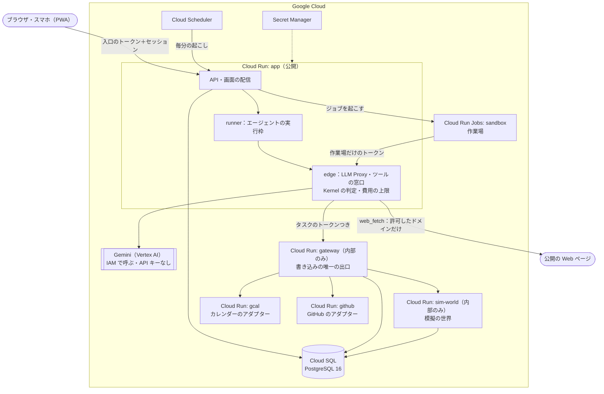

# 構成

Google Cloud（asia-northeast1）の Cloud Run に、境界ごとに別のサービス・別のサービスアカウントで置きます。外から届くのは `app` だけで、書き込みは必ず `gateway` を通ります。

## サービス

| サービス | 役割 |
|---|---|
| `app` | API・セッション・画面の配信・エージェントの実行・安全チェックの進行・Kill Switch |
| `gateway` | 書き込みの唯一の出口。`workspace_id` はリクエストではなくタスクのトークンから引き直す。コネクタの資格情報を使えるのはここだけ |
| `sim-world` | 模擬の世界（仕入れ係の店舗）を MCP で出す。損害額の式もここにある |
| `gcal`・`github` | 実の外部サービスのアダプター。DB も秘密も持たず、gateway が付けたトークンでその1回だけ API を呼ぶ |
| `sandbox` | 作業場。権限のない利用者でコマンドを動かす |

## 信頼の境界

- **公開は `app` だけ**。`gateway`・`sim-world` は Ingress を内部に限り、決まったサービスアカウントからしか呼べない。
- **`runner` は外に直接届かない**。DB・Gemini・gateway のクライアントを import しないことを `pnpm lint:deps`（dependency-cruiser）で CI が検査する。LLM とツールには `edge` の関数を通してしか届かない。
- **Gemini は API キーを持たない**。`app` のサービスアカウントの IAM だけで呼ぶ。
- **秘密は DB に置かない**。Google カレンダーの refresh token は暗号化して保存し、使うのは gateway だけ。GitHub は App の秘密鍵を持つ gateway が、そのつどインストールのトークンを作る。

## デプロイ

`main` への push で [`deploy.yml`](../.github/workflows/deploy.yml) が動きます。

1. CI（[`ci.yml`](../.github/workflows/ci.yml)：型・テスト・依存の境界・zizmor・gitleaks）
2. Workload Identity 連携で GCP に入る（鍵ファイルなし）
3. Artifact Registry にイメージを置く
4. マイグレーション（Cloud Run Job `migrate`）
5. `sim-world` → アダプター → `gateway` → `app` の順にデプロイ
6. スモークテスト。落ちたら前のリビジョンへ戻す

PR からはデプロイできません。GCP の初期設定は [infra/README.md](../infra/README.md) にあります。

## パッケージ

| パス | 役割 |
|---|---|
| `apps/web` | 画面（React＋Vite の PWA） |
| `apps/app`・`apps/gateway`・`apps/sim-world`・`apps/gcal`・`apps/github`・`apps/sandbox` | 上のサービス |
| `packages/kernel` | 統制の中心。ポリシーの合成・判定・Intent の正規化（純粋関数だけ） |
| `packages/oracles` | 試験の合否（O-01〜O-08。決定論） |
| `packages/rehearsal` | 安全チェックのロジック（障害カタログ・締める提案・合格証・回帰） |
| `packages/runner` | エージェントの実行枠・プロンプトの組み立て |
| `packages/edge` | runner の唯一の出口（LLM Proxy・ツールの実行・費用の上限） |
| `packages/llm` | Gemini の呼び出しと価格表 |
| `packages/db` | PostgreSQL の接続・マイグレーション・監査ログ |
| `packages/platform` | 環境変数・ログ・サービス間の認証などの共通部分 |
| `packages/sim-core` | 模擬の世界の枠組み（時計・乱数は仮想） |
| `packages/gcal-core`・`packages/github-core` | コネクタのツール定義（アダプター・gateway・app で共有） |
| `packages/sandbox` | 作業場の実行役とのやりとり |
| `packages/gateway-client`・`packages/sim-client` | app から gateway・sim-world を呼ぶクライアント |
| `scripts/measure` | 統制なしのエージェントの引っかかり率の計測 |
| `infra` | GCP の初期設定スクリプト |
