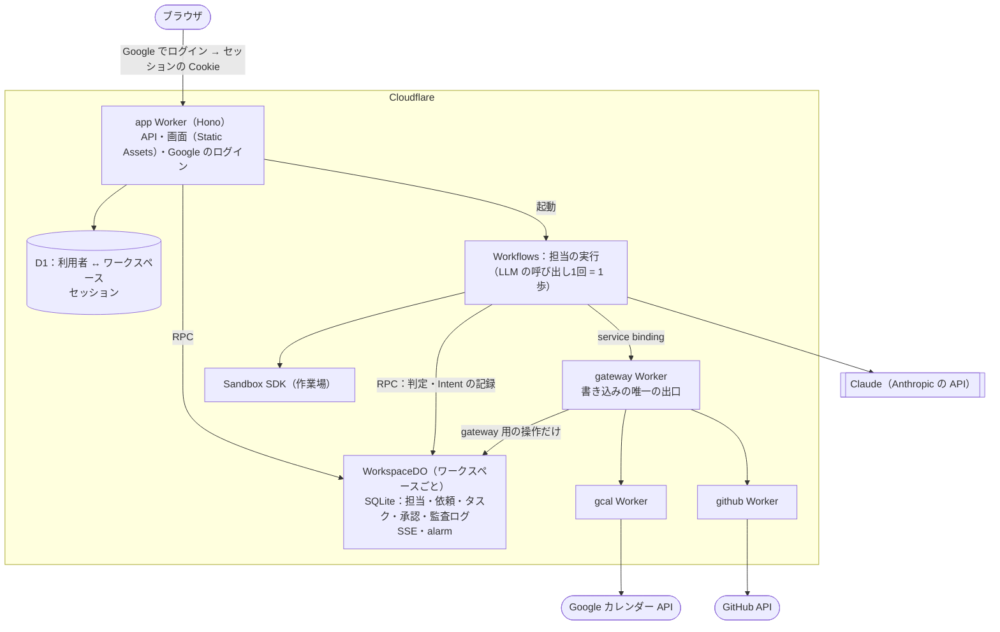

# Cloudflare への移行の設計（案）

Makase を Cloudflare だけで動かす。PostgreSQL と Node のプロセスをやめ、Workers・Durable Objects・Workflows に載せ替える。
あわせて、Google アカウントでログインした人がそれぞれ自分のチーム（ワークスペース）を持てるようにする。

## 決めたこと

1. **誰が使えるか**：許可したメールアドレス（`ALLOWED_EMAILS`。今は運営者の1つだけ）の Google アカウントだけ。ほかのアカウントはログインの時点で断る。許可を足せば、その人も自分のワークスペースを持てる。
2. **LLM**：Claude だけに対応する（Anthropic の公式 SDK。ほかの提供元は持たない）。運営者が入れたキー（Workers secrets の `ANTHROPIC_API_KEY`）で全員分を払う。モデルは `CLAUDE_MODEL`（既定 `claude-opus-5-5`）。上限はワークスペースのポリシーの日次 $10 と、全体の日次の上限。
3. **作業場（Sandbox SDK）**：未定。決まるまでは作業場なしで動く形にし、あとから足す。
4. **Kill Switch はなくす**（2026-10-23）。全部を止めるボタンは持たない。使いすぎは費用の上限（タスク・日次）で止まる。

## 全体図

## 置き換え

| 今 | Cloudflare | 理由 |
|---|---|---|
| PostgreSQL（全ワークスペース共通） | **WorkspaceDO の SQLite**（ワークスペースごとに1つ） | 読んで判断して書くトランザクションを同期で書ける（`transactionSync`）。1つのワークスペースの処理は1本の流れになるので、行のロックの順番（M-21）が要らない。D1 は対話型のトランザクションがないので使わない |
| `users`・`sessions`・入口の記録 | **D1**（全体で1つ） | ワークスペースをまたぐ小さな表。1回の問い合わせか `batch()` で足りる |
| LISTEN/NOTIFY・2秒の見回り | WorkspaceDO から直接 | DB と通知が同じ場所にある。SSE は WorkspaceDO が持つ |
| 毎分の tick・掃除 | WorkspaceDO の alarm、全体の掃除は Cron Triggers | |
| app（Node・Hono） | app Worker（Hono はそのまま） | |
| エージェントの実行（プロセスの中のループ） | **Workflows** | 数分続くループを、やり直し・再開つきの歩みに分ける |
| gateway・gcal・github（Node） | それぞれ Worker。service binding で呼ぶ | |
| DB のロール（ot_app・ot_gateway） | WorkspaceDO の操作の分け方 | gateway の Worker には gateway 用の RPC だけを見せる（呼べる操作で権限を分ける） |
| 作業場（Docker） | Sandbox SDK | |
| `.env` の秘密 | Workers secrets | |

そのまま使うもの：`packages/kernel`・`packages/runner`（純粋な関数）、`packages/gcal-core`・`github-core`、`apps/web`（ビルドして Static Assets に置く）。
書き直すもの：`packages/db`（SQL を SQLite に、関数を WorkspaceDO の中の同期の処理に）、`packages/edge`（Node の DNS・http・fs をやめる）、app・gateway の土台。

## データ

### D1（全体）

| 表 | 中身 |
|---|---|
| `users` | Google の `sub`・メールアドレス・名前 |
| `memberships` | 利用者 → ワークスペースの ID（今は1人1つ） |
| `sessions` | Cookie のハッシュ・期限 |

### WorkspaceDO（ワークスペースごと）

今の public の表のうち、ワークスペースに属するもの全部（担当・スナップショット・仕事・依頼・実行・タスク・Intent・承認・判定の記録・費用・監査ログ・スキル・パック・コネクタ・資格情報など）。
`workspace_id` の列は要らなくなる（DO そのものがワークスペース）。

Postgres の書き方の置き換え：

| Postgres | SQLite |
|---|---|
| `uuid`・`gen_random_uuid()` | TEXT。ID はコードで作る |
| `jsonb` | TEXT（JSON）。中を見る所は `json_extract` |
| `uuid[]`・`= ANY($1)` | JSON の配列と `json_each` |
| `timestamptz` | ISO 8601 の TEXT か ms の INTEGER |
| `numeric` の金額 | マイクロドルの INTEGER（Kernel はもう整数で比べている） |
| `FOR UPDATE`・advisory lock | 要らない（DO の中は1本の流れ） |
| トリガー（監査ログは追記だけ・汚染は戻さない など） | SQLite のトリガー（`RAISE(ABORT)`）で同じ守りを置く |
| ロールの GRANT | 操作の分け方（上の表） |

## ログイン

1. 画面の「Google でログイン」→ app Worker が Google の OAuth（`openid email profile`）に送る。
2. 戻ってきたら ID トークンを確かめ、D1 の `users` を作る（なければ）。初めての人にはワークスペース（WorkspaceDO）を1つ作る。
3. セッションの Cookie を出す。以後の API はセッションからワークスペースの DO を引く。
4. Google カレンダーをつなぐ（今の `connectors/google.ts`）は、ログインとは別の同意として残す。

今の入口のトークン（`PHASE0_ACCESS_TOKEN`）とローカルのトークンなしの入口はやめる。

## 今のデータの移し方（担当・スキル）

1. 手元の Postgres から、担当（agents・agent_snapshots の今のもの・agent_jobs）とスキル（agent_skills）、パックの導入の記録を JSON に書き出すスクリプトを作る。
2. ログインしたあと、その JSON を自分のワークスペースに取り込む（一度だけの管理用の操作）。
3. 依頼・タスク・監査ログは移さない（新しく始める）。

## 進め方

| 段 | やること | 動くもの |
|---|---|---|
| 1 土台 | wrangler の設定、app Worker と WorkspaceDO の骨組み、`wrangler dev`、Workers 用の vitest | 空の API が動く |
| 2 ログイン | Google のログイン、D1、ワークスペースの作成 | ログインして空の画面 |
| 3 DB の層 | スキーマを SQLite に、repo の関数を WorkspaceDO に。試験も移す | 担当・依頼の読み書き |
| 4 実行 | runner・edge を Workflows に、gateway・gcal・github を Worker に | 依頼から担当が動いて確認が届く |
| 5 残り | SSE・alarm・作業場（Sandbox SDK）、担当・スキルの取り込み | 今の機能がそろう |
| 6 デプロイ | 本番の Worker・秘密・ドメイン | 公開の URL で使える |

古い Node の版（apps/*・packages/db の Postgres）は、6 が済むまで残し、最後に消す。

### 第4段の小段

どの小段も試験が通れば main にマージできる大きさにする。試験の LLM は台本どおりに答える ScriptedLlm。

| 小段 | やること | 動くもの |
|---|---|---|
| 4a 受け付け | POST /asks・answer、Idempotency-Key | 依頼が generating で作られ、一覧に出る |
| 4b 編成 | LLM の呼び出し（DO の前の確かめ → fetch → DO の記録）、設定プランナーを Workflow に | 依頼すると担当が決まり、タスクが queued で並ぶ |
| 4c 実行 | edge の DB の部分を DO の同期の関数に、担当の実行を TaskWorkflow に（書き込みなし） | 依頼から担当が報告し、回答が返る |
| 4d 確認 | Intent の記録と判定、確認の一覧（GET /check） | 担当が書き込もうとすると確認が届く |
| 4e gateway | gateway を同じ Worker の別の入口に、承認から実行まで（ExecuteIntentWorkflow） | 承認すると外へ書き込まれる |
| 4f 道具 | web_search・web_fetch、ask_user・team_*（`waitForEvent`）、reply・resume | 残りの道具と API がそろう |
| 4g・4h | gcal・github の Worker（ここで gateway を別の Worker に分け、秘密を閉じる） | カレンダーと GitHub につながる |

決めたこと：
- 実行の進め役は WorkspaceDO。タスクが終わると DO が次のタスクを選び、TaskWorkflow を起動する（依頼全体の Workflow は作らない）
- TaskWorkflow は runner の `runTask` をそのまま回し、EdgePort の呼び出しを歩み（`step.do`）で包む。LLM の1回は1歩にまとめ、DO の記録は callId で冪等にする
- Claude の思考のブロックは会話に載せて返さない（全部外した会話は受け付けられ、一部だけ・書き換えた形は preserved thinking の検査で 400 になるため）。そのかわり、次の呼び出しでモデルは前の思考を見られない
- 書き込みの RPC は AppError を値（`write.ts` の WriteResult）にして返し、Worker で投げ直す（RPC をまたぐと code・details が落ちるため）
- edge の失敗（EdgeError）も同じく値（`edge/fault.ts` の EdgeOutcome）で返し、TaskWorkflow の歩みの外で投げ直す（歩みの中で投げると Workflow のやり直しにかかるため）
- Workflow の歩みの上限は1つの Workflow で Workers Paid が 10,000（設定で 25,000 まで）、Workers Free が 1,024（`step.sleep` は数えない）。担当1人は最大 200 ターンで、1ターンはおよそ LLM の1歩と道具の1〜2歩なので、Free でもふつうは収まる
- Workers Free で使うときの制限（2026-10 時点）：歩みは1日 3,000 まで（依頼1件でおよそ数十歩なので、1日に数十件）、CPU は1回の呼び出しで 10ms まで（LLM の応答の待ちは数えない）。CPU が足りるかは本番で測る（第6段）
