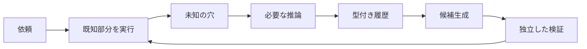

# 00. 成長機構の概要・決定事項（v1.8）
- プロジェクト：Makase ／ 版数：v1.8（2026-10-26） ／ インプット：[概要](00_overview.md)、今回のユーザー回答

> **3行で**
> 1. 仕事の実行履歴から、判断の穴を持つプログラムを作る。
> 2. 検証に通った部分を自動採用し、未知の部分だけでAIを呼ぶ。
> 3. 家に置くローカル版を基準に、日程調整で効果を測る。

## 🧭 判断してほしいこと
今回の未決事項はなし。技術詳細・数値は委任に基づく設計値で、実測結果ではない。
- R-114：有限の試験では汎化の正しさを証明できない。適用範囲を制限し、毎回ガードと出力条件を検査する。
- R-115：検証・候補生成の費用が節約分を上回りうる。学習費込みの費用を別途測る。
- R-116：カレンダー取得後に予定が変わりうる。送信直前の再取得で低減するが、外部サービス間の原子性は保証できない。

## 全体図

見てほしいところ：実行結果の丸暗記ではなく、成立条件付きの処理が増える。

## 要点
- [用語](#用語集)でスキル・プログラム・穴を区別する。
- [決定事項](#決定事項ログ)にユーザー回答と委任判断を分ける。
- [追跡表](#トレーサビリティ表)から上流・下流をたどれる。

## 詳細
### 用語集
| 用語 | コード上の名前 | 定義 |
|---|---|---|
| 学習プログラム | learning_program | 型・前提・出力条件を持つ不変のIR版。自然言語スキルとは別物 |
| 中間表現 | IR | 許可された演算とコネクタ操作、ガード、穴で作る有向非巡回グラフ |
| ガード | guard | freshな観測から適用条件を決定論的に評価し、pass / miss / blockedを返す |
| 判断の穴 | hole | 入出力型と必要な根拠を定義した未解決部分。権限拒否や通信障害ではない |
| 観測 | observation | ツールから実際に得た値と時刻・取得元・スキーマ版・汚染情報 |
| 推測 | hypothesis | LLMが提案した値。観測や利用者の明示入力とは区別する |
| 適用範囲 | scope | operation・入力schema・アカウント・カレンダー・設定版で固定した再利用範囲 |
| 自動採用 | activation | 検証ゲートが通った候補版を、新規runで選べるactive版へ変えること |
| 再生検証 | replay | 固定入力・観測を使い、外部に書き込まず結果を比較すること |
| シャドー検証 | shadow | 通常実行の観測を候補にも渡し、実際の採用結果と比較すること |

### 決定事項ログ
「Claude判断（おまかせ）」はスキル指定の委任判断ラベル。今回の設計担当による判断を意味する。

| ID | 決定 | 決定者 | 理由・定義先 |
|---|---|---|---|
| D-391 | 既存設計をv1.8へ更新 | ユーザー | 設計を分岐させない |
| D-392 | Linux＋Node＋SQLite、持ち主1人を継承 | ユーザー | 家に置くv1.7が基準 |
| D-393 | 最初の実証は日程調整 | ユーザー | 条件変化と再利用を測れる |
| D-394 | 条件達成で自動採用 | ユーザー | 採用の都度承認は設けない |
| D-395 | 技術詳細・数値を委任 | ユーザー | 用途・権限の大きな変更は別途確認 |
| D-396 | 制限IRと契約付きの穴 | Claude判断（おまかせ） | [ADR-085](adr/ADR-085-learning-ir.md)：任意コードより検証範囲を限定できる |
| D-397 | 検証ゲート・不変版・自動失効 | Claude判断（おまかせ） | [ADR-086](adr/ADR-086-learning-activation.md)：自動採用を再現可能にする |
| D-398 | 穴だけの推論、拒否・障害は別経路 | Claude判断（おまかせ） | [ADR-087](adr/ADR-087-learning-holes.md)：局所復帰と権限境界を両立 |
| D-399 | 1候補100反例試験・5実績・5シャドー一致 | Claude判断（おまかせ） | [FR-119](04_functional_spec/learning.md#fr-119)：最低限の異なる条件を確認。証明ではない |
| D-400 | 上限・保持期間・性能・評価値 | Claude判断（おまかせ） | [NFR-098〜101](05_non_functional.md#成長機構v18)：家庭用ホストで有限の資源に収める |
| D-401 | API・DB・UI・再開契約 | Claude判断（おまかせ） | [08](08_database/learning.md)・[09](09_api/learning.md)・[06](06_learning.md)：既存の認証と副作用境界に接続 |
| D-402 | UUIDv7、ISO 8601 UTC、作成日時を記録 | 定石 | 既存DB/API規約を継承 |

### トレーサビリティ表
| REQ | US | UC | FR | SCR | API | TBL |
|---|---|---|---|---|---|---|
| [119](01_requirements.md#成長機構v18) | [084](02_user_stories.md#成長機構v18) | [073](03_learning.md#uc-073) | [117・118](04_functional_spec/learning.md) | [034](06_learning.md#scr-034) | [158・159](09_api/learning.md) | [064・065](08_database/learning.md) |
| [120](01_requirements.md#成長機構v18) | [085](02_user_stories.md#成長機構v18) | [074](03_learning.md#uc-074) | [119](04_functional_spec/learning.md#fr-119) | [034](06_learning.md#scr-034) | [159](09_api/learning.md) | [065・066](08_database/learning.md) |
| [121](01_requirements.md#成長機構v18) | [086](02_user_stories.md#成長機構v18) | [075](03_learning.md#uc-075) | [120・121](04_functional_spec/learning.md) | [035](06_learning.md#scr-035) | [161](09_api/learning.md) | [067・068](08_database/learning.md) |
| [122](01_requirements.md#成長機構v18) | [087](02_user_stories.md#成長機構v18) | [076](03_learning.md#uc-076) | [122](04_functional_spec/learning.md#fr-122) | [034・035](06_learning.md) | [160・162](09_api/learning.md) | [065〜068](08_database/learning.md) |

### 現状との対応
`packages/runner/src/harness.ts`はLLMを各ターン呼ぶ実装で、実行可能な学習IRは未実装。既存スキル本文や承認digestはプログラムの正しさの証拠にしない。
`apps/worker/src/index.ts`はCloudflare版の入口。今回の設計基盤ではない。ローカル本体への既存移行設計と、今回追加する成長機構を区別する。
Kernel・Intent・監査の考え方を継承するが、LLMが生成した操作だけを想定する入口にはIR実行からの操作提案が必要となる。

## このドキュメントで決まったこと
D-391〜402。全体の索引は[00_overview.md](00_overview.md)。
