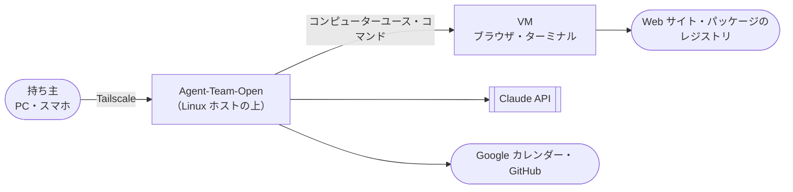

# 00. プロジェクト概要
- プロジェクト：Agent-Team-Open ／ 版数：v0.5（2026-10-24） ／ インプット：ヒアリング（2026-10-23）、[docs/cloudflare-design.md](../cloudflare-design.md)、`apps/worker`・`apps/web` の実装

> **3行で**
> 1. Agent-Team-Open を「Linux が動く機械ならどこにでも置ける」形にする。ラズパイ、Win ノートの WSL2、Mac の Linux VM などに `docker compose up` で置き、PC やスマホのブラウザから Tailscale 経由で使う。
> 2. エージェントには、ホストの上の VM（実体は Docker コンテナ）に入ったブラウザとターミナルを持たせる。API や MCP がないページも、コンピューターユースで画面を見て操作し、コードは VM の中で動かして直す。操作は自由で、こわい操作だけ人が確認する。用途ごとのパックを入れると、その用途の依頼で最適化されたエージェントが使われる。
> 3. OSS（AGPL-3.0）として公開する。LLM は Claude だけで、接続先に Bedrock・Vertex 経由を足す（Should）。Cloudflare への配置・複数人・ホスト間の同期・編成・スキルが育つ仕組み・Web Push 通知・非エンジニアの一般向けの配布は、今回はやらない（[01 §7](01_requirements.md#7-スコープ外wont)）。

## 🧭 判断してほしいこと
なし。Q-114〜Q-123 は 2026-10-24 にすべて決着した（D-172〜D-182）。OSS と事業の方針も同日に決めた（D-183〜D-189、[ADR-055](adr/ADR-055-agpl-license.md)・[ADR-056](adr/ADR-056-llm-provider.md)）。残るのはリスク（R-76〜86）だけで、各ドキュメントと [README](README.md#-判断してほしいこと全ドキュメントから集約) にある。

## 全体図

見てほしいところ：持ち主から Agent-Team-Open に届く道は Tailscale だけ。エージェントは VM のブラウザを通して API のないサイトも扱い、VM のターミナルでコードを動かす。

## 要点
- 置き先は、Linux が動く 64bit の機械（arm64・amd64）。Docker Compose 一式で配る（[ADR-049](adr/ADR-049-docker-compose.md)）
- 本体は Node＋SQLite の1プロセス。Cloudflare 版のコード（kernel・runner・同期の repo の関数）を移す（[ADR-042](adr/ADR-042-node-sqlite.md)）
- VM はコンテナに仮想画面と Chromium とシェルを入れたもの。人も画面を見て、交代して操作できる（[ADR-043](adr/ADR-043-box-container.md)、[ADR-054](adr/ADR-054-terminal-in-vm.md)）
- パックは用途の単位。入れると、その用途の依頼でパックのエージェントが使われる（[ADR-053](adr/ADR-053-pack-by-purpose.md)）
- こわい操作は、エージェントの申告とプログラムの合図の両方で止める（[ADR-047](adr/ADR-047-risky-action-check.md)）
- ID は削除した旧設計書（94b6629 で削除）の続きから振る。今の画面と API は旧 ID を引き継ぐ（[ID 体系](#id体系)）
- OSS（AGPL-3.0）として公開する。一般向けの配布はせず、収益化するなら企業導入。企業導入で要る複数人・組織は次の版（[ADR-055](adr/ADR-055-agpl-license.md)、[docs/oss-and-business.md](../oss-and-business.md)）
- LLM の接続先は Anthropic 直・Bedrock・Vertex から `.env` で選ぶ。モデルは同じ Claude（[ADR-056](adr/ADR-056-llm-provider.md)）
- 成果物を外に出す操作（公開・送信・push・PR・外部 API への書き込み）は、必ず人が最終承認する。点検役の AI は承認の代わりにならない（BR-10）

---

## 詳細

### エレベーターピッチ
自分の機械で AI エージェントに仕事を任せたい開発者のための Agent-Team-Open は、API のないサイトの操作まで人が手を動かしていた問題を、手元の Linux ホストの上でブラウザ付きのエージェントを動かして解決する、自分だけのエージェント基盤である。OSS（AGPL-3.0）で、ソースを読め、自分のサーバーで動き、API キーは自分持ち。用途ごとの専門パックで、「作れなかった人が作れる」ところまで運ぶ。

### 背景と目的
- これまでの設計は「Cloudflare だけで動かす」だった（[cloudflare-design.md](../cloudflare-design.md)）。Cloudflare では、エージェントに本物のブラウザを持たせて人と画面を共有するのが難しい。
- 持ち主は、手元にある機械（ラズパイ、ノート PC）を置き先に選びたい。PC からもスマホからも使いたい。
- 目的は、API や MCP のないページもエージェントに任せられるようにすること。

### 対象ユーザー
ホストの持ち主1人（[02 P-1](02_user_stories.md#p-1-持ち主)）。OSS として公開するので、同じ立場の開発者（自分の機械に置いて使う人）も P-1。非エンジニアの一般向けには配らない。企業導入（組織の共有ホスト）は次の版（D-184）。

### スコープ（In / Out）
| In（今回） | Out（Won't） |
|---|---|
| Linux ホストへの配置（Compose）、Tailscale での接続 | Cloudflare への配置（いったん外す） |
| チャット・エージェントの作成と削除・1件の依頼を1人に任せる・用途ごとのパック | 複数エージェントの編成、連絡板 |
| VM のブラウザのコンピューターユース・VM のターミナル・画面の共有と交代 | VM でブラウザとターミナル以外のアプリ（GUI）を使う。スマホからの交代中の文字入力（次の版） |
| こわい操作の確認（申告＋合図） | すべての操作の確認 |
| Web 検索・ページの取得、Google カレンダー、GitHub | スキルが育つ仕組み（スキルの案・整理） |
| 費用と回数の上限・監査ログ・書き出しと取り込み | 複数人・ホスト間の同期、インターネットへの公開、Web Push 通知（次の版） |
| LLM の接続先を Anthropic 直・Bedrock・Vertex から選ぶ（Should）、標準パック「告知ページ制作」 | 他社の LLM、非エンジニアの一般向けの配布（インストーラー・ホスティング版） |

### 用語集

用語集（20語）

| 用語 | コード上の名前 | 定義 |
|---|---|---|
| ホスト | host | Agent-Team-Open を置く Linux の機械。ラズパイ、Win ノートの WSL2、Mac の Linux VM、ふつうの Linux PC |
| 持ち主 | owner | ホストを使うただ1人。Tailscale のログイン名（`OWNER_LOGIN`）で決まる |
| 本体 | core（コンテナ `makase`） | API・画面の配信・エージェントの実行・SQLite を持つプロセス |
| VM | box（コンテナ `box-<id>`） | エージェント専用の使い捨ての実行環境。仮想画面・Chromium・画面の配信・シェルを持つ。タスクごとに起こす（D-168）。実体は Docker コンテナで、本当の仮想マシンではない（ADR-043）。呼び名は持ち主の指示で「VM」（D-182） |
| box-manager | box-manager（コンテナ） | VM を起こす・止める・中継する唯一の部品。Docker の操作権を持つのはここだけ |
| box-agent | box-agent（VM の中のプロセス） | VM の中で、クリックや入力の実行・スクショ・要素の確かめ・コマンドの実行をする小さなプログラム |
| egress | egress（コンテナ。HTTP(S) プロキシ） | VM から外への通信をすべて通す中継。家の LAN・tailnet・本体へは通さない |
| プロフィール | browser profile | エージェントごとに残す、ブラウザのデータ（Cookie・ログイン状態） |
| コンピューターユース | computer use | 画面のスクショを見て、マウスとキーボードで操作すること（Claude の computer use ツール） |
| 操作 | browser action | VM への1回のクリック・入力・キー・スクロールなど |
| こわい操作 | risky action | 支払い・購入・送信・削除・アカウントの設定の変更 |
| 申告 | `confirm_action` | エージェントが「この操作の前に確認して」と出す道具 |
| 合図 | tripwire | プログラムが申告なしでも止める条件（パスワード欄・カード欄への入力、確認するドメイン、決まった言葉のボタン） |
| 確認 | check | 人が ○ / × を押すカード。書き込みとこわい操作で出る |
| 交代 | takeover | 人が VM の操作をエージェントから代わること。代わっている間、エージェントは待つ |
| エージェント | agent | 依頼を受けて動く AI。画面でも「エージェント」と呼ぶ（「担当」は使わない） |
| 依頼 | ask | チャットで頼んだ1件の仕事 |
| タスク | task | 依頼を進める1回の実行。エージェント1人の1回分 |
| Kernel | `packages/kernel` | 書き込みとこわい操作を「通す・確認・止める」に分ける決定論のコード |
| 歩みの記録 | task step | タスクの1歩（LLM の1回・道具の1回）の結果。再起動したらここから続ける |

### 決定事項ログ
代替案があった判断は ADR に書き、ここには1行とリンクだけ置く。旧設計書の D-120 までの続きから振る。

決定事項（D-121〜D-189）

| ID | 決定内容 | 決定者 | 理由 | 影響範囲 | ADR |
|---|---|---|---|---|---|
| D-121 | 置き先は Linux ホスト。Cloudflare はいったん外す | ユーザー | 手元の機械で動かし、VM のブラウザを持たせたい | 全体 | [ADR-041](adr/ADR-041-linux-host.md) |
| D-122 | 本体は Node＋SQLite。Workers の実装を移す | ユーザー | 同期の repo 関数をそのまま使える。VM を起こすのも素直に書ける | 07・08 | [ADR-042](adr/ADR-042-node-sqlite.md) |
| D-123 | VM はコンテナ＋仮想画面 | ユーザー | ラズパイと WSL でそのまま動く | 07 | [ADR-043](adr/ADR-043-box-container.md) |
| D-124 | ブラウザは自由に操作し、こわい操作だけ確認する | ユーザー | API のないサイトを任せたい | FR-075〜077 | [ADR-047](adr/ADR-047-risky-action-check.md) |
| D-125 | こわい操作は申告＋決まった合図で見分ける | ユーザー | 申告の忘れをプログラムで拾う | FR-076 | [ADR-047](adr/ADR-047-risky-action-check.md) |
| D-126 | 人は VM の画面を見られ、交代して操作できる | ユーザー | ログイン・CAPTCHA は人がする | FR-078 | [ADR-043](adr/ADR-043-box-container.md) |
| D-127 | 使うのは持ち主1人。ワークスペースは1つ | ユーザー | 自分の機械で使う | 08、FR-073 | — |
| D-128 | つなぎ方は Tailscale。インターネットには公開しない | ユーザー | 外のスマホから入れて、公開の守りが要らない | NFR-064 | [ADR-046](adr/ADR-046-tailscale-identity.md) |
| D-129 | ログインは Tailscale の身元に任せる | ユーザー | 別のログイン画面が要らない | FR-073 | [ADR-046](adr/ADR-046-tailscale-identity.md) |
| D-130 | 複数のホストはそれぞれ独立。引っ越しは書き出しと取り込み | ユーザー | 同期が要らない | FR-082 | — |
| D-131 | プロフィールはエージェントごとに残し、VM はタスクごとに起こす（v0.3 で「依頼ごと」の表記を直した：D-168） | ユーザー | 一度ログインすれば次から使える | FR-079 | [ADR-048](adr/ADR-048-profile-per-agent.md) |
| D-132 | 配り方は Docker Compose 一式 | ユーザー | どの Linux でも同じ手順 | 07 | [ADR-049](adr/ADR-049-docker-compose.md) |
| D-133 | 最初の版に Google カレンダーと GitHub を入れる。編成と育つ仕組みは入れない（パックは D-176 で残すことにした） | ユーザー | 要るものだけにする | 01 | [ADR-050](adr/ADR-050-one-agent-per-ask.md) |
| D-134 | 細かい数値は定石で決めて一覧にする | ユーザー | 質問の往復を減らす | 05 | — |
| D-135 | ID は旧設計書の続きから。今の画面・API は旧 ID を引き継ぐ | ユーザー | コードのコメントの ID と食い違わない | 全体 | — |
| D-136 | VM を起こす権限は box-manager だけに持たせる | Claude判断（提案） | 本体が乗っ取られても Docker を自由に使わせない | 07 | [ADR-044](adr/ADR-044-box-manager.md) |
| D-137 | VM から外へは egress だけを通す | Claude判断（提案） | VM から家の LAN と本体に届かせない | 07、NFR-066 | [ADR-045](adr/ADR-045-egress.md) |
| D-138 | 書き込みの出口（gateway）は本体の中の部品にする | Claude判断（提案） | 1人で使うので別のコンテナにする益が小さい | 07 | [ADR-051](adr/ADR-051-gateway-in-core.md) |
| D-139 | VM の同時数は既定 1、設定で 4 まで | Claude判断（おまかせ） | ラズパイの 4GB でも動く | NFR-061 | — |
| D-140 | 画面の大きさは 1280×800 | Claude判断（おまかせ） | computer use の推奨の範囲で、スクショの費用が小さい | NFR-063 | — |
| D-141 | 1タスクの上限：操作 300 回・60 分・$3。日次は $10（今のまま）。60 分は外側の打ち切りで、ポリシーの `max_minutes` は 55（M-59） | Claude判断（おまかせ） | 画像の費用がかさむので回数と時間でも止める | FR-013、TBL-035 | — |
| D-142 | こわい操作の確認の期限は 30 分 | Claude判断（おまかせ） | スマホに気づくまでの時間を見込む | FR-077 | — |
| D-143 | 交代中に操作が 15 分ないと VM を止め、依頼は返事待ちにする（交代の頼みのまま待つ時間は 30 分：D-167） | Claude判断（おまかせ） | VM のつけっぱなしでメモリを食わない | FR-078 | — |
| D-144 | スクショの画像は 7 日で消す（操作の記録の行は残す） | Claude判断（おまかせ） | ディスクが小さいラズパイを見込む | TBL-033 | — |
| D-145 | SQLite のバックアップは毎日1回・7世代 | Claude判断（おまかせ） | 1台の機械なので壊れたときの戻り先が要る | NFR-070 | — |
| D-146 | 最低のホスト：64bit・メモリ 4GB・空き 10GB。推奨 8GB | Claude判断（おまかせ） | Chromium 1つと本体が入る大きさ | NFR-062 | — |
| D-147 | 時刻は ISO 8601（UTC）の TEXT、ID は UUIDv7 の TEXT、金額はマイクロドルの整数 | 定石 | Cloudflare 版の決めごとを引き継ぐ | 08 | — |
| D-148 | API は同じ出どころ（Origin）と専用ヘッダーで CSRF を防ぐ | 定石 | Tailscale の身元はクッキーと同じく自動で付く | NFR-065 | — |
| D-149 | プロジェクト名は Agent-Team-Open。コンテナ名・ホスト名・ヘッダー（`makase`・`X-Makase-Request` など）は短い今の名前のまま | ユーザー（名前）／ Claude判断（識別子） | 名前の指示（2026-10-23）。識別子を変えると URL とコードが長くなる | 全体 | — |
| D-150 | 操作の先が分からない変える操作は確認に回す（T-6）。多すぎるサイトは「確かめないドメイン」で外す | ユーザー | Astra のレビュー（2026-10-24）。すり抜けを防ぐ | FR-076 | [ADR-047](adr/ADR-047-risky-action-check.md) |
| D-151 | 設定（上限・`browser` 欄）は次のタスクから効く | Claude判断 | 今の `edge/inputs.ts` はタスクの始まりのポリシーを固定して使う | API-096、TBL-035 | — |
| D-152 | ブラウザの確認は `action_intents` に乗せず `browser_checks` にする | Claude判断（提案） | MCP 用の必須の列が埋まらない | FR-077、TBL-039 | [ADR-052](adr/ADR-052-browser-checks-table.md) |
| D-153 | LLM を呼ぶ前に見積もりの費用を予約し、終わったら精算する | Claude判断 | 並んだタスクで日次の上限を超えない | FR-013、TBL-038 | — |
| D-154 | VM は1つずつ別のネットワークに置く。egress はつなぐ先のアドレスを固定する | Claude判断（提案） | Docker の `internal` は同じネットワークの中を分けない | NFR-066 | [ADR-045](adr/ADR-045-egress.md) |
| D-155 | Chromium はキオスクの形・倍率 1・タブ1枚。ページを開くのは `open_url` | Claude判断 | 画面の座標と CDP の要素を1対1にする | FR-075、07 | — |
| D-156 | `GET /api/health` は確かめなしで ok と版だけ。ホストの状態は `GET /api/v1/host` | 定石 | 確かめなしの口に状態を出さない | API-082、API-111 | — |
| D-157 | `type` の文字列に改行（`\n`・`\r`）が含まれるときは、Enter の `key` と同じ判定（T-4）にかける | Claude判断 | レビュー（2026-10-24）。改行で送信がすり抜ける | FR-075、FR-076 | [ADR-047](adr/ADR-047-risky-action-check.md) |
| D-158 | `open_url` は `http`・`https` だけ受ける。確認するドメインへの `open_url` は T-2 として確認に回す | Claude判断 | URL を開くだけで動く操作（退会・削除・同意）を止める | FR-075、FR-076、API-103 | [ADR-047](adr/ADR-047-risky-action-check.md) |
| D-159 | 承認のあと中身が変わっていたら、新しい確認は作らず、Claude に新しいスクショを返して決め直させる | Claude判断 | 同じ座標の先は別の要素かもしれない。`action_id` の UNIQUE とも合う | FR-077、TBL-039、API-110 | — |
| D-160 | 操作する人と `control_epoch` の切り替えは内部 API-113 で box-manager に伝える | Claude判断 | box-agent が今の epoch を知る手段がなかった | FR-078、API-090・091・113 | — |
| D-161 | Claude との会話に画像として残すスクショは直近 3 枚（`browser.keep_screenshots`）。古いものは文に置き換える | Claude判断（おまかせ） | 1歩の費用が歩数とともに増え、文脈の上限を超えるのを防ぐ | FR-075、TBL-035、R-82 | — |
| D-162 | 秘密の欄の領域は、保存するスクショと Claude に送るスクショの両方で塗りつぶす | Claude判断 | サイトがマスクしないカード番号が画像に残る | FR-075、11 §8 | — |
| D-163 | 交代で中止した LLM の歩みは `done`（`aborted`）で閉じ、予約した費用を精算する | Claude判断 | 中止しても入力トークンは課金される。`started` を残さない | FR-078、API-090、TBL-038 | — |
| D-164 | `web_fetch` にも egress と同じアドレスの判定（リダイレクト先の再判定を含む）を適用する | Claude判断 | 本体は ctl ネットワークにもいる | 07、11 §8 | [ADR-045](adr/ADR-045-egress.md) |
| D-165 | 決まった言葉の照合は、ラテン文字の語は単語の境界、日本語は部分一致 | Claude判断 | 「Postal code」「Confirmation number」で空振りしない | FR-076 | — |
| D-166 | T-4（Enter・Space）は、先が `textarea`・`contenteditable` のときは当たらない | Claude判断 | 改行なので送信にならない | FR-076 | — |
| D-167 | 交代の頼み（`requested`）の期限は 30 分。交代中（`active`）の放置は 15 分のまま | Claude判断（おまかせ） | 確認（D-142）と同じ「人が気づくまで」の待ち | FR-078、TBL-034 | — |
| D-168 | VM は「タスクごと」に起こす。「依頼ごと」の表記を統一した | Claude判断 | `boxes.task_id` に合わせる。返事で次のタスクが立てば VM は新しく起こす | 07、ADR-048 | [ADR-048](adr/ADR-048-profile-per-agent.md) |
| D-169 | スマホの文字入力は RFB ではなく box-agent の `type`（API-103）で打つ | Claude判断 | 日本語と記号が崩れない。スマホの文字入力そのものは次の版（D-181） | SCR-022 | — |
| D-170 | 起動時に `owner_login` が違えば止まる。`.env` の `OWNER_LOGIN_REPLACE=1` のときだけ上書きして起動する | Claude判断 | 持ち主がログイン名を変えたときに起動できなくなる | TBL-031、11 §10 | — |
| D-171 | box-agent は起動時に Chromium のロックファイル（`SingletonLock` など）を消してから Chromium を起こす | Claude判断 | 前の VM が落ちると次が立たない | FR-074、07 | — |
| D-172 | 提案だった ADR-044・045・051・052 を承認する | ユーザー | 作る量を増やさずに VM と本体を分けられる | 07、TBL-039 | ADR-044・045・051・052 |
| D-173 | `div` に JS を付けただけの擬似ボタンも決まった言葉（T-3）の対象にする。box-agent が `clickable` を返す | ユーザー | 多くの EC サイトの購入ボタンがこれ。空振りは確かめないドメインで外す | FR-076、API-103 | — |
| D-174 | 確認待ち・交代待ちの時間は `max_minutes` に含めない。`tasks.paused_ms` に足して経過時間から引く | ユーザー | 1回の確認でタスクの半分が消えないように | FR-075・077・078、`tasks` | — |
| D-175 | ポリシーの初期値は設計書の値のまま（$3・操作 300 回・200 歩・55 分） | ユーザー | VM の仕事は歩数が多い | TBL-035 | — |
| D-176 | パックを残し、「用途ごとに最適化されたエージェント集」として設計し直す | ユーザー | 入れておくと、その用途の依頼で最適化されたエージェントが使われる | REQ-093、FR-085、SCR-024 | [ADR-053](adr/ADR-053-pack-by-purpose.md) |
| D-177 | 手で書いたスキル（`agent_skills`）は残す。`origin` は `pack` だけ | ユーザー | 手順書そのものは役に立つ。育つ仕組みは入れない | FR-082、`agent_skills` | — |
| D-178 | VM にターミナルを入れる。VM の中のコマンドは判定せず、VM の外に効くものだけ確認する | ユーザー（入れる）／ Claude判断（線引き） | コードを直す仕事を任せたい。VM は使い捨てで資格情報を持たない | REQ-094、FR-086、NFR-080 | [ADR-054](adr/ADR-054-terminal-in-vm.md) |
| D-179 | Web Push 通知は最初の版に入れない。知らせは PWA を開いているときの SSE だけ | ユーザー | 最初の版を小さくする | REQ-091（Won't）、FR-017、TBL-037 | — |
| D-180 | 決まった言葉の初期値に「確定」「Confirm」「Submit」を入れる | ユーザー | 送信の多くはこの言葉。多ければ設定で外せる | FR-076、TBL-035 | — |
| D-181 | 最初の版は PC での交代を優先。スマホは頼む・確認・見る・タップまで Must、交代中の文字入力は次の版 | ユーザー | まず PC で動くこと | REQ-083、SCR-022、NFR-074 | — |
| D-182 | 呼び名を正式名称にする：箱→VM、箱の管理役→box-manager、箱の中の操作役→box-agent、出口の見張り→egress。VM の実体は Docker コンテナ | ユーザー | やさしい言い換えのほうが分かりにくい | 全体 | — |
| D-183 | OSS として公開する。ライセンスは AGPL-3.0。`package.json` の `license` は `AGPL-3.0-only` | ユーザー | 今の最大のリスクは「真似される」ではなく「存在を知られない」。企業導入の道は AGPL で残す | 01 §3・§6、11 §1、README、LICENSE | [ADR-055](adr/ADR-055-agpl-license.md) |
| D-184 | 非エンジニアの一般向けには配らない。収益化するなら企業導入（導入支援・専門パック作成・運用契約）。企業導入で要る複数人・組織は次の版 | ユーザー | 一般向けの浸透は配布・サポート・課金の体制が要る。当面は作り切る | 01 §4・§7、02 P-1 | [ADR-055](adr/ADR-055-agpl-license.md) |
| D-185 | LLM の接続先に Bedrock・Vertex 経由の Claude を足す（Should）。`.env` の `LLM_PROVIDER` で選ぶ。接続先で使えない道具は宣言から外す | ユーザー（足す）／ Claude判断（道具の線引き） | 企業導入では AWS・Google Cloud の契約の中で Claude を使いたい会社が多い | REQ-095、FR-087、11 §10 | [ADR-056](adr/ADR-056-llm-provider.md) |
| D-186 | 最初の標準パックは「告知ページ制作パック」（`announcement-page`）。デモの 4 人は 1 人のエージェントの手順書 4 本（設計・制作・点検・仕上げ）にする | ユーザー（パック）／ Claude判断（1 人の形） | デモの実績があり、レビューの商品仕様・第三者テストの対象にそのまま使える。1 件 1 人は ADR-050 | FR-085、01 §2 | — |
| D-187 | 成果物を外に出す操作（公開・送信・push・PR・外部 API への書き込み）は必ず人が最終承認する。点検役の AI は承認の代わりにならない | Claude判断（レビューの指摘） | BR-03・BR-08 ですでに守られているが、方針として明文化する | BR-10 | — |
| D-188 | 成功指標に「開発者でない第三者が手順書だけで置き、告知ページ 1 件を完成できる」を足す。3 人中 2 人・総所要時間を記録 | Claude判断（おまかせ） | レビューの「第三者が使えることを示せ」。OSS でも企業導入でも効く | 01 §2、NFR-081 | — |
| D-189 | 初めて置く人の所要は、Docker と Tailscale が入った機械で手順書だけで 30 分以内 | Claude判断（おまかせ） | D-188 を測れる形にする | NFR-081 | — |

### ID体系
削除した旧設計書（94b6629 の前）の ID はコードのコメントに残っている。重ならないように続きから振り、今もある画面と API は旧 ID を引き継ぐ。

| 接頭辞 | 今回の番号 | 引き継いだ旧 ID |
|---|---|---|
| REQ | REQ-076〜095 | なし |
| US | US-049〜062 | なし |
| UC | UC-042〜053 | なし |
| FR | FR-072〜087 | FR-013 予算、FR-016 監査ログ、FR-017 通知（次の版）、FR-018 進捗の配信、FR-061 依頼を任せる、FR-063 回答を返す |
| NFR | NFR-061〜081 | なし |
| SCR | SCR-022〜024 | SCR-010 記録、SCR-014 エージェント、SCR-019 確認、SCR-020 チャット、SCR-021 依頼 |
| TBL | TBL-031〜040 | TBL-007 `task_events` |
| API | API-082〜118 | API-016・019・023・041・072・073・075・076・077・080・081（API-031・032 は次の版） |
| ADR / D / Q / R / BR | ADR-041〜056 / D-121〜189 / Q-114〜123（すべて決着） / R-76〜86 / BR-01〜10 | なし |

旧 ID の中身は、引き継いだものに限ってこの設計書のほうを正とする。ほかの旧 ID（コードのコメントにあるもの）は、旧設計書の時点の意味のまま。

### トレーサビリティ表

REQ → US → UC → FR → SCR / API / TBL

| REQ | US | UC | FR | SCR | API | TBL |
|---|---|---|---|---|---|---|
| REQ-076 置き先 | US-049 | UC-042 | FR-083 | SCR-023 | API-082, 111 | — |
| REQ-077 つなぎ方 | US-050 | UC-043 | FR-073 | 全画面 | API-083 | TBL-031 |
| REQ-078 持ち主だけ | US-050 | UC-043 | FR-073 | — | API-083 | TBL-031 |
| REQ-079 チャットで任せる | US-051 | UC-044 | FR-061, FR-063, FR-018, FR-085（振り分け） | SCR-020, SCR-021 | API-016, 072, 073, 075, 076, 077, 084, 085, 100 | `asks`, `tasks` |
| REQ-080 エージェントの作成・削除 | US-052 | UC-045 | FR-072 | SCR-014 | API-041, 080, 081 | `agents` |
| REQ-081 コンピューターユース | US-053 | UC-046 | FR-074, FR-075 | SCR-021, SCR-022 | API-086, 099, 101〜105, 109, 112 | TBL-032, 033 |
| REQ-082 こわい操作の確認 | US-054 | UC-047 | FR-076, FR-077 | SCR-019 | API-087, 110, 112 | TBL-033, 035, 039 |
| REQ-083 画面の共有と交代（スマホの文字入力は次の版） | US-055 | UC-048 | FR-078 | SCR-022 | API-088〜091, 103, 106, 113 | TBL-032, 034 |
| REQ-084 ログインが残る | US-056 | UC-048 | FR-079 | SCR-014 | API-092, 108 | TBL-036 |
| REQ-085 Web 検索・取得 | US-051 | UC-044 | FR-080 | SCR-021 | — | `task_web_urls` |
| REQ-086 カレンダー | US-057 | UC-049 | FR-081 | SCR-019, SCR-023 | API-019, 087, 093〜095, 107 | `connectors`, `action_intents` |
| REQ-087 GitHub | US-057 | UC-049 | FR-081 | SCR-019, SCR-023 | API-019, 087, 093〜095, 107 | `connectors`, `action_intents` |
| REQ-088 上限 | US-058 | UC-046 | FR-013 | SCR-023 | API-096 | `usage_records`, TBL-035 |
| REQ-089 引っ越し | US-059 | UC-050 | FR-082 | SCR-023 | API-097, 098 | `agents`, `agent_snapshots`, `agent_skills`, TBL-035 |
| REQ-090 記録 | US-058 | UC-051 | FR-016 | SCR-010 | API-023 | `audit_logs`, TBL-033 |
| REQ-091 通知（Won't・次の版） | — | — | FR-017（次の版） | — | API-031, 032（次の版） | TBL-037（作らない） |
| REQ-092 再起動から続ける | US-049 | UC-042 | FR-084 | — | — | TBL-038 |
| REQ-093 パック | US-060 | UC-052, UC-044 | FR-085 | SCR-024, SCR-014 | API-114〜116 | `pack_installs`, `agent_skills`, TBL-035 |
| REQ-094 VM のターミナル | US-061 | UC-053 | FR-086 | SCR-021 | API-117, 118 | TBL-040, TBL-035 |
| REQ-095 LLM の接続先（Should） | US-062 | UC-042 | FR-087 | SCR-023 | API-111 | — |

### ドキュメント索引
| ファイル | 中身 |
|---|---|
| [README.md](README.md) | 読む入口 |
| [01_requirements.md](01_requirements.md) 〜 [11_tech_spec.md](11_tech_spec.md) | 要件定義〜技術仕様書 |
| [adr/](adr/) | ADR-041〜056 |
| [changes/](changes/) | 変更レポート |
| [../oss-and-business.md](../oss-and-business.md) | OSS 方針と事業化の整理（設計書の外。ADR-055 の元） |

## このドキュメントで決まったこと
- D-121〜D-189（上の決定事項ログ）
