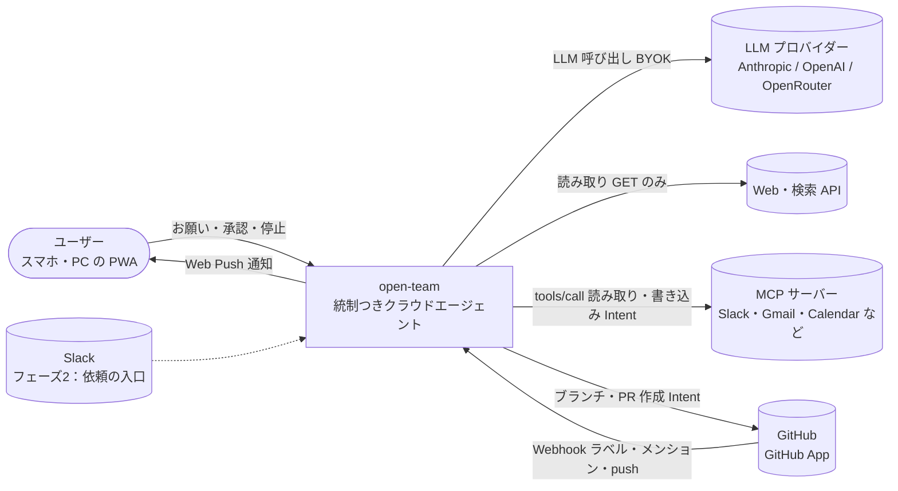

# 00. プロジェクト概要
- プロジェクト：open-team（仮称） ／ 版数：v0.6（2026-10-01、書き直し） ／ インプット：壁打ちメモ 2026-09-30（リポジトリ外の壁打ちメモ）、プロダクトオーナーとの壁打ち（2026-10-01）、01〜11 の全ドキュメント

> **3行で**
> 1. open-team は「何でも任せたいが、勝手な外部作用と暴走が怖い人」向けの **統制つき汎用クラウドエージェント**。ポリシーを LLM の外の決定論的なランタイムが強制する。
> 2. エージェントは名前を付けて頼むだけで自分を設定する（v0.5）。ただし権限を広げられるのはユーザーの承認だけ。外部サービスへは MCP でつなぎ、書き込みは承認か「宛先を固定したルール」でだけ通す（v0.6）。
> 3. 最初の到達点は課金なし・単一ユーザー・ローカルで動くフェーズ0。課金・ネイティブアプリ・公開するセルフホスト版は作らない。

## 🧭 判断してほしいこと

本書固有の論点はなし。プロジェクト全体の論点は [README.md](README.md) に集約する。要件・ストーリーの論点は [01_requirements.md](01_requirements.md)（Q-01〜Q-07、R-01〜R-02）と [02_user_stories/README.md](02_user_stories/README.md)（Q-08〜Q-14）にある。フェーズ1の完成条件の二重化は [Q-90](11_tech_spec.md)。

## 全体図

C4 レベル1（コンテキスト）。

見てほしいところ：外部への **書き込み**（MCP の書き込みツール・GitHub の PR）はすべて Intent として固定してから実行する。Web は読み取りだけ。

## 要点
- 原則は5つ（[原則](#原則)）。中心は「LLM は提案するだけ。実行するかはランタイムが決める」。
- 対象は個人ユーザー（開発しない人を含む）→ チーム → 企業の順（[対象ユーザー](#対象ユーザー)）。
- フェーズ0（単一ユーザー・ローカル）→ フェーズ1（MVP）→ フェーズ2 の3段階（[スコープ](#スコープ)、詳細は [01](01_requirements.md)）。
- 用語・仮定・トレーサビリティは別ファイル（[用語集](00_overview/glossary.md)、[仮定一覧](00_overview/assumptions.md)、[トレーサビリティ表](00_overview/traceability.md)）。
- 決定は [決定事項ログ](#決定事項ログ) に1行ずつ。代替案があったものは ADR。
- 12〜15（差分として足した設計）は 00〜11 に統合して削除した（[ドキュメント索引](#ドキュメント索引)）。

---

## 詳細

### エレベーターピッチ

**ニュースのリサーチ、毎朝の交通状況、メールの整理、開発まで、何でもエージェントに任せたいけれど、勝手な外部作用と暴走が怖い人** のための **open-team** は、**自律エージェントに「何をどこまでやらせてよいか」をプロンプト任せにしている** という課題を、**ワークスペースのポリシーを LLM の外側にある決定論的なランタイムに強制させ、既存サービス（MCP）への書き込みをスマホからの承認または範囲を絞った事前の許可で通す** ことで解決する **統制つき汎用クラウドエージェント** である。

- v0.4：開発は用途の1つ（テンプレート）になった。既存サービスへは MCP サーバーでつなぎ、Web の読み取りは組み込みにする。
- v0.5：ユーザーはエージェントに名前を付けて頼むだけ。設定はエージェント自身が行い、権限を広げる変更だけユーザーの承認を通す（[ADR-026](adr/ADR-026-name-and-ask.md)）。
- v0.3：dots / Grok Bot の機能は基本的にすべて「統制つきで同等に」採用する。「統制・安全性」「どこからでも頼める」「成果物の質」「開発以外への拡張」の4つの軸で勝負する（→ [01 差別化の方針](01_requirements.md)）。

### 原則

| # | 原則 | 出典 |
|---|---|---|
| 1 | LLM は提案するだけ。実行するかどうかは決定論的なランタイムが判断する | v0.1 |
| 2 | エージェントは「権限の境界」である。指示・Skill・メモリは振る舞いを変えるが、権限は増やさない | v0.2（旧 12） |
| 3 | 外から入ってくる情報（Web ページ・メール・MCP の応答）は「データ」であり、「指示」ではない。それを読んだ後の外部作用ほど厳しく判定する | v0.4（旧 13） |
| 4 | エージェントは自分の設定を書き換えられるが、自分の権限は広げられない。権限を広げられるのはユーザーの承認だけである | v0.5（旧 14） |
| 5 | 宛先は定義が決め、LLM は中身だけを書く | v0.6（旧 15） |

### 背景と目的

- GrokBot / dots のように「どこからでも頼めて勝手にやってくれる」自律型のクラウドエージェントが広がっている。一方で、暴走・請求額・勝手な外部作用・説明責任への不安が、任せる妨げになっている。
- 既存資産の **itiwoman-automation**（統制：FlowEngine・許可リスト・承認待ち・キャンセル）と **open-agent / open-tui**（設計と振り分け：Harness・PermissionMap・モデル Router・Evidence）を組み合わせ、「自律的に動くが、暴走しないことを構造で保証する」エージェントを作る。
- 詳しくは [01_requirements.md](01_requirements.md) を参照。

### 対象ユーザー

| 段階 | ペルソナ | 刺さるポイント |
|---|---|---|
| ⓪ 最初の利用者 | プロダクトオーナー本人（フェーズ0） | 自分の開発環境で、毎朝の交通・ニュースのまとめが届く |
| ① 入口 | P-6 開発をしない個人ユーザー（v0.4） | 朝の交通・ニュース・メールの整理を、つないだサービスの範囲で安全に任せられる |
| ① 入口 | P-1 ソロ開発者 | 寝ている間や移動中に Issue が片付く。予算の上限があるので請求額が膨らまない |
| ② 拡張 | P-2 OSS メンテナ・小規模チームのリード、P-3 チームメンバー | ポリシーファイルをリポジトリに置けば、全員のエージェントが同じルールで動く |
| ② 拡張（フェーズ2） | P-5 業務担当者 | 定型の調査・下書き・転記を任せられ、勝手には送信されない |
| ③ 収益（将来） | P-4 企業のセキュリティ担当 | 監査ログ、承認者の設定（SSO 等は MVP 対象外） |

ペルソナの詳細は [02_user_stories/README.md](02_user_stories/README.md)。

### スコープ

| フェーズ | In | 出典 |
|---|---|---|
| フェーズ0（v0.4〜） | 単一ユーザー・ローカル実行、ワークスペースのポリシー、Web 読み取り、MCP コネクタ（URL で登録）、`watch`、汎用テンプレート、汚染の追跡、届け先への送信。v0.5：名前だけでの作成、エージェントからの問いかけ、自己設定と `classify()`、仕事（jobs）、チャットでの一言による調整。v0.6：引数の役割と宛先の固定、届け先の宣言化、MCP の Intent のライフサイクル | 旧 13・14・15 |
| フェーズ1（MVP） | GitHub App による連携、Issue の委任（Web・ラベル）／タスク単位の使い捨てサンドボックスでの自律実行／`.agent/policy.yaml` による自律レベル・予算・Breaker・禁止パスの強制／PR 作成の承認（スマホ）、承認内容と実際の PR の一致の検証／予算・Breaker による自動停止、キャンセル、Kill Switch／ハッシュチェーンつき監査ログ、Web Push 通知、BYOK／信頼度提案・メンバー管理・監査ログのエクスポート（Should） | 旧 00 |
| フェーズ1（MVP、エージェントビルダー） | 複数エージェント、Harness Canvas と試し実行（v0.5 で詳細設定・Could）、GitOps モードでの PR による公開、トリガー（手動・ラベル・メンション・スケジュール）、エージェント単位の停止とスコアカード／テンプレート3種（dev-coder・reviewer・triager）、自己レビュー、Skill、メモリ（Should）／アプリ内での即時有効化、「以後も許可」のルール、`handoff`、AI 事前レビュー（厳しくする方向のみ）、アクティビティビュー、音声入力 | 旧 12 |
| フェーズ1（v0.4 で追加） | MCP カタログとワンクリック接続、`assistant` テンプレート、用途別のスターター | 旧 13 |
| フェーズ2 | Slack からの依頼、永続ワークスペース、統制つきブラウザ、組織の共通ポリシー、取りまとめ役と委任、複数ユーザー（SaaS 化） | 旧 13 |

**Out（Won't）**：PR のマージ・Issue へのコメント・その他の GitHub への書き込み／GitLab・Bitbucket／任意の外部ホストへの通信（`shell_network`）／ネイティブアプリ、公開するセルフホスト版／プラットフォームでの LLM 課金・有料プラン（どのフェーズでも当面扱わない）／SSO・SCIM などの企業向け機能、2人承認／却下後の作り直し、バイナリの差分／Cedar・OPA との連携／ハーネスの差し替え／統制のないブラウザ操作、モデルの判断による許可。全文は [01 §7](01_requirements.md)。

### 用語集・仮定・トレーサビリティ

- [00_overview/glossary.md](00_overview/glossary.md)：用語集（コード上の名前つき。旧称も残す）
- [00_overview/assumptions.md](00_overview/assumptions.md)：仮定一覧 A-01〜A-87（すべての仮定の正本）
- [00_overview/traceability.md](00_overview/traceability.md)：REQ → US → UC → FR → SCR → API → TBL の対応表

### 決定事項ログ

代替案があった判断は ADR に書き、ここには1行とリンクだけ置く。ADR の一覧は [README.md](README.md) と [07_architecture.md](07_architecture.md)。

決定事項（D-01〜D-32、v0.2〜v0.6）

| ID | 決定内容 | 決定者 | 理由 | 影響範囲 | ADR |
|---|---|---|---|---|---|
| D-01 | 位置づけを統制つき自律 **開発** エージェントから **汎用クラウドエージェント** に変える。開発はテンプレートの1つ | ユーザー（v0.4） | ニュース・交通・メールなども同じ仕組みで任せたい | 01, 02, 全体 | — |
| D-02 | 対象に一般の個人ユーザーを含める。MCP はカタログからワンクリックで接続できる前提 | ユーザー（v0.4） | 開発者以外にも広げる | 01, 02（P-6）, 06 | — |
| D-03 | 課金の仕組みは作らない。LLM はユーザー自身の API キーで呼ぶ | ユーザー（v0.4） | 当面は自分で使えれば十分 | 01, 05 | — |
| D-04 | 最初の到達点を単一ユーザー・ローカルのフェーズ0にする | ユーザー（v0.4） | SaaS の運用は当面不要 | 01, 05, 07 | [ADR-025](adr/ADR-025-phase0-single-user-local.md) |
| D-05 | ポリシーの基本をワークスペース単位（アプリ内）にし、リポジトリの `.agent/policy.yaml` は開発エージェントだけの追加の上限にする。コントロールリポジトリ（REQ-031）は置き換え | ユーザー（v0.4） | リポジトリのないエージェントの置き場所 | 01, 03, 04, 08 | [ADR-021](adr/ADR-021-workspace-policy.md) |
| D-06 | MCP コネクタを前倒しする（フェーズ0。旧 13 の決定事項表は「フェーズ1」と書くが、旧 13 の要件表・フェーズ計画と旧 01 v0.4 はフェーズ0） | ユーザー（v0.4） | 既存サービスへは MCP でつなぐのが基本 | 01, 04, 07 | [ADR-022](adr/ADR-022-mcp-unified-unclassified-is-write.md) |
| D-07 | 定期リサーチ（`watch`）を前倒しし（フェーズ0）、Should から Must に引き上げる | ユーザー（v0.4） | ニュース・交通などの定期リサーチ | 01, 04 | — |
| D-08 | Web の読み取りは組み込みにし、専用のプロキシを通す | 記載なし（v0.4） | リサーチの中心。`shell_network` は deny のまま | 04, 07 | [ADR-023](adr/ADR-023-builtin-web-read-proxy.md) |
| D-09 | プロンプトインジェクション対策はモデルの判断ではなく汚染の追跡で行う | 記載なし（v0.4） | モデルに見抜かせる方法は確実でない | 03, 04 | [ADR-024](adr/ADR-024-taint-tracking-against-injection.md) |
| D-10 | 作り方は **名前を付けるだけ**。作成するとエージェントから「何をしましょう？」と話しかける | ユーザー（v0.5） | 一般の個人ユーザーには手順が多すぎた | 01, 02, 06 | [ADR-026](adr/ADR-026-name-and-ask.md) |
| D-11 | エージェントは名前のある担当者として一覧に出し、仕事はエージェントの中に並べる | ユーザー（v0.5） | dots / Grok Bot に近い見せ方 | 06 | [ADR-026](adr/ADR-026-name-and-ask.md) |
| D-12 | 設定する主体はエージェント自身（自己設定）。テンプレート・ツール・コネクタ・トリガー・届け先をお願いから決める | ユーザー（v0.5） | ユーザーに設定させない | 03, 04 | [ADR-026](adr/ADR-026-name-and-ask.md) |
| D-13 | 1体のエージェントが複数の仕事を持つ（頼むたびに仕事が増える） | ユーザー（v0.5） | 同じ担当者に頼みごとを増やす体験 | 04, 08 | [ADR-028](adr/ADR-028-jobs-as-unit-of-work.md) |
| D-14 | 権限を広げずに済む仕事はすぐ開始。新しい接続・書き込み・権限の追加が要る仕事はチャットのカードで1回だけ確認する | ユーザー（v0.5） | 試し実行 → 公開の手順をなくす | 03, 04, 06 | [ADR-027](adr/ADR-027-classify-widening-changes.md) |
| D-15 | 権限を広げない調整（指示・情報源・時刻・長さ）は自動で反映し、チャットに残す。1タップで戻せる | ユーザー（v0.5） | 使い続けるほど合ってくる | 03, 04 | [ADR-027](adr/ADR-027-classify-widening-changes.md) |
| D-16 | 役割外のお願いは引き受けたうえで、役割の合う別のエージェントがいれば「〇〇に任せますか？」と提案する | ユーザー（v0.5） | 誰に頼むかを気にしなくて済む | 03, 04 | — |
| D-17 | 名前を空のまま作れる。最初のお願いから名前を提案して付ける | ユーザー（v0.5） | 名前を考える手間をなくす | 03, 06 | — |
| D-18 | Canvas と試し実行は「詳細設定」に残し、REQ-018・022 を Could に下げる。会話での下書き（REQ-020）は REQ-052〜053 に置き換える | ユーザー（v0.5） | 作り方の変更に伴う | 01, 02, 04, 06 | [ADR-026](adr/ADR-026-name-and-ask.md) |
| D-19 | 書き込みツールの引数ごとに `destination` / `content` / `option` をユーザーが確定する。未確定は `destination` 扱い | ユーザー（v0.6） | どの引数が宛先か Kernel が知らなかった | 03, 04, 06, 08 | [ADR-029](adr/ADR-029-mcp-arg-roles-destination-fixed.md) |
| D-20 | 「以後も許可」のルールは、ツールのすべての `destination` 引数を完全一致で固定する。`content` は書けない。`option` は書いた分だけ完全一致 | ユーザー（v0.6） | 毎日変わる本文でもルールに一致させる | 03, 04 | [ADR-029](adr/ADR-029-mcp-arg-roles-destination-fixed.md) |
| D-21 | ルールの条件は汚染の有無にかかわらず同じ（常に宛先を固定）。旧 BR-39 を置き換える | ユーザー（v0.6） | 判定を単純にする | 03, 04 | [ADR-029](adr/ADR-029-mcp-arg-roles-destination-fixed.md) |
| D-22 | 届け先は仕事の `deliver` に宣言し、ランタイムがレポートから Intent を作る。LLM が呼ぶツール `deliver` は廃止 | ユーザー（v0.6） | 宛先を定義で固定する | 04, 08 | [ADR-030](adr/ADR-030-declarative-deliver.md) |
| D-23 | 1タスクの Intent は複数可（既定5件、Hard Ceiling 20件）。A-30 を廃止 | ユーザー（v0.6） | 1タスクで複数の届け先に送る | 04, 08 | — |
| D-24 | MCP の書き込みは送信前の失敗を除いて自動で再試行しない。結果が分からないときは `unknown_outcome` | ユーザー（v0.6） | 二重送信を避ける | 04, 08, 10 | [ADR-031](adr/ADR-031-mcp-write-no-auto-retry.md) |
| D-25 | 検証はツールごとに `none`（既定）/ `readback`（フェーズ1）。`none` の Intent は `executed` で終わる | ユーザー（v0.6） | MCP には読み戻しの標準がない | 04, 08, 10 | — |
| D-26 | 同じ仕事の次の実行が始まったら、前の実行の承認待ちは `expired`（`superseded`）。承認の期限は「24時間」と「次の実行の予定時刻」の早い方 | ユーザー（v0.6） | 古いニュースを後から送らない | 03, 04, 10 | — |
| D-27 | dots / Grok Bot の機能は基本的にすべて「統制つきで同等に」採用する。Web アプリ（PWA）のみ・BYOK のみの制約は維持する | ユーザー（v0.3） | 体験は競合と同等にし、統制は残す | 01, 全体 | [ADR-017](adr/ADR-017-in-app-definition-default.md)〜[ADR-020](adr/ADR-020-ephemeral-compute-persistent-disk.md) |
| D-28 | 操作デモから Skill を作る（Teach a task）を採用する（フェーズ2、統制つきブラウザ上。REQ-041）。旧 12 の未決事項に残っていた項目 | ユーザー（v0.3） | 競合機能の採用方針の表で採用済み | 01, 04 | [ADR-019](adr/ADR-019-browser-via-write-blocking-proxy.md) |
| D-29 | `agent_memories.source_task_id` は NULL 可・ON DELETE SET NULL とし、表示用の `source_task_ref` を残す。tasks が参照する `agent_snapshots`・`agent_drafts` はタスクより先に消さない | 記載なし（v0.2） | 保持期間の違い | 08 | — |
| D-30 | スラッグ `default` を既定エージェントに予約し、`.agent/agents/default.yaml` があればその定義で上書き、なければ組み込み（`source = 'builtin'`）を使う（BR-31） | 記載なし（v0.2） | — | 03, 08 | — |
| D-31 | 公開 PR がマージされずにクローズされた下書きは `drafting` に戻し、`pr_number` を `last_pr_number` に移す（UC-019 4a）。下書きは `DELETE /api/v1/agent-drafts/{draftId}`（API-058、作成者または組織の owner）で破棄できる。※下書きと API-058 は v0.5 で廃止 | 記載なし（v0.2） | — | 03, 08, 09, 10 | — |
| D-32 | エージェント停止で止めたタスクの `halt_reason` は `agent_disabled`（UC-022）。API-050 の「owner」は組織（ワークスペース）のロールの owner（BR-27） | 記載なし（v0.2） | — | 08, 09, 10 | — |

### ID体系

| 接頭辞 | 範囲 | 対象 | 定義しているドキュメント | 参照元 |
|---|---|---|---|---|
| REQ | 001〜058 | 要件（REQ-020・031 は廃止） | [01_requirements.md](01_requirements.md) | — |
| P | 1〜6 | ペルソナ | [02_user_stories/README.md](02_user_stories/README.md) | — |
| US | 001〜044 | ユーザーストーリー | [02_user_stories/README.md](02_user_stories/README.md) | REQ |
| UC | 001〜 | ユースケース | [03_use_cases/README.md](03_use_cases/README.md) | US |
| BR | 01〜60 | ビジネスルール | [03_use_cases/README.md](03_use_cases/README.md) | UC |
| FR | 001〜040 | 機能要件 | [04_functional_spec/README.md](04_functional_spec/README.md) | UC / US |
| NFR | 001〜059 | 非機能要件 | [05_non_functional.md](05_non_functional.md) | REQ |
| SCR | 001〜018 | 画面（SCR-015 は廃止） | [06_ux_design/README.md](06_ux_design/README.md) | FR |
| ADR | 001〜031 | 設計判断 | [adr/](adr/)、一覧は [07_architecture.md](07_architecture.md) | NFR / FR |
| TBL | 001〜030 | テーブル（TBL-021 は廃止。TBL-026〜030 は 08 の書き直しで採番：workspace_policies / connectors / connector_tools / profiles / reports） | [08_database/README.md](08_database/README.md) | FR |
| API | 001〜071 | API エンドポイント（API-043〜048・057・058 は廃止） | [09_api/README.md](09_api/README.md) | FR / SCR |
| A | 01〜87 | 仮定（A-30 は廃止） | [00_overview/assumptions.md](00_overview/assumptions.md) | — |
| D | 01〜32 | ADR のない決定 | 本書 [決定事項ログ](#決定事項ログ) | — |
| Q / R | 01〜99 | 判断してほしいこと（未決・トレードオフ / リスク） | 各ドキュメントの冒頭 → [README.md](README.md) に集約 | — |

- UC の範囲は 03 の書き直しで確定する（旧 15 は MCP 版を「UC-009〜010 の MCP 版、または UC-029〜030」としている）。
- 廃止した ID は欠番にし、定義していたドキュメントに「廃止（vX、→ 置換先）」の1行を残す。

### ドキュメント索引

| No | ドキュメント | 内容 |
|---|---|---|
| — | [README.md](README.md) | 読む入口。判断してほしいことの集約、ADR 一覧 |
| 00 | 本書 ＋ [00_overview/](00_overview/glossary.md) | 概要・原則・スコープ・決定事項ログ・ID 体系／用語集・仮定一覧・トレーサビリティ |
| 01 | [01_requirements.md](01_requirements.md) | 要件定義（背景・競合分析・差別化・KPI・ロール・REQ・フェーズ計画・制約・Won't） |
| 02 | [02_user_stories/README.md](02_user_stories/README.md) | ペルソナ・ストーリーマップ・US（受け入れ基準） |
| 03 | [03_use_cases/README.md](03_use_cases/README.md) | アクター・ユースケース図・UC 記述・ビジネスルール |
| 04 | [04_functional_spec/README.md](04_functional_spec/README.md) | FR 詳細・操作カタログ・ポリシーと定義のスキーマ・権限・ステータス |
| 05 | [05_non_functional.md](05_non_functional.md) | NFR（可用性・性能・セキュリティ・運用・UX・法令・コスト） |
| 06 | [06_ux_design/README.md](06_ux_design/README.md) | デザイン方針・画面遷移・SCR 詳細 |
| 07 | [07_architecture.md](07_architecture.md) | 構成図・技術スタック・コンポーネント・ADR 一覧 |
| 08 | [08_database/README.md](08_database/README.md) | テーブル定義・DDL・データ保持 |
| 09 | [09_api/README.md](09_api/README.md) | 共通仕様・エラーコード・API の詳細 |
| 10 | [10_diagrams/README.md](10_diagrams/README.md) | ER 図・シーケンス図・状態遷移図 |
| 11 | [11_tech_spec.md](11_tech_spec.md) | 技術仕様書（全体の統合） |
| — | [adr/](adr/) | ADR-001〜031（1件1ファイル） |
| — | [changes/](changes/2026-10-01-rewrite.md) | 版ごとの変更レポート |
| 12 | 12_agent_builder.md | **統合済み・削除**（v0.3）。競合分析・フェーズ計画・採用方針 → 01、P-5・US → 02、UC・BR → 03、FR・スキーマ → 04、SCR → 06、ADR-011〜020 → adr/、TBL → 08、API → 09、図 → 10 |
| 13 | 13_cloud_agent.md | **統合済み・削除**（v0.4）。決定事項 → 本書、使い方・フェーズ計画・REQ → 01、P-6・US-036〜039 → 02、BR-38〜46 → 03、操作・ツール・テンプレート → 04、フェーズ0の構成 → 07、ADR-021〜025 → adr/ |
| 14 | 14_agent_persona.md | **統合済み・削除**（v0.5）。決定事項 → 本書、REQ-052〜058 → 01、US-040〜044 → 02、UC-025〜028・BR-47〜55 → 03、FR-034〜040 → 04、SCR-018 → 06、TBL-023〜025 → 08、API-060〜067 → 09、ADR-026〜028 → adr/ |
| 15 | 15_mcp_write.md | **統合済み・削除**（v0.6）。決定事項 → 本書、BR-56〜60 → 03、`decide()`・Intent のライフサイクル → 04、承認カード → 06、テーブル変更 → 08、API-068〜071 → 09、ADR-029〜031 → adr/ |

## このドキュメントで決まったこと
- 決定事項ログ D-01〜D-32（上記）。ADR は [adr/](adr/) と [README.md](README.md) の一覧。
- 版ごとの経緯は [changes/](changes/2026-10-01-rewrite.md)。
