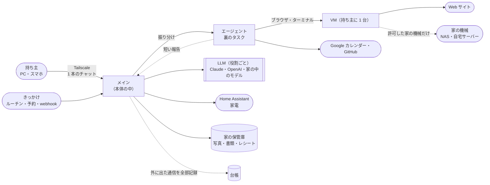

# 00. プロジェクト概要
- プロジェクト：Agent-Team-Open ／ 版数：v1.8（2026-10-26） ／ インプット：ヒアリング、[参考資料/](../../参考資料/index.md)、既存設計、実装調査、[今回の決定](00_learning.md)

> **3行で**
> 1. Agent-Team-Open は**家に置く常駐エージェント**。セットアップ済みのラズパイ（キット）か自分の Linux ホストに置き、スマホや PC から Tailscale 経由で、1 本のチャットで**メイン**のエージェントと話す。非エンジニアでも、写真の整理・レシートからの家計簿・Home Assistant 経由の家電の自動化を頼める。メインは小さな質問に自分で答え、重い仕事は用途に合うエージェントへ**裏で振り分け**、短い報告だけを受け取る。
> 2. エージェントは、持ち主のチャットだけでなく、ルーチン・予約した確認・webhook・裏の作業の完了でも起き、用がなければ眠る。ループと状態（会話・記憶・ルーチン）は本体に置き、作業は持ち主に 1 台の **VM**（ブラウザとターミナル。止めても残る）で行う。記憶は 2 層（プロフィールと検索）。持ち主に話すのは `send_to_owner` を呼んだときだけで、伝える価値がなければ黙る。
> 3. こわい操作（支払い・送信・削除、鍵や暖房などの家電、保管庫のファイルを消す）は Kernel の規則で止め、人が確かめる（オートレビューは既定で切る）。OSS（AGPL-3.0）。大手の常駐エージェント（Dots・Grok Bot・Muse）はクラウドから家の中に届かない。家の中だけで動かせ（A）、判定を確かめられ（B）、モデルを選べ（C）、仕分けは家の中の判断モデルで 0 円。Cloudflare・複数人（家族は次の版の候補）・Slack やメールの窓口・声・支払いの代行・ストア配布はやらない（[01 §7](01_requirements.md#7-スコープ外wont)）。

## 成長機構（v1.8）
Makaseの成長を「検証済み処理が増え、必要な推論が減ること」と定義する。日程調整で実証し、未知部分だけに一時的なエージェント処理を起動する。
本概要の[追加用語・決定事項D-391〜402・トレーサビリティ表](00_learning.md)は概要の分冊であり、今回の決定の正本とする。

## 🧭 判断してほしいこと
**v1.7**：家に置く常駐エージェントにした（D-371〜D-384、[変更レポート](changes/2026-10-26-home-agent.md)）。判断してほしいのは、キットの推奨（ラズパイ 5 の 16GB）と、判断モデル・4B を実機で測る順番。
未決はなし。v0.6 の Q-124 は D-201（[ADR-059](adr/ADR-059-main-agent-delegates.md)）で決着した。常駐型への作り直しの決定は D-200〜D-211（ユーザー）と D-212〜D-240（Claude判断）。Fable 5.1 と Astra のレビューを受けた v1.1 の決定は D-241〜D-274（D-248 はユーザー、ほかは Claude判断）。v1.1 の直しを読み直した v1.2 の決定は D-275〜D-310（D-310 はユーザー、ほかは Claude判断）。v1.2 の Claude判断を見直した v1.3 の決定は D-311〜D-314（Claude判断）。2026-10-24 のレビューで過剰な設計を削った v1.4 の決定は D-315〜D-328（D-328 だけ Claude判断、ほかはユーザー）。差別化の軸 A・B・C を足した v1.6 の決定は D-340〜D-370（[変更レポート](changes/2026-10-26-differentiation-abc.md)。チームで 1 台は v1.7 で不採用：[ADR-075](adr/ADR-075-team-sharing-proposal.md)）。[README](README.md#claude判断で決めたこと見直してほしいもの) に一覧。リスク（R-76〜R-106。R-87・R-95・R-96・R-99 は v1.4 で消した）は各ドキュメントと [README](README.md#-判断してほしいこと全ドキュメントから集約) にある。

## 全体図

見てほしいところ：持ち主が話す相手はメインだけ。VM を触るのは振り分け先のエージェントで、メインの文脈にはスクショも作業の記録も入らない。

## 要点
- 常駐型：ループと状態は本体に置き、きっかけで起きて、用がなければ眠る（[ADR-058](adr/ADR-058-resident-agent.md)）
- 1 本のチャットでメインと話し、メインが用途に合うエージェントへ裏で振り分ける（[ADR-059](adr/ADR-059-main-agent-delegates.md)）
- VM は持ち主に 1 台。ファイル・ツール・ログインが残る。画面は 1 つで順番に使う（[ADR-060](adr/ADR-060-one-persistent-vm.md)）。中のコマンドは判定せず、控えから戻せる（[ADR-061](adr/ADR-061-vm-no-judge-restore.md)）
- 持ち主に話す道具は `send_to_owner` だけ。知らせは Web Push（[ADR-062](adr/ADR-062-send-to-owner.md)・[ADR-067](adr/ADR-067-web-push-first.md)）
- 記憶は 2 層：プロフィールと検索（[ADR-070](adr/ADR-070-memory-two-layers.md)）。費用は自動のきっかけ用の別上限で守る（[ADR-069](adr/ADR-069-daily-auto-budget.md)）
- VM は `box-browser`・`box-shell` の 2 コンテナの組（[ADR-068](adr/ADR-068-browser-shell-split.md)）。LLM は役割ごとに Claude・OpenAI・OpenAI 互換から選ぶ（[ADR-078](adr/ADR-078-llm-by-role.md)）
- こわい操作は合図 → 人。オートレビューは既定で切り、入れたときだけ間に挟む（[ADR-064](adr/ADR-064-auto-review.md)・[ADR-077](adr/ADR-077-auto-review-off-by-default.md)）。成果物を外に出す操作は必ず人（BR-10）
- 家に置く常駐エージェント。非エンジニアにはセットアップ済みのラズパイで届ける（[ADR-079](adr/ADR-079-home-agent-kit.md)）。家の保管庫（[ADR-080](adr/ADR-080-home-vault.md)）・Home Assistant（[ADR-081](adr/ADR-081-home-assistant.md)）・家計簿（[ADR-082](adr/ADR-082-household-ledger.md)）。仕分けは家の中の判断モデル、ラズパイでは 4B 級まで（[ADR-083](adr/ADR-083-classify-and-local-on-pi.md)）
- 閉域モード（家の中だけで動かす）で外向きを許可リストに絞り、許可した社内システムにだけ届く。外に出た通信は全部台帳に残る（[ADR-074](adr/ADR-074-closed-network.md)）
- 判定の規則は版つきで、試験が通らないと変えられない。判定は再実行で同じ結果になり、監査ログはハッシュの鎖で改ざんが分かる（[ADR-076](adr/ADR-076-verifiable-decisions.md)）
- キットの選び方：ラズパイ 5 の 8GB が最低、16GB が推奨（NFR-092）。チームで 1 台は不採用（[ADR-075](adr/ADR-075-team-sharing-proposal.md)）
- 文脈はキャッシュの先頭を変えない形に組み、ターンを始める前に長すぎる履歴を要約する（[ADR-066](adr/ADR-066-prompt-cache-layout.md)）。webhook は Funnel で受け口だけ公開（[ADR-065](adr/ADR-065-webhook-funnel.md)）

---

## 詳細

### エレベーターピッチ
自分の機械で AI エージェントに仕事を任せたい開発者のための Agent-Team-Open は、「頼んだときしか動かず、API のないサイトは人が手を動かす」問題を、手元の Linux ホストに常駐するメインのエージェントと、ブラウザとターミナルを持つ専門のエージェントで解決する、自分だけのエージェント基盤である。OSS（AGPL-3.0）で、ソースを読め、自分のサーバーで動き、API キーは自分持ち。寝ている間に進め、朝に短く知らせる。大手の常駐エージェントと違い、家の中（家の LAN・家のファイル・家電）に手が届き、家の外に出さずに動かせ、判定を後から確かめられ、モデルを選べる。セットアップ済みのラズパイなら、非エンジニアもスマホだけで使い始められる。

### 背景と目的
- v0.6 までは「持ち主がチャットで頼むと、1 人のエージェントが 1 つの文脈で仕事をする」形だった。留守の間は進まず、長く話すとスクショと作業の記録で文脈が膨らむ。
- 参考資料（[GrokBot の講義の解説動画のノート](../../参考資料/2026-10-17_GrokBotの仕組み_常駐型エージェントのアーキテクチャ.md)）の常駐型は、ループと状態をサーバーに置き、いろいろなきっかけで起き、メインがサブエージェントに仕事を渡し、記憶を持つ。持ち主はこの形で作り直すことを選んだ（D-200）。
- 目的は、持ち主が一言頼むか予定を置いておけば、API のないサイトの仕事やコードの修正まで、留守の間に進むようにすること。

### 対象ユーザー
ホストの持ち主1人（[02 P-1](02_user_stories.md#p-1-持ち主)）。OSS として公開するので、同じ立場の開発者（自分の機械に置いて使う人）も P-1。非エンジニアの一般向けには配らない。v1.7 から、家の人（非エンジニアを含む）も持ち主にする。届け方はセットアップ済みのラズパイ（[ADR-079](adr/ADR-079-home-agent-kit.md)・D-371・372）。家族で使うのは次の版の候補。同じものを社内に置くこともできる（A・B・C）。チームで 1 台は不採用（D-383）。

### スコープ（In / Out）
| In（今回） | Out（Won't） |
|---|---|
| Linux ホストへの配置（Compose）、Tailscale・Headscale・社内 LAN での接続、webhook の受け口だけの公開（Funnel。閉域では LAN の中）、閉域モード・内部ホストの許可・外に出た通信の台帳 | Cloudflare への配置、画面と API のインターネットへの公開 |
| 1 本のチャットでメインと話す・メインの振り分け・エージェントの作成と削除・用途ごとのパック | エージェントごとの会話、振り分け先のさらに下への振り分け、仕事どうしの連絡板 |
| きっかけ（チャット・ルーチン・予約した確認・webhook・裏の作業の完了）・眠る／起きる | Slack・メール・電話・会議・声の窓口 |
| VM（持ち主に 1 台、ブラウザとターミナル、控えと作り直し）・画面の共有と交代 | VM でブラウザとターミナル以外のアプリ（GUI）を使う、メモリのスナップショット、エージェントごとの VM |
| こわい操作の確認（合図 → 人。オートレビューは入れたときだけ）・判定の規則の版と試験・判定の再実行・監査ログの鎖 | すべての操作の確認 |
| 記憶（2 層）・手で書いたスキル・パックの手順書・日程調整の検証済み実行IRの学習（v1.8） | 自然言語スキルの自動改変、任意コードの学習、異なる仕事間の自動合成 |
| `send_to_owner`・Web Push・Web 検索・Google カレンダー・GitHub・家の保管庫（写真・書類）・家計簿・Home Assistant 経由の家電・チャットの画像の添付・家の中の判断モデル・セットアップ済みのラズパイ（キット） | 支払いの代行と本人確認、パスワード管理ツールでの自動入力 |
| 費用と回数の上限・監査ログ・標準パック「告知ページ制作」・役割ごとのモデル（Claude・OpenAI・OpenAI 互換） | 複数人（家族は次の版の候補、チームで 1 台は不採用）・顔で人を見分ける・マイコンのプログラムを書く・ホスト間の同期、Claude・OpenAI・OpenAI 互換以外の LLM、Bedrock・Vertex 経由の Claude、書き出しと取り込み、ストア配布・ホスティング版・API の肩代わり（v1.7：キットで届ける） |

### 用語集

用語集（50語）

| 用語 | コード上の名前 | 定義 |
|---|---|---|
| ホスト | host | Agent-Team-Open を置く Linux の機械。ラズパイ、Win ノートの WSL2、Mac の Linux VM、ふつうの Linux PC |
| 持ち主 | owner | ホストを使うただ1人。Tailscale のログイン名（`OWNER_LOGIN`）で決まる |
| 本体 | core（コンテナ `makase`） | API・画面の配信・受付・メインと振り分け先の実行・タイマー・SQLite を持つプロセス |
| 常駐型 | resident | ループと状態を本体に置き、きっかけで起き、用がなければ眠る形（ADR-058） |
| メイン | main agent（`agents.kind = 'main'`） | 持ち主が 1 本のチャットで話す相手のエージェント。小さな質問に自分で答え、重い仕事を振り分ける。1 人だけで、消せない |
| エージェント | agent（`agents.kind = 'worker'`） | メインの振り分け先。持ち主が作るか、メインが作るか、パックで入る。画面でも「エージェント」と呼ぶ（「担当」は使わない） |
| チャット | chat（`chat_messages`） | 持ち主とメインの 1 本の会話。持ち主のメッセージと、メインの `send_to_owner` だけが並ぶ |
| きっかけ | wake（`wakes`） | エージェントを起こすもの：持ち主のチャット（`chat`）・ルーチン（`routine`）・予約した確認（`scheduled`）・webhook（`webhook`）・裏の作業の完了（`task_done`） |
| 受付 | intake | きっかけを確かめて `wakes` に入れる部品 |
| ルーター | router | `wakes` の重複を捨て、どのキュー（メインかタスク）に入れるかを決め、まとめる部品 |
| ターン | turn（`turns`） | メインが起きてから眠るまでの 1 回。歩みの記録で耐久性を持つ |
| タスク | task（`tasks`） | メインがエージェントに渡した 1 件の仕事。エージェントの新しい文脈で裏で動き、報告を返す |
| 振り分け | delegate | メインがタスクを作ってエージェントに渡すこと（道具 `delegate`） |
| 報告 | report（`tasks.report`） | タスクの終わりにエージェントがメインへ返す短い文（2,000 字まで）と成果物の場所 |
| `send_to_owner` | `send_to_owner` | 持ち主に話す唯一の道具。文・ファイル・選択肢（ADR-062） |
| ルーチン | routine（`routines`） | プロンプトと時刻の組。決まった時刻にメイン（か決めたエージェント）を起こす |
| 予約した確認 | scheduled wake（`scheduled_wakes`） | メインが「あとでもう一度見る」ために予約した、次に起きる時刻と覚え書き |
| 受け口 | webhook（`webhooks`） | 外のサービスが出来事を送ってくる口。Funnel で `/hooks/:hookId` だけを公開する |
| 記憶 | memory | 2 層：プロフィール（`memory_facts`）・検索（`memory_search`）（ADR-070） |
| VM | box-browser・box-shell | 持ち主に 1 台の実行環境。実体は 2 つのコンテナ（`box-browser`・`box-shell`）の組で、一緒に起こし一緒に止める。画面でも「VM」1 つとして見せる。ブラウザのプロフィールとホームのボリュームは止めても残る（ADR-060・068）。本当の仮想マシンではない（ADR-043）。呼び名は持ち主の指示で「VM」（D-182） |
| VM の世代 | box generation（`boxes` の 1 行） | VM の 1 回の起動。起きるたびに新しい世代。承認・交代・操作は世代に結びつく |
| 眠る・起きる | sleep / wake | 何もなければ LLM を呼ばず、VM を止める。道具を使うときに VM を起こす |
| 画面の番 | screen lease（`boxes.screen_task_id`） | 1 つしかない画面と Chrome を使えるタスク。1 つずつ |
| 控え | VM snapshot（`vm_snapshots`） | `makase-browser-profile` と `makase-vm-home` を 1 つにまとめた tar。毎日 1 回・3 世代。戻す・作り直すに使う |
| box-manager | box-manager（コンテナ） | VM を起こす・止める・中継する・控えを取る唯一の部品。Docker の操作権を持つのはここだけ |
| box-agent | box-agent（`box-browser` の中のプロセス） | クリックや入力の実行・スクショ・要素の確かめ・CDP・`open_url`・`read_page` をする小さなプログラム |
| shell-agent | shell-agent（`box-shell` の中のプロセス） | コマンドの実行と tar の出し入れ（API-117・118）の受け手 |
| box-browser | box-browser（コンテナ） | VM のうちブラウザ側。Xvfb・Chromium・VNC・box-agent を持つ。利用者 `browser`、ボリューム `makase-browser-profile` |
| box-shell | box-shell（コンテナ） | VM のうちターミナル側。bash・git・Node・Python・shell-agent を持つ。利用者 `agent`、ボリューム `makase-vm-home` |
| egress | egress（コンテナ。HTTP(S) プロキシ） | VM から外への通信をすべて通す中継。許可リストは送り元のコンテナで分ける（`box-browser` はアドレスの判定だけ、`box-shell` は許可リスト。ADR-045・068）。本体・box-manager・tailnet・ホスト自身・クラウドのメタデータへは通さない。社内の機械は持ち主が書いた内部ホストだけ（v1.6：D-343） |
| コンピューターユース | computer use | 画面のスクショを見て、マウスとキーボードで操作すること（Claude の computer use ツール） |
| 操作 | browser action | VM への1回のクリック・入力・キー・スクロールなど |
| こわい操作 | risky action | 支払い・購入・送信・削除・公開・アカウントの設定の変更 |
| 申告 | `confirm_action` | エージェントが「この操作の前に確認して」と出す道具。`category` つき（D-228） |
| 合図 | tripwire | プログラムが申告なしでも止める条件（T-1〜T-6） |
| オートレビュー | auto review（`auto_reviews`） | 合図に当たった操作のうち、人に回さないものを別の LLM の呼び出しが確かめること（ADR-064）。既定で切る（ADR-077） |
| 閉域モード | `network.mode = closed` | 本体と VM の外向きを許可リストの先だけに絞る置き方（ADR-074） |
| 内部ホスト | `network.internal_hosts` | VM から届いてよい社内のホスト。既定は空（ADR-074） |
| 台帳 | egress ledger（`egress_events`） | 外に出た通信を全部残した記録。中身は残さない（ADR-074） |
| 規則の版 | policy version（`policy_versions`） | 判定の規則の 1 版。SHA-256 で名指しし、試験の例を持つ（ADR-076） |
| 役割 | LLM role | モデルを割り当てる単位。`main`・`worker`・`computer`・`review`・`summary`・`classify`（ADR-078・083） |
| キット | kit | セットアップ済みのラズパイ。電源と LAN をつなぎ、スマホで QR を読めば使い始められる（ADR-079） |
| 家の保管庫 | vault（`makase-vault`） | 写真・書類・レシートを置く USB の SSD か NAS。本体の道具で扱い、消すのはゴミ箱へ（ADR-080） |
| 機器の区分 | `human_device_classes` | 鍵・暖房・ガスなど、動かすのに必ず人の確認が要る家電の種類（ADR-081・BR-15） |
| 判断モデル | decision model | 文章を生成せず、選択・点数・はい/いいえを型つきで返す小さなモデル。仕分けにだけ使う（ADR-083） |
| 確認 | check | 人が ○ / × を押すカード。API の書き込みと、人に回したこわい操作で出る |
| 交代 | takeover | 人が VM の操作をエージェントから代わること。代わっている間、エージェントは待つ |
| Kernel | `packages/kernel` | 書き込みとこわい操作を「通す・確認・止める」に分ける決定論のコード |
| 歩みの記録 | task step（`task_steps`） | ターン・タスクの1歩（LLM の1回・道具の1回）の結果。再起動したらここから続ける |
| 汚染 | taint | 外から来た内容（Web・VM・webhook・汚染したタスクの報告）を読んだ印。汚染のあとの書き込みは確認に回る（BR-06） |

### 決定事項ログ
代替案があった判断は ADR に書き、ここには1行とリンクだけ置く。旧設計書の D-120 までの続きから振る。v1.0 で置き換わった行には、決定内容の末尾に印を付けた（行は消さない）。

決定事項（D-121〜D-390）

| ID | 決定内容 | 決定者 | 理由 | 影響範囲 | ADR |
|---|---|---|---|---|---|
| D-121 | 置き先は Linux ホスト。Cloudflare はいったん外す | ユーザー | 手元の機械で動かし、VM のブラウザを持たせたい | 全体 | [ADR-041](adr/ADR-041-linux-host.md) |
| D-122 | 本体は Node＋SQLite。Workers の実装を移す | ユーザー | 同期の repo 関数をそのまま使える。VM を起こすのも素直に書ける | 07・08 | [ADR-042](adr/ADR-042-node-sqlite.md) |
| D-123 | VM はコンテナ＋仮想画面 | ユーザー | ラズパイと WSL でそのまま動く | 07 | [ADR-043](adr/ADR-043-box-container.md) |
| D-124 | ブラウザは自由に操作し、こわい操作だけ確認する | ユーザー | API のないサイトを任せたい | FR-075〜077 | [ADR-047](adr/ADR-047-risky-action-check.md) |
| D-125 | こわい操作は申告＋決まった合図で見分ける | ユーザー | 申告の忘れをプログラムで拾う | FR-076 | [ADR-047](adr/ADR-047-risky-action-check.md) |
| D-126 | 人は VM の画面を見られ、交代して操作できる | ユーザー | ログイン・CAPTCHA は人がする | FR-078 | [ADR-043](adr/ADR-043-box-container.md) |
| D-127 | 使うのは持ち主1人。ワークスペースは1つ（v1.0：webhook の受け口だけは公開する例外を D-208 で足した） | ユーザー | 自分の機械で使う | 08、FR-073 | — |
| D-128 | つなぎ方は Tailscale。インターネットには公開しない（v1.0：webhook の受け口だけ Funnel で公開する例外 → D-208） | ユーザー | 外のスマホから入れて、公開の守りが要らない | NFR-064 | [ADR-046](adr/ADR-046-tailscale-identity.md) |
| D-129 | ログインは Tailscale の身元に任せる | ユーザー | 別のログイン画面が要らない | FR-073 | [ADR-046](adr/ADR-046-tailscale-identity.md) |
| D-130 | 複数のホストはそれぞれ独立。引っ越しは書き出しと取り込み | ユーザー | 同期が要らない | FR-082 | — |
| D-131 | プロフィールはエージェントごとに残し、VM はタスクごとに起こす（v0.3 で「依頼ごと」の表記を直した：D-168）（**置き換え済み** → D-202・D-205。VM は持ち主に 1 台） | ユーザー | 一度ログインすれば次から使える | FR-079 | [ADR-048](adr/ADR-048-profile-per-agent.md) |
| D-132 | 配り方は Docker Compose 一式 | ユーザー | どの Linux でも同じ手順 | 07 | [ADR-049](adr/ADR-049-docker-compose.md) |
| D-133 | 最初の版に Google カレンダーと GitHub を入れる。編成と育つ仕組みは入れない（パックは D-176 で残すことにした）（v1.0：編成の代わりにメインが振り分ける → D-201） | ユーザー | 要るものだけにする | 01 | [ADR-050](adr/ADR-050-one-agent-per-ask.md) |
| D-134 | 細かい数値は定石で決めて一覧にする | ユーザー | 質問の往復を減らす | 05 | — |
| D-135 | ID は旧設計書の続きから。今の画面・API は旧 ID を引き継ぐ | ユーザー | コードのコメントの ID と食い違わない | 全体 | — |
| D-136 | VM を起こす権限は box-manager だけに持たせる | Claude判断（提案） | 本体が乗っ取られても Docker を自由に使わせない | 07 | [ADR-044](adr/ADR-044-box-manager.md) |
| D-137 | VM から外へは egress だけを通す | Claude判断（提案） | VM から家の LAN と本体に届かせない | 07、NFR-066 | [ADR-045](adr/ADR-045-egress.md) |
| D-138 | 書き込みの出口（gateway）は本体の中の部品にする | Claude判断（提案） | 1人で使うので別のコンテナにする益が小さい | 07 | [ADR-051](adr/ADR-051-gateway-in-core.md) |
| D-139 | VM の同時数は既定 1、設定で 4 まで（**置き換え済み** → D-202・D-217。VM は 1 台、裏の仕事の同時数は 3） | Claude判断（おまかせ） | ラズパイの 4GB でも動く | NFR-061 | — |
| D-140 | 画面の大きさは 1280×800 | Claude判断（おまかせ） | computer use の推奨の範囲で、スクショの費用が小さい | NFR-063 | — |
| D-141 | 1タスクの上限：操作 300 回・60 分・$3。日次は $10（今のまま）。60 分は外側の打ち切りで、ポリシーの `max_minutes` は 55（M-59） | Claude判断（おまかせ） | 画像の費用がかさむので回数と時間でも止める | FR-013、TBL-035 | — |
| D-142 | こわい操作の確認の期限は 30 分 | Claude判断（おまかせ） | スマホに気づくまでの時間を見込む | FR-077 | — |
| D-143 | 交代中に操作が 15 分ないと VM を止め、依頼は返事待ちにする（交代の頼みのまま待つ時間は 30 分：D-167）（v1.0：VM は止めず、交代を終えて返事待ちにする → D-237） | Claude判断（おまかせ） | VM のつけっぱなしでメモリを食わない | FR-078 | — |
| D-144 | スクショの画像は 7 日で消す（操作の記録の行は残す） | Claude判断（おまかせ） | ディスクが小さいラズパイを見込む | TBL-033 | — |
| D-145 | SQLite のバックアップは毎日1回・7世代 | Claude判断（おまかせ） | 1台の機械なので壊れたときの戻り先が要る | NFR-070 | — |
| D-146 | 最低のホスト：64bit・メモリ 4GB・空き 10GB。推奨 8GB | Claude判断（おまかせ） | Chromium 1つと本体が入る大きさ | NFR-062 | — |
| D-147 | 時刻は ISO 8601（UTC）の TEXT、ID は UUIDv7 の TEXT、金額はマイクロドルの整数 | 定石 | Cloudflare 版の決めごとを引き継ぐ | 08 | — |
| D-148 | API は同じ出どころ（Origin）と専用ヘッダーで CSRF を防ぐ | 定石 | Tailscale の身元はクッキーと同じく自動で付く | NFR-065 | — |
| D-149 | プロジェクト名は Agent-Team-Open。コンテナ名・ホスト名・ヘッダー（`makase`・`X-Makase-Request` など）は短い今の名前のまま | ユーザー（名前）／ Claude判断（識別子） | 名前の指示（2026-10-23）。識別子を変えると URL とコードが長くなる | 全体 | — |
| D-150 | 操作の先が分からない変える操作は確認に回す（T-6）。多すぎるサイトは「確かめないドメイン」で外す | ユーザー | Astra のレビュー（2026-10-24）。すり抜けを防ぐ | FR-076 | [ADR-047](adr/ADR-047-risky-action-check.md) |
| D-151 | 設定（上限・`browser` 欄）は次のタスクから効く | Claude判断 | 今の `edge/inputs.ts` はタスクの始まりのポリシーを固定して使う | API-096、TBL-035 | — |
| D-152 | ブラウザの確認は `action_intents` に乗せず `browser_checks` にする | Claude判断（提案） | MCP 用の必須の列が埋まらない | FR-077、TBL-039 | [ADR-052](adr/ADR-052-browser-checks-table.md) |
| D-153 | LLM を呼ぶ前に見積もりの費用を予約し、終わったら精算する | Claude判断 | 並んだタスクで日次の上限を超えない | FR-013、TBL-038 | — |
| D-154 | VM は1つずつ別のネットワークに置く。egress はつなぐ先のアドレスを固定する | Claude判断（提案） | Docker の `internal` は同じネットワークの中を分けない | NFR-066 | [ADR-045](adr/ADR-045-egress.md) |
| D-155 | Chromium はキオスクの形・倍率 1・タブ1枚。ページを開くのは `open_url` | Claude判断 | 画面の座標と CDP の要素を1対1にする | FR-075、07 | — |
| D-156 | `GET /api/health` は確かめなしで ok と版だけ。ホストの状態は `GET /api/v1/host` | 定石 | 確かめなしの口に状態を出さない | API-082、API-111 | — |
| D-157 | `type` の文字列に改行（`\n`・`\r`）が含まれるときは、Enter の `key` と同じ判定（T-4）にかける | Claude判断 | レビュー（2026-10-24）。改行で送信がすり抜ける | FR-075、FR-076 | [ADR-047](adr/ADR-047-risky-action-check.md) |
| D-158 | `open_url` は `http`・`https` だけ受ける。確認するドメインへの `open_url` は T-2 として確認に回す | Claude判断 | URL を開くだけで動く操作（退会・削除・同意）を止める | FR-075、FR-076、API-103 | [ADR-047](adr/ADR-047-risky-action-check.md) |
| D-159 | 承認のあと中身が変わっていたら、新しい確認は作らず、Claude に新しいスクショを返して決め直させる | Claude判断 | 同じ座標の先は別の要素かもしれない。`action_id` の UNIQUE とも合う | FR-077、TBL-039、API-110 | — |
| D-160 | 操作する人と `control_epoch` の切り替えは内部 API-113 で box-manager に伝える | Claude判断 | box-agent が今の epoch を知る手段がなかった | FR-078、API-090・091・113 | — |
| D-161 | Claude との会話に画像として残すスクショは直近 3 枚（`browser.keep_screenshots`）。古いものは文に置き換える（**置き換え済み** → D-256。古いスクショはサーバー側で消す） | Claude判断（おまかせ） | 1歩の費用が歩数とともに増え、文脈の上限を超えるのを防ぐ | FR-075、TBL-035、R-82 | — |
| D-162 | 秘密の欄の領域は、保存するスクショと Claude に送るスクショの両方で塗りつぶす | Claude判断 | サイトがマスクしないカード番号が画像に残る | FR-075、11 §8 | — |
| D-163 | 交代で中止した LLM の歩みは `done`（`aborted`）で閉じ、予約した費用を精算する | Claude判断 | 中止しても入力トークンは課金される。`started` を残さない | FR-078、API-090、TBL-038 | — |
| D-164 | `web_fetch` にも egress と同じアドレスの判定（リダイレクト先の再判定を含む）を適用する | Claude判断 | 本体は ctl ネットワークにもいる | 07、11 §8 | [ADR-045](adr/ADR-045-egress.md) |
| D-165 | 決まった言葉の照合は、ラテン文字の語は単語の境界、日本語は部分一致 | Claude判断 | 「Postal code」「Confirmation number」で空振りしない | FR-076 | — |
| D-166 | T-4（Enter・Space）は、先が `textarea`・`contenteditable` のときは当たらない（**覆した** → D-242。`textarea` の Enter は人に回す） | Claude判断 | 改行なので送信にならない | FR-076 | — |
| D-167 | 交代の頼み（`requested`）の期限は 30 分。交代中（`active`）の放置は 15 分のまま | Claude判断（おまかせ） | 確認（D-142）と同じ「人が気づくまで」の待ち | FR-078、TBL-034 | — |
| D-168 | VM は「タスクごと」に起こす。「依頼ごと」の表記を統一した（**置き換え済み** → D-202・D-214。起きるたびに新しい世代） | Claude判断 | `boxes.task_id` に合わせる。返事で次のタスクが立てば VM は新しく起こす | 07、ADR-048 | [ADR-048](adr/ADR-048-profile-per-agent.md) |
| D-169 | スマホの文字入力は RFB ではなく box-agent の `type`（API-103）で打つ | Claude判断 | 日本語と記号が崩れない。スマホの文字入力そのものは次の版（D-181） | SCR-022 | — |
| D-170 | 起動時に `owner_login` が違えば止まる。`.env` の `OWNER_LOGIN_REPLACE=1` のときだけ上書きして起動する | Claude判断 | 持ち主がログイン名を変えたときに起動できなくなる | TBL-031、11 §10 | — |
| D-171 | box-agent は起動時に Chromium のロックファイル（`SingletonLock` など）を消してから Chromium を起こす | Claude判断 | 前の VM が落ちると次が立たない | FR-074、07 | — |
| D-172 | 提案だった ADR-044・045・051・052 を承認する | ユーザー | 作る量を増やさずに VM と本体を分けられる | 07、TBL-039 | ADR-044・045・051・052 |
| D-173 | `div` に JS を付けただけの擬似ボタンも決まった言葉（T-3）の対象にする。box-agent が `clickable` を返す | ユーザー | 多くの EC サイトの購入ボタンがこれ。空振りは確かめないドメインで外す | FR-076、API-103 | — |
| D-174 | 確認待ち・交代待ちの時間は `max_minutes` に含めない。`tasks.paused_ms` に足して経過時間から引く | ユーザー | 1回の確認でタスクの半分が消えないように | FR-075・077・078、`tasks` | — |
| D-175 | ポリシーの初期値は設計書の値のまま（$3・操作 300 回・200 歩・55 分） | ユーザー | VM の仕事は歩数が多い | TBL-035 | — |
| D-176 | パックを残し、「用途ごとに最適化されたエージェント集」として設計し直す（v1.0：パックのエージェントはメインの振り分け先 → D-201） | ユーザー | 入れておくと、その用途の依頼で最適化されたエージェントが使われる | REQ-093、FR-085、SCR-024 | [ADR-053](adr/ADR-053-pack-by-purpose.md) |
| D-177 | 手で書いたスキル（`agent_skills`）は残す。`origin` は `pack` だけ | ユーザー | 手順書そのものは役に立つ。育つ仕組みは入れない | FR-082、`agent_skills` | — |
| D-178 | VM にターミナルを入れる。VM の中のコマンドは判定せず、VM の外に効くものだけ確認する（v1.0：判定しない理由を「使い捨て」から「資格情報を置かない・控えで戻す」に → D-209） | ユーザー（入れる）／ Claude判断（線引き） | コードを直す仕事を任せたい。VM は使い捨てで資格情報を持たない | REQ-094、FR-086、NFR-080 | [ADR-054](adr/ADR-054-terminal-in-vm.md) |
| D-179 | Web Push 通知は最初の版に入れない。知らせは PWA を開いているときの SSE だけ（**覆した** → D-207。Web Push を最初の版に） | ユーザー | 最初の版を小さくする | REQ-091（Won't）、FR-017、TBL-037 | — |
| D-180 | 決まった言葉の初期値に「確定」「Confirm」「Submit」を入れる（v1.1：言葉の分け方を D-242 で直した） | ユーザー | 送信の多くはこの言葉。多ければ設定で外せる | FR-076、TBL-035 | — |
| D-181 | 最初の版は PC での交代を優先。スマホは頼む・確認・見る・タップまで Must、交代中の文字入力は次の版 | ユーザー | まず PC で動くこと | REQ-083、SCR-022、NFR-074 | — |
| D-182 | 呼び名を正式名称にする：箱→VM、箱の管理役→box-manager、箱の中の操作役→box-agent、出口の見張り→egress。VM の実体は Docker コンテナ | ユーザー | やさしい言い換えのほうが分かりにくい | 全体 | — |
| D-183 | OSS として公開する。ライセンスは AGPL-3.0。`package.json` の `license` は `AGPL-3.0-only` | ユーザー | 今の最大のリスクは「真似される」ではなく「存在を知られない」。企業導入の道は AGPL で残す | 01 §3・§6、11 §1、README、LICENSE | [ADR-055](adr/ADR-055-agpl-license.md) |
| D-184 | 非エンジニアの一般向けには配らない。収益化するなら企業導入（導入支援・専門パック作成・運用契約）。企業導入で要る複数人・組織は次の版（v1.7 で見直し：D-382） | ユーザー | 一般向けの浸透は配布・サポート・課金の体制が要る。当面は作り切る | 01 §4・§7、02 P-1 | [ADR-055](adr/ADR-055-agpl-license.md) |
| D-185 | LLM の接続先に Bedrock・Vertex 経由の Claude を足す（Should）。`.env` の `LLM_PROVIDER` で選ぶ。接続先で使えない道具は宣言から外す（v1.4 で D-315 に置き換え） | ユーザー（足す）／ Claude判断（道具の線引き） | 企業導入では AWS・Google Cloud の契約の中で Claude を使いたい会社が多い | REQ-095、FR-087、11 §10 | [ADR-056](adr/ADR-056-llm-provider.md) |
| D-186 | 最初の標準パックは「告知ページ制作パック」（`announcement-page`）。デモの 4 人は 1 人のエージェントの手順書 4 本（設計・制作・点検・仕上げ）にする（v1.0：「1 件 1 人」は ADR-059 の振り分けに読み替える） | ユーザー（パック）／ Claude判断（1 人の形） | デモの実績があり、レビューの商品仕様・第三者テストの対象にそのまま使える。1 件 1 人は ADR-050 | FR-085、01 §2 | — |
| D-187 | 成果物を外に出す操作（公開・送信・push・PR・外部 API への書き込み）は必ず人が最終承認する。点検役の AI は承認の代わりにならない | Claude判断（レビューの指摘） | BR-03・BR-08 ですでに守られているが、方針として明文化する | BR-10 | — |
| D-188 | 成功指標に「開発者でない第三者が手順書だけで置き、告知ページ 1 件を完成できる」を足す。3 人中 2 人・総所要時間を記録 | Claude判断（おまかせ） | レビューの「第三者が使えることを示せ」。OSS でも企業導入でも効く | 01 §2、NFR-081 | — |
| D-189 | 初めて置く人の所要は、Docker と Tailscale が入った機械で手順書だけで 30 分以内 | Claude判断（おまかせ） | D-188 を測れる形にする | NFR-081 | — |
| D-190 | 置き先は 3 段で進める：手元の WSL2 の PC → クラウドの Linux VM（amd64）→ ラズパイ（arm64）。作る順番は VM の縦の 1 本 → こわい操作 → 本体の移植 → パックとターミナル（v1.0：12_implementation_order.md は削除 → D-211。置き先の 3 段の順番はこの行に残す） | ユーザー（段）／ Claude判断（MS の順） | 不確かなもの（VM・computer use・判定）を先に手元で測る。arm64 の対応と実機の計測は最後でよい | 12（削除） | — |
| D-191 | 道具は安い順に試す：知っていること・手順書 → コネクタ → `web_search`・`web_fetch` → VM のブラウザ → 人に聞く。コネクタが失敗したら Web 検索を飛ばしてブラウザに進んでよい。Kernel では強制しない | Claude判断 | 参考資料（GrokBot）。右ほど遅く・高く・こわい。スクショの費用（R-82）を下げる | FR-088 | — |
| D-192 | スキルは名前と説明（「〜のときに使う」）だけを最初に渡し、本文は `read_skill` で読む。表は今の `agent_skills` のまま | Claude判断 | 参考資料。手順書が増えても文脈を埋めない | FR-088、FR-085 | — |
| D-193 | コネクタの道具は名前だけ先に渡し、使うと決めたときに詳細を読み込む（tool search）。接続先で使えなければ最初から全部 | Claude判断 | 参考資料。コネクタが増えたときに文脈を埋めない | FR-088、FR-087 | — |
| D-194 | 見るだけの道具 `read_page` を足す。CDP のアクセシビリティツリーから、見えているボタン・リンク・入力欄の一覧（役割・名前・中心の座標）を返す。秘密の欄の値は返さない | Claude判断 | 参考資料の「ページの構造を読む」。スクショなしで押せる歩みが増える | FR-075、API-103 | — |
| D-195 | 動いているタスクへの持ち主のメッセージは列に並ばず、次の歩みの頭に差し込む（`ask_pending_replies`）。LLM の呼び出しは中止しない。同じタスクに届いた結果は 1 歩に 1 まとまり（v1.0：きっかけ全般の扱いに広げた → D-220）（v1.4 で D-324 に置き換え） | Claude判断 | 参考資料の「新しいメッセージの扱い」。途中で言い直せる | FR-089、API-077、SCR-020 | — |
| D-196 | SSE は通し番号（`workspace_events.id`）つきの合図にし、中身は REST で取りに行く。抜けたら・つなぎ直したら読み直す。送信は画面が ID を作って先に表示する | Claude判断 | 参考資料の「送信を押すと」。合図を落としても困らない | FR-018、API-085、API-077、SCR-020 | — |
| D-197 | 知らせは伝える価値があるものだけ。同じ依頼の同じ種類は 1 つにまとめ、進捗は知らせにしない（v1.0：Web Push にも同じ決まり → D-229） | Claude判断 | 参考資料の「伝えるか、黙るか」 | 04 知らせ | — |
| D-198 | API の書き込みの確認カードを種類ごとに出し分ける（PR は差分、カレンダーは予定の中身） | Claude判断 | 参考資料の「ツールごとに画面を出し分ける」。見てから決められる | SCR-019 | — |
| D-199 | 失敗したタスクを eval のケースにし、ハーネスを直したら eval で確かめてから出す | Claude判断 | 参考資料の「製品とモデルは一緒に良くなる」 | 11 §11 | — |
| D-200 | 常駐型として作り直す。版数は v1.0。ID は v0.6 の続きから振り、意味が変わらないものは引き継ぐ | ユーザー | 参考資料（GrokBot の講義の解説動画）の「ループ＋サーバー＋コンピュータ＋記憶」 | 全体 | [ADR-058](adr/ADR-058-resident-agent.md) |
| D-201 | 持ち主は 1 本のチャットでメインと話し、メインが用途に合うエージェントへ裏で振り分ける。Q-124 は決着（ADR-050・057 を置き換え） | ユーザー | 1 本のチャットのまま、重い仕事をメインの文脈から外す | REQ-079、FR-061・092 | [ADR-059](adr/ADR-059-main-agent-delegates.md) |
| D-202 | VM は持ち主に 1 台。止めても残り、道具を使うときに起きる（ADR-048 を置き換え） | ユーザー | ファイル・入れたツール・ログインを次の仕事に残す | REQ-104、FR-074・100 | [ADR-060](adr/ADR-060-one-persistent-vm.md) |
| D-203 | きっかけは 5 つ：持ち主のチャット・ルーチン・予約した確認・webhook・裏の作業の完了 | ユーザー | 留守の間にも進めたい | REQ-096〜100、FR-090 | [ADR-058](adr/ADR-058-resident-agent.md) |
| D-204 | 記憶は 4 層（プロフィール・ログ・メモ・検索）を最初の版に入れる（v1.4 で D-325 に置き換え） | ユーザー | 好みを毎回言い直さない | REQ-101、FR-097 | [ADR-063](adr/ADR-063-memory-four-layers.md) |
| D-205 | 画面と Chrome は 1 つで全員が使う。画面を使う仕事は順番。ログインは全員で共通 | ユーザー | いちばん軽い。ラズパイでも動く | FR-074・079、TBL-032 | [ADR-060](adr/ADR-060-one-persistent-vm.md) |
| D-206 | 合図に当たった操作の後にオートレビューを挟む。外に出す・支払う・消す・秘密の欄は必ず人（v1.6 で既定は切る：D-351） | ユーザー | 留守の間に止まる回数を減らす。BR-10 は変えない | REQ-103、FR-099 | [ADR-064](adr/ADR-064-auto-review.md) |
| D-207 | Web Push を最初の版に入れる（D-179 を覆す） | ユーザー | 留守の間の知らせが要る | REQ-091、FR-017 | [ADR-067](adr/ADR-067-web-push-first.md) |
| D-208 | webhook は Tailscale Funnel で `/hooks/` だけを公開して受ける（D-128 の例外） | ユーザー | GitHub の出来事ですぐ起きる | REQ-099、FR-096、NFR-064・085 | [ADR-065](adr/ADR-065-webhook-funnel.md) |
| D-209 | VM の中のコマンドは判定しない。資格情報を置かず、外へは egress の許可リストだけ、毎日の控えから戻せるようにする | ユーザー | 開発の仕事で止めない。壊れたら戻す | FR-086・100、BR-08 | [ADR-061](adr/ADR-061-vm-no-judge-restore.md) |
| D-210 | プロフィールとログは全員で共有、メモはエージェントごと。プロフィールを書くのはメインだけ | ユーザー（共有）／ Claude判断（書き手） | 好みを全員が知る。書き手を 1 つにして食い違いを防ぐ | FR-097 | [ADR-063](adr/ADR-063-memory-four-layers.md) |
| D-211 | 12_implementation_order.md を消す | ユーザー | 実装の順番は設計書の範囲外。v1.0 で中身が古くなる | 00 索引、11 | — |
| D-212 | 持ち主に話す道具は `send_to_owner` の 1 つだけ。メインの地の文はチャットに出さない。振り分け先は持ち主に話さない（v1.4 で D-320 に置き換え） | Claude判断 | 参考資料の `SendToUser`。伝える価値がなければ黙る | FR-093、FR-063（統合） | [ADR-062](adr/ADR-062-send-to-owner.md) |
| D-213 | 文脈の並べ方を固定し、先頭は次の要約まで変えない。キャッシュの外れを部分ごとのハッシュつきで記録する。要約はメインの会話が 10 万トークンを超え、ターンが終わって 10 分たったとき。`cache_control` は 1 時間（v1.1：要約は 6 万トークン・履歴は持ち越さない → D-256・D-270） | Claude判断 | 参考資料の第 5 章。費用と速さ | FR-098、NFR-083 | [ADR-066](adr/ADR-066-prompt-cache-layout.md) |
| D-214 | VM は 10 分使わなければ止める（眠る）。起きるたびに `boxes` に新しい世代の行を作る | Claude判断（おまかせ） | ラズパイのメモリを空ける。承認・交代は世代に結びつける（今のまま） | FR-074、NFR-082 | — |
| D-215 | VM のホームの控えは毎日 1 回・3 世代。作り直しは空のホームから。どちらも VM を止めてから | Claude判断（おまかせ） | 前の仕事の残りを消せる。ディスクを食いすぎない | FR-100、TBL-052 | — |
| D-216 | Chrome は利用者 `browser`、コマンドは利用者 `agent` で動かす。Chrome のプロフィールのフォルダは 700（v1.4 で D-326 に置き換え） | Claude判断 | コマンドから Cookie を読ませない | FR-086、NFR-066 | [ADR-061](adr/ADR-061-vm-no-judge-restore.md) |
| D-217 | 裏の仕事の同時数は既定 3（設定で 1〜5）。画面の番は 1 つで、3 分画面を使わなければ返す。ターミナルは同時に 2 本まで（v1.1：3 分の数え方と番号を D-258 で直した） | Claude判断（おまかせ） | VM 1 台・画面 1 つで回る数 | NFR-061・088、TBL-032 | — |
| D-218 | 振り分けは 1 段だけ（振り分け先はさらに振り分けない）。1 回の頼みを複数の仕事に分けてよい。仕事どうしの連絡板は作らず、受け渡しはメインを通す | Claude判断 | 作りを小さく保つ。編成（連絡板）は Won't のまま | FR-092 | [ADR-059](adr/ADR-059-main-agent-delegates.md) |
| D-219 | 振り分け先の報告は 2,000 字まで＋成果物の場所（パス・URL）。スクショ・作業の記録はメインに返さない | Claude判断 | メインの文脈を小さく保つ | FR-092 | [ADR-059](adr/ADR-059-main-agent-delegates.md) |
| D-220 | 新しいきっかけの扱い：持ち主のチャットは、メインのターンが動いていれば次の歩みの頭に入れる（列に並ばない）。ほかのきっかけは列の後ろ。3 秒以内に続いた持ち主のメッセージと、同時に並んだ仕事の完了は 1 ターンにまとめる（v1.1：`attached` を足した → D-247）（v1.4 で D-324 に置き換え） | Claude判断 | 参考資料の「新しいメッセージの扱い」。D-195 を広げた | FR-090・089 | — |
| D-221 | ルーチンは持ち主が画面で作るか、メインが提案して持ち主が ○ で作る。間隔は 15 分以上・20 本まで | Claude判断（おまかせ） | 外の文の仕掛けでルーチンを作らせない。費用を抑える | FR-094 | — |
| D-222 | 予約した確認はメインだけが作れる。5 分後〜30 日後、1 日 20 件まで。振り分け先は報告に「いつもう一度見るか」を書き、メインが予約する | Claude判断（おまかせ） | 振り分けを 1 段に保つ。暴走で起き続けない | FR-095 | — |
| D-223 | webhook は本文 256KB・1 分 60 件まで。重複は配達 ID で捨てる。形は GitHub（`X-Hub-Signature-256`）と汎用（`X-Makase-Signature-256`、HMAC-SHA256）。署名の秘密は作ったときに 1 度だけ見せる（v1.1：件数と重複の扱いを D-260・D-261 で直した）（v1.2：1 分 60 件を超えた分はまとめて 202、1 時間 600 件を超えたら 429 → D-260・D-284）（v1.4 で D-318 に置き換え） | Claude判断（おまかせ） | 公開の口を小さく保つ | FR-096、NFR-085 | [ADR-065](adr/ADR-065-webhook-funnel.md) |
| D-224 | 記憶の数値：プロフィール 100 個・4,000 字、ログはプロンプトに 30 件、メモは 60 分。プロフィールを書く材料は持ち主のメッセージとメインの `send_to_owner` の文だけ。消してよいのは、記憶の更新の歩みに渡した事実だけ（v1.1：材料は持ち主のメッセージだけ → D-246）（v1.1：材料は持ち主のメッセージだけ → D-246）（v1.4 で D-325 に置き換え） | Claude判断（おまかせ） | 参考資料の数値。外の文を記憶に入れない | FR-097、NFR-087 | [ADR-063](adr/ADR-063-memory-four-layers.md) |
| D-225 | 記憶の検索は SQLite の FTS5（`trigram`）。会話・ログ・仕事の報告を入れる | Claude判断 | 日本語でも部分一致で引ける。依存を増やさない | FR-097、TBL-050 | — |
| D-226 | オートレビューは道具なしの Claude の呼び出し 1 回（`CLAUDE_REVIEW_MODEL`、既定 `claude-sonnet-5-5`）、20 秒。エージェントの会話は渡さない | Claude判断 | 安く速く。会話の仕掛けを引き継がない | FR-099 | [ADR-064](adr/ADR-064-auto-review.md) |
| D-227 | 決まった言葉を `browser.human_words`（必ず人）と `browser.confirm_words`（オートレビュー）に分ける（v1.1：中身を D-242 で直した） | Claude判断 | 外に出す・支払う・消すの言葉は人に回す | FR-076・099、TBL-035 | [ADR-064](adr/ADR-064-auto-review.md) |
| D-228 | `confirm_action` に `category`（`publish`・`pay`・`delete`・`send`・`account`・`other`）を足す | Claude判断 | 申告の行き先を決定論で分ける | FR-075・099 | — |
| D-229 | Web Push で送るのは `send_to_owner` の `notify = true`・人の確認・交代の頼みだけ。同じタスクの同じ種類は `tag` で置き換える。PWA が前に出ているときは送らない | Claude判断 | D-197 と同じ「伝える価値があるときだけ」 | FR-017 | [ADR-067](adr/ADR-067-web-push-first.md) |
| D-230 | メインの 1 ターンの上限：$1・40 歩・10 分。日次 $10 はメイン・振り分け先・オートレビューの合計。日次の残りのうち $1 は持ち主のチャットのターンのために取っておく（v1.4 で D-322 に置き換え） | Claude判断（おまかせ） | ルーチンや webhook で使い切って、持ち主が話せなくならないように | FR-013、NFR-076 | — |
| D-231 | 待機中は LLM を呼ばない。タイマーは毎分（ルーチン・予約した確認・VM の眠り・期限・要約） | Claude判断 | 待機中はほぼ無料にする | FR-091、NFR-082 | — |
| D-232 | 起こされた理由（`origin`）をきっかけ・ターン・タスクに残す。webhook の本文と、汚染したタスクの報告は汚染として扱う（受けたメインのターンも汚染する）。持ち主が書いたルーチンの文は汚染しない（v1.1：引き継ぎを D-245 で広げた） | Claude判断 | 頼みか外の通知かを見分ける。汚染のあとの書き込みは確認に回る（BR-06） | FR-090・092・096 | — |
| D-233 | 持ち主が入力を始めた合図（API-121）で、メインの先頭のキャッシュを温める。5 分に 1 回まで（Should）（v1.4 で D-317 に置き換え） | Claude判断 | 最初の返事を速くする | FR-098 | — |
| D-234 | `send_to_owner` の種類は `text`・`file`・`choices`・`reaction`。ファイルは 20MB まで、本体のデータに写して配る（成果物の添付の Won't を外す）（v1.1：配り方と写し方 → D-243・D-244）（v1.4 で D-320 に置き換え） | Claude判断 | 告知ページの HTML などを直接渡せる | FR-093、TBL-043 | [ADR-062](adr/ADR-062-send-to-owner.md) |
| D-235 | 依頼（`asks`）を使わず、チャット（`chat_messages`）・ターン（`turns`）・タスク（`tasks`）にする。依頼のページはタスクのページ `/tasks/:taskId` にする | Claude判断 | 1 本のチャットとメインの振り分けに合わせる | 06・08・09 | [ADR-059](adr/ADR-059-main-agent-delegates.md) |
| D-236 | メインは VM を直接使わない。道具は `send_to_owner`・`delegate`・`list_tasks`・`steer_task`・`cancel_task`・`search_memory`・`schedule_wake`・`propose_routine`・`web_search`・`web_fetch`・コネクタ（書き込みは確認つき）・`read_skill`（v1.1：メインの書き込みの承認 → D-248） | Claude判断 | メインの文脈にスクショを入れない。小さな質問は自分で答える | FR-091 | — |
| D-237 | 交代中に 15 分操作がないときは、交代を終えてタスクを返事待ちにする。VM は止めず、眠りの決まり（D-214）に任せる（D-143 を直す）（v1.1：タスクは `blocked` で閉じる → D-257） | Claude判断 | VM は 1 台を共有するので、1 つのタスクの都合で止めない | FR-078 | — |
| D-238 | 道具の約束事：ターンの途中で足し外ししない・使えないときはエラーを返し、文に次にやることを書く・説明とスキーマは 1 つ 4,000 字まで | Claude判断 | 参考資料。キャッシュを壊さない | FR-088・098 | [ADR-066](adr/ADR-066-prompt-cache-layout.md) |
| D-239 | 書き出しにプロフィールとルーチンを入れる。ログ・メモ・受け口の秘密・VM のホームは入れない（v1.4 で D-316 に置き換え） | Claude判断 | 引っ越し先で好みと定期の仕事を引き継ぐ | FR-082 | — |
| D-240 | 最低のホストの空きディスクを 20GB にする（VM のホームと控え 3 世代）（v1.2：32GB → D-300） | Claude判断（おまかせ） | ADR-061 の控えの分 | NFR-062 | — |
| D-241 | Funnel は 8443 番だけを公開し、`/hooks/` を webhook の口（:8081）に流す。画面と API の 443 番は Funnel にしない。受け口の URL は `https://makase.<tailnet>.ts.net:8443/hooks/<hookId>` | Claude判断（レビュー） | Funnel の公開はポート単位で、443 番を公開すると画面と API も外から届く（Astra #1・Fable #3） | NFR-064・085、FR-073・096、API-128・129、07 | [ADR-065](adr/ADR-065-webhook-funnel.md) |
| D-242 | 行き先の見直し：`確定`・`保存`・`Submit`・`Confirm`・`Save` を `human_words` に移す。T-7（POST のフォームの送信）を足して人に回す。T-6 のうちほかの出どころの iframe・JS のダイアログ・ブラウザの外は人、canvas だけオートレビュー。T-4 で作動先の名前が取れないとき・`textarea`・`contenteditable` の Enter（D-166 を覆す。改行は Shift+Enter）は人。`confirm_words` は 次へ・続ける・検索・Next・Continue・Search | Claude判断（レビュー） | BR-10 の「フォームの送信・支払いは必ず人」が名前の付け方と決済の iframe ですり抜けていた（Astra #5・Fable #1） | FR-076・099、BR-14、TBL-035 | [ADR-064](adr/ADR-064-auto-review.md) |
| D-243 | 成果物のファイルは `attachment`・`nosniff`・`CSP: sandbox` で配る。プレビュー（`?preview=1`）も同じ CSP でスクリプトを動かさない | Claude判断（レビュー） | 同じ出どころで HTML を開くと、中のスクリプトが持ち主の身元で API を呼べる（Astra #4・Fable #2） | API-112、FR-093、SCR-020 | [ADR-062](adr/ADR-062-send-to-owner.md) |
| D-244 | 成果物は報告の時点で `~/work/<taskId>` の下だけを `/data/files/<taskId>/` に写す（合わせて 20MB まで）。`send_to_owner` の `file` は写した成果物だけ受ける | Claude判断（レビュー） | VM のパスを後から読むと、眠っている・戻された VM で失われる。Cookie などを渡させない（Fable #17） | FR-092・093 | — |
| D-245 | 汚染はターンから、そのターンが作るタスク・言い直し（`steer`）・予約・ルーチンの提案（→ ルーチン）に引き継ぐ。ターンの汚染には、前の要約のあとの履歴に汚染した内容があることも含める | Claude判断（レビュー） | メイン経由の指示・ルーチンで汚染の印が消えていた（Astra #6・Fable #12） | FR-089・090・094・095、BR-11、TBL-042・044・054 | — |
| D-246 | プロフィールの材料は持ち主のメッセージだけにする（メインの `send_to_owner` の文を外す）。本体が書くログは定型文だけ（v1.4 で D-325 に置き換え） | Claude判断（レビュー） | 外の文がメインの文に言い換えられて共有の記憶に入る（Astra #6・Fable #12） | FR-097、BR-12 | [ADR-063](adr/ADR-063-memory-four-layers.md) |
| D-247 | `wakes.status` に `attached` を足す。ターンを閉じるのと、渡していないきっかけの確かめを 1 つのトランザクションにし、残っていれば閉じない。閉じたあと `queued` が残れば、すぐ次のターンを始める。失敗したターンの持ち主のメッセージは 2 回まで戻す（v1.4 で D-324 に置き換え） | Claude判断（レビュー） | ターンの終わりの瞬間に届いたチャットが失われる（Astra #9・Fable #6・#21） | FR-090・091、TBL-041 | — |
| D-248 | メインのカレンダー・GitHub の書き込みは、確認待ちになったらターンを終えて眠り、○ / × ・期限切れできっかけ `approval_done` を作って起きる。`action_intents`・`approvals` は `task_id` か `turn_id` のどちらかを持つ | ユーザー | 10 分のターンで 30 分の確認を待てず、結果で起きる手段がなかった（Astra #7・Fable #5） | FR-081・090・091、TBL-041、`action_intents`・`approvals` | — |
| D-249 | メインの道具が作るもの（タスク・メッセージ・予約・提案・メモ）に `tool_call_id` の UNIQUE を持たせ、作るのと歩みの `done` を同じトランザクションで書く。メインの道具は `repeatable = 0`。タスクを閉じるのと `task_done` を入れるのも同じトランザクション | Claude判断（レビュー） | 再起動でタスク・通知が二重になる、完了が届かない（Astra #10・Fable #14） | FR-084・091・092、TBL-038・043・045・049・054、`tasks` | — |
| D-250 | タスクを取り消したら、待っている確認・オートレビュー・承認待ちの Intent を期限切れ（`task_cancelled`）にする。実行の直前に、タスクが動いていること・世代・画面の番・`screen_epoch` を確かめる | Claude判断（レビュー） | 取り消したタスクの確認をあとから ○ すると実行されうる（Astra #11） | FR-077・081、API-016・110 | — |
| D-251 | VM の操作を `workspace.vm_op` で 1 つずつにする（起動・停止・控え・戻す・作り直す）。戻しの途中で落ちたら、起動時に戻しからやり直す（印ファイル） | Claude判断（レビュー） | 戻している途中に別のタスクが VM を起こせた（Astra #12） | FR-074・084・100、TBL-031 | — |
| D-252 | Chrome の操作口（CDP）は TCP で開かずパイプだけ。X のソケットは `browser` と box-agent のグループだけ。box-agent・VNC は box ネットワークのアドレスにだけ結んでトークンで確かめる。コマンドの環境にトークンを渡さず、`/proc` は `hidepid=2`（v1.4 で D-326 に置き換え） | Claude判断（レビュー） | 利用者を分けても、127.0.0.1 の CDP にはコマンドから届く（Astra #2） | FR-086、07 VM の中身、NFR-066 | [ADR-061](adr/ADR-061-vm-no-judge-restore.md) |
| D-253 | box ネットワークからホストへの入りを断る（Docker のゲートウェイの `isolated` モードか、box-manager が入れる DOCKER-USER の規則。実装するときに版で決める）（v1.2：規則は手順書のホスト側の手順で入れ、box-manager は確かめるだけ → D-293）（v1.4 で D-326 に置き換え） | Claude判断（レビュー） | `internal: true` だけではホストのブリッジ側のアドレスに届く（Astra #3） | 07、NFR-066・075、11 §11 | [ADR-045](adr/ADR-045-egress.md) |
| D-254 | `tasks` は今の `schema.ts` に合わせる：状態は今の CHECK（`completed` などを使い、`done`・`waiting_input` は使わない）。`report`・`tainted` は今の列を使う。`job_id` を NULL 可にし、`trigger_type` に `delegate` を足す | Claude判断（レビュー） | 設計が今の制約と違い、そのままでは保存できない（Astra #8） | 04 ステータス定義、08 変える表 | — |
| D-255 | computer use は、1 歩＝1 つの返事の操作の列。並んだ順に確かめて実行し、こわい操作で止まったら残りは実行しない。結果はすべて次の 1 つのメッセージで返し、toolset では `toolset_name` を付ける。画面の大きさは toolset では渡さない（Bedrock の `computer_20251124` だけ渡す） | Claude判断（レビュー・仕様を確かめた） | toolset は 1 回の返事に操作を並べる（Fable #7） | FR-075・087 | — |
| D-256 | 履歴は追記だけにする。古いスクショは手元で消さず、サーバー側の context editing（`clear_tool_uses_20250919`）に任せる（D-161 を置き換え）。LLM の返事は content をそのまま残す。要約のあとは履歴を持ち越さない。記憶・一覧の変更は `role: "system"` のメッセージで足す（v1.2：本体の知らせは user メッセージの中の枠 → D-286） | Claude判断（レビュー・仕様を確かめた） | 今の Opus 5.5・Sonnet 5.5 は、履歴を書き換えると思考のブロックが無効になり、2026-08-31 以降のアカウントでは 400（Fable #4） | FR-075・084・098、TBL-038 | [ADR-066](adr/ADR-066-prompt-cache-layout.md) |
| D-257 | 報告の `blocked` はタスクの終わり（`completed`、報告の状態 `blocked`）。交代の放置も同じ。続きはメインが新しいタスクで振り分ける | Claude判断（レビュー） | 閉じたのか待っているのかが決まっておらず、二重のタスクや枠の取りっぱなしになる（Astra #13・Fable #16） | FR-078・092、UC-048・055 | — |
| D-258 | 画面の番の 3 分は通常の実行中だけ数える。番が替わるたびに `screen_epoch` を増やし、番を一度失った歩みの操作は実行しない。`control_epoch` と分け、ターミナルは世代だけを確かめ、交代中も動く | Claude判断（レビュー） | 確認待ち・長い思考で番が渡り、別のページで操作が実行されうる。ターミナルが無関係に断られる（Astra #14・Fable #8・#9） | FR-074・078・086、TBL-032 | — |
| D-259 | 費用の予約に区分（`chat`・`auto`）を付ける。`auto` は日次の残りのうち $1 を使えない。`task_done`・`approval_done`・`steer` は日次の上限で捨てず、翌日まで待つ。日次の残りがタスクの上限に届かなければ `delegate` はエラー（v1.4 で D-322 に置き換え） | Claude判断（レビュー） | 「新しいターンを始めない」だけでは取り置きが守られず、完了の知らせが消える（Astra #15・Fable #10） | FR-013・091・092、TBL-041・042、`usage_records` | — |
| D-260 | 件数で捨てるのは webhook だけ。1 受け口 1 分 60 件を超えた分はまとめに足し、1 時間 600 件を超えたら 429。内部のきっかけ（チャット・完了・承認・言い直し）は件数で捨てない（v1.4 で D-318 に置き換え） | Claude判断（レビュー） | 共通の上限でチャットや完了の知らせまで捨てられた。GitHub は 429 を送り直さない（Astra #16・Fable #11） | FR-090・096、NFR-085 | — |
| D-261 | `source_key` は `<origin>:<…>` の形にし、webhook は `webhook:<hookId>:<配達 ID>`。汎用の署名は時刻と配達 ID も含め、5 分より古いものは断る。GitHub は本文の sha256 で 24 時間の重複も捨てる | Claude判断（レビュー） | 配達 ID が受け口をまたいでぶつかる。配達 ID は署名に含まれない（Astra #17・Fable #31） | FR-096、TBL-041 | — |
| D-262 | ターンの歩みは要約に取り込まれてから消す。`context_snapshots` は参照するターンがある間は消さない | Claude判断（レビュー） | 要約の前に履歴が消え、外部キーにも反する（Astra #18） | TBL-038・053 | — |
| D-263 | ⑥（履歴）の終わりにも 1 時間の `cache_control` を付ける。キャッシュの書き込みは 5 分と 1 時間を分けて残す | Claude判断（レビュー） | 10 分後の要約では、5 分の履歴のキャッシュは切れている。単価が違う（Astra #19・Fable #15） | FR-098、`usage_records` | — |
| D-264 | 呼び出しの前に入力の大きさを見積もり、20 万トークンを超えるならその場で要約する。1 ターンに入れるきっかけは 20 件・3 万トークンまで（v1.4 で D-323 に置き換え） | Claude判断（レビュー） | きっかけが続くと、要約の機会がないまま上限を超える（Astra #20） | FR-090・098 | — |
| D-265 | VM のホームは 8GB まで（box-manager が毎分測り、超えたら VM を止める）。ホストの空きが 3GB を切ったら VM の起動と控えをやめて知らせる。控えに失敗したら古い控えを消さない（v1.2：ホームは 4GB → D-300） | Claude判断（おまかせ） | 残り続けるホームがホストを満杯にすると、SQLite と控えまで壊れる（Astra #21） | FR-074・100、NFR-062・084 | — |
| D-266 | VM の中の `http://127.0.0.1:8000`〜`8099` だけは egress を通さずに開ける（作ったページの点検用）。box-agent・VNC は 127.0.0.1 で待ち受けない（v1.4 で D-326 に置き換え） | Claude判断（レビュー） | 標準パックの点検（作った HTML を VM のブラウザで開く）ができなかった（Astra #22・Fable #19） | FR-075・085、07 | — |
| D-267 | Web Push は送り待ちの表（`push_outbox`）に元の行と同じトランザクションで入れ、送り手が 3 回まで送り直す（1 時間で期限切れ）。端末に届くまでの時間は保証しない | Claude判断（レビュー） | 送る前に落ちると通知が消える（Astra #23） | FR-017、NFR-086、TBL-055 | — |
| D-268 | 控えに戻す・作り直すときは、VM を使っているタスクを `halted`（`vm_replaced`）で閉じてメインに知らせる。確かめのダイアログに件数を出す | Claude判断（レビュー） | 作業のファイルが消えたまま続いてしまう（Fable #18） | FR-100、API-134・135、SCR-023 | — |
| D-269 | 画面が見えているかは、端末ごとの心拍（前に出ている間 30 秒ごと）と SSE の接続で決める。前の呼び出しから 1 時間以上たっていて履歴が 1 万トークンを超えていれば、次のターンの頭で要約して先頭を作り直す（v1.4 で D-323 に置き換え） | Claude判断（レビュー） | 見ているのに通知が来る。ログの写しが何週間も古いまま（Astra #25・Fable #20・#30） | FR-017・098、API-121 | — |
| D-270 | 要約の目安を 6 万トークンにする（D-213 の 10 万から下げる。実測で直す）（v1.4 で D-323 に置き換え） | Claude判断（レビュー） | 10 万トークン近い履歴では、1 ターン $1 を要約の前に使い切る（Fable #39） | FR-098 | — |
| D-271 | 本体だけを再起動したときは、box-manager の一覧と同じ世代の VM をそのまま使う。待っている確認は `core_restarted` で期限切れ（v1.4 で D-327 に置き換え） | Claude判断（レビュー） | 健全な VM とログイン中のページを止めていた（Fable #38） | FR-084、TBL-039 | — |
| D-272 | VM のルートは読み取りだけなので `apt` は使えない（残るのはホームの下に入れたもの）。Chromium のサンドボックスは利用者名前空間を許す seccomp で動かす（v1.4 で D-326 に置き換え） | Claude判断（レビュー） | 「入れたツールは残る」の範囲と、capability を外したときの Chromium の動かし方が決まっていなかった（Fable #33） | FR-086、07 | — |
| D-273 | オートレビューと記憶の更新の答えは構造化出力（`output_config.format`）で受ける（今のモデルはプリフィルと強制の `tool_choice` が 400）。`refusal` は失敗として扱う。先温めは `max_tokens = 0`（v1.4 で D-317 に置き換え） | Claude判断（レビュー・仕様を確かめた） | 今の API の決まりに合わせる（Fable #26・#27） | FR-097・098・099 | — |
| D-274 | 小さな食い違いをそろえる：選択肢への返事は `text`＋`reply_to`、`write_note` はメインも持つ、同時数は `max_tasks`、`propose_routine` に `agentId`、パックの `browser` は `human_words`・`confirm_words`、Push の `tag` は確認の ID、ルーチンの承認はログに書くだけでメインを起こさない、TBL-033 の制約、移植元の「プロフィールも消す」を直す、画面の欄のデータ元を REST に | Claude判断（レビュー） | 文書どうしの食い違い（Fable #22〜#25・#29・#32・#34〜#37、Astra #24・#26） | 04・06・08・09 | — |
| D-275 | メインのターンの書き込みでは `policy_decisions` にも `turn_id` を足し（`task_id` と一方だけ）、`approvals` の `job_id` の記述を消す。`turn_id` の Intent は、× と期限切れなら決めたのと、○ なら実行の結果を書くのと同じトランザクションで `approval_done` を入れる。期限切れでタスクを止めるのはタスクのときだけ | Claude判断（レビュー） | gateway・edge が `policy_decisions.task_id`（NOT NULL）を書くので、メインの書き込みが保存できない（R1） | FR-081・091、API-019、`action_intents`・`approvals`・`policy_decisions` | — |
| D-276 | ターンを閉じる処理（done・halted・failed）で、残った `attached` を同じトランザクションで `queued` に戻す。failed のときは渡したメイン宛てのきっかけを全種類 `queued` に戻す（2 回まで。3 回目は `dropped`（`retry_exceeded`））（v1.4 で D-324 に置き換え） | Claude判断（レビュー） | halted・failed で `attached` と渡した `task_done` などが行き場をなくす（R2） | FR-091・084、TBL-041、UC-054 | — |
| D-277 | ターンに足した文（きっかけの頭書き・汚染の枠・本体の知らせ）は描いた形のまま歩み `input:<n>` の `result` に残し、`wakes.consumed_step_key` で結ぶ。組み直すときは表から描き直さない | Claude判断（レビュー） | 組み直しでバイトが変わり、追記だけ（D-256）が守れない（R3） | FR-090・091・098・084、TBL-038・041 | ADR-066 |
| D-278 | `context_snapshots` に `tainted` を持たせる。要約に渡した⑤・⑥に汚染があれば 1（前の要約の汚染を引き継ぐ）。その先頭を使うターンは汚染から始める（D-245 を直す。消し方は D-310）（v1.3：消す場所への導線 → D-311）（v1.4 で D-323 に置き換え） | Claude判断（レビュー） | 要約を通ると汚染の印が消える（R4） | FR-098、TBL-042・053、UC-060 | ADR-066 |
| D-279 | 動いている `auto` のターンに `chat`・`approval_done` を結びつけたら、同じトランザクションでターンを `chat` に上げる（v1.4 で D-322 に置き換え） | Claude判断（レビュー） | 持ち主のチャットが auto のターンに入ると、取っておいた $1 を使えない（R5） | FR-013・090、TBL-042 | — |
| D-280 | 歩みの名前を `memory:<n>`・`summary:<n>` にする。閉じると決めたら `turns.closing_at` を入れ、記憶の更新は 1 回だけ。呼び出し前の要約は `result` に新しい先頭の ID。タイマーの要約と冷えた後の要約はターンの外の仕事（費用は `agent_id` がメイン・`turn_id` は NULL）。冷えた後の要約は `turns` の行を作る前（v1.4 で D-323・D-324 に置き換え） | Claude判断（レビュー） | 1 ターン内の記憶の更新・要約で主キーがぶつかる。タイマーの要約の持ち主が決まらない（R6） | FR-091・097・098、TBL-038・042、UC-054・058 | — |
| D-281 | タイマーの要約の途中でターンが始まったら、その要約は捨てる（ターンを待たせない）。新しい先頭は「要約を始めてから `turns` が増えていない」ことを確かめるのと同じトランザクションで入れる（v1.4 で D-323 に置き換え） | Claude判断（レビュー） | 要約とターンの開始の排他がなかった（R7） | FR-098、UC-060 | — |
| D-282 | 区分で使える日次の残りが 1 歩目の見積もりに届かなければ、ルーターは `TZ` の 0 時までターンを始めない（chat も待つ）。知らせは 1 日 1 回（v1.3：上限を上げたらすぐ評価し直す → D-312）（v1.4 で D-322 に置き換え） | Claude判断（レビュー） | 日次の上限で待つきっかけがあると、ターンの開始が空回りする（R8） | FR-013・090、UC-054 | — |
| D-283 | 今の `schema.ts` の制約は変えずに満たす：振り分けのタスクは `requester_id` にメインの ID、`agent_snapshot_id` は作るときにスナップショット、`report_kind = 'normal'`。`usage_records` は `phase` に値を足し、`provider` に `bedrock`・`vertex` を足す（CHECK は表を作り直す） | Claude判断（レビュー） | NOT NULL と CHECK を満たせず保存できない（D-254 の残り。R9・R16） | FR-092・087・013、`tasks`・`usage_records` | — |
| D-284 | webhook は `wakes` に `hook_id`・`body_sha256` を持ち、件数は `(hook_id, created_at)` から数える。1 分の上限を超えた配達は `merged` の行にして、まとめ（`webhook-batch:<hookId>:<分>`）に足す。足せるのはまとめが `queued` の間だけ（もう渡していれば鍵の後ろに `:<n>`）（v1.4 で D-318 に置き換え） | Claude判断（レビュー） | 本文のハッシュとまとめの置き場所・鍵がなかった（R11） | FR-096、TBL-041、API-129 | ADR-065 |
| D-285 | `memory_notes` に `tainted` を持たせ、汚染したメモを入れたタスクは汚染から始める。メインのメモは⑥に入れず `search_memory` でだけ読む。検索が汚染の印の付いた行を返したら、呼んだターン・タスクは汚染する（v1.4 で D-325 に置き換え） | Claude判断（レビュー） | メモで汚染の印が消える。メインのメモの入り方が決まっていなかった（R12） | FR-092・097、TBL-049・050 | ADR-063 |
| D-286 | ⑥に足す本体の知らせは、`role: "system"` ではなく次の user メッセージの中の「（本体から：…）」の枠に入れる（道具の結果の後ろ。D-256 を直す） | Claude判断（レビュー・仕様を確かめた） | Messages API の `messages` は user・assistant だけを受ける（R13） | FR-098、API-130〜132 | ADR-066 |
| D-287 | `action_intents` に `tool_call_id`（UNIQUE）を足す。再起動で探すものにメモと Intent を足し、`steer_task` は `source_key`、`cancel_task` はタスクの状態で確かめる | Claude判断（レビュー） | メインのコネクタの書き込みを再起動で見つけられない（R14） | FR-084・091、`action_intents` | — |
| D-288 | `push_outbox` は「通知 × 購読」の行にする（`notice_id`・`subscription_id`）。見えている端末があって送らなかった行は `skipped`。`chat_messages.notify` は「送る対象か」 | Claude判断（レビュー） | 1 行で全端末に送る形では、端末ごとの再送と状態が持てない（R15） | FR-017・093、TBL-043・055 | ADR-067 |
| D-289 | 費用はいつも区分で使える残り（auto は残り − $1）で比べる（`delegate` を含む）。`turns.halt_reason` は `budget_exceeded`・`daily_budget_exceeded`・`steps_exceeded`・`timeout`（v1.4 で D-322 に置き換え） | Claude判断（レビュー） | delegate の確かめが区分を見ていない。名前が FR-013 と違う（R22） | FR-013・091・092、TBL-042 | — |
| D-290 | Xvfb は TCP と抽象名前空間のソケットで待ち受けない（`-nolisten tcp -nolisten local`）。`-auth` の鍵は `/home/browser`（700）に置き、box-agent と x11vnc には fd で渡す（v1.4 で D-326 に置き換え） | Claude判断（レビュー） | ファイルの権限では抽象ソケットを守れず、コマンドからログイン済みの Chromium を操作できた（V1） | FR-086、07、NFR-066、11 §11 | ADR-043・061 |
| D-291 | VM の起動役だけが `CAP_SETUID`・`CAP_SETGID` を持ち、決まった子を起こしたら手放す。`hidepid` には頼らない。トークン・鍵は環境変数にも引数にも載せず fd で渡す（v1.4 で D-326 に置き換え） | Claude判断（レビュー） | 利用者を分けることと「capability をすべて外す」が両立しない（V2） | FR-074・086、07、NFR-066 | ADR-043・061 |
| D-292 | egress は資格のない通信を断る。Chromium にも専用の資格を持たせる（`役:<boxId>` と `EGRESS_SECRET` の HMAC）（v1.4 で D-326 に置き換え） | Claude判断（レビュー） | コマンドが資格を外すと Chromium 扱いになり、`terminal.allow_hosts` をすり抜けられた（V3） | FR-086、07、NFR-066、11 §10・§11 | ADR-045・054 |
| D-293 | ホストへの入りを断る規則は、手順書のホスト側の手順で DOCKER-USER と INPUT に入れる（D-253 を直す）。box-manager は入っているかを確かめ、なければ VM を起こさない（`HOST_ISOLATION_MISSING`）（v1.3：Docker が別の VM にある置き先は `isolated` モードだけ → D-314）（v1.4 で D-326 に置き換え） | Claude判断（レビュー） | box-manager のコンテナからはホストの規則を入れられない（V4） | FR-074、07、NFR-066・075、API-101 | ADR-044・045 |
| D-294 | ホームの入れ替え（API-108）は非同期にする。失敗したら `vm_op` は none、`vm_home_state` は broken にして、戻す・作り直すだけを受ける。vm_op ごとに時間の上限。NFR-071 の 60 秒には入れ替えを待つ時間を含めない（v1.4 で D-319 に置き換え） | Claude判断（レビュー） | 落ちずに失敗したとき VM_BUSY が続いた（V5） | FR-074・084・100、TBL-031、API-108・133〜135、NFR-071・084 | ADR-044・061 |
| D-295 | 本体の再起動で、snapshotting は box-manager に聞き直す、starting は止めて failed、stopping は止め切る。残った creating の控えは failed。控えの間は API-101 が断る | Claude判断（レビュー） | 一律に none に戻すと控えが壊れ、世代がぶつかった（V6） | FR-084・100、TBL-052、API-101・143 | ADR-044 |
| D-296 | コマンド（API-117）は世代と actionId だけを確かめ、controlEpoch は受けない | Claude判断（レビュー） | D-258（交代中も動く）と食い違っていた（V7） | FR-086、API-117・113、UC-053 | ADR-054 |
| D-297 | T-4 は修飾キーつきの Enter も含む（Shift+Enter だけ当たらない）。Enter を含む T-5 と canvas の T-6 は人に回す | Claude判断（レビュー） | Ctrl+Enter の送信と canvas の操作が、外に出ないと言い切れないのにオートレビューに回っていた（V8） | FR-076、BR-14 | ADR-047・064 |
| D-298 | inspect に `editable`・`submitsForm`・`formMethod`・`unresolvedKind` を足す。T-7 は標準のフォームの送信だけ。JS の送信は R-76 の残る危険 | Claude判断（レビュー） | 判定の材料が inspect になかった（V9・V10） | FR-076、API-103、TBL-033・039、R-76 | ADR-047 |
| D-299 | screen_epoch は番を取るときだけ増やす。確認を作るときに browser_checks に写し、比べるのは本体だけ | Claude判断（レビュー） | 増やす場所と比べる相手が文書ごとに違った（V11） | FR-074・075、TBL-032・039、API-103・110 | ADR-052 |
| D-300 | VM のホームの上限は 4GB、最低の空きディスクは 32GB、控えは 3 世代のまま（D-240・D-265 を直す）。動いている間もホストの空きが 3GB を切ったら VM を止める（`disk_low`）（v1.3：Chromium のキャッシュはホームの外 → D-313） | Claude判断（レビュー） | ホーム 8GB・控え 3 世代・書きかけ 1 個では 20GB に収まらない（V12） | NFR-062・084、FR-074・100 | ADR-060・061 |
| D-301 | 容量を超えたら「掃除のために起こす」形にする（`boxes.mode = cleanup`。タスクは受けない）。大きいフォルダを画面から消す（API-145・146）（v1.4 で D-319 に置き換え） | Claude判断（レビュー） | 「VM の画面で消す」はできなかった（V13） | FR-074、TBL-031・032、API-145・146、SCR-023 | ADR-060 |
| D-302 | 本体だけの再起動で同じ世代を使い続けるときは、確認を `core_restarted` に揃え、交代は API-113 で agent を伝え、コマンドと操作は actionId で結果だけを問い合わせる（v1.4 で D-327 に置き換え） | Claude判断（レビュー） | D-271 が再開の表のほかの行と図に入っていなかった（V14・V15） | FR-084、API-103・113・117 | — |
| D-303 | `--proxy-bypass-list` は `<-loopback>` と `127.0.0.1:8000`〜`8099` の列挙で書く（試験で確かめる）（v1.4 で D-326 に置き換え） | Claude判断（レビュー） | 範囲の書き方は効かず、ループバックはもともとプロキシを通らない（V17） | FR-075、07、11 §11 | ADR-045 |
| D-304 | Chromium のサンドボックスは専用の seccomp と AppArmor のプロファイル（`makase-box`）で動かす。使えなければ `--no-sandbox` に逃げず VM を起こさない（`sandbox_unavailable`）（v1.4 で D-326 に置き換え） | Claude判断（レビュー） | Docker の既定の seccomp と Ubuntu 23.10 以降の AppArmor は利用者名前空間を断る（V18） | 07、NFR-075、FR-074、TBL-032 | ADR-043 |
| D-305 | Funnel の 8443 番は `/` ごと :8081 に流し、:8081 が `POST /hooks/:hookId` 以外を 404 にする | Claude判断（レビュー） | パスで転送するとパスの頭が落ちうる（V19） | NFR-064、07、03、UC-057、11 | ADR-065 |
| D-306 | VM の中の tar は利用者 agent が作り、シンボリックリンクはたどらない。本体は広げるときにリンク・装置ファイル・絶対パス・`..` を捨てる | Claude判断（レビュー） | `~/work` に置いたリンクから Cookie が成果物に写りうる（V20） | FR-086・092、API-118 | ADR-054 |
| D-307 | 直前の確かめを、すべての実行（列の残り・pass・○）の前に置く（D-250 を広げる）。API-110 は外れたとき expired を返す | Claude判断（レビュー） | pass と列の残りに確かめがなかった（V21・V23） | FR-075・077・099、API-110、UC-046・047・059 | ADR-052・064 |
| D-308 | 戻す・作り直すで止めるタスクは「終わっていないタスクのうち VM の道具を一度でも使ったものと、画面の番を持つもの」。その確認は expired（`vm_replaced`） | Claude判断（レビュー） | 止める範囲と確認の期限切れの理由がなかった（V22） | FR-077・100、TBL-039、API-133〜135 | ADR-052 |
| D-309 | 控えは専用のボリューム（`makase-vm-snapshots`）に置き、box-manager は本体のデータのボリュームをつながない。ホームとホストの空きを測るのは box-manager だけ | Claude判断（レビュー） | 控えのために SQLite 入りのボリュームをつなぐことになり、測る担当も文書ごとに違った（V24） | FR-074・100、07、TBL-052、API-109 | ADR-044・060・061 |
| D-310 | 要約に付いた「外の文を読んだ」印は、持ち主が記憶の画面で要約を読んで消す（API-147。`context_snapshots.untainted_at`）。本体もメインも自分では消さない。監査ログ `memory.untainted`（v1.4 で D-323 に置き換え） | ユーザー | D-278 のままだと、メインは一度でも汚染すると印が消えず、書き込みとタスクがずっと確認に回る | FR-098、TBL-053、API-147、SCR-025 | — |
| D-311 | 汚染の印を消す場所は持ち主の記憶の画面のまま（D-310 は変えない）。メインのターンの汚染が今の要約の印から来ているとき、確認のカード（API-087 の `summaryTainted`）に「メインの記憶の要約に外の内容が入っているため確認しています」と SCR-025 の要約の欄へのリンクを出す。チャットにも「外の印あり」（API-120 の `summaryTainted`）を出す。Web Push の文は変えない（v1.4 で D-323 に置き換え） | Claude判断（見直し） | 調べものを一度頼むと完了報告で要約に印が付き、書き込みとタスクが確認に回り続けるのに、消す場所への道が見えなかった | FR-017・091・097・098、SCR-019・020・025、API-019・087・120・147、TBL-042・053 | — |
| D-312 | API-096 で日次の上限か `reserve_chat_usd` が変わったら、ルーターが待っているきっかけを今すぐ評価し直す（下げても同じ）。D-282 の知らせに「設定で日次の上限を上げればすぐ再開します」と SCR-023 へのリンクを入れる。変えた記録はポリシーの新しい版（v1.4 で D-322 に置き換え） | Claude判断（見直し） | 上限を上げたときに再開するかが書かれておらず、知らせにも上げ方がなかった | FR-013・091、SCR-020・023、API-096、UC-054 | — |
| D-313 | Chromium の HTTP キャッシュはホームの外の `/tmp/chromium-cache`（`browser`・700）に置き、`--disk-cache-dir`・`--disk-cache-size` で 512MB まで。`/tmp` は VM 専用の名前なしボリューム（tmpfs にせずメモリに数えない）で、ホームの測りにも控えにも入らない。プロフィールの中に残る CacheStorage・IndexedDB は D-301 の掃除で扱う。フラグの効き方は実装で確かめる（v1.4 で D-321 に置き換え） | Claude判断（見直し） | キャッシュの置き場と大きさが決まっておらず、育つとホームの 4GB を超えて VM が止まり、控えにも写る | FR-074・079、NFR-062・066、07 | ADR-043・060・061 |
| D-314 | WSL2 の置き先は WSL のディストリの中の Docker Engine を手順書の正とし、確かめる構成はこれだけ。Docker が別の VM にある置き先（Docker Desktop・OrbStack・Colima）ではホスト側の規則を入れず、`isolated` モードの box ネットワークを作れたときだけ VM を起こす。作れなければ `HOST_ISOLATION_MISSING` と「Docker Engine に入れ替える」節。別の VM かは `docker info` などで見分ける（項目は実装で確かめる）（v1.4 で D-326 に置き換え） | Claude判断（見直し） | Docker Desktop の Docker は Windows 側の別の VM で動き、D-293 の規則を WSL の中で入れても効かない。最初の置き先が WSL2 | NFR-075・081、API-101、UC-042、07 | ADR-044・045 |
| D-315 | Bedrock・Vertex の接続先を初版から外す。LLM は Anthropic の API 直だけ（v1.6 で D-352 に置き換え。Bedrock・Vertex は次の版のまま）。REQ-095 は Won't、FR-087 は使わない。クライアントの作成は `llm/claude.ts` の 1 か所にまとめ、差し替えの口だけ残す | ユーザー | 企業導入は最初の 1 社が来たら考える。その前に接続先 3 つ分の設計を持つのは重い | REQ-095、FR-087、API-111、11 §10 | [ADR-056](adr/ADR-056-llm-provider.md)（取り下げ） |
| D-316 | 書き出しと取り込みを外す（REQ-089 は Won't）。引っ越しは `makase-data` と VM のホームのボリュームのコピーを手順書に書く | ユーザー | ホスト 1 台なので手順書で足りる | REQ-089、FR-082、API-097・098、SCR-023 | — |
| D-317 | 先温めを外す。API-121（心拍）は残し、用途は「画面が見えているか」だけ | ユーザー | 先温めの効きより仕掛けが重い | FR-098、NFR-082、API-121 | — |
| D-318 | webhook は 1 受け口あたり 1 分 60 件を超えたら 429 を返して何も残さない。まとめ・`merged`・本文ハッシュの重複捨てを消す。重複は `source_key` の UNIQUE だけ | ユーザー | まとめの仕掛けが複雑 | FR-096、NFR-085、TBL-041、R-92 | [ADR-065](adr/ADR-065-webhook-funnel.md) |
| D-319 | 掃除のための起動を外す。ホームが 4GB を超えたら、ブラウザのデータを消す・控えに戻す・作り直すの 3 つだけ。`vm_home_state` は `ok`・`broken` | ユーザー | 掃除のための起動の仕掛けが重い | FR-079・100、API-145・146、R-98 | [ADR-060](adr/ADR-060-one-persistent-vm.md) |
| D-320 | `send_to_owner` の `reaction` を外す。`kind` は `text`・`file`・`choices` | ユーザー | 使い道が薄い | FR-093、API-120 | [ADR-062](adr/ADR-062-send-to-owner.md) |
| D-321 | Chromium の HTTP キャッシュの置き場を設計書から外す（実装のときに決める） | ユーザー | 置き場の仕掛けが重い | NFR-062、07 | — |
| D-322 | 費用の区分の取っておきをやめ、`daily_usd`（10）と `daily_auto_usd`（7）の 2 つの上限にする。区分はターン開始時に決めて変えない。`auto` は `dropped`、`chat` は毎分のタイマーで待つ | ユーザー | 取っておき・格上げ・即再評価が複雑 | FR-013・090、API-096、NFR-082、R-92 | [ADR-069](adr/ADR-069-daily-auto-budget.md) |
| D-323 | 要約を 1 経路にする（ターンを始める前に履歴が 6 万トークン超なら要約）。要約の汚染の印・印を消す操作を消す。残る危険は R-100 | ユーザー | 経路が多く、印の管理が重い | FR-098、TBL-042、R-100 | [ADR-066](adr/ADR-066-prompt-cache-layout.md) |
| D-324 | ターン途中の差し込みをやめる。動いている間に届いた `chat` は `queued` のままで、ターンが終わったらすぐ次を始める。タスクへの言い直し（`steer`）は残す | ユーザー | `attached`・`closing_at` が複雑 | REQ-079、FR-089・091・084、TBL-041 | — |
| D-325 | 記憶を 2 層（プロフィールと検索）にする。ログ・メモ・`write_note` を消す | ユーザー | ログは `task_events` と重なり、メモは汚染の管理が重い | FR-097、SCR-025、NFR-087、TBL-047・050 | [ADR-070](adr/ADR-070-memory-two-layers.md) |
| D-326 | ブラウザとターミナルを別のコンテナ（`box-browser`・`box-shell`）にする。起動役・資格・ホスト前提の検査をやめる。egress は送り元のコンテナで分ける。`shell:8000` を点検に使う。`--no-sandbox` に逃げてよい | ユーザー | 同居させて利用者を分ける仕掛けが R-95・R-96・R-99 を生んだ | FR-074・079・086・100、NFR-062・066・075、07、R-100 | [ADR-068](adr/ADR-068-browser-shell-split.md) |
| D-327 | 本体の再起動では必ず新しい VM の世代で起こし直す。「同じ世代を使い続ける」の分岐を消す | ユーザー | 再開の分岐が多い | FR-084、API-103・117 | — |
| D-328 | Web Push の送り待ち表（`push_outbox`）はそのまま残す | Claude判断 | 再送が要る。削ると通知が落ちる | TBL-055 | [ADR-067](adr/ADR-067-web-push-first.md) |
| D-329 | IMP-001：ブラウザ/シェル資格を世代ごとに独立生成し相互拒否 | 承認済み改善案 | シェルからのブラウザ権限迂回を防ぐ | FR-086、07、API-103・106・117 | ADR-068の隔離を具体化 |
| D-330 | IMP-002：秘密入力は交代専用。AI再送原本は保存せず、混入応答は全体拒否・会話終了 | ユーザー明示決定 | 秘密非保存を履歴原本保存より優先 | FR-075・078・098、TBL-038 | [ADR-071](adr/ADR-071-human-only-secrets.md) |
| D-331 | IMP-003：全可視秘密領域を撮影前マスク、保証不能は画像保存/送信停止・人へ要求 | ユーザー明示決定 | 操作対象以外からの画像漏洩を防ぐ | FR-075、API-105 | ADR-071 |
| D-332 | IMP-004：実効送信先をinspect/表示/ハッシュ/直前比較に含め、秘密URLは交代 | 承認済み改善案 | 宛先だけの変更による承認迂回を防ぐ | FR-077、TBL-039、API-103・110 | — |
| D-333 | IMP-005：操作IDで未受付/実行中/終了を照合、DB確定後ACKまで結果保持 | 承認済み改善案 | 高速完了と再起動で結果を失わない | FR-084・100、TBL-031、API-108 | [ADR-073](adr/ADR-073-durable-vm-operation-results.md) |
| D-334 | IMP-006：消去もclearing_browserで排他・操作ID/ACK、失敗はbroken | 承認済み改善案 | 復元/控えとの競合を防ぐ | FR-079、API-138・144、TBL-031 | ADR-073 |
| D-335 | IMP-007：allowed仮行→確認/レビュー→verdict/参照同時更新を一括commit | 承認済み改善案 | FK/CHECKを満たし仮状態を公開しない | FR-077・099、TBL-033・039・051 | — |
| D-336 | IMP-008：固定本文①〜⑤を永続化し保存本文から再開 | 承認済み改善案 | 設定変更後も履歴を再現 | FR-098、TBL-053 | ADR-066の永続化を具体化 |
| D-337 | IMP-009：副作用確定/不明後のLLM失敗は停止通知、元依頼を再受付しない | ユーザー明示決定 | 新tool_call_idによる重複を防ぐ | FR-091、TBL-041・042・055 | [ADR-072](adr/ADR-072-stop-after-side-effects.md) |
| D-338 | IMP-010：動的VMを導入labelで停止/削除、非使用確認後コピー | 承認済み改善案 | Compose外の書き手を確実に止める | NFR-070、11運用契約 | — |
| D-339 | IMP-011：ComposeとVM2イメージのdigest一組を公開し明示pull | 承認済み改善案 | 新規/更新ホストでVMを起動可能にする | FR-074、NFR-077、11運用契約 | — |
| D-340 | 閉域モード `network.mode`（`standard`・`closed`）。`closed` では本体と VM の外向きを `network.allow_hosts` の先だけにする | ユーザー（軸 A）・Claude判断 | 大手のクラウド型が届かない社内で使える | REQ-106、FR-101、NFR-089 | [ADR-074](adr/ADR-074-closed-network.md) |
| D-341 | 入口は Tailscale・Headscale・社内 LAN の直結から選ぶ。`closed` では Tailscale の SaaS・Funnel を使わず、webhook は LAN の中で受ける | Claude判断 | 調整サーバーと Funnel も外に出る | FR-101、NFR-064 | [ADR-074](adr/ADR-074-closed-network.md) |
| D-342 | `closed` では Web Push を切り、画面の中の通知と社内の ntfy に送る | Claude判断 | Push のサービスに宛先と時刻が出る | FR-017・101、R-102 | [ADR-074](adr/ADR-074-closed-network.md) |
| D-343 | 内部ホストの許可 `network.internal_hosts`（既定は空、`browser`・`terminal` で別）。本体・box-manager・tailnet・ホスト・メタデータは固定で断る。作動は既定 `confirm`（人） | Claude判断 | 社内システムに届かせつつ、ページの仕掛けから社内に広がらない | REQ-107、FR-102、NFR-066、R-106 | [ADR-074](adr/ADR-074-closed-network.md) |
| D-344 | 外に出た通信の台帳 `egress_events`。宛先・目的・バイト数・許可/拒否・トークン数。中身は残さない。行 90 日・集計は無期限 | Claude判断 | 「外に出ない」を見せて確かめられるように | REQ-108、FR-103、TBL-056、API-148、SCR-027 | [ADR-074](adr/ADR-074-closed-network.md) |
| D-345 | チームで 1 台は提案（次の版の候補）。メンバーごとにメイン・記憶・VM、規則・費用の総額・監査は共有、管理者の二人の確認（v1.7 で不採用：D-383） | ユーザー（案を作る）・Claude判断 | 企業導入の形を先に示す。今の版は持ち主 1 人のまま | REQ-111、R-105 | [ADR-075](adr/ADR-075-team-sharing-proposal.md)（提案） |
| D-346 | 容量の目安：ラズパイ 4/5（4GB）1 人、ラズパイ 5（8GB）2〜3 人、（16GB）4〜5 人、PC 16GB 5〜8 人、32GB 10〜15 人、64GB 20〜30 人。実機で測って直す（v1.7 でキットの選び方に作り直し：D-383） | ユーザー（明確にする）・Claude判断（数字） | ホストの選び方を示す | NFR-092 | [ADR-075](adr/ADR-075-team-sharing-proposal.md) |
| D-347 | 判定の規則を正規化した JSON にし、`policy_versions` に版・SHA-256 を残す。判定ごとに版のハッシュを残す。書き出し・取り込み | ユーザー（軸 B）・Claude判断 | どの規則で判定したかを後から示す | REQ-109、FR-104、TBL-057、API-149 | [ADR-076](adr/ADR-076-verifiable-decisions.md) |
| D-348 | 規則の試験の例を持ち、全部通らないと保存できない。過去 30 日への試し当て | Claude判断 | 規則の変更で行き先が知らずに変わらない | FR-104、SCR-028 | [ADR-076](adr/ADR-076-verifiable-decisions.md) |
| D-349 | 判定の入力を保存し、再実行で同じ結果になる。Kernel の判定は純粋な関数（時刻・乱数・LLM・ネットワークなし） | Claude判断 | 決定論を確かめられる形にする | FR-105、NFR-090、API-150 | [ADR-076](adr/ADR-076-verifiable-decisions.md) |
| D-350 | `audit_logs` に `prev_hash`・`row_hash`。毎日の末尾を `audit_anchors` に残して書き出す。検査で切れ目を見つける | Claude判断 | DB を直接書き換えても分かる | FR-106、NFR-091、TBL-058、API-151、R-103 | [ADR-076](adr/ADR-076-verifiable-decisions.md) |
| D-351 | オートレビューは既定で切る（`review.auto.enabled = false`）。入れたときは ADR-064 のまま。判定ごとに `decided_by` を残す | ユーザー | 既定で LLM を判定に入れない | REQ-103、FR-099、TBL-051 | [ADR-077](adr/ADR-077-auto-review-off-by-default.md) |
| D-352 | LLM は役割（`main`・`worker`・`computer`・`review`・`summary`）ごとに、`anthropic`・`openai`・`openai_compatible` から選ぶ。D-315 を置き換える | ユーザー（軸 C・範囲） | 1 社に縛られない。閉域で社内の推論サーバーを使える | REQ-110、FR-107 | [ADR-078](adr/ADR-078-llm-by-role.md) |
| D-353 | `llm_models` に能力と単価を宣言する。能力が足りない役割には選べない。単価が空なら動かさない | Claude判断 | 合わないモデルや費用の分からないモデルで動かない | FR-107、TBL-059、API-152、SCR-029 | [ADR-078](adr/ADR-078-llm-by-role.md) |
| D-354 | Claude・OpenAI の computer use を同じ作動の形に直してから確かめ・Kernel へ。`openai_compatible` は `generic` の道具で試し扱い | Claude判断 | Kernel と VM を接続先から切り離す | FR-108、R-101・104 | [ADR-078](adr/ADR-078-llm-by-role.md) |
| D-355 | 文脈は接続先によらず先頭を変えない形。費用の上限は宣言した単価で計算する | Claude判断 | ADR-066・069 をそのまま使う | FR-098・013 | [ADR-078](adr/ADR-078-llm-by-role.md) |
| D-356 | `closed`＋全役割を社内の `openai_compatible` にすると外向き 0。カレンダー・GitHub.com・Web 検索は使えない | Claude判断 | 完全な閉域の姿を示す | REQ-106、NFR-089 | [ADR-074](adr/ADR-074-closed-network.md) |
| D-357 | ローカル LLM の推論サーバーはラズパイに置かない。同じ PC なら容量の目安から引く（v1.7 で D-380 に置き換え） | Claude判断 | ラズパイのメモリと CPU が足りない | NFR-092・093 | [ADR-078](adr/ADR-078-llm-by-role.md) |
| D-358 | 持ち主の確かめ：Tailscale・Headscale は `Tailscale-User-Login` と `OWNER_LOGIN`。社内 LAN の直結は本体のパスキー（WebAuthn）とセッション Cookie（12 時間）。最初の登録は `makase owner-enroll` の 1 回限りの URL | Claude判断 | LAN の直結には身元のヘッダーがない | FR-073・101、NFR-064、API-083 | [ADR-074](adr/ADR-074-closed-network.md) |
| D-359 | egress の記録は egress が溜め（最大 1 万件）、box-manager が毎分取りに行って本体に渡す。本体の外向きは本体の中の窓口 `net` が許可リストで絞って台帳に書く | Claude判断 | VM のネットワークから本体へは戻らない | FR-103、07 | [ADR-074](adr/ADR-074-closed-network.md) |
| D-360 | 台帳に書けないとき・egress の溜まりが満杯のとき：`closed` は新しい外向きを断る、`standard` は通して欠けの件数を残し状態欄に出す | Claude判断 | 閉域では「記録のない外向き」を作らない | FR-101・103、NFR-089 | [ADR-074](adr/ADR-074-closed-network.md) |
| D-361 | `openai_compatible` のキーは `.env` の `OPENAI_COMPATIBLE_API_KEY`（任意）。OpenAI は `OPENAI_API_KEY` | Claude判断 | ローカルはキーが要らないことが多い | FR-107、11 §10 | [ADR-078](adr/ADR-078-llm-by-role.md) |
| D-362 | 役割の既定：`main`・`worker`・`computer` は `claude-opus-5-5`、`review`・`summary` は `claude-sonnet-5-5`。OpenAI・互換の既定はない | Claude判断 | 今の動きを既定に残す | FR-107、TBL-059 | [ADR-078](adr/ADR-078-llm-by-role.md) |
| D-363 | 要約を始める長さ ＝ min（6 万, 文脈の長さ × 0.5）、呼び出し前の上限 ＝ min（今の値, 文脈の長さ × 0.9） | Claude判断 | 32k 級のローカルでも溢れない | FR-098・107 | [ADR-078](adr/ADR-078-llm-by-role.md) |
| D-364 | context editing と思考ブロックの署名は Anthropic のときだけ。ほかは送るときの投影で古い画像を外す（原本は追記だけ） | Claude判断 | 接続先ごとに API の機能が違う | FR-098・107 | [ADR-078](adr/ADR-078-llm-by-role.md) |
| D-365 | 内部ホストの `confirm`／`auto` はブラウザの作動だけ。ターミナルは egress の許可だけ（BR-08 のまま） | Claude判断 | ターミナルは Kernel で判定しない | FR-102 | [ADR-074](adr/ADR-074-closed-network.md) |
| D-366 | `closed` では `terminal.allow_hosts` は `network.allow_hosts` と `internal_hosts.terminal` の中だけ効く | Claude判断 | 閉域の許可リストを 1 か所で決める | FR-101・102 | [ADR-074](adr/ADR-074-closed-network.md) |
| D-367 | 社内の GitHub Enterprise Server・GitLab のコネクタは次の版。初版はターミナルの `git` で扱う | Claude判断 | コネクタを足すと API の確認の設計が増える | FR-081・102 | [ADR-074](adr/ADR-074-closed-network.md) |
| D-368 | 日ごとの集計 `egress_daily` は TBL-056 の付属の表 | Claude判断 | 台帳と一緒に読む | TBL-056 | — |
| D-369 | 規則の版の本文は `browser`・`terminal`・`network`・`review.auto.enabled` と行き先の表。`budget`・`llm` は入れない。今の値は `workspace_policies` に置き、保存のたびに同じトランザクションで版を足す | Claude判断 | 行き先に効くものだけを再実行の対象にする | FR-104、TBL-035・057 | [ADR-076](adr/ADR-076-verifiable-decisions.md) |
| D-370 | REQ-103（オートレビュー）の優先度を Should に下げる | Claude判断 | 既定で切るため | REQ-103 | [ADR-077](adr/ADR-077-auto-review-off-by-default.md) |
| D-371 | 対象を家の人（非エンジニアを含む）に広げる。持ち主 1 人は変えない | ユーザー | Muse・Dots が届かないのは家の中。便利さで差をつける | REQ-112、02 | [ADR-079](adr/ADR-079-home-agent-kit.md) |
| D-372 | 届け方はセットアップ済みのラズパイ（推奨 16GB・最低 8GB・USB の SSD）。入口は Tailscale。初回は QR とパスキーと API キーの 5 段 | ユーザー（キット）・Claude判断（手順） | SD への書き込みは非エンジニアに難しい | REQ-112、FR-109、NFR-094、SCR-033 | [ADR-079](adr/ADR-079-home-agent-kit.md) |
| D-373 | 家の保管庫 `makase-vault`。本体の道具で扱い Kernel が判定。消すのはゴミ箱へ（30 日。1 回で 20 件以上は人）、上書きは前の版、空にするのは人。VM にはつながない | Claude判断 | 家の写真は取り返しがつかない。ADR-061 を崩さない | REQ-113、FR-110、NFR-095、TBL-060、API-153、SCR-030 | [ADR-080](adr/ADR-080-home-vault.md) |
| D-374 | 写真の並べ替え・重複・縮小版は本体のプログラム。中身での分類は画像を読める役割（既定クラウド）で見積もってから。顔の識別はやらない | ユーザー（画像はクラウド既定）・Claude判断 | 0 円でできることは LLM を使わない | FR-111、R-108 | [ADR-080](adr/ADR-080-home-vault.md) |
| D-375 | 家計簿：レシートの写真 → 読み取り → `classify` で費目 → `ledger_entries` → カレンダーと照らす → 自信が低ければ確認のカード | ユーザー（家計簿）・Claude判断 | 家の外に置きたくない情報 | REQ-114、FR-112、NFR-097、TBL-061、API-154、SCR-031 | [ADR-082](adr/ADR-082-household-ledger.md) |
| D-376 | チャットに画像を添付（10 枚・20MB まで）。縮めて送り、元は保管庫。汚染の印を付ける | Claude判断 | 写真の整理と家計簿の入口 | REQ-116、FR-114、TBL-063、API-156 | [ADR-080](adr/ADR-080-home-vault.md) |
| D-377 | Home Assistant を同じラズパイに入れ、本体のコネクタが長期トークンで呼ぶ。HA は内部ホストに自動で登録 | ユーザー（HA 経由） | 市販の機器が使え、配線が要らない | REQ-115、FR-113、TBL-062、API-155、SCR-032 | [ADR-081](adr/ADR-081-home-assistant.md) |
| D-378 | 鍵・空調と暖房・バルブ・警報・シャッターと印を付けた機器を動かす・それらに触る自動化は必ず人。自動化の変更は既定で人。区分は Kernel の規則 | Claude判断 | 物理的な害は取り返しがつかない | FR-113、BR-15、R-107 | [ADR-081](adr/ADR-081-home-assistant.md) |
| D-379 | 役割 `classify`（判断モデル、接続先 `decision`）。間違えても困らない仕分けだけ。Kernel には使わない。自信 0.8 未満は LLM へ | ユーザー（判断モデルを使う）・Claude判断（線引き） | 家の中で 0 円・一瞬で仕分ける | REQ-117、FR-115、BR-16、R-109 | [ADR-083](adr/ADR-083-classify-and-local-on-pi.md) |
| D-380 | ラズパイ 5 では 4B 級までの生成モデルを `summary` と短い文章に。8GB では VM を起こしている間は止める。実機で測ってから既定に。D-357 を置き換え | ユーザー（4B を売りに）・Claude判断 | ネットが切れても家の中で片付く | FR-107・115、NFR-092・096、R-112 | [ADR-083](adr/ADR-083-classify-and-local-on-pi.md) |
| D-381 | A・B・C を家向けの言葉に（閉域モード＝家の中だけで動かす、内部ホスト＝家の機械）。コード上の名前は変えない | Claude判断 | 統制の話を便利さの話にする | 全体 | — |
| D-382 | 「非エンジニアの一般向けには展開しない」を見直す。キットで少数から手渡し・販売。ストア配布・ホスティング版・API の肩代わりはやらない | ユーザー | 家に置く形なら配布の重さを抑えられる | `docs/oss-and-business.md`、01 §7 | [ADR-079](adr/ADR-079-home-agent-kit.md) |
| D-383 | チームで 1 台（ADR-075）は不採用。NFR-092 はキットの選び方に作り直す | ユーザー | 会社で 1 人 1 台の VM は要らない | REQ-111、NFR-092 | [ADR-075](adr/ADR-075-team-sharing-proposal.md) |
| D-384 | API キーは最初は持ち主が自分で取る（スマホで貼る画面と写真つきの手順書）（v1.7 の追加で更新：D-387。ChatGPT でサインインを先に） | ユーザー | こちらがサービス提供者にならない | FR-109、SCR-033 | [ADR-079](adr/ADR-079-home-agent-kit.md) |
| D-385 | 接続先 `openai_chatgpt`（Sign in with ChatGPT。OSS の自分での登録）を足す。Responses API・`store: false`・`stream: true`。モデルはトークンで一覧を取る | ユーザー（使う） | API キーの壁を取る。OSS は無料の人も使える見込み | REQ-110、FR-107・116、TBL-059、API-152 | [ADR-084](adr/ADR-084-sign-in-with-chatgpt.md) |
| D-386 | サインインはデバイスコード（スマホで承認）。トークンは本体に暗号化、VM には置かない。切れたら知らせて再サインイン | Claude判断 | キットはヘッドレス。戻り先が `127.0.0.1` だけでは届かない | FR-116、API-157、NFR-072 | [ADR-084](adr/ADR-084-sign-in-with-chatgpt.md) |
| D-387 | キットの初回設定では「ChatGPT でサインイン」を先に。API キーは別の道。どちらもなくても家の中のモデルで動く（D-384 を更新） | ユーザー（この形で入れる） | 非エンジニアの最初の一歩を軽く | FR-109、SCR-033、NFR-094 | [ADR-084](adr/ADR-084-sign-in-with-chatgpt.md) |
| D-388 | 403 は選べない。429・途中の失敗はほかの支払いに切り替えず止めて知らせる。費用 0 円で回数とトークンを記録 | Claude判断 | OpenAI は自動で切り替えない。止まったと分かるように | FR-116、`usage_records` | [ADR-084](adr/ADR-084-sign-in-with-chatgpt.md) |
| D-389 | 自動のきっかけでは ChatGPT の枠を既定で使わない（`llm.chatgpt_allow_auto = false`） | Claude判断 | 無料の枠を守る。常駐での使い方が許されるか分からない | FR-107・116 | [ADR-084](adr/ADR-084-sign-in-with-chatgpt.md) |
| D-390 | 能力は `tools` だけから。画像・computer use は確かめてから。非公式の OAuth は使わない | Claude判断 | 公式の文書に書かれていない | FR-116、R-113 | [ADR-084](adr/ADR-084-sign-in-with-chatgpt.md) |

### ID体系
削除した旧設計書（94b6629 の前）の ID はコードのコメントに残っている。重ならないように続きから振り、今もある画面と API は旧 ID を引き継ぐ。v1.0 では v0.6 の ID を引き継ぎ、意味が変わったものは中身を書き換え、使わなくなったものは「使わない」と書いて残す（[changes/2026-10-24-resident-v1.md](changes/2026-10-24-resident-v1.md)）。

| 接頭辞 | v1.0 の番号 | 引き継いだ旧 ID・使わなくなった ID |
|---|---|---|
| REQ | REQ-076〜118 | — |
| US | US-049〜083 | — |
| UC | UC-042〜072 | — |
| FR | FR-072〜116 | 引き継ぎ：FR-013 上限、FR-016 監査ログ、FR-017 通知（v1.0 で Must）、FR-018 進捗の配信、FR-061 振り分け先の選び方。使わない：FR-063（→ FR-093 に統合） |
| NFR | NFR-061〜097 | — |
| SCR | SCR-022〜033 | 引き継ぎ：SCR-010 記録、SCR-014 エージェント、SCR-019 確認、SCR-020 チャット、SCR-021 タスク（v0.6 の「依頼」） |
| TBL | TBL-031〜063 | 引き継ぎ：TBL-007 `task_events`。使わない：TBL-036 `browser_profiles` |
| API | API-082〜157 | 引き継ぎ：API-016・019・023・031・032・041・080・081。使わない：API-072・073・075・076・077・084（依頼）、API-086（VM の一覧）、API-092（エージェントのプロフィールを消す） |
| ADR / D / Q / R / BR | ADR-041〜084 / D-121〜390 / Q-114〜124（すべて決着） / R-76〜113（R-87・95・96・99 は v1.4 で消した） / BR-01〜16 | — |

旧 ID の中身は、引き継いだものに限ってこの設計書のほうを正とする。ほかの旧 ID（コードのコメントにあるもの）は、旧設計書の時点の意味のまま。

### トレーサビリティ表

REQ → US → UC → FR → SCR / API / TBL

| REQ | US | UC | FR | SCR | API | TBL |
|---|---|---|---|---|---|---|
| REQ-076 置き先 | US-049 | UC-042 | FR-083 | SCR-023 | API-082, 111 | — |
| REQ-077 つなぎ方 | US-050 | UC-043 | FR-073 | 全画面 | API-083 | TBL-031 |
| REQ-078 持ち主だけ | US-050 | UC-043 | FR-073 | — | API-083 | TBL-031 |
| REQ-079 1 本のチャットとメインの振り分け | US-051, US-068 | UC-044, UC-054, UC-055 | FR-061, FR-018, FR-085, FR-088, FR-089, FR-091, FR-092 | SCR-020, SCR-021 | API-016, 085, 100, 119, 120, 122, 123, 124 | TBL-042, TBL-043, `tasks` |
| REQ-080 エージェントの作成・削除 | US-052 | UC-045 | FR-072 | SCR-014 | API-041, 080, 081 | `agents` |
| REQ-081 コンピューターユース | US-053 | UC-046 | FR-074, FR-075, FR-088 | SCR-021, SCR-022 | API-088, 099, 101〜105, 109, 112 | TBL-032, 033 |
| REQ-082 こわい操作の確認 | US-054 | UC-047 | FR-076, FR-077 | SCR-019 | API-087, 110, 112 | TBL-033, 035, 039 |
| REQ-083 画面の共有と交代 | US-055 | UC-048 | FR-078 | SCR-022 | API-088〜091, 103, 106, 113 | TBL-032, 034 |
| REQ-084 ログインが残る | US-056 | UC-048 | FR-079 | SCR-022, SCR-023 | API-138, 144 | TBL-032 |
| REQ-085 Web 検索・取得 | US-051 | UC-044 | FR-080 | SCR-021 | — | `task_web_urls` |
| REQ-086 カレンダー | US-057 | UC-049 | FR-081 | SCR-019, SCR-023 | API-019, 087, 093〜095, 107 | `connectors`, `action_intents` |
| REQ-087 GitHub | US-057 | UC-049 | FR-081 | SCR-019, SCR-023 | API-019, 087, 093〜095, 107 | `connectors`, `action_intents` |
| REQ-088 上限 | US-058 | UC-046, UC-054 | FR-013 | SCR-023 | API-096 | `usage_records`, TBL-035 |
| REQ-089 引っ越し | US-059 | UC-050 | FR-082 | SCR-023 | API-097, 098 | `agents`, `agent_skills`, TBL-035, 044, 047 |
| REQ-090 記録 | US-058 | UC-051 | FR-016 | SCR-010 | API-023 | `audit_logs`, TBL-033, 051 |
| REQ-091 通知（Web Push） | US-070 | UC-054 | FR-017 | SCR-023 | API-031, 032, 121, 137 | TBL-037, 055 |
| REQ-092 再起動から続ける | US-049 | UC-042 | FR-084 | — | — | TBL-038, 041, 042 |
| REQ-093 パック | US-060 | UC-052, UC-055 | FR-085 | SCR-024, SCR-014 | API-114〜116 | `pack_installs`, `agent_skills`, TBL-035 |
| REQ-094 VM のターミナル | US-061 | UC-053 | FR-086 | SCR-021 | API-117, 118 | TBL-040, TBL-035 |
| REQ-095 LLM の接続先（Should） | US-062 | UC-042 | FR-087 | SCR-023 | API-111 | — |
| REQ-096 常駐（起きる・眠る） | US-063 | UC-054 | FR-090, FR-091 | SCR-020 | API-119 | TBL-041, 042 |
| REQ-097 ルーチン | US-064 | UC-056 | FR-094 | SCR-026, SCR-019 | API-125, 126, 136, 142 | TBL-044, 054 |
| REQ-098 予約した確認 | US-065 | UC-056 | FR-095 | SCR-026 | API-127, 139 | TBL-045 |
| REQ-099 webhook | US-066 | UC-057 | FR-096 | SCR-026 | API-128, 129, 140 | TBL-046, 041 |
| REQ-100 裏の作業の完了で続ける | US-063 | UC-055 | FR-092, FR-090 | SCR-020, SCR-021 | API-122, 123 | `tasks`, TBL-041 |
| REQ-101 記憶 | US-067 | UC-058 | FR-097 | SCR-025 | API-130〜132, 141, 147 | TBL-047〜050, 053 |
| REQ-102 伝える価値があるときだけ話す | US-063 | UC-054 | FR-093 | SCR-020 | API-119, 120 | TBL-043 |
| REQ-103 オートレビュー | US-069 | UC-059 | FR-099 | SCR-010, SCR-021 | API-023 | TBL-051, 035 |
| REQ-104 VM が残り、戻せる | US-071 | UC-061 | FR-074, FR-100 | SCR-023 | API-088, 133〜135, 143 | TBL-032, 052 |
| REQ-106 閉域で動く（Should） | US-073 | UC-062 | FR-101 | SCR-023, SCR-027 | API-111, 148 | TBL-035, 056 |
| REQ-107 社内システムに届く（Should） | US-074 | UC-063 | FR-102 | SCR-023 | API-111 | TBL-035 |
| REQ-108 外に出た通信が見える | US-075 | UC-064 | FR-103 | SCR-027 | API-148 | TBL-056 |
| REQ-109 判定を確かめられる | US-076 | UC-065 | FR-104, FR-105, FR-106 | SCR-010, SCR-028 | API-149, 150, 151 | TBL-057, 058, `audit_logs` |
| REQ-110 モデルを選べる | US-077 | UC-066 | FR-107, FR-108, FR-116 | SCR-029 | API-111, 152 | TBL-059, 035 |
| REQ-111 チームで 1 台（不採用） | — | — | — | — | — | — |
| REQ-112 キットで始められる | US-078 | UC-067 | FR-109 | SCR-033 | API-157 | — |
| REQ-113 家の保管庫 | US-079 | UC-068 | FR-110, FR-111 | SCR-030 | API-153 | TBL-060 |
| REQ-114 家計簿（Should） | US-080 | UC-069 | FR-112 | SCR-031 | API-154 | TBL-061 |
| REQ-115 家電・IoT | US-081 | UC-070 | FR-113 | SCR-032 | API-155 | TBL-062 |
| REQ-116 チャットで写真を送れる | US-082 | UC-071 | FR-114 | SCR-020 | API-156 | TBL-063 |
| REQ-117 家の中で仕分ける（Should） | US-083 | UC-072 | FR-115 | SCR-029 | API-152 | TBL-059 |
| REQ-118 家族で使う（次の版の候補） | — | — | — | — | — | — |
| REQ-105 安く速く（キャッシュ・要約） | US-072 | UC-060 | FR-098 | SCR-023 | API-111, 121 | TBL-053, `usage_records` |

### ドキュメント索引・決定
読む順と各文書の索引は[README](README.md)。今回（v1.7）の決定は D-371〜390（D-385〜390 は Sign in with ChatGPT の追加。[変更レポート](changes/2026-10-26-home-agent.md)）。v1.6 の決定 D-340〜370 は[差別化 A・B・C の変更レポート](changes/2026-10-26-differentiation-abc.md)。v1.5 の決定 D-329〜339 は[P1 の変更レポート](changes/2026-10-25-p1-review-fixes.md)。既存決定 D-121〜339 は上のログに保持する。
