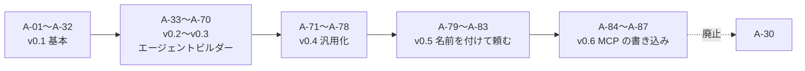

# 00. 仮定一覧
- プロジェクト：open-team（仮称） ／ 版数：v0.6（2026-10-01、書き直し） ／ 親：[00_overview.md](../00_overview.md)

> **3行で**
> 1. 本書がすべての仮定（A-01〜A-87）の正本。各ドキュメントは ID で参照する。
> 2. 「要確認 ○」は、実装前に確かめる必要がある仮定（25件）。
> 3. A-30 は v0.6 で廃止、A-03・A-05・A-34 は後の版で改訂・読み替えた（「状態」列）。

## 🧭 判断してほしいこと
なし（要確認の仮定は下表の ○。論点として扱うものは各ドキュメントの Q に挙げる）

## 全体図

見てほしいところ：後の版の仮定が前の版の仮定を改訂している（A-78 → A-03、A-81 → A-34、A-85 → A-30）。

## 要点
- 影響範囲の列の数字はドキュメント番号。「12」〜「15」は統合前のファイル番号（旧 12〜15）で、内容は 00〜11 に統合済み。
- A-71〜A-87 は旧 13〜15 に影響範囲の記載がない。
- 状態が空欄のものは、書き直し時点で有効。

---

## 詳細

### 一覧

仮定 A-01〜A-87（87件）

| ID | 仮定 | 影響範囲 | 要確認 | 状態 |
|---|---|---|---|---|
| A-01 | ベータ期の規模は、ユーザー500人、組織100、タスク2,000件/月 | 05, 07, 08 | ○ | フェーズ1以降の前提。フェーズ0は単一ユーザー（旧 13、ADR-025） |
| A-02 | itiwoman-automation と open-agent は TypeScript 製で、パッケージとして移植できる | 07, 11 | ○ |  |
| A-03 | 個人アカウントも1つの組織として扱う（インストール単位 = 組織） | 03, 04, 08 |  | 改訂（v0.4、→ A-78）：個人のワークスペースはサインイン時に自動で作り、GitHub はつなぐ連携先の1つ |
| A-04 | ロールは owner / maintainer / viewer の3種類 | 04, 06, 09 |  |  |
| A-05 | 承認待ちの有効期限は24時間 | 04, 08 | ○ | 一部改訂（v0.6、旧 15）：定期実行の仕事から出た Intent の期限は min(24時間, 次の実行の予定時刻) |
| A-06 | プッシュ通知の本文にコードの内容を含めない | 04, 06 |  |  |
| A-07 | ラベルによる委任は、open-team に登録済みで書き込み権限のあるユーザーに限る | 04 |  |  |
| A-08 | 信頼度提案の基準は、30日で承認10回以上・却下0回・Breaker作動0回 | 04 | ○ |  |
| A-09 | 組織の同時実行数は3件まで | 03, 04, 05 | ○ | 「組織」は v0.4 以降ワークスペース |
| A-10 | サンドボックスはIntentの提出時に破棄し、承認待ちの間は残さない | 07 |  |  |
| A-11 | ベースブランチが進んで差分を適用できない場合は、自動リベースせずに失敗にする | 04, 11 | ○ |  |
| A-12 | 後からサインインした Organization のメンバーは viewer になる | 03 |  | 「Organization」は GitHub の Organization |
| A-13 | 1ステップ = LLM呼び出し1回 | 04, 05 |  |  |
| A-14 | 対応するLLMプロバイダーは Anthropic、OpenAI、OpenRouter | 04, 07 | ○ |  |
| A-15 | プロンプトと応答の全文は暗号化して30日保存し、組織の設定で無効にできる | 04, 08 | ○ | 「組織の設定」は v0.4 以降ワークスペースの設定 |
| A-16 | `commands.allow` は前方一致で、シェルのメタ文字を含むコマンドは一致しない | 04 | ○ |  |
| A-17 | 承認カードの差分要約の費用はタスクの予算から引く | 04 |  |  |
| A-18 | 監査ログのエクスポートは owner だけができる | 04, 09 |  |  |
| A-19 | ベータ期は Google Cloud の東京リージョンの1リージョンで運用する | 05, 07 | ○ |  |
| A-20 | ピーク時の同時実行数は50タスク | 05 |  |  |
| A-21 | 許可するパッケージレジストリは npm・PyPI・crates.io・Go proxy・Maven Central・RubyGems の6つ | 05, 07 | ○ |  |
| A-22 | 通知から直接承認するボタンは付けない | 04, 06 |  |  |
| A-23 | 幅1024px以上では3カラムのレイアウトにする | 06 |  |  |
| A-24 | クラウドは Google Cloud を使う | 07 | ○ |  |
| A-25 | Cloud Run Jobs で、開始 p95 < 60秒を満たせる | 05, 07 | ○（要検証） |  |
| A-26 | pnpm workspaces ＋ Turborepo のモノレポにする | 07 |  |  |
| A-27 | LLMの単価はプラットフォームの価格表を使い、プロバイダーの請求額とは突き合わせない | 07 |  |  |
| A-28 | usage_records は13か月保持する | 08 |  |  |
| A-29 | 差分は5MBまでDBに保存する | 08 |  |  |
| A-30 | MVPでは1タスクにつきIntentは1件 | 04, 08 |  | **廃止（v0.6、15）**：1タスクの Intent は複数可（→ A-85） |
| A-31 | 画面用のAPIとWebhookは同じ `api` サービスで提供する | 07, 09 |  |  |
| A-32 | 1MBを超える差分は、承認画面でファイルごとに取得する | 06, 09 |  |  |
| A-33 | フェーズ1のテンプレートは dev-coder / reviewer / triager の3つ | 旧 12 |  | v0.4 でテンプレートを追加（`researcher` / `briefer` / `watcher` / `assistant`、REQ-050） |
| A-34 | 1リポジトリのエージェントは20個まで、1エージェントの Skill は20個まで | 旧 12 | ○ | v0.5 で「1リポジトリ」を「1ワークスペース」に読み替え（→ A-81） |
| A-35 | 設計アシスタントの費用は下書き1件あたり $0.5 まで（リポジトリの日次予算に含める） | 旧 12 | ○ | 設計アシスタントは v0.5 で設定プランナーに置き換え（→ A-82） |
| A-36 | 試し実行の予算は1回 $1 まで | 旧 12 | ○ |  |
| A-37 | スケジュールの最短間隔は1時間、`max_runs_per_day` は最大50 | 旧 12 |  |  |
| A-38 | メモリは1エージェント200項目・各500文字、注入は4,000トークンまで | 旧 12 |  |  |
| A-39 | レポートは open-team の中にだけ保存する | 旧 12 |  |  |
| A-40 | フェーズ2の最初の連携先は Slack | 旧 12 | ○ | v0.4 で GitHub 以外の連携は MCP に統一（ADR-022） |
| A-41 | メンションの書式は `@open-team <agent-id> <指示>`（コメントの先頭のみ） | 旧 12 |  |  |
| A-42 | 競合の情報は 2026-10-01 時点の Web 検索に基づく（一部は二次情報） | 01, 12 | ○ |  |
| A-43 | GitHub App に `issue_comment` の購読と `checks: write` を追加する | 旧 12 |  |  |
| A-44 | 既定の `open-team` ラベルは既定エージェント（`default`、BR-31）に割り当てる | 02, 03 |  |  |
| A-45 | 既存のタスクは、マイグレーションで既定エージェント（`default`）に紐づける | 03, 08 |  |  |
| A-46 | `paths.allow` による `path_not_allowed` の判定を、`edit_code` のツール呼び出しに加えて Intent の全変更パスにも適用する | 04 |  |  |
| A-47 | A-01 のタスク数（2,000件/月）には、トリガーによる起動と試し実行を含める | 05 |  |  |
| A-48 | NFR-055（下書きの検証）は GitHub と LLM を呼ばず、DB のポリシースナップショットで行う | 05 |  |  |
| A-49 | スマホの下部タブの「リポジトリ」を「エージェント」に置き換え、リポジトリは「その他」に移す | 06 |  |  |
| A-50 | エージェント関連のURLは `/agents`、`/agents/:agentId`、`/agent-drafts/:draftId`、`/agent-drafts/:draftId/chat`、`/tasks/:taskId/preview` | 06 |  | `/agent-drafts/*` は v0.5 で下書きの廃止に伴い対象外（→ SCR-018 は `/agents/:agentId`） |
| A-51 | 試し実行のプレビューは SCR-007 の表示モードとし、別の画面IDを設けない | 06 |  |  |
| A-52 | エージェントの停止の理由は1〜500文字 | 06, 09 |  |  |
| A-53 | 既定エージェントは SCR-003・SCR-014 の先頭に「既定」のラベルつきで表示する（`default.yaml` がなければ「組み込み」） | 06 |  |  |
| A-54 | スケジューラーは worker の定期処理として動かし、`FOR UPDATE SKIP LOCKED` で二重起動を防ぐ | 07, 10 |  |  |
| A-55 | DB の列と値は 12 を正とし、08 ではインデックス・制約・件数・保持期間・RLS・マイグレーションを補う | 08 |  | 旧 12 は 04・08 に統合済み。08 が正 |
| A-56 | 想定レコード数は、組織100・リポジトリ500・リポジトリあたり平均2エージェントで見積もる | 08 |  | 「組織」は v0.4 以降ワークスペース |
| A-57 | スケジュールの重複判定に `agent_schedules.last_task_id` を使う | 08, 10 |  |  |
| A-58 | `action_intents.self_review` の形は `{model, rounds[], unresolved[]}` | 08, 09 |  |  |
| A-59 | 組み込みの既定エージェントのスナップショットは、ポリシースナップショットと Hard Ceiling の版ごとに1件 | 08 |  |  |
| A-60 | API-058 で破棄できるのは `drafting` の下書きだけ | 08, 09 |  | API-058 は v0.5 で廃止 |
| A-61 | API の形とエラーの割り当ては 09 で補い、一覧と API-046・048 は 12 を正とする | 09 |  | 旧 12 は 09 に統合済み。09 が正（API-046・048 は v0.5 で廃止） |
| A-62 | HTTP ステータスの慣例：競合 409、業務上の前提 422、停止中 423、回数の上限 429 | 09 |  |  |
| A-63 | 自己レビューの結果は API-039 の `selfReview` で送り、intentHash には含めない | 09 |  |  |
| A-64 | API-058 で破棄できるのは `drafting` だけ（A-60 と同じ） | 09 |  | API-058 は v0.5 で廃止 |
| A-65 | 再公開では同じブランチ名を使い、open なPRがなければブランチを新しいコミットに更新する | 09 |  |  |
| A-66 | Check Run の結論：エラーは failure、警告だけは neutral、問題なしは success | 09 |  |  |
| A-67 | API-059 の既定の status は `active,invalid,disabled`。`clamped` で絞り込めて、状態ごとの件数を返す | 09 |  |  |
| A-68 | エージェントビルダーの図は 12 を正とする | 10 |  | 旧 12 は 10 に統合済み。10 が正 |
| A-69 | `removed` のエージェントは、同じIDのファイルが戻れば同じ行で active / invalid に戻す | 10 |  |  |
| A-70 | ER図の `last_task_id` とスケジュールの重複確認は A-57 に従う | 10 |  |  |
| A-71 | フェーズ0で使う MCP サーバーは、リモート（Streamable HTTP）のものに限る。ローカルの stdio サーバーは、フェーズ0ではコンテナ内での起動を許すが、フェーズ1（SaaS）では扱わない | 記載なし（旧 13 で定義） | ○ | |
| A-72 | Web 検索は外部の検索 API を使う（プロバイダーは設定で選ぶ。キーはユーザーのもの） | 記載なし（旧 13 で定義） | ○ | |
| A-73 | 交通情報は、公開の運行情報ページ・道路交通情報・地図や経路の MCP から取る。リアルタイム性はそれらの情報源に依存する | 記載なし（旧 13 で定義） |  | |
| A-74 | フェーズ0でスマホから使う場合は、Tailscale などのトンネルを使う（公開のインターネットに直接さらさない） | 記載なし（旧 13 で定義） | ○ | |
| A-75 | PC が止まっていて実行できなかったスケジュールは、後から実行しない | 記載なし（旧 13 で定義） |  | |
| A-76 | プロフィールは1ワークスペースにつき50項目、各500文字まで | 記載なし（旧 13 で定義） |  | |
| A-77 | `web_fetch` の本文は最大 200KB（抽出後のテキスト）、1タスク30回まで（ポリシーで減らせる） | 記載なし（旧 13 で定義） |  | |
| A-78 | 既存の「組織（organizations）」は「ワークスペース（workspaces）」に改名し、GitHub App のインストールはワークスペースにつなぐ連携の1つにする | 記載なし（旧 13 で定義） |  | |
| A-79 | 最初の境界の予算（`per_task_usd: 0.2`、`per_day_usd: 1`、`max_runs_per_day: 10`）は、リサーチ系の仕事を1日数回動かすのに足りる | 記載なし（旧 14 で定義） | ○ | |
| A-80 | 会話の保存期間は90日。それより古いものは要約を残す | 記載なし（旧 14 で定義） |  | |
| A-81 | 1エージェントの仕事は10個まで。ワークスペースのエージェントは20体まで（A-34 の「1リポジトリ」を「1ワークスペース」に読み替える） | 記載なし（旧 14 で定義） |  | |
| A-82 | 設定プランナーには、ワークスペースで最も性能の高いモデル（routing の `plan`）を使う。1回の呼び出しの費用は $0.05 程度 | 記載なし（旧 14 で定義） | ○ | |
| A-83 | 役割は5種類（`research` / `watch` / `brief` / `assist` / `dev`）で足りる | 記載なし（旧 14 で定義） |  | |
| A-84 | 引数の役割は、入力スキーマの最上位のプロパティの単位で足りる（Slack・Gmail・Calendar の主要な書き込みツールで確認する） | 記載なし（旧 15 で定義） | ○ | |
| A-85 | 1タスクの Intent は既定5件、Hard Ceiling 20件 | 記載なし（旧 15 で定義） |  | |
| A-86 | MCP の `tools/call` のタイムアウトは60秒、保存する応答は64KBまで | 記載なし（旧 15 で定義） |  | |
| A-87 | フェーズ0では、エージェントが書き込みの結果を使って次の手順を決める必要はない（結果を待たない） | 記載なし（旧 15 で定義） | ○ | |

## このドキュメントで決まったこと
- A-30 の廃止（v0.6）→ [00_overview.md の決定事項ログ](../00_overview.md#決定事項ログ) D-23。
