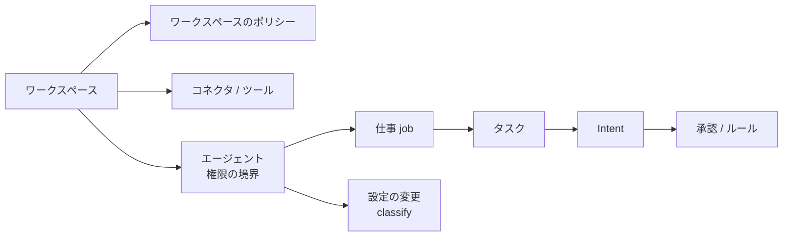

# 00. 用語集
- プロジェクト：open-team（仮称） ／ 版数：v0.6（2026-10-01、書き直し） ／ 親：[00_overview.md](../00_overview.md)

> **3行で**
> 1. 全ドキュメントで使う用語と、コード上の名前の対応表。
> 2. v0.4 で「組織（organizations）」を「ワークスペース（workspaces）」に改名した。旧称は「旧称」として残す。
> 3. v0.5 で廃止した用語（下書き・設計アシスタント）も、置換先つきで残す。

## 🧭 判断してほしいこと
なし

## 全体図

見てほしいところ：権限の境界はエージェント単位、実行の単位は仕事とタスク、外部作用の単位は Intent。

## 要点
- 統制の中核：[基本](#基本と統制)（Kernel・判定・Hard Ceiling・Intent）
- エージェント：[エージェントと仕事](#エージェントと仕事)（v0.5 の仕事・役割・自己設定）
- 外部連携：[連携・汎用化](#連携汎用化)（v0.4 の MCP・Web・汚染、v0.6 の引数の役割）

---

## 詳細

### 基本と統制

基本と統制の用語（42語）

| 用語 | 英語名（コード上の名前） | 定義 |
|---|---|---|
| ワークスペース | Workspace（`workspaces`、v0.4） | 統制とデータの単位。個人のワークスペースはサインイン時に自動で作る。GitHub はつなぐ連携先の1つ（A-78） |
| 組織（旧称） | Organization（`organizations`） | v0.3 までの名前。GitHub App のインストール単位で、個人アカウントも1つの組織として扱った（BR-01、A-03）。v0.4 でワークスペースに改名 |
| ロール | Role（`memberships.role`） | ワークスペース内の権限。`owner` / `maintainer` / `viewer` |
| 依頼者 | Requester（`tasks.requester_id`） | タスクを委任したユーザー |
| 承認者 | Approver（`approvals.approver_ids`） | 承認待ちの Intent を承認・却下できるユーザー（BR-14） |
| タスク | Task（`tasks`） | エージェントの1回の実行。開発では原則として1つの Issue に対応する。v0.5 以降は仕事（job）から作られる |
| ポリシー | Policy（`.agent/policy.yaml`） | 操作ごとの自律レベル・予算・Breaker・禁止パス・許可コマンド・承認者を定めたリポジトリのファイル。v0.4 以降は開発エージェントだけにかかる追加の上限 |
| ワークスペースのポリシー | Workspace Policy（v0.4） | アプリ内で定義する、すべてのエージェントの上限（BR-43）。版の履歴を持ち、緩める変更は owner の承認が要る |
| ルーティング | Routing（`.agent/routing.yaml`） | 処理フェーズごとに使う LLM モデルを定めたファイル |
| ポリシースナップショット | Policy Snapshot（`policy_snapshots`） | 特定のコミットのポリシーを検証・正規化した、変更しない記録。タスクは開始時点のものに固定される |
| 操作の種類 | Action Type（`action_type`） | `read` / `edit_code` / `run_tests` / `shell_network` / `open_pr` / `merge`。v0.3 で `browser_submit`・`payment`、v0.4 で `web_read` / `mcp_read` / `mcp_write` / `notify`、v0.6 で Intent の `mcp_call` を追加 |
| 自律レベル | Autonomy Level | 操作の種類ごとの扱い。`auto`（自律実行）/ `approve`（承認が必要）/ `deny`（禁止）/ `handoff`（ユーザーに引き継ぐ、v0.3）。`approve` の操作はルールに一致すれば `auto` 扱い |
| handoff | Handoff（v0.3） | エージェントが一時停止し、ユーザーが自分で操作する自律レベル。パスワードの変更・支払い・送金は Hard Ceiling で `handoff` のみ |
| Hard Ceiling | Platform Ceiling（`PLATFORM_CEILINGS`） | どのポリシーでも超えられないプラットフォームの上限（BR-06） |
| Governance Kernel | Kernel（`packages/kernel`） | 判定（`decide`）・合成（`compose`）・分類（`classify`）・Breaker・状態遷移を持つ統制の中核。すべて決定論的な純粋関数 |
| 判定 | Decision（`policy_decisions`） | Kernel の出力。`allow` / `deny` / `approve` / `halt` / `handoff` |
| 作用の意図 | ActionIntent（`action_intents`） | 「この外部作用を実行したい」という提案。内容を固定して承認・実行・記録する。`open_pr` と `mcp_call`（v0.6）。1タスクに複数可（v0.6） |
| intentHash | `intent_hash` | Intent の内容のハッシュ。承認はこれに紐づく。PR：差分の結果・タイトル・本文・ベースコミット・ポリシー。MCP：コネクタ・ツール・引数・ツールのハッシュ・実効ポリシーのハッシュ |
| 期待する tree SHA | `expected_tree_sha` | 差分をベースコミットに適用した結果の Git tree の SHA。実行時と実行後の検証に使う（PR のみ） |
| 承認 | Approval（`approvals`） | Intent に対する承認依頼と、その決定。[以後も許可] で決めたかを `remember` に持つ（v0.6） |
| 承認カード | Approval Card（SCR-007） | 差分や引数・リスク評価・コスト・該当ポリシーをまとめた承認画面。v0.5 以降はチャットの中にも出る |
| リスク評価 | Risk Assessment（`risk_level`） | ルールで計算するリスクの度合い（`low` / `medium` / `high`）。PR と MCP の書き込みで計算式が違う |
| Action Gateway | `gateway` | 外部への書き込みを行う唯一のコンポーネント。GitHub App の秘密鍵と MCP の認証情報を持つ |
| サンドボックス | Sandbox（`agent-runner`） | タスクごとに起動・破棄する隔離環境。外部サービスの認証情報を持たない |
| サンドボックストークン | Sandbox Token（`sandbox_token_hash`） | サンドボックスが `sandbox-edge` を呼ぶための、タスク単位のトークン |
| sandbox-edge | `sandbox-edge` | サンドボックスから届く唯一のサービス。LLM Proxy・Web 取得プロキシ・Internal API を提供する |
| LLM Proxy | LLM Proxy（API-037） | すべての LLM 呼び出しを中継し、予算とツール呼び出しを判定する |
| Harness | Harness（`packages/harness`） | サンドボックス内で動くエージェントのループ（open-agent 由来） |
| フェーズ（処理） | Phase（`tasks.phase`） | `investigate` / `plan` / `implement` / `test`（と、要約用の `summarize`） |
| フェーズ（計画） | — | フェーズ0（単一ユーザー・ローカル）/ フェーズ1（MVP）/ フェーズ2 |
| ステップ | Step（`tasks.steps_used`） | LLM 呼び出し1回（A-13） |
| 予算 | Budget（`budget.*`） | タスク・日ごとの費用（USD）、ステップ数、実行時間の上限 |
| Breaker | Circuit Breaker（`breakers.*`） | カウンタと閾値で暴走を検知して停止する仕組み |
| Kill Switch | Kill Switch（`workspaces.kill_switch_engaged`、旧 `organizations.…`） | ワークスペース内のすべてのエージェントを一括停止する仕組み |
| 監査ログ | Audit Log（`audit_logs`） | ワークスペースごとのハッシュチェーンでつないだ、追記専用の記録 |
| チェックポイント | Audit Checkpoint | 監査ログの最新のハッシュに KMS で署名して別の保存先に置いたもの（日次。フェーズ0では省略） |
| タスクイベント | Task Event（`task_events`） | タイムライン表示用の進捗記録（監査ログとは別） |
| BYOK | Bring Your Own Key（`llm_credentials`） | 利用者自身の LLM の API キーを使う方式 |
| 信頼度提案 | Trust Proposal（`trust_proposals`） | 承認の実績から、自律レベルの引き上げを提案するもの |
| リポジトリスナップショット | Repo Snapshot（`snapshot_object_path`） | ベースコミットの tarball。サンドボックスに読み取り専用で渡す |
| AI 事前レビュー | Pre-action AI Review（v0.3） | 外部作用の前にモデルが内容を検査する。結果は `auto` を `approve` に引き上げることにだけ使う（BR-34） |
| アクティビティビュー | Activity View（v0.3） | ワークスペース全体の実行・判定・外部作用を時系列で表示し、そこから停止できる画面 |

### エージェントと仕事

エージェントと仕事の用語（24語）

| 用語 | 英語名（コード上の名前） | 定義 |
|---|---|---|
| エージェント | Agent（`agents`、`.agent/agents/<id>.yaml`） | 名前のある担当者で、**権限の境界**（grants・自律レベル・予算・ルール）と、メモリ・会話・プロフィールの公開範囲を持つ。仕事どうしは境界を共有する |
| エージェント定義 v2 | Agent Definition（`version: 2`、v0.5） | `grants` と `jobs[]` を持つ定義の形式。v1（`template` / `instructions` / `triggers` が直下）は仕事が1つの v2 として読む |
| 役割 | Role（`agents.role`、v0.5） | 名前と最初のお願いから推測した得意分野（`research` / `watch` / `brief` / `assist` / `dev`）。挨拶・テンプレートの初期値・任せ先の提案にだけ使い、権限に影響しない（BR-48） |
| 仕事 | Job（`agent_jobs`、`jobs[]`、v0.5） | 1つのお願いから作る実行の単位。テンプレート・指示・トリガー・届け先を持つ。`once` / `recurring` / `watch` の3種類 |
| 最初の境界 | Initial Boundary（v0.5） | 作成直後のエージェントが持つ権限：`web_read`・`notify`・`submit_report`・`memory_write` と低い予算（A-79） |
| エージェントのチャット | Agent Chat（`agent_messages`、SCR-018、v0.5） | お願い・質問・確認カード・承認カード・結果の要約・変更の記録が流れる1本の会話 |
| 設定プランナー | Config Planner（v0.5） | お願いや反応から、定義の差分（JSON Patch）と確認事項を作る LLM。提案だけを行う。設計アシスタントを置き換える |
| 依頼 | Ask（`asks`、v0.12） | 入口（SCR-020）で頼んだ1件。編成を1つ持つ |
| 編成 | Formation（v0.12） | 依頼を誰がどの形でやるか。担当（使い回したエージェント・新しく作ったエージェント）と形からなる。設定プランナーが作り、Kernel の `validateFormation()` が検査する |
| 形 | Shape（`asks.shape`、v0.12） | 編成の進め方。ひとり（`single`）・並列（`parallel`）・まとめ（`aggregate`）・順番（`chain`） |
| まとめ役 | Aggregator（v0.12） | まとめの形で、各担当の結果を1つの報告にするエージェント。書き込みを持たず、ユーザーへの報告だけをする（BR-72） |
| エージェント生成中 | Generating（v0.12） | 依頼を送ってから編成が決まるまでの入口の表示 |
| 回答 | Answer（`asks.answer_task_id`、v0.14） | 依頼1件にユーザーへ返す1つの答え。窓口が書き、「誰が何をしたか」「手が要るもの」の行は Kernel が差し込む（FR-063） |
| 窓口 | Spokesperson（`ask_members.is_spokesperson`、v0.14） | 編成で回答を書く担当。ひとりはその担当、まとめはまとめ役、順番は最後の段。並列は窓口なしで Kernel が並べる |
| 連絡板 | Team board（`ask_messages`、v0.14） | 同じ依頼の担当どうしの連絡（共有・質問・返事・作り直しの依頼）。必ず Kernel を通り、データとして届き、汚染を引き継ぐ（FR-064、BR-75〜77） |
| 追いのターン | Follow-up turn（`tasks.kind = followup`、v0.14） | 終わった担当に質問が来たときに起こす、書き込みのない1ターン。返事を1通送って終わる |
| 設定の変更 | Config Change（`agent_config_changes`、v0.5） | エージェントが自分の定義に加えたい差分。Kernel が分類し、広げる変更は承認を待つ |
| 変更の分類 | `classify()`（v0.5） | 設定の変更を `narrow`（狭める）/ `neutral`（変わらない）/ `widen`（広げる）に分ける Kernel の純粋関数 |
| 確認カード | Confirm Card（v0.5） | `widen` の変更で「新しくできるようになること」を並べ、[許可] [やめる] を求めるカード |
| 自己調整 | Self-tuning（v0.5） | ユーザーの反応・発言・実行の成否から、権限を広げない範囲で自分を調整すること（BR-51〜54） |
| 調整メモ | `tuning`（v0.5） | 自己調整で書き換える仕事の指示の欄。ユーザーが書いた指示は消さない（BR-52） |
| エージェントスナップショット | Agent Snapshot（`agent_snapshots`） | 検証して実効ポリシーと合成した、変更しない定義。タスクは開始時点のものに固定される |
| 実効ポリシー | Effective Policy（`effective_policy`） | Hard Ceiling・ワークスペースのポリシー・（開発のみ）リポジトリのポリシー・エージェント定義を、厳しい方を取って合成したもの（`compose()`） |
| テンプレート | Template（`packages/harness/templates`） | フェーズの並び・使えるツール・出力の種類の組み合わせ。`dev-coder` / `reviewer` / `triager`、v0.4 で `researcher` / `briefer` / `watcher` / `assistant` |
| Skill | Skill（`.agent/skills/<name>/SKILL.md`） | 再利用できる手順。権限は与えない |
| メモリ | Agent Memory（`agent_memories`） | エージェントが覚えた項目。完了したタスクで書かれたものだけが有効 |
| トリガー | Trigger（`tasks.trigger_type`） | タスクを起動する入口。`manual` / `github_label` / `github_mention` / `schedule`、v0.4 で `watch` |
| アプリ内モード / GitOps モード | Definition Mode（v0.3） | 定義の正本を open-team の DB に置き保存で有効にする（既定）か、リポジトリに置き PR のマージで有効にするか（ADR-017） |
| Harness Canvas | Canvas（SCR-016） | エージェントの構成と境界を一画面で確認・編集する画面。v0.5 でエージェント詳細の「詳細設定」に移動 |
| 試し実行 | Dry Run（`tasks.is_dry_run`） | 外部作用を `simulated` にして行う、本番と同じ経路の実行。v0.5 で詳細設定の機能（Could） |
| 下書き（廃止） | Agent Draft（`agent_drafts`） | 公開前のエージェント定義と設計アシスタントとの会話。**廃止（v0.5、→ 会話・設定の変更）** |
| 設計アシスタント（廃止） | Design Assistant | 会話からエージェント定義の変更案を作った LLM。**廃止（v0.5、→ 設定プランナー）** |
| レポート | Report（`reports`、v0.4） | タスクの成果物（本文 ＋ 出典の URL）。アプリ内に保存する |

### 連携・汎用化

連携・汎用化の用語（14語）

| 用語 | 英語名（コード上の名前） | 定義 |
|---|---|---|
| コネクタ | Connector（`connectors`、v0.4） | 登録した MCP サーバー（または組み込みの GitHub）。認証情報は Gateway だけが持つ |
| コネクタのツール | Connector Tool（`connector_tools`、v0.4） | MCP サーバーが公開する各ツール。分類（`read` / `write` / `unclassified`）、説明文と入力スキーマのハッシュ、引数の役割を持つ |
| 未分類 | `unclassified` | 分類していないツール。書き込みとして扱い、ルールを持てない |
| 要再確認 | `needs_review` | 説明文・入力スキーマが変わったツールの状態。確認まで呼び出しは `deny`（BR-42） |
| 引数の役割 | Argument Roles（`arg_roles`、v0.6） | 書き込みツールの最上位の引数ごとの `destination`（宛先）/ `content`（中身）/ `option`（その他）。未確定は `destination` 扱い（BR-56） |
| 自分の中だけ | `scope: self`（v0.6） | 宛先の引数を持たないツールが、自分のアカウントの中でだけ作用することをユーザーが明示した印 |
| ツールのハッシュ | `tool_hash`（v0.6） | ツールの説明文・入力スキーマ・`arg_roles` から計算するハッシュ。ルールと Intent に記録する |
| 「以後も許可」のルール | Rule（`rules[]`、v0.3 / v0.6） | 承認カードから作る許可。ツールのすべての `destination` 引数を実際の値で完全一致に固定する（BR-39、BR-57） |
| 届け先 | Deliver（`jobs[].deliver`、v0.6） | 仕事の結果の送り先の宣言。宛先は定義が決め、ランタイムが Intent を作る（BR-58）。ツールの `deliver` は廃止 |
| 結果不明 | `unknown_outcome`（v0.6） | MCP の書き込みを送信した後に応答が返らなかった Intent の状態。ユーザーが確定する（BR-59） |
| 置き換えによる期限切れ | `expired`（`superseded`、v0.6） | 同じ仕事の次の実行が始まって無効になった承認待ち（BR-60）。ほかに `tool_changed` |
| 汚染 | Taint（`tasks.tainted`、v0.4） | 外部の内容（Web・MCP の応答）を読んだタスクの印。解除できない（BR-38） |
| Web 取得プロキシ | Web Fetch Proxy（v0.4） | `web_fetch` が通る GET / HEAD のみ・認証情報なし・私的アドレス拒否のプロキシ |
| プロフィール | Profile（`profiles`、v0.4） | 自宅・職場・通勤経路・関心など、エージェントに渡すユーザーの前提。項目ごとに公開先を選ぶ |

## このドキュメントで決まったこと
- 用語の統一：組織 → ワークスペース（v0.4、A-78）。決定の一覧は [00_overview.md の決定事項ログ](../00_overview.md#決定事項ログ)。
