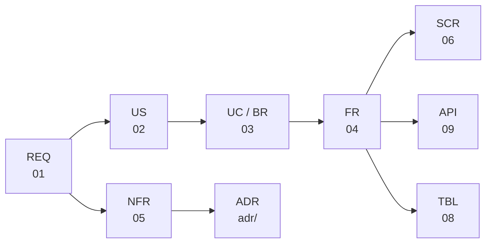

# 00. トレーサビリティ表
- プロジェクト：open-team（仮称） ／ 版数：v0.6（2026-10-01、書き直し） ／ 親：[00_overview.md](../00_overview.md)

> **3行で**
> 1. REQ ごとに、US → UC → FR → SCR → API → TBL の対応を1行で示す。
> 2. v0.4（REQ-042〜051）は UC・FR・SCR・API の ID がまだ振られていない（旧 13 は概要だけ）。TBL は 08 で TBL-026〜030 を採番。
> 3. v0.5 で廃止した ID（REQ-020、SCR-015、TBL-021、API-043〜048・057・058）は「廃止」と明記して残す。

## 🧭 判断してほしいこと
なし（ID の未採番・未反映は各ドキュメントの Q。要件・ストーリーの分は [01](../01_requirements.md) と [02](../02_user_stories/README.md)）

## 全体図

見てほしいところ：上流の ID を廃止・置換したときは、この表をたどって下流を確認する。

## 要点
- 定義先：REQ [01](../01_requirements.md)、US [02](../02_user_stories/README.md)、UC [03](../03_use_cases/README.md)、FR [04](../04_functional_spec/README.md)、NFR [05](../05_non_functional.md)、SCR [06](../06_ux_design/README.md)、TBL [08](../08_database/README.md)、API [09](../09_api/README.md)。
- 「—（未採番）」は、旧 13 が「反映が要る」とだけ書いて ID を振っていないもの。

---

## 詳細

### REQ → 下流

トレーサビリティ表（REQ-001〜058）

| REQ | 優先度 | US | UC | FR | SCR | API | TBL |
|---|---|---|---|---|---|---|---|
| REQ-001 | Must | US-001, US-002 | UC-001 | FR-001, FR-002 | SCR-001, SCR-008, SCR-012 | API-001〜005, API-035 | TBL-001〜004, TBL-016, TBL-017 |
| REQ-002 | Must | US-004 | UC-005 | FR-005 | SCR-003 | API-007, API-010, API-011 | TBL-006 |
| REQ-003 | Must | US-005 | UC-007 | FR-007, FR-008 | SCR-005 | API-036, API-038 | TBL-006, TBL-007 |
| REQ-004 | Must | US-003, US-006 | UC-004, UC-007 | FR-003, FR-004, FR-010 | SCR-003, SCR-005, SCR-009 | API-008, API-009, API-037, API-039 | TBL-005, TBL-008, TBL-010 |
| REQ-005 | Must | US-007 | UC-009 | FR-011 | SCR-006, SCR-007 | API-017〜019 | TBL-008, TBL-009 |
| REQ-006 | Must | US-008 | UC-010 | FR-010, FR-012 | SCR-005, SCR-007 | API-019, API-039（＋Gateway 内部 API） | TBL-008 |
| REQ-007 | Must | US-009, US-010 | UC-008, UC-014 | FR-009, FR-013 | SCR-002, SCR-005 | API-013, API-022, API-037, API-040 | TBL-006, TBL-011 |
| REQ-008 | Must | US-011 | UC-008 | FR-004, FR-014 | SCR-005 | API-037, API-039 | TBL-006, TBL-010 |
| REQ-009 | Must | US-012, US-013 | UC-011, UC-012 | FR-015 | SCR-005, SCR-011, SCR-013 | API-006, API-016, API-020, API-021 | TBL-002, TBL-006 |
| REQ-010 | Must | US-014 | UC-013 | FR-016 | SCR-010 | API-023, API-024 | TBL-012 |
| REQ-011 | Must | US-015 | UC-003 | FR-017 | SCR-011, SCR-012 | API-004, API-031, API-032 | TBL-014 |
| REQ-012 | Must | US-016, US-017 | UC-002, UC-004, UC-007 | FR-003, FR-008, FR-009, FR-019 | SCR-009, SCR-011, SCR-012 | API-026〜028, API-037, API-040 | TBL-005, TBL-011, TBL-013 |
| REQ-013 | Must | US-018 | UC-007 | FR-018 | SCR-002, SCR-004, SCR-005 | API-012〜015, API-038 | TBL-007 |
| REQ-014 | Should | US-019 | UC-006 | FR-006 | SCR-004（トリガーの表示） | API-035 | TBL-006, TBL-017 |
| REQ-015 | Should | US-020 | UC-015 | FR-021 | SCR-009 | API-033, API-034 | TBL-015 |
| REQ-016 | Should | US-021, US-022 | UC-004, UC-009, UC-016 | FR-011, FR-020 | SCR-007, SCR-011 | API-029, API-030 | TBL-003, TBL-009 |
| REQ-017 | Should | US-023 | UC-013 | FR-016 | SCR-010 | API-025 | TBL-012 |
| REQ-018 | Could（v0.5） | US-025 | UC-017 | FR-023, FR-025 | SCR-016（v0.5 で SCR-017 の詳細設定へ） | API-044, API-046（v0.5 で廃止） | TBL-019, TBL-021（廃止） |
| REQ-019 | Must | US-027, US-029 | UC-019, UC-020 | FR-022, FR-023 | SCR-014, SCR-016 | API-041, API-042 | TBL-018, TBL-019 |
| REQ-020 | **廃止（v0.5、→ REQ-052, REQ-053）** | US-024 | UC-017 | FR-024（→ FR-035） | SCR-015（廃止） | API-043, API-045, API-057, API-058（廃止） | TBL-021（廃止）, TBL-011 |
| REQ-021 | Must（GitOps モード） | US-027 | UC-019, UC-020 | FR-022, FR-027 | SCR-016 | API-048（v0.5 で廃止）（＋Gateway 内部 API） | TBL-018, TBL-021（廃止） |
| REQ-022 | Could（v0.5） | US-026 | UC-018 | FR-026 | SCR-016, SCR-005 | API-047（v0.5 で廃止） | TBL-006, TBL-019 |
| REQ-023 | Must | US-028 | UC-021 | FR-028 | SCR-016, SCR-017 | API-035, API-011 | TBL-006, TBL-020 |
| REQ-024 | Should | US-030 | UC-017, UC-024 | FR-030 | SCR-016, SCR-005 | API-053 | TBL-019, TBL-021（廃止） |
| REQ-025 | Should | US-031 | UC-023 | FR-031 | SCR-017 | API-051, API-052, API-055 | TBL-022 |
| REQ-026 | Must | US-032 | UC-022 | FR-032 | SCR-002, SCR-014, SCR-017 | API-049, API-050, API-059 | TBL-018 |
| REQ-027 | Should | US-033 | UC-007 | FR-029, FR-033 | SCR-005 | API-056 | TBL-006 |
| REQ-028 | Should | — | UC-007 | FR-029 | SCR-007 | API-013, API-018, API-037 | TBL-008 |
| REQ-029 | Must（フェーズ2） | US-034 | — | —（フェーズ2で設計） | — | — | — |
| REQ-030 | Must（フェーズ0） | US-035 | —（未採番） | —（未採番。Intent の流れは 04） | — | API-019（v0.6 変更）, API-070 | TBL-008, TBL-009（v0.6 変更） |
| REQ-031 | **廃止（v0.4、→ REQ-045）** | — | — | — | — | — | — |
| REQ-032 | Should（フェーズ2） | — | — | —（フェーズ2で設計） | — | — | — |
| REQ-033〜038 | フェーズ1（v0.3） | —（未作成） | — | — | — | — | — |
| REQ-034 | Must | —（未作成） | — | — | — | API-019, API-068, API-069（v0.6） | — |
| REQ-039〜041 | フェーズ2（v0.3） | — | — | —（フェーズ2で設計） | — | — | — |
| REQ-042 | Must（フェーズ0） | US-038 | —（未採番） | —（未採番） | —（未採番） | API-071（v0.6） | TBL-027, TBL-028 |
| REQ-043 | Must（フェーズ0） | US-036 | —（未採番） | —（未採番） | — | — | — |
| REQ-044 | Must（フェーズ0） | US-036, US-037 | —（未採番） | —（未採番） | — | — | — |
| REQ-045 | Must（フェーズ0） | US-039 | —（未採番） | —（未採番） | —（未採番） | —（未採番） | TBL-026 |
| REQ-046 | Must（フェーズ0） | US-036, US-037 | —（未採番） | —（未採番） | — | — | TBL-030 |
| REQ-047 | Must（フェーズ0） | US-037 | —（未採番） | —（未採番） | — | — | TBL-006（`tainted`） |
| REQ-048 | Should（フェーズ0） | US-036 | —（未採番） | —（未採番） | —（未採番） | —（未採番） | TBL-029 |
| REQ-049 | Must（フェーズ1） | US-038 | — | — | — | — | — |
| REQ-050 | Must（フェーズ0、スターターは1） | US-039 | — | — | — | — | — |
| REQ-051 | Must（フェーズ0） | — | — | — | — | — | — |
| REQ-052 | Must（フェーズ0） | US-040 | UC-025 | FR-034 | SCR-014, SCR-018 | API-060 | TBL-018, TBL-024 |
| REQ-053 | Must（フェーズ0） | US-041 | UC-026 | FR-035, FR-037, FR-038 | SCR-018 | API-062 | TBL-023, TBL-025 |
| REQ-054 | Must（フェーズ0） | US-041, US-044 | UC-026, UC-028 | FR-036 | SCR-018 | API-063 | TBL-025 |
| REQ-055 | Must（フェーズ0） | US-042 | UC-026 | FR-037 | SCR-017, SCR-018 | API-065 | TBL-023 |
| REQ-056 | Should（フェーズ0） | US-042 | UC-028 | FR-039 | SCR-018 | API-064, API-067 | TBL-025 |
| REQ-057 | Should（フェーズ0） | US-043 | UC-027 | FR-040 | SCR-018 | API-066 | TBL-023 |
| REQ-058 | Should（フェーズ0） | US-040 | UC-025 | FR-034, FR-035 | SCR-018 | API-060 | TBL-018 |
| REQ-063 | Must（フェーズ0・0-H） | US-045 | UC-040 | FR-061 | SCR-020 | API-072, API-073（仮。09 は提出後） | `asks`・`ask_members`（仮。08 は提出後）, TBL-018, TBL-023 |
| REQ-064 | Must（フェーズ0）/ 0-H は順番が Must | US-046 | UC-040 | FR-061, FR-062 | SCR-020, SCR-019, SCR-021 | API-072, API-074, API-075（仮） | `asks`・`ask_members`（仮）, TBL のタスク（`ask_id`） |
| REQ-065 | Must（フェーズ0・0-H） | US-045 | UC-040 | FR-061 | SCR-020 | — | — |
| REQ-066 | Must（フェーズ0・0-H） | US-047 | UC-040, UC-041 | FR-063 | SCR-019, SCR-020, SCR-021 | API-075, API-077（仮） | `asks.answer_task_id`・`ask_members.is_spokesperson`（仮） |
| REQ-067 | Must（フェーズ0）/ 0-H は Should | US-048 | UC-041 | FR-064 | SCR-021 | API-076（仮） | `ask_messages`・`tasks.kind`（仮） |

- REQ-052〜058 の行は、旧 14 の UC・FR・SCR・API・TBL の対応から作った。REQ-030・034・042 の API は旧 15 の API-019・068〜071 から作った。
- REQ-042〜051 の UC・FR・SCR は旧 13 が ID を振っていない（03〜09 の書き直しで採番される場合はそちらが正）。TBL-026〜030 は 08 の書き直しで採番した（workspace_policies / connectors / connector_tools / profiles / reports）。

### NFR と REQ の対応（主なもの）

REQ-003 → NFR-018〜020 ／ REQ-004 → NFR-005, 007, 036 ／ REQ-005 → NFR-006, 041 ／ REQ-006 → NFR-005 ／ REQ-007 → NFR-050 ／ REQ-009 → NFR-002, 012, 013 ／ REQ-010 → NFR-028, 035 ／ REQ-011 → NFR-010, 039 ／ REQ-012 → NFR-022 ／ REQ-013 → NFR-011 ／ REQ-019 → NFR-056 ／ REQ-020 → NFR-054, 059（REQ-020 は廃止） ／ REQ-021 → NFR-051 ／ REQ-023 → NFR-052 ／ REQ-026 → NFR-053

## このドキュメントで決まったこと
- なし（対応表のみ）。
