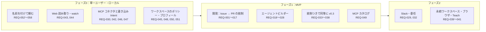

# 01. 要件定義
- プロジェクト：open-team（仮称） ／ 版数：v0.6（2026-10-01、書き直し） ／ インプット：壁打ちメモ 2026-09-30（リポジトリ外の壁打ちメモ）、[00_overview.md](00_overview.md)、競合調査（2026-10-01）

> **3行で**
> 1. スマホから何でも頼めて、Web と MCP でつないだ既存サービスを使って自律的に動き、何をどこまでやってよいかはポリシーがコードで強制する **汎用クラウドエージェント** を作る（REQ-001〜058）。
> 2. 最初の到達点はフェーズ0：名前だけで「朝の交通係」「ニュースリサーチャー」を作り、一言お願いするだけで翌朝からスマホに結果が届くこと。KPI はフェーズ1以降に測る。
> 3. 課金・ネイティブアプリ・公開するセルフホスト版・モデルの判断による許可・PR 以外の GitHub への書き込みはやらない（[Won't](#7-スコープ外wont今回やらない)）。

## 🧭 判断してほしいこと

| # | 種類 | 論点 | 選択肢 | おすすめ（理由） | 決まらないと止まるもの |
|---|---|---|---|---|---|
| Q-01 | 未決 | プロダクト名 | — | —（元の記述なし） | — |
| Q-02 | 未決 | 課金モデル・料金体系（将来）。BYOK のみで続けるか、プラットフォーム課金を併用するか。課金するならエージェント数・実行時間・機能のどれで課金するか（競合はどちらも上位プランへの同梱） | A: BYOK のみ / B: 併用 | —（元の記述なし。v0.4 で「課金の仕組みは当面作らない」は決定済み：D-03） | フェーズ2（SaaS 化）、05 のコスト |
| Q-03 | 未決 | 開発チームの規模とリリース期限 | — | —（元の記述なし） | 05 の運用体制・SLA |
| Q-04 | ✅決定 | 追加の KPI「作成完了率」（旧 12 §要件）は `agent_drafts` の「公開 PR がマージされた下書き」で測るが、下書き（TBL-021）は v0.5 で廃止（旧 14 §データベース） → **「作成完了率」を「最初の結果の到達率」（作ったエージェントのうち7日以内に最初の結果が届いた割合 ≥ 40%）に置き換え**（[D-17](decisions.md#d-17)）| A: v0.5 の作り方で測り直す / B: KPI を外す | —（元の記述なし） | KPI の計測 |
| Q-05 | 未決 | 一般の個人ユーザー向けに、LLM の API キーを用意する手間をどう減らすか（課金を扱わない前提のまま）（旧 13 §未決事項） | — | —（元の記述なし） | REQ-049、P-6 のオンボーディング |
| Q-06 | ✅決定 | 開発テンプレートをフェーズ0に含めるか（現状はフェーズ1）（旧 13 §未決事項） → **フェーズ1のまま**（[D-03](decisions.md#d-03)）| A: フェーズ1のまま / B: フェーズ0に含める | —（元の記述なし。現状は A） | フェーズ0の範囲 |
| Q-07 | 未決 | MCP カタログの審査の方針（フェーズ1）。誰が・何を基準にカタログに載せるか（旧 13 §未決事項） | — | —（元の記述なし） | REQ-049 |
| R-01 | リスク | 競合の情報は 2026-10-01 時点の Web 検索に基づき、一部は二次情報（A-42）。dots の公式ヘルプ、Grok Bot の監査と支出上限の提供状況を一次情報で確認していない | — | —（元の記述なし。確認は旧 12 の未決事項） | 差別化の方針の前提 |
| R-02 | リスク | 交通情報の情報源が、利用規約上、自動取得してよいページかどうか未確認（旧 13 §未決事項、A-73） | — | —（元の記述なし） | US-036、フェーズ0の完成条件 |

- フェーズ1（MVP）の完成条件は旧 13 の条件に一本化した（[D-01](decisions.md#d-01)）。

## 全体図

見てほしいところ：フェーズ0は「予算・Breaker・停止・監査ログ・通知・承認」など、動かすのに要る既存の要件（REQ-005〜011 の一部）も含む。

## 要点
- 不安は4つ（暴走・請求額・外部への作用・説明責任）。開発以外（メール送信・Slack 投稿）にも同じく当てはまる（[§1](#1-背景課題)）。
- 競合（Grok Bot・dots）の機能は「統制つきで同等に」採用する。共通ルールは3つ（[採用方針](#競合機能の採用方針v03)）。
- 成功の判定：フェーズ0は完成条件だけ、フェーズ1以降は KPI（[§2](#2-目的成功指標kpi)）。
- 要件は REQ-001〜058。REQ-020・031 は廃止、REQ-018・022 は Could に下げた（[§5](#5-業務要件--機能要件概要)）。
- フェーズの正本は [§5 フェーズ計画](#フェーズ計画)。
- 制約：PWA のみ・BYOK のみ・サンドボックスに認証情報を渡さない（[§6](#6-制約条件)）。

---

## 詳細

### 1. 背景・課題

- GrokBot / dots に代表される「どこからでも頼めて、勝手にやってくれる」自律型クラウドエージェントが普及しつつある（Grok Bot：2026-08-11 β開始、OpenAI dots：2026-09-29 発表）。それらは **利便性を優先しており、何をどこまで実行してよいかの制御がプロンプト頼み** である。調査時点では、全 Bot が1台の VM と認証情報を共有している、エージェント単位の支出上限や監査ビューがない、最後の確認をモデルが判定している、などの弱点がある（→ [競合分析](#競合分析)）。
- 競合はどちらも **ユーザーが自分用のエージェントを作れる** ことを中心に据えている。open-team も、エージェントの作成を中核の機能とし、「エージェント＝権限の境界」として統制と両立させる。
- エージェントにリポジトリやサービスを任せる際の不安は次の4点に集約される。開発に限らず「エージェントにメールを送らせる」「Slack に投稿させる」場合にも同じように当てはまる。
  1. **暴走**：同じ操作の無限ループ、意図しない広範囲の変更、禁止したファイルへの変更
  2. **請求額**：LLM 費用が青天井に膨らむ
  3. **外部への作用**：勝手に Push・PR・マージ・送信される
  4. **説明責任**：後から「誰が・どのモデルが・何を根拠に」実行したか追えない
- 既存資産として、統制側の **itiwoman-automation**（FlowEngine・許可リスト・承認待ち・キャンセル・書き込みデフォルト禁止）と、設計・振り分け側の **open-agent / open-tui**（Harness Canvas・PermissionMap・モデル Router・Evidence）がある。前者には常時稼働トリガー・実作用・サンドボックス・コスト計測が、後者にはサーバー実行・自律ループ・承認フローが欠けている。

| 版 | 方針 |
|---|---|
| v0.3 | dots / Grok Bot の機能は基本的にすべて採用し、体験は同等にしたうえで統制を残す。モデルの判断は判定を厳しくする方向にだけ使い、外部作用は内容を固定してから実行する |
| v0.4 | 開発専用をやめ、ニュースのリサーチや毎朝の交通状況の確認などを含めて **何でも頼める汎用クラウドエージェント** にする。既存サービスへは MCP サーバーでつなぐことを基本とし、開発（Issue → PR）は用途の1つとする |
| v0.5 | ユーザーは複雑な操作をしない。エージェントに名前を付け、やりたいことを伝えるだけにする。設定はエージェントが自分で行い、権限を広げる変更だけユーザーの承認を通す |
| v0.6 | MCP の書き込みは「宛先は定義が決め、LLM は中身だけを書く」。「以後も許可」は宛先を固定したルールでだけ効く |

### 競合分析

調査日：2026-10-01。どちらの製品も発表から日が浅く、一部は公式ドキュメントを引用した二次情報に基づく（【二次】、A-42、R-01）。

Grok Bot・dots・open-team の比較（9観点）

| 観点 | Grok Bot（SpaceXAI / Cursor、2026-08-11 β） | OpenAI dots（2026-09-29 DevDay で発表） | open-team（v0.3 時点の記述） |
|---|---|---|---|
| 作り方 | 名前・肩書き・役割の自然言語の3項目。Skill は文章、または操作デモの録画（最長10分）で教える | 会話で作る。作成はデスクトップ版と Web 版のみ。持てるのは当面1体 | 会話で下書き → Canvas で境界を確認 → 試し実行 → PR で公開（v0.5 で「名前を付けて頼む」に変更） |
| 定義の置き場所 | 製品内の設定 | 製品内の設定（Custom Rules） | **リポジトリ内のファイル**（差分・レビュー・ロールバックができる）。v0.3 で既定はアプリ内モード |
| 起動 | スケジュール。Cursor 連携なら Slack / GitHub のイベントでも動く | スケジュール、読み取り専用のリサーチ | 手動、Issue のラベル、メンション、スケジュール（フェーズ2で Slack） |
| 依頼できる場所 | デスクトップ、iOS、Android、Slack | ChatGPT（Web・モバイル）、Codex、Slack、Teams、音声 | Web（PWA）、GitHub（フェーズ2で Slack） |
| 隔離 | **全 Bot が1台の VM と認証情報を共有**【二次】 | 1 dot につき1台のクラウド PC | **タスクごとの使い捨てサンドボックス。認証情報なし** |
| 承認 | Allow once / Deny / Always Allow。自動の確認はモデルが判定 | 4段階の Custom Rules。自動の確認はモデルが判定 | ポリシーと Kernel による決定論的な判定。承認は intentHash に固定 |
| 予算 | 支出上限は「coming」【二次】 | プラン共通の利用枠。dot 単位の上限は見当たらない【二次】 | エージェント単位・タスク単位・日単位の上限と Breaker |
| 監査 | 監査ビューは「coming」【二次】 | Activity View | ハッシュチェーンつきの監査ログ |
| 作業範囲 | 汎用（ブラウザ操作を含む） | 汎用（4,000以上のアプリ連携） | v0.3：フェーズ1は開発、フェーズ2で業務ツールへ（v0.4 で汎用に変更） |

**主な出典**：[x.ai: Introducing Grok Bot](https://x.ai/news/introducing-grok-bot)、[docs.x.ai: Skills, routines and automations](https://docs.x.ai/grok-bot/skills-routines-and-automations)、[learncursor: Grok Bot security](https://www.learncursor.dev/learn/cursor-agents/grok-bot-security-privacy)【二次】、[TNW: OpenAI dots](https://thenextweb.com/news/openai-dots-always-on-ai-agents-cloud-computers-devday)、[TechCrunch: OpenAI launches dots](https://techcrunch.com/2026/09/29/openai-launches-dots-its-bubbly-agentic-avatar/)、[dev.to: dots permission model](https://dev.to/sword_luan_6dfb4e81cf5f15/openai-dots-explained-from-the-docs-the-permission-model-of-an-always-on-agent-5eoj)【二次】

**参考**：OpenAI の Agent Builder（ビジュアルキャンバス）は 2026-11-30 に終了予定で、ビジュアルなエージェント作成画面の枠が空く。Zapier Agents は外部ゲストによる承認と、実行回数での自動停止を持つ（チームでの承認の前例）。

### 差別化の方針

| 勝負する軸 | 競合の弱点 | open-team の打ち手 | 関連 |
|---|---|---|---|
| 統制・安全性 | 隔離が共有 VM、最後の確認がモデル判定、予算・監査が未提供 | エージェント＝権限の境界、実効ポリシーの合成（厳しい方を取る）、エージェント単位の予算・停止・監査 | BR-20〜23、FR-023、FR-032 |
| どこからでも頼める | 入口は多いが、入口ごとに統制が分かれていない保証がない | 入口はすべて「トリガー」として定義し、同じ Kernel を通す | FR-028、フェーズ2（Slack） |
| 成果物の質 | 成果物の検証はユーザー任せ | 提出前の自己レビュー（別モデル）、Skill の版管理、エージェントごとのスコアカード | FR-029、FR-030、FR-032 |
| 開発以外への拡張 | 汎用だが、作用の内容を事前に確定できない（ブラウザ操作） | 作用はすべて Intent（内容を固定したプレビュー → 承認 → 検証）。v0.4 で連携は MCP に統一（ADR-022） | ADR-016、ADR-022 |

### 競合機能の採用方針（v0.3）

**方針（2026-10-01 決定、D-27）**：dots と Grok Bot の機能は基本的にすべて採用する。体験は競合と同等にし、統制は残す（「統制つきで同等に」）。Web アプリ（PWA）のみ・BYOK のみの制約は維持する。統制つきで採用するときの共通ルールは次の3つ。

1. **判定は決定論的なランタイムが行う**：モデルの判断を使ってよいのは、判定を **厳しくする方向** だけ。
2. **外部作用は、内容を固定してから実行する**：プレビュー → 承認（または事前に許可したルール）→ 実行 → 検証。
3. **リポジトリのポリシー（`policy.yaml`）と Hard Ceiling は、どの機能からも超えられない上限** として残す（v0.4 以降はワークスペースのポリシーも上限）。

競合の機能ごとの採用の形（20機能、v0.3 時点のフェーズ）

| 競合の機能 | 出典 | open-team での採用の形 | フェーズ（v0.3） | 要件 |
|---|---|---|---|---|
| 会話でエージェントを作る（名前・役割・見た目） | 両方 | 採用済み（FR-024）。定義に `appearance`（アイコン・色）を追加。スマホでも作成できる（dots はできない）。v0.5 で「名前を付けて頼む」に置き換え | 1 | REQ-020（→ REQ-052〜053） |
| 設定画面で作り、すぐ有効になる | 両方 | **アプリ内モード（既定）**：定義を open-team に保存し、保存した時点で有効にする。権限を広げる変更だけは承認者の承認が要る。版の履歴・差分・ロールバックつき。リポジトリで管理したい組織は **GitOps モード**（PR のマージで有効。v0.2 の方式）を選べる | 1 | REQ-033 |
| Skill を会話で保存する | Grok | 採用済み（FR-030、API-053） | 1 | REQ-024 |
| 操作デモを録画して教える（Teach a task） | Grok | ブラウザのサンドボックスで、ユーザーが遠隔のブラウザを操作して記録 → 手順と画面要素を SKILL.md の下書きにする。実行時はブラウザ操作の統制に従う | 2 | REQ-041 |
| スケジュール・イベント起動 | 両方 | 採用済み（FR-028） | 1 | REQ-023 |
| 読み取り専用の能動的リサーチ | dots | トリガー `watch`：指定した情報源を定期的に読み、変化があればレポートする。テンプレート `watcher` は読み取り系のツールしか持たない（Hard Ceiling） | 2（v0.4 でフェーズ0） | REQ-043 |
| メモリ | 両方 | 採用済み（FR-031）。項目単位で削除でき、出どころをたどれる | 1 | REQ-025 |
| 承認の Allow once / Deny / Always Allow | Grok | 承認カードに「今回だけ許可」「却下」「以後も許可」。「以後も許可」は範囲を絞ったルールとして定義に追加し、取り消せる。ポリシーや Hard Ceiling が `approve` を求める操作には出さず、代わりに「ポリシー変更の PR を作る」（信頼度提案）を出す。ルールの形は v0.6 で確定（D-20） | 1 | REQ-034 |
| 4段階のルール（無断で実行 / 事前承認済みなら実行 / 確認 / ユーザーに引き継ぎ） | dots | `auto` / ルールに一致すれば `auto` / `approve` / **`handoff`（新設）**。`handoff` ではエージェントが一時停止し、ユーザーが自分で操作する。パスワードの変更・支払い・送金は Hard Ceiling で `handoff` のみ | 1 | REQ-035 |
| モデルによる自動の確認（Auto Review / Auto-review） | 両方 | **AI 事前レビュー**：外部作用の前にモデルが内容を検査する。結果は `auto` を `approve` に引き上げることにだけ使い、許可には使わない | 1 | REQ-036 |
| Activity View | dots | 組織全体のアクティビティ（全エージェントの実行・判定・外部作用を時系列で表示し、そこから停止できる） | 1 | REQ-037 |
| 音声で頼む | 両方 | PWA の音声入力（ブラウザの音声認識）。ネイティブアプリは作らない | 1 | REQ-038 |
| 専用のクラウド PC（常時起動） | 両方 | **エージェント単位の永続ワークスペース**：ファイルとブラウザのプロファイルを、エージェントごとの暗号化ディスクに保存し、実行のたびにつなぐ。計算資源はタスクごとに使い捨てのまま。エージェント同士は分離する | 2 | REQ-039 |
| ブラウザ操作・既存ツールへのログイン | 両方 | **統制つきブラウザ**：ブラウザは別のサンドボックスで動かし、通信は専用のプロキシを通す。許可したドメインへの GET だけを通し、POST などの書き込みは承認済みの Intent（送信先・入力値・画面のハッシュ）に一致する場合だけ通す。ログイン情報は保管庫に置き、モデルには見せない | 2 | REQ-040 |
| パスワード・2FA の入力の引き継ぎ | Grok | `handoff` の一種として、ユーザーがスマホから遠隔のブラウザを直接操作する。その間エージェントは停止し、画面も記録しない | 2 | REQ-040 |
| 数千のアプリ連携 | dots | **MCP コネクタ**：リモートの MCP サーバーを登録し、ツールごとに読み取り / 書き込みを分類する。分類していないツールは書き込み扱い（`approve`）。書き込みは引数をプレビューする Intent。認証情報は Gateway が持つ | 2（v0.4 でフェーズ0） | REQ-042 |
| 取りまとめ役（chief of staff）、エージェント同士のやり取り | Grok | 取りまとめ役のテンプレート `coordinator` と委任の Intent（REQ-032 を Should に引き上げ）。エージェント間のメッセージは「データ」として渡し、相手の権限は増やさない | 2 | REQ-032 |
| ネイティブアプリ・デスクトップアプリ | 両方 | 採用しない（制約を維持）。PWA のインストールと通知で代える | — | — |
| LLM の費用をプランに含める | 両方 | 採用しない（BYOK を維持） | — | — |

### 想定する使い方（v0.4）

| 例 | トリガー | 読むもの | 結果の届け方 | 外部作用 |
|---|---|---|---|---|
| 毎朝の交通状況 | スケジュール（平日 6:45） | Web 検索（運行情報・道路交通情報）、地図・経路の MCP、カレンダーの MCP（今日の最初の予定の場所） | プッシュ通知 ＋ アプリ内レポート | なし（通知は組み込み） |
| ニュースのリサーチ | スケジュール（毎朝 7:00）／手動 | Web 検索・ページ取得（指定したテーマ・媒体） | アプリ内レポート ＋ Slack の自分宛て DM | Slack への投稿（「以後も許可」のルールで自動） |
| 気になる情報の監視 | `watch`（1時間ごと） | 指定したページ・RSS・検索クエリ | 変化があったときだけ通知 | なし |
| メールの整理 | 手動（「今日の未読をまとめて」） | Gmail の MCP（読み取り） | アプリ内レポート | 下書き作成は `approve`、送信は既定で `approve` |
| 開発（従来どおり） | ラベル・メンション・手動 | GitHub のリポジトリ | PR | PR の作成（`approve`） |

v0.4 で変わること・変わらないこと（6領域）

| 領域 | 変わること | 変わらないこと |
|---|---|---|
| 統制 | ポリシーの基本がワークスペース単位になる。操作の種類に `web_read`・`mcp.<connector>.<tool>`・`notify` が加わる（`deliver` は v0.6 で宣言に変更）。汚染（taint）による判定の引き上げを追加 | Kernel の `decide()`・`compose()` は決定論的な純粋関数。Hard Ceiling・予算・Breaker・Kill Switch・監査ログ |
| 作用 | 外部作用の対象が GitHub の PR から、MCP の書き込み系ツール全般に広がる | 外部作用はすべて Intent（プレビュー → 承認 or ルール → 実行 → 記録） |
| 実行環境 | 開発以外のタスクは、コードのサンドボックスなしで（またはリポジトリのない空の作業領域で）動く | サンドボックスには認証情報を渡さない。MCP の認証情報は Gateway だけが持つ |
| エージェント | テンプレートに `researcher`・`watcher`・`briefer`・`assistant` を追加 | エージェント＝権限の境界。メモリ・Skill（作り方は v0.5 で変更） |
| 入口 | ワークスペースの作成に GitHub を必須にしない（個人のワークスペースを自動で作る） | Web アプリ（PWA）、プッシュ通知、音声入力 |
| 運用 | 最初は単一ユーザー・ローカルで動かす（フェーズ0） | SaaS を最終形とする方針（ネイティブアプリは作らない） |

### 2. 目的・成功指標（KPI）

**目的**：スマホ（Web アプリ）から何でも頼めて、Web と MCP でつないだ既存サービスを使って自律的に調べ・まとめ・作業し、かつ「何をどこまでやってよいか」をポリシーがコードで強制する汎用クラウドエージェントを作る。最初の到達点は、プロダクトオーナーの開発環境で単一ユーザーとして毎日使えること（フェーズ0）。

- **位置づけ（[D-120](decisions.md#d-120)、2026-10-15）**：エンジニアはエージェントを自分で作れるが、一般ユーザーは作れない。依頼から担当を自動で生成し、同じような依頼にはその担当を使い回し、使うほど確認が減る（担当に引き継がれた「以後も許可」のルールや権限を絞った設定が、その依頼で安全チェックを通すと効くため。引き継がれるのは担当の定義に入るものだけで、承認した宛先や安全チェックの記録は仕事ごと。再学習ではない）。上の目的は変えず、「統制」は任せても大丈夫な理由として残す。
- v0.3 までの目的：スマホから Issue を任せるとクラウドで自律的に実装して PR を出し、リポジトリ内のポリシーファイルがコードで強制する開発エージェントを SaaS として提供する。
- **原則**：LLM は提案するだけ。実行するかどうかは決定論的なランタイムが判断する。

**フェーズ0の完成条件（v0.5）**：名前だけで「朝の交通係」と「ニュースリサーチャー」を作り、**それぞれに一言お願いするだけで**、翌朝からスマホに結果が届く。Slack への投稿は初回だけ承認し、「以後も許可」で翌日から自動になる。「もっと短く」と言えば、次の朝から短くなる。

- フェーズ0の KPI はない。完成条件を満たすかどうかで判断する。
- v0.4 の完成条件（置き換え前）：「毎朝の交通状況」と「ニュースのリサーチ」のエージェントを会話で作り、毎朝スマホに結果が届く。Slack への投稿は初回だけ承認し、「以後も許可」で翌日から自動になる。

**フェーズ1（MVP）の完成条件（検収）**：開発者でない個人ユーザーが、カタログから Gmail と Calendar をつないで「朝のまとめ」エージェントを作れる（[D-01](decisions.md#d-01)）。

- 置き換え前（旧 01）：スマホから Issue を1件指示すると自律的に実装が進み、承認すると PR が出る。会話と Canvas でエージェントを作り、試し実行し、PR で公開してマージすると起動できる。開発テンプレートはフェーズ1の範囲に残るが、完成条件ではない。

| 指標（フェーズ1以降、ベータ開始後3か月） | 目標値 | 計測方法 |
|---|---|---|
| MVP 検収シナリオ達成率 | 100%（上記「完成条件」を満たす） | 受け入れテスト |
| 委任タスクの PR 到達率 | ≥ 50%（承認待ちまで到達したタスク / 作成タスク） | tasks.status 集計 |
| PR 承認率 | ≥ 60%（approved / (approved + rejected)） | approvals 集計 |
| ポリシー違反の外部作用件数 | **0件**（ポリシー上 deny / 未承認の外部作用が実行された件数） | 監査ログ照合 |
| 予算超過件数 | **0件**（タスク上限を超えて課金された件数。超過額 ≤ 1ステップ分の見積誤差） | usage_records 集計 |
| Kill Switch 停止時間 | p95 ≤ 10秒（押下 → 全サンドボックス停止確認） | 監査ログのタイムスタンプ差 |
| 週次アクティブ開発者数 | 100人 | 週内にタスクを1件以上作成したユーザー数 |
| 作成完了率（v0.2） | ≥ 40%（公開 PR がマージされた下書き / 作成された下書き）※Q-04（下書き廃止で要見直し） | agent_drafts 集計 |
| 1組織あたりの有効なエージェント数（v0.2） | 中央値 ≥ 2 | agents 集計 |
| 権限の切り詰めによる意図しない停止（v0.2） | 0件（clamp の警告を出さずに実行が変わった件数） | policy_decisions 照合 |

### 3. ステークホルダー

| 役割 | 関心事 | 関与度 |
|---|---|---|
| プロダクトオーナー（本プロジェクト） | 差別化＝決定論的ガバナンス、SaaS としての成立性。フェーズ0では最初の利用者 | 高 |
| 開発をしない個人ユーザー（v0.4） | 朝の交通・ニュース・メールの整理を、つないだサービスの範囲で安全に任せたい | 高（フェーズ0〜1の入口）／エージェントを自分では作れない人（[D-120](decisions.md#d-120)） |
| 個人開発者（入口ユーザー） | 寝ている間・移動中に Issue が片付く / 請求額に上限がある | 高（主要利用者） |
| OSS メンテナ・小規模チームのリード | 全員のエージェントが同じルールで動く / ポリシーを PR でレビューできる | 高 |
| 企業のセキュリティ・監査担当（将来） | 監査ログ、承認者の設定、SSO、コンプライアンス | 中（MVP では要件収集のみ） |
| GitHub（外部プラットフォーム） | GitHub App の利用規約・レート制限の順守 | 低（制約として） |
| LLM プロバイダー（外部） | API キー利用規約・レート制限 | 低（制約として） |

### 4. 利用者・ロール

| ロール | 説明 | 想定人数（ベータ。A-01） |
|---|---|---|
| オーナー（owner） | ワークスペースの管理者。BYOK・メンバー・Kill Switch 解除・ワークスペースのポリシーを緩める変更・MCP ツールの分類を管理 | 100人（ワークスペース数と同数） |
| メンテナ（maintainer） | タスク委任・承認・Kill Switch 発動ができる | 300人 |
| 閲覧者（viewer） | タスク・監査ログの閲覧のみ | 100人 |
| システム：エージェント | サンドボックス内で動く LLM エージェント。**信頼しない主体** として扱う | — |

- 個人のワークスペースはサインイン時に自動で作り、本人がオーナーになる（v0.4、A-78。v0.3 までは「自分の GitHub アカウント＝1組織」）。
- フェーズ0は単一ユーザー。サインインは省略し、固定トークンで画面を守る（ADR-025、[D-06](decisions.md#d-06)）。

### 5. 業務要件 / 機能要件（概要）

### フェーズ計画

| フェーズ | 範囲 | 完成条件 |
|---|---|---|
| **フェーズ0（個人の開発環境）** | REQ-030、REQ-042〜048、REQ-050〜055、REQ-058、REQ-056 のうちチャットでの一言による調整、と、その動作に要る既存の要件（予算・Breaker・停止・監査ログ・通知・承認）。単一ユーザー・ローカル実行。ワークスペースのポリシー、Web 読み取り、MCP コネクタ（リモートの MCP サーバーを URL で登録）、スケジュール・手動のトリガー、テンプレート `researcher` / `briefer` / `watcher`、プッシュ通知とアプリ内レポート、承認カード | [§2 フェーズ0の完成条件](#2-目的成功指標kpi) |
| フェーズ1（MVP） | フェーズ0 ＋ REQ-001〜028、REQ-033〜038、REQ-049。MCP のカタログとワンクリック接続（OAuth）、`assistant` テンプレート、用途別のスターター、開発テンプレート（GitHub 連携・PR）、v0.3 のフェーズ1の機能、**複数ユーザー（サインイン・マルチテナント・メンバー管理。[D-02](decisions.md#d-02)）** | [§2](#2-目的成功指標kpi)（[D-01](decisions.md#d-01)） |
| フェーズ2 | REQ-029、REQ-032、REQ-039〜041。Slack からの依頼、永続ワークスペース、統制つきブラウザ、取りまとめ役と委任、組織の共通ポリシー | v0.3 のフェーズ2と同じ |

- フェーズ0では後回しにできるもの：👍 / 👎・開封時刻による自動の調整（REQ-056 の残り）、任せ先の提案（REQ-057）。
- フェーズ0では、サインイン・マルチテナント・RLS・SLA など「他人のデータを預かる」ための要件を **実装しない**（設計は残す）。
- 課金・有料プラン・プラットフォームでの LLM 課金は、どのフェーズでも当面は扱わない。

v0.3 時点のフェーズ計画（置き換え前）

| フェーズ | 範囲 | 位置づけ |
|---|---|---|
| フェーズ1（MVP） | 既存の REQ-001〜017 ＋ 複数エージェント、会話での作成、Canvas、試し実行、アプリ内での即時有効化（GitOps モードでは PR での公開）、トリガー（手動・ラベル・メンション・スケジュール）、テンプレート3種、Skill、メモリ、「以後も許可」のルール、`handoff`、AI 事前レビュー、アクティビティビュー、音声入力、見た目、エージェント単位の停止とスコアカード | 開発者向けに「自分のエージェントチーム」を安全に作れる状態 |
| フェーズ2 | Slack（依頼・進捗・承認への導線）、GitHub 以外の連携先（Slack 投稿、Linear、Notion、Google Drive）、MCP コネクタ、永続ワークスペース、統制つきブラウザ（Teach a task・ログインの引き継ぎ）、`watch` トリガー、組織のコントロールリポジトリ、開発以外のテンプレート、取りまとめ役とエージェント間の委任 | 「どこからでも」「開発以外も」で GrokBot / dots と正面から並ぶ |

v0.4 で MCP・`watch`・連携先への作用をフェーズ0へ前倒しし、コントロールリポジトリ（REQ-031）をワークスペースのポリシー（REQ-045）に置き換えた。

### 要件一覧

REQ-001〜058（58件。うち廃止2件）

| ID | 要件 | 優先度 | フェーズ | 理由 |
|---|---|---|---|---|
| REQ-001 | GitHub アカウントでサインインし、GitHub App を通じて対象リポジトリを連携できる | Must | 1 | 開発の最初の作用が GitHub PR であり、権限を絞れて短命トークンを使える GitHub App が前提 |
| REQ-002 | Web アプリから Issue を選び、エージェントにタスクとして委任できる | Must | 1 | 主要価値「スマホから Issue を任せる」 |
| REQ-003 | エージェントはタスク単位の使い捨て隔離環境で、調査→計画→実装→テストを自律実行する | Must | 1 | 主要価値「自律実装」。乗っ取られても被害が出ない構造の前提 |
| REQ-004 | 操作の種類ごとの自律レベル（auto / approve / deny）、予算、暴走検知の閾値、禁止パスを **リポジトリ内のポリシーファイル** で定義でき、ランタイムが決定論的に強制する | Must | 1 | 差別化の中核。個人は1ファイル、チームは PR レビュー、企業は監査に使える |
| REQ-005 | PR 作成は承認を必須とし、スマホで差分要約・リスク評価・消費コスト・該当ポリシーを見て承認 / 却下できる | Must | 1（承認カードはフェーズ0にも要る） | 最初の外部作用を人間が統制する |
| REQ-006 | 承認された内容と **完全に同一** の PR だけが作成され、作成後に一致を検証する | Must | 1 | Intent → Decide → Execute → Verify による承認のすり替え防止 |
| REQ-007 | タスク単位・日単位の予算上限（USD・ステップ数・実行時間）を超える前に自動停止し、消費状況を確認できる | Must | 1（フェーズ0にも要る） | 請求額の不安の解消 |
| REQ-008 | ルールベースの暴走検知（同一操作の繰り返し、影響範囲の超過、禁止パスへの接触、コストの急増）で自動停止する | Must | 1（フェーズ0にも要る） | 暴走の不安の解消。判断は LLM でなくカウンタと閾値で行う |
| REQ-009 | 実行中のタスクを個別に、またはワークスペース全体を一括（Kill Switch）で即時停止できる | Must | 1（フェーズ0にも要る） | 最後の安全装置 |
| REQ-010 | すべてのステップ（LLM 呼び出し・判定・承認・外部作用）を改ざん検知可能な監査ログに記録し、閲覧・検証できる | Must | 1（フェーズ0にも要る） | 説明責任 |
| REQ-011 | 承認待ち・完了・停止をスマホにプッシュ通知する | Must | 1（フェーズ0にも要る） | 「移動中・寝ている間」のユースケースに必須 |
| REQ-012 | LLM は利用者自身の API キー（BYOK）で呼び出し、処理フェーズごとにモデルを振り分けられる | Must | 1 | 初期の LLM 費用リスクを利用者側に置く。既存 Router 資産の流用 |
| REQ-013 | 実行中タスクの進捗（フェーズ・ステップ・消費コスト）をリアルタイムで確認できる | Must | 1 | 自律実行への安心感と、停止判断の材料 |
| REQ-014 | GitHub Issue に特定ラベルを付けるとタスクが開始される | Should | 1 | Web アプリを開かずに委任できる |
| REQ-015 | 承認実績に基づき、自律レベルの引き上げ（ポリシー変更）を提案する | Should | 1 | 「ガバナンスが実績から育つ」差別化要素 |
| REQ-016 | ワークスペースのメンバーのロール管理と、ポリシーによる承認者の指定ができる | Should | 1 | チーム展開（段階②）の前提 |
| REQ-017 | 監査ログをエクスポートできる | Should | 1 | 企業展開（段階③）の前提 |
| REQ-018 | Harness Canvas で、エージェントの構成（起動条件・役割・Skill・モデル）と境界（権限・予算・承認者）を一画面で確認・編集できる | **Could（v0.5 で Must から変更。詳細設定）** | 1 | v0.2 で Could から Must に昇格したが、v0.5 で作り方が変わり詳細設定の機能になった |
| REQ-019 | リポジトリに複数のエージェントを定義でき、各エージェントの権限はリポジトリのポリシーより広くならない（v0.4 以降はワークスペースのポリシーも上限：REQ-045） | Must | 1 | エージェント＝権限の境界。チームで安全に増やせる |
| REQ-020 | ~~自然言語の会話でエージェント定義の下書きを作れる~~ **廃止（v0.5、→ REQ-052, REQ-053）** | — | — | — |
| REQ-021 | エージェントの作成・変更は PR として提出され、デフォルトブランチに取り込まれてから有効になる（v0.3 以降は **GitOps モード** のときの要件。既定はアプリ内モード：REQ-033、ADR-017） | Must | 1 | 権限の変更をコードレビューの対象にする |
| REQ-022 | 公開前に、外部作用を行わない試し実行ができる | **Could（v0.5 で Must から変更。詳細設定）** | 1 | 公開後の事故を防ぐ |
| REQ-023 | エージェントごとに起動条件（手動・ラベル・メンション・スケジュール）を設定できる | Must | 1（スケジュール・手動はフェーズ0にも要る） | 「どこからでも頼める」「常時稼働」への対応 |
| REQ-024 | Skill（再利用できる手順）をリポジトリで管理してエージェントに付けられ、成功したタスクから Skill の下書きを作れる | Should | 1 | 成果物の質を積み上げる |
| REQ-025 | エージェントごとのメモリを持ち、項目単位で閲覧・削除できる | Should | 1 | 使うほど賢くなる。誤った記憶を消せる |
| REQ-026 | エージェントを個別に停止でき、実績（スコアカード）を確認できる | Must | 1 | ワークスペース全体を止めずに問題のあるエージェントだけを止める |
| REQ-027 | PR を作らないテンプレート（レビュー・トリアージ）で、レポートを出力できる | Should | 1 | PR 以外の用途を、外部作用なしで提供する |
| REQ-028 | 開発エージェントは、PR の提出前に別モデルによる自己レビューを行う | Should | 1 | 成果物の質（PR 承認率） |
| REQ-029 | Slack からエージェントに依頼し、進捗と承認待ちを受け取れる | Must | 2 | 「どこからでも頼める」 |
| REQ-030 | GitHub 以外の連携先への作用（MCP の書き込み系ツール）を Intent として扱い、プレビュー・承認できる | Must | **0**（v0.4 で 2 から） | 開発以外への拡張 |
| REQ-031 | ~~組織のコントロールリポジトリで、リポジトリに属さないエージェントと組織共通の上限を定義できる~~ **廃止（v0.4、→ REQ-045）** | — | — | 一般のユーザーには重すぎる（ADR-021） |
| REQ-032 | エージェントが別のエージェントに作業を委任でき、取りまとめ役のエージェントを作れる | Should（v0.3 で Could から） | 2 | 複数エージェントの協調（Grok Bot の chief of staff） |
| REQ-033 | アプリ内で作成・変更したエージェントを保存した時点で有効にできる。権限を広げる変更は承認者の承認が要る。リポジトリで管理する GitOps モードも選べる | Must | 1 | 作る体験で競合に負けない（ADR-017） |
| REQ-034 | 承認カードから「以後も許可」で、範囲を絞った許可ルールを追加・取り消しできる（ポリシーと Hard Ceiling は超えない。ルールの形は v0.6：宛先を完全一致で固定） | Must | 1（Slack 投稿の自動化はフェーズ0の完成条件に含まれる） | Grok Bot の Always Allow 相当 |
| REQ-035 | 自律レベル `handoff`（ユーザーに引き継ぐ）を設定できる。パスワードの変更・支払い・送金は常に `handoff` | Should | 1 | dots の「ユーザーへ引き継ぎ」相当 |
| REQ-036 | 外部作用の前に AI 事前レビューを行い、疑わしいものは人の確認に回す（許可には使わない） | Should | 1 | 競合の Auto Review 相当（ADR-018） |
| REQ-037 | ワークスペース全体のアクティビティ（全エージェントの実行・判定・外部作用）を時系列で確認し、そこから停止できる | Must | 1 | dots の Activity View 相当 |
| REQ-038 | 音声でエージェントに依頼できる（PWA の音声入力） | Could | 1 | 競合の音声入力相当（ネイティブアプリは作らない） |
| REQ-039 | エージェントごとに永続ワークスペース（ファイル・ブラウザのプロファイル）を持てる | Must | 2 | 競合のクラウド PC 相当（ADR-020） |
| REQ-040 | 統制つきのブラウザ操作ができる（許可したドメインのみ、書き込みは承認済みの Intent に一致する場合のみ、ログイン情報はモデルに見せない、ログインの引き継ぎ） | Must | 2 | 競合のブラウザ操作相当（ADR-019） |
| REQ-041 | 操作のデモを記録して Skill を作れる（Teach a task） | Should | 2 | Grok Bot 相当 |
| REQ-042 | MCP コネクタを登録し、ツールごとに読み取り / 書き込みを分類して使える。分類していないツールは書き込みとして扱う | Must | **0**（v0.4 で 2 から） | 既存サービスへは MCP でつなぐのが基本（ADR-022） |
| REQ-043 | 読み取り専用で情報源を定期的に調べ、変化があればレポート・通知できる（`watch`） | Must（v0.4 で Should から） | **0**（v0.4 で 2 から） | ニュース・交通などの定期リサーチ |
| REQ-044 | エージェントは Web を検索し、ページを取得して読める（読み取りのみ。認証情報は使わない） | Must | 0 | リサーチ系の用途の中心（ADR-023） |
| REQ-045 | ワークスペース（個人または組織）単位のポリシーをアプリ内で定義でき、すべてのエージェントの上限になる。リポジトリがなくてもエージェントを作れる | Must | 0 | 開発以外のエージェントの置き場所（ADR-021。REQ-031 を置き換える） |
| REQ-046 | エージェントの結果を、プッシュ通知・アプリ内レポート・連携先（Slack・メールなど）に届けられる。届け先への送信は Intent になり、「以後も許可」のルールで定期実行を自動化できる | Must | 0 | 毎朝のまとめを受け取る |
| REQ-047 | 外部から読んだ内容（Web・MCP の応答）に影響された外部作用は、決定論的なルールで判定を厳しくする（汚染の追跡） | Must | 0 | プロンプトインジェクション対策（ADR-024） |
| REQ-048 | 自宅・職場・通勤経路・関心のあるテーマなど、ユーザーの個人的な前提（プロフィール）を登録し、エージェントに渡せる。項目ごとにどのエージェントに見せるかを選べる | Should | 0 | 交通・ニュースの個人化 |
| REQ-049 | MCP コネクタのカタログから、OAuth でワンクリック接続できる（技術に詳しくないユーザー向け） | Must | 1 | 一般の個人ユーザー向け |
| REQ-050 | 汎用テンプレート（`researcher` / `briefer` / `watcher` / `assistant`）と、用途別のスターター（朝の交通・ニュース・メールの整理など）から作り始められる | Must | 0（スターターは1） | 開発以外の用途 |
| REQ-051 | 単一ユーザーとしてローカルの開発環境で起動でき、LLM はユーザー自身の API キーで呼ぶ | Must | 0 | 最初の到達点（ADR-025） |
| REQ-052 | 名前を入力するだけ（空でもよい）でエージェントを作れ、作成するとエージェントのほうから「何をするか」を尋ねる | Must | 0 | 一般の個人ユーザーでも手順なしで始められる（ADR-026） |
| REQ-053 | エージェントのチャットで自然言語でお願いすると、エージェントが自分の設定（仕事・テンプレート・ツール・トリガー・届け先）を作り、権限を広げずに済む範囲ですぐに動き始める | Must | 0 | 同上（REQ-020 を置き換える） |
| REQ-054 | エージェントによる設定の変更は Kernel が `narrow` / `neutral` / `widen` に分類し、`widen` はユーザーの承認なしに反映されない | Must | 0 | 自己設定を権限拡大の経路にしない（ADR-027） |
| REQ-055 | 1体のエージェントが複数の仕事を持ち、同じチャットで仕事を足したり変えたり止めたりできる | Must | 0 | 担当者に頼むのと同じ感覚（ADR-028） |
| REQ-056 | ユーザーの反応・発言・実行の成否をもとに、エージェントが権限を広げない範囲で自分を調整し続け、変更を記録して元に戻せる | Should | 0（チャットでの一言による調整のみ。自動の調整は後回し可） | 使い続けるほど合ってくる |
| REQ-057 | 役割外のお願いを引き受けたうえで、役割の合う別のエージェントへ仕事を移すことを提案できる | Should | 0（後回し可） | 誰に頼むかを気にしなくて済む |
| REQ-058 | 名前なしで作ったエージェントに、最初のお願いから名前を付ける | Should | 0 | 名前を考える手間をなくす |
| REQ-063 | 入口で依頼すると、合うエージェントがいれば使い回し、いなければ名前を付けて新しく作り、確認なしで仕事を始める（v0.12） | Must | 0（0-H も Must） | 誰に頼むか・どう作るかを考えずに任せられる（ADR-036） |
| REQ-064 | 1体では向かない依頼は、独立した複数のエージェントに分ける。形は並列・まとめ（まとめ役が1つの報告に）・順番（前の結果を次が使う）を依頼に応じて選ぶ（v0.12） | Must | 0（0-H は順番が Must、並列・まとめは Should） | 担当ごとに権限を狭く保ったまま、大きめの依頼も1回で任せられる（ADR-036） |
| REQ-065 | アプリの入口は「仕事はエージェントに任せて」の1文と入力欄だけにする（v0.12） | Must | 0（0-H も Must） | することが「頼む」1つだと一目で分かる（ADR-037） |
| REQ-066 | 担当が何体でも、依頼1件にユーザーへの回答を1つ返す。1体ならその担当が答え、複数なら編成の窓口が答える（v0.14） | Must | 0（0-H も Must） | 分けて任せても「頼んだ → 答えが来た」だけを見ればよい（ADR-038） |
| REQ-067 | 同じ依頼の担当どうしは、連絡板で共有・質問・返事・作り直しの依頼をしながら進める。連絡で担当も権限も増えない（v0.14） | Must | 0（0-H は Should） | 分けた担当が聞き返し・重複の回避・作り直しをでき、答えの質が上がる（ADR-038） |

- REQ-044〜051 の理由は旧 01 v0.4、REQ-052〜058 の理由は旧 14 の決定事項と ADR から要約した。

### 6. 制約条件

| 種別 | 制約 |
|---|---|
| 提供形態 | SaaS（マルチテナント）を最終形とする。ただしフェーズ0は、プロダクトオーナーの開発環境で単一ユーザーとして動かす（ADR-025）。公開するセルフホスト版は作らない（フェーズ0の開発・自己利用に限って緩める） |
| クライアント | Web アプリ（PWA、スマホ・PC 共通）。ネイティブアプリは作らない |
| 外部作用 | MCP の書き込み系ツール（フェーズ0から）と、開発の「ブランチ作成＋PR 作成」。ほかに、ユーザーの操作によるエージェント定義の PR 作成（GitOps モード、`.agent/` 配下のみ）がある |
| 認証情報 | サンドボックスには外部サービスの認証情報（GitHub トークン・LLM の API キー・MCP の認証情報）を一切渡さない |
| LLM 費用 | ユーザー自身の API キーのみ（BYOK）。課金の仕組み（プラットフォームでの LLM 課金・有料プラン）は当面作らない（v0.4 で再確認） |
| 技術資産 | itiwoman-automation（FlowEngine・RunCoordinator）と open-agent（Router・PermissionMap・Harness）を再利用する（A-02） |
| iOS でのプッシュ通知 | iOS 16.4 以降で、ホーム画面に追加した PWA に限られる |
| 法規制 | 個人情報保護法・GDPR（EU 圏の利用者を想定する場合）。GitHub App・LLM プロバイダー・MCP でつなぐサービスの利用規約。Web から取得する情報源の利用規約（R-02） |
| チーム・期限 | 未定（Q-03） |

### 7. スコープ外（Won't：今回やらない）

- PR のマージ、ブランチの削除、リリース作成など、PR 作成以外の GitHub への書き込み
- Issue・PR へのコメント投稿（進捗コメントを含む）
- GitLab / Bitbucket など GitHub 以外のコードホスティングへの対応（Slack からの依頼はフェーズ2。業務ツールへの作用は MCP コネクタでフェーズ0から）
- 統制のないブラウザ操作（ブラウザ操作はフェーズ2で、書き込みの通信をプロキシで止める形でのみ採用する。ADR-019）
- モデルの判断による許可（モデルの判断は判定を厳しくする方向にだけ使う。ADR-018）
- ハーネスのコードやコンテナのイメージを利用者が差し替えること（ADR-013）
- ネイティブアプリ（iOS / Android）と、公開するセルフホスト版
- プラットフォームでの LLM 課金、有料プラン、請求処理（どのフェーズでも当面扱わない）
- SSO（SAML / OIDC）、SCIM、IP 制限など企業向け機能
- サンドボックスから任意の外部ホストへ通信すること（`shell_network` は常に deny。Web の読み取りは専用のプロキシ経由の `web_read` だけを許す。ADR-023）
- 却下された PR を、フィードバックをもとにエージェントが作り直すこと
- バイナリファイルの変更を含む差分
- 2人承認（four-eyes）など、複数人による承認
- Cedar / OPA などの外部ポリシーエンジンとの連携（MVP は自作の判定器を使う）
- エージェントが役割外のお願いのために新しいエージェントを勝手に作ること、エージェントの間で勝手に仕事を移すこと（v0.5、旧 14 §役割外のお願い）。v0.12 で、入口の依頼を受けた設定プランナーが担当を作ることは認めた（REQ-063）。タスクの中のエージェントが作ること・依頼の外の担当を呼ぶことは引き続き Won't（BR-73）。v0.14 で、同じ依頼の担当への連絡板での連絡だけは認めた（REQ-067）

## このドキュメントで決まったこと
- [ADR-017](adr/ADR-017-in-app-definition-default.md)：定義の既定はアプリ内、権限を広げる変更だけ承認（REQ-033、REQ-021 を GitOps モードに）
- [ADR-021](adr/ADR-021-workspace-policy.md)：ポリシーの基本をワークスペース単位に（REQ-045、REQ-031 の廃止）
- [ADR-025](adr/ADR-025-phase0-single-user-local.md)：最初の到達点はフェーズ0（REQ-051）
- [ADR-026](adr/ADR-026-name-and-ask.md)：名前を付けて頼む（REQ-052〜053、REQ-020 の廃止、REQ-018・022 を Could に）
- [ADR-036](adr/ADR-036-ask-generates-formation.md)・[ADR-037](adr/ADR-037-entrance-one-sentence.md)：頼むと編成が生成される・入口は1文と入力欄（REQ-063〜065）
- [ADR-038](adr/ADR-038-team-board-and-one-answer.md)：担当どうしは連絡板で協調し、依頼1件に回答を1つ返す（REQ-066・067）
- D-01〜D-07、D-10、D-18、D-27：[00_overview.md の決定事項ログ](00_overview.md#決定事項ログ)
- 前提とする仮定：A-01〜A-04、A-42、A-73、A-78（[仮定一覧](00_overview/assumptions.md)）
