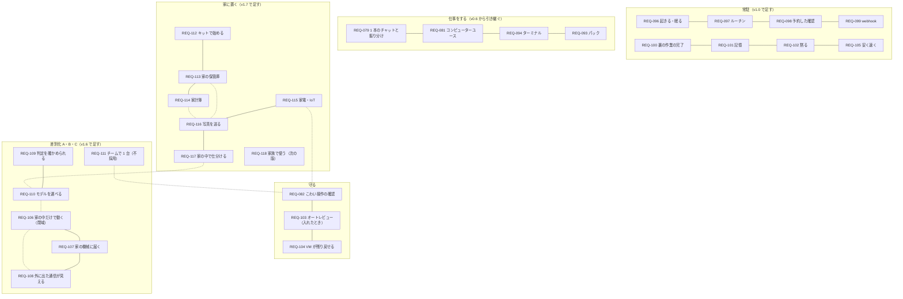

# 01. 要件定義
- プロジェクト：Agent-Team-Open ／ 版数：v1.8（2026-10-26） ／ インプット：[00_overview](00_overview.md)、[成長機構](00_learning.md)

> **3行で**
> 1. 持ち主1人が、自分の家（か自分の Linux ホスト）に Agent-Team-Open を置き、スマホや PC から 1 本のチャットでメインのエージェントと話す。メインは用途に合うエージェントへ裏で仕事を振り分ける。非エンジニアの家の人にも、セットアップ済みのラズパイ（キット）で届ける（v1.7：D-371・372）。
> 2. エージェントは、チャット・ルーチン・予約した確認・webhook・裏の作業の完了で起き、用がなければ眠る。記憶（2 層）を持ち、VM のブラウザとターミナルに加えて、**家の中**――家の保管庫（写真・書類）・家計簿・Home Assistant の家電――で仕事をし、伝える価値があるときだけ話しかける（Web Push）。
> 3. v1.8で日程調整の実行IRを学習し、検証後に自動採用する。外部操作は既存Kernelを継承。自然言語スキルの自動改変・任意コードの学習・仕事横断合成は対象外（[§7](#7-スコープ外wont)）。

## 成長機構（v1.8）
既存の家庭向け用途に、「同じ仕事で推論が減り、条件が変わると必要部分だけ推論する」を追加する。ロールは持ち主1人、ローカルWeb/PWAを継承。期限・開発予算の新規コミットは設けない。

| ID | 要件 | 優先度 | 成功の条件 |
|---|---|---|---|
| REQ-119 | 日程調整の経験を成立条件付きの処理として再利用する | Must | 過去の結果の丸暗記ではなく、新しい空き時間から候補を求める |
| REQ-120 | 検証条件を満たす処理を自動で採用する | Must | 人の採用クリックなしで有効化し、根拠を表示する |
| REQ-121 | 条件変化の影響部分だけAIに戻す | Must | 完了済み操作を重複実行せず、穴の理由が分かる |
| REQ-122 | 品質・費用・推論削減を確認し、利用を止められる | Must | 学習費込みで測り、停止が次ノードに反映される |
| REQ-123 | 異なる仕事間の部品自動合成・任意コードの学習 | Won't | 日程調整の契約が実証できた後の検討対象 |

数値指標は[NFR-098〜101](05_non_functional.md#成長機構v18)。自然言語スキルの自動改変は引き続き対象外だが、検証可能な実行IRの学習は対象内とする（[ADR-085](adr/ADR-085-learning-ir.md)）。

## 🧭 判断してほしいこと
なし

## 全体図

見てほしいところ：v0.6 の「仕事をする」はそのまま。上に「常駐」の 8 本を足し、VM が残るぶんの守り（REQ-103・104）を足した。v1.6 で、A（REQ-106〜108）・B（REQ-109）・C（REQ-110）の「差別化」を足した。v1.7 で、家の中に届く 7 本（REQ-112〜118）を足し、チームで 1 台（REQ-111）は不採用にした（D-383）。ほかの要件（置き先・つなぎ方・交代・上限など）は §5 の表にある。

## 要点
- 持ち主が話すのはメインだけ。メインが振り分ける（[REQ-079](#5-要件)）
- 持ち主のチャット以外のきっかけでも起きる。用がなければ LLM も VM も止まる（REQ-096〜100）
- 記憶は 2 層（プロフィール・検索）。持ち主の好みを覚え、画面で直せる（REQ-101）
- 持ち主に話すのは伝える価値があるときだけ。スマホに Web Push で届く（REQ-102・091）
- VM は持ち主に 1 台。ファイルとログインが残り、控えから戻せる（REQ-104・084）
- 合図に当たった操作は既定ですべて人に回る。オートレビューを入れたときだけ、外に出す・支払う・消す・秘密以外を機械が確かめる（REQ-082・103。既定は切る：D-351）
- A 家の中だけで動かし外に出ない：`closed` で外向きは許可した先だけ。ローカル LLM なら 0。家の機械（内部ホスト）にも届く。外に出た通信は台帳で全部見える（REQ-106〜108。D-381）
- B 判定を外から確かめられる：規則は版つき・試験つき、同じ入力は同じ結果、監査ログは改ざんが分かる（REQ-109）
- C 役割ごとにモデルを選べる：Claude・OpenAI・OpenAI 互換（Ollama・vLLM など）（REQ-110）。チームで 1 台は不採用（REQ-111：D-383）
- 家に置く：非エンジニアにはセットアップ済みのラズパイ（キット）で届け、スマホだけで始められる（REQ-112。D-371・372）
- 家の保管庫の写真・書類を整理し、レシートの写真から家計簿を作る。チャットで写真を送れる（REQ-113・114・116）
- 家電は Home Assistant 経由で読む・動かす・自動化を作る。鍵・空調・バルブ・警報・シャッターは必ず人（REQ-115。D-377・378）
- 文章の仕分けは家の中の判断モデルで行い、API 代を抑える。こわい操作の判断には使わない（REQ-117。D-379）
- 成功の基準は「寝る前に頼んだ API のないサイトの仕事が、朝までに終わっている」こと、「第三者が手順書だけで置いて告知ページを完成できる」こと、「非エンジニアがキットを 15 分で使い始め、家計簿の読み取りと家電の自動化 1 つを頼める」こと（[§2](#2-目的成功指標)）

---

## 詳細

### 1. 背景・課題
- これまでのエージェントは、API か MCP があるサービスにしか書き込めなかった。予約サイトや役所のページのように API がないものは、人が手で操作していた（v0.6 で VM のブラウザを入れた）。
- v0.6 は、持ち主が頼んだときだけ動く。留守の間に進まず、時刻や外の出来事（PR のレビュー・CI の失敗）で動けない。1 つの文脈で仕事をするので、長く話すとスクショと作業の記録で文脈が膨らむ。好みを毎回言い直す。
- 参考資料（[GrokBot の講義の解説動画のノート](../../参考資料/2026-10-17_GrokBotの仕組み_常駐型エージェントのアーキテクチャ.md)）の常駐型は、これらを「ループ＋サーバー＋コンピュータ＋記憶」で解いている。持ち主はこの形で作り直すことを選んだ（D-200）。
- Muse・Dots・Grok Bot のようなクラウドの VM で動くエージェントは、インターネットに出ているものしか触れない。家の中の LAN・家のファイル（写真・書類）・家電には届かない。この設計は持ち主の家に置けるので、そこが「使っていて便利」の軸になる。非エンジニアを含む家の人にも、セットアップ済みのラズパイ（キット）で届ける（v1.7：D-371・372）。
- BDAA 2026–2027 一次審査のレビュー（2026-10-24）は「AI の人数ではなく、利用者が仕事を完成できる価値を示せ」「第三者が使えることを示せ」と指摘した。OSS として公開し、企業導入の道を残す（[../oss-and-business.md](../oss-and-business.md)、[ADR-055](adr/ADR-055-agpl-license.md)）。

### 2. 目的・成功指標
| 指標 | 目標値 | 計測方法 |
|---|---|---|
| 留守の間に終わる | 夜にチャットで頼んだ、API のないサイトの仕事 5 種類（予約の空きを調べる・フォームを下書きまで埋める など）のうち 4 つが、翌朝までに人の交代 1 回以内で終わり、終わったことがスマホに 1 回だけ届く | タスクの結果・交代の記録（TBL-034）・送った通知の数 |
| 外のきっかけで動く | ルーチン（平日 8:00 の朝のまとめ）と webhook（PR のレビュー依頼）で、持ち主が何もせずにメインが起き、必要なときだけ話しかける。2 週間で取りこぼし 0 | `wakes` と `turns` の記録 |
| 覚えている | 持ち主が 1 度言った好み（例：「告知ページは明るい色で」）を、次の週の別の頼みで言わずに守る。5 件中 4 件 | 試しの頼みで目で確かめる |
| 待機中は安い | 何もない 1 日の LLM の費用が $0.05 以下（ルーチンを除く） | `usage_records` |
| 置き先を選ばない | ラズパイ 5・WSL2 の Win ノート・ふつうの Linux PC の3つで、同じ手順で起動できる | 手順書どおりに置いて起動する |
| 閉域で外に出ない（A） | `network.mode = closed` ＋ 全部の役割を社内のローカル LLM にして 1 日動かし、台帳（`egress_events`）の許可リスト外への外向きが 0 | `egress_events`（TBL-056）・egress のログ（NFR-089） |
| 判定が再現し、改ざんが分かる（B） | 過去 30 日の判定を再実行して 100% 同じ結果。監査ログの 1 行を書き換えると検査で必ず見つかる | 判定の再実行（API-150）・監査ログの検査（API-151。NFR-090・091） |
| モデルを選べる（C） | 役割ごとに接続先を変えても（Claude・OpenAI・OpenAI 互換）、同じ試験ページで確かめた先と実行した先がずれない。ローカル LLM でメインと振り分け先が動く | 試験ページを接続先ごとに動かす（R-104）・NFR-093 |
| キットで 15 分 | 非エンジニア 3 人が、キットの電源を入れてから最初のお願いまでを 15 分以内に終える。3 人中 2 人以上（NFR-094。v1.7：D-372）。「ChatGPT でサインイン」の道なら API キーを取る段がなくなる（D-387）。API キーの道でも 15 分に収める | 第三者テスト。所要時間を記録する |
| 家計簿の読み取り | 試しのレシート 50 枚で、金額・日付 95% 以上、費目 90% 以上が正しい（NFR-097。v1.7：D-375） | 試しのレシートと正解の突き合わせ |
| 家電の自動化を 1 つ作れる | 非エンジニアが、チャットの頼みだけで Home Assistant の自動化を 1 つ作れる。こわい機器に触るものは、必ず人の確認が出る（BR-15。v1.7：D-377・378） | 第三者テスト。確認が出た回数を記録する |
| 第三者が完成できる | 開発者でない 3 人が、手順書だけで置いて（NFR-081）、標準パック「告知ページ制作」で告知ページ 1 件を公開できる状態まで作れる。3 人中 2 人以上。設定から完成までの総所要時間（人の確認・修正を含む）を記録する（D-188） | 第三者テスト。手作業・単一の AI チャットで同じ告知を作った時間と並べる |

### 3. ステークホルダー
| 役割 | 関心事 | 関与度 |
|---|---|---|
| 持ち主（開発者を兼ねる） | 頼んでおけば留守の間に進むこと、うるさくないこと、勝手に支払いなどをされないこと | 高 |
| OSS の利用者（自分の機械に置く開発者） | 手順書だけで置けること、ソースを読んで何をするか分かること、自分の API キーで動くこと | 中 |
| 家の人（非エンジニアを含む。v1.7：D-371） | 家にラズパイを置いて、スマホから頼みたい。難しい設定をしなくてよいこと、写真・書類・レシートが家の外に出すぎないこと、家電を勝手に動かされないこと、困ったときに手順書か状態の画面で分かること | 高 |
| 導入先の組織（企業導入）の情報システム担当・監査する人 | 同じものを社内に置けること（閉域）。データが外に出ないこと。社内の画面を任せられること。外に出た通信が全部見えること。判定が正しいと外から確かめられること。使うモデルを選べること（今の版で応える：REQ-106〜110）。AWS・Google Cloud の契約で Claude を使えること（次の版）。複数人・権限が要るチームで 1 台は不採用（REQ-111：D-383） | 中（A・B・C で応える。D-184・D-340〜357） |
| 審査・レビューする人（BDAA など） | 誰が使い、第三者が完成でき、いくらで提供できるか | 低 |

### 4. 利用者・ロール
| ロール | 説明 | 想定人数 |
|---|---|---|
| 持ち主 | ホストを置いて使う人。すべての操作ができる。OSS の利用者も、キットを受け取った家の人（非エンジニア）も同じロール（v1.7：D-371） | 1ホストに1人 |

家族が自分のロールで使う形は REQ-118（次の版の候補。Won't）。

### 5. 要件
| ID | 要件 | 優先度 | 理由 |
|---|---|---|---|
| REQ-076 | Linux が動く 64bit の機械（arm64・amd64）に、同じ手順で置ける | Must | ラズパイ・WSL2・Mac の Linux VM を選べる |
| REQ-077 | PC とスマホのブラウザから、家の外からも使える。画面と API はインターネットに公開しない（webhook の受け口だけは公開してよい：REQ-099） | Must | 外出先でも使いたい。公開の守りは最小にする |
| REQ-078 | 持ち主1人だけが使える | Must | 自分の機械・自分のアカウントのブラウザを扱う |
| REQ-079 | 持ち主は 1 本のチャットでメインと話す。メインは小さな質問に自分で答え、重い仕事は用途に合うエージェントへ裏で振り分け、短い報告を受け取る。合うエージェントがいなければ作る。動いているタスクには言い直しを届けられる（FR-089） | Must | 1 本のチャットのまま、重い仕事をメインの文脈から外す（D-201） |
| REQ-080 | エージェントを一覧から作る・消す（メインは消せない） | Must | 今の機能（PR #9） |
| REQ-081 | エージェントが VM のブラウザを、画面を見ながらマウスとキーボードで操作できる | Must | API・MCP のないページを任せる |
| REQ-082 | こわい操作（支払い・購入・送信・削除・公開・アカウントの設定）の前は止める。それ以外は確認しない | Must | 自由に操作させつつ、取り返しのつかないことは止める |
| REQ-083 | 人が VM の画面をライブで見られ、交代して操作できる。スマホからは見る・タップで操作するまで。交代中の文字入力は次の版（D-181） | Must | ログインや CAPTCHA は人がする |
| REQ-084 | ブラウザのログイン状態は VM に残り、全エージェントで使える。画面から消せる | Must | 一度ログインすれば次から任せられる（D-205） |
| REQ-085 | Web 検索とページの取得ができる | Must | 今の機能 |
| REQ-086 | Google カレンダーに予定を入れる（確認つき） | Must | 今の機能 |
| REQ-087 | GitHub のリポジトリを読み、PR を出す（確認つき） | Must | 今の機能 |
| REQ-088 | 費用・歩数・操作の回数・時間の上限で止まる。メインのターンにも上限がある | Must | 常駐型は放っておいても動くので、暴走を止める |
| REQ-090 | 判定・操作・きっかけの記録（オートレビューを入れたときはその記録も）を、あとから見られる | Must | 留守の間に何をしたかを確かめたい |
| REQ-091 | 伝える価値があるメッセージ・人の確認・交代の頼みを、スマホに通知する（Web Push）。`closed` では Web Push を切り、画面の中の通知と、任意で社内の ntfy に送る | Must | 留守の間の知らせが要る（D-207。v0.6 の Won't を覆した）。Web Push は中身を暗号化しても、宛先と時刻は外の Push サービスに出る（D-342） |
| REQ-092 | ホストを再起動しても、動いていたターンとタスクを続けられる | Must | WSL2 やラズパイは止まりやすい |
| REQ-093 | 用途ごとに最適化されたエージェント集（パック）を入れる・外せる。入れると、その用途の仕事はメインがパックのエージェントに振り分ける | Must | 用途ごとの指示・手順書・確認するドメインをまとめて持ち込める（D-176） |
| REQ-094 | エージェントが VM の中でコマンドを実行し、リポジトリを動かして直せる。VM の外に効くもの（push・PR など）だけ確認する | Must | コードの修正と確かめを任せたい |
| REQ-096 | エージェントのループと状態は本体に置き、きっかけで起き、用がなければ LLM も VM も止まる（眠る） | Must | PC を閉じても進む。待機中はほぼ無料にする（D-200） |
| REQ-097 | ルーチン（プロンプトと時刻の組）で、決まった時刻にメインを起こせる。持ち主が作るか、メインの提案を持ち主が承認して作る | Must | 朝のまとめ・週次の確認などを任せる（D-203） |
| REQ-098 | メインが「あとでもう一度見る」時刻を予約でき、その時刻に起きて続きをする | Must | 空きを待つ・返事を待つ仕事（D-203） |
| REQ-099 | 外のサービス（GitHub など）の出来事を webhook で受けて、メインを起こせる。受け口だけ（Funnel の 8443 番）をインターネットに公開し、署名を確かめる。`closed` では Funnel を使わず、社内の GitLab・GitHub Enterprise Server から LAN の中で受ける（REQ-106） | Must | PR のレビュー・CI の結果ですぐ動く（D-208） |
| REQ-100 | 振り分けたタスクが終わったら、メインが起きて続きをする（次のタスクを渡す・持ち主に伝える・黙る） | Must | 何段もの仕事を、持ち主の手を介さずに進める（D-203） |
| REQ-101 | 持ち主についての記憶を 2 層（プロフィール・検索）で持つ。持ち主は見て、直し、消せる | Must | 好みを毎回言い直さない（D-204） |
| REQ-102 | 持ち主に話すのは、伝える価値があるときだけ。文・ファイル・選択肢で話す | Must | 常駐型でうるさくしない（D-212） |
| REQ-103 | 持ち主がオートレビューを入れたとき（既定は切る：`review.auto.enabled = false`）、合図に当たった操作のうち、外に出す・支払う・消す・秘密の欄以外は、別のモデルが確かめて通してよい。入れているかを状態欄と記録に出し、判定ごとに誰が決めたか（`kernel`・`human`・`llm_review`）を残す | Should | 留守の間に止まる回数を減らす（D-206）。BR-10 は変えない。既定は Kernel と人だけにして判定を決まりきったものにする（v1.6：D-351・D-370 で Must から Should に下げた、[ADR-077](adr/ADR-077-auto-review-off-by-default.md)） |
| REQ-104 | VM は持ち主に 1 台で、止めてもファイル・ツール・ログインが残る。毎日の控えに戻せ、空から作り直せる | Must | 次の仕事に道具を残す。壊れたら戻す（D-202・D-209） |
| REQ-105 | 長く話しても速く安く動く（プロンプトキャッシュを外さない・ターンを始めるときに要約する） | Must | 常駐型は同じ会話で長く話す（D-213） |
| REQ-106 | 閉域モード（`network.mode = closed`）にすると、本体と VM の外向きは持ち主が `network.allow_hosts` に書いた先だけになる（LLM の接続先も書く）。LLM をすべてローカルにすれば外に出る通信は 0 になる。入口は Tailscale（既定）・Headscale・社内 LAN の直結（本体のパスキーでログイン：D-358）から選べ、webhook は社内の GitLab・GitHub Enterprise Server から LAN の中で受ける | Should | 家の中（か社内）のネットワークだけで動き、外に出さない（A。v1.6：D-340〜342・356、[ADR-074](adr/ADR-074-closed-network.md)）。US-073・UC-062 |
| REQ-107 | 持ち主が許可した内部ホスト（`network.internal_hosts`。CIDR・ホスト名。既定は空）にだけ、VM のブラウザとターミナルから届く。ホストごとに確認（既定）か自動を選ぶ。本体・box-manager・tailnet・ホスト自身・クラウドのメタデータは書いても断る | Should | 家の機械（家の NAS・ルーター・家電の画面など）と社内の業務画面を任せる（A。v1.6：D-343、ADR-074）。US-074・UC-063 |
| REQ-108 | 本体の外向き（LLM・カレンダー・GitHub・通知）と egress（ブラウザ・ターミナル）の通信を全部、台帳（`egress_events`）に残し、画面で見て CSV で書き出せる。中身は残さない | Must | 外に何が出たかを見せる（A。v1.6：D-344、ADR-074）。US-075・UC-064 |
| REQ-109 | 判定の規則は版つきのデータで、試験が全部通らないと変えられない。同じ入力と版で再実行すると同じ結果になる。監査ログはハッシュの鎖で、書き換えを検査で見つけられる。LLM は既定で判定に入らない | Must | 判定を外から確かめられる（B。v1.6：D-347〜351、[ADR-076](adr/ADR-076-verifiable-decisions.md)・ADR-077）。US-076・UC-065 |
| REQ-110 | LLM を役割（メイン・振り分け先・画面の操作・オートレビュー・要約）ごとに、Claude・OpenAI・OpenAI 互換（Ollama・vLLM など）から選べる。ChatGPT でサインインして、自分の ChatGPT の枠で呼ぶ道（接続先 `openai_chatgpt`）もある（API キーが要らない。無料の人も OSS なら使える見込みで、枠は小さい。v1.7：D-385〜390）。モデルの能力と単価を宣言し、能力が足りないモデルは役割に選べない | Must | モデルを選べる（C。v1.6：D-352〜355・357、[ADR-078](adr/ADR-078-llm-by-role.md)）。v1.7：ChatGPT でサインイン（FR-116。D-385〜390）。US-077・UC-066 |
| REQ-111 | （不採用）チームで 1 台：メンバーごとにメイン・チャット・記憶・VM を分けて使う。パック・判定の規則・費用の総額・監査ログは共有 | Won't（不採用） | 持ち主 1 人のまま（REQ-078）。v1.6 では提案だったが、v1.7 で不採用にした（D-383、[ADR-075](adr/ADR-075-team-sharing-proposal.md)）。容量の表は「キットの選び方と同居できるもの」（NFR-092）に作り直した |
| REQ-112 | 非エンジニアが、セットアップ済みのラズパイ（キット）を受け取り、スマホだけで使い始められる。初回は①電源と LAN（か Wi-Fi をスマホから設定）→②スマホに Tailscale を入れ、キットの QR で招待を受ける→③画面の QR からパスキーを登録→④「ChatGPT でサインイン」（スマホでコードを承認する。API キーを貼るのは別の道で、写真つきの手順書つき：D-384・387）→⑤最初のお願い、の 5 段で、電源を入れてから 15 分以内（NFR-094） | Must | 家の人に届ける（v1.7：D-371・372・384・387）。US-078・UC-067 |
| REQ-113 | 家の保管庫（USB の SSD か NAS の `makase-vault`。`写真`・`書類`・`レシート`・`書き出し`・`ゴミ箱`）のファイルを、エージェントが道具で一覧・読む・書く・移す・ゴミ箱へ移す。消すのはゴミ箱へ（30 日で自動削除）、上書きは前の版を残す（30 日）、ゴミ箱を空にする・30 日より前に消すのは必ず人。写真は撮影日・場所・重複で並べ替え（LLM なし）、中身での分類は件数と費用を見積もって持ち主に見せてから行う。顔で人を見分けない | Must | 家のファイルに届く（v1.7：D-373・374）。US-079・UC-068 |
| REQ-114 | 家計簿：チャットで送ったレシートの写真から、店・日付・品目・金額・支払い方法を読み、費目をつけて台帳に入れる。カレンダーの同じ日の予定と照らし、月ごとの画面と CSV の書き出しを出す。読み取りの自信が低いときは確認のカードで持ち主が直す。家計簿は家の中の SQLite にだけ置く | Should | 家の暮らしで毎日使える（v1.7：D-375）。US-080・UC-069 |
| REQ-115 | 家電・IoT：Home Assistant（同じラズパイのコンテナ。キットでは入れておく）の API を通して、機器の状態を読む・動かす・自動化を作る・直す・消す。鍵・空調と暖房・ガスと水のバルブ・警報・シャッターやガレージ・持ち主が「こわい」に印を付けた家電を動かす、またはそれらに触る自動化を作る・変えるのは、必ず人の確認（BR-15）。自動化を作る・変える・消すのは既定で人の確認 | Must | 家の機械を動かす（v1.7：D-377・378）。US-081・UC-070 |
| REQ-116 | チャットに写真を添付できる（スマホから 1 回 10 枚まで・1 枚 20MB まで。JPEG・PNG・HEIC）。本体が縮め、元の画像は保管庫に置く。添付は外から来たものとして汚染の印を付ける（BR-06） | Must | 写真を見せて頼む（レシート・家の写真）（v1.7：D-376）。US-082・UC-071 |
| REQ-117 | 家の中の判断モデルで文章を仕分ける（役割 `classify`）。レシートの費目・知らせる価値・振り分けの下ごしらえ・家電への短い指示の機器と操作の選びに使い、自信が下限（既定 0.8）より低ければ LLM に回す。Kernel の判定・こわい操作・機器の区分の判断には使わない（BR-16）。ラズパイ 5 では 4B 級の生成モデルを `summary` と短い文章の役割に限って選べる | Should | API 代と待ち時間を減らす（v1.7：D-379・380）。US-083・UC-072 |
| REQ-118 | （次の版の候補）家族で使う：家族が自分のロールでチャット・記憶を分けて使う。顔の識別は含めない | Won't（今の版） | 今の版は持ち主 1 人のまま（REQ-078。v1.7：D-371） |

### 6. 制約条件
| 種類 | 内容 |
|---|---|
| 技術 | LLM は役割ごとに Claude・OpenAI・OpenAI 互換から選ぶ（接続先は `anthropic`・`openai`・`openai_compatible`。Bedrock・Vertex は次の版。v1.6：D-352。v1.7：4 つ目に `openai_chatgpt`＝ChatGPT でサインイン。自分での登録・Responses API・`store: false`・`stream: true`。能力は `tools` だけを宣言する。自動のきっかけでは既定で使わない。利用規約・無料の枠・画像・computer use は確かめてから広げる：D-385〜390。ほかのアプリの client を借りる非公式の OAuth は使わない）。画面の操作（computer use）は接続先ごとの呼び出しを本体の中で同じ作動の形に直す（D-354）。ホストは Linux（Docker が動くこと）。webhook を使うときは、`standard` では Tailscale Funnel が要り、`closed` では社内の GitLab・GitHub Enterprise Server から LAN の中で受ける（D-341）。ラズパイ 5 では 4B 級（量子化）のローカル生成モデルを `summary` と短い文章の役割に限って選べる（8GB では VM を起こしている間は止める。実機で測ってから既定にする：v1.7 D-380 が D-357 を置き換えた）。家に置く機器（保管庫・Home Assistant）は同じホストか家の LAN に置く（D-373・377）。画像を読む役割の既定はクラウドの LLM（台帳に残る。GPU の PC があればローカルに切り替えられる） |
| 予算 | LLM の料金は持ち主のキーで払う（最初は持ち主が自分で API キーを取る：D-384。ChatGPT でサインインすれば、持ち主の ChatGPT の枠で呼ぶので API の費用は 0 円と記録する：D-388）（ローカル LLM は単価 0 と宣言する：D-353）。日次 $10 まで（メイン・振り分け先と、入れたときのオートレビューの合計。宣言した単価で計算する。設定で変えられる：D-355）。プロジェクト側の運営費はほぼゼロ |
| 体制 | 持ち主1人が作って使う。OSS として公開し、同じ立場の開発者も置ける（D-183） |
| 既存 | `apps/worker` の Cloudflare 版（第4段 4c まで）と `apps/web` を移して使う。依頼（`asks`）中心の画面と API は、チャットとタスクに作り直す（D-235） |
| 規約 | 自動操作を禁じるサイトの扱いは持ち主の責任。確認するドメインで止められるようにする |
| ライセンス | AGPL-3.0（`AGPL-3.0-only`）。依存ライブラリは AGPL と両立するものだけを使う（[ADR-055](adr/ADR-055-agpl-license.md)） |

### 7. スコープ外（Won't）
| やらないこと | 理由 |
|---|---|
| Cloudflare への配置 | いったん外す（ユーザー指示）。中身は Linux 版と共通にしない |
| 複数人・複数のワークスペース・組織 | 持ち主1人で使う。チームで 1 台（REQ-111）は不採用にした（v1.7：D-383、[ADR-075](adr/ADR-075-team-sharing-proposal.md)）。家族で使う形は REQ-118 として次の版の候補にとどめる |
| 顔で人を見分けること（写真の整理など） | やらない（Won't。D-374）。分類は「料理」「子ども」「書類の写真」のような中身まで |
| ストア配布・ホスティング版・こちらが API を肩代わりする課金 | 配布・サポート・課金の体制が要る。非エンジニアにはセットアップ済みのキットで、少数から手渡し・販売で届ける（v1.7：D-382。それまでの「非エンジニアの一般向けの配布はやらない」を見直した）。OSS の開発者への配布と企業導入は変わらない（D-184） |
| ホスト間の同期・連携（親子のホスト） | ホストはそれぞれ独立。引っ越しはボリュームのコピー（手順書） |
| エージェントごとの会話（Bot ごとのチャット） | 1 本のチャットでメインと話す（D-201） |
| 振り分け先のさらに下への振り分け・仕事どうしの連絡板 | 振り分けは 1 段だけ。受け渡しはメインを通す（D-218） |
| 自然言語スキルを書き足す仕組み（スキルの案・整理・人の手順を見て手順書にする） | 手で書いたスキルとパックの手順書は使う（D-177）。v1.8の検証済み実行IRの学習（REQ-119〜122）は別概念として対象内 |
| Slack・メール・電話・会議・声の窓口 | 窓口は PWA だけ。外の出来事は webhook で受ける（REQ-099） |
| 支払いの代行と本人確認、秘密のAI入力・再送原本保管 | T-1の秘密入力は交代専用。AI再送用秘密原本は暗号化しても保存しない。全可視秘密領域を撮影前に隠せないときは画像保存/外部送信を止め人へ対応要求（FR-075・078、D-330・331） |
| 画面と API のインターネットへの公開・独自ドメイン | Tailscale だけ。公開するのは webhook の受け口だけ（ADR-065） |
| エージェントごとの VM・画面を分けて並べる・メモリのスナップショット | VM は 1 台・画面は 1 つ（D-202・D-205）。Docker のチェックポイントは不安定 |
| VM でターミナル以外のアプリ（GUI のアプリ）を使う、デスクトップ全体の操作 | 目的はブラウザとターミナル |
| すべての操作の確認 | 自由に操作させる（ユーザー選択） |
| スマホからの交代中の文字入力（次の版） | 最初の版は PC のブラウザでの交代を優先する（D-181） |
| microVM・ふつうの VM | VM の入口を決めて、あとから差し替えられる形にだけしておく |
| Kill Switch（全部を止めるボタン） | 2026-10-23 に外した。タスクごとの取り消し・VM の停止・ルーチンの停止はある |
| Bedrock・Vertex 経由の Claude（REQ-095） | 次の版のまま。接続先は `anthropic`・`openai`・`openai_compatible` の 3 つを今の版で持つ（REQ-110）。Bedrock・Vertex は、そのあとから足せる口だけ残す（v1.6：D-352 が D-315 を置き換えた。ADR-056 は取り下げのまま） |
| エージェント・設定の書き出し・取り込み（REQ-089） | 次の版。ホストは 1 台なので、引っ越しはデータのボリューム `makase-data` と VM のホームのボリュームをコピーする手順を手順書に書けば足りる（D-316） |
| 接続先ごとの専用の細工（Bedrock・Vertex の認証など）と、ローカル LLM の画面操作の成功率の目標 | ローカル LLM の画面操作（`generic`）は「試し」扱いで、成功率の目標は持たない（NFR-093、D-354、R-101）。Claude 以外の LLM は v1.6 で入れた（REQ-110） |

v0.6 の Won't のうち、Web Push 通知（D-207）・ルーチン（D-203）・記憶（D-204）・成果物のファイルの添付（D-234）は v1.0 で入れた。

## このドキュメントで決まったこと
- D-121、D-127、D-128、D-130、D-176、D-177、D-181、D-183〜D-185、D-188、D-200〜D-210、D-212、D-234、v1.4：D-315・D-316・D-320・D-324・D-325、v1.6：D-340〜D-370、v1.7：D-371〜D-390（[00 決定事項ログ](00_overview.md#決定事項ログ)）
- [ADR-058](adr/ADR-058-resident-agent.md)〜[ADR-067](adr/ADR-067-web-push-first.md)
- v1.6：[ADR-074](adr/ADR-074-closed-network.md)〜[ADR-078](adr/ADR-078-llm-by-role.md)
- v1.7：ADR-079〜083（家に置く常駐エージェント。ADR-075 は不採用）
