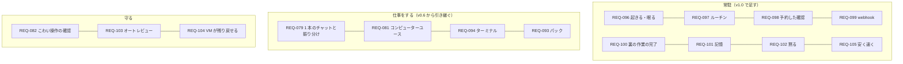

# 01. 要件定義
- プロジェクト：Agent-Team-Open ／ 版数：v1.4（2026-10-24） ／ インプット：[00_overview](00_overview.md)

> **3行で**
> 1. 持ち主1人が、自分の Linux ホストに Agent-Team-Open を置き、PC やスマホから 1 本のチャットでメインのエージェントと話す。メインは用途に合うエージェントへ裏で仕事を振り分ける。
> 2. エージェントは、チャット・ルーチン・予約した確認・webhook・裏の作業の完了で起き、用がなければ眠る。記憶（2 層）を持ち、持ち主に 1 台の VM のブラウザとターミナルで仕事をし、伝える価値があるときだけ話しかける（Web Push）。
> 3. こわい操作は合図で止め、外に出す・支払う・消す・秘密は人、それ以外はオートレビューが確かめる。Cloudflare・複数人・Slack やメールの窓口・声・支払いの代行・スキルが育つ仕組み・一般向けの配布はやらない（[§7](#7-スコープ外wont)）。

## 🧭 判断してほしいこと
なし

## 全体図

見てほしいところ：v0.6 の「仕事をする」はそのまま。上に「常駐」の 8 本を足し、VM が残るぶんの守り（REQ-103・104）を足した。ほかの要件（置き先・つなぎ方・交代・上限など）は §5 の表にある。

## 要点
- 持ち主が話すのはメインだけ。メインが振り分ける（[REQ-079](#5-要件)）
- 持ち主のチャット以外のきっかけでも起きる。用がなければ LLM も VM も止まる（REQ-096〜100）
- 記憶は 2 層（プロフィール・検索）。持ち主の好みを覚え、画面で直せる（REQ-101）
- 持ち主に話すのは伝える価値があるときだけ。スマホに Web Push で届く（REQ-102・091）
- VM は持ち主に 1 台。ファイルとログインが残り、控えから戻せる（REQ-104・084）
- 合図に当たった操作は、人に回すものとオートレビューに回すものに分ける（REQ-082・103）
- 成功の基準は「寝る前に頼んだ API のないサイトの仕事が、朝までに終わっている」こと、「第三者が手順書だけで置いて告知ページを完成できる」こと（[§2](#2-目的成功指標)）

---

## 詳細

### 1. 背景・課題
- これまでのエージェントは、API か MCP があるサービスにしか書き込めなかった。予約サイトや役所のページのように API がないものは、人が手で操作していた（v0.6 で VM のブラウザを入れた）。
- v0.6 は、持ち主が頼んだときだけ動く。留守の間に進まず、時刻や外の出来事（PR のレビュー・CI の失敗）で動けない。1 つの文脈で仕事をするので、長く話すとスクショと作業の記録で文脈が膨らむ。好みを毎回言い直す。
- 参考資料（[GrokBot の講義の解説動画のノート](../../参考資料/2026-10-17_GrokBotの仕組み_常駐型エージェントのアーキテクチャ.md)）の常駐型は、これらを「ループ＋サーバー＋コンピュータ＋記憶」で解いている。持ち主はこの形で作り直すことを選んだ（D-200）。
- BDAA 2026–2027 一次審査のレビュー（2026-10-24）は「AI の人数ではなく、利用者が仕事を完成できる価値を示せ」「第三者が使えることを示せ」と指摘した。OSS として公開し、企業導入の道を残す（[../oss-and-business.md](../oss-and-business.md)、[ADR-055](adr/ADR-055-agpl-license.md)）。

### 2. 目的・成功指標
| 指標 | 目標値 | 計測方法 |
|---|---|---|
| 留守の間に終わる | 夜にチャットで頼んだ、API のないサイトの仕事 5 種類（予約の空きを調べる・フォームを下書きまで埋める など）のうち 4 つが、翌朝までに人の交代 1 回以内で終わり、終わったことがスマホに 1 回だけ届く | タスクの結果・交代の記録（TBL-034）・送った通知の数 |
| 外のきっかけで動く | ルーチン（平日 8:00 の朝のまとめ）と webhook（PR のレビュー依頼）で、持ち主が何もせずにメインが起き、必要なときだけ話しかける。2 週間で取りこぼし 0 | `wakes` と `turns` の記録 |
| 覚えている | 持ち主が 1 度言った好み（例：「告知ページは明るい色で」）を、次の週の別の頼みで言わずに守る。5 件中 4 件 | 試しの頼みで目で確かめる |
| 待機中は安い | 何もない 1 日の LLM の費用が $0.05 以下（ルーチンを除く） | `usage_records` |
| 置き先を選ばない | ラズパイ 5・WSL2 の Win ノート・ふつうの Linux PC の3つで、同じ手順で起動できる | 手順書どおりに置いて起動する |
| 第三者が完成できる | 開発者でない 3 人が、手順書だけで置いて（NFR-081）、標準パック「告知ページ制作」で告知ページ 1 件を公開できる状態まで作れる。3 人中 2 人以上。設定から完成までの総所要時間（人の確認・修正を含む）を記録する（D-188） | 第三者テスト。手作業・単一の AI チャットで同じ告知を作った時間と並べる |

### 3. ステークホルダー
| 役割 | 関心事 | 関与度 |
|---|---|---|
| 持ち主（開発者を兼ねる） | 頼んでおけば留守の間に進むこと、うるさくないこと、勝手に支払いなどをされないこと | 高 |
| OSS の利用者（自分の機械に置く開発者） | 手順書だけで置けること、ソースを読んで何をするか分かること、自分の API キーで動くこと | 中 |
| 導入先の組織（企業導入。次の版） | 自社サーバーで動き、データが外に出ないこと。AWS・Google Cloud の契約で Claude を使えること（次の版）。複数人・権限は次の版 | 低（来たら考える。D-184） |
| 審査・レビューする人（BDAA など） | 誰が使い、第三者が完成でき、いくらで提供できるか | 低 |

### 4. 利用者・ロール
| ロール | 説明 | 想定人数 |
|---|---|---|
| 持ち主 | ホストを置いて使う人。すべての操作ができる。OSS の利用者も同じロール | 1ホストに1人 |

### 5. 要件
| ID | 要件 | 優先度 | 理由 |
|---|---|---|---|
| REQ-076 | Linux が動く 64bit の機械（arm64・amd64）に、同じ手順で置ける | Must | ラズパイ・WSL2・Mac の Linux VM を選べる |
| REQ-077 | PC とスマホのブラウザから、家の外からも使える。画面と API はインターネットに公開しない（webhook の受け口だけは公開してよい：REQ-099） | Must | 外出先でも使いたい。公開の守りは最小にする |
| REQ-078 | 持ち主1人だけが使える | Must | 自分の機械・自分のアカウントのブラウザを扱う |
| REQ-079 | 持ち主は 1 本のチャットでメインと話す。メインは小さな質問に自分で答え、重い仕事は用途に合うエージェントへ裏で振り分け、短い報告を受け取る。合うエージェントがいなければ作る。動いているタスクには言い直しを届けられる（FR-089） | Must | 1 本のチャットのまま、重い仕事をメインの文脈から外す（D-201） |
| REQ-080 | エージェントを一覧から作る・消す（メインは消せない） | Must | 今の機能（PR #9） |
| REQ-081 | エージェントが VM のブラウザを、画面を見ながらマウスとキーボードで操作できる | Must | API・MCP のないページを任せる |
| REQ-082 | こわい操作（支払い・購入・送信・削除・公開・アカウントの設定）の前は止める。それ以外は確認しない | Must | 自由に操作させつつ、取り返しのつかないことは止める |
| REQ-083 | 人が VM の画面をライブで見られ、交代して操作できる。スマホからは見る・タップで操作するまで。交代中の文字入力は次の版（D-181） | Must | ログインや CAPTCHA は人がする |
| REQ-084 | ブラウザのログイン状態は VM に残り、全エージェントで使える。画面から消せる | Must | 一度ログインすれば次から任せられる（D-205） |
| REQ-085 | Web 検索とページの取得ができる | Must | 今の機能 |
| REQ-086 | Google カレンダーに予定を入れる（確認つき） | Must | 今の機能 |
| REQ-087 | GitHub のリポジトリを読み、PR を出す（確認つき） | Must | 今の機能 |
| REQ-088 | 費用・歩数・操作の回数・時間の上限で止まる。メインのターンにも上限がある | Must | 常駐型は放っておいても動くので、暴走を止める |
| REQ-090 | 判定・オートレビュー・操作・きっかけの記録を、あとから見られる | Must | 留守の間に何をしたかを確かめたい |
| REQ-091 | 伝える価値があるメッセージ・人の確認・交代の頼みを、スマホに通知する（Web Push） | Must | 留守の間の知らせが要る（D-207。v0.6 の Won't を覆した） |
| REQ-092 | ホストを再起動しても、動いていたターンとタスクを続けられる | Must | WSL2 やラズパイは止まりやすい |
| REQ-093 | 用途ごとに最適化されたエージェント集（パック）を入れる・外せる。入れると、その用途の仕事はメインがパックのエージェントに振り分ける | Must | 用途ごとの指示・手順書・確認するドメインをまとめて持ち込める（D-176） |
| REQ-094 | エージェントが VM の中でコマンドを実行し、リポジトリを動かして直せる。VM の外に効くもの（push・PR など）だけ確認する | Must | コードの修正と確かめを任せたい |
| REQ-096 | エージェントのループと状態は本体に置き、きっかけで起き、用がなければ LLM も VM も止まる（眠る） | Must | PC を閉じても進む。待機中はほぼ無料にする（D-200） |
| REQ-097 | ルーチン（プロンプトと時刻の組）で、決まった時刻にメインを起こせる。持ち主が作るか、メインの提案を持ち主が承認して作る | Must | 朝のまとめ・週次の確認などを任せる（D-203） |
| REQ-098 | メインが「あとでもう一度見る」時刻を予約でき、その時刻に起きて続きをする | Must | 空きを待つ・返事を待つ仕事（D-203） |
| REQ-099 | 外のサービス（GitHub など）の出来事を webhook で受けて、メインを起こせる。受け口だけ（Funnel の 8443 番）をインターネットに公開し、署名を確かめる | Must | PR のレビュー・CI の結果ですぐ動く（D-208） |
| REQ-100 | 振り分けたタスクが終わったら、メインが起きて続きをする（次のタスクを渡す・持ち主に伝える・黙る） | Must | 何段もの仕事を、持ち主の手を介さずに進める（D-203） |
| REQ-101 | 持ち主についての記憶を 2 層（プロフィール・検索）で持つ。持ち主は見て、直し、消せる | Must | 好みを毎回言い直さない（D-204） |
| REQ-102 | 持ち主に話すのは、伝える価値があるときだけ。文・ファイル・選択肢で話す | Must | 常駐型でうるさくしない（D-212） |
| REQ-103 | 合図に当たった操作のうち、外に出す・支払う・消す・秘密の欄以外は、別のモデルが確かめて通してよい（オートレビュー） | Must | 留守の間に止まる回数を減らす（D-206）。BR-10 は変えない |
| REQ-104 | VM は持ち主に 1 台で、止めてもファイル・ツール・ログインが残る。毎日の控えに戻せ、空から作り直せる | Must | 次の仕事に道具を残す。壊れたら戻す（D-202・D-209） |
| REQ-105 | 長く話しても速く安く動く（プロンプトキャッシュを外さない・ターンを始めるときに要約する） | Must | 常駐型は同じ会話で長く話す（D-213） |

### 6. 制約条件
| 種類 | 内容 |
|---|---|
| 技術 | LLM は Claude だけ（computer use ツール）。接続先は Anthropic の API 直だけ。ホストは Linux（Docker が動くこと）。webhook を使うときは Tailscale Funnel が要る |
| 予算 | Claude の料金は持ち主のキーで払う。日次 $10 まで（メイン・振り分け先・オートレビューの合計。設定で変えられる）。プロジェクト側の運営費はほぼゼロ |
| 体制 | 持ち主1人が作って使う。OSS として公開し、同じ立場の開発者も置ける（D-183） |
| 既存 | `apps/worker` の Cloudflare 版（第4段 4c まで）と `apps/web` を移して使う。依頼（`asks`）中心の画面と API は、チャットとタスクに作り直す（D-235） |
| 規約 | 自動操作を禁じるサイトの扱いは持ち主の責任。確認するドメインで止められるようにする |
| ライセンス | AGPL-3.0（`AGPL-3.0-only`）。依存ライブラリは AGPL と両立するものだけを使う（[ADR-055](adr/ADR-055-agpl-license.md)） |

### 7. スコープ外（Won't）
| やらないこと | 理由 |
|---|---|
| Cloudflare への配置 | いったん外す（ユーザー指示）。中身は Linux 版と共通にしない |
| 複数人・複数のワークスペース・組織 | 持ち主1人で使う。企業導入（組織の共有ホスト）で要るときに次の版で入れる（D-184） |
| 非エンジニアの一般向けの配布（インストーラー・ホスティング版・課金） | 配布・サポート・課金の体制が要る。OSS として開発者に配り、企業導入は導入支援で届ける（D-184） |
| ホスト間の同期・連携（親子のホスト） | ホストはそれぞれ独立。引っ越しはボリュームのコピー（手順書） |
| エージェントごとの会話（Bot ごとのチャット） | 1 本のチャットでメインと話す（D-201） |
| 振り分け先のさらに下への振り分け・仕事どうしの連絡板 | 振り分けは 1 段だけ。受け渡しはメインを通す（D-218） |
| エージェントがスキルを書き足す仕組み（スキルの案・整理・人の手順を見てスキルにする） | 記憶（REQ-101）までにする。手で書いたスキルとパックの手順書は使う（D-177） |
| Slack・メール・電話・会議・声の窓口 | 窓口は PWA だけ。外の出来事は webhook で受ける（REQ-099） |
| 支払いの代行と本人確認、パスワード管理ツールでの自動入力 | 支払いの入力とログインは交代で人がする（FR-078）。パスワードはモデルに渡さない |
| 画面と API のインターネットへの公開・独自ドメイン | Tailscale だけ。公開するのは webhook の受け口だけ（ADR-065） |
| エージェントごとの VM・画面を分けて並べる・メモリのスナップショット | VM は 1 台・画面は 1 つ（D-202・D-205）。Docker のチェックポイントは不安定 |
| VM でターミナル以外のアプリ（GUI のアプリ）を使う、デスクトップ全体の操作 | 目的はブラウザとターミナル |
| すべての操作の確認 | 自由に操作させる（ユーザー選択） |
| スマホからの交代中の文字入力（次の版） | 最初の版は PC のブラウザでの交代を優先する（D-181） |
| microVM・ふつうの VM | VM の入口を決めて、あとから差し替えられる形にだけしておく |
| Kill Switch（全部を止めるボタン） | 2026-10-23 に外した。タスクごとの取り消し・VM の停止・ルーチンの停止はある |
| Bedrock・Vertex 経由の Claude（REQ-095） | 次の版。企業導入は最初の 1 社が来たら考える方針で、その前に接続先 3 つ分の設計を持つのは重い。`llm/claude.ts` のクライアント作成を 1 か所にまとめ、あとから差し替えられる口だけ残す（D-315） |
| エージェント・設定の書き出し・取り込み（REQ-089） | 次の版。ホストは 1 台なので、引っ越しはデータのボリューム `makase-data` と VM のホームのボリュームをコピーする手順を手順書に書けば足りる（D-316） |
| Claude 以外の LLM | 2026-10-23 の決定のまま |

v0.6 の Won't のうち、Web Push 通知（D-207）・ルーチン（D-203）・記憶（D-204）・成果物のファイルの添付（D-234）は v1.0 で入れた。

## このドキュメントで決まったこと
- D-121、D-127、D-128、D-130、D-176、D-177、D-181、D-183〜D-185、D-188、D-200〜D-210、D-212、D-234、v1.4：D-315・D-316・D-320・D-324・D-325（[00 決定事項ログ](00_overview.md#決定事項ログ)）
- [ADR-058](adr/ADR-058-resident-agent.md)〜[ADR-067](adr/ADR-067-web-push-first.md)
