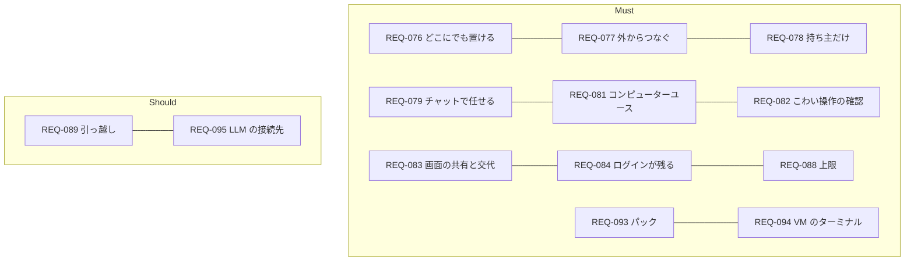

# 01. 要件定義
- プロジェクト：Agent-Team-Open ／ 版数：v0.6（2026-10-24） ／ インプット：[00_overview](00_overview.md)

> **3行で**
> 1. 持ち主1人が、自分の Linux ホストに Agent-Team-Open を置き、PC やスマホからチャットでエージェントに仕事を任せる。
> 2. エージェントは VM のブラウザを自由に操作する。こわい操作の前だけ人が確認し、人はいつでも画面を見て交代できる。VM のターミナルでコードも動かせ、用途ごとのエージェント集（パック）も入れられる。
> 3. OSS（AGPL-3.0）として公開し、LLM の接続先に Bedrock・Vertex 経由を足す（Should）。Cloudflare・複数人・同期・編成・育つ仕組み・Web Push 通知・非エンジニアの一般向けの配布はやらない（[§7](#7-スコープ外wont)）。

## 🧭 判断してほしいこと
なし

## 全体図

見てほしいところ：中心は REQ-081〜084（VM のブラウザ）。ほかは今の Agent-Team-Open の機能を新しい置き先に合わせたもの。

## 要点
- 置き先は Linux が動く機械なら何でもよい（[REQ-076](#5-要件)）
- 外からは Tailscale でつなぎ、インターネットには公開しない（REQ-077）
- VM のブラウザの操作は自由。こわい操作だけ確認する（REQ-081・082）
- 人は画面を見て、交代して操作できる。ログインはエージェントごとに残る（REQ-083・084）
- 用途ごとのエージェント集（パック）を入れられ、VM のターミナルでコードを動かして直させられる（REQ-093・094）
- スマホからは見る・タップまで。通知（Web Push）と交代中の文字入力は次の版（D-179・D-181）
- LLM は Claude だけ。接続先は Anthropic 直・Bedrock・Vertex から選べる（REQ-095、Should）
- 成功の基準は「API のないサイトの仕事を、スマホから頼んで終わらせられる」ことと、「開発者でない第三者が手順書だけで置いて、告知ページ 1 件を完成できる」こと（[§2](#2-目的成功指標)）
- OSS（AGPL-3.0）として公開する。一般向けには配らず、収益化するなら企業導入（[ADR-055](adr/ADR-055-agpl-license.md)）

---

## 詳細

### 1. 背景・課題
- これまでのエージェントは、API か MCP があるサービス（カレンダー・GitHub）にしか書き込めなかった。予約サイトや役所のページのように API がないものは、人が手で操作していた。
- Cloudflare だけで動かす設計では、本物のブラウザを人と共有するのが難しい。
- 手元にラズパイやノート PC があり、これを置き先にしたい。
- BDAA 2026–2027 一次審査のレビュー（2026-10-24）は「AI の人数ではなく、利用者が仕事を完成できる価値を示せ」「第三者が使えることを示せ」と指摘した。OSS として公開し、企業導入の道を残す（[../oss-and-business.md](../oss-and-business.md)、[ADR-055](adr/ADR-055-agpl-license.md)）。

### 2. 目的・成功指標
| 指標 | 目標値 | 計測方法 |
|---|---|---|
| API のないサイトの仕事が終わる | 試しに選んだ5種類の仕事（予約の空きを調べる・フォームを下書きまで埋める など）のうち4つが、人の交代1回以内で終わる | 依頼の結果と交代の記録（TBL-034） |
| 置き先を選ばない | ラズパイ 5・WSL2 の Win ノート・ふつうの Linux PC の3つで、同じ手順で起動できる | 手順書どおりに置いて起動する |
| スマホから使える | 外出先のスマホから、頼む・確認する・VM の画面を見る・タップで操作するができる（交代中の文字入力は次の版） | 手で確かめる |
| 第三者が完成できる | 開発者でない 3 人が、手順書だけで置いて（NFR-081）、標準パック「告知ページ制作」で告知ページ 1 件を公開できる状態まで作れる。3 人中 2 人以上。設定から完成までの総所要時間（人の確認・修正を含む）を記録する（D-188） | 第三者テスト。手作業・単一の AI チャットで同じ告知を作った時間と並べる |

### 3. ステークホルダー
| 役割 | 関心事 | 関与度 |
|---|---|---|
| 持ち主（開発者を兼ねる） | 手軽に任せられること、勝手に支払いなどをされないこと | 高 |
| OSS の利用者（自分の機械に置く開発者） | 手順書だけで置けること、ソースを読んで何をするか分かること、自分の API キーで動くこと | 中 |
| 導入先の組織（企業導入。次の版） | 自社サーバーで動き、データが外に出ないこと。AWS・Google Cloud の契約で Claude を使えること（REQ-095）。複数人・権限は次の版 | 低（来たら考える。D-184） |
| 審査・レビューする人（BDAA など） | 誰が使い、第三者が完成でき、いくらで提供できるか | 低 |

### 4. 利用者・ロール
| ロール | 説明 | 想定人数 |
|---|---|---|
| 持ち主 | ホストを置いて使う人。すべての操作ができる。OSS の利用者も同じロール | 1ホストに1人 |

### 5. 要件
| ID | 要件 | 優先度 | 理由 |
|---|---|---|---|
| REQ-076 | Linux が動く 64bit の機械（arm64・amd64）に、同じ手順で置ける | Must | ラズパイ・WSL2・Mac の Linux VM を選べる |
| REQ-077 | PC とスマホのブラウザから、家の外からも使える。インターネットには公開しない | Must | 外出先でも使いたい。公開の守りは要らない |
| REQ-078 | 持ち主1人だけが使える | Must | 自分の機械・自分のアカウントのブラウザを扱う |
| REQ-079 | チャットで頼むと、エージェント1人が仕事をして答える。合うエージェントがいなければ作る | Must | 今の Agent-Team-Open の中心 |
| REQ-080 | エージェントを一覧から作る・消す | Must | 今の機能（PR #9） |
| REQ-081 | エージェントが VM のブラウザを、画面を見ながらマウスとキーボードで操作できる | Must | API・MCP のないページを任せる |
| REQ-082 | こわい操作（支払い・購入・送信・削除・アカウントの設定）の前は人が確認する。それ以外は確認しない | Must | 自由に操作させつつ、取り返しのつかないことは止める |
| REQ-083 | 人が VM の画面をライブで見られ、交代して操作できる。スマホからは見る・タップで操作するまで。交代中の文字入力は次の版（D-181） | Must | ログインや CAPTCHA は人がする。最初の版は PC のブラウザでの交代を優先する |
| REQ-084 | ブラウザのログイン状態はエージェントごとに残る。画面から消せる | Must | 一度ログインすれば次から任せられる |
| REQ-085 | Web 検索とページの取得ができる | Must | 今の機能 |
| REQ-086 | Google カレンダーに予定を入れる（確認つき） | Must | 今の機能。最初の版に入れる |
| REQ-087 | GitHub のリポジトリを読み、PR を出す（確認つき） | Must | 今の機能。最初の版に入れる |
| REQ-088 | 費用・操作の回数・時間の上限で止まる | Must | 画像の費用がかさむ。暴走を止める |
| REQ-089 | エージェントと設定を書き出し、別のホストに取り込める | Should | ホスト同士は独立なので、引っ越しの道だけ用意する |
| REQ-090 | 判定と操作の記録を、あとから見られる | Must | 自由に操作させるぶん、何をしたかを確かめたい |
| REQ-091 | 確認と交代の頼みを、スマホに通知する（Web Push） | Won't（次の版） | 最初の版は画面を開いているときの知らせ（SSE）だけにする（D-179） |
| REQ-092 | ホストを再起動しても、動いていた依頼を続けられる | Must | WSL2 やラズパイは止まりやすい |
| REQ-093 | 用途ごとに最適化されたエージェント集（パック）を入れる・外せる。入れると、その用途の依頼でパックのエージェントが使われる | Must | 用途ごとの指示・手順書・確認するドメインをまとめて持ち込める（D-176） |
| REQ-094 | エージェントが VM の中でコマンドを実行し、リポジトリを動かして直せる。VM の外に効くもの（push・PR など）だけ確認する | Must | コードの修正と確かめを任せたい。VM は使い捨てで壊れても残らない（D-178） |
| REQ-095 | LLM の接続先を Anthropic の API 直・Amazon Bedrock・Google Vertex AI から設定で選べる。モデルは同じ Claude | Should | 企業導入では AWS・Google Cloud の契約の中で Claude を使いたい会社が多い（D-185）。他社の LLM は入れない |

### 6. 制約条件
| 種類 | 内容 |
|---|---|
| 技術 | LLM は Claude だけ（computer use ツール）。接続先は Anthropic の API 直が既定で、Bedrock・Vertex 経由も選べる（REQ-095）。ホストは Linux（Docker が動くこと） |
| 予算 | Claude の料金は持ち主のキー（または持ち主の AWS・GCP のアカウント）で払う。日次 $10 まで（今のポリシー）。プロジェクト側の運営費はほぼゼロ |
| 体制 | 持ち主1人が作って使う。OSS として公開し、同じ立場の開発者も置ける（D-183） |
| 既存 | `apps/worker` の Cloudflare 版（第4段 4c まで）と `apps/web` を移して使う |
| 規約 | 自動操作を禁じるサイトの扱いは持ち主の責任。確認するドメインで止められるようにする |
| ライセンス | AGPL-3.0（`AGPL-3.0-only`）。依存ライブラリは AGPL と両立するものだけを使う（[ADR-055](adr/ADR-055-agpl-license.md)） |

### 7. スコープ外（Won't）
| やらないこと | 理由 |
|---|---|
| Cloudflare への配置 | いったん外す（ユーザー指示）。中身は Linux 版と共通にしない |
| 複数人・複数のワークスペース・組織 | 持ち主1人で使う。企業導入（組織の共有ホスト）で要るときに次の版で入れる（D-184） |
| 非エンジニアの一般向けの配布（インストーラー・ホスティング版・課金） | 配布・サポート・課金の体制が要る。OSS として開発者に配り、企業導入は導入支援で届ける（D-184） |
| ホスト間の同期・連携（親子のホスト） | ホストはそれぞれ独立。引っ越しは REQ-089 |
| 複数エージェントの編成・連絡板 | 1件の依頼はエージェント1人（[ADR-050](adr/ADR-050-one-agent-per-ask.md)） |
| スキルが育つ仕組み（スキルの案・整理） | 最初の版に入れない（ユーザー選択） |
| Web Push 通知（次の版） | 最初の版は画面を開いているときの知らせ（SSE）だけ（D-179） |
| スマホからの交代中の文字入力（次の版） | 最初の版は PC のブラウザでの交代を優先する（D-181） |
| VM でターミナル以外のアプリ（GUI のアプリ）を使う | 目的はブラウザとターミナル。GUI のアプリは扱わない |
| すべての操作の確認 | 自由に操作させる（ユーザー選択） |
| microVM・ふつうの VM の VM | VM の入口を決めて、あとから差し替えられる形にだけしておく |
| インターネットへの公開・独自ドメイン | Tailscale だけ |
| Kill Switch（全部を止めるボタン） | 2026-10-23 に外した。依頼ごとの取り消しと VM の停止はある |
| Claude 以外の LLM | 2026-10-23 の決定のまま。Bedrock・Vertex 経由の Claude は REQ-095 で入れる（モデルは同じ） |
| 成果物（HTML など）を依頼の回答にファイルとして添える | 最初の版は GitHub への PR（確認つき）で届ける。添付は次の版 |
| きっかけと予約の仕事（ルーチン：決まった時刻・webhook で依頼を立てる）（次の版の候補） | 最初の版は持ち主がチャットで頼んだときだけ動く。参考資料（GrokBot）の `routines/` の形を候補にする（[changes/2026-10-24-grokbot-reference.md](changes/2026-10-24-grokbot-reference.md)） |
| 記憶（いつもプロンプトに入れる持ち主のプロフィール・日付つきの事実のログ）（次の版の候補） | 自動で書き足す記憶は「育つ仕組み」に近い。手で書いたスキルと「いつ使うか」（FR-088）までを最初の版にする |
| パスワード管理ツールでの自動入力（次の版の候補） | 最初の版はログインを交代で人がする（FR-078）。入れるときもパスワードはモデルに渡さない |
| 声・電話・会議・Slack・メールの窓口、支払いと本人確認 | 持ち主1人が PWA から使う（D-127・D-128） |

## このドキュメントで決まったこと
- D-121、D-127、D-128、D-130、D-133、D-176、D-177、D-178、D-179、D-180、D-181、D-183、D-184、D-185、D-188（[00 決定事項ログ](00_overview.md#決定事項ログ)）
- [ADR-055](adr/ADR-055-agpl-license.md)：OSS・AGPL-3.0。[ADR-056](adr/ADR-056-llm-provider.md)：LLM の接続先
