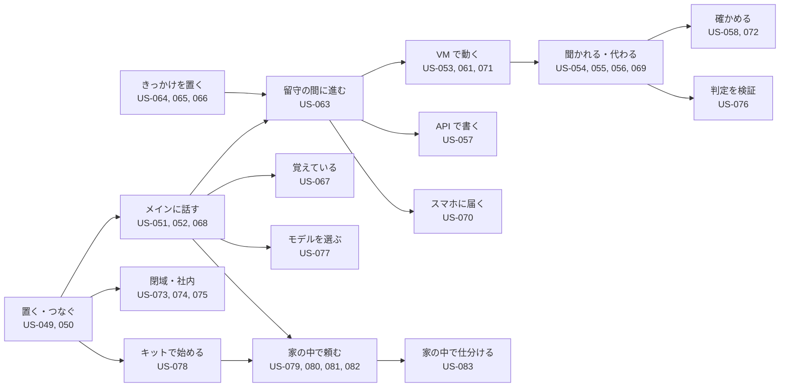

# 02. ユーザーストーリー
- プロジェクト：Agent-Team-Open ／ 版数：v1.8（2026-10-26） ／ インプット：[01_requirements](01_requirements.md)

> **3行で**
> 1. 利用者は持ち主（P-1：開発者）と、キットを受け取る家の人（P-2：非エンジニア）。どちらも持ち主 1 人のロール（REQ-078）。ストーリーは 33 本（US-049〜083。US-059・062 は欠番）。
> 2. v1.0 の中心は US-063（留守の間に進め、戻ったら短く知る）。きっかけ（US-064〜066）・記憶（US-067）・タスクへの言い直し（US-068）・確認の減り（US-069。オートレビューを入れたとき）・スマホの知らせ（US-070）・VM を戻す（US-071）が支える。v1.6 で差別化 A・B・C（US-073〜077：家の中だけで動かす・家の機械・外に出た通信・判定の検証・モデル選び）を足した。
> 3. v1.7 で、家に置くストーリー US-078〜083 を足した（キットで始める・写真の整理・レシートの家計簿・家電・写真を送る・家の中の仕分け）。チームで 1 台は不採用、家族で使うのは次の版（REQ-118）なので書かない。編成・Slack・声・ストアやホスティング版の配布のストーリーも書かない（[01 §7](01_requirements.md#7-スコープ外wont)）。

## 成長機構（v1.8）
既存の持ち主ペルソナを継承。活動の流れは「頼む→経験を蓄える→再利用する→変化に対応→結果を確認する」。

| ID / 要件 | ストーリー（すべてMust） | 受入基準 Given / When / Then |
|---|---|---|
| US-084 / REQ-119 | 持ち主として、同じ種類の仕事を早く済ませるため経験を再利用したい | 適格な日程調整履歴がある / 別の日程を頼む / 新しい観測から候補を求め、古い予定を複製しない |
| US-085 / REQ-120 | 持ち主として、採用操作を繰り返さず学習の恩恵を受けたい | 候補が検証条件を満たす / 採用判定する / 自動で次回から利用し、検証根拠を見られる |
| US-086 / REQ-121 | 持ち主として、条件が変わっても最初からやり直さず進めたい | active版に未知条件がある / ガードが不成立 / その部分だけ推論または質問し、完了済み操作を再送しない |
| US-087 / REQ-122 | 持ち主として、効果と理由を知り、望まない学習を止めたい | 学習runがある / 詳細を開いて版を停止 / 回数・費用・理由が見え、次のノード開始を止める |

詳細な例外と事後条件は[UC-073〜076](03_learning.md)。

## 🧭 判断してほしいこと
なし

## 全体図

見てほしいところ：v1.7 で足したのは K（キットで始める）・L（写真・家計簿・家電を家の中で頼む）・Q（家の中の仕分け）。v1.0 で足したのは T・R・N・M と、D の US-069（オートレビューは入れたときだけ）。v1.6 で足したのは G（閉域・社内の画面・外に出た通信）・H（判定の検証）・I（モデル選び）。持ち主は「頼む」か「きっかけを置く」だけで、あとは留守の間に進む。

## 要点
- 持ち主はメインに一言書くだけ。メインが合うエージェントに振り分け、報告を受けて短く知らせる（[US-051](#us-051メインに頼む-req-079-req-085-req-093-優先度must)・[US-063](#us-063留守の間に進め戻ったら短く知る-req-096-req-100-req-102-優先度must)）
- 決まった時刻・あとでもう一度・GitHub の出来事で、メインが自分で起きる（US-064〜066）
- 好みは 1 度言えば覚え、画面で見て直せる（US-067）
- 動いているタスクに「やっぱり木曜にして」と言い直せる（US-068）
- 合図に当たった操作は既定で人に聞く。オートレビューを入れたときだけ、外に出す・支払う・消す・秘密でなければ人に聞かずに進む（US-069）
- 家の中だけで動かせ（閉域）、家の機械や社内の画面を任せられ、外に出た通信が全部見える（US-073〜075）
- 判定の規則が版つきで、再実行と鎖の検査で確かめられる（US-076）
- 役割ごとにモデルを選べ、ローカル LLM でも動く（US-077）
- 非エンジニアがキットを受け取り、スマホだけで 15 分で始められる（US-078）
- 保管庫の写真・書類を整理してもらえ、消したものは 30 日ゴミ箱に残る（US-079）
- レシートの写真を送るだけで家計簿になり、読み取りに自信がないときは確認が来る（US-080）
- 家電の状態を聞き、動かし、自動化を作れる。鍵・空調・バルブ・警報・シャッターは必ず人の確認（US-081）
- チャットに写真を送って頼める（US-082）。文章の仕分けは家の中の判断モデルで行い、API 代をかけない（US-083）
- 確認・交代の頼み・伝える価値のある報告だけがスマホに届く（US-070）
- VM はファイルとログインが残る。おかしくなったら控えに戻す（US-056・071）

---

## 詳細

### ペルソナ
### P-1: 持ち主
- 属性：開発ができる個人（導入先の情報システム担当・監査する人も、P-1 として置いて確かめる側に立つ。チームで 1 台は不採用：REQ-111、家族で使うのは次の版：REQ-118）。自宅にラズパイ、手元に Win のノート PC がある。OSS として公開するので、同じ立場の開発者（会社の検証機に置く人を含む）も P-1。非エンジニアの家の人は P-2 として対象にする（v1.7：D-371・382。それまでの「一般向けは対象にしない」を見直した。ストア配布・ホスティング版はやらない）
- 目的：細かい手作業（予約・申し込み・調べもの・予定の登録・PR の手直し）を AI に任せ、寝ている間・出かけている間に進めてほしい
- 困りごと：API がないサイトは任せられない。勝手に支払われるのは困る。進むたびに報告されるとうるさい。同じ好みを毎回言うのが面倒。機能が多すぎると使わなくなる
- IT リテラシー：高い（Docker・Tailscale を自分で入れられる）

### P-2: 家の人（非エンジニア。v1.7：D-371）
- 属性：自宅にラズパイを置いて、スマホから頼みたい人。セットアップ済みのラズパイ（キット）を知り合いから手渡しで受け取る。ロールは持ち主（1 台に 1 人。家族で使うのは次の版：REQ-118）
- 目的：レシートを撮って送るだけで家計簿にしたい。たまった写真・書類を片付けたい。家電の自動化や操作を、言葉で頼みたい
- 困りごと：コマンドや設定ファイルは触れない。API キーが何か分からない。家電を勝手に動かされる・写真が知らないところに出るのは不安。困ったときに誰に聞けばよいか分からない
- IT リテラシー：低い〜ふつう（スマホのアプリは入れられる。パソコンの設定はしない）

### ストーリーマップ
| アクティビティ | ステップ | ストーリー |
|---|---|---|
| 準備 | 置く・つなぐ | US-049、US-050 |
| 任せる | メインに頼む・エージェントを作る・タスクに言い直す | US-051、US-052、US-068 |
| きっかけを置く | ルーチン・あとでもう一度・GitHub の出来事 | US-064、US-065、US-066 |
| 留守の間に進む | 振り分け・報告・知らせ | US-063、US-070 |
| VM で動く | 操作させる・聞かれる・代わる・ログインを残す・戻す | US-053〜056、US-069、US-071 |
| 書き込む | カレンダー・GitHub | US-057 |
| 広げる | パックを入れる・コードを直させる | US-060、US-061 |
| 覚える | 好みを覚える・見て直す | US-067 |
| 見直す | 上限・記録・費用 | US-058、US-072 |
| 家・社内に置く | 閉域（家の中だけ）で置く・家の機械や社内の画面を任せる・外に出た通信を見る | US-073、US-074、US-075 |
| 確かめる | 判定の規則・再実行・監査ログの検査 | US-076 |
| モデルを選ぶ | 役割ごとの設定・ローカル LLM | US-077 |
| キットで始める | 電源・Tailscale・パスキー・ChatGPT でサインイン（か API キー）・最初のお願い | US-078 |
| 家の中で頼む | 写真の整理・レシートの家計簿・家電・写真を送る | US-079、US-080、US-081、US-082 |
| 家の中で仕分ける | 判断モデルで API 代をかけずに仕分ける | US-083 |

### ストーリー一覧

### US-049：ホストに置いて起動する 〔REQ-076, REQ-092〕 優先度：Must
**持ち主として、手元のどの Linux の機械でも同じ手順で使い始めるために、Compose の一式で起動したい。**
- Given Docker と Compose が入った 64bit の Linux When 設定ファイルを埋めて `docker compose up -d` Then 本体・box-manager・egress・Tailscale が起動し、画面が開ける
- Given メインのターンやタスクが動いている途中 When ホストを再起動する Then 起動のあと、止まった歩みの次から続く

### US-050：外からスマホで入る 〔REQ-077, REQ-078〕 優先度：Must
**持ち主として、外出先でも使うために、スマホからログインの手間なく入りたい。**
- Given スマホが持ち主の tailnet に入っている When `https://makase.<tailnet>.ts.net` を開く Then ログイン画面なしでチャットが開く
- Given 持ち主以外の Tailscale の利用者 When 同じ URL を開く Then 403 になり、何も見えない
- Given インターネットの誰か When `https://makase.<tailnet>.ts.net/`（443 番）を開く Then つながらない（443 番は tailnet だけ。Funnel は 8443 番だけ）
- Given インターネットの誰か When 8443 番の `/hooks/` 以外を開く Then 404

### US-051：メインに頼む 〔REQ-079, REQ-085, REQ-093〕 優先度：Must
**持ち主として、設定を考えずに仕事を任せるために、チャットに一言書きたい。**
- Given 「明日の天気は？」のような小さな質問 When 送る Then メインが自分で調べて答える（エージェントに振り分けない）
- Given 合うエージェントがいる重い仕事 When 送る Then メインは「○○に頼みました」と短く返し、仕事は裏で進む。チャットには作業の途中経過が流れない
- Given 合うエージェントがいない When 送る Then メインがエージェントを1人作り（生成画面に切り替わる）、そのまま振り分ける
- Given 告知ページ制作パックが入っている When 「文化祭の告知ページを作って」と送る Then パックのエージェントに振り分けられる

### US-052：エージェントを作る・消す 〔REQ-080〕 優先度：Must
**持ち主として、決まった仕事の係を用意するために、一覧からエージェントを作り、要らなくなったら消したい。**
- Given エージェント一覧 When したいことを書いて作る Then エージェントが1人増え、メインの振り分け先になる
- Given 動いていないエージェント When 消す Then 一覧から消える（VM のログイン状態は全員で共通なので消えない）
- Given 動いているエージェント When 消す Then 「動いているので消せない」と出る
- Given メイン When 一覧を開く Then メインは先頭に出て、消すメニューがない

### US-053：API のないサイトを任せる 〔REQ-081〕 優先度：Must
**持ち主として、手で操作していたサイトの仕事を任せるために、エージェントにブラウザを操作させたい。**
- Given ブラウザが要るタスク When エージェントが動く Then VM が起き（眠っていれば）、エージェントは画面の番を取って、画面を見てクリック・入力・スクロールをして進める
- Given 別のタスクが画面の番を持っている When ブラウザを使おうとする Then 番が空くまで待つ（ターミナルの仕事は待たずに進む）
- Given タスクが終わった When 10 分ほかに使われない Then VM は止まる（ファイルとログインは残る）
- Given 操作が上限（300回・55分・$3）に達した When 次の操作をしようとする Then タスクは止まり、メインに理由が報告される

### US-054：こわい操作の前に聞かれる 〔REQ-082〕 優先度：Must
**持ち主として、勝手に支払いや送信をされないために、こわい操作の前だけ確認したい。**
- Given エージェントが「購入」ボタンを押そうとする When 申告か合図（必ず人の言葉）に当たった Then 操作は止まり、スクショと押す場所の印つきの確認がスマホに届く
- Given 確認 When ○ を押す Then その1操作だけが実行される。画面が変わっていたら実行せず、エージェントが決め直す
- Given 確認 When × を押す、または30分たつ Then 操作はされず、エージェントは別の道を探すか報告する
- Given ふつうのリンクのクリックや検索欄への入力 When エージェントが操作する Then 確認なしで進む

### US-055：画面を見て代わる 〔REQ-083〕 優先度：Must
**持ち主として、ログインや CAPTCHA を片付けるために、VM の画面を見て代わりに操作したい。**
- Given VM が動いている When タスクのページか確認から VM の画面を開く Then エージェントの操作がライブで見える（操作はできない）
- Given VM の画面 When 「代わる」を押す Then エージェントは止まって待ち、人がマウス・キーボード（スマホではタップ。文字入力は次の版）で操作できる
- Given 交代中 When 「返す」を押す Then エージェントは今の画面から続ける
- Given エージェントがログインの画面で止まった When エージェントが交代を頼む Then 「ログインしてください」の頼みがスマホに届く

### US-056：一度ログインすれば次から使える 〔REQ-084〕 優先度：Must
**持ち主として、毎回ログインしないで済むように、VM にログイン状態を残したい。**
- Given 前のタスクで人がログインした When 別のエージェントのタスクが同じサイトを開く Then ログインした状態で始まる
- Given 設定の VM の欄 When 「ブラウザのデータを消す」を押す Then Cookie とログイン状態が消える（画面の番が使われている間は消せない）

### US-057：カレンダー・GitHub に書く 〔REQ-086, REQ-087〕 優先度：Must
**持ち主として、API があるものは確実に書き込むために、今までどおり確認つきで書き込ませたい。**
- Given Google カレンダーをつないである When メインかエージェントが予定を入れようとする Then 予定の中身の確認が届き、○ で入る。メインのときは、確認を待つ間メインは眠り、○ / × で起きて「入れました」などと伝える（D-248）
- Given GitHub をつないである When エージェントが PR を出そうとする Then 差分の確認が届き、○ で出る

### US-058：使いすぎない・あとで確かめる 〔REQ-088, REQ-090〕 優先度：Must
**持ち主として、費用と操作を把握するために、上限を決め、何をしたかをあとで見たい。**
- Given 設定画面 When タスク・メインのターン・日次の上限を変える Then 次のタスク・ターンから効く
- Given 記録の画面 When 開く Then きっかけ・判定（誰が決めたか）・確認・操作（スクショつき。7日を過ぎたものは画像なし）が時刻順に見える。オートレビューを入れているときは、その行も見える

### US-060：パックを入れる・外す 〔REQ-093〕 優先度：Must
**持ち主として、用途ごとに整えたエージェントをすぐ使うために、パックを入れ、要らなくなったら外したい。**
- Given パックの一覧 When 「入れる」を押す Then そのパックのエージェントが増え、手順書と確認するドメインも入る
- Given パックが入っている When そのパックの用途に合う頼みを送る Then メインがパックのエージェントに振り分ける。合うパックがなければ今までどおり
- Given パックが入っていて、動いているエージェントがない When 「外す」を押す Then パックのエージェントと手順書が消える（動いていれば「動いているので外せない」と出る）

### US-061：コードを VM で動かして直させる 〔REQ-094〕 優先度：Must
**持ち主として、リポジトリの修正とテストを任せるために、エージェントに VM のターミナルでコードを動かさせたい。**
- Given GitHub のリポジトリ When メインに「テストが通るように直して」と頼む Then 振り分け先が VM の中でコマンドを動かしてテストを走らせ、直した差分が PR の確認として届く
- Given エージェントが VM の中でコマンドを実行する When 実行する Then 確認なしで動く（資格情報は VM になく、外へは許可リストだけ）
- Given 前のタスクでホームに入れたツール（`npm`・`pip --user`） When 次のタスクで使う Then 入れ直さずに使える
- Given 直した差分を GitHub に push する When エージェントが push しようとする Then 確認が届き、○ を押すまで push されない

### US-063：留守の間に進め、戻ったら短く知る 〔REQ-096, REQ-100, REQ-102〕 優先度：Must
**持ち主として、寝ている間や出かけている間にも仕事を進めてほしいので、頼んだら PC を閉じても動き続け、終わったときだけ短く知らせてほしい。**
- Given 夜に「来週の木曜の 19 時に 4 人で入れる店を 3 つ探して、空きを確かめておいて」と頼んだ When PC とスマホの画面を閉じる Then タスクは裏で進み、終わるとメインが起きて結果をまとめ、1 回だけ知らせる
- Given タスクの報告を受けたメイン When 次にやることがある（例：見つけた店の予約の下書き） Then 持ち主に聞かずに次のタスクを渡す。こわい操作は確認に回る
- Given メインが起きたが、伝える価値がない（例：ルーチンで調べたら変化がなかった） When ターンが終わる Then チャットには何も出ず、通知も来ない
- Given 何も起きていない When 1 日たつ Then LLM は呼ばれず、VM は止まっている

### US-064：ルーチンを作る 〔REQ-097〕 優先度：Must
**持ち主として、毎日・毎週の決まった仕事を任せるために、「平日 8:00 に今日の予定と未読の PR をまとめて」のようなルーチンを置きたい。**
- Given きっかけの画面 When 名前・プロンプト・時刻（平日 8:00 など）を書いて作る Then その時刻にメインが起き、プロンプトどおりに動く
- Given チャットで「毎週月曜に先週の PR をまとめて」と頼む When メインがルーチンを提案する Then 確認のカードが出て、○ を押すとルーチンができる（× なら作られない）
- Given ルーチン When 止める・消す Then 次の時刻から動かない

### US-065：あとでもう一度見てもらう 〔REQ-098〕 優先度：Must
**持ち主として、今は空きがない予約や返事待ちの仕事を任せるために、メインに「あとでもう一度見る」を予約させたい。**
- Given 「キャンセルが出たら教えて」と頼んだ When 今は空きがない Then メインは次に見る時刻（例：3 時間後）を予約して眠る。その時刻に起きて、また見に行かせる
- Given きっかけの画面 When 予約の一覧を開く Then 時刻と覚え書きが見え、消せる

### US-066：GitHub の出来事で動く 〔REQ-099〕 優先度：Must
**持ち主として、PR のレビュー依頼や CI の失敗にすぐ対応してもらうために、GitHub の出来事でメインを起こしたい。**
- Given きっかけの画面 When GitHub の受け口を作る Then 受け口の URL（`https://makase.<tailnet>.ts.net:8443/hooks/<hookId>`）と署名の秘密が 1 度だけ出る。それを GitHub のリポジトリの webhook に登録する
- Given CI が失敗した When GitHub から webhook が届く Then 署名を確かめたうえでメインが起き、必要なら直すタスクを振り分ける。直した PR は確認に回る
- Given 署名が合わない・同じ配達の再送 When 届く Then 前者は 401 で何も起きず、後者は捨てられる

### US-067：好みを覚えて、見て直せる 〔REQ-101〕 優先度：Must
**持ち主として、同じことを何度も言わないで済むように、好みや大事な事実を覚えておいてほしい。間違って覚えたら直したい。**
- Given 「告知ページは明るい色で、絵文字は使わないで」と言った When 次の週に別の告知ページを頼む Then 言わなくてもその好みで作られる
- Given 記憶の画面 When 開く Then プロフィール（大事な事実）が見え、直す・消す・足すができる
- Given 「先週何した？」と聞く When メインが答える Then チャットとタスクの報告を記憶の検索で探して答える

### US-068：動いているタスクに言い直す 〔REQ-079〕 優先度：Must
**持ち主として、途中で条件が変わったときに止めずに伝えるために、動いているタスクにもチャットで言い直したい。**
- Given 裏のタスクが動いている When メインに「やっぱり木曜にして」と言う Then メインがそのタスクに言い直しを届ける（`steer_task`）
- Given タスクのページ When 直接書いて送る Then そのタスクの次の歩みに入る
- Given メインのターンが動いている When チャットを送る Then ターンが終わってから、次のターンで読まれる

### US-069：確認が減る 〔REQ-103〕 優先度：Should
**持ち主として、留守の間に止まらないように、オートレビューを入れたときは、取り返しのつかない操作以外を機械に確かめてもらいたい。**
- Given オートレビューを入れていない（既定） When 合図に当たる Then 機械は確かめず、すべて人の確認に回る。入れていないことが状態欄と記録に出る
- Given 設定でオートレビューを入れた（`review.auto.enabled = true`）。エージェントが予約サイトの空き検索で「次へ」を押そうとする When 合図（T-3 の `confirm_words`）に当たった Then オートレビューが確かめ、通せば人に聞かずに実行する
- Given オートレビューを入れている。オートレビューが止めた・答えなかった When 20 秒たつ Then 人の確認に回る
- Given 「購入する」「送信」「削除」「確定」「Submit」・パスワード欄・カード欄・POST のフォームの送信・決済の iframe の中 When 合図に当たった Then オートレビューを入れていても通さず、必ず人に回る
- Given 記録の画面 When オートレビューの行を開く Then 通した・止めた理由と費用が見える。判定ごとに誰が決めたか（`kernel`・`human`・`llm_review`）が残っている（REQ-109）

### US-070：スマホに知らせが来る 〔REQ-091〕 優先度：Must
**持ち主として、留守の間の大事なことに気づくために、PWA を閉じていてもスマホに知らせが来てほしい。**
- Given 設定画面 When 通知を許可する Then この端末が購読され、試しの通知が届く
- Given PWA を閉じている When メインが `send_to_owner`（`notify = true`）を呼ぶ・人の確認ができる・交代を頼まれる Then スマホに通知が届く。タップでその画面が開く
- Given 同じタスクの確認が続けて 3 つできた When 届く Then 通知は 1 つにまとまり、件数だけ増える
- Given PWA を前に出している When 同じことが起きる Then 通知は来ず、画面にだけ出る

### US-071：VM を戻す・作り直す 〔REQ-104〕 優先度：Must
**持ち主として、VM がおかしくなったり、変なものが残っていそうなときに、前の状態に戻したい。**
- Given 設定の VM の欄 When 控えの一覧を開く Then 毎日の控え（3 世代）が日付つきで見え、「今すぐ控えを取る」もできる
- Given 控え When 「この控えに戻す」を押す Then 「動いているタスク N 件が止まります」と確かめたあと、それらのタスクを止めてメインに知らせ、VM を止めてホームを控えの中身に戻す
- Given 「空から作り直す」を押す When 確かめる Then ホームが空になり、ログインもツールも消える

### US-072：長く話しても速く安い 〔REQ-105〕 優先度：Must
**持ち主として、何か月も同じチャットを使い続けるために、会話が長くなっても返事が遅くならず、費用も増えないでほしい。**
- Given メインの会話が 6 万トークン（文脈が短いモデルでは文脈の長さの半分：D-363）を超えた When 次のターンを始める Then 始める前に要約され、短い要約から始まる（チャットの画面には前の会話がそのまま残る）
- Given 設定画面の「ホスト」欄 When 開く Then キャッシュの当たり率と、外れた回数（どの部分が変わったか）が見える

### US-073：閉域で置きたい 〔REQ-106〕 優先度：Should
**導入先の情報システム担当（や、家の外に出したくない家の人）として、データを家・社内から出さないために、外向きの通信を自分たちが決めた先だけにして置きたい。**
- Given 設定で `network.mode` を `closed` にし、`network.allow_hosts` に社内の LLM の接続先などを書いた When 本体を起動する Then 本体と VM の外向きは書いた先だけになる。書いていない先へは本体の外向きも egress も断られる
- Given `closed` で、全部の役割を社内の `openai_compatible` のモデルにした When 1 日動かす Then 外に出る通信は 0 になる（台帳で確かめる：US-075）。カレンダー（Google）・GitHub.com・Web 検索は使えない
- Given 入口の選択 When Tailscale・Headscale・社内 LAN の直結（社内 CA の証明書）から選ぶ Then `closed` では Tailscale の SaaS の調整サーバーと Funnel は使われない
- Given `closed` で webhook を使う When 社内の GitLab・GitHub Enterprise Server が LAN の中から送る Then 署名を確かめて受ける
- Given 社内 LAN の直結で入る When 初めて開く Then 本体のパスキー（WebAuthn）でログインする。最初のパスキーは `docker compose exec makase makase owner-enroll` が出す 1 回限りの URL で登録する。Tailscale・Headscale は今までどおり（D-358）
- Given `closed` で、台帳に書けない When 新しい外向きが起きる Then 断る。`standard` では通し、欠けた件数を台帳に記録して状態欄に出す（D-360）
- Given `closed` で Web Push が使えない When 確認や交代の頼みができる Then 画面の中の通知（SSE）で知らせ、設定があれば社内の ntfy にも送る
- Given `standard`（既定） When Web Push を使う Then 設定の画面に「中身は暗号化されるが、宛先と時刻は外の Push サービスに出る」と書いてある

### US-074：社内の業務画面を任せたい 〔REQ-107〕 優先度：Should
**導入先の担当者として、社内の画面（GitLab・勤怠・社内ポータル）の手作業を任せるために、許可した社内のホストにだけ VM から届くようにしたい。**
- Given `network.internal_hosts` が空（既定） When VM のブラウザが社内のアドレスを開こうとする Then 断られる
- Given `internal_hosts` に社内の CIDR・ホスト名を書いた（`browser` と `terminal` で別に書く） When エージェントがそのホストの画面を操作する Then 届く。ホストごとの設定が `confirm`（既定）なら、作動の前に人の確認が出る。`auto` ならそのまま進む
- Given `internal_hosts` の `confirm`／`auto` When ターミナルから届く Then 作動は Kernel で判定しない（BR-08）ので、この設定は効かない。egress が `internal_hosts.terminal` を通すかどうかだけが決まる（D-365）
- Given `closed` で `terminal.allow_hosts` を書いた When 効く先を見る Then `network.allow_hosts` と `internal_hosts.terminal` に入っている先だけが効く（D-366）
- Given 社内の GitHub Enterprise Server・GitLab の API 書き込み When 使いたい Then 今の版では出さない。社内の Git はターミナルの `git`（内部ホストを `terminal` に許可）で扱う（D-367）
- Given 本体・box-manager・tailnet・ホスト自身・クラウドのメタデータ（169.254.169.254 など）のアドレス When `internal_hosts` に書いても Then 断られる（固定の除外）
- Given 許可した内部ホストの画面 When 外に出す・支払う・消す・秘密の操作をする Then これまでどおり必ず人に回る（BR-10）

### US-075：外に何が出たか知りたい 〔REQ-108〕 優先度：Must
**持ち主・導入先の担当者として、データが外に出ていないと言えるために、外に出た通信を全部見たい。**
- Given 本体が LLM・カレンダー・GitHub・Push・ntfy に、または VM がブラウザ・ターミナルで外に通信した When 台帳（外に出た通信の画面）を開く Then 送り元・宛先ホスト・目的・送ったバイト数・受けたバイト数・許可か拒否かが 1 件ずつ見える。中身は残らない。LLM の行にはトークン数もある
- Given 台帳 When 期間で絞って CSV で書き出す Then 同じ行が CSV に出る
- Given 90 日を過ぎた行 When 日がたつ Then 行は消えるが、日ごとの集計は残る
- Given `closed` ＋ ローカル LLM で 1 日動かした When 台帳を見る Then 許可リスト外への外向きは 0 件で、拒否の行があればその宛先が分かる

### US-076：判定が正しいと確かめたい 〔REQ-109〕 優先度：Must
**監査する人として、判定を信じてよいと言えるために、規則の中身・変わった経緯・過去の判定の再現・ログの改ざんを外から確かめたい。**
- Given 判定の規則の画面 When 開く Then 今の版・SHA-256・変えた人・理由と、これまでの版の一覧が見える。`policy.json` として書き出せ、取り込める
- Given 規則を変えて保存しようとする When 規則と一緒に持つ試験の例（作動の入力と期待する行き先 `allow`・`human`・`deny`）が 1 つでも外れる Then 保存できない
- Given 規則を変える When 試し当てを押す Then 過去 30 日の判定に新しい版を当てて、行き先が変わる件数と例が見える
- Given 過去の判定 When 再実行する Then 保存した入力と使った版で判定し直し、元と同じ結果になる。違えば違いを示す
- Given 監査ログ When 検査を押す Then 鎖（`prev_hash`・`row_hash`）を端から確かめ、切れ目があればその位置を示す。毎日 0 時の末尾のハッシュは画面に出て、書き出して外に控えられる
- Given オートレビューを入れていない（既定） When 判定が出る Then 決めたのは `kernel` か `human` のどちらかで、LLM は入らない

### US-077：役割ごとにモデルを選びたい・ローカル LLM で動かしたい 〔REQ-110〕 優先度：Must
**持ち主として、費用・性能・データの置き場所に合わせるために、役割ごとに使うモデルを選びたい。社内のローカル LLM でも動かしたい。**
- Given モデルの画面 When 役割（メイン・振り分け先・画面の操作・オートレビュー・要約）ごとに、接続先（Claude・OpenAI・OpenAI 互換）とモデルを選ぶ Then 次のターン・タスクから効く
- Given OpenAI 互換（Ollama・vLLM・LM Studio など） When 接続先の `base_url` とモデルの能力と単価（ローカルは 0 と明示）を書いて足す Then 役割に選べるようになる。単価が空のモデルでは動かない
- Given 能力が足りないモデル（例：道具の呼び出しができない） When メインや振り分け先に選ぼうとする Then 選べない。理由が出る
- Given OpenAI 互換のモデル When 画面の操作の役割に選びたい Then 「試し」の設定（`llm.experimental_generic_computer = true`）を入れたときだけ選べ、成功率の目標は持たない
- Given 役割ごとに接続先が違う When 画面を操作する Then 接続先の違いは本体の中で同じ作動の形に直され、確かめる仕組みから見て差がない
- Given 費用の上限 When 接続先を変えた Then 宣言した単価で計算する
- Given 役割の既定 When 初めて開く Then `main`・`worker`・`computer` は Anthropic の `claude-opus-5-5`、`review`・`summary` は `claude-sonnet-5-5`。OpenAI・互換には既定がなく、持ち主が選ぶ。キーは `.env` の `OPENAI_API_KEY`・`OPENAI_COMPATIBLE_API_KEY`（ローカルで要らなければ空）（D-361・362）
- Given 文脈の短いローカルのモデル（32k 級） When 長く話す Then 要約はモデルの文脈の長さに合わせて早く始まる（1.6 万トークン。D-363）。古いスクショを消す仕組みは Anthropic のときだけで、ほかは送るときに外す（D-364）
- Given ChatGPT のアカウント（無料でもよい） When 接続先 `openai_chatgpt` で「ChatGPT でサインイン」し、枠の共有を承認する Then API キーなしで、自分の ChatGPT の枠で呼べる。OSS の自分での登録なので、無料の人も使える見込み。ただし枠は小さく、すぐ上限に当たることがある（D-385・R-113）
- Given `openai_chatgpt` When 使えるモデルを見る Then サインインのトークンで一覧を取って出す（固定しない）。能力は `tools` だけで、画像（`vision`）・画面の操作（`computer_use`）は確かめるまで宣言しない。`computer` の役割には選べない（D-390）
- Given 自動のきっかけ（ルーチン・webhook・予約した確認） When `openai_chatgpt` が割り当ててある Then 既定では使われない（`llm.chatgpt_allow_auto = false`）。持ち主のチャットとそこから振り分けた仕事にだけ使う（D-389）
- Given 枠の上限（429）・対象外（403）・接続が切れた（401 か `invalid_grant`） When 呼ぶ Then ほかの支払いに切り替えず、そのターン・タスクを止めて理由を知らせる。切れたときは「ChatGPT との接続が切れました」と出し、もう一度サインインを求める（D-386・388）

### US-078：キットを受け取ってスマホだけで始めたい 〔REQ-112〕 優先度：Must
**家の人（非エンジニア）として、パソコンの設定をしないで使い始めるために、セットアップ済みのキットをスマホだけで始めたい。**
- Given イメージが書き込み済みのラズパイ 5 と USB の SSD のキット When 電源と LAN をつなぐ（Wi-Fi のときはスマホから設定する） Then 本体が起動し、はじめての設定の画面（SCR-033）に入る準備ができる
- Given スマホ When Tailscale を入れ、キットの QR で招待を受ける Then 外出先からも `https://` で開ける（正しい証明書がつく）
- Given はじめての設定の画面 When 画面の QR を読んでパスキーを登録する Then 以後はパスキーでログインできる（D-358 の `owner-enroll` を QR にしたもの）
- Given はじめての設定の画面 When 「ChatGPT でサインイン」を押し、出てきた短いコードをスマホのブラウザで承認し、枠の共有も承認する Then API キーを取らずに、最初のお願いができる。無料の ChatGPT でも OSS なら使える見込みだが、枠は小さい（D-385〜387。R-113）
- Given API キー（ほかの方法） When 写真つきの手順書を見て、自分で取ったキーをスマホで貼る Then 保存され、最初のお願いができる（D-384）。どちらもしなくても、家の中のモデルだけで動かせる（できることは減る：D-387）
- Given 非エンジニア 3 人 When 電源を入れてから最初のお願いまでを試す Then 3 人中 2 人以上が 15 分以内に終える（NFR-094）

### US-079：写真を整理してほしい 〔REQ-113〕 優先度：Must
**家の人として、たまった写真や書類を片付けるために、保管庫の中をエージェントに整理してもらいたい。**
- Given 保管庫の `写真` に写真がたまっている When 「撮った日と場所で分けて、同じ写真を教えて」と頼む Then 撮影日・場所（EXIF）での並べ替えと重複の検出が、LLM を使わず 0 円で行われる
- Given 「料理」「子ども」「書類の写真」に分けてほしい When 頼む Then 先に件数と費用の見積もりが出て、持ち主が ○ を押した上限の中でだけ画像を読む。送った枚数は台帳に残る。顔で人を見分けることはしない
- Given エージェントがファイルを消そうとする When 実行する Then `ゴミ箱` へ移るだけで、30 日は戻せる。上書きしたときは前の版が `.versions` に 30 日残る
- Given ゴミ箱を空にする・30 日より前に消したい When 頼む Then エージェントはできず、画面から持ち主が操作する

### US-080：レシートを送るだけで家計簿にしたい 〔REQ-114〕 優先度：Should
**家の人として、入力の手間をなくすために、レシートの写真を送るだけで家計簿にしたい。**
- Given チャット When レシートの写真を送る Then 店・日付・品目・金額・支払い方法が読まれ、費目がついて家計簿に 1 行入る。レシートの画像は保管庫の `レシート` に置かれる
- Given 金額や日付の読み取りの自信が低い When 入れようとする Then 確認のカードが出て、持ち主が直してから入る
- Given カレンダーに同じ日の「家族で外食」がある When 外食のレシートを入れる Then メモにその予定が付く
- Given 家計簿の画面（SCR-031） When 月を選ぶ Then 月ごとの集計が見え、CSV で書き出せる。家計簿は家の中の SQLite にだけある
- Given 試しのレシート 50 枚 When 読み取る Then 金額・日付が 95% 以上、費目が 90% 以上で合う（NFR-097）

### US-081：家電の自動化を頼みたい・家電を動かしたい 〔REQ-115〕 優先度：Must
**家の人として、家電を言葉で扱うために、Home Assistant の機器をエージェントに読んで動かして自動化も作ってもらいたい。**
- Given Home Assistant をつないである When 「リビングの電気はついてる？」と聞く Then 機器の状態を読んで答える
- Given 照明のような、こわくない機器 When 「電気を消して」と頼む Then 確認なしで動く
- Given 鍵・空調と暖房・ガスや水のバルブ・警報・シャッターやガレージ・持ち主が「こわい」に印を付けた家電 When 動かそうとする Then 必ず人の確認が出て、○ を押すまで動かない（BR-15）。画面で機器に印を付け直せる
- Given 「毎晩 23 時に玄関の電気を消して」と頼む When エージェントが自動化を作る Then 既定では人の確認が出て、○ で Home Assistant に入る。鍵などに触る自動化は設定にかかわらず人の確認
- Given 作った自動化 When 「やめて」と頼む Then 人の確認のあとで消える

### US-082：写真を送って頼みたい 〔REQ-116〕 優先度：Must
**家の人として、言葉で説明しにくいことを伝えるために、チャットに写真を送って頼みたい。**
- Given チャット When スマホから写真を 10 枚・1 枚 20MB までで添付して送る（JPEG・PNG・HEIC） Then 本体が長辺 1568px に縮めて LLM に渡し、元の画像は保管庫に置かれ、メッセージに残る
- Given 10 枚を超える・20MB を超える・対応していない形式 When 送ろうとする Then 送れず、理由が出る
- Given 添付した写真 When エージェントが読む Then 外から来たものとして汚染の印が付き、そのターンの書き込みは確認に回る（BR-06）

### US-083：API 代をかけずに家の中で仕分けたい 〔REQ-117〕 優先度：Should
**家の人として、毎回 LLM に払わないために、文章の仕分けを家の中のモデルで済ませたい。**
- Given 判断モデル（接続先 `decision`）を設定した When レシートの費目・知らせる価値・振り分けの下ごしらえを仕分ける Then 家の中で 1 秒以内（p95、ラズパイ 5）に仕分けされ、LLM の費用はかからない（NFR-096）
- Given 判断モデルの自信が下限（既定 0.8）より低い When 仕分ける Then 上の役割（LLM）に回る
- Given 「寝室のエアコンを 26 度にして」のような短い指示 When 機器と操作を選ぶ Then 判断モデルが選ぶが、動かしてよいかは Kernel と機器の区分（BR-15）が決める。判断モデルは判定に入らない（BR-16）
- Given ラズパイ 5 のローカル生成モデル（4B 級） When `summary` や短い文章の役割に選ぶ Then 選べる。8GB では VM を起こしている間は止まる

## このドキュメントで決まったこと
- D-176、D-178、D-181、D-184、D-200〜D-208、D-212、D-214、D-217、D-221、D-222、D-229、v1.4：D-315・D-316・D-323・D-324・D-325、v1.6：D-340〜D-370、v1.7：D-371〜D-384（[00 決定事項ログ](00_overview.md#決定事項ログ)）。数値は D-141・D-142・D-144
