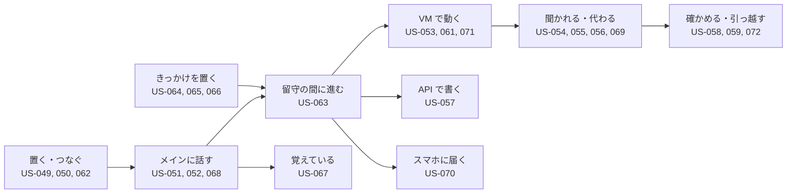

# 02. ユーザーストーリー
- プロジェクト：Agent-Team-Open ／ 版数：v1.1（2026-10-24） ／ インプット：[01_requirements](01_requirements.md)

> **3行で**
> 1. 利用者は持ち主（P-1）だけ。OSS の利用者（自分の機械に置く開発者）も P-1。ストーリーは 24 本（US-049〜072）。
> 2. v1.0 の中心は US-063（留守の間に進め、戻ったら短く知る）。きっかけ（US-064〜066）・記憶（US-067）・言い直し（US-068）・確認の減り（US-069）・スマホの知らせ（US-070）・VM を戻す（US-071）が支える。
> 3. v0.6 の 14 本（置く・頼む・VM・確認・交代・パック・ターミナルなど）は、メインに話して振り分けてもらう形に直した。編成・Slack・声・一般向けの配布のストーリーは書かない（[01 §7](01_requirements.md#7-スコープ外wont)）。

## 🧭 判断してほしいこと
なし

## 全体図

見てほしいところ：v1.0 で足したのは T・R・N・M と、D の US-069。持ち主は「頼む」か「きっかけを置く」だけで、あとは留守の間に進む。

## 要点
- 持ち主はメインに一言書くだけ。メインが合うエージェントに振り分け、報告を受けて短く知らせる（[US-051](#us-051メインに頼む-req-079-req-085-req-093-優先度must)・[US-063](#us-063留守の間に進め戻ったら短く知る-req-096-req-100-req-102-優先度must)）
- 決まった時刻・あとでもう一度・GitHub の出来事で、メインが自分で起きる（US-064〜066）
- 好みは 1 度言えば覚え、画面で見て直せる（US-067）
- 動いている間に「やっぱり木曜にして」と言い直せる（US-068）
- 合図に当たっても、外に出す・支払う・消す・秘密でなければ人に聞かずに進む（US-069）
- 確認・交代の頼み・伝える価値のある報告だけがスマホに届く（US-070）
- VM はファイルとログインが残る。おかしくなったら控えに戻す（US-056・071）

---

## 詳細

### ペルソナ
### P-1: 持ち主
- 属性：開発ができる個人。自宅にラズパイ、手元に Win のノート PC がある。OSS として公開するので、同じ立場の開発者（会社の検証機に置く人を含む）も P-1。非エンジニアの一般向けは対象にしない（D-184）
- 目的：細かい手作業（予約・申し込み・調べもの・予定の登録・PR の手直し）を AI に任せ、寝ている間・出かけている間に進めてほしい
- 困りごと：API がないサイトは任せられない。勝手に支払われるのは困る。進むたびに報告されるとうるさい。同じ好みを毎回言うのが面倒。機能が多すぎると使わなくなる
- IT リテラシー：高い（Docker・Tailscale を自分で入れられる）

### ストーリーマップ
| アクティビティ | ステップ | ストーリー |
|---|---|---|
| 準備 | 置く・つなぐ・接続先を選ぶ | US-049、US-050、US-062 |
| 任せる | メインに頼む・エージェントを作る・言い直す | US-051、US-052、US-068 |
| きっかけを置く | ルーチン・あとでもう一度・GitHub の出来事 | US-064、US-065、US-066 |
| 留守の間に進む | 振り分け・報告・知らせ | US-063、US-070 |
| VM で動く | 操作させる・聞かれる・代わる・ログインを残す・戻す | US-053〜056、US-069、US-071 |
| 書き込む | カレンダー・GitHub | US-057 |
| 広げる | パックを入れる・コードを直させる | US-060、US-061 |
| 覚える | 好みを覚える・見て直す | US-067 |
| 見直す | 上限・記録・引っ越し・費用 | US-058、US-059、US-072 |

### ストーリー一覧

### US-049：ホストに置いて起動する 〔REQ-076, REQ-092〕 優先度：Must
**持ち主として、手元のどの Linux の機械でも同じ手順で使い始めるために、Compose の一式で起動したい。**
- Given Docker と Compose が入った 64bit の Linux When 設定ファイルを埋めて `docker compose up -d` Then 本体・box-manager・egress・Tailscale が起動し、画面が開ける
- Given メインのターンやタスクが動いている途中 When ホストを再起動する Then 起動のあと、止まった歩みの次から続く

### US-050：外からスマホで入る 〔REQ-077, REQ-078〕 優先度：Must
**持ち主として、外出先でも使うために、スマホからログインの手間なく入りたい。**
- Given スマホが持ち主の tailnet に入っている When `https://makase.<tailnet>.ts.net` を開く Then ログイン画面なしでチャットが開く
- Given 持ち主以外の Tailscale の利用者 When 同じ URL を開く Then 403 になり、何も見えない
- Given インターネットの誰か When `https://makase.<tailnet>.ts.net/`（443 番）を開く Then つながらない（443 番は tailnet だけ。Funnel は 8443 番だけ）
- Given インターネットの誰か When 8443 番の `/hooks/` 以外を開く Then 404

### US-051：メインに頼む 〔REQ-079, REQ-085, REQ-093〕 優先度：Must
**持ち主として、設定を考えずに仕事を任せるために、チャットに一言書きたい。**
- Given 「明日の天気は？」のような小さな質問 When 送る Then メインが自分で調べて答える（エージェントに振り分けない）
- Given 合うエージェントがいる重い仕事 When 送る Then メインは「○○に頼みました」と短く返し、仕事は裏で進む。チャットには作業の途中経過が流れない
- Given 合うエージェントがいない When 送る Then メインがエージェントを1人作り（生成画面に切り替わる）、そのまま振り分ける
- Given 告知ページ制作パックが入っている When 「文化祭の告知ページを作って」と送る Then パックのエージェントに振り分けられる

### US-052：エージェントを作る・消す 〔REQ-080〕 優先度：Must
**持ち主として、決まった仕事の係を用意するために、一覧からエージェントを作り、要らなくなったら消したい。**
- Given エージェント一覧 When したいことを書いて作る Then エージェントが1人増え、メインの振り分け先になる
- Given 動いていないエージェント When 消す Then 一覧から消える（VM のログイン状態は全員で共通なので消えない）
- Given 動いているエージェント When 消す Then 「動いているので消せない」と出る
- Given メイン When 一覧を開く Then メインは先頭に出て、消すメニューがない

### US-053：API のないサイトを任せる 〔REQ-081〕 優先度：Must
**持ち主として、手で操作していたサイトの仕事を任せるために、エージェントにブラウザを操作させたい。**
- Given ブラウザが要るタスク When エージェントが動く Then VM が起き（眠っていれば）、エージェントは画面の番を取って、画面を見てクリック・入力・スクロールをして進める
- Given 別のタスクが画面の番を持っている When ブラウザを使おうとする Then 番が空くまで待つ（ターミナルの仕事は待たずに進む）
- Given タスクが終わった When 10 分ほかに使われない Then VM は止まる（ファイルとログインは残る）
- Given 操作が上限（300回・55分・$3）に達した When 次の操作をしようとする Then タスクは止まり、メインに理由が報告される

### US-054：こわい操作の前に聞かれる 〔REQ-082〕 優先度：Must
**持ち主として、勝手に支払いや送信をされないために、こわい操作の前だけ確認したい。**
- Given エージェントが「購入」ボタンを押そうとする When 申告か合図（必ず人の言葉）に当たった Then 操作は止まり、スクショと押す場所の印つきの確認がスマホに届く
- Given 確認 When ○ を押す Then その1操作だけが実行される。画面が変わっていたら実行せず、エージェントが決め直す
- Given 確認 When × を押す、または30分たつ Then 操作はされず、エージェントは別の道を探すか報告する
- Given ふつうのリンクのクリックや検索欄への入力 When エージェントが操作する Then 確認なしで進む

### US-055：画面を見て代わる 〔REQ-083〕 優先度：Must
**持ち主として、ログインや CAPTCHA を片付けるために、VM の画面を見て代わりに操作したい。**
- Given VM が動いている When タスクのページか確認から VM の画面を開く Then エージェントの操作がライブで見える（操作はできない）
- Given VM の画面 When 「代わる」を押す Then エージェントは止まって待ち、人がマウス・キーボード（スマホではタップ。文字入力は次の版）で操作できる
- Given 交代中 When 「返す」を押す Then エージェントは今の画面から続ける
- Given エージェントがログインの画面で止まった When エージェントが交代を頼む Then 「ログインしてください」の頼みがスマホに届く

### US-056：一度ログインすれば次から使える 〔REQ-084〕 優先度：Must
**持ち主として、毎回ログインしないで済むように、VM にログイン状態を残したい。**
- Given 前のタスクで人がログインした When 別のエージェントのタスクが同じサイトを開く Then ログインした状態で始まる
- Given 設定の VM の欄 When 「ブラウザのデータを消す」を押す Then Cookie とログイン状態が消える（画面の番が使われている間は消せない）

### US-057：カレンダー・GitHub に書く 〔REQ-086, REQ-087〕 優先度：Must
**持ち主として、API があるものは確実に書き込むために、今までどおり確認つきで書き込ませたい。**
- Given Google カレンダーをつないである When メインかエージェントが予定を入れようとする Then 予定の中身の確認が届き、○ で入る。メインのときは、確認を待つ間メインは眠り、○ / × で起きて「入れました」などと伝える（D-248）
- Given GitHub をつないである When エージェントが PR を出そうとする Then 差分の確認が届き、○ で出る

### US-058：使いすぎない・あとで確かめる 〔REQ-088, REQ-090〕 優先度：Must
**持ち主として、費用と操作を把握するために、上限を決め、何をしたかをあとで見たい。**
- Given 設定画面 When タスク・メインのターン・日次の上限を変える Then 次のタスク・ターンから効く
- Given 記録の画面 When 開く Then きっかけ・判定・オートレビュー・確認・操作（スクショつき。7日を過ぎたものは画像なし）が時刻順に見える

### US-059：別のホストへ引っ越す 〔REQ-089〕 優先度：Should
**持ち主として、ノート PC からラズパイに移るために、エージェントと設定を持っていきたい。**
- Given 前のホスト When 書き出す Then エージェント・スキル・設定・確認のルール・プロフィール・ルーチンが1つのファイルになる（会話・タスクの履歴・ログ・メモ・VM のホーム・つながりの資格情報・受け口の秘密は入らない）
- Given 新しいホスト When そのファイルを取り込む Then エージェントと設定が入る。同じ名前のエージェントは取り込まずに知らせる

### US-060：パックを入れる・外す 〔REQ-093〕 優先度：Must
**持ち主として、用途ごとに整えたエージェントをすぐ使うために、パックを入れ、要らなくなったら外したい。**
- Given パックの一覧 When 「入れる」を押す Then そのパックのエージェントが増え、手順書と確認するドメインも入る
- Given パックが入っている When そのパックの用途に合う頼みを送る Then メインがパックのエージェントに振り分ける。合うパックがなければ今までどおり
- Given パックが入っていて、動いているエージェントがない When 「外す」を押す Then パックのエージェントと手順書が消える（動いていれば「動いているので外せない」と出る）

### US-061：コードを VM で動かして直させる 〔REQ-094〕 優先度：Must
**持ち主として、リポジトリの修正とテストを任せるために、エージェントに VM のターミナルでコードを動かさせたい。**
- Given GitHub のリポジトリ When メインに「テストが通るように直して」と頼む Then 振り分け先が VM の中でコマンドを動かしてテストを走らせ、直した差分が PR の確認として届く
- Given エージェントが VM の中でコマンドを実行する When 実行する Then 確認なしで動く（資格情報は VM になく、外へは許可リストだけ）
- Given 前のタスクでホームに入れたツール（`npm`・`pip --user`） When 次のタスクで使う Then 入れ直さずに使える
- Given 直した差分を GitHub に push する When エージェントが push しようとする Then 確認が届き、○ を押すまで push されない

### US-062：会社の契約で Claude を使う 〔REQ-095〕 優先度：Should
**持ち主として、会社の AWS や Google Cloud の契約の中で Claude を使うために、接続先を Bedrock か Vertex に変えたい。**
- Given `.env` の `LLM_PROVIDER` が `bedrock` で、AWS のリージョンと資格情報がある When 起動して頼む Then Claude の呼び出し（オートレビューを含む）は Bedrock 経由になり、設定画面の「ホスト」欄に接続先とモデルが出る
- Given `.env` の `LLM_PROVIDER` が `vertex` で、GCP のプロジェクトとリージョンと ADC がある When 起動して頼む Then Claude の呼び出しは Vertex 経由になる
- Given 接続先に必要な値が足りない When 起動する Then 足りない値の名前を出して止まる（US-049 と同じ）
- Given 接続先が `bedrock` When エージェントが Web 検索をしようとする Then Web 検索の道具はなく、`web_fetch` と VM のブラウザで調べる

### US-063：留守の間に進め、戻ったら短く知る 〔REQ-096, REQ-100, REQ-102〕 優先度：Must
**持ち主として、寝ている間や出かけている間にも仕事を進めてほしいので、頼んだら PC を閉じても動き続け、終わったときだけ短く知らせてほしい。**
- Given 夜に「来週の木曜の 19 時に 4 人で入れる店を 3 つ探して、空きを確かめておいて」と頼んだ When PC とスマホの画面を閉じる Then タスクは裏で進み、終わるとメインが起きて結果をまとめ、1 回だけ知らせる
- Given タスクの報告を受けたメイン When 次にやることがある（例：見つけた店の予約の下書き） Then 持ち主に聞かずに次のタスクを渡す。こわい操作は確認に回る
- Given メインが起きたが、伝える価値がない（例：ルーチンで調べたら変化がなかった） When ターンが終わる Then チャットには何も出ず、通知も来ない
- Given 何も起きていない When 1 日たつ Then LLM は呼ばれず、VM は止まっている

### US-064：ルーチンを作る 〔REQ-097〕 優先度：Must
**持ち主として、毎日・毎週の決まった仕事を任せるために、「平日 8:00 に今日の予定と未読の PR をまとめて」のようなルーチンを置きたい。**
- Given きっかけの画面 When 名前・プロンプト・時刻（平日 8:00 など）を書いて作る Then その時刻にメインが起き、プロンプトどおりに動く
- Given チャットで「毎週月曜に先週の PR をまとめて」と頼む When メインがルーチンを提案する Then 確認のカードが出て、○ を押すとルーチンができる（× なら作られない）
- Given ルーチン When 止める・消す Then 次の時刻から動かない

### US-065：あとでもう一度見てもらう 〔REQ-098〕 優先度：Must
**持ち主として、今は空きがない予約や返事待ちの仕事を任せるために、メインに「あとでもう一度見る」を予約させたい。**
- Given 「キャンセルが出たら教えて」と頼んだ When 今は空きがない Then メインは次に見る時刻（例：3 時間後）を予約して眠る。その時刻に起きて、また見に行かせる
- Given きっかけの画面 When 予約の一覧を開く Then 時刻と覚え書きが見え、消せる

### US-066：GitHub の出来事で動く 〔REQ-099〕 優先度：Must
**持ち主として、PR のレビュー依頼や CI の失敗にすぐ対応してもらうために、GitHub の出来事でメインを起こしたい。**
- Given きっかけの画面 When GitHub の受け口を作る Then 受け口の URL（`https://makase.<tailnet>.ts.net:8443/hooks/<hookId>`）と署名の秘密が 1 度だけ出る。それを GitHub のリポジトリの webhook に登録する
- Given CI が失敗した When GitHub から webhook が届く Then 署名を確かめたうえでメインが起き、必要なら直すタスクを振り分ける。直した PR は確認に回る
- Given 署名が合わない・同じ配達の再送 When 届く Then 前者は 401 で何も起きず、後者は捨てられる

### US-067：好みを覚えて、見て直せる 〔REQ-101〕 優先度：Must
**持ち主として、同じことを何度も言わないで済むように、好みや大事な事実を覚えておいてほしい。間違って覚えたら直したい。**
- Given 「告知ページは明るい色で、絵文字は使わないで」と言った When 次の週に別の告知ページを頼む Then 言わなくてもその好みで作られる
- Given 記憶の画面 When 開く Then プロフィール（大事な事実）とログ（日付つきの出来事）が見え、直す・消す・足すができる
- Given 「先週何した？」と聞く When メインが答える Then ログと記憶の検索から答える

### US-068：動いている間に言い直す 〔REQ-079〕 優先度：Must
**持ち主として、途中で条件が変わったときに止めずに伝えるために、動いている間にもチャットで言い直したい。**
- Given メインのターンが動いている When 「やっぱり木曜にして」と送る Then 列に並ばず、メインの次の歩みに入る
- Given 裏のタスクが動いている When メインに言い直す Then メインがそのタスクに言い直しを届ける（`steer_task`）
- Given タスクのページ When 直接書いて送る Then そのタスクの次の歩みに入る

### US-069：確認が減る 〔REQ-103〕 優先度：Must
**持ち主として、留守の間に止まらないように、取り返しのつかない操作以外は機械に確かめてもらいたい。**
- Given エージェントが予約サイトの空き検索で「次へ」を押そうとする When 合図（T-3 の `confirm_words`）に当たった Then オートレビューが確かめ、通せば人に聞かずに実行する
- Given オートレビューが止めた・答えなかった When 20 秒たつ Then 人の確認に回る
- Given 「購入する」「送信」「削除」「確定」「Submit」・パスワード欄・カード欄・POST のフォームの送信・決済の iframe の中 When 合図に当たった Then オートレビューを通さず、必ず人に回る
- Given 記録の画面 When オートレビューの行を開く Then 通した・止めた理由と費用が見える

### US-070：スマホに知らせが来る 〔REQ-091〕 優先度：Must
**持ち主として、留守の間の大事なことに気づくために、PWA を閉じていてもスマホに知らせが来てほしい。**
- Given 設定画面 When 通知を許可する Then この端末が購読され、試しの通知が届く
- Given PWA を閉じている When メインが `send_to_owner`（`notify = true`）を呼ぶ・人の確認ができる・交代を頼まれる Then スマホに通知が届く。タップでその画面が開く
- Given 同じタスクの確認が続けて 3 つできた When 届く Then 通知は 1 つにまとまり、件数だけ増える
- Given PWA を前に出している When 同じことが起きる Then 通知は来ず、画面にだけ出る

### US-071：VM を戻す・作り直す 〔REQ-104〕 優先度：Must
**持ち主として、VM がおかしくなったり、変なものが残っていそうなときに、前の状態に戻したい。**
- Given 設定の VM の欄 When 控えの一覧を開く Then 毎日の控え（3 世代）が日付つきで見え、「今すぐ控えを取る」もできる
- Given 控え When 「この控えに戻す」を押す Then 「動いているタスク N 件が止まります」と確かめたあと、それらのタスクを止めてメインに知らせ、VM を止めてホームを控えの中身に戻す
- Given 「空から作り直す」を押す When 確かめる Then ホームが空になり、ログインもツールも消える

### US-072：長く話しても速く安い 〔REQ-105〕 優先度：Must
**持ち主として、何か月も同じチャットを使い続けるために、会話が長くなっても返事が遅くならず、費用も増えないでほしい。**
- Given メインの会話が 6 万トークンを超えた When 最後の話から 10 分たつ Then 留守の間に要約され、次に話すときは短い要約から始まる（チャットの画面には前の会話がそのまま残る）
- Given 設定画面の「ホスト」欄 When 開く Then キャッシュの当たり率と、外れた回数（どの部分が変わったか）が見える

## このドキュメントで決まったこと
- D-176、D-178、D-181、D-184、D-185、D-200〜D-208、D-212、D-214、D-217、D-221、D-222、D-229（[00 決定事項ログ](00_overview.md#決定事項ログ)）。数値は D-141・D-142・D-144
