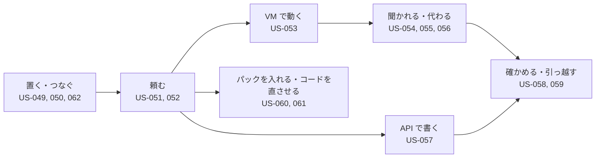

# 02. ユーザーストーリー
- プロジェクト：Agent-Team-Open ／ 版数：v0.6（2026-10-24） ／ インプット：[01_requirements](01_requirements.md)

> **3行で**
> 1. 利用者は持ち主（P-1）だけ。OSS の利用者（自分の機械に置く開発者）も P-1。ストーリーは14本（US-049〜062）。
> 2. 中心は US-053〜056：API のないサイトを任せ、こわい操作だけ聞かれ、必要なら交代し、ログインは一度で済む。
> 3. パックとターミナルの2本（US-060・061）と、LLM の接続先の1本（US-062、Should）が加わった。編成・育つ仕組み・複数人・一般向けの配布のストーリーは書かない（[01 §7](01_requirements.md#7-スコープ外wont)）。

## 🧭 判断してほしいこと
なし

## 全体図

見てほしいところ：持ち主の1日の流れの順に並べてある。D の3本と G の2本が新しいところ。

## 要点
- 置くのは一度だけ。`docker compose up` で起動する（[US-049](#ストーリー一覧)）
- 外のスマホから Tailscale でそのまま入れる（US-050）
- エージェントは VM のブラウザを自分で操作する（US-053）
- 支払い・送信などの前だけ、スマホに確認が来る（US-054）
- ログインは人が交代して一度だけ。次からはエージェントが使える（US-055・056）
- 用途ごとのエージェント集（パック）を入れ、コードは VM のターミナルで動かして直させる（US-060・061）
- 会社の AWS・Google Cloud の契約で Claude を使うときは、`.env` で接続先を Bedrock・Vertex に変える（US-062、Should）

---

## 詳細

### ペルソナ
### P-1: 持ち主
- 属性：開発ができる個人。自宅にラズパイ、手元に Win のノート PC がある。OSS として公開するので、同じ立場の開発者（会社の検証機に置く人を含む）も P-1。非エンジニアの一般向けは対象にしない（D-184）
- 目的：細かい手作業（予約・申し込み・調べもの・予定の登録）を AI に任せたい
- 困りごと：API がないサイトは任せられない。勝手に支払われるのは困る。機能が多すぎると使わなくなる
- IT リテラシー：高い（Docker・Tailscale を自分で入れられる）

### ストーリーマップ
| アクティビティ | ステップ | ストーリー |
|---|---|---|
| 準備 | 置く・つなぐ・接続先を選ぶ | US-049、US-050、US-062 |
| 任せる | 頼む・エージェントを作る | US-051、US-052 |
| VM で動く | 操作させる・聞かれる・代わる・ログインを残す | US-053〜056 |
| 書き込む | カレンダー・GitHub | US-057 |
| 広げる | パックを入れる・コードを直させる | US-060、US-061 |
| 見直す | 上限・記録・引っ越し | US-058、US-059 |

### ストーリー一覧

### US-049：ホストに置いて起動する 〔REQ-076, REQ-092〕 優先度：Must
**持ち主として、手元のどの Linux の機械でも同じ手順で使い始めるために、Compose の一式で起動したい。**
- Given Docker と Compose が入った 64bit の Linux When 設定ファイルを埋めて `docker compose up -d` Then 本体・box-manager・egress・Tailscale が起動し、画面が開ける
- Given 依頼が動いている途中 When ホストを再起動する Then 起動のあと、依頼は止まった歩みの次から続く

### US-050：外からスマホで入る 〔REQ-077, REQ-078〕 優先度：Must
**持ち主として、外出先でも使うために、スマホからログインの手間なく入りたい。**
- Given スマホが持ち主の tailnet に入っている When `https://makase.<tailnet>.ts.net` を開く Then ログイン画面なしでチャットが開く
- Given 持ち主以外の Tailscale の利用者 When 同じ URL を開く Then 403 になり、何も見えない
- Given 家の LAN の別の機械 When ホストの IP とポートに直接つなぐ Then つながらない（ポートを開けていない）

### US-051：チャットで頼む 〔REQ-079, REQ-085〕 優先度：Must
**持ち主として、設定を考えずに仕事を任せるために、チャットに一言書きたい。**
- Given 合うエージェントがいる When 依頼を送る Then そのエージェント1人が仕事をして、チャットに答えが返る
- Given 合うエージェントがいない When 依頼を送る Then エージェントが1人作られ（生成画面に切り替わる）、そのまま仕事をする

### US-052：エージェントを作る・消す 〔REQ-080〕 優先度：Must
**持ち主として、決まった仕事の係を用意するために、一覧からエージェントを作り、要らなくなったら消したい。**
- Given エージェント一覧 When したいことを書いて作る Then エージェントが1人増える
- Given 動いていないエージェント When 消す Then 一覧から消え、そのプロフィール（ログイン状態）も消える
- Given 動いているエージェント When 消す Then 「動いているので消せない」と出る

### US-053：API のないサイトを任せる 〔REQ-081〕 優先度：Must
**持ち主として、手で操作していたサイトの仕事を任せるために、エージェントにブラウザを操作させたい。**
- Given ブラウザが要る依頼 When エージェントが動く Then VM が起き、エージェントは画面を見てクリック・入力・スクロールをして仕事を進める
- Given 依頼が終わった When 報告が出る Then VM は止まる（プロフィールは残る）
- Given 操作が上限（300回・60分・$3）に達した When 次の操作をしようとする Then タスクは止まり、理由がチャットに出る

### US-054：こわい操作の前に聞かれる 〔REQ-082〕 優先度：Must
**持ち主として、勝手に支払いや送信をされないために、こわい操作の前だけ確認したい。**
- Given エージェントが「購入」ボタンを押そうとする When エージェントが申告した、または合図（決まった言葉）に当たった Then 操作は止まり、スクショと押す場所の印つきの確認が届く（画面を開いていれば知らせが出る）
- Given 確認 When ○ を押す Then その1操作だけが実行される。画面が変わっていたら、もう一度聞かれる
- Given 確認 When × を押す、または30分たつ Then 操作はされず、エージェントは別の道を探すか報告する
- Given ふつうのリンクのクリックや検索欄への入力 When エージェントが操作する Then 確認なしで進む

### US-055：画面を見て代わる 〔REQ-083〕 優先度：Must
**持ち主として、ログインや CAPTCHA を片付けるために、VM の画面を見て代わりに操作したい。**
- Given VM が動いている When 依頼のページから VM の画面を開く Then エージェントの操作がライブで見える（操作はできない）
- Given VM の画面 When 「代わる」を押す Then エージェントは止まって待ち、人がマウス・キーボード（スマホではタップ。文字入力は次の版）で操作できる
- Given 交代中 When 「返す」を押す Then エージェントは今の画面から続ける
- Given エージェントがログインの画面で止まった When エージェントが交代を頼む Then 「ログインしてください」の頼みが届く

### US-056：一度ログインすれば次から使える 〔REQ-084〕 優先度：Must
**持ち主として、毎回ログインしないで済むように、エージェントごとにログイン状態を残したい。**
- Given 前の依頼で人がログインした When 同じエージェントに次の依頼をする Then ログインした状態のブラウザで始まる
- Given エージェントの画面 When 「ブラウザのデータを消す」を押す Then Cookie とログイン状態が消える（動いている間は消せない）

### US-057：カレンダー・GitHub に書く 〔REQ-086, REQ-087〕 優先度：Must
**持ち主として、API があるものは確実に書き込むために、今までどおり確認つきで書き込ませたい。**
- Given Google カレンダーをつないである When エージェントが予定を入れようとする Then 予定の中身の確認が届き、○ で入る
- Given GitHub をつないである When エージェントが PR を出そうとする Then 差分の確認が届き、○ で出る

### US-058：使いすぎない・あとで確かめる 〔REQ-088, REQ-090〕 優先度：Must
**持ち主として、費用と操作を把握するために、上限を決め、何をしたかをあとで見たい。**
- Given 設定画面 When 1タスクの上限・日次の上限を変える Then 次のタスクから効く
- Given 記録の画面 When 開く Then 判定・確認・操作（スクショつき。7日を過ぎたものは画像なし）が時刻順に見える

### US-059：別のホストへ引っ越す 〔REQ-089〕 優先度：Should
**持ち主として、ノート PC からラズパイに移るために、エージェントと設定を持っていきたい。**
- Given 前のホスト When 書き出す Then エージェント・スキル・設定・確認のルールが1つのファイルになる（依頼の履歴・プロフィール・つながりの資格情報は入らない）
- Given 新しいホスト When そのファイルを取り込む Then エージェントと設定が入る。同じ名前のエージェントは取り込まずに知らせる

### US-060：パックを入れる・外す 〔REQ-093〕 優先度：Must
**持ち主として、用途ごとに整えたエージェントをすぐ使うために、パックを入れ、要らなくなったら外したい。**
- Given パックの一覧 When 「入れる」を押す Then そのパックのエージェントが増え、手順書と確認するドメインも入る
- Given パックが入っている When そのパックの用途に合う依頼を送る Then パックのエージェント1人が仕事をする。合うパックがなければ今までどおり
- Given パックが入っていて、動いているエージェントがない When 「外す」を押す Then パックのエージェントとそのプロフィールが消える（動いていれば「動いているので外せない」と出る）

### US-061：コードを VM で動かして直させる 〔REQ-094〕 優先度：Must
**持ち主として、リポジトリの修正とテストを任せるために、エージェントに VM のターミナルでコードを動かさせたい。**
- Given GitHub のリポジトリ When リポジトリを指定して「テストが通るように直して」と頼む Then VM の中でコマンドが動いてテストが走り、直した差分が PR の確認として届く
- Given エージェントが VM の中でコマンドを実行する When 実行する Then 確認なしで動く（VM は使い捨てで、外に効かない）
- Given 直した差分を GitHub に push する When エージェントが push しようとする Then 確認が届き、○ を押すまで push されない

### US-062：会社の契約で Claude を使う 〔REQ-095〕 優先度：Should
**持ち主として、会社の AWS や Google Cloud の契約の中で Claude を使うために、接続先を Bedrock か Vertex に変えたい。**
- Given `.env` の `LLM_PROVIDER` が `bedrock` で、AWS のリージョンと資格情報がある When 起動して依頼を送る Then Claude の呼び出しは Bedrock 経由になり、設定画面の「ホスト」欄に接続先とモデルが出る
- Given `.env` の `LLM_PROVIDER` が `vertex` で、GCP のプロジェクトとリージョンと ADC がある When 起動して依頼を送る Then Claude の呼び出しは Vertex 経由になる
- Given 接続先に必要な値が足りない When 起動する Then 足りない値の名前を出して止まる（US-049 と同じ）
- Given 接続先が `bedrock` When エージェントが Web 検索をしようとする Then Web 検索の道具はなく、`web_fetch` と VM のブラウザで調べる（Bedrock には Claude の Web 検索ツールがない）

## このドキュメントで決まったこと
- D-176（パック）、D-178（VM のターミナル）、D-179（通知は次の版）、D-181（スマホの文字入力は次の版）、D-184（一般向けはやらない）、D-185（LLM の接続先）。数値は D-141〜D-144
