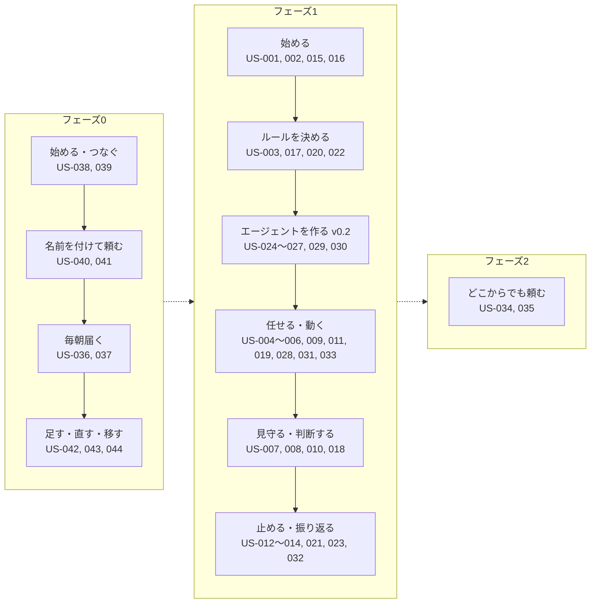

# 02. ユーザーストーリー
- プロジェクト：open-team（仮称） ／ 版数：v0.6（2026-10-01、書き直し） ／ インプット：[01_requirements.md](../01_requirements.md)

> **3行で**
> 1. ペルソナ6人（P-1〜P-6）と、ストーリー44件（US-001〜044）を定義する。受け入れ基準は Given / When / Then。
> 2. フェーズ0の中心は「名前を付けて頼む」（US-040〜044）と「毎朝届く」（US-036〜039）。開発（US-001〜023）とエージェントビルダー（US-024〜033）はフェーズ1、US-034〜035 はフェーズ2。
> 3. US-024〜027 は v0.3・v0.5 で上流の要件が置換・格下げされ、扱いが未決（Q-08）。v0.3 の機能（REQ-033〜041）にはまだストーリーがない（Q-09）。

## 🧭 判断してほしいこと

| # | 種類 | 論点 | 選択肢 | おすすめ（理由） | 決まらないと止まるもの |
|---|---|---|---|---|---|
| Q-08 | ✅決定 | US-024〜027 の扱い。US-024 の上流 REQ-020 は廃止（→ REQ-052・053）、US-025・026 の上流 REQ-018・022 は Could に格下げ（旧 14 §要件）、US-027 は PR での公開が前提だが既定はアプリ内モード（旧 12 §未決事項 v0.3「US-027・UC-019・FR-027・SCR-016 などの見直しが要る」） → **GitOps モードはフェーズ2以降へ。US-024 廃止、US-025・026 は Could、US-027・UC-019・020・FR-027・NFR-051 はフェーズ2**（[D-14](../decisions.md#d-14)）| A: US-024 を廃止し US-025・026 を Could、US-027 を GitOps モードの話に書き直す / B: 現状のまま残す | —（元の記述なし） | UC-017〜019、FR-024〜027、SCR-016 |
| Q-09 | 未決 | v0.3 の要件 REQ-033〜038（フェーズ1）と REQ-039〜041（フェーズ2）、v0.4 の REQ-051 にストーリーがない（旧 00 トレーサビリティ表「—（未反映）」）。REQ-034（「以後も許可」）は US-037 の受け入れ基準にだけ現れる | A: ストーリーを追加する / B: フェーズ2の分は後で設計する | —（元の記述なし） | 03 の UC、04 の FR（REQ-033〜038 分） |
| Q-10 | 未決 | US-035（REQ-030、フェーズ2）は「投稿された本文のハッシュが承認したものと一致することが記録される」としているが、REQ-030 は v0.4 でフェーズ0に前倒しされ（旧 13 §要件）、MCP の書き込みの検証は既定で `none`（旧 15 §決定事項「検証」） | A: US-035 をフェーズ0・検証 `none` に合わせて書き直す / B: `readback` 前提のフェーズ1のストーリーとして残す | —（元の記述なし） | US-035 の受け入れテスト |
| Q-11 | 未決 | コードを書かない利用者（P-5）向けに、PR のマージを経ずに Web 上で公開する経路を許すか（ADR-011、フェーズ2）（旧 02・旧 12 §未決事項）。v0.3 のアプリ内モード（ADR-017）との関係は本文に記述がない | A: 許す / B: 許さない | —（元の記述なし） | フェーズ2の設計 |
| Q-12 | 未決 | Slack から承認する場合の再認証の方式と、A-22（通知から直接承認しない）との関係（US-034、フェーズ2） | — | —（元の記述なし） | US-034、フェーズ2の Slack |
| Q-13 | ✅決定 | メンションに対する返信をどうするか（コメント投稿は Won't のため、現在は Web Push だけ）。フェーズ1で `comment_issue` を外部作用として追加するか（旧 02・旧 12 §未決事項） → **Web Push だけ（コメント投稿は Won't のまま）**（[D-33](../decisions.md#d-33)）| A: Web Push だけ / B: `comment_issue` を追加 | —（元の記述なし。現状は A） | US-028、Won't の見直し |
| Q-14 | 未決 | 却下時にフィードバックを入力して再実行させる機能を、どのフェーズで入れるか（MVP では Won't）（旧 02 §未決事項） | — | —（元の記述なし） | Won't の見直し、US-007 |

## 全体図

ストーリーマップ（左から右へ利用の流れ。各箱の中がストーリー）。

見てほしいところ：フェーズ0は「作る → 届く → 直す」の短い流れ。フェーズ1は開発の統制の流れで、予算・停止・承認のふるまいはフェーズ0の土台にもなる。

## 要点
- ペルソナは [personas.md](personas.md)。入口は P-6（開発をしない個人ユーザー）と P-1（ソロ開発者）。
- 開発と統制の基本（US-001〜023）：[stories-dev.md](stories-dev.md)
- エージェントビルダー（US-024〜035）：[stories-agent-builder.md](stories-agent-builder.md)。上流が変わったストーリーには注記を付けた。
- 汎用クラウドエージェントと「名前を付けて頼む」（US-036〜044）：[stories-cloud-agent.md](stories-cloud-agent.md)
- すべての ID の索引は [ID 索引](#id-索引)。
- 文中の「組織」は v0.4 以降の「ワークスペース」に読み替えた（用語は [用語集](../00_overview/glossary.md)）。

---

## 詳細

### ペルソナ（概要）

| ID | ペルソナ | ロール | フェーズ |
|---|---|---|---|
| — | プロダクトオーナー本人（最初の利用者） | owner | 0 |
| [P-1](personas.md#p-1ソロ開発者-aoiowner--maintainer) | ソロ開発者 Aoi | owner / maintainer | 1 |
| [P-2](personas.md#p-2oss-メンテナ小規模チームのリード-renowner--maintainer) | OSS メンテナ／小規模チームのリード Ren | owner / maintainer | 1 |
| [P-3](personas.md#p-3チームメンバー-soramaintainer--viewer) | チームメンバー Sora | maintainer / viewer | 1 |
| [P-4](personas.md#p-4将来企業のセキュリティ担当-kaiviewer) | （将来）企業のセキュリティ担当 Kai | viewer | 将来 |
| [P-5](personas.md#p-5業務担当者-miopmカスタマーサポートフェーズ2) | 業務担当者 Mio（PM・カスタマーサポート） | — | 2 |
| [P-6](personas.md#p-6開発をしない個人ユーザーv04) | 開発をしない個人ユーザー（v0.4） | owner | 0〜1 |

### ストーリーマップ（表）

アクティビティ × ステップ × ストーリー（16行）

| アクティビティ | ステップ | ストーリー（Must） | ストーリー（Should） | フェーズ |
|---|---|---|---|---|
| つなぐ（v0.4） | MCP サーバーを登録 → ツールを分類 → カタログから接続 | US-038 | — | 0（カタログは1） |
| リポジトリなしで使う（v0.4） | 汎用テンプレートだけで作る | US-039 | — | 0 |
| 頼んで任せる（v0.12） | 入口で頼む → エージェント生成中… → 担当が決まる・作られる（必要なら分ける）→ 担当どうしで協調（v0.14）→ 回答1つ → チェック | US-045〜048 | — | 0 |
| 名前を付けて頼む（v0.5） | 名前を付ける → 話しかけられる → お願いする → 自己設定 | US-040, US-041 | — | 0 |
| 毎朝届く（v0.4） | スケジュールで起動 → Web・MCP を読む → 通知・Slack に届く | US-036, US-037 | — | 0 |
| 足す・直す（v0.5） | 仕事を足す → 一言で直す → 自動で調整 → 元に戻す | US-042, US-044 | — | 0 |
| 任せ先に移す（v0.5） | 役割外のお願い → 任せ先の提案 | — | US-043 | 0 |
| 始める | サインイン → リポジトリ連携 → 鍵登録 → 通知許可 | US-001, US-002, US-016, US-015 | — | 1 |
| ルールを決める | ポリシーを書く → 検証する → モデルを振り分ける | US-003, US-017 | US-020, US-022 | 1 |
| エージェントを作る（v0.2） | 会話で下書き → Canvas で確認・編集 → 試し実行 → PR で公開（Q-08） | US-024, US-025, US-026, US-027, US-029 | US-030 | 1 |
| 任せる | エージェントを選んで委任 → ラベル・メンション・スケジュールで起動 | US-004, US-028 | US-019, US-033 | 1 |
| 見守る | 進捗を見る → 予算を見る | US-018, US-010 | — | 1 |
| エージェントが動く | 自律実行 → ポリシー強制 → 自動停止 → 覚える | US-005, US-006, US-009, US-011 | US-031 | 1 |
| 判断する | 通知を受ける → 承認 / 却下 → PR 作成 | US-015, US-007, US-008 | — | 1 |
| 止める | 個別キャンセル → エージェント単位の停止 → 一括停止 | US-012, US-032, US-013 | — | 1 |
| 振り返る・チームで使う | 監査ログを見る → 検証する → 出力する → スコアカードを見る → メンバー管理 | US-014, US-032 | US-023, US-021 | 1 |
| どこからでも頼む | Slack から依頼 → 開発以外の作用を承認 | US-034, US-035 | — | 2（US-035 は Q-10） |

### ID 索引

US-001〜044（44件）

| ID | タイトル | REQ | 優先度 | 定義 |
|---|---|---|---|---|
| US-001 | GitHub アカウントでサインインする | REQ-001 | Must | [stories-dev.md](stories-dev.md) |
| US-002 | GitHub App をインストールしてリポジトリを連携する | REQ-001 | Must | [stories-dev.md](stories-dev.md) |
| US-003 | ポリシーの有効な内容と検証結果を確認する | REQ-004 | Must | [stories-dev.md](stories-dev.md) |
| US-004 | Issue を選んでエージェントに委任する | REQ-002 | Must | [stories-dev.md](stories-dev.md) |
| US-005 | エージェントが隔離環境で自律的に実装する | REQ-003, REQ-012 | Must | [stories-dev.md](stories-dev.md) |
| US-006 | ポリシーで禁止した操作とパスは実行されない | REQ-004 | Must | [stories-dev.md](stories-dev.md) |
| US-007 | 承認カードを見て PR 作成を承認・却下する | REQ-005 | Must | [stories-dev.md](stories-dev.md) |
| US-008 | 承認した内容どおりの PR が作成される | REQ-006 | Must | [stories-dev.md](stories-dev.md) |
| US-009 | 予算上限に達する前に自動停止する | REQ-007 | Must | [stories-dev.md](stories-dev.md) |
| US-010 | 予算の消費状況を確認する | REQ-007 | Must | [stories-dev.md](stories-dev.md) |
| US-011 | 暴走を検知して自動停止する | REQ-008 | Must | [stories-dev.md](stories-dev.md) |
| US-012 | 実行中のタスクをキャンセルする | REQ-009 | Must | [stories-dev.md](stories-dev.md) |
| US-013 | Kill Switch でワークスペース全体を一括停止する | REQ-009 | Must | [stories-dev.md](stories-dev.md) |
| US-014 | 監査ログを閲覧・検証する | REQ-010 | Must | [stories-dev.md](stories-dev.md) |
| US-015 | 承認待ち・完了・停止のプッシュ通知を受け取る | REQ-011 | Must | [stories-dev.md](stories-dev.md) |
| US-016 | LLM の API キーを登録する（BYOK） | REQ-012 | Must | [stories-dev.md](stories-dev.md) |
| US-017 | 処理フェーズごとにモデルを振り分ける | REQ-012 | Must | [stories-dev.md](stories-dev.md) |
| US-018 | タスクの進捗をリアルタイムで確認する | REQ-013 | Must | [stories-dev.md](stories-dev.md) |
| US-019 | Issue にラベルを付けて委任する | REQ-014 | Should | [stories-dev.md](stories-dev.md) |
| US-020 | 自律レベル引き上げの提案を受ける | REQ-015 | Should | [stories-dev.md](stories-dev.md) |
| US-021 | メンバーのロールを管理する | REQ-016 | Should | [stories-dev.md](stories-dev.md) |
| US-022 | ポリシーで承認者を指定する | REQ-016 | Should | [stories-dev.md](stories-dev.md) |
| US-023 | 監査ログをエクスポートする | REQ-017 | Should | [stories-dev.md](stories-dev.md) |
| US-024 | 会話でエージェントの下書きを作る（上流 REQ-020 は廃止。Q-08） | REQ-020 | Must | [stories-agent-builder.md](stories-agent-builder.md) |
| US-025 | Canvas で構成と境界を確認・編集する（Q-08） | REQ-018 | Must | [stories-agent-builder.md](stories-agent-builder.md) |
| US-026 | 試し実行で動きを確かめる（Q-08） | REQ-022 | Must | [stories-agent-builder.md](stories-agent-builder.md) |
| US-027 | PR として公開し、マージで有効にする（Q-08） | REQ-019, REQ-021 | Must | [stories-agent-builder.md](stories-agent-builder.md) |
| US-028 | 起動条件を設定する | REQ-023 | Must | [stories-agent-builder.md](stories-agent-builder.md) |
| US-029 | ポリシーを超える権限は付けられない | REQ-019 | Must | [stories-agent-builder.md](stories-agent-builder.md) |
| US-030 | Skill を作って付ける | REQ-024 | Should | [stories-agent-builder.md](stories-agent-builder.md) |
| US-031 | メモリを確認・削除する | REQ-025 | Should | [stories-agent-builder.md](stories-agent-builder.md) |
| US-032 | エージェントを個別に停止し、実績を見る | REQ-026 | Must | [stories-agent-builder.md](stories-agent-builder.md) |
| US-033 | レポート型のエージェントを使う | REQ-027 | Should | [stories-agent-builder.md](stories-agent-builder.md) |
| US-034 | Slack から依頼する | REQ-029 | Must（フェーズ2） | [stories-agent-builder.md](stories-agent-builder.md) |
| US-035 | 開発以外の作用を承認する（Q-10） | REQ-030 | Must（フェーズ2） | [stories-agent-builder.md](stories-agent-builder.md) |
| US-036 | 毎朝、通勤前に交通状況を知る | REQ-043, REQ-044, REQ-046, REQ-048 | Must | [stories-cloud-agent.md](stories-cloud-agent.md) |
| US-037 | 決まったテーマのニュースを毎朝まとめてもらう | REQ-044, REQ-046, REQ-047 | Must | [stories-cloud-agent.md](stories-cloud-agent.md) |
| US-038 | MCP サーバーをつないで使う | REQ-042, REQ-049 | Must | [stories-cloud-agent.md](stories-cloud-agent.md) |
| US-039 | リポジトリなしでエージェントを作る | REQ-045, REQ-050 | Must | [stories-cloud-agent.md](stories-cloud-agent.md) |
| US-040 | 名前を付けるだけでエージェントを作る | REQ-052, REQ-058 | Must | [stories-cloud-agent.md](stories-cloud-agent.md) |
| US-041 | お願いするだけで動き始める | REQ-053, REQ-054 | Must | [stories-cloud-agent.md](stories-cloud-agent.md) |
| US-042 | 同じエージェントに仕事を足す・変える | REQ-055, REQ-056 | Must | [stories-cloud-agent.md](stories-cloud-agent.md) |
| US-043 | 役割外のお願いを任せ先に移す | REQ-057 | Should | [stories-cloud-agent.md](stories-cloud-agent.md) |
| US-044 | 自分の知らないうちに権限が増えない | REQ-054 | Must | [stories-cloud-agent.md](stories-cloud-agent.md) |
| US-045 | 頼むだけで、合ったエージェントが用意される | REQ-063, REQ-065 | Must | [stories-cloud-agent.md](stories-cloud-agent.md) |
| US-046 | 1体では向かない依頼は、独立したエージェントに分けて任せる | REQ-064 | Must（0-H は順番が Must） | [stories-cloud-agent.md](stories-cloud-agent.md) |
| US-047 | 何体で動いても、答えは1つで返ってくる | REQ-066 | Must | [stories-cloud-agent.md](stories-cloud-agent.md) |
| US-048 | 分かれた担当どうしが確かめ合ってから答える | REQ-067 | Must（0-H は Should） | [stories-cloud-agent.md](stories-cloud-agent.md) |

P-1〜P-6 の定義は [personas.md](personas.md)。

## このドキュメントで決まったこと
- P-6（v0.4）と US-036〜044（v0.4・v0.5）の追加：[00_overview.md の決定事項ログ](../00_overview.md#決定事項ログ) D-02、D-10〜D-17
- 前提とする仮定の一覧は各ストーリーファイルの末尾と [仮定一覧](../00_overview/assumptions.md)
