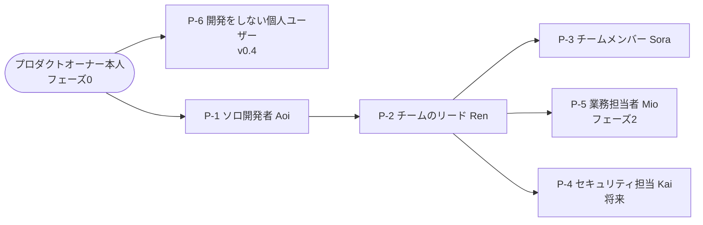

# 02. ペルソナ（P-1〜P-6）
- プロジェクト：open-team（仮称） ／ 版数：v0.6（2026-10-01、書き直し） ／ 親：[README.md](README.md)

> **3行で**
> 1. 入口は P-6（開発をしない個人ユーザー）と P-1（ソロ開発者）。フェーズ0の最初の利用者はプロダクトオーナー本人。
> 2. チームへの拡張は P-2・P-3、フェーズ2で P-5（業務担当者）、将来の企業向けは P-4。
> 3. P-6 の名前・属性は旧 13・14 のストーリーの主語から集めたもので、それ以上の設定はない。

## 🧭 判断してほしいこと
なし（ストーリー全体の論点は [README.md](README.md)）

## 全体図

見てほしいところ：個人 → チーム → 企業の順に広げる。P-6 は v0.4 で入口に加わった。

## 要点
- 開発者のペルソナ：[P-1](#p-1ソロ開発者-aoiowner--maintainer)〜[P-3](#p-3チームメンバー-soramaintainer--viewer)
- 開発以外：[P-5](#p-5業務担当者-miopmカスタマーサポートフェーズ2)、[P-6](#p-6開発をしない個人ユーザーv04)
- 監査：[P-4](#p-4将来企業のセキュリティ担当-kaiviewer)

---

## 詳細

### P-1：ソロ開発者 Aoi（owner / maintainer）
- 属性：個人開発者。副業で SaaS を1〜3個運営。GitHub の個人アカウントを使い、主に移動中にスマホで作業状況を確認する。
- 目的：寝ている間や通勤中に、溜まった小さな Issue（バグ修正・依存更新・テスト追加）を片付けたい。
- 困りごと：既存のエージェントは「気づいたら勝手に Push していた」「月末の請求額が怖い」。何が起きたか後から追えない。
- IT リテラシー：高い。YAML の設定ファイルを書くことに抵抗はない。
- エージェントを作る主な利用者（自分用の小さなチーム。旧 12「ペルソナ（追加）」）。

### P-2：OSS メンテナ／小規模チームのリード Ren（owner / maintainer）
- 属性：5〜10人のチームのテックリード、または OSS のメンテナ。GitHub Organization を管理している。
- 目的：チーム全員が同じルールでエージェントを使えるようにし、そのルール自体を PR でレビューしたい。
- 困りごと：メンバーごとにエージェントの設定がバラバラで、誰がどこまで許可しているかわからない。
- IT リテラシー：高い。
- エージェントを作る主な利用者（チームの共通エージェントをレビューして導入。旧 12「ペルソナ（追加）」）。

### P-3：チームメンバー Sora（maintainer / viewer）
- 属性：P-2 のチームに所属するエンジニア。
- 目的：自分に割り当てられた Issue をエージェントに任せ、承認者のレビューを受けて PR にしたい。
- 困りごと：ポリシーのどこに引っかかったのかがわからないと、使い方を改善できない。

### P-4：（将来）企業のセキュリティ担当 Kai（viewer）
- 属性：企業の情報セキュリティ部門の担当者。MVP では要件を集めるためのペルソナとして扱う。
- 目的：エージェントが「何を・誰の承認で・どのモデルで」実行したかを監査したい。

### P-5：業務担当者 Mio（PM・カスタマーサポート）〔フェーズ2〕
- 属性：コードは書かない。Slack と Notion で働く。
- 目的：定型の調査・下書き・転記をエージェントに任せたい。
- 困りごと：エージェントが勝手に送信するのは困る。
- 補足：フェーズ2のペルソナである（旧 12「ペルソナ（追加）」）。

### P-6：開発をしない個人ユーザー（v0.4）
- 属性：開発をしない一般の個人ユーザー。電車と車で通勤する、情報収集に時間を取られている、設定画面に慣れていない（US-036・037・040 の主語）。
- 目的：朝の交通・ニュース・メールの整理を、つないだサービスの範囲で安全に任せたい（旧 00「対象ユーザー」）。GitHub なしで使いたい（US-039）。
- 困りごと：テンプレートや権限を理解しないと使い始められないのは困る（US-040）。勝手な外部作用と暴走が怖い（旧 00「エレベーターピッチ」）。
- IT リテラシー：技術に詳しくない。MCP はカタログからワンクリックで接続できることを前提にする（REQ-049、旧 13「決定事項」）。
- 補足：v0.4 で入口のペルソナに加えた（旧 13「既存ドキュメントへの影響」で 02 への追加を指示）。名前は付いていない。

## このドキュメントで決まったこと
- P-6 の追加（v0.4）→ [00_overview.md の決定事項ログ](../00_overview.md#決定事項ログ) D-02。
