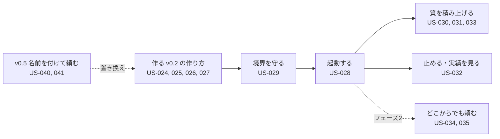

# 02. ユーザーストーリー：エージェントビルダー（US-024〜035）
- プロジェクト：open-team（仮称） ／ 版数：v0.6（2026-10-01、書き直し） ／ 親：[README.md](README.md) ／ インプット：[01_requirements.md](../01_requirements.md)（REQ-018〜030）

> **3行で**
> 1. 自分用のエージェントを作り（v0.2 の作り方）、起動条件・Skill・メモリ・停止・レポートを使うストーリー（フェーズ1）と、Slack・開発以外の作用（フェーズ2）。
> 2. 作り方は v0.3（アプリ内モード）と v0.5（名前を付けて頼む）で変わった。US-024〜027 は上流が置換・格下げされており、扱いが未決（Q-08）。
> 3. 権限の上限（US-029）・メモリ（US-031）・停止（US-032）・レポート（US-033）は v0.5 以降も有効。

## 🧭 判断してほしいこと
本書に関わる論点は [README.md](README.md) の Q-08（US-024〜027 の扱い）、Q-10（US-035 と検証・フェーズの食い違い）、Q-11〜Q-13（フェーズ2の公開経路・Slack での承認・メンションへの返信）。

## 全体図

見てほしいところ：「作る」部分は v0.5 で置き換わった（点線）。境界・起動・質・停止のストーリーはそのまま使う。

## 要点
- 上流が変わったストーリーには「上流の状態」の注記を付けた（US-024〜027、US-035）。
- 権限がポリシーを超えないこと：[US-029](#us-029ポリシーを超える権限は付けられない-req-019-優先度must)
- 停止とスコアカード：[US-032](#us-032エージェントを個別に停止し実績を見る-req-026-優先度must)

---

## 詳細

### US-024：会話でエージェントの下書きを作る 〔REQ-020〕 優先度：Must
**開発者として、YAMLを一から書かずに済むように、やってほしいことを話すだけでエージェントの下書きを作りたい。**

> 上流の状態（v0.5）：REQ-020 は廃止され REQ-052・053（US-040・041）に置き換わった。FR-024・SCR-015・TBL-021・API-043 なども廃止。本ストーリーの扱いは Q-08。

受け入れ基準：
- Given 連携済みのリポジトリがある When 「依存関係の更新PRを毎週月曜に出す係がほしい」と入力する Then テンプレート・起動条件・権限・予算が埋まった下書きと、Canvas のプレビューが表示される
- Given 下書きがある When 「テストは npm test だけでいい」と追加で伝える Then 該当箇所だけが変わり、変更点がハイライトされる
- Given アシスタントの出力がスキーマに合わない When 下書きに反映しようとする Then 反映されず、「提案を反映できませんでした（理由）」と表示される

### US-025：Canvas で構成と境界を確認・編集する 〔REQ-018〕 優先度：Must
**開発者として、エージェントに何を任せて何を任せないかを一目で把握するために、構成と境界を一画面で見たい。**

> 上流の状態（v0.5）：REQ-018 は Could に下がり、Canvas はエージェント詳細の「詳細設定」に移った。本ストーリーの優先度は Q-08。

受け入れ基準：
- Given 下書きを開いている When Canvas を表示する Then 起動条件 → エージェント → できること → 境界 → 外部作用 が左から右（スマホでは上から下）に並ぶ
- Given リポジトリのポリシーが `open_pr: approve` When 下書きで `open_pr: auto` を選ぼうとする Then 選択できず、「リポジトリのポリシーで制限されています」と鍵アイコンが表示される
- Given どの画面でも When 「このエージェントにできること」を開く Then 実効ポリシーから生成した文章（LLMを使わない）が表示される

### US-026：試し実行で動きを確かめる 〔REQ-022〕 優先度：Must
**開発者として、公開してから事故に気づくことがないように、本番と同じ条件で、外部作用だけは起きない試し実行をしたい。**

> 上流の状態（v0.5）：REQ-022 は Could に下がり、試し実行は「詳細設定」の機能になった。試し実行の API-047 は v0.5 で廃止。本ストーリーの優先度は Q-08。

受け入れ基準：
- Given 下書きがある When Issue（または指示文）を選んで試し実行する Then タスク詳細に「試し実行」の帯が表示され、通常どおり進捗が流れる
- Given 試し実行がPR作成まで進んだ When Intent が提出される Then 承認カードがプレビューとして表示され、PRは作成されない
- Given 試し実行の費用が $1 に達した When 次のLLM呼び出しをしようとする Then 停止する
- Given 試し実行が終わった When タスク詳細を見る Then タスクは「完了（試し実行）」（`completed`（`dry_run`））で、エージェントのメモリには何も追加されていない

### US-027：PRとして公開し、マージで有効にする 〔REQ-019, REQ-021〕 優先度：Must
**チームのリードとして、エージェントの追加や権限の変更をコードと同じようにレビューするために、エージェント定義をPRで受け取りたい。**

> 上流の状態（v0.3）：既定はアプリ内モード（REQ-033、ADR-017）になり、PR での公開は GitOps モードのときの動き。公開の API-048 は v0.5 で廃止。見直しは Q-08。

受け入れ基準：
- Given 検証を通った下書き When 「公開する」を押す Then `.agent/agents/<id>.yaml`（と Skill）を追加するPRが作られ、PRのリンクが表示される
- Given 公開PRがある When デフォルトブランチにマージされる Then 数分以内にエージェント一覧で「有効」になる
- Given 公開PRがマージされていない When そのエージェントを起動しようとする Then 起動できない（試し実行のみ可能）
- Given 公開PRがマージされずにクローズされた When 下書きを開く Then 下書きは編集中に戻っており、再び公開できる

### US-028：起動条件を設定する 〔REQ-023〕 優先度：Must
**開発者として、Webアプリを開かなくても仕事が回るように、ラベル・メンション・スケジュールでエージェントを起動したい。**

受け入れ基準：
- Given `agent:bug-fixer` ラベルのトリガーが有効 When Issue にそのラベルを付ける Then bug-fixer のタスクが作成される
- Given 有効なエージェント When Issue のコメントに `@open-team bug-fixer 先にテストを書いて` と書く Then 追加の指示つきでタスクが作成される
- Given 平日9時のスケジュール When 時刻になる Then エージェント担当者（定義の `owner`）を依頼者としてタスクが作成される。担当者の権限がなくなっていたら作成されず、監査ログに理由が残る
- Given 同じスケジュールから起動した前回のタスクが未完了 When 次の時刻になる Then タスクは作成されず、監査ログに `trigger.skipped`（`previous_run_active`）が残る（BR-29）

### US-029：ポリシーを超える権限は付けられない 〔REQ-019〕 優先度：Must
**チームのリードとして、メンバーが作ったエージェントでリポジトリのルールが破られないように、エージェントの権限がポリシーを超えないことを保証したい。**

受け入れ基準：
- Given ポリシーで `paths.deny: ["infra/**"]` When エージェント定義が `paths.allow: ["infra/**"]` を含む Then 検証エラー `AGENT_EXCEEDS_POLICY` になり公開できない
- Given 有効なエージェント When 後からポリシーが厳しくなる Then エージェントは厳しい方の値で動き、一覧と Canvas に「ポリシーにより制限中」の警告が出る
- Given 同じリポジトリの別のエージェントがすでに `agent:bug-fixer` ラベルを使っている When 同じラベルのトリガーを設定する Then 検証エラー `AGENT_TRIGGER_CONFLICT` になり公開できない

### US-030：Skill を作って付ける 〔REQ-024〕 優先度：Should
**開発者として、うまくいったやり方を次も使えるように、手順を Skill として保存してエージェントに付けたい。**

受け入れ基準：
- Given PRが作成された（`succeeded`）か、レポートを提出した（`completed`（`report`））タスク。試し実行は除く When 「このやり方を Skill にする」を押す Then タスクの経過から `SKILL.md` の下書きが作られ、下書きの編集画面が開く
- Given Skill に「`curl` で外部APIを叩く」と書いてある When その Skill を使うエージェントが実行される Then `curl` は `commands.allow` に従って判定される（Skill によって許可されない）

### US-031：メモリを確認・削除する 〔REQ-025〕 優先度：Should
**開発者として、エージェントが間違ったことを覚え続けないように、覚えた内容を1件ずつ確認して消したい。**

受け入れ基準：
- Given エージェントがタスク中に `remember` した When タスクが完了（PR作成またはレポート提出）する Then その項目が「有効」として一覧に表示される
- Given タスクが停止・失敗・却下で終わった When メモリ一覧を見る Then そのタスクで書かれた項目は有効になっていない
- Given 有効な項目 When 削除する Then 次のタスクから使われず、監査ログに削除（`agent.memory_deleted`）が残る
- Given 試し実行のタスクが `remember` した When メモリ一覧を見る Then 項目は保存されていない（BR-24）

### US-032：エージェントを個別に停止し、実績を見る 〔REQ-026〕 優先度：Must
**メンテナとして、ワークスペース全体を止めずに問題のあるエージェントだけを止めるために、エージェント単位で即時停止したい。**

受け入れ基準：
- Given 実行中のタスクがあるエージェント When 「このエージェントを停止」を押す Then 実行中のタスクが10秒以内に停止し（`halted`、理由 `agent_disabled`）、すべてのトリガーが受け付けられなくなる。エージェント担当者とワークスペースの owner に通知が届く
- Given 停止中のエージェント When ワークスペースの owner が「再開」を押す Then `active` に戻る。停止したタスクは再開しない（maintainer は再開できない）
- Given エージェント詳細 When スコアカードを開く Then 直近30日のタスク数・PR到達率・承認率・平均コスト・Breaker 作動回数が表示される

### US-033：レポート型のエージェントを使う 〔REQ-027〕 優先度：Should
**開発者として、PRまでは要らない調査（依存関係の脆弱性、Issue の振り分け案）を定期的に受け取りたい。**

受け入れ基準：
- Given reviewer / triager テンプレートのエージェント When タスクが完了する Then タスクは「完了（レポート）」（`completed`（`report`））になり、レポートがタスク詳細に表示され、Push 通知が届く。GitHub には何も書き込まれない
- Given レポートに秘密情報のパターン（`ghs_`、`sk-` など）が含まれる When 保存される Then マスクされた本文だけが保存される（BR-32）

### US-034：Slack から依頼する 〔REQ-029〕 優先度：Must（フェーズ2）
**業務担当者として、普段いる場所から離れずに、Slack のメンションでエージェントに依頼したい。**

受け入れ基準：
- Given Slack ユーザーと open-team ユーザーが紐づいている When `@open-team researcher 競合3社の料金を調べて` と投稿する Then タスクが作成され、スレッドに進捗の要約が投稿される
- Given 承認が必要な作用 When Intent が提出される Then スレッドに承認カードへのリンクが投稿される（承認は Web で行う）

### US-035：開発以外の作用を承認する 〔REQ-030〕 優先度：Must（フェーズ2）
**業務担当者として、エージェントが勝手に送信しないように、送る内容をそのまま見てから承認したい。**

> 上流の状態（v0.4・v0.6）：REQ-030 はフェーズ0に前倒しされ、MCP の書き込みの検証は既定で `none`（`readback` はフェーズ1）。受け入れ基準の「本文のハッシュの一致の記録」との関係は Q-10。フェーズ0の Slack 投稿は US-037 が扱う。

受け入れ基準：
- Given `slack.post_message: approve` When エージェントが投稿を提案する Then 承認カードに投稿先と本文がそのまま表示され、承認した内容だけが投稿される
- Given 投稿後 When 検証する Then 投稿された本文のハッシュが承認したものと一致することが記録される

## このドキュメントで決まったこと
- 前提とする仮定：A-35、A-36、A-37、A-38、A-39、A-41、A-44（[仮定一覧](../00_overview/assumptions.md)）
