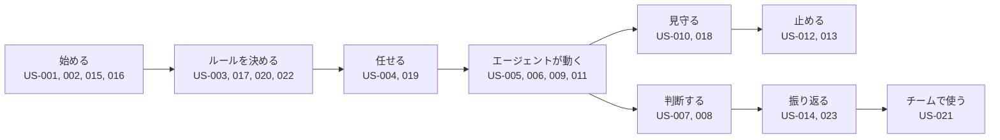

# 02. ユーザーストーリー：開発と統制の基本（US-001〜023）
- プロジェクト：open-team（仮称） ／ 版数：v0.6（2026-10-01、書き直し） ／ 親：[README.md](README.md) ／ インプット：[01_requirements.md](../01_requirements.md)（REQ-001〜017）

> **3行で**
> 1. 開発（Issue → PR）を統制つきで任せるストーリー。サインイン・ポリシー・委任・自律実行・承認・停止・監査・通知・BYOK を含む（フェーズ1）。
> 2. 予算・Breaker・停止・監査ログ・通知・承認のふるまいは、フェーズ0の汎用エージェントの土台にもなる。
> 3. 文中の「組織」は v0.4 以降「ワークスペース」に読み替えた（US-002 の補足を除く）。

## 🧭 判断してほしいこと
なし（ストーリー全体の論点は [README.md](README.md)）

## 全体図

見てほしいところ：外部作用（PR 作成）の前に必ず「判断する」を通る。止める手段は個別キャンセルと Kill Switch の2つ。

## 要点
- 委任：[US-004](#us-004issueを選んでエージェントに委任する-req-002-優先度must)、ラベル：[US-019](#us-019issueにラベルを付けて委任する-req-014-優先度should)
- 統制：[US-006](#us-006ポリシーで禁止した操作とパスは実行されない-req-004-優先度must)（禁止）、[US-009](#us-009予算上限に達する前に自動停止する-req-007-優先度must)（予算）、[US-011](#us-011暴走を検知して自動停止する-req-008-優先度must)（Breaker）
- 承認と一致の検証：[US-007](#us-007承認カードを見てpr作成を承認却下する-req-005-優先度must)、[US-008](#us-008承認した内容どおりのprが作成される-req-006-優先度must)
- 停止：[US-012](#us-012実行中のタスクをキャンセルする-req-009-優先度must)、[US-013](#us-013kill-switch-でワークスペース全体を一括停止する-req-009-優先度must)

---

## 詳細

### US-001：GitHubアカウントでサインインする 〔REQ-001〕 優先度：Must
**開発者として、新しくアカウントを作らずに使い始めるために、GitHubアカウントでサインインしたい。**

受け入れ基準：
- Given 未ログインの状態 When 「GitHubでサインイン」を押してGitHub上で認可する Then open-team のホーム画面に遷移し、自分のGitHubログイン名が表示される
- Given GitHub上で認可をキャンセルした When コールバックに戻る Then ログイン画面に戻り「サインインがキャンセルされました」と表示される
- Given ログイン済みの状態 When 30日間アクセスしない Then セッションが切れ、再度サインインが必要になる

### US-002：GitHub App をインストールしてリポジトリを連携する 〔REQ-001〕 優先度：Must
**開発者として、エージェントに任せるリポジトリだけを選ぶために、GitHub App をインストールして対象リポジトリを連携したい。**

受け入れ基準：
- Given サインイン直後で連携済みの組織がない When オンボーディングで「GitHub Appをインストール」を押してリポジトリを選ぶ Then open-team 上に組織とリポジトリの一覧が表示される

補足：v0.4 以降、ワークスペースはサインイン時に自動で作られ、GitHub App のインストールはワークスペースにつなぐ連携の1つになった（A-78）。この受け入れ基準の「組織」は旧称のまま残している。
- Given GitHub上でリポジトリの選択を解除した When Webhookを受信する Then そのリポジトリは一覧で「連携解除」と表示され、新しいタスクを作れなくなる
- Given 自分がGitHub上で書き込み権限を持たないリポジトリ When タスクを作成しようとする Then 403エラーになる

### US-003：ポリシーの有効な内容と検証結果を確認する 〔REQ-004〕 優先度：Must
**リポジトリの管理者として、エージェントが何をどこまでできるかを把握するために、有効なポリシーとその検証結果を確認したい。**

受け入れ基準：
- Given `.agent/policy.yaml` がデフォルトブランチにある When ポリシー画面を開く Then 操作ごとの自律レベル・予算・Breaker・禁止パスが一覧で表示され、ファイルのコミットSHAが表示される
- Given `.agent/policy.yaml` がない When ポリシー画面を開く Then 「既定ポリシーを適用中」と表示され、既定値が表示される
- Given ポリシーにスキーマ違反またはプラットフォーム上限を超える値がある When ポリシー画面を開く Then 行番号つきのエラーが表示され、そのリポジトリではタスクを開始できない
- Given 編集中のYAMLを検証欄に貼り付けた When 「検証」を押す Then 保存やコミットをせずに検証結果だけが表示される

### US-004：Issueを選んでエージェントに委任する 〔REQ-002〕 優先度：Must
**開発者として、手を動かさずにIssueを片付けるために、スマホからIssueを選んでエージェントに委任したい。**

受け入れ基準：
- Given 連携済みのリポジトリにOpenのIssueがある When 新規タスク画面で委任先のエージェントとIssueを選び「委任する」を押す Then タスクが「待機中」として作成され、タスク詳細画面に遷移する
- Given 有効なエージェントがある When Issueを選ばずに指示文だけを入力して「委任する」を押す Then 指示文を入力としたタスクが「待機中」として作成される
- Given 同じエージェントの同じIssueに未完了のタスクがある When 同じエージェントに同じIssueを委任しようとする Then 「このIssueは実行中です」と表示されて作成されない（別のエージェントへの委任は作成できる。Issue なしの指示文だけの委任は重複を判定しない。BR-29）
- Given LLMのAPIキーが未登録 When 委任しようとする Then 設定画面への導線が表示され、タスクは作成されない
- Given Kill Switch が発動中 When 委任しようとする Then 「Kill Switch発動中のため新しいタスクを開始できません」と表示される

### US-005：エージェントが隔離環境で自律的に実装する 〔REQ-003, REQ-012〕 優先度：Must
**開発者として、自分が見ていない間に作業が進むように、エージェントに調査→計画→実装→テストを自律的に実行してほしい。**

受け入れ基準：
- Given タスクが待機中 When 実行枠が空く Then タスク専用の隔離環境が起動し、状態が「実行中」になる
- Given 実行中 When エージェントが実装とテストを終える Then 差分がPR作成のIntentとして提出され、隔離環境は破棄される
- Given 隔離環境の中 When 環境変数・ファイルシステムを調べる Then GitHubトークンもLLMのAPIキーも存在しない
- Given 隔離環境の中 When 許可されていないホストへ通信しようとする Then 通信は遮断される

### US-006：ポリシーで禁止した操作とパスは実行されない 〔REQ-004〕 優先度：Must
**リポジトリの管理者として、プロンプトに頼らずに安全を保証するために、ポリシーで deny にした操作や禁止パスへの変更がランタイムによって確実に拒否されてほしい。**

受け入れ基準：
- Given `paths.deny` に `infra/**` がある When エージェントが `infra/main.tf` を編集しようとする Then その操作は拒否され、判定理由（該当ルール）が監査ログに残る
- Given 隔離環境が乗っ取られ、禁止パスを含む差分がIntentとして提出された When Gatewayが差分を検証する Then Intentは deny となりPRは作成されない
- Given `merge: auto` と書かれたポリシー When 検証する Then プラットフォーム上限（merge は常に deny）の違反としてエラーになる

### US-007：承認カードを見てPR作成を承認・却下する 〔REQ-005〕 優先度：Must
**開発者として、スマホでも安心して判断できるように、差分要約・リスク・消費コスト・該当ポリシーがまとまったカードを見て、PR作成を承認または却下したい。**

受け入れ基準：
- Given PR作成のIntentが承認待ち When 承認カードを開く Then 差分要約（LLM生成と明記）・変更ファイル一覧・ルールベースのリスク評価・消費コスト・該当したポリシールールが表示される
- Given 承認カードを表示中 When 「承認」を押して確認ダイアログで確定する Then 状態が「実行中（PR作成中）」になる
- Given 承認カードを表示中 When 「却下」を押す Then タスクは「却下」で終了し、PRは作成されない
- Given 承認待ちになってから24時間が経った When 承認カードを開く Then 「期限切れ」と表示され、承認できない
- Given 承認者でないユーザー When 承認しようとする Then 403エラーになる

### US-008：承認した内容どおりのPRが作成される 〔REQ-006〕 優先度：Must
**開発者として、承認後のすり替えを防ぐために、自分が承認した差分と完全に同じPRだけが作成されることを保証してほしい。**

受け入れ基準：
- Given 承認済みのIntent When Gatewayが実行する Then `open-team/` で始まるブランチが作成され、PRが作成される
- Given PRが作成された When 検証処理が走る Then PRのhead commitのtree SHAが、承認したIntentから計算したtree SHAと一致した場合に限り「検証済み」となる
- Given 承認後に差分の内容が変わった（intentHashが一致しない） When 実行しようとする Then 実行は拒否される

### US-009：予算上限に達する前に自動停止する 〔REQ-007〕 優先度：Must
**開発者として、請求額を心配せずに任せるために、タスクごと・日ごとの予算上限を超える前にエージェントが自動停止してほしい。**

受け入れ基準：
- Given `budget.per_task_usd: 2` When 次のLLM呼び出しの最大見積額を加えると2ドルを超える Then その呼び出しは実行されず、タスクは「停止（予算超過）」になる
- Given `budget.max_steps: 80` When 81ステップ目を実行しようとする Then タスクは「停止（予算超過）」になる
- Given 当日のリポジトリ合計が `per_day_usd` に達している When 新しいタスクを開始しようとする Then タスクは開始されず、翌日0時（ワークスペースのタイムゾーン）まで待機する

### US-010：予算の消費状況を確認する 〔REQ-007〕 優先度：Must
**開発者として、使いすぎに早く気づくために、タスク・日・月ごとの消費額を予算メーターで確認したい。**

受け入れ基準：
- Given ホーム画面を開く When 表示が完了する Then 当日と当月の消費額が表示され、日次予算に対する割合がメーターで表示される
- Given タスク詳細を開く When 実行中 Then タスク予算に対する消費額・ステップ数・経過時間がリアルタイムで更新される

### US-011：暴走を検知して自動停止する 〔REQ-008〕 優先度：Must
**開発者として、ループや過剰な変更で被害が広がらないように、ルールベースで暴走を検知し、エージェントを自動停止してほしい。**

受け入れ基準：
- Given `breakers.same_action_repeat: 5` When 同じツールを同じ引数で5回連続して呼び出そうとする Then タスクは「停止（Breaker作動）」になり、作動したBreakerの種類が表示される
- Given `breakers.files_changed_max: 30` When 31ファイル目を変更しようとする、または31ファイル以上の差分が提出される Then 停止する
- Given `breakers.denied_attempts_max: 3` When 拒否された操作が3回に達する Then 停止する
- Given `breakers.step_cost_usd_max: 0.5` When 1ステップのLLM見積額が0.5ドルを超える Then 停止する

### US-012：実行中のタスクをキャンセルする 〔REQ-009〕 優先度：Must
**開発者として、方向性が違うと気づいた時点で止めるために、実行中のタスクを個別にキャンセルしたい。**

受け入れ基準：
- Given 実行中・承認待ち・待機中のいずれかのタスク When 「キャンセル」を押す Then 10秒以内に隔離環境が停止し、タスクは「キャンセル」になる
- Given キャンセル済みのタスクの承認待ちIntent When 承認しようとする Then 実行されない

### US-013：Kill Switch でワークスペース全体を一括停止する 〔REQ-009〕 優先度：Must
**開発者として、異常に気づいたらすぐに全部止めるために、ワンタップでワークスペース内のすべてのエージェントを停止したい。**

受け入れ基準：
- Given 実行中のタスクが複数ある When Kill Switch を発動する Then すべての隔離環境が10秒以内（p95）に停止し、承認待ちのIntentはすべて無効になる
- Given Kill Switch が発動中 When タスクを作成しようとする、または承認しようとする Then すべて拒否される
- Given Kill Switch が発動中 When owner 以外が解除しようとする Then 403エラーになる（止めるのは簡単に、再開は慎重に）

### US-014：監査ログを閲覧・検証する 〔REQ-010〕 優先度：Must
**開発者として、後から何が起きたかを説明できるように、すべてのステップの記録を閲覧し、改ざんされていないことを検証したい。**

受け入れ基準：
- Given タスクが終了している When 監査ログ画面でタスクを指定する Then LLM呼び出し（モデル・トークン・費用）・ポリシー判定・承認・外部作用が時系列で表示される
- Given 監査ログ When 「整合性を検証」を押す Then ハッシュチェーンを再計算した結果（OK / 破損箇所の連番）が表示される

### US-015：承認待ち・完了・停止のプッシュ通知を受け取る 〔REQ-011〕 優先度：Must
**開発者として、アプリを開いていなくても判断のタイミングを逃さないために、スマホにプッシュ通知を受け取りたい。**

受け入れ基準：
- Given 通知を許可したPWA When タスクが承認待ちになる Then 10秒以内（p95）に通知が届き、タップすると承認カードが開く
- Given 通知 When 内容を見る Then リポジトリ名・Issue番号・状態だけが含まれ、コードの内容は含まれない
- Given iOSのSafariでホーム画面に追加していない When 通知を有効にしようとする Then ホーム画面への追加手順が表示される

### US-016：LLMのAPIキーを登録する（BYOK） 〔REQ-012〕 優先度：Must
**開発者として、自分の契約でLLMを使うために、APIキーを安全に登録したい。**

受け入れ基準：
- Given 設定画面 When プロバイダーを選んでAPIキーを登録する Then キーが疎通確認され、末尾4文字だけが表示される
- Given 登録済みのキー When 画面・API・ログのいずれかを確認する Then キーの平文はどこにも出てこない
- Given 登録済みのキー When 削除する Then 以降そのプロバイダーのモデルを使うタスクは開始できない

### US-017：処理フェーズごとにモデルを振り分ける 〔REQ-012〕 優先度：Must
**開発者として、コストと品質のバランスをとるために、計画・実装・要約などのフェーズごとに使うモデルを指定したい。**

受け入れ基準：
- Given `.agent/routing.yaml` にフェーズごとのモデルを書いた When タスクが実行される Then 各LLM呼び出しは指定モデルで行われ、監査ログにモデル名が記録される
- Given `routing.yaml` がない When タスクが実行される Then ワークスペースの既定ルーティングが使われる
- Given 登録されていないプロバイダーのモデルが指定されている When ポリシーを検証する Then エラーになる

### US-018：タスクの進捗をリアルタイムで確認する 〔REQ-013〕 優先度：Must
**開発者として、エージェントが今何をしているかを知るために、フェーズ・ステップ・判定をリアルタイムで確認したい。**

受け入れ基準：
- Given 実行中のタスク詳細を開いている When エージェントがステップを進める Then 3秒以内（p95）にタイムラインに追加される
- Given ポリシーで拒否された操作がある When タイムラインを見る Then 拒否の理由（該当ルール）がわかる形で表示される

### US-019：Issueにラベルを付けて委任する 〔REQ-014〕 優先度：Should
**開発者として、Webアプリを開かずに委任するために、GitHubでIssueに `open-team` ラベルを付けるだけでタスクを開始したい。**

受け入れ基準：
- Given 連携済みのリポジトリ When 書き込み権限を持つ open-team ユーザーがIssueに `open-team` ラベルを付ける Then その人を依頼者とする、既定エージェント（`default`。`.agent/agents/default.yaml` がなければ組み込みの既定エージェント。BR-31）のタスクが作成される
- Given エージェント定義に `github_label` トリガー（例：`agent:bug-fixer`）がある When そのラベルを付ける Then そのエージェントのタスクが作成される（詳細は US-028）
- Given ラベルを付けたGitHubユーザーが open-team に未登録、または権限がない When Webhookを受信する Then タスクは作成されず、監査ログに記録だけが残る

### US-020：自律レベル引き上げの提案を受ける 〔REQ-015〕 優先度：Should
**リポジトリの管理者として、実績に基づいて手間を減らすために、承認の実績が十分に積み上がった操作について自律レベル引き上げの提案を受けたい。**

受け入れ基準：
- Given 直近30日で `open_pr` の承認が10回、却下とBreaker作動が0回 When 日次集計が走る Then 「open_pr を auto（ドラフトPR）にする」提案が表示される
- Given 提案 When 「受け入れる」を押す Then policy.yaml を変更するPRの作成Intentが作られ、通常と同じ承認フローを通る（勝手には変わらない）
- Given 提案 When 「見送る」を押す Then 同じ提案は30日間表示されない

### US-021：メンバーのロールを管理する 〔REQ-016〕 優先度：Should
**ワークスペースのオーナーとして、権限を適切に分けるために、メンバーのロール（owner / maintainer / viewer）を変更したい。**

受け入れ基準：
- Given owner When メンバーのロールを変更する Then 即時に反映され、監査ログに記録される
- Given ワークスペースで最後の owner When 自分を owner 以外に変更しようとする Then エラーになる

### US-022：ポリシーで承認者を指定する 〔REQ-016〕 優先度：Should
**チームリードとして、レビューの責任者を明確にするために、ポリシーファイルで承認できるユーザーを指定したい。**

受け入れ基準：
- Given `approvers: [ren]` When sora が依頼したタスクが承認待ちになる Then ren にだけ通知が届き、ren だけが承認できる
- Given `approvers` がない When 承認待ちになる Then 依頼者本人とワークスペースの owner が承認できる

### US-023：監査ログをエクスポートする 〔REQ-017〕 優先度：Should
**監査担当者として、外部のツールで分析するために、期間を指定して監査ログをJSON Lines形式で出力したい。**

受け入れ基準：
- Given 期間を指定する When エクスポートを実行する Then ハッシュ値を含むJSON Linesファイルがダウンロードされる
- Given エクスポートしたファイル When 公開されている検証手順で再計算する Then チェーンの整合性を確認できる

## このドキュメントで決まったこと
- 前提とする仮定：A-05（承認待ちの期限24時間。定期実行の仕事は v0.6 で短縮：D-26）、A-06、A-07、A-08（[仮定一覧](../00_overview/assumptions.md)）
