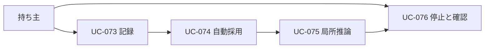

# 03. 成長機構のユースケース
- 版数：v1.8（2026-10-26） ／ インプット：[US-084〜087](02_user_stories.md#成長機構v18)

> **3行で**
> 1. 初回は通常のAI実行を記録し、候補を作る。
> 2. 検証後は同じ範囲の仕事をプログラムで処理する。
> 3. 未知の入力だけ推論し、停止・失効・復旧を区別する。

## 🧭 判断してほしいこと
なし。[R-114〜116](00_learning.md#-判断してほしいこと)を継承。

## 全体図

見てほしいところ：学習の採用と、外部への操作承認は別の出来事。

## 要点
- [UC-073](#uc-073)：記録の不足を推測で埋めない。
- [UC-074](#uc-074)：採用に人のクリックを要求しない。
- [UC-075](#uc-075)：既に完了した副作用を繰り返さない。
- [UC-076](#uc-076)：停止理由と費用を確認できる。

## 詳細
### UC-073
〔US-084〕持ち主が初めて日程調整を依頼する。
- 事前条件：認証済み、カレンダー接続済み。自由文はメインが型付き依頼へ変換する。
- 基本：依頼→必要情報の確認→空き時間取得→候補作成→既存の操作承認→実行結果を報告。
- 記録：日時・時間帯・参照権限・ツール版・入力出力・根拠を紐づける。成功した適格履歴が5件集まると候補生成の対象になる。
- 代替：曖昧な日時や好みは利用者へ確認。欠損データのある履歴は学習対象外。
- 事後：仕事の結果と型付き観測が保存される。候補生成失敗は元の仕事の成功を取り消さない。

### UC-074
〔US-085〕本体のタイマーが未処理の適格履歴を検出する。
- 事前条件：学習有効、予算あり、同scopeのactive版または候補が上限内。
- 基本：候補生成→静的検査→再生・反例試験→シャドー比較→すべて合格でactive版へ原子的に切り替え。
- 代替：材料不足はcandidateのまま。失敗はrejectedとし、理由を保存する。
- 例外：再起動では永続化済みの検証ジョブを再開。旧版は切替完了まで使用する。
- 事後：新規runだけ新しい版を固定する。ユーザーには採用結果を学習詳細に表示する。

### UC-075
〔US-086〕同じ範囲の依頼で、プログラムに未知の条件が現れる。
- 事前条件：active版あり、型付き入力が確定。
- 基本：版固定→freshな観測取得→ガード→既知ノード実行→穴を保存→必要な文脈だけでAIを起動→型・根拠・出力条件を検査→後続実行。
- 代替：好み・権限の不明点は人に確認。外部通信失敗は既存の再試行規約、権限拒否は停止。
- 例外：穴解決が2回失敗すればneeds_owner。予算不足なら推論を始めずblocked。副作用の結果不明はunknown_outcomeで停止する。
- 事後：同じノードを重複送信しない。解決結果は今回のrunにだけ反映し、次版候補は再検証する。

### UC-076
〔US-087〕持ち主が学習詳細を確認し、版を停止する。
- 事前条件：持ち主として認証済み。
- 基本：一覧→版詳細→検証・費用・穴の履歴確認→版停止→activeポインタを解除。
- 代替：依存版の変更や出力契約違反でも自動失効する。
- 例外：既に停止済みの操作は成功として返す。停止前に送信した外部操作は取り消したと表示しない。
- 事後：以後のノード開始前に停止を検出。安全なチェックポイントから通常経路へ戻すか、人に確認する。

## このドキュメントで決まったこと
[D-398・401](00_learning.md#決定事項ログ)。
