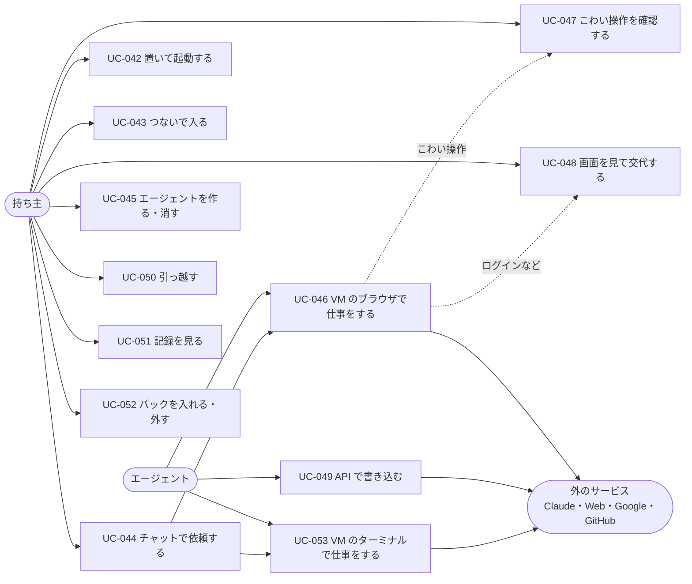

# 03. ユースケース
- プロジェクト：Agent-Team-Open ／ 版数：v0.4（2026-10-24） ／ インプット：[02_user_stories](02_user_stories.md)

> **3行で**
> 1. ユースケースは12本（UC-042〜053）。アクターは持ち主・エージェント・外のサービスの3種類。
> 2. 中心は UC-046（VM のブラウザで仕事をする）。そこから UC-047（こわい操作の確認）と UC-048（交代）に分かれる。
> 3. ビジネスルールは BR-01〜09。こわい操作の見分け方（BR-03）と、承認が効く範囲（BR-04）が要。VM の中のコマンドは判定しない（BR-08）。

## 🧭 判断してほしいこと
なし

## 全体図

見てほしいところ：UC-046 から、こわい操作なら UC-047 へ、人の手が要るなら UC-048 へ分かれる。

## 要点
- UC-046 の1歩は「スクショ → Claude が操作を決める → 合図を確かめる → 実行」（[UC-046](#ユースケース記述)）
- 申告か合図に当たった操作は、承認されるまで実行しない（BR-03）
- 承認はその1操作だけに効き、画面が変わっていたら実行せず、Claude に決め直させる（BR-04）
- 交代中はエージェントの操作を受け付けない（BR-05）
- VM のターミナルの中のコマンドは判定せず、VM の外に効くものだけ確認する（UC-053・BR-08）

---

## 詳細

### アクター一覧
| アクター | 種別 | 説明 |
|---|---|---|
| 持ち主 | 人 | ホストを置いて使う1人 |
| エージェント | 本体の中の実行（Claude） | 依頼を受けて、道具と VM のブラウザを使う |
| 外のサービス | 外部システム | Claude API、Web サイト、Google カレンダー API、GitHub API、Tailscale |

### ユースケース記述

### UC-042：置いて起動する 〔US-049〕
- アクター：持ち主
- 事前条件：64bit の Linux に Docker Engine と Compose v2 が入っている。Tailscale のアカウントがある
- 基本フロー：
 1. 持ち主は Compose の一式を取ってきて、設定ファイル（`.env`）に Claude の API キー・Tailscale の認証キー・持ち主のログイン名を書く
 2. `docker compose up -d` を実行する
 3. 本体はデータベースを最新の形にし（前にバックアップを取る）、VM のイメージがあるかを確かめる
 4. Tailscale が tailnet に入り、`https://makase.<tailnet>.ts.net` で待ち受ける
- 代替フロー：
 - 3a. 前に止まったときに動いていたタスクがある → UC-046 の続きから再開する（FR-084）
- 例外フロー：
 - E1. 64bit でない・メモリが足りない → 起動の記録に理由を出して止まる
 - E2. 設定ファイルに必須の値がない → 足りない値の名前を出して止まる
- 事後条件：画面が開け、`GET /api/health` が ok を返す

### UC-043：つないで入る 〔US-050〕
- アクター：持ち主
- 事前条件：使う端末が tailnet に入っている
- 基本フロー：
 1. 持ち主はブラウザで Agent-Team-Open の URL を開く
 2. Tailscale が利用者のログイン名を付けて本体に渡す
 3. 本体はログイン名が持ち主と一致することを確かめ、チャットを返す
- 例外フロー：
 - E1. ログイン名が持ち主でない・付いていない → 403
- ビジネスルール：BR-01

### UC-044：チャットで依頼する 〔US-051〕
- アクター：持ち主
- 基本フロー：
 1. 持ち主はチャットに依頼を書いて送る
 2. 本体は合うエージェントを1人選ぶ。入っているパックの用途に合えば、そのパックのエージェントから選ぶ（FR-085）。いなければ1人作る（生成画面に切り替わる）
 3. タスクが始まり、進み具合がチャットに流れる
 4. エージェントが報告し、答えがチャットに出る
- 代替フロー：
 - 2a. 依頼があいまい → 本体が質問し、持ち主が答えてから 2 に戻る
 - 3a. ブラウザが要る → UC-046
 - 3b. カレンダー・GitHub に書く → UC-049
 - 3c. コードを動かす → UC-053
- 事後条件：依頼は done・failed・cancelled のどれかになる

### UC-045：エージェントを作る・消す 〔US-052〕
- アクター：持ち主
- 基本フロー（作る）：エージェント一覧で、したいことを書いて作る → LLM がエージェント1人の設定を作り、保存する
- 基本フロー（消す）：一覧で消す → 論理削除し、プロフィールの消去を box-manager に頼む
- 例外フロー：
 - E1. 動いているエージェントを消す → 409 `AGENT_BUSY`

### UC-046：VM のブラウザで仕事をする 〔US-053〕
- アクター：エージェント
- 事前条件：タスクが running。VM の同時数に空きがある
- トリガー：エージェントが初めて computer の道具を使う
- 基本フロー：
 1. 本体は box-manager に、このエージェントのプロフィールをつけた VM を起こすよう頼む
 2. 本体は VM のスクショを Claude に渡す
 3. Claude は次の操作（クリック・入力・キー・スクロール など）を返す
 4. 本体は操作の先の要素を VM に確かめさせ、合図に当たるかを Kernel で判定する
 5. 当たらなければ操作を実行し、記録して 2 に戻る
 6. 仕事が済んだら、エージェントは報告を出す。本体は VM を止める
- 代替フロー：
 - 3a. Claude が申告（`confirm_action`）を出した → UC-047
 - 4a. 合図に当たった → UC-047
 - 3b. Claude が交代を頼んだ（`request_takeover`）→ UC-048
 - 2a. VM の同時数に空きがない → タスクは空くまで待つ（status_detail `waiting_box`）
- 例外フロー：
 - E1. 上限（操作の回数・時間・費用）に達した → タスクは halted。VM を止める
 - E2. VM が落ちた → 1回だけ起こし直す。だめなら failed（`sandbox_lost`）
 - E3. 本体が再起動した → 歩みの記録から続け、VM は起こし直す（FR-084）
- ビジネスルール：BR-02、BR-03、BR-06

### UC-047：こわい操作を確認する 〔US-054〕
- アクター：持ち主
- トリガー：UC-046 の 3a か 4a
- 基本フロー：
 1. 本体は操作をブラウザの確認（`browser_checks`）として記録し、確認待ちにする。タスクは awaiting_approval になる
 2. 確認の一覧に、スクショ・押す場所の印・要約・当たった合図が出る（画面を開いていれば知らせが出る）
 3. 持ち主が ○ を押す
 4. 本体は確認を1回だけ「実行中」にし、box-agent が中身（タブ・フレーム・要素・フォームの値）が同じことを確かめてから実行する
 5. タスクは running に戻り、UC-046 の 2 から続ける
- 代替フロー：
 - 3a. × を押した → 操作はしない。Claude に「断られた」と返す
 - 3b. 30分たった → expired。Claude に「期限切れ」と返す
 - 4a. 画面が変わって中身が違う → expired（`page_changed`）にする。新しい確認は作らず、Claude に新しいスクショと「画面が変わったので実行しなかった」を返して、操作を決め直させる
 - 4b. 実行したか分からない（本体が落ちた など）→ `unknown_outcome`。Claude に新しいスクショで伝える
- ビジネスルール：BR-03、BR-04

### UC-048：画面を見て交代する 〔US-055、US-056〕
- アクター：持ち主
- 基本フロー：
 1. 持ち主は依頼のページか確認から、VM の画面を開く（見るだけ）
 2. 「代わる」を押す。エージェントは今の操作を終えて待つ
 3. 持ち主は画面を操作する（ログイン・CAPTCHA など）
 4. 「返す」を押す。エージェントは「人が操作した」と知らされ、新しいスクショから続ける
- 代替フロー：
 - 1a. エージェントが交代を頼んだ → 頼みの理由つきで確認の一覧と画面の知らせに出る
 - 3a. 頼み（`requested`）のまま 30 分、または交代中（`active`）に 15 分操作がない → VM を止め、依頼は返事待ちにする（プロフィールは残る）
- 事後条件：人がログインしたら、その状態はエージェントのプロフィールに残る
- ビジネスルール：BR-05

### UC-049：API で書き込む 〔US-057〕
- アクター：エージェント
- 基本フロー：今の流れのまま。書き込みは Intent になり、Kernel が判定し、確認ののち gateway が Google カレンダー・GitHub に書く
- ビジネスルール：BR-06

### UC-050：引っ越す 〔US-059〕
- アクター：持ち主
- 基本フロー：前のホストで書き出す → ファイルを新しいホストに取り込む
- 例外フロー：
 - E1. 形式の版が新しすぎる → 取り込まない
 - E2. 同じ名前のエージェント → その1人は飛ばして知らせる

### UC-051：記録を見る 〔US-058〕
- アクター：持ち主
- 基本フロー：記録の画面で、判定・確認・操作を時刻順に見る。ハッシュの鎖を確かめられる

### UC-052：パックを入れる・外す 〔US-060〕
- アクター：持ち主
- 基本フロー（入れる）：パックの画面で一覧から選んで入れる → 本体はパックのエージェントを作り、手順書と確認するドメインの追加分を入れる
- 基本フロー（外す）：入っているパックを外す → パックのエージェントとそのプロフィール、手順書、足した確認するドメインを消す
- 代替フロー：
 - 1a. 入っているパックの版が上がっていた → 更新する（パックのエージェントの設定を作り直す。手で変えた設定は失われると知らせる）
- 例外フロー：
 - E1. パックのエージェントが動いている → 409 `AGENT_BUSY`（外せない）
 - E2. パックのファイルの形が正しくない・形式の版が新しすぎる → 入れずに理由を知らせる
- ビジネスルール：BR-07、BR-09

### UC-053：VM のターミナルで仕事をする 〔US-061〕
- アクター：エージェント
- 事前条件：タスクが running。リポジトリを GitHub につないである
- トリガー：エージェントが初めてターミナルの道具を使う
- 基本フロー：
 1. gateway が GitHub からリポジトリの tar を取り、VM に入れる
 2. Claude はコマンドを返す
 3. box-agent は VM の中でコマンドを実行し、出力を返す（判定はしない）。2 に戻る
 4. 仕事が済んだら、変更を tar で VM から取り出し、差分を PR の Intent にして確認に回す（UC-049）
- 例外フロー：
 - E1. 1コマンドが 120 秒を超えた → タイムアウトにして Claude に伝える
 - E2. 出力が 64KB を超えた → 超えた分を切って、切ったことを知らせる
 - E3. 1タスクのコマンドが 200 回に達した → タスクは halted
 - E4. VM が落ちた → 起こし直し、ファイルを入れ直して Claude に伝える。`started` のままのコマンドはやり直さない
- ビジネスルール：BR-06、BR-08

### ビジネスルール
| ID | ルール |
|---|---|
| BR-01 | 本体に届くのは Tailscale を通った、持ち主のログイン名のリクエストだけ |
| BR-02 | VM はエージェントごとに同時に1つまで。全体の同時数は設定（既定 1） |
| BR-03 | 申告があるか、合図（パスワード欄・カード欄への入力、`type` の改行（Enter と同じ）、確認するドメインでの操作・確認するドメインへの `open_url`、決まった言葉を含む要素のクリックやキーでの作動、修飾キー、操作の先が分からない）に当たった操作は、承認まで実行しない |
| BR-04 | 承認はその1操作だけに、1回だけ効く。実行の直前に中身が同じであることを確かめ、違えば実行せず、Claude に決め直させる。交代と VM の起こし直しで、待っている確認は消える |
| BR-05 | 交代を始めたら、エージェントの操作を受け付けない（動いている操作が終わってから人に渡す）。人の操作は合図で止めない（人が責任を持つ） |
| BR-06 | VM で読んだ内容は「汚染」として扱う。そのあとのカレンダー・GitHub への書き込みは、今のルールどおり確認に回る |
| BR-07 | プロフィールは、エージェントを消したとき・持ち主が消したときにだけ消える |
| BR-08 | VM の中のコマンドは判定しない（VM は使い捨てで、資格情報を持たない）。VM の外に効くもの（push・PR・外部 API への書き込み）は今までどおり確認する |
| BR-09 | パックのエージェントも 1 件 1 人（ADR-050）。合うパックがなければ今までどおり |

## このドキュメントで決まったこと
- D-124、D-125、D-131、D-142、D-143、D-157、D-158、D-159、D-167、D-176、D-178、D-179（[00 決定事項ログ](00_overview.md#決定事項ログ)）
