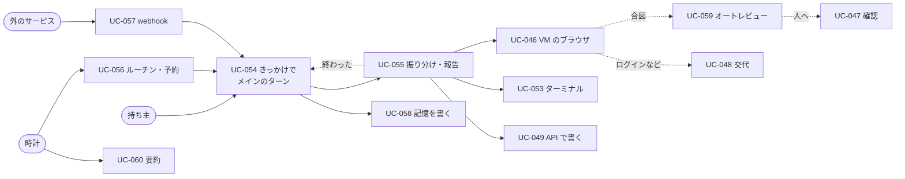

# 03. ユースケース
- プロジェクト：Agent-Team-Open ／ 版数：v1.1（2026-10-24） ／ インプット：[02_user_stories](02_user_stories.md)

> **3行で**
> 1. ユースケースは 20 本（UC-042〜061）。アクターは持ち主・メイン・エージェント・時計・外のサービスの 5 種類。
> 2. 中心は UC-054（きっかけを受けてメインのターンを回す）と UC-055（振り分けて報告を受ける）。重い仕事は UC-046（VM のブラウザ）・UC-053（ターミナル）として、振り分け先の文脈で動く。
> 3. ビジネスルールは BR-01〜14。こわい操作の見分け（BR-03）と行き先（BR-14）、承認が効く範囲（BR-04）、汚染（BR-06・11）、記憶の書き方（BR-12）が要。成果物を外に出す操作は必ず人（BR-10）。

## 🧭 判断してほしいこと
なし

## 全体図

見てほしいところ：どのきっかけも UC-054 に入る。タスクの終わり（UC-055）もきっかけとして UC-054 に戻る。そのほかの UC（置く・つなぐ・作る・引っ越す・記録・パック・VM を戻す）は詳細の一覧にある。

## 要点
- どのきっかけも受付 → ルーター → メインのキューを通る。持ち主のチャットは動いているターンに割り込める（[UC-054](#uc-054きっかけを受けてメインのターンを回す-us-063-us-068-us-070)）
- メインは小さな質問に自分で答え、重い仕事を `delegate` で渡す。タスクの終わりがまたきっかけになる（[UC-055](#uc-055振り分けて報告を受ける-us-051-us-063)）
- 申告か合図に当たった操作は、人かオートレビューのどちらかに回るまで実行しない（BR-03・BR-14）
- 承認はその1操作だけに効き、画面が変わっていたら実行せず決め直させる（BR-04）
- 外から来たきっかけと、汚染したタスクの報告で起きたターンは汚染する（BR-11）
- プロフィールを書く材料は持ち主の言葉とメインの `send_to_owner` だけ（BR-12）

---

## 詳細

### アクター一覧
| アクター | 種別 | 説明 |
|---|---|---|
| 持ち主 | 人 | ホストを置いて使う1人 |
| メイン | 本体の中の実行（Claude） | 持ち主と話し、振り分ける |
| エージェント | 本体の中の実行（Claude） | 振り分けられたタスクを、道具と VM で進める |
| 時計 | 本体のタイマー | ルーチン・予約した確認・眠り・期限・要約の時刻を見る |
| 外のサービス | 外部システム | Claude API、Web サイト、Google カレンダー API、GitHub（API と webhook）、Tailscale、Push のサービス |

### ユースケース一覧
| ID | 名前 | アクター | 関連 US |
|---|---|---|---|
| UC-042 | 置いて起動する | 持ち主 | US-049, US-062 |
| UC-043 | つないで入る | 持ち主 | US-050 |
| UC-044 | チャットで頼む | 持ち主 | US-051 |
| UC-045 | エージェントを作る・消す | 持ち主 | US-052 |
| UC-046 | VM のブラウザで仕事をする | エージェント | US-053 |
| UC-047 | こわい操作を確認する | 持ち主 | US-054 |
| UC-048 | 画面を見て交代する | 持ち主 | US-055, US-056 |
| UC-049 | API で書き込む | メイン・エージェント | US-057 |
| UC-050 | 引っ越す | 持ち主 | US-059 |
| UC-051 | 記録を見る | 持ち主 | US-058 |
| UC-052 | パックを入れる・外す | 持ち主 | US-060 |
| UC-053 | VM のターミナルで仕事をする | エージェント | US-061 |
| UC-054 | きっかけを受けてメインのターンを回す | メイン | US-063, US-068, US-070 |
| UC-055 | 振り分けて報告を受ける | メイン・エージェント | US-051, US-063 |
| UC-056 | ルーチン・予約した確認で起きる | 時計 | US-064, US-065 |
| UC-057 | webhook で起きる | 外のサービス | US-066 |
| UC-058 | 記憶を書く・見直す | メイン・持ち主 | US-067 |
| UC-059 | オートレビューで確かめる | 本体 | US-069 |
| UC-060 | 留守の間に要約する | 時計 | US-072 |
| UC-061 | VM を眠らせる・起こす・戻す | 本体・持ち主 | US-053, US-071 |

### ユースケース記述

### UC-042：置いて起動する 〔US-049, US-062〕
- アクター：持ち主
- 事前条件：64bit の Linux に Docker Engine と Compose v2 が入っている。Tailscale のアカウントがある
- 基本フロー：
 1. 持ち主は Compose の一式を取ってきて、設定ファイル（`.env`）に LLM の接続先（`LLM_PROVIDER`）とその資格・Tailscale の認証キー・持ち主のログイン名・Web Push の鍵を書く（FR-087）
 2. `docker compose up -d` を実行する
 3. 本体はデータベースを最新の形にし（前にバックアップを取る）、メインがなければ作り、VM のイメージがあるかを確かめる
 4. Tailscale が tailnet に入り、`https://makase.<tailnet>.ts.net` で待ち受ける。受け口があれば `/hooks/` だけを Funnel で公開する
- 代替フロー：
 - 3a. 前に止まったときに動いていたターン・タスクがある → 歩みの記録の続きから再開する（FR-084）
- 例外フロー：
 - E1. 64bit でない・メモリが足りない → 起動の記録に理由を出して止まる
 - E2. 設定ファイルに必須の値がない → 足りない値の名前を出して止まる
- 事後条件：画面が開け、`GET /api/health` が ok を返す

### UC-043：つないで入る 〔US-050〕
- アクター：持ち主
- 事前条件：使う端末が tailnet に入っている
- 基本フロー：
 1. 持ち主はブラウザで Agent-Team-Open の URL を開く
 2. Tailscale が利用者のログイン名を付けて本体に渡す
 3. 本体はログイン名が持ち主と一致することを確かめ、チャットを返す
- 例外フロー：
 - E1. ログイン名が持ち主でない・付いていない → 403
- ビジネスルール：BR-01

### UC-044：チャットで頼む 〔US-051〕
- アクター：持ち主
- 基本フロー：
 1. 持ち主はチャットに書いて送る。画面はメッセージの ID を作って先に表示する
 2. 受付がきっかけ（`chat`）にしてメインのキューに入れる → UC-054
- 代替フロー：
 - 1a. メインの選択肢（`choices`）のボタンを押した → 選んだ値を返事として送る
- 事後条件：メッセージは `chat_messages` に残る。返事をするかはメインが決める（ADR-062）

### UC-045：エージェントを作る・消す 〔US-052〕
- アクター：持ち主（メインも作れる：UC-055 2a）
- 基本フロー（作る）：エージェント一覧で、したいことを書いて作る → LLM がエージェント1人の設定（名前・指示・道具・「いつ使うか」）を作り、保存する
- 基本フロー（消す）：一覧で消す → 論理削除する（VM のログインは共通なので消さない）
- 例外フロー：
 - E1. 動いているエージェントを消す → 409 `AGENT_BUSY`
 - E2. メインを消す → 409 `MAIN_AGENT`

### UC-046：VM のブラウザで仕事をする 〔US-053〕
- アクター：エージェント（振り分け先）
- 事前条件：タスクが running
- トリガー：エージェントが computer の道具を使う
- 基本フロー：
 1. 本体は VM が眠っていれば box-manager に起こさせる（UC-061）
 2. 本体は画面の番を取る（空いていなければ `waiting_screen` で待つ）
 3. 本体は VM のスクショ（か `read_page` の一覧）を Claude に渡す
 4. Claude は次の操作の列（クリック・入力・キー・スクロール など。1 つの返事にいくつも並ぶ）を返す。本体は並んだ順に 5〜6 を行い、こわい操作で止まったら残りは実行しない（D-255）
 5. 本体は操作の先の要素を VM に確かめさせ、合図に当たるかを Kernel で判定する
 6. 当たらなければ操作を実行し、記録して 3 に戻る
 7. 仕事が済んだら、エージェントは報告を出す。本体は画面の番を返す
- 代替フロー：
 - 4a. Claude が申告（`confirm_action`）を出した・5a. 合図に当たった → 行き先の表（BR-14）で UC-059 か UC-047
 - 4b. Claude が交代を頼んだ（`request_takeover`）→ UC-048
 - 6a. 通常の実行中に 3 分画面の操作がない（ターミナルだけ使っている）→ 画面の番を返し、次に使うときに取り直す。LLM の呼び出し中・確認待ちは数えない。番を一度失っていたら、返った操作は実行せず、新しいスクショから決め直させる（D-258）
- 例外フロー：
 - E1. 上限（操作の回数・時間・費用）に達した → タスクは halted。メインに報告する
 - E2. VM が落ちた → 1回だけ起こし直す。だめなら failed（`sandbox_lost`）
 - E3. 本体が再起動した → 歩みの記録から続け、VM は新しい世代で起こし直す（FR-084）
- ビジネスルール：BR-02、BR-03、BR-06、BR-14

### UC-047：こわい操作を確認する 〔US-054〕
- アクター：持ち主
- トリガー：UC-046 の 4a・5a で行き先が人、または UC-059 で止まった
- 基本フロー：
 1. 本体は操作をブラウザの確認（`browser_checks`）として記録し、確認待ちにする。タスクは awaiting_approval になる
 2. 確認の一覧に、スクショ・押す場所の印・要約・当たった合図（オートレビューが止めた理由も）が出て、Web Push が届く
 3. 持ち主が ○ を押す
 4. 本体は確認を1回だけ「実行中」にし、box-agent が中身（タブ・フレーム・要素・フォームの値）が同じことを確かめてから実行する
 5. タスクは running に戻り、UC-046 の 3 から続ける
- 代替フロー：
 - 3a. × を押した → 操作はしない。Claude に「断られた」と返す
 - 3b. 30分たった → expired。Claude に「期限切れ」と返す
 - 4a. 画面が変わって中身が違う → expired（`page_changed`）。新しい確認は作らず、Claude に新しいスクショと「画面が変わったので実行しなかった」を返して決め直させる
 - 4b. 実行したか分からない（本体が落ちた など）→ `unknown_outcome`。Claude に新しいスクショで伝える
- ビジネスルール：BR-03、BR-04、BR-14

### UC-048：画面を見て交代する 〔US-055、US-056〕
- アクター：持ち主
- 基本フロー：
 1. 持ち主はタスクのページか確認から、VM の画面を開く（見るだけ）
 2. 「代わる」を押す。画面の番を持つエージェントは今の操作を終えて待つ
 3. 持ち主は画面を操作する（ログイン・CAPTCHA など）
 4. 「返す」を押す。エージェントは「人が操作した」と知らされ、新しいスクショから続ける
- 代替フロー：
 - 1a. エージェントが交代を頼んだ → 頼みの理由つきで確認の一覧と Web Push に出る
 - 2a. 画面の番を持つタスクがない → 交代は VM だけに結びつき、返したらそのまま終わる
 - 3a. 頼み（`requested`）のまま 30 分、または交代中（`active`）に 15 分操作がない → 交代を終え、タスクは報告の状態 `blocked` で閉じてメインに知らせる。VM は止めない（D-237・D-257）
- 事後条件：人がログインしたら、その状態は VM に残る（全員で共通）
- ビジネスルール：BR-05

### UC-049：API で書き込む 〔US-057〕
- アクター：メイン・エージェント
- 基本フロー：今の流れのまま。書き込みは Intent になり、Kernel が判定し、確認ののち gateway が Google カレンダー・GitHub に書く
- ビジネスルール：BR-06、BR-10

### UC-050：引っ越す 〔US-059〕
- アクター：持ち主
- 基本フロー：前のホストで書き出す → ファイルを新しいホストに取り込む
- 例外フロー：
 - E1. 形式の版が新しすぎる → 取り込まない
 - E2. 同じ名前のエージェント → その1人は飛ばして知らせる

### UC-051：記録を見る 〔US-058〕
- アクター：持ち主
- 基本フロー：記録の画面で、きっかけ・判定・オートレビュー・確認・操作を時刻順に見る。ハッシュの鎖を確かめられる

### UC-052：パックを入れる・外す 〔US-060〕
- アクター：持ち主
- 基本フロー（入れる）：パックの画面で一覧から選んで入れる → 本体はパックのエージェントを作り、手順書と確認するドメインの追加分を入れる。メインの振り分け先の一覧に載る
- 基本フロー（外す）：入っているパックを外す → パックのエージェント、手順書、足した確認するドメインを消す
- 代替フロー：
 - 1a. 入っているパックの版が上がっていた → 更新する（手で変えた設定は失われると知らせる）
- 例外フロー：
 - E1. パックのエージェントが動いている → 409 `AGENT_BUSY`
 - E2. パックのファイルの形が正しくない・形式の版が新しすぎる → 入れずに理由を知らせる
- ビジネスルール：BR-07、BR-09

### UC-053：VM のターミナルで仕事をする 〔US-061〕
- アクター：エージェント（振り分け先）
- 事前条件：タスクが running。リポジトリを使うなら GitHub につないである
- 基本フロー：
 1. VM が眠っていれば起こす（UC-061）。リポジトリを使うなら、gateway が GitHub から tar を取り、VM のタスクのフォルダ（`~/work/<taskId>`）に入れる
 2. Claude はコマンドを返す
 3. box-agent は利用者 `agent` でコマンドを実行し、出力を返す（判定はしない）。2 に戻る
 4. 仕事が済んだら、変更を tar で取り出し、差分を PR の Intent にして確認に回す（UC-049）
- 例外フロー：
 - E1. 1コマンドが 120 秒を超えた → タイムアウトにして Claude に伝える
 - E2. 出力が 64KB を超えた → 超えた分を切って、切ったことを知らせる
 - E3. 1タスクのコマンドが 200 回に達した → タスクは halted
 - E4. ターミナルがすでに 2 本動いている → 空くまで待つ
 - E5. VM が落ちた → 起こし直し（ホームは残る）、Claude に伝える。`started` のままのコマンドはやり直さない
- ビジネスルール：BR-06、BR-08

### UC-054：きっかけを受けてメインのターンを回す 〔US-063, US-068, US-070〕
- アクター：メイン
- トリガー：きっかけ（チャット・ルーチン・予約した確認・webhook・タスクの完了・メインの書き込みの承認の結果）
- 基本フロー：
 1. 受付がきっかけを確かめて `wakes` に入れる（`origin`・汚染の印つき）
 2. ルーターが重複を捨て、メインのキューに並べる。3 秒以内に続いた持ち主のメッセージと、同時に並んだタスクの完了は 1 つにまとめる
 3. メインが眠っていればターンを始める（`turns`）。文脈は固定の先頭＋要約＋履歴＋きっかけ
 4. メインは歩む：自分で答える・道具を使う・`delegate` で振り分ける（UC-055）・`schedule_wake` で予約する
 5. 伝える価値があれば `send_to_owner` を呼ぶ。`notify` なら PWA が前に出ていないとき Web Push が届く
 6. 道具を呼ばずに終わったら、記憶の更新の歩み（UC-058）を回してターンを閉じ、眠る
- 代替フロー：
 - 3a. ターンが動いている間に持ち主のチャットが来た → ターンに結びつけ（`attached`）、次の歩みの頭に入れる（列に並ばない）。ターンを閉じる時点で渡していなければ、閉じずに続けるか、次のターンに戻す（D-247）
 - 4a. メインのカレンダー・GitHub の書き込みが確認に回った → ターンを終えて眠る。持ち主が ○ / × を押すと、きっかけ `approval_done` で起きて続きをする（D-248）
 - 3b. ターンが動いている間にほかのきっかけが来た → 列の後ろに並び、次のターンで扱う
 - 5a. 伝える価値がない → 何も送らない（チャットに何も残らない）
- 例外フロー：
 - E1. ターンの上限（$1・40 歩・10 分）・日次の上限 → ターンを止め、持ち主に「上限で止まりました」を送る
 - E2. 本体が再起動した → 歩みの記録から続ける。道具はやり直さず、作ったもので確かめる（FR-084・D-249）
 - E3. LLM が 3 回続けて失敗した → ターンを `failed` にし、渡した持ち主のメッセージは次のターンに戻す（2 回まで）
- ビジネスルール：BR-11、BR-13

### UC-055：振り分けて報告を受ける 〔US-051, US-063〕
- アクター：メイン・エージェント
- 基本フロー：
 1. メインは振り分け先の一覧（名前・「いつ使うか」・パックの用途と例文）から 1 人を選び、`delegate(agentId, brief)` を呼ぶ。`brief` には目的・条件・終わりの形を全部書く
 2. 本体はタスクを作り、同時数に空きがあれば始める（空きがなければ `queued`）
 3. エージェントは新しい文脈（指示・記憶の写し・メモ・スキルの一覧・`brief`）で歩む（UC-046・049・053）
 4. 終わったら報告（2,000 字まで・成果物の場所）を返す。本体はタスクを閉じ、きっかけ（`task_done`）をメインのキューに入れる → UC-054
- 代替フロー：
 - 1a. 合うエージェントがいない → メインが `delegate` の `newAgent` で作ってから渡す（生成画面に切り替わる）
 - 1b. 1 つの頼みを複数に分ける → `delegate` を何度か呼ぶ（同時に 3 つまで）。順に渡すときは、前の報告を受けてから次を渡す
 - 3a. 持ち主が言い直した → メインが `steer_task` で届ける。タスクの次の歩みの頭に入る
- 例外フロー：
 - E1. タスクが halted・failed → 報告に理由を入れて、同じく `task_done` で戻る
 - E3. 報告の状態が `blocked`（人の情報が要る）→ タスクは閉じる。メインは持ち主に聞き、答えをもらったら新しいタスクとして振り分ける（D-257）
 - E2. メインが `cancel_task` を呼んだ・持ち主が取り消した → cancelled
- ビジネスルール：BR-09、BR-11

### UC-056：ルーチン・予約した確認で起きる 〔US-064, US-065〕
- アクター：時計
- 基本フロー：
 1. タイマーは毎分、`next_run_at` を過ぎたルーチンと `at` を過ぎた予約を探す
 2. 見つけたら、きっかけ（`routine`・`scheduled`）を作り、ルーチンの次の時刻を計算し直す → UC-054
- 代替フロー：
 - 1a. 本体が止まっていて時刻を過ぎていた → 起動のあと、過ぎたルーチンは 1 回だけ動かす（たまった分を全部は動かさない）。予約は動かす
 - 2a. メインがルーチンを提案した（`propose_routine`）→ 確認のカードを出し、持ち主が ○ を押したらルーチンができる
- ビジネスルール：BR-13

### UC-057：webhook で起きる 〔US-066〕
- アクター：外のサービス
- 基本フロー：
 1. GitHub が Funnel の `https://makase.<tailnet>.ts.net:8443/hooks/<hookId>` に POST する（Funnel は 8443 番だけを公開：D-241）
 2. 本体の webhook の口が受け口を引き、署名（HMAC）を確かめる
 3. 配達 ID で重複を確かめ、本文を汚染の印つきできっかけ（`webhook`）にする → UC-054
- 例外フロー：
 - E1. 受け口がない・止めてある → 404
 - E2. 署名が合わない → 401（何も残さない）
 - E3. 1 分 60 件を超えた・本文が 256KB を超えた → 429・413
- ビジネスルール：BR-11

### UC-058：記憶を書く・見直す 〔US-067〕
- アクター：メイン・持ち主
- 基本フロー（書く）：
 1. ターンの終わりに、本体は「記憶の更新」の歩みを回す。渡すのは今のプロフィールのうち関係のある事実と、このターンの持ち主のメッセージだけ（メインの文・道具の結果は渡さない：D-246）
 2. Claude は事実の足し・置き換え・消し（渡した事実だけ）と、ログの行を構造化出力で返す
 3. 本体は数（100 個・4,000 字）を確かめて書く。超えたら順位の低いものから外す
- 基本フロー（見直す）：記憶の画面でプロフィールとログを見て、直す・消す・足す
- ビジネスルール：BR-12

### UC-059：オートレビューで確かめる 〔US-069〕
- アクター：本体
- トリガー：UC-046 の合図・申告で、行き先がオートレビュー（BR-14）
- 基本フロー：
 1. 本体は操作を確認の候補として記録し、印つきのスクショを作る
 2. 道具なしの Claude（オートレビューのモデル）に、タスクの `brief`・操作・確かめた中身・スクショだけを渡す
 3. 答えが `pass` → 中身のハッシュつきで実行する（UC-047 の 4 と同じ）
- 代替フロー：
 - 3a. 答えが `stop`・答えない・20 秒たった → 理由つきで人の確認に回す（UC-047）
- ビジネスルール：BR-04、BR-14

### UC-060：留守の間に要約する 〔US-072〕
- アクター：時計
- 基本フロー：
 1. タイマーは毎分、メインの会話の大きさと最後のターンの終わりの時刻を見る
 2. 6 万トークンを超え、ターンが終わって 10 分たっていれば、同じ先頭のまま「ここまでを要約して」と呼ぶ（先頭と履歴の 1 時間のキャッシュが温かいので安い。D-263・D-270）
 3. 要約と、作り直した①〜④で新しい先頭を作る（`context_snapshots`）。次のターンからこれを使い、前の履歴は持ち越さない（思考のブロックを残すと 400 になるため。D-256）
- 例外フロー：
 - E1. 要約の途中できっかけが来た → 要約を捨ててターンを始める（次の機会にやり直す）

### UC-061：VM を眠らせる・起こす・戻す 〔US-053, US-071〕
- アクター：本体・持ち主
- 基本フロー（起こす・眠らせる）：
 1. タスクが VM の道具を使うとき、VM が止まっていれば box-manager に起こさせる（新しい世代）
 2. タイマーは毎分、VM の最後の操作の時刻を見る。10 分何もなく、画面の番・交代・動いているコマンドがなければ止める
- 基本フロー（戻す）：
 1. 持ち主が控えを選んで「戻す」（か「作り直す」）を押す
 2. 本体は VM の操作を `restoring`（`rebuilding`）にし、VM を使っているタスクを `halted`（`vm_replaced`）で閉じてメインに知らせ、VM を止める（D-251・D-268）
 3. box-manager がホームのボリュームを控えの中身（か空）に入れ替える。次に使うときに起きる
- タイマーは毎日 1 回、VM が止まっているときに控えを取る（3 世代）
- ビジネスルール：BR-07、BR-08

### ビジネスルール
| ID | ルール |
|---|---|
| BR-01 | 画面と API に届くのは Tailscale を通った、持ち主のログイン名のリクエストだけ。webhook の口（Funnel）には `/hooks/:hookId` しかなく、署名で確かめる |
| BR-02 | VM は 1 台。画面の番は 1 つのタスクだけが持つ。ターミナルは同時に 2 本まで |
| BR-03 | 申告があるか、合図（パスワード欄・カード欄への入力、`type` の改行（Enter と同じ）、確認するドメインでの操作・確認するドメインへの `open_url`、決まった言葉を含む要素のクリックやキーでの作動、修飾キー、操作の先が分からない）に当たった操作は、人かオートレビューが通すまで実行しない |
| BR-04 | 承認（人・オートレビュー）はその1操作だけに、1回だけ効く。実行の直前に中身が同じであることを確かめ、違えば実行せず、Claude に決め直させる。交代と VM の起こし直しで、待っている確認は消える |
| BR-05 | 交代を始めたら、エージェントの操作を受け付けない（動いている操作が終わってから人に渡す）。人の操作は合図で止めない（人が責任を持つ） |
| BR-06 | VM で読んだ内容は「汚染」として扱う。そのあとのカレンダー・GitHub への書き込みは、今のルールどおり確認に回る |
| BR-07 | VM のホーム（ログイン・ファイル）は、持ち主が「ブラウザのデータを消す」「控えに戻す」「作り直す」を押したときにだけ消える。エージェントを消しても消えない |
| BR-08 | VM の中のコマンドは判定しない。VM に資格情報を置かず、外へは egress の許可リストだけを通す。VM の外に効くもの（push・PR・外部 API への書き込み）は今までどおり確認する |
| BR-09 | パックのエージェントもメインの振り分け先の 1 人。合うパックがなければ今までどおり（使い回すか作る） |
| BR-10 | 成果物を外に出す操作（ページの公開・フォームの送信・push・PR・外部 API への書き込み）は、必ず人が最終承認する。点検役のエージェント・手順書の点検・オートレビューは承認の代わりにならない（D-187） |
| BR-11 | webhook のきっかけ、汚染したタスクの報告で起きたターンは汚染する。汚染はターンから、そのターンが作るタスク・言い直し・予約・ルーチンの提案に引き継ぐ（D-245）。汚染したターンの書き込みは確認に回る。持ち主のチャットと、持ち主が書いた（直した）ルーチンの文は汚染しない |
| BR-12 | 記憶は命令ではなく情報として渡す。プロフィールを書くのはメインの記憶の更新の歩みだけで、材料は持ち主のメッセージだけ（D-246）。本体が書くログは定型文だけ。消してよいのは、その歩みに渡した事実だけ |
| BR-13 | ルーチンを作るのは持ち主。メインは提案だけで、持ち主の ○ で作られる。予約した確認はメインだけが作れる（5 分後〜30 日後・1 日 20 件まで） |
| BR-14 | 合図・申告の行き先は決定論で決める：T-1・T-2・`human_words`・T-7（POST の送信）・ほかの出どころの iframe とダイアログ・名前の取れない作動・`textarea` の Enter・申告の `publish`・`pay`・`delete`・`send`・`account` は人。それ以外（外に出ないと言い切れるもの）はオートレビュー（D-242）。オートレビューは通すだけで、人の確認を取り消せない |

## このドキュメントで決まったこと
- D-124、D-125、D-142、D-157、D-158、D-159、D-167、D-176、D-178、D-185、D-187、D-201〜D-209、D-212、D-214、D-217、D-218、D-220〜D-224、D-232、D-237（[00 決定事項ログ](00_overview.md#決定事項ログ)）
