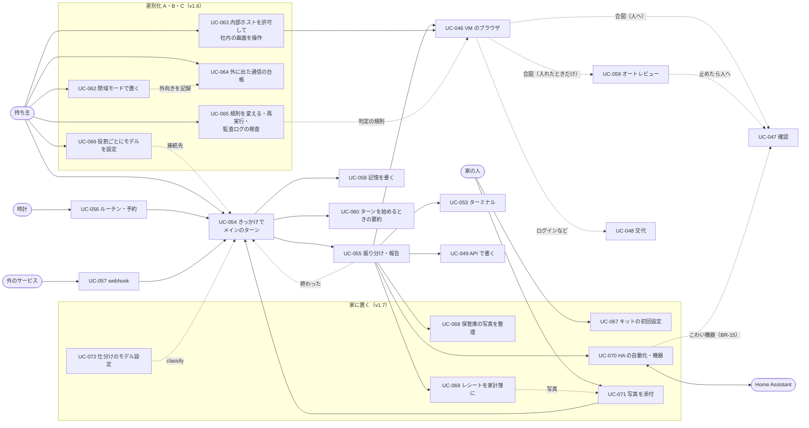

# 03. ユースケース
- プロジェクト：Agent-Team-Open ／ 版数：v1.8（2026-10-26） ／ インプット：[02_user_stories](02_user_stories.md)

> **3行で**
> 1. ユースケースは 30 本（UC-042〜072。UC-050 は使わない）。アクターは持ち主（家の人を含む）・メイン・エージェント・時計・外のサービス・Home Assistant の 6 種類。v1.6 で差別化 A・B・C の UC-062〜066、v1.7 で家に置く UC-067〜072 を足した。
> 2. 中心は UC-054（きっかけを受けてメインのターンを回す）と UC-055（振り分けて報告を受ける）。重い仕事は UC-046（VM のブラウザ）・UC-053（ターミナル）として、振り分け先の文脈で動く。家の中の仕事は UC-068〜071（保管庫・家計簿・Home Assistant・写真の添付）。
> 3. ビジネスルールは BR-01〜16。こわい操作の見分け（BR-03）と行き先（BR-14）、承認が効く範囲（BR-04）、汚染（BR-06・11）、記憶の書き方（BR-12）、機器の区分は必ず人（BR-15）、判断モデルは間違えても困る判断に使わない（BR-16）が要。成果物を外に出す操作は必ず人（BR-10）。

## 成長機構（v1.8）
[UC-073〜076：記録・自動採用・局所推論・停止](03_learning.md)を追加。既存の持ち主認証、カレンダー接続、操作承認のユースケースを前提とする。

## 🧭 判断してほしいこと
なし

## 全体図

見てほしいところ：どのきっかけも UC-054 に入る。v1.7 の家の中の仕事（UC-068〜070）は、振り分け先が保管庫の道具と Home Assistant の道具で進め、こわい機器は UC-047 の確認に回る。タスクの終わり（UC-055）もきっかけとして UC-054 に戻る。そのほかの UC（置く・つなぐ・作る・記録・パック・VM を戻す）は詳細の一覧にある。

## 要点
- どのきっかけも受付 → ルーター → メインのキューを通る。動いているターンの間に来たきっかけは、ターンが終わってから次のターンで扱う（[UC-054](#uc-054きっかけを受けてメインのターンを回す-us-063-us-068-us-070)）
- メインは小さな質問に自分で答え、重い仕事を `delegate` で渡す。タスクの終わりがまたきっかけになる（[UC-055](#uc-055振り分けて報告を受ける-us-051-us-063)）
- 申告か合図に当たった操作は、人（オートレビューを入れたときはオートレビューも）が通すまで実行しない。既定は人だけ（BR-03・BR-14）
- 家の中だけで動かす閉域（`closed`）では外向きが許可した先だけになり、外に出た通信は台帳に残る。判定の規則は版つきで試験され、再実行で同じ結果になる。モデルは役割ごとに選ぶ（UC-062〜066）
- キットは QR とスマホだけで始められる（UC-067）。保管庫は消すとゴミ箱（30 日）。レシートは読み取りの自信が低ければ持ち主が直す（UC-068・069）
- 鍵・空調・バルブ・警報・シャッターなどこわい機器の操作と、それに触る自動化は必ず人（BR-15。UC-070）。判断モデルは間違えても困らない仕分けにだけ使う（BR-16。UC-072）
- 承認はその1操作だけに効き、画面が変わっていたら実行せず決め直させる（BR-04）
- 外から来たきっかけと、汚染したタスクの報告で起きたターンは汚染する（BR-11）
- プロフィールを書く材料は持ち主のメッセージだけ（BR-12・D-246）

---

## 詳細

### アクター一覧
| アクター | 種別 | 説明 |
|---|---|---|
| 持ち主 | 人 | ホストを置いて使う1人 |
| メイン | 本体の中の実行（Claude） | 持ち主と話し、振り分ける |
| エージェント | 本体の中の実行（Claude） | 振り分けられたタスクを、道具と VM で進める |
| 時計 | 本体のタイマー | ルーチン・予約した確認・眠り・期限の時刻を見る |
| 家の人 | 人 | キットを受け取った非エンジニアの持ち主。持ち主と同じロール（v1.7：D-371） |
| Home Assistant | 家の機器の窓口（外部システム） | 同じラズパイのコンテナ。機器の状態・操作・自動化を API で受ける。内部ホストとして自動で登録する（D-377） |
| 外のサービス | 外部システム | LLM の API（Claude・OpenAI・OpenAI 互換のローカル LLM）、Web サイト、Google カレンダー API、GitHub（API と webhook。`closed` では社内の GitLab・GitHub Enterprise Server）、Tailscale（か Headscale）、Push のサービス（`closed` では社内の ntfy） |

### ユースケース一覧
| ID | 名前 | アクター | 関連 US |
|---|---|---|---|
| UC-042 | 置いて起動する | 持ち主 | US-049 |
| UC-043 | つないで入る | 持ち主 | US-050 |
| UC-044 | チャットで頼む | 持ち主 | US-051 |
| UC-045 | エージェントを作る・消す | 持ち主 | US-052 |
| UC-046 | VM のブラウザで仕事をする | エージェント | US-053 |
| UC-047 | こわい操作を確認する | 持ち主 | US-054 |
| UC-048 | 画面を見て交代する | 持ち主 | US-055, US-056 |
| UC-049 | API で書き込む | メイン・エージェント | US-057 |
| UC-050 | 使わない（v1.4：D-316） | — | — |
| UC-051 | 記録を見る | 持ち主 | US-058 |
| UC-052 | パックを入れる・外す | 持ち主 | US-060 |
| UC-053 | VM のターミナルで仕事をする | エージェント | US-061 |
| UC-054 | きっかけを受けてメインのターンを回す | メイン | US-063, US-068, US-070 |
| UC-055 | 振り分けて報告を受ける | メイン・エージェント | US-051, US-063 |
| UC-056 | ルーチン・予約した確認で起きる | 時計 | US-064, US-065 |
| UC-057 | webhook で起きる | 外のサービス | US-066 |
| UC-058 | 記憶を書く・見直す | メイン・持ち主 | US-067 |
| UC-059 | オートレビューで確かめる（入れたときだけ） | 本体 | US-069 |
| UC-060 | ターンを始めるときに要約する | 本体 | US-072 |
| UC-061 | VM を眠らせる・起こす・戻す | 本体・持ち主 | US-053, US-071 |
| UC-062 | 閉域モードで置く | 持ち主 | US-073 |
| UC-063 | 内部ホストを許可して社内の画面を操作させる | 持ち主・エージェント | US-074 |
| UC-064 | 外に出た通信の台帳を見る・書き出す | 持ち主 | US-075 |
| UC-065 | 判定の規則を変える（試験・試し当て）・判定を再実行する・監査ログを検査する | 持ち主 | US-076 |
| UC-066 | 役割ごとにモデルを設定する | 持ち主 | US-077 |
| UC-067 | キットの初回設定 | 家の人 | US-078 |
| UC-068 | 保管庫の写真を整理する | 家の人・エージェント | US-079 |
| UC-069 | レシートを送って家計簿に入れる | 家の人・エージェント | US-080, US-082 |
| UC-070 | Home Assistant の自動化を作る・機器を動かす | 家の人・エージェント・Home Assistant | US-081 |
| UC-071 | チャットに写真を添付する | 家の人 | US-082 |
| UC-072 | 仕分けのモデルを設定する | 持ち主 | US-083 |

### ユースケース記述

### UC-042：置いて起動する 〔US-049〕
- アクター：持ち主
- 事前条件：64bit の Linux に Docker Engine と Compose v2 が入っている（WSL2 は WSL の中の Docker Engine を推奨。Docker Desktop・OrbStack・Colima も可）。Tailscale のアカウントがある
- 基本フロー：
 1. 持ち主は Compose の一式を取ってきて、設定ファイル（`.env`）に使う LLM の接続先の API キー（Anthropic・OpenAI・OpenAI 互換のどれか。ローカル LLM でキーが要らなければ接続先だけ）・Tailscale の認証キー（Headscale・社内 LAN の直結ならその設定。UC-062）・持ち主のログイン名・Web Push の鍵を書く
 2. `docker compose up -d` を実行する
 3. 本体はデータベースを最新の形にし（前にバックアップを取る）、メインがなければ作り、VM のイメージがあるかを確かめる
 4. Tailscale が tailnet に入り、`https://makase.<tailnet>.ts.net` で待ち受ける。受け口があれば 8443 番だけを Funnel で公開し、webhook の口（:8081）に流す（443 番は公開しない。:8081 は `POST /hooks/:hookId` 以外を 404：D-241・D-305）
- 代替フロー：
 - 3a. 前に止まったときに動いていたターン・タスクがある → 歩みの記録の続きから再開する（FR-084）
- 例外フロー：
 - E1. 64bit でない・メモリが足りない → 起動の記録に理由を出して止まる
 - E2. 設定ファイルに必須の値がない → 足りない値の名前を出して止まる
- 事後条件：画面が開け、`GET /api/health` が ok を返す

### UC-043：つないで入る 〔US-050〕
- アクター：持ち主
- 事前条件：使う端末が tailnet に入っている
- 基本フロー：
 1. 持ち主はブラウザで Agent-Team-Open の URL を開く
 2. Tailscale が利用者のログイン名を付けて本体に渡す
 3. 本体はログイン名が持ち主と一致することを確かめ、チャットを返す
- 代替フロー：
 - 2a. 社内 LAN の直結（`closed` の入口の 1 つ：UC-062） → 本体のパスキー（WebAuthn）でログインし、12 時間のセッション Cookie を持つ（D-358）
- 例外フロー：
 - E1. ログイン名が持ち主でない・付いていない → 403
- ビジネスルール：BR-01

### UC-044：チャットで頼む 〔US-051〕
- アクター：持ち主
- 基本フロー：
 1. 持ち主はチャットに書いて送る。画面はメッセージの ID を作って先に表示する
 2. 受付がきっかけ（`chat`）にしてメインのキューに入れる → UC-054
- 代替フロー：
 - 1a. メインの選択肢（`choices`）のボタンを押した → 選んだ値を返事として送る
- 事後条件：メッセージは `chat_messages` に残る。返事をするかはメインが決める（ADR-062）

### UC-045：エージェントを作る・消す 〔US-052〕
- アクター：持ち主（メインも作れる：UC-055 2a）
- 基本フロー（作る）：エージェント一覧で、したいことを書いて作る → LLM がエージェント1人の設定（名前・指示・道具・「いつ使うか」）を作り、保存する
- 基本フロー（消す）：一覧で消す → 論理削除する（VM のログインは共通なので消さない）
- 例外フロー：
 - E1. 動いているエージェントを消す → 409 `AGENT_BUSY`
 - E2. メインを消す → 409 `MAIN_AGENT`

### UC-046：VM のブラウザで仕事をする 〔US-053〕
- アクター：エージェント（振り分け先）
- 事前条件：タスクが running
- トリガー：エージェントが computer の道具を使う
- 基本フロー：
 1. 本体は VM が眠っていれば box-manager に起こさせる（UC-061）
 2. 本体は画面の番を取る（空いていなければ `waiting_screen` で待つ）
 3. 本体は VM のスクショ（か `read_page` の一覧）を Claude に渡す
 4. Claude は次の操作の列（クリック・入力・キー・スクロール など。1 つの返事にいくつも並ぶ）を返す。本体は並んだ順に 5〜6 を行い、こわい操作で止まったら残りは実行しない（D-255）
 5. 本体は操作の先の要素を VM に確かめさせ、合図に当たるかを Kernel で判定する
 6. 当たらなければ操作を実行し、記録して 3 に戻る
 7. 仕事が済んだら、エージェントは報告を出す。本体は画面の番を返す
- 代替フロー：
 - 4a. Claude が申告（`confirm_action`）を出した・5a. 合図に当たった → 行き先の表（BR-14）で UC-047（既定）。オートレビューを入れているときは UC-059 か UC-047
 - 4b. Claude が交代を頼んだ（`request_takeover`）→ UC-048
 - 6a. 通常の実行中に 3 分画面の操作がない（ターミナルだけ使っている）→ 画面の番を返し、次に使うときに取り直す。LLM の呼び出し中・確認待ちは数えない。番を一度失っていたら、返った操作は実行せず、新しいスクショから決め直させる（D-258）
- 例外フロー：
 - E1. 上限（操作の回数・時間・費用）に達した → タスクは halted。メインに報告する
 - E2. VM が落ちた → 1回だけ起こし直す。だめなら failed（`sandbox_lost`）
 - E3. 本体が再起動した → 歩みの記録から続け、VM は新しい世代で起こし直す（FR-084）
- ビジネスルール：BR-02、BR-03、BR-06、BR-14

### UC-047：こわい操作を確認する 〔US-054〕
- アクター：持ち主
- トリガー：UC-046 の 4a・5a で行き先が人（既定は合図に当たったものすべて）、または UC-059 で止まった
- 基本フロー：
 1. 本体は操作をブラウザの確認（`browser_checks`）として記録し、確認待ちにする。タスクは awaiting_approval になる
 2. 確認の一覧に、スクショ・押す場所の印・要約・当たった合図（オートレビューを入れているときは、止めた理由も）が出て、通知が届く（Web Push。`closed` では画面の中の通知と社内の ntfy：UC-062）
 3. 持ち主が ○ を押す
 4. 本体は確認を1回だけ「実行中」にし、box-agent が中身（タブ・フレーム・要素・フォームの値）が同じことを確かめてから実行する
 5. タスクは running に戻り、UC-046 の 3 から続ける
- 代替フロー：
 - 3a. × を押した → 操作はしない。Claude に「断られた」と返す
 - 3b. 30分たった → expired。Claude に「期限切れ」と返す
 - 4a. 画面が変わって中身が違う → expired（`page_changed`）。新しい確認は作らず、Claude に新しいスクショと「画面が変わったので実行しなかった」を返して決め直させる
 - 4b. 実行したか分からない（本体が落ちた など）→ `unknown_outcome`。Claude に新しいスクショで伝える
- ビジネスルール：BR-03、BR-04、BR-14

### UC-048：画面を見て交代する 〔US-055、US-056〕
- アクター：持ち主
- 基本フロー：
 1. 持ち主はタスクのページか確認から、VM の画面を開く（見るだけ）
 2. 「代わる」を押す。画面の番を持つエージェントは今の操作を終えて待つ
 3. 持ち主は画面を操作する（ログイン・CAPTCHA など）
 4. 「返す」を押す。エージェントは「人が操作した」と知らされ、新しいスクショから続ける
- 代替フロー：
 - 1a. エージェントが交代を頼んだ → 頼みの理由つきで確認の一覧と Web Push に出る
 - 2a. 画面の番を持つタスクがない → 交代は VM だけに結びつき、返したらそのまま終わる
 - 3a. 頼み（`requested`）のまま 30 分、または交代中（`active`）に 15 分操作がない → 交代を終え、タスクは報告の状態 `blocked` で閉じてメインに知らせる。VM は止めない（D-237・D-257）
- 事後条件：人がログインしたら、その状態は VM に残る（全員で共通）
- ビジネスルール：BR-05

### UC-049：API で書き込む 〔US-057〕
- アクター：メイン・エージェント
- 基本フロー：今の流れのまま。書き込みは Intent になり、Kernel が判定し、確認ののち gateway が Google カレンダー・GitHub に書く
- ビジネスルール：BR-06、BR-10

### UC-051：記録を見る 〔US-058〕
- アクター：持ち主
- 基本フロー：記録の画面で、きっかけ・判定（誰が決めたか）・確認・操作を時刻順に見る（オートレビューを入れているときはその行も）。ハッシュの鎖を確かめられる（検査は UC-065）

### UC-052：パックを入れる・外す 〔US-060〕
- アクター：持ち主
- 基本フロー（入れる）：パックの画面で一覧から選んで入れる → 本体はパックのエージェントを作り、手順書と確認するドメインの追加分を入れる。メインの振り分け先の一覧に載る
- 基本フロー（外す）：入っているパックを外す → パックのエージェント、手順書、足した確認するドメインを消す
- 代替フロー：
 - 1a. 入っているパックの版が上がっていた → 更新する（手で変えた設定は失われると知らせる）
- 例外フロー：
 - E1. パックのエージェントが動いている → 409 `AGENT_BUSY`
 - E2. パックのファイルの形が正しくない・形式の版が新しすぎる → 入れずに理由を知らせる
- ビジネスルール：BR-07、BR-09

### UC-053：VM のターミナルで仕事をする 〔US-061〕
- アクター：エージェント（振り分け先）
- 事前条件：タスクが running。リポジトリを使うなら GitHub につないである
- 基本フロー：
 1. VM が眠っていれば起こす（UC-061）。リポジトリを使うなら、gateway が GitHub から tar を取り、VM のタスクのフォルダ（`~/work/<taskId>`）に入れる
 2. Claude はコマンドを返す
 3. shell-agent は利用者 `agent` でコマンドを実行し、出力を返す（判定はしない）。2 に戻る
 4. 仕事が済んだら、変更を tar で取り出し、差分を PR の Intent にして確認に回す（UC-049）
- 例外フロー：
 - E1. 1コマンドが 120 秒を超えた → タイムアウトにして Claude に伝える
 - E2. 出力が 64KB を超えた → 超えた分を切って、切ったことを知らせる
 - E3. 1タスクのコマンドが 200 回に達した → タスクは halted
 - E4. ターミナルがすでに 2 本動いている → 空くまで待つ
 - E5. VM が落ちた → 起こし直し（ホームは残る）、Claude に伝える。`started` のままのコマンドはやり直さない
- ビジネスルール：BR-06、BR-08

### UC-054：きっかけを受けてメインのターンを回す 〔US-063, US-068, US-070〕
- アクター：メイン
- トリガー：きっかけ（チャット・ルーチン・予約した確認・webhook・タスクの完了・メインの書き込みの承認の結果）
- 基本フロー：
 1. 受付がきっかけを確かめて `wakes` に入れる（`origin`・汚染の印つき）
 2. ルーターが重複を捨て、メインのキューに並べる。3 秒以内に続いた持ち主のメッセージと、同時に並んだタスクの完了は 1 つにまとめる
 3. メインが眠っていればターンを始める（`turns`）。履歴が要約を始める長さ（6 万トークン。文脈が短いモデルでは文脈の長さの半分：D-363）を超えていれば、始める前に要約する（UC-060）。文脈は固定の先頭＋要約＋履歴＋きっかけ
 4. メインは歩む：自分で答える・道具を使う・`delegate` で振り分ける（UC-055）・`schedule_wake` で予約する
 5. 伝える価値があれば `send_to_owner` を呼ぶ。`notify` なら PWA が前に出ていないとき Web Push が届く
 6. 道具を呼ばずに終わったら、閉じると決め、記憶の更新の歩み（UC-058）を 1 回だけ回してターンを閉じ、眠る（D-280）
- 代替フロー：
 - 3a. ターンが動いている間に持ち主のチャット・承認の結果が来た → `queued` のまま待つ。ターンが終わったら（`done`・`halted`・`failed` のどれでも）すぐ次のターンを始める（最後のチャットから 3 秒待ってまとめる）
 - 4a. メインのカレンダー・GitHub の書き込みが確認に回った → ターンを終えて眠る。持ち主が ○ / × を押すと、きっかけ `approval_done` で起きて続きをする（D-248）
 - 5a. 伝える価値がない → 何も送らない（チャットに何も残らない）
- 例外フロー：
 - E1. ターンの上限（$1・40 歩・10 分）・日次の上限 → ターンを止め、持ち主に「上限で止まりました」を送る。ターンの区分（`chat`・`auto`）の日次の上限に届いていれば、`auto` のきっかけは捨てて 1 日 1 回知らせ、`chat` のきっかけは `queued` のまま待つ（0 時か、設定で上限を上げたあとの毎分のタイマーで始める。知らせは 1 日 1 回で、設定の上限の欄へのリンクを付ける：ADR-069）
 - E2. 本体が再起動した → 歩みの記録から続ける。道具はやり直さず、作ったもので確かめる（FR-084・D-249）
  - E3. LLMが3回連続失敗 → failed。副作用未発生を証明できる場合だけ2回まで戻す。確定済み/不明の副作用があれば元wakeはconsumedのまま停止通知し、確定済み/未完了を明示する（FR-091、D-337）
- ビジネスルール：BR-11、BR-13

### UC-055：振り分けて報告を受ける 〔US-051, US-063〕
- アクター：メイン・エージェント
- 基本フロー：
 1. メインは振り分け先の一覧（名前・「いつ使うか」・パックの用途と例文）から 1 人を選び、`delegate(agentId, brief)` を呼ぶ。`brief` には目的・条件・終わりの形を全部書く
 2. 本体はタスクを作り、同時数に空きがあれば始める（空きがなければ `queued`）
 3. エージェントは新しい文脈（指示・スキルの一覧・プロフィールの写し・`brief`）で歩む（UC-046・049・053）
 4. 終わったら報告（2,000 字まで・成果物の場所）を返す。本体はタスクを閉じ、きっかけ（`task_done`）をメインのキューに入れる → UC-054
- 代替フロー：
 - 1a. 合うエージェントがいない → メインが `delegate` の `newAgent` で作ってから渡す（生成画面に切り替わる）
 - 1b. 1 つの頼みを複数に分ける → `delegate` を何度か呼ぶ（同時に 3 つまで）。順に渡すときは、前の報告を受けてから次を渡す
 - 3a. 持ち主が言い直した → メインが `steer_task` で届ける。タスクの次の歩みの頭に入る
- 例外フロー：
 - E1. タスクが halted・failed → 報告に理由を入れて、同じく `task_done` で戻る
 - E3. 報告の状態が `blocked`（人の情報が要る）→ タスクは閉じる。メインは持ち主に聞き、答えをもらったら新しいタスクとして振り分ける（D-257）
 - E2. メインが `cancel_task` を呼んだ・持ち主が取り消した → cancelled
- ビジネスルール：BR-09、BR-11

### UC-056：ルーチン・予約した確認で起きる 〔US-064, US-065〕
- アクター：時計
- 基本フロー：
 1. タイマーは毎分、`next_run_at` を過ぎたルーチンと `at` を過ぎた予約を探す
 2. 見つけたら、きっかけ（`routine`・`scheduled`）を作り、ルーチンの次の時刻を計算し直す → UC-054
- 代替フロー：
 - 1a. 本体が止まっていて時刻を過ぎていた → 起動のあと、過ぎたルーチンは 1 回だけ動かす（たまった分を全部は動かさない）。予約は動かす
 - 2a. メインがルーチンを提案した（`propose_routine`）→ 確認のカードを出し、持ち主が ○ を押したらルーチンができる
- ビジネスルール：BR-13

### UC-057：webhook で起きる 〔US-066〕
- アクター：外のサービス
- 基本フロー：
 1. GitHub が Funnel の `https://makase.<tailnet>.ts.net:8443/hooks/<hookId>` に POST する（Funnel は 8443 番だけを公開：D-241）
 2. 本体の webhook の口が受け口を引き、署名（HMAC）を確かめる
 3. 配達 ID で重複を確かめ、本文を汚染の印つきできっかけ（`webhook`）にする → UC-054
- 例外フロー：
 - E1. 受け口がない・止めてある → 404
 - E2. 署名が合わない → 401（何も残さない）
 - E3. 1 受け口で 1 分 60 件を超えた → 429（何も残さない）。本文が 256KB を超えた → 413
- ビジネスルール：BR-11

### UC-058：記憶を書く・見直す 〔US-067〕
- アクター：メイン・持ち主
- 基本フロー（書く）：
 1. ターンを閉じると決めたあとに、本体は「記憶の更新」の歩みを 1 回だけ回す（D-280）。渡すのは今のプロフィールのうち関係のある事実と、このターンの持ち主のメッセージだけ（メインの文・道具の結果は渡さない：D-246）
 2. Claude は事実の足し・置き換え・消し（渡した事実だけ）を構造化出力（`{ add, replace, remove }`）で返す
 3. 本体は数（100 個・4,000 字）を確かめて書く。超えたら順位の低いものから外す
- 基本フロー（見直す）：記憶の画面でプロフィールを見て、直す・消す・足す。`search_memory` でチャットとタスクの報告を探せる
- ビジネスルール：BR-12

### UC-059：オートレビューで確かめる 〔US-069〕
- アクター：本体
- 事前条件：持ち主がオートレビューを入れている（`review.auto.enabled = true`。既定は切る：D-351）。切っているときはこの UC は動かず、合図に当たった操作はすべて UC-047 に回る
- トリガー：UC-046 の合図・申告で、行き先がオートレビュー（BR-14）
- 基本フロー：
 1. 本体は操作を確認の候補として記録し、印つきのスクショを作る
 2. 道具なしの Claude（オートレビューのモデル）に、タスクの `brief`・操作・確かめた中身・スクショだけを渡す
 3. 答えが `pass` → 中身のハッシュつきで実行する（UC-047 の 4 と同じ）
- 代替フロー：
 - 3a. 答えが `stop`・答えない・20 秒たった → 理由つきで人の確認に回す（UC-047）
- ビジネスルール：BR-04、BR-14

### UC-060：ターンを始めるときに要約する 〔US-072〕
- アクター：本体（ルーター）
- トリガー：メインのターンを始めるとき
- 基本フロー：
 1. ターンを始める処理は、メインの履歴（⑥）が要約を始める長さ（6 万トークンか、モデルの文脈の長さ × 0.5 の小さいほう：D-363）を超えているかを見る
 2. 超えていれば、`turns` の行を作る前に、同じ先頭のまま「ここまでを要約して」と呼ぶ（先頭と履歴の 1 時間のキャッシュが温かいので安い。D-263）。要約の指示には、持ち越すもの（約束・進んでいるタスク・持ち主の言い直し）と、「外から来た内容」の枠の中の指示は写さないことを書く
 3. 要約と、作り直した①〜④で新しい先頭を作る（`context_snapshots`）。履歴は持ち越さない（思考のブロックを残すと 400 になるため。D-256）
 4. そのままターンを始める
- 例外フロー：
 - E1. 要約が失敗した → 要約せずにそのままターンを始め、次の機会にやり直す
 - E2. 呼び出しの前の入力が 20 万トークンを超えていた → 要約せずにターンを `halted`（`context_exceeded`）にし、次のターンの開始で要約する
- 事後条件：要約はターンの外の仕事で、歩みの記録には書かない。費用は `usage_records`（`phase = 'summary'`）に残る

### UC-061：VM を眠らせる・起こす・戻す 〔US-053, US-071〕
- アクター：本体・持ち主
- 基本フロー（起こす・眠らせる）：
 1. タスクが VM の道具を使うとき、VM が止まっていれば box-manager に起こさせる（新しい世代。`box-browser` と `box-shell` の 2 つのコンテナを一緒に起こす）
 2. タイマーは毎分、VM の最後の操作の時刻を見る。10 分何もなく、画面の番・交代・動いているコマンドがなければ止める
- 基本フロー（戻す）：
 1. 持ち主が控えを選んで「戻す」（か「作り直す」）を押す
 2. 本体は VM の操作を `restoring`（`rebuilding`）にし、VM を使っているタスクを `halted`（`vm_replaced`）で閉じてメインに知らせ、VM を止める（D-251・D-268）
 3. box-manager が 2 つのボリューム（`makase-browser-profile`・`makase-vm-home`）を控えの中身（か空）に入れ替える。次に使うときに起きる
- 代替フロー：
 - ホームが 4GB を超えた → box-manager が VM を止める（`stop_reason = 'disk_quota'`）。超えている間はタスクのために VM を起こさず、設定の VM の欄に大きさと 3 つの操作（ブラウザのデータを消す・控えに戻す・作り直す）を出す。ホームの状態は `ok`・`broken` の 2 つ
- タイマーは毎日 1 回、VM が止まっているときに控えを取る（3 世代）
- ビジネスルール：BR-07、BR-08

### UC-062：閉域モードで置く 〔US-073〕
- アクター：持ち主（導入先の情報システム担当を含む）
- 事前条件：本体が動いている。使う LLM の接続先（社内の `openai_compatible` など）が決まっている
- 基本フロー：
 1. 持ち主は設定で `network.mode` を `closed` にし、`network.allow_hosts` に許可する先（LLM の接続先・社内の Git など）を書く
 2. 入口を 3 つ（Tailscale・Headscale・社内 LAN の直結。社内 CA の TLS）から選ぶ
 3. モデルの画面で、全部の役割を社内の `openai_compatible` のモデルにする（UC-066）
 4. 本体は設定を保存し、本体の外向きは窓口 `net` で、VM の外向きは egress で、許可リストの先だけに絞る。VM と egress に反映するのは box-manager 経由（本体の ctl の道と同じ）
 5. 持ち主は台帳（UC-064）で、許可リスト外への外向きが 0 件であることを確かめる
- 代替フロー：
 - 2a. 入口が Tailscale・Headscale → これまでどおり `Tailscale-User-Login` と `OWNER_LOGIN` を比べる（Headscale でも `tailscale serve` が同じヘッダーを付ける）。`closed` では Tailscale の SaaS の調整サーバーと Funnel は使わない
 - 2b. 入口が社内 LAN の直結 → 初めに `docker compose exec makase makase owner-enroll` が出す 1 回限りの URL で、本体のパスキー（WebAuthn）を登録する。以後はパスキーでログインし、HttpOnly・Secure・SameSite=Strict のセッション Cookie（12 時間）を持つ（D-358）
 - 4a. webhook を使う → 社内の GitLab・GitHub Enterprise Server から LAN の中で受ける。署名は今までどおり確かめる（UC-057）
 - 4b. 通知 → Web Push は切り、画面の中の通知（SSE）で知らせる。設定があれば社内の ntfy にも送る（`standard` の Web Push は、中身は暗号化されるが宛先と時刻が外の Push サービスに出ると、設定の画面に書く：D-342）
- 例外フロー：
 - E1. 許可リストにない先へ本体か VM が通信しようとする → 断り、台帳に「拒否」で残す
 - E2. 台帳に書けない → `closed` では新しい外向きを断る。`standard` では通し、欠けた件数を台帳に記録して状態欄に出す（D-360）
 - E3. カレンダー（Google）・GitHub.com・Web 検索を使おうとする（外向き 0 の構成） → 使えないと知らせる
- 事後条件：外向きは許可リストの先だけ。ローカル LLM だけなら外に出る通信は 0
- ビジネスルール：BR-01、BR-08

### UC-063：内部ホストを許可して社内の画面を操作させる 〔US-074〕
- アクター：持ち主・エージェント（振り分け先）
- 事前条件：`network.internal_hosts` に社内のホスト（CIDR・ホスト名）が書いてある（`browser` と `terminal` で別。既定は空）。`closed` のときは、そのホストが `network.allow_hosts` の外でも内部ホストとして届く
- 基本フロー：
 1. 持ち主は `internal_hosts.browser` に社内の業務画面のホストを書き、ホストごとに作動の扱い（`confirm`（既定）か `auto`）を選ぶ
 2. エージェントが VM のブラウザでそのホストの画面を開く（UC-046）
 3. 本体は操作ごとに、行き先のホストが `internal_hosts` にあるかを見て、設定が `confirm` なら人の確認（UC-047）に回し、`auto` ならそのまま進める
 4. 外に出す・支払う・消す・秘密の操作は、ホストの設定にかかわらず、これまでどおり必ず人に回る（BR-10）
- 代替フロー：
 - 2a. エージェントがターミナルで社内の Git などに届く（`git`） → `internal_hosts.terminal` に入っている先だけ egress が通す。ターミナルは Kernel で判定しない（BR-08）ので、`confirm`／`auto` は効かない（D-365）
 - 2b. `closed` で `terminal.allow_hosts` を書いている → `network.allow_hosts` と `internal_hosts.terminal` に入っている先だけが効く（D-366）
- 例外フロー：
 - E1. `internal_hosts` が空のまま社内のアドレスを開こうとする → 断る
 - E2. 本体・box-manager・tailnet・ホスト自身・クラウドのメタデータ（169.254.169.254 など）を書いた → 書いても固定で断る。保存時に理由を知らせる
 - E3. 社内の GitHub Enterprise Server・GitLab の API の書き込みを使いたい → 今の版では出さない（D-367）
- 事後条件：許可した社内のホストにだけ届き、通信は台帳（UC-064）に残る
- ビジネスルール：BR-08、BR-10

### UC-064：外に出た通信の台帳を見る・書き出す 〔US-075〕
- アクター：持ち主
- 基本フロー：
 1. 持ち主は「外に出た通信」の画面（SCR-027）を開く
 2. 期間・目的（`llm`・`tool`・`browser`・`terminal`・`notify`）・許可か拒否かで絞る
 3. 画面には送り元・宛先ホスト・目的・送ったバイト数・受けたバイト数・許可か拒否か（LLM の行はトークン数も）が 1 件ずつと、日ごとの集計が出る。中身は残らない
 4. 持ち主は絞った結果を CSV で書き出す（`GET /api/egress.csv`）
- 代替フロー：
 - 1a. 記録の経路：本体の外向き（LLM・カレンダー・GitHub・Push・ntfy）は窓口 `net` が許可リストで絞って台帳に書く。VM の外向きは egress が自分の中に溜め（最大 1 万件）、box-manager が毎分取りに行って本体に渡す（D-359）
 - 3a. 90 日を過ぎた行 → 消える。日ごとの集計 `egress_daily` は無期限に残る
- 例外フロー：
 - E1. egress の溜まりが満杯・台帳に書けない → `closed` では新しい外向きを断る。`standard` では通し、欠けた件数を台帳に記録して状態欄に出す（D-360）
- 事後条件：外に何が出たか（出なかったか）を、行と集計で言える
- ビジネスルール：BR-08

### UC-065：判定の規則を変える（試験・試し当て）・判定を再実行する・監査ログを検査する 〔US-076〕
- アクター：持ち主（監査する人を含む）
- 事前条件：判定の規則は版つきの正規化した JSON で、`policy_versions` にある。規則と一緒に試験の例（入力と期待する行き先 `allow`・`human`・`deny`）を持つ
- 基本フロー（規則を変える）：
 1. 持ち主は判定の規則の画面（SCR-028）で規則（`browser`・`terminal`・`network`・`review.auto.enabled` と行き先の表）を直す。`budget`・`llm` は規則に入れない（D-369）
 2. 「試験」を押す。本体は試験の例を全部当てる
 3. 「試し当て」を押す。過去 30 日の判定に新しい版を当てて、行き先が変わる件数と例を見る
 4. 全部通ったら保存する。本体は同じトランザクションで `workspace_policies` の今の値を更新し、`policy_versions` に版・SHA-256（`policy_sha256`）・変えた人・理由を足す
- 基本フロー（判定を再実行する）：
 1. 持ち主は記録の画面で過去の判定を開き、「再実行」を押す（`POST /api/verdicts/:id/replay`）
 2. 本体は保存した入力（`verdict_input`）と使った版で、Kernel の判定をやり直す（純粋な関数。時刻は入力に入れてある）
 3. 元の結果と同じなら「一致」を示す
- 基本フロー（監査ログを検査する）：
 1. 持ち主は「検査」を押す（`POST /api/audit/verify`）
 2. 本体は `audit_logs` の鎖（`prev_hash`・`row_hash`）を端から確かめる
 3. 切れ目がなければ「正常」を示す。毎日 0 時の末尾のハッシュ（`audit_anchors`）は画面に出て、書き出して外に控えられる
- 代替フロー：
 - 4a. `policy.json` を書き出す・取り込む → 取り込みも試験が全部通らないと保存できない
 - 2a. 判定ごとに誰が決めたか（`decided_by`：`kernel`・`human`・`llm_review`）を見る。オートレビューを入れていなければ `llm_review` は出ない（D-351）
- 例外フロー：
 - E1. 試験が 1 つでも外れる → 保存できず、外れた例を示す
 - E2. 再実行の結果が元と違う → 違いを示す（規則の版の取り違えか、保存した入力の欠けを疑う）
 - E3. 鎖に切れ目がある → 切れた位置を示す。root を取られた場合は、控えた先頭より後は守れない（R-103）
- 事後条件：規則の変わった経緯が版で残り、過去の判定を再現でき、ログの改ざんを見つけられる
- ビジネスルール：BR-04、BR-14

### UC-066：役割ごとにモデルを設定する 〔US-077〕
- アクター：持ち主
- 事前条件：使う接続先のキーが `.env` にある（Anthropic の `ANTHROPIC_API_KEY`・OpenAI の `OPENAI_API_KEY`・OpenAI 互換の `OPENAI_COMPATIBLE_API_KEY`。ローカルで要らなければ空：D-361）。接続先 `openai_chatgpt`（v1.7：D-385）はキーの代わりに ChatGPT でサインイン済みであること（UC-067 か SCR-029。トークンは本体に暗号化して置く：D-386）
- 基本フロー：
 1. 持ち主はモデルの画面（SCR-029）を開く。役割（`main`・`worker`・`computer`・`review`・`summary`）ごとの今の接続先とモデルが見える。初めの既定は `main`・`worker`・`computer` が `anthropic` の `claude-opus-5-5`、`review`・`summary` が `claude-sonnet-5-5`（D-362）
 2. OpenAI 互換のモデルを足すときは、`base_url`・能力（`tools`・`vision`・`computer_use`・文脈の長さ・`prompt_cache`）・単価（ローカルは 0 と明示）を書く
 3. 役割ごとに接続先とモデルを選ぶ。本体は能力を照合する（`computer` は `computer_use` が `none` 以外、`main`・`worker` は `tools`、`review` は `vision`）
 4. 次のターン・タスクから効く
- 代替フロー：
 - 3a. `computer` に OpenAI 互換のモデルを選びたい → `llm.experimental_generic_computer = true` のときだけ選べる（`generic`。スクショ＋座標の本体の道具。試し扱いで成功率の目標は持たない：D-354）
 - 4a. 画面の操作の道具は接続先ごとに変わるが、本体の中で同じ作動の形に直してから確かめ・Kernel に渡す。Kernel・box-agent・確かめは接続先を知らない（D-354）
 - 4b. 要約を始める長さと呼び出し前の上限は、モデルの文脈の長さに合わせる（D-363）。古いスクショを消す仕組みと思考ブロックの署名は Anthropic のときだけ（D-364）
 - 3b. 接続先に `openai_chatgpt` を選ぶ（v1.7：D-385）→ 使えるモデルはトークンで一覧を取って出す。能力は `tools` だけで、`computer` の役割には選べない（D-390）。自動のきっかけで使うかは切り替えられる（既定は使わない：D-389）
- 例外フロー：
 - E1. 能力が足りないモデルを選んだ → 選べず、理由を示す
 - E2. 単価が空のモデル → 動かさない
 - E3. 費用の上限 → 宣言した単価で計算する（D-355）
 - E4. `openai_chatgpt` が 403（`subscription_sharing_user_not_eligible`。対象外）→ その接続先は選べず、理由を出す（D-388）
 - E5. `openai_chatgpt` が 429（上限。ストリームの途中の `response.failed` を含む）→ ほかの支払いに切り替えず、そのターン・タスクを止めて知らせる。費用は 0 円、呼び出し回数とトークンは記録する（D-388）
 - E6. `openai_chatgpt` の接続が切れた（`invalid_grant`・401 `subscription_sharing_invalid_user`。利用者が切った）→ 「ChatGPT との接続が切れました」と知らせ、もう一度サインインを求める。切られても通知は来ないので、呼んだときに気づく（D-386）
- 事後条件：役割ごとの接続先が決まり、費用は宣言した単価で数える
- ビジネスルール：BR-14

### UC-067：キットの初回設定 〔US-078〕
- アクター：家の人
- 事前条件：イメージが書き込み済みのラズパイ（推奨は 5 の 16GB、最低 8GB）と USB の SSD（512GB 以上）のキットがある。スマホがある
- 基本フロー：
 1. 家の人はキットの電源と LAN をつなぐ。本体が起動し、はじめての設定の画面（SCR-033）に入れる状態になる
 2. スマホに Tailscale を入れ、キットの QR で招待を受ける。外出先からも `https://` で開ける
 3. 画面の QR を読んで、パスキーを登録する（`owner-enroll` を QR にしたもの：D-358）
 4. 「ChatGPT でサインイン」を押す。画面に短いコードが出るので、スマホのブラウザで承認し、枠の共有（トークンの共有）も承認する（デバイスコード：D-386）。トークンは本体が暗号化して保存する（VM には置かない）。API キーは要らない（D-385・387）
 5. 最初のお願いをチャットで送る。電源を入れてからここまで 15 分以内が目標（NFR-094）
- 代替フロー：
 - 1a. LAN ケーブルがない → Wi-Fi をスマホから設定する
 - 4a. ChatGPT でなく API キーを使う → 「ほかの方法」から、写真つきの手順書を見て自分で取ったキーを貼る（D-384）。本体は暗号化して保存する
 - 4b. あとでサインインする・キーを貼る → 設定の画面からできる。どちらもしなくても、家の中のモデルだけで動かせる（できることは減る。D-387）
 - 4c. 手元の PC から置いたとき → デバイスコードでなく `127.0.0.1` の戻りでサインインしてもよい（D-386）
- 例外フロー：
 - E1. 招待の QR が期限切れ・使用済み → 再発行の手順を画面に出す
 - E2. API キーが通らない → どこが違うかを画面に出し、手順書の該当の写真へ案内する
 - E2a. 枠の共有を承認しなかった → 「枠を使えません」と出し、もう一度承認するか、API キーの道を案内する（D-386）。403（対象外）→ 理由を出して API キーの道へ。429（枠に達した）→ あとで試すか API キーの道へ（D-388）。コードの期限切れ → 新しいコードを出す
 - E3. パスキーの登録に失敗 → もう一度 QR を出す。1 回限りの QR は登録できたら使えなくなる
- 事後条件：スマホからパスキーでログインでき、ChatGPT のサインインか API キーのどちらかが保存され（どちらもなければ家の中のモデルだけ）、最初のお願いが送れる
- ビジネスルール：BR-01

### UC-068：保管庫の写真を整理する 〔US-079〕
- アクター：家の人・エージェント（メインか振り分け先）
- 事前条件：保管庫（`makase-vault`）がつながっている。`写真`・`書類`・`レシート`・`書き出し`・`ゴミ箱` のフォルダがある
- 基本フロー：
 1. 家の人が「写真を撮った日と場所で分けて、同じ写真を教えて」と頼む
 2. エージェントは `vault_list` で一覧し、`vault_read` で EXIF を読む。並べ替え・重複の検出・縮小版の作成は本体のプログラムが行う（LLM なし・0 円）
 3. エージェントは `vault_move` で撮影日・場所のフォルダに移す。Kernel が各道具を判定する（D-373）。重複は消さず、一覧にして見せる
 4. 結果を `send_to_owner` で短く伝える
- 代替フロー：
 - 1a. 「料理」「子ども」「書類の写真」に分けたい → 画像を読める役割（既定はクラウド）で分類する。先に枚数と費用の見積もりを出して持ち主に見せ、○ の上限の中で行う。送った枚数は台帳に残る（D-374）
 - 3a. ファイルを消したい → `vault_trash` で `ゴミ箱` へ移す。30 日で自動で消える
 - 3b. 上書きする → 前の版を `.versions` に 30 日残す
 - 3c. VM での作業が要る → 本体が要るファイルだけ VM のホームにコピーし、書き戻しは `vault_write` で行う（VM には保管庫をつながない）
- 例外フロー：
 - E1. 保管庫がつながっていない・容量がない → 理由を伝えて止まる
 - E2. 保管庫の外のパスを指す → 断る
 - E3. ゴミ箱を空にする・30 日より前に消す → エージェントはできない。画面（SCR-030）から持ち主が行う
 - E4. 見積もりを持ち主が断る・上限に達した → 画像を読む分類はせず、プログラムでできる分だけ行う
- 事後条件：ファイルは整理されるが、消したものも 30 日は戻せる。顔で人を見分けることはしない
- ビジネスルール：BR-06、BR-10

### UC-069：レシートを送って家計簿に入れる 〔US-080, US-082〕
- アクター：家の人・エージェント
- 事前条件：チャットに画像を添付できる（UC-071）。家計簿の画面（SCR-031）がある
- 基本フロー：
 1. 家の人がチャットでレシートの写真を送る
 2. 本体は画像を保管庫の `レシート` に置く。画像を読める役割（既定はクラウド）が、店・日付・品目・金額・支払い方法を読む
 3. 費目を `classify` で決める。自信が低ければ LLM に回す（D-379）
 4. 本体は `ledger_entries`（TBL-061）に 1 行入れる。カレンダーの同じ日の予定と照らし、「家族で外食」などをメモに付ける
 5. 家の人は月ごとの画面で集計を見て、CSV で書き出せる
- 代替フロー：
 - 2a. 複数枚を一度に送る → 1 枚ずつ読んで入れ、結果を 1 つにまとめて伝える
- 例外フロー：
 - E1. 金額・日付の読み取りの自信が低い → 確認のカードで家の人に直してもらい、直したものを入れる
 - E2. 読み取れない（ぼけている・レシートでない） → 入れず、撮り直しを頼む
 - E3. 同じレシートを再び送った → 重複の可能性を伝え、入れるかを聞く
 - E4. 画像を読む役割のクラウドに接続できない → 入れずに待つ。ローカルに切り替えていればそちらで読む
- 事後条件：家計簿は家の中の SQLite にだけある。画像のクラウド送信は台帳に残る
- ビジネスルール：BR-06、BR-16

### UC-070：Home Assistant の自動化を作る・機器を動かす 〔US-081〕
- アクター：家の人・エージェント・Home Assistant
- 事前条件：Home Assistant がつながっている（長期トークンは本体に暗号化して置く）。機器の写し `home_devices`（TBL-062）がある
- 基本フロー：
 1. 家の人が「リビングの電気を消して」「毎晩 23 時に玄関の電気を消して」と頼む
 2. エージェントは `home_state` で機器の状態を読む。機器と操作の選びには `classify` を使ってよい（D-379）
 3. 動かすとき `home_call` を呼ぶ。Kernel が機器の区分（BR-15）を見る。こわくない機器なら通り、動く
 4. 自動化を作るとき `home_automation_put` を呼ぶ。既定で人の確認が出て、○ で Home Assistant に入る。設定で「こわくない機器だけなら通す」にもできる
 5. 結果を `send_to_owner` で伝える
- 代替フロー：
 - 3a. 鍵・空調と暖房・ガスや水のバルブ・警報・シャッターやガレージ・持ち主が「こわい」に印を付けた家電 → 必ず人の確認（BR-15）
 - 4a. こわい機器に触る自動化を作る・変える → 設定にかかわらず必ず人の確認
 - 4b. 自動化を直す・消す → `home_automation_put`・`home_automation_delete` を呼び、既定で人の確認
 - 4c. 機器に「こわい」の印を付け直す → 画面（SCR-032）で家の人が行う
- 例外フロー：
 - E1. Home Assistant に届かない・トークンが無効 → 理由を伝え、つなぎ直しを頼む
 - E2. 機器が見つからない・複数ある → どれかを家の人に聞く（選択肢）
 - E3. 確認が × か 30 分たつ → 動かさない
 - E4. 判断モデルが機器の区分を決めようとした → 区分は Kernel の規則だけで決まるので影響しない（BR-16）
- 事後条件：機器の区分に従って動く。こわい機器は人の ○ なしには動かない
- ビジネスルール：BR-03、BR-04、BR-15、BR-16

### UC-071：チャットに写真を添付する 〔US-082〕
- アクター：家の人
- 事前条件：チャットが開いている
- 基本フロー：
 1. 家の人はスマホで写真を選んで添付し、メッセージを送る（1 回 10 枚まで・1 枚 20MB まで。JPEG・PNG・HEIC）
 2. 本体は形式と大きさを確かめ、長辺 1568px に縮める。元の画像は保管庫に置く
 3. 本体はメッセージに添付の参照を残す（`chat_attachments`：TBL-063）
 4. メインは縮めた画像を見て答える、または振り分ける
- 代替フロー：
 - 4a. レシートの写真 → UC-069 へ
- 例外フロー：
 - E1. 10 枚を超える・20MB を超える・形式が違う → 送れず理由を伝える
 - E2. 保管庫に置けない → 縮めた画像だけで進め、元を置けなかったと伝える
 - E3. 画像を読める役割が設定されていない → 画像を読めないと伝える
- 事後条件：添付は外から来たものなので汚染の印が付き、そのターンの書き込みは確認に回る
- ビジネスルール：BR-06、BR-11

### UC-072：仕分けのモデルを設定する 〔US-083〕
- アクター：持ち主
- 事前条件：判断モデルの接続先 `decision`（Kev の `/v1/systemone` 互換、または選択肢の確率を返す OpenAI 互換）がある
- 基本フロー：
 1. 持ち主はモデルの画面（SCR-029）で、役割 `classify` の接続先とモデルを選ぶ
 2. 自信の下限（既定 0.8）を確かめる
 3. 使う場面（レシートの費目・知らせる価値・振り分けの下ごしらえ・家電への短い指示の機器と操作の選び）が有効になる
 4. 自信が下限より低いときは、上の役割（LLM）に回る
- 代替フロー：
 - 1a. ラズパイ 5 でローカル生成モデル（4B 級）を `summary` と短い文章の役割に選ぶ → 8GB では VM を起こしている間は止まる（本体がメモリを見て排他にする）。16GB なら同時に動く（D-380）
- 例外フロー：
 - E1. 判断モデルに届かない・形が違う → LLM に回す
 - E2. `main`・`worker`・`computer` にローカル生成モデルを選ぶ → 選べない
 - E3. 日本語の精度・速さ・ライセンスを実機で確かめていない候補 → 既定にしない（R-109）
- 事後条件：仕分けは家の中で行われ、Kernel の判定・こわい操作・機器の区分には使われない
- ビジネスルール：BR-16

### ビジネスルール
| ID | ルール |
|---|---|
| BR-01 | 画面と API に届くのは Tailscale（か Headscale）を通った持ち主のログイン名のリクエストか、社内 LAN の直結のときは本体のパスキーでログインしたセッション（D-358）だけ。webhook の口（Funnel）には `/hooks/:hookId` しかなく、署名で確かめる |
| BR-02 | VM は 1 台。画面の番は 1 つのタスクだけが持つ。ターミナルは同時に 2 本まで |
| BR-03 | 申告があるか、合図（パスワード欄・カード欄への入力、`type` の改行（Enter と同じ）、確認するドメインでの操作・確認するドメインへの `open_url`、決まった言葉を含む要素のクリックやキーでの作動、修飾キー、操作の先が分からない）に当たった操作は、人が通すまで実行しない（オートレビューを入れたときは、外に出さないと言い切れるものに限り、オートレビューも通せる：D-351） |
| BR-04 | 承認（人。入れたときはオートレビューも）はその1操作だけに、1回だけ効く。実行の直前に中身が同じであることを確かめ、違えば実行せず、Claude に決め直させる。交代と VM の起こし直しで、待っている確認は消える |
| BR-05 | 交代を始めたら、エージェントの操作を受け付けない（動いている操作が終わってから人に渡す）。人の操作は合図で止めない（人が責任を持つ） |
| BR-06 | VM で読んだ内容は「汚染」として扱う。そのあとのカレンダー・GitHub への書き込みは、今のルールどおり確認に回る |
| BR-07 | VM のホーム（ログイン・ファイル）は、持ち主が「ブラウザのデータを消す」「控えに戻す」「作り直す」を押したときにだけ消える。エージェントを消しても消えない |
| BR-08 | VM の中のコマンドは判定しない。VM に資格情報を置かず、外へは egress の許可リストだけを通す。VM の外に効くもの（push・PR・外部 API への書き込み）は今までどおり確認する |
| BR-09 | パックのエージェントもメインの振り分け先の 1 人。合うパックがなければ今までどおり（使い回すか作る） |
| BR-10 | 成果物を外に出す操作（ページの公開・フォームの送信・push・PR・外部 API への書き込み）は、必ず人が最終承認する。点検役のエージェント・手順書の点検・オートレビュー（入れたときだけ）は承認の代わりにならない（D-187） |
| BR-11 | webhook のきっかけ、汚染したタスクの報告で起きたターンは汚染する。汚染はターンから、そのターンが作るタスク・言い直し・予約・ルーチンの提案に引き継ぐ（D-245）。汚染したターンの書き込みは確認に回る。持ち主のチャットと、持ち主が書いた（直した）ルーチンの文は汚染しない |
| BR-12 | 記憶は命令ではなく情報として渡す。プロフィールを書くのはメインの記憶の更新の歩みだけで、材料は持ち主のメッセージだけ（D-246）。消してよいのは、その歩みに渡した事実だけ |
| BR-13 | ルーチンを作るのは持ち主。メインは提案だけで、持ち主の ○ で作られる。予約した確認はメインだけが作れる（5 分後〜30 日後・1 日 20 件まで） |
| BR-14 | T-1は人への交代専用でAI入力の通常承認はしない（D-330）。T-2・human_words・T-7・別origin iframe/ダイアログ・名前不明/textareaのEnter・外部書込みの申告は人。それ以外で外に出ないと言い切れるものは、オートレビューを入れたとき（既定は切る：D-351）だけオートレビュー、切っていれば人。人の確認を取り消せない。判定ごとに誰が決めたか（`decided_by`：`kernel`・`human`・`llm_review`）を残す |
| BR-15 | 機器の区分（v1.7：D-378）：鍵（`lock`）・空調と暖房（`climate`・`water_heater`）・ガスと水のバルブ（`valve`）・警報（`alarm_control_panel`）・シャッターやガレージ（`cover`）・持ち主が「こわい」に印を付けた家電のコンセント（`human_device_classes`）を動かす、またはそれらに触る自動化を作る・変えるのは、必ず人が確認する。それ以外の機器を動かすのは通す。自動化を作る・変える・消すのは既定で人の確認（設定で「こわくない機器だけなら通す」にできる）。区分は Kernel の規則（規則の版に入る：D-369）で決め、判断モデルや LLM では決めない |
| BR-16 | 判断モデル（`classify`）と LLM は、Kernel の判定・こわい操作の判断・機器の区分に使わない。使ってよいのは、間違えても困らない仕分け（費目・知らせる価値・振り分けの下ごしらえ・機器と操作の選び）だけ。自信が下限より低ければ上の役割に回す（v1.7：D-379） |

## このドキュメントで決まったこと
- D-124、D-125、D-142、D-157、D-158、D-159、D-167、D-176、D-178、D-187、D-201〜D-209、D-212、D-214、D-217、D-218、D-220〜D-224、D-232、D-237、D-276、D-280、v1.4：D-315・D-316・D-319・D-322・D-323・D-324・D-325・D-326、v1.6：D-340〜D-370、v1.7：D-371〜D-384（[00 決定事項ログ](00_overview.md#決定事項ログ)）
