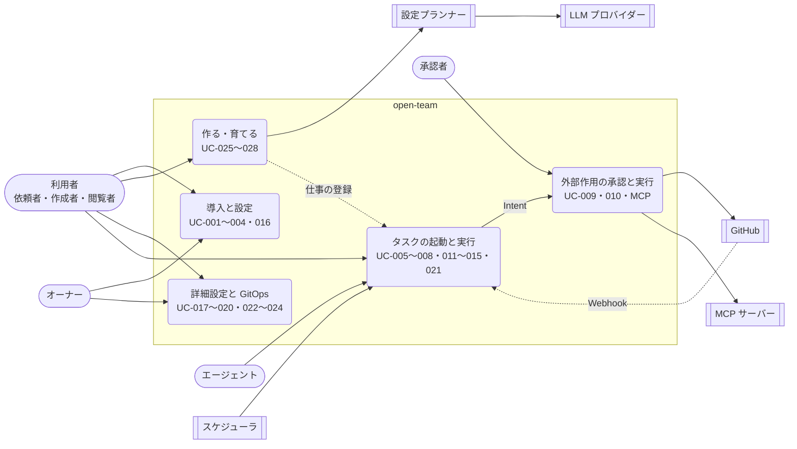

# 03. ユースケース
- プロジェクト：open-team（仮称） ／ 版数：v0.6（2026-10-01）：12〜15 を統合 ／ インプット：[01 要件定義](../01_requirements.md)、[02 ユーザーストーリー](../02_user_stories/README.md)

> **3行で**
> 1. ユースケースは UC-001〜028 と、MCP の書き込みの2つ（ID 未定）。既定の使い方は「エージェントに名前を付けて頼む → エージェントが自分で設定する → 外部作用は承認かルールで実行する」である。
> 2. どの入口・どのエージェントでも、判定は決定論的な Kernel が行い、LLM は提案するだけ。広げる変更と外部作用だけが人に戻る（BR-01〜60）。
> 3. v0.2 の「下書き → PR で公開」（UC-017〜020・024）と GitHub 前提のサインイン（UC-001）は前提が変わり、見直し待ち。ルールは [business-rules.md](business-rules.md)。

## 🧭 判断してほしいこと
| # | 種類 | 論点 | 選択肢 | おすすめ（理由） | 決まらないと止まるもの |
|---|---|---|---|---|---|
| Q-15 | 未決 | UC-010 E3（PR の検証不一致）で、作成された PR を自動でクローズするか（旧 03 §未決事項） | A: 自動でクローズ / B: 残して警告だけ（今の記述） | —（元の記述なし） | UC-010 E3、FR-012 |
| Q-16 | ✅決定 | メンションへの返信。コメントの投稿は Won't のため今は Web Push だけ。フェーズ1で `comment_issue` を外部作用に加えるか（旧 03・12 §未決事項） → **Web Push だけ（コメント投稿は Won't のまま）**（[D-33](../decisions.md#d-33)）| A: 加える / B: Web Push のまま | —（元の記述なし） | UC-021、操作カタログ |
| Q-17 | ✅決定 | v0.3（アプリ内モードが既定・BR-33・ADR-017）と v0.5（会話での下書き REQ-020・FR-024・SCR-015・TBL-021 の廃止、Canvas・試し実行は詳細設定へ）を受けた UC-017〜020・024 と BR-22・BR-30 の見直し。P-5 向けに PR を経ずに Web で公開する経路（旧 03 §未決事項）を含む。出典：12 §概要（v0.5 の注記）・§未決事項（v0.3）、14 §既存ドキュメントへの影響 → **GitOps モードはフェーズ2以降へ。US-024 廃止、US-025・026 は Could、US-027・UC-019・020・FR-027・NFR-051 はフェーズ2**（[D-14](../decisions.md#d-14)）| A: 詳細設定・GitOps モード用に書き直す / B: 一部を廃止して UC-025・026 に統合 | —（元の記述なし。12 は「見直しが要る」とだけ書く） | UC-017〜020・024、BR-22・30、FR-025〜027、SCR-016 |
| Q-18 | 未決 | A-03 の改訂（ワークスペースは GitHub App のインストール単位でない、個人のワークスペースはサインイン時に自動で作る）を受けた UC-001 の流れと BR-02（owner の決め方）。UC-016（メンバー管理）のフェーズ：v0.2 はフェーズ1、13 はフェーズ2に「複数ユーザー（SaaS 化）」を置く。出典：03 UC-001・BR-01・BR-02、13 §概念モデル・§フェーズ計画 | —（新しい流れは未設計） | —（元の記述なし） | UC-001、UC-016、BR-01・02、SCR-001・012 |
| Q-19 | ✅決定 | 13 が 03 に求める「交通・ニュース・MCP 登録のユースケース」は未設計（13 §既存ドキュメントへの影響）。交通・ニュースは UC-025・026 の例（14 例1・例4）で代えるか。MCP の登録・分類・引数の役割の確定（13 §登録と分類、15 §確定のしかた、US-038）、ワークスペースのポリシーの編集、プロフィールの登録の UC を立てるか → **新しい ID を振る（UC-029〜・FR-041〜・SCR-019〜）。MCP の書き込みは UC-009・010 を拡張せず別 UC。本設計は T-1 の設計作業で書く**（[D-09](../decisions.md#d-09)）| A: 新しい UC を立てる / B: 例で代える | —（元の記述なし） | US-036〜039 のトレース、06 のコネクタ画面 |
| Q-20 | ✅決定 | MCP の書き込みを UC-009・010 の拡張とするか、UC-029・030 として新しく立てるか（15 §既存ドキュメントへの影響に両案）。本書では仮に「MCP-承認」「MCP-実行」と書いた → **新しい ID を振る（UC-029〜・FR-041〜・SCR-019〜）。MCP の書き込みは UC-009・010 を拡張せず別 UC。本設計は T-1 の設計作業で書く**（[D-09](../decisions.md#d-09)）| A: UC-009・010 を拡張 / B: UC-029・030 を新設 | —（元の記述なし） | 04 の FR-010〜012 の MCP 版、10 のシーケンス図の ID |
| Q-21 | 未決 | 起動の UC と「仕事（jobs）」の関係。v0.5 でトリガー・テンプレート・指示は仕事に移った（ADR-028）が、UC-005・006・021 は定義の `prompt`・トリガーが前提のまま。`watch` の起動（REQ-043、フェーズ0）の UC がない。BR-07・BR-25 の「maintainer 以上・GitHub の書き込み権限」を GitHub をつながないエージェントにどう当てはめるか。出典：12 §トリガーと入口・BR-25、13 §要件、14 §概念モデル | —（未設計） | —（元の記述なし） | UC-021、BR-07・25、FR-028・037 |
| Q-22 | ✅決定 | アプリ内モードで「権限を広げる変更」を承認できる人：承認者（BR-14）か、ワークスペースの owner に限るか。個人開発者は自分で承認することになる（12 §未決事項（v0.3））。13 はワークスペースのポリシーを緩める変更を「owner の承認」とする（13 §概念モデル） → **ワークスペースの owner に限る（Intent の承認は従来どおり承認者 BR-14）**（[D-22](../decisions.md#d-22)）| A: 承認者（BR-14） / B: owner に限る | —（元の記述なし） | BR-33、UC-026 の確認カード |
| Q-23 | ✅決定 | BR-23 は「権限は `autonomy`・`paths`・`commands`・`budget`・`breakers` だけで決まる」と列挙するが、v0.3〜v0.5 で `rules`（12）、`connectors` の `grant`・`web`・`profile`（13）、「権限の境界」（14 §概念モデル）が加わった。出典：12 §ビジネスルール BR-23、14 §概念モデル → **列挙をやめ「権限は権限の境界だけで決まる」とし、境界の定義を参照する**（[D-24](../decisions.md#d-24)）| A: 列挙を更新 / B: 列挙をやめ「権限の境界」を参照 | —（元の記述なし） | BR-23、FR-023・036 |
| Q-24 | 一部決定 | （初回の確認の実行・メモリの移動は [D-27・28](../decisions.md) で決定、任せ先の選び方だけ未決）UC-026・027 に関わる 14 の未決：繰り返す仕事の初回に確認の実行を必ず行うか／仕事を移すときメモリも移すか／同じ役割のエージェントが複数いるときの任せ先の選び方（14 §未決事項） | — | —（元の記述なし） | UC-026 手順6、UC-027 |
| R-06 | リスク | MCP の書き込みの検証は既定で `none`。実行後に作用が意図どおりだったかを確かめられない（13 §呼び出しの経路、15 §決定事項） | — | 監査ログに「検証なし」を残し、フェーズ1で `readback` を足す（15） | MCP-実行 |
| R-07 | リスク | フェーズ0では PC が止まっている間のスケジュールは実行されず、後からも実行しない（A-75）。毎朝の結果が届かない日がありうる | — | アクティビティに「未実行」として残す（13 §フェーズ0） | UC-021 |

## 全体図

見てほしいところ：エージェントが外に作用するのは D5 だけで、必ず Intent を通る。D2 で作った仕事は D4 の同じ実行経路で動く。フェーズ0では利用者・承認者・オーナーは同じ1人である（13 §フェーズ0）。

## 要点
- 領域は5つ：[導入と設定](setup.md)・[作る・育てる](agents.md)・[詳細設定と GitOps](agent-builder.md)・[タスクの起動と実行](tasks.md)・[外部作用の承認と実行](actions.md)。
- 既定の作り方は v0.5 の「名前を付けて頼む」（UC-025〜028）。代表例は「ニュースリサーチャー」「朝の交通係」（[agents.md](agents.md)）。
- エージェントは自分の設定を変えられるが、`widen`（広げる変更）はユーザーの承認でしか反映されない（BR-47）。
- 外から読んだ内容はデータであり指示ではない。読んだタスクは `tainted` になり、設定の自動変更や承認カードの表示が厳しくなる（BR-38・BR-51）。
- 「以後も許可」は宛先の引数をすべて実際の値で固定したルールだけ。中身（本文）は毎回変わってよい（BR-39・BR-56）。
- MCP の書き込みは送信後に結果が分からなければ再試行しない（BR-59）。定期実行の承認待ちは次の実行で無効になる（BR-60）。
- フェーズ0で使う UC は下の索引の「フェーズ」列が 0 のもの。

---

## 詳細

### アクター一覧

| アクター | 種別 | 説明 |
|---|---|---|
| ユーザー（フェーズ0） | 人 | 単一ユーザー。サインインは省略する（13 §フェーズ0）。ワークスペースのポリシーの例では `approvers: [me]` で、承認者も本人。UC-025〜028 のアクター |
| 依頼者（Requester） | 人 | タスクを委任するユーザー（maintainer 以上）。委任先のエージェントを選ぶ |
| 承認者（Approver） | 人 | 承認待ちのIntentを承認・却下するユーザー。実効ポリシーの `approvers`、または依頼者本人とワークスペースの owner（BR-14） |
| オーナー（Owner） | 人 | ワークスペースの owner（ロール）。BYOK・メンバー・Kill Switch の解除・エージェントの再開・MCP ツールの分類（BR-44）を担当。エージェント定義の `owner`（エージェント担当者）とは別 |
| 作成者（Creator） | 人 | エージェントを作成・編集し、試し実行・公開するユーザー（maintainer 以上） |
| エージェント担当者 | 人 | エージェント定義の `owner` に書かれたユーザー。スケジュール起動の依頼者で、有効化・無効化・停止の通知先（BR-25） |
| 閲覧者（Viewer） | 人 | 閲覧のみ |
| エージェント（Agent） | システム（信頼しない） | LLM エージェント。v0.5 から名前のある担当者として見せ、複数の仕事を持つ（14）。ツール呼び出し・Intent・レポートの提出とメモリへの書き込み（`remember`）だけができる。権限はワークスペースのポリシー（開発ではリポジトリのポリシーも）より広くならない（BR-20） |
| 設定プランナー | システム | v0.5。お願い・反応からエージェント定義の差分を作る LLM の機能。設計アシスタント（FR-024）を置き換える（FR-035）。差分は検証と `classify()` を通ったものだけが反映される（BR-47）。ルールは作れない（BR-57） |
| 設計アシスタント | システム | **v0.5 で置換（→ 設定プランナー）**。会話からエージェント定義（YAML）の変更案を作る機能。UC-017・024 の記述に残る（Q-17） |
| GitHub | 外部システム | OAuth、GitHub App（API・Webhook）。v0.4 からワークスペースにつなぐ連携先の1つ（開発用） |
| MCP サーバー | 外部システム | v0.4。リモートの MCP サーバー（フェーズ0は Streamable HTTP、A-71）。認証情報は Gateway だけが持つ |
| Web | 外部システム | v0.4。検索 API と公開の Web ページ。Web 取得プロキシを通して GET / HEAD だけで読む |
| LLMプロバイダー | 外部システム | Anthropic / OpenAI / OpenRouter（BYOK） |
| Web Push サービス | 外部システム | ブラウザベンダーのプッシュサービス（FCM / APNs / Mozilla） |
| スケジューラ | システム | 期限切れ・日次集計などの定期処理。スケジュールトリガーによるエージェントの起動（worker の毎分の処理）、自己調整の集計（UC-028）も行う |

### 想定する使い方（13 §想定する使い方）

| 例 | トリガー | 読むもの | 結果の届け方 | 外部作用 | 主な UC |
|---|---|---|---|---|---|
| 毎朝の交通状況 | スケジュール（平日 6:45） | Web 検索（運行情報・道路交通情報）、地図・経路の MCP、カレンダーの MCP（今日の最初の予定の場所） | プッシュ通知 ＋ アプリ内レポート | なし（通知は組み込み） | UC-025・026（例4）、UC-021、UC-007 |
| ニュースのリサーチ | スケジュール（毎朝 7:00）／手動 | Web 検索・ページ取得（指定したテーマ・媒体） | アプリ内レポート ＋ Slack の自分宛て DM | Slack への投稿（「以後も許可」のルールで自動） | UC-025・026（例1）、MCP-承認・実行 |
| 気になる情報の監視 | `watch`（1時間ごと） | 指定したページ・RSS・検索クエリ | 変化があったときだけ通知 | なし | UC-026（例2）。起動の UC は Q-21 |
| メールの整理 | 手動（「今日の未読をまとめて」） | Gmail の MCP（読み取り） | アプリ内レポート | 下書き作成は `approve`、送信は既定で `approve` | UC-026、MCP-承認・実行 |
| 開発（従来どおり） | ラベル・メンション・手動 | GitHub のリポジトリ | PR | PR の作成（`approve`） | UC-005〜010 |

### ユースケース索引

フェーズ：0 = 13・14 がフェーズ0に入れると書いたもの、1 = v0.2 の MVP の範囲。13 のフェーズ0の範囲にある「停止」が UC-011・012・022 のどれを指すかは書かれていないため、これらは 1 のままにした。

| ID | 名前 | 主なアクター | フェーズ | US | 状態 | 定義 |
|---|---|---|---|---|---|---|
| UC-001 | サインイン・リポジトリ連携 | 依頼者、GitHub | 1 | US-001, 002 | 見直し待ち（Q-18） | [setup.md](setup.md) |
| UC-002 | LLMキー登録（BYOK） | オーナー | 1（0 は `.env`） | US-016 | 有効 | [setup.md](setup.md) |
| UC-003 | 通知購読 | 依頼者、Web Push | 0 | US-015 | 有効 | [setup.md](setup.md) |
| UC-004 | ポリシー確認・検証 | 依頼者、GitHub | 1 | US-003, 017, 022 | 有効（リポジトリのポリシー） | [setup.md](setup.md) |
| UC-005 | タスク委任（Web） | 依頼者 | 1 | US-004 | 有効（Q-21） | [tasks.md](tasks.md) |
| UC-006 | タスク委任（ラベル） | GitHub | 1 | US-019, 028 | 有効（Q-21） | [tasks.md](tasks.md) |
| UC-007 | 自律実行 | エージェント | 0（開発は1） | US-005, 006, 017, 018, 033 | 有効 | [tasks.md](tasks.md) |
| UC-008 | 自動停止（予算・Breaker） | Kernel | 0 | US-009, 011 | 有効 | [tasks.md](tasks.md) |
| UC-009 | PR作成承認 | 承認者 | 1 | US-007, 015, 022 | 有効（MCP 版は Q-20） | [actions.md](actions.md) |
| UC-010 | PR作成実行・検証 | Gateway、GitHub | 1 | US-008 | 有効（Q-15） | [actions.md](actions.md) |
| UC-011 | タスクキャンセル | 依頼者 | 1 | US-012 | 有効 | [tasks.md](tasks.md) |
| UC-012 | Kill Switch | 依頼者、オーナー | 1 | US-013 | 有効 | [tasks.md](tasks.md) |
| UC-013 | 監査ログ閲覧・検証・出力 | 閲覧者以上 | 0 | US-014, 023 | 有効 | [tasks.md](tasks.md) |
| UC-014 | 予算確認 | 依頼者 | 0 | US-010 | 有効 | [tasks.md](tasks.md) |
| UC-015 | 信頼度引き上げ提案 | スケジューラ、オーナー | 1 | US-020 | 有効 | [tasks.md](tasks.md) |
| UC-016 | メンバー管理 | オーナー | 1（Q-18） | US-021 | 有効 | [setup.md](setup.md) |
| UC-017 | エージェントの下書き作成 | 作成者 | 1 | US-024, 025 | 見直し待ち（Q-17） | [agent-builder.md](agent-builder.md) |
| UC-018 | 試し実行 | 作成者 | 1 | US-026 | 見直し待ち（Q-17） | [agent-builder.md](agent-builder.md) |
| UC-019 | エージェントの公開 | 作成者、GitHub | 1（GitOps） | US-027 | 見直し待ち（Q-17） | [agent-builder.md](agent-builder.md) |
| UC-020 | エージェント定義の読み込み | GitHub | 1（GitOps） | US-027, 029 | 見直し待ち（Q-17） | [agent-builder.md](agent-builder.md) |
| UC-021 | トリガーによる起動 | GitHub、スケジューラ | メンション1・スケジュール0 | US-028 | 有効（Q-21） | [tasks.md](tasks.md) |
| UC-022 | エージェントの停止・再開 | メンテナ、オーナー | 1 | US-032 | 有効 | [agent-builder.md](agent-builder.md) |
| UC-023 | メモリの管理 | エージェント、メンテナ | 1 | US-031 | 有効 | [agent-builder.md](agent-builder.md) |
| UC-024 | タスクから Skill の下書きを作る | メンテナ | 1 | US-030 | 見直し待ち（Q-17） | [agent-builder.md](agent-builder.md) |
| UC-025 | 名前を付けてエージェントを作る | ユーザー | 0 | US-040 | 有効 | [agents.md](agents.md) |
| UC-026 | お願いから仕事を作る | ユーザー | 0 | US-041, 042 | 有効 | [agents.md](agents.md) |
| UC-027 | 仕事を別のエージェントに移す | ユーザー | 0（後回し可） | US-043 | 有効 | [agents.md](agents.md) |
| UC-028 | 自己調整 | worker | 0（一部後回し可） | US-042, 044 | 有効 | [agents.md](agents.md) |
| UC-040 | 頼んで任せる（編成の生成。v0.12） | ユーザー | 0（0-H は「ひとり」「順番」が Must） | US-045, 046 | 有効（UC-029〜039 は MCP の UC に空けておく） | [agents.md](agents.md) |
| UC-041 | 担当どうしで協調して、1つの回答を返す（v0.14） | システム、ユーザー | 0（0-H は回答1つが Must、連絡板は Should） | US-047, 048 | 有効 | [agents.md](agents.md) |
| MCP-承認 | MCP の書き込みの判定と承認 | 承認者 | 0 | US-035, 037 | ID 未定（Q-20） | [actions.md](actions.md) |
| MCP-実行 | MCP の書き込みの実行 | Gateway、MCP サーバー | 0 | US-035, 037 | ID 未定（Q-20） | [actions.md](actions.md) |

### ビジネスルール索引

BR-01〜60 の一覧（60件。本文は business-rules.md）

| ID | 要旨 | 版 | まとまり |
|---|---|---|---|
| BR-01 | ワークスペースは GitHub App のインストール単位ではない（v0.4 改訂） | v0.4 | [ワークスペースと権限](business-rules.md#ワークスペースと権限) |
| BR-02 | インストールした人は owner、後から来たメンバーは viewer | v0.2 | [ワークスペースと権限](business-rules.md#ワークスペースと権限) |
| BR-03 | API キーは LLM Proxy だけが復号できる形で保存 | v0.2 | [ワークスペースと権限](business-rules.md#ワークスペースと権限) |
| BR-04 | ポリシーはデフォルトブランチの HEAD から読み、タスクは開始時点に固定 | v0.2 | [ポリシーと実効ポリシー](business-rules.md#ポリシーと実効ポリシー) |
| BR-05 | ポリシーファイルがなければ既定ポリシー | v0.2 | [ポリシーと実効ポリシー](business-rules.md#ポリシーと実効ポリシー) |
| BR-06 | Hard Ceiling | v0.2 | [ポリシーと実効ポリシー](business-rules.md#ポリシーと実効ポリシー) |
| BR-07 | タスクを開始できる条件 | v0.2 | [タスクの起動](business-rules.md#タスクの起動) |
| BR-08 | 同時実行数は3件まで | v0.2 | [タスクの起動](business-rules.md#タスクの起動) |
| BR-09 | ツール呼び出しは操作の種類に分類してから判定。分類できなければ deny | v0.2 | [実行中の統制](business-rules.md#実行中の統制) |
| BR-10 | LLM 呼び出しの前に予算を事前判定 | v0.2 | [実行中の統制](business-rules.md#実行中の統制) |
| BR-11 | Breaker はカウンタと閾値だけで判定 | v0.2 | [実行中の統制](business-rules.md#実行中の統制) |
| BR-12 | サンドボックスは認証情報を持たず、通信先を限る | v0.2 | [実行中の統制](business-rules.md#実行中の統制) |
| BR-13 | リスク評価はルールベース、LLM の要約は参考 | v0.2 | [実行中の統制](business-rules.md#実行中の統制) |
| BR-14 | 承認できる人 | v0.2 | [ワークスペースと権限](business-rules.md#ワークスペースと権限) |
| BR-15 | 承認は intentHash に紐づく（v0.6 で MCP に拡張） | v0.2 / v0.6 | [外部作用](business-rules.md#外部作用) |
| BR-16 | Gateway が GitHub に書き込める範囲 | v0.2 | [外部作用](business-rules.md#外部作用) |
| BR-17 | Kill Switch の発動は maintainer 以上、解除は owner | v0.2 | [ワークスペースと権限](business-rules.md#ワークスペースと権限) |
| BR-18 | 監査ログは追記のみ、ハッシュチェーン | v0.2 | [実行中の統制](business-rules.md#実行中の統制) |
| BR-19 | 信頼度提案の基準 | v0.2 | [実行中の統制](business-rules.md#実行中の統制) |
| BR-20 | 実効ポリシーは厳しい方を取る合成（v0.4 でワークスペースのポリシーを追加） | v0.4 | [ポリシーと実効ポリシー](business-rules.md#ポリシーと実効ポリシー) |
| BR-21 | 定義がポリシーより緩ければ公開時エラー、後から厳しくなれば clamp | v0.2 | [ポリシーと実効ポリシー](business-rules.md#ポリシーと実効ポリシー) |
| BR-22 | 定義と Skill はデフォルトブランチの HEAD からだけ読む | v0.2 | [ポリシーと実効ポリシー](business-rules.md#ポリシーと実効ポリシー) |
| BR-23 | 指示・Skill・メモリは権限を与えない | v0.2 | [ポリシーと実効ポリシー](business-rules.md#ポリシーと実効ポリシー) |
| BR-24 | 試し実行の扱い | v0.2 | [タスクの起動](business-rules.md#タスクの起動) |
| BR-25 | スケジュール起動の依頼者はエージェント担当者 | v0.2 | [タスクの起動](business-rules.md#タスクの起動) |
| BR-26 | メモリはタスクの終わり方で有効か破棄か（v0.6 で `actions_declined` を追加） | v0.2 / v0.6 | [メモリと秘密情報](business-rules.md#メモリと秘密情報) |
| BR-27 | エージェントの停止は maintainer 以上、再開は owner | v0.2 | [ワークスペースと権限](business-rules.md#ワークスペースと権限) |
| BR-28 | エージェント定義の公開で書き込める範囲 | v0.2 | [外部作用](business-rules.md#外部作用) |
| BR-29 | 重複の判定 | v0.2 | [タスクの起動](business-rules.md#タスクの起動) |
| BR-30 | 設計アシスタントの出力は提案、費用は下書き1件 $0.5 まで | v0.2 | [メモリと秘密情報](business-rules.md#メモリと秘密情報) |
| BR-31 | スラッグ `default` は既定エージェント | v0.2 | [ポリシーと実効ポリシー](business-rules.md#ポリシーと実効ポリシー) |
| BR-32 | 保存する前に秘密情報をマスク | v0.2 | [メモリと秘密情報](business-rules.md#メモリと秘密情報) |
| BR-33 | アプリ内モードで緩める変更は承認が要る | v0.3 | [ポリシーと実効ポリシー](business-rules.md#ポリシーと実効ポリシー) |
| BR-34 | AI事前レビューは厳しくする方向にだけ使う | v0.3 | [実行中の統制](business-rules.md#実行中の統制) |
| BR-35 | 「以後も許可」を追加できる操作（v0.6 で読み替え） | v0.3 / v0.6 | [外部作用](business-rules.md#外部作用) |
| BR-36 | パスワード変更・支払い・送金は `handoff` だけ | v0.3 | [実行中の統制](business-rules.md#実行中の統制) |
| BR-37 | （フェーズ2）ブラウザの通信はプロキシで書き込みを止める | v0.3 | [実行中の統制](business-rules.md#実行中の統制) |
| BR-38 | 外部の内容を読んだタスクは `tainted` | v0.4 | [外部の内容と汚染](business-rules.md#外部の内容と汚染) |
| BR-39 | `mcp_write` の `auto` は宛先をすべて固定したルールの一致だけ（v0.6 改訂） | v0.6 | [外部作用](business-rules.md#外部作用) |
| BR-40 | `watcher` は書き込み系のツールを持たない | v0.4 | [外部の内容と汚染](business-rules.md#外部の内容と汚染) |
| BR-41 | プロフィールは定義に書いた項目だけ渡し、書き込みでは強調表示 | v0.4 | [外部の内容と汚染](business-rules.md#外部の内容と汚染) |
| BR-42 | ツールの説明が変わったら `needs_review` | v0.4 | [外部の内容と汚染](business-rules.md#外部の内容と汚染) |
| BR-43 | ワークスペースのポリシーは全エージェントの上限 | v0.4 | [ポリシーと実効ポリシー](business-rules.md#ポリシーと実効ポリシー) |
| BR-44 | ツールを `read` にできるのは owner だけ | v0.4 | [ワークスペースと権限](business-rules.md#ワークスペースと権限) |
| BR-45 | レポートと通知には出典の URL | v0.4 | [外部の内容と汚染](business-rules.md#外部の内容と汚染) |
| BR-46 | 前回と同じ結果は通知しない | v0.4 | [外部の内容と汚染](business-rules.md#外部の内容と汚染) |
| BR-47 | 定義を変えられる経路は2つ。`widen` はユーザーの操作だけ | v0.5 | [自己設定](business-rules.md#自己設定) |
| BR-48 | 名前・役割・アイコンは権限に影響しない | v0.5 | [自己設定](business-rules.md#自己設定) |
| BR-49 | 1つのお願いに質問は1つまで | v0.5 | [自己設定](business-rules.md#自己設定) |
| BR-50 | プロフィールの公開は `neutral` | v0.5 | [自己設定](business-rules.md#自己設定) |
| BR-51 | 自動の調整は反応・発言・成否だけを根拠にする | v0.5 | [自己設定](business-rules.md#自己設定) |
| BR-52 | 自動の調整は1仕事1日1回まで | v0.5 | [自己設定](business-rules.md#自己設定) |
| BR-53 | すべての変更はスナップショットになり、元に戻せる | v0.5 | [自己設定](business-rules.md#自己設定) |
| BR-54 | 元に戻した調整は14日間自動で行わない | v0.5 | [自己設定](business-rules.md#自己設定) |
| BR-55 | 承認した `widen` は監査ログに残す | v0.5 | [自己設定](business-rules.md#自己設定) |
| BR-56 | 引数の役割はユーザーが確定、未確定は `destination` | v0.6 | [外部作用](business-rules.md#外部作用) |
| BR-57 | ルールは承認カードからだけ作れる | v0.6 | [外部作用](business-rules.md#外部作用) |
| BR-58 | 届け先の宛先は仕事の定義が決める | v0.6 | [外部作用](business-rules.md#外部作用) |
| BR-59 | MCP の書き込みは自動で再試行しない | v0.6 | [外部作用](business-rules.md#外部作用) |
| BR-60 | 定期実行の承認待ちは次の実行で無効 | v0.6 | [外部作用](business-rules.md#外部作用) |

### 前提・仮定（このドキュメントが使うもの）

一覧の正本は [00 概要](../00_overview.md) の前提・仮定にある。

前提・仮定（20件）

| ID | 仮定 | 出典 |
|---|---|---|
| A-03 | **（v0.4 で改訂）** ワークスペースは GitHub App のインストール単位ではない。個人のワークスペースはサインイン時に自動で作り、GitHub はつなぐ連携先の1つ（v0.2：個人アカウントも1つの組織として扱い、インストール単位 = 組織） | 13 §概念モデル |
| A-09 | ワークスペースの同時実行数の上限は3件（BR-08） | 03 |
| A-10 | サンドボックスは、Intentを提出した時点で破棄する。承認を待つ間はサンドボックスを残さない（MCP の書き込みでも同じ。15） | 03 |
| A-11 | ベースブランチが進んで差分を適用できない場合は、自動でリベースせず失敗にする | 03 |
| A-12 | 後から Organization のメンバーがサインインした場合、既定のロールは viewer | 03 |
| A-33 | フェーズ1のテンプレートは dev-coder / reviewer / triager の3つ（v0.4 で `researcher` / `briefer` / `watcher` / `assistant` を追加。13） | 12 |
| A-34 | 1エージェントの Skill は20個まで。エージェントの上限は A-81 に読み替え | 12 |
| A-36 | 試し実行の予算は1回 $1 まで | 12 |
| A-37 | スケジュールの最短間隔は1時間、`max_runs_per_day` は最大50 | 12 |
| A-39 | レポートは open-team の中にだけ保存し、GitHub には書き込まない | 12 |
| A-41 | メンションの書式は `@open-team <agent-id> <指示>` とし、コメントの先頭にある場合だけ受け付ける | 12 |
| A-45 | 既存のタスクと、既定の `open-team` ラベル（UC-006）は、既定エージェント（`default`、BR-31）に紐づける | 03 |
| A-71 | フェーズ0で使う MCP サーバーはリモート（Streamable HTTP）に限る | 13 |
| A-75 | PC が止まっていて実行できなかったスケジュールは、後から実行しない | 13 |
| A-78 | 「組織（organizations）」は「ワークスペース（workspaces）」に改名する | 13 |
| A-79 | 最初の境界の予算（`per_task_usd: 0.2`、`per_day_usd: 1`、`max_runs_per_day: 10`）はリサーチ系の仕事に足りる | 14 |
| A-81 | 1エージェントの仕事は10個まで。ワークスペースのエージェントは20体まで（A-34 の「1リポジトリ」を「1ワークスペース」に読み替え） | 14 |
| A-85 | 1タスクの Intent は既定5件、Hard Ceiling 20件 | 15 |
| A-86 | MCP の `tools/call` のタイムアウトは60秒、保存する応答は64KBまで | 15 |
| A-87 | フェーズ0では、エージェントが書き込みの結果を使って次の手順を決める必要はない | 15 |

## このドキュメントで決まったこと
- [ADR-012](../adr/ADR-012-stricter-wins-composition.md)：実効ポリシーは厳しい方を取る合成（BR-20）
- [ADR-015](../adr/ADR-015-dry-run-same-path.md)：試し実行は本番と同じ経路を通す（UC-018、BR-24）
- [ADR-017](../adr/ADR-017-in-app-definition-default.md)：定義の既定の保存場所はアプリ内（BR-33）
- [ADR-021](../adr/ADR-021-workspace-policy.md)：ポリシーの基本はワークスペース単位（BR-43）
- [ADR-024](../adr/ADR-024-taint-tracking-against-injection.md)：プロンプトインジェクションには汚染の追跡で対策（BR-38〜42）
- [ADR-026](../adr/ADR-026-name-and-ask.md)・[ADR-027](../adr/ADR-027-classify-widening-changes.md)・[ADR-028](../adr/ADR-028-jobs-as-unit-of-work.md)：名前を付けて頼む・広げる変更だけ人に戻す・仕事を単位にする（UC-025〜028、BR-47）
- [ADR-029](../adr/ADR-029-mcp-arg-roles-destination-fixed.md)・[ADR-030](../adr/ADR-030-declarative-deliver.md)・[ADR-031](../adr/ADR-031-mcp-write-no-auto-retry.md)：宛先の固定・届け先の宣言化・MCP の書き込みは自動で再試行しない（BR-39・56〜60）
