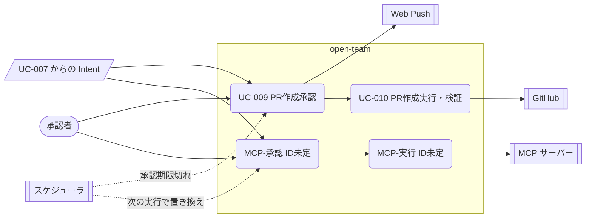

# 03. ユースケース — 外部作用の承認と実行（UC-009、UC-010、MCP の書き込み）
- [← 03 README](README.md) ／ ビジネスルールは [business-rules.md](business-rules.md)

外部作用はすべて Intent になり、「プレビュー → 承認（またはルール）→ 実行 → 記録」の順に進む。GitHub の PR は UC-009・UC-010、MCP の書き込みは 15 で決まった流れを下に書いた。MCP の流れに UC-009・010 を広げるか、UC-029・030 を新しく立てるかは決まっていない（Q-20）。本書では「MCP-承認」「MCP-実行」と仮に呼ぶ。

見てほしいところ：PR と MCP で「承認 → 実行」の形は同じ。違いは、MCP では1タスクに複数の Intent があり、送信後に結果が分からなければ再試行しないこと（BR-59）。

---

### UC-009：PR作成承認 〔US-007, US-015, US-022〕
- アクター：承認者、Web Push サービス、スケジューラ ／ フェーズ：1
- 事前条件：`open_pr` のIntentが提出されている
- トリガー：Intentが提出される
- 基本フロー：
  1. Kernelは差分を検証する（禁止パス、変更ファイル数の上限、バイナリの有無、サイズ）。
  2. Kernelは `autonomy.open_pr` を判定し、`approve` であれば承認依頼を作成する。タスクは `awaiting_approval` になる。
  3. システムは承認カード用の情報を作る。ルールベースのリスク評価（BR-13）を計算し、LLMで差分の要約を作る（タスク予算から消費する）。
  4. 承認者に通知する。
  5. 承認者は承認カード（SCR-007）を開いて内容を確認し、「承認」を押して確認ダイアログで確定する。
  6. システムは承認者であること（BR-14）、intentHashが一致すること、Kill Switch と期限を検証し、承認を記録する。
  7. UC-010 へ進む。
- 代替フロー：
  - 2a. `autonomy.open_pr: auto` → 承認を省き、ドラフトPRとして UC-010 へ進む（BR-06）。
  - 5a. 承認者が「却下」を押す → Intentは `rejected`、タスクは `rejected` になる。
  - 5b. 24時間が過ぎた → スケジューラがIntentを `expired`、タスクを `halted`（`approval_expired`）にする。
- 例外フロー：
  - E1. 1の検証で違反があった → Intentは `denied`、タスクは `halted`（`policy_violation`）になる。
  - E2. 承認者でない → 403 `FORBIDDEN`
  - E3. intentHashが一致しない（表示後に内容が変わった） → 409 `INTENT_CHANGED`
- 事後条件：Intentが `approved` / `rejected` / `expired` / `denied` のいずれかになる。
- ビジネスルール：BR-06、BR-13、BR-14、BR-15

### UC-010：PR作成実行・検証 〔US-008〕
- アクター：システム（Action Gateway）、GitHub ／ フェーズ：1
- 事前条件：Intentが `approved`（または auto で許可された状態）
- トリガー：承認の確定、または auto による許可
- 基本フロー：
  1. GatewayはDBのトランザクションの中で、Intentが `approved` であること、Kill Switch が発動していないこと、タスクがキャンセルされていないことを確認し、Intentを `executing` にする。
  2. GatewayはGitHub Appのインストールトークン（短命）を発行する。
  3. ベースコミットに差分を適用し、blob・tree・commitを作成する。
  4. `open-team/task-{taskId}` ブランチを作成し、PRを作成する（auto の場合はドラフト）。
  5. Intentを `executed` にし、監査ログに `action.executed` を記録する。
  6. GatewayはPRを取得し、head commit の tree SHA と承認時に計算した期待値を比較する。一致すれば `verified` にし、タスクを `succeeded` にする。
  7. 依頼者に完了を通知する。
- 代替フロー：
  - 3a. 同じIntentでの再実行（リトライ）→ 既存のブランチ・コミットを確認し、作成済みのものは作り直さない（冪等）。
- 例外フロー：
  - E1. 1の検証に失敗した → 実行せず、Intentは `failed`。
  - E2. ベースブランチが進んでいて、差分を適用できない → Intentは `failed`、タスクは `failed`（`base_conflict`）。
  - E3. 6で一致しない → Intentは `failed`（`verify_mismatch`）、タスクは `failed`。PRは残るが、監査ログに不一致を記録し、依頼者に警告を通知する（PR を自動でクローズするかは Q-15）。
  - E4. GitHub APIのエラー（5xx・レート制限）→ 最大3回リトライ。
- 事後条件：検証済みのPRが存在する。または、失敗が記録されている。
- ビジネスルール：BR-15、BR-16

### MCP-承認：MCP の書き込みの判定と承認 〔US-035, US-037〕
ID は未定（Q-20）。内容は 15 §Intent のライフサイクル・§承認カード・§承認待ちと定期実行 による。

- アクター：承認者（フェーズ0はユーザー本人）、スケジューラ ／ フェーズ：0
- 事前条件：タスクから `mcp_write`（書き込み・未分類の MCP ツール）の Intent が出た。出どころは2つ：`assistant` のエージェントが `mcp_call` で直接呼ぶ（`origin = agent`）、または仕事の `deliver` からランタイムがタスクの最後に作る（`origin = deliver`、BR-58）
- 基本フロー：
  1. Kernel が `decide()` で判定し、Intent を intentHash つきで保存する（BR-15）。エージェントは書き込みの結果を待たずに続ける（`mcp_call` の戻り値は `{ intentId, status }` だけ。A-87）。
  2. エージェントのループが終わった時点で承認待ちの Intent があれば、タスクを `awaiting_approval` にし、実行用のサンドボックス（またはプロセス）を終了する（A-10）。
  3. チャットに承認カードを出す。宛先（`destination` 引数。ルールの `labels` があれば名前つき）、中身（`content`。プロフィールの値を強調。BR-41）、その他（`option`）、汚染していれば読んだ情報源、ツールの現在の説明を表示する。
  4. 承認者が [承認] を押す → Intent は `approved` になり、MCP-実行へ進む。
- 代替フロー：
  - 1a. 有効なルールに一致する → `allow`。承認なしで MCP-実行へ進む（BR-39）。
  - 1b. 1タスクの Intent が上限（既定5件、Hard Ceiling 20件。A-85）を超える → `deny`（`intent_limit`）。
  - 4a. [以後も許可] を押す（出す条件は BR-35・BR-39 の表）→「固定される値（宛先）」と「毎回変わってよい値（本文）」を確認として表示してから確定する。Intent を承認し、同時にルールを定義に追加する（`widen`。ユーザーの直接の操作なので確認カードは重ねない。BR-47 ①）。監査ログに `approval.decided` と `agent.config.widened`（`origin = approval_rule`）を残す。
  - 4b. [やめる] → Intent は `rejected`。
  - 5a. 承認期限 `min(作成から24時間, 同じ仕事の次の実行の予定時刻)` を過ぎた、または同じ仕事の次の実行が始まった → Intent は `expired`（`superseded`）、タスクは `completed`（`actions_declined`）。通知は送らず、カードを「期限切れ」に変える（BR-60）。
  - 5b. 3回続けて承認されずに置き換えられた → チャットで「承認が間に合っていません。[以後も許可] にするか、届け先を外しますか？」と1回だけ聞く。
  - 5c. ツールが `needs_review` になった → そのツールの `pending_approval` と `approved`（未実行）の Intent をすべて `expired`（`tool_changed`）にし、チャットで知らせる（BR-42）。
- 例外フロー：
  - E1. 操作がカタログにない・ツールが付与されていない → `deny`（`unknown_action` / `not_granted`）。
  - E2. ツールが `needs_review`、またはコネクタが無効 → `deny`（`tool_needs_review` / `connector_disabled`）。
  - E3. [以後も許可] の条件を満たさないのに要求された → 422 `RULE_NOT_ALLOWED`。
- 事後条件：Intent が `approved` / `rejected` / `expired` / `denied` のいずれか、またはルール一致で実行へ進んでいる。
- ビジネスルール：BR-15、BR-35、BR-39、BR-41、BR-42、BR-47、BR-56、BR-57、BR-58、BR-60

### MCP-実行：MCP の書き込みの実行 〔US-035, US-037〕
ID は未定（Q-20）。内容は 15 §Gateway での実行・§タスクの終わり方 による。

- アクター：システム（Action Gateway）、MCP サーバー ／ フェーズ：0
- 事前条件：Intent が `approved`、またはルール一致で `allow`
- 基本フロー：
  1. Gateway は Intent をロックし、状態が `approved`、Kill Switch が未発動、ツールの現在の `toolHash` が Intent のものと同じであることを確かめ、`executing` にする。
  2. 認証情報を復号し、承認カードに表示したものと同じ引数で `tools/call` を呼ぶ（タイムアウト60秒。A-86）。
  3. 正常な応答（`isError` なし）→ `executed`。検証が `none`（既定）のツールではここで終わる。`readback`（フェーズ1）のツールは `verified` / `failed` に進む。
  4. 応答の本文を、上限（64KB）とマスクを通してから保存する。
- 例外フロー：
  - E1. 1でツールが変わっていた → `expired`（`tool_changed`）。
  - E2. `isError: true` の応答 → `failed`（`tool_error`、応答の本文を保存）。再試行しない。
  - E3. 送信前の失敗（名前解決・接続拒否・TLS）→ `approved` のまま最大3回、指数バックオフで再試行。尽きたら `failed`（`unreachable`）。
  - E4. 認証エラー（401・403、トークンの更新に失敗）→ `failed`（`auth_required`）。再試行しない。チャットに [つなぎ直して再実行] を出す。
  - E5. 送信後のタイムアウト・接続断・5xx → `unknown_outcome`。再試行しない（二重送信を避ける。BR-59）。承認者に通知し、カードに [実行済みとして閉じる] [失敗として閉じる] [もう一度実行] を出す。[もう一度実行] は同じ引数で新しい Intent を作り、二重になるおそれをカードに書いて承認を求める（ルールがあっても `auto` にしない）。
- 事後条件：タスクの終わり方は Intent の結果で決まる（下表）。`succeeded` の意味は「外部作用がすべて実行された（検証できるものは検証済み）」に広がった。

Intent の結果とタスクの終わり方（15 §タスクの終わり方。4行）

| Intent の結果 | タスクの状態 |
|---|---|
| Intent がない | `completed`（`report`） |
| すべて `executed` / `verified` | `succeeded` |
| `rejected` / `expired` を含み、`failed` / `unknown_outcome` を含まない | `completed`（`actions_declined`） |
| `failed` / `unknown_outcome` を1つでも含む | `failed`（`action_failed`）。レポートは残り、閲覧できる |

- ビジネスルール：BR-15、BR-26、BR-59
