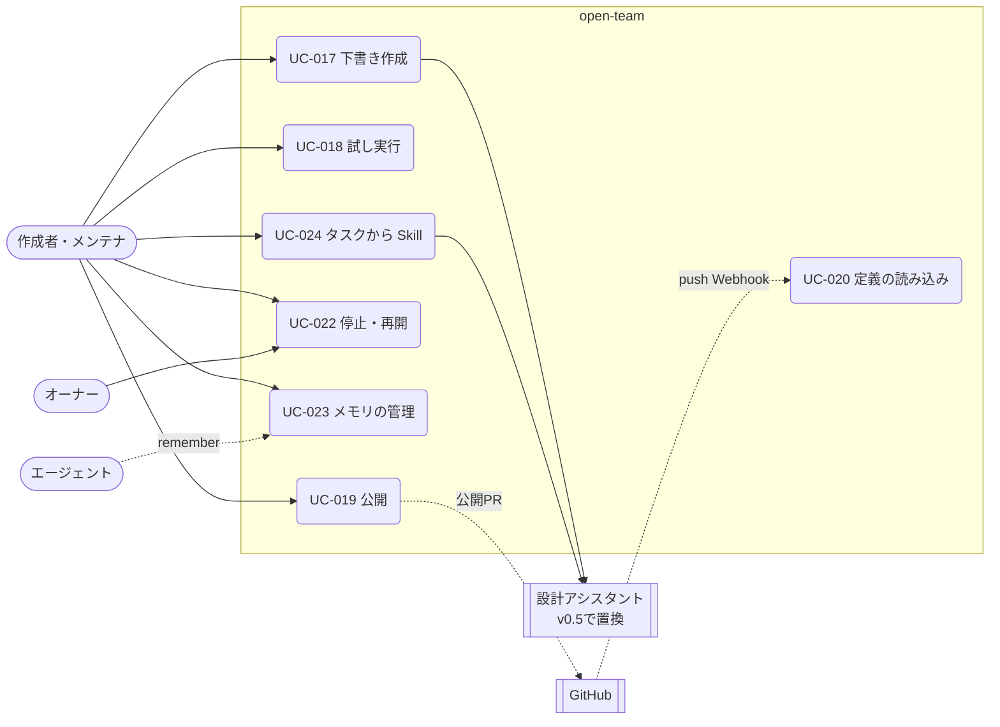

# 03. ユースケース — 詳細設定と GitOps（UC-017〜020、UC-022〜024）
- [← 03 README](README.md) ／ ビジネスルールは [business-rules.md](business-rules.md)

v0.2（12）で決めた「下書き → Canvas → 試し実行 → PR で公開」の作り方と、エージェントの運用（停止・メモリ・Skill）である。

> **前提が変わった（Q-17）**：v0.3 で定義の既定の保存場所がアプリ内になり、PR での公開は GitOps モードだけの方式になった（BR-33、ADR-017）。v0.5 で会話での下書き（REQ-020・FR-024・SCR-015・TBL-021）は廃止され、Canvas と試し実行は「詳細設定」に移った（UC-025・026 が既定の作り方）。UC-017〜020・024 の下の記述は v0.2 のもので、見直しが要る。UC-022・023 はこの変更の影響を受けない。

見てほしいところ：UC-018 の試し実行は UC-007 と同じ経路を通り、外部作用だけを Gateway の手前で止める（BR-24、ADR-015）。

---

### UC-017：エージェントの下書き作成 〔US-024, US-025〕
> **見直し待ち（Q-17）**：会話での下書き（手順 1 の「会話で作る」と 3〜5、E1〜E3）は v0.5 で UC-025・UC-026 に置き換わった。Canvas での直接編集は詳細設定として残る。

- アクター：作成者（maintainer 以上）、LLMプロバイダー ／ フェーズ：1
- 事前条件：リポジトリが連携済み。LLMキーが登録済み
- トリガー：エージェント一覧（SCR-014）で「新しいエージェント」、または既存エージェントの「編集」
- 基本フロー：
  1. 作成者はテンプレートを選ぶか、「会話で作る」を選ぶ。
  2. システムは下書きを作る（既存エージェントの編集なら、現在の定義を複製する）。
  3. 作成者は、やってほしいことを自然言語で入力する。
  4. 設計アシスタントは、リポジトリのポリシー・既存のエージェント・Skill の一覧を参照し、YAML の変更案と説明を返す。
  5. システムは変更案をスキーマ検証と実効ポリシーの合成にかけ、通ったものだけを下書きに反映する（BR-30）。
  6. Canvas（SCR-016）に変更点がハイライトされる。作成者は Canvas のフォームまたは YAML で直接編集できる。編集のたびに 5 の検証を行う。
  7. 3〜6 を繰り返す。
- 代替フロー：
  - 1a. テンプレートから作る → アシスタントを使わず、テンプレートの既定値で下書きを作る。
- 例外フロー：
  - E1. 変更案がスキーマに合わない → 反映せず、理由をアシスタントに返して1回だけ作り直させる。それでも合わなければ作成者に表示する。
  - E2. 下書き1件あたりのアシスタント費用が $0.5 に達した → それ以上は呼び出さず（422 `ASSISTANT_BUDGET_EXCEEDED`）、手での編集だけを受け付ける。
  - E3. 同じ下書きでアシスタントの応答を待っている間に次のメッセージを送った → 409 `ASSISTANT_BUSY`。メッセージは1件4,000文字まで。
  - E4. 新しいエージェントのスラッグが、同じリポジトリの既存のエージェント（`removed` を除く）と重なる → 409 `AGENT_SLUG_TAKEN`。
  - E5. 下書きが `drafting` でない（公開済み・マージ済み・破棄済み）のに編集しようとした → 409 `AGENT_DRAFT_NOT_EDITABLE`。
  - E6. 読み込んだ後に、別の編集（設計アシスタントの反映を含む）で下書きが更新されていた → 409 `AGENT_DRAFT_CONFLICT`。最新の下書きを読み直して編集をやり直す。
- 事後条件：下書きが `drafting` で保存されている。設計アシスタントの費用は下書きに紐づけて usage_records に記録され、リポジトリの日次予算に含まれる。会話は秘密情報をマスクして保存する。
- ビジネスルール：BR-20、BR-21、BR-30、BR-31、BR-32

### UC-018：試し実行 〔US-026〕
> v0.5 で「詳細設定」の機能に移った（REQ-022 は Could）。下書き（TBL-021）の廃止との関係は Q-17。

- アクター：作成者、エージェント ／ フェーズ：1
- 事前条件：下書きが検証を通っている
- トリガー：Canvas で「試し実行」
- 基本フロー：
  1. 作成者は Issue を選ぶか、指示文を入力する。
  2. システムは、下書きの定義とデフォルトブランチ HEAD のポリシーから実効ポリシーを合成し、予算を `min(下書きの per_task_usd, $1)` にして、`is_dry_run = true`（`trigger_type = dry_run`）のタスクを作る。ワークスペースの同時実行数（BR-08）とリポジトリの日次予算には数え、`max_runs_per_day` と BR-29 には数えない（BR-24）。
  3. UC-007 と同じ経路で実行する。
  4. Intent が提出されると、Kernel の判定結果にかかわらず `simulated` として保存し、承認カードをプレビュー表示する（API-013 の `intent.preview`）。Gateway は呼ばない。
  5. タスクは `completed`（`status_detail = dry_run`）になる。メモリへの書き込みは受け付けるが保存しない（行を作らない）。
- 例外フロー：UC-007、UC-008 と同じ。
- 事後条件：試し実行の結果（タイムライン・差分・プレビュー・費用）が下書きに紐づいて残る。
- ビジネスルール：BR-24

### UC-019：エージェントの公開 〔US-027〕
> v0.3 以降は GitOps モードだけの方式（アプリ内モードでは保存した時点で有効。BR-33）。見直しは Q-17。

- アクター：作成者、Gateway、GitHub ／ フェーズ：1（GitOps モード）
- 事前条件：下書きが検証を通っている
- トリガー：Canvas で「公開する」
- 基本フロー：
  1. システムは、下書きを YAML（と Skill のファイル）に書き出す。
  2. Gateway は `open-team/agent-config/<draftId の先頭8文字>` ブランチを作り、`.agent/` 配下のファイルだけをコミットしてPRを作る（BR-28）。PR本文には、実効ポリシーの要約・前の定義との差分・試し実行の結果へのリンクを入れる。
  3. システムは下書きを `published`（PR番号つき）にし、監査ログに `agent_config.pr_opened` を記録する。
  4. PRのレビューとマージは GitHub 上で行う（ブランチ保護などのリポジトリのルールがそのまま効く）。PRには Check Run `open-team/agent-config` で検証結果を返す（`.agent/**` を変更するPRすべてが対象。BR-28）。
- 代替フロー：
  - 4a. 公開PRがマージされずにクローズされた → 下書きを `drafting` に戻し（`pr_number` は `last_pr_number` に移す）、再公開できるようにする。
- 例外フロー：
  - E1. 公開の間にデフォルトブランチのポリシーが変わり、検証が通らなくなった → PRを作らず、Canvas にエラーを表示する（422 `AGENT_DRAFT_INVALID`）。
  - E2. 下書きがすでに公開済み → 409 `AGENT_DRAFT_ALREADY_PUBLISHED`。
- 事後条件：公開PRが存在する。エージェントはまだ有効ではない。
- ビジネスルール：BR-21、BR-28

### UC-020：エージェント定義の読み込み 〔US-027, US-029〕
> GitOps モードで定義の正本がリポジトリにある場合の読み込み。アプリ内モードとの関係は Q-17。

- アクター：GitHub（Webhook）、システム ／ フェーズ：1（GitOps モード）
- トリガー：デフォルトブランチへの `push` Webhook で `.agent/` 配下に変更がある。または、リポジトリの連携時
- 基本フロー：
  1. Gateway を通して `.agent/agents/*.yaml` と参照されている Skill を読む。
  2. エージェントごとにスキーマ検証と実効ポリシーの合成を行い、エージェントスナップショットを保存する。
  3. 有効なエージェントは `active`、エラーがあるものは `invalid`、ファイルが消えたものは `removed` にする。スケジュールの次回時刻を計算し直す。
  4. 監査ログに `agent.activated` / `agent.updated` / `agent.invalidated` / `agent.removed` を記録し、エージェント担当者とワークスペースの owner に Push 通知する。
- 代替フロー：
  - 2a. ポリシーの変更だけ（エージェント定義は不変）→ 全エージェントの合成をやり直し、clamp が発生したものには警告を付ける（BR-21）。
  - 3a. 停止中（`disabled`）のエージェントの定義が更新された → `disabled` のまま、スナップショットだけを更新する。
  - 3b. `.agent/agents/default.yaml` がない → 組み込みの既定エージェント（`source = builtin`）を使う（BR-31）。
- 事後条件：エージェントの状態がデフォルトブランチの内容と一致している。
- ビジネスルール：BR-21、BR-22、BR-31

### UC-022：エージェントの停止・再開 〔US-032〕
- アクター：メンテナ（停止）、ワークスペースの owner（再開） ／ フェーズ：1
- 基本フロー：
  1. maintainer がエージェント詳細（SCR-017）で「停止」を押し、理由を入力する。
  2. システムはエージェントを `disabled` にし、そのエージェントの実行中・待機中のタスクを Kill Switch と同じ手順（FR-015）で停止する（`halted`、`halt_reason = agent_disabled`）。
  3. 監査ログに `agent.disabled` を記録し、エージェント担当者とワークスペースの owner に通知する。
  4. 再開はワークスペースの owner が行い、`active` に戻す（`agent.enabled`）。停止したタスクは再開しない。
- 代替フロー：
  - 2a. 停止中にエージェント定義が更新された → `disabled` のまま、スナップショットだけを更新する（UC-020 3a）。
  - 4a. ワークスペースの owner 以外が再開しようとした → 403 `FORBIDDEN`。
- ビジネスルール：BR-27

### UC-023：メモリの管理 〔US-031〕
- アクター：エージェント、メンテナ ／ フェーズ：1
- 基本フロー：
  1. `memory.enabled: false` のエージェントには `remember` を渡さない（呼ばれたら deny）。有効な場合、エージェントが `remember` を呼ぶと、LLM Proxy が `memory_write` として判定し、`allow` なら項目を `pending` で保存する（秘密情報のパターンはマスクする。BR-32）。出どころとして `source_task_id` と表示用の `source_task_ref` を残す。
  2. タスクが BR-26 の「有効にする」終わり方（`succeeded`、`completed` の `report` / `actions_declined`）で終わると、そのタスクの `pending` の項目を `active` にする。それ以外の終わり方なら `discarded` にする。
  3. 次のタスクの開始時に、`active` の項目を新しい順に、合計4,000トークンまでコンテキストに入れる。
  4. メンテナはエージェント詳細で項目を1件ずつ削除できる（`agent.memory_deleted`）。
- 代替フロー：
  - 1a. 試し実行のタスク → 書き込みは受け付けるが保存しない（行を作らない。BR-24）。
- ビジネスルール：BR-24、BR-26、BR-32

### UC-024：タスクから Skill の下書きを作る 〔US-030〕
> 設計アシスタント（FR-024）は v0.5 で設定プランナー（FR-035）に置き換わった。このユースケースの扱いは Q-17。

- アクター：メンテナ、LLMプロバイダー ／ フェーズ：1
- 事前条件：タスクが `succeeded` または `completed`（`report`）で終わっている。試し実行ではない
- 基本フロー：
  1. タスク詳細で「このやり方を Skill にする」を押す。
  2. 設計アシスタントが、タスクの経過（ツール呼び出しの列と差分の要約）から `SKILL.md` の下書きを作る（秘密情報はマスクする。BR-32）。
  3. 下書き（そのエージェントの定義に Skill を追加したもの）が開き、以降は UC-017〜019 と同じ。
- 例外フロー：
  - E1. 対象外のタスク（上の事前条件を満たさない）→ 409 `TASK_NOT_COMPLETED`。
- ビジネスルール：BR-30、BR-32
