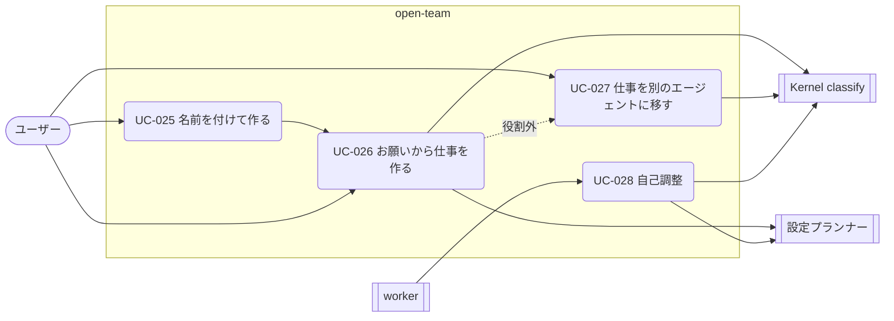

# 03. ユースケース — エージェントを作る・育てる（UC-025〜028）
- [← 03 README](README.md) ／ ビジネスルールは [business-rules.md](business-rules.md)

v0.5 の既定の作り方。ユーザーはエージェントに名前を付け、やりたいことを伝えるだけにする。設定はエージェント（設定プランナー）が行い、広げる変更だけをユーザーに確認する（BR-47）。v0.3 までの作り方（下書き・Canvas・試し実行・公開）は [agent-builder.md](agent-builder.md) に残した。


見てほしいところ：どの UC も、設定の変更は Kernel の `classify()` を通る。`widen`（広げる変更）だけが確認カードでユーザーに戻る。

| 体験の例（14 §体験の流れ） | 対応する UC |
|---|---|
| 例1：名前を付けて作る（ニュースリサーチャー） | UC-025 の基本フロー → UC-026 の基本フロー（Slack 未接続 → 接続 → 初回の承認カードで [以後も許可]） |
| 例2：同じエージェントに仕事を足す（決算ページの見張り） | UC-026 の基本フロー（読むだけなので確認なしで開始） |
| 例3：役割外のお願い（エンジニアにニュース） | UC-026 の 2b → UC-027 |
| 例4：名前なしで作る（朝の交通係） | UC-025 の 3a → UC-026 の 4（質問1つ）と名前の提案 |

<details>
<summary>例1〜4 の会話（14 §体験の流れ）</summary>

```
例1：名前を付けて作る（ニュースリサーチャー）
[ユーザー]  ＋ 新しいエージェント → 名前「ニュースリサーチャー」→ 作成
[ニュースリサーチャー] ニュースリサーチャーです。どんなニュースを、どのくらいの頻度で調べましょう？
                     例：「毎朝、生成AIの規制のニュースをまとめて」
[ユーザー]  毎朝、AI規制と半導体のニュースをまとめて Slack に送って
[ニュースリサーチャー] こうします：
              ・毎朝 7:00（平日・休日とも）
              ・テーマ：AI規制、半導体。各3件、1行の要約と出典URL
              ・届け先：Slack の自分宛て DM
            ┌ Slack がまだつながっていません [Slack をつなぐ] ┐
[ユーザー]  （つなぐ）
[ニュースリサーチャー] つながりました。最初の1回を今から実行します。
            ┌ 承認：Slack に投稿（自分宛ての DM）／本文のプレビュー … ┐
            └ [承認] [以後も許可] [やめる]                            ┘
[ユーザー]  以後も許可
[ニュースリサーチャー] 明日から毎朝 7:00 に自動で送ります。

例2：同じエージェントに仕事を足す
[ユーザー]  あと、TSMC の決算ページが更新されたら教えて
[ニュースリサーチャー] 1時間ごとにページを確認して、変わったときだけ通知します（読むだけなので、すぐ始めます）。
→ 「ニュースリサーチャー」に仕事が2つ並ぶ（毎朝のまとめ、決算ページの見張り）。

例3：役割外のお願い
[ユーザー]  （エンジニアに）明日の朝のニュースも調べといて
[エンジニア] 引き受けます。明日の朝 7:00 に調べて、アプリに届けます。
            ニュースリサーチャーが同じ種類の仕事をしています。こちらに任せますか？
            [ニュースリサーチャーに任せる] [このまま]

例4：名前なしで作る
[ユーザー]  ＋ 新しいエージェント →（名前は空のまま）作成
[新しいエージェント] こんにちは。何をしましょう？
[ユーザー]  平日の朝、通勤経路の遅延を教えて
[新しいエージェント] 平日 6:45 に、電車の運行情報と道路の渋滞を調べて通知します。
                   通勤経路を教えてください（例：首里 → 県庁前、ゆいレール）。
[ユーザー]  首里から県庁前、ゆいレール
[朝の交通係] 名前を「朝の交通係」にしました。[名前を変える]
            明日の 6:45 から始めます。
```

</details>

---

### UC-025：名前を付けてエージェントを作る 〔US-040〕
- アクター：ユーザー、LLMプロバイダー ／ フェーズ：0
- 事前条件：LLM のキーが登録済み
- 基本フロー：
  1. ユーザーはエージェント一覧（SCR-014）で「＋ 新しいエージェント」を押し、名前を入力する（空でもよい）。アイコンは名前から自動で選ぶ。
  2. システムはエージェントを「最初の境界」（04 FR-034）で作り（TBL-018、`status = idle`）、監査ログに `agent.created` を記録する。
  3. システムは名前から役割を推測し（推測できなければ `null`）、役割に合わせた挨拶をチャットに出す。
- 代替フロー：
  - 3a. 名前が空：仮の名前「新しいエージェント」で始め、UC-026 の最初のお願いで設定プランナーが名前を1つ提案し、そのまま付ける。チャットに「名前を『〇〇』にしました [名前を変える]」と出す。
- 例外フロー：
  - E1. 1ワークスペースのエージェントが20体に達している：作成できない旨と、止まっているエージェントの一覧を出す（A-81）。
- 補足（14 §名前と役割）：
  - 推測できる役割は `research` / `watch` / `brief` / `assist` / `dev` のどれか（またはなし）に限る。役割は挨拶・テンプレートの初期値・任せ先の提案にだけ使う（BR-48）。
  - 名前はワークスペースの中で重複できない。重複する場合は末尾に番号を付ける（「朝の交通係 2」）。
- ビジネスルール：BR-48

### UC-026：お願いから仕事を作る 〔US-041, US-042〕
- アクター：ユーザー、LLMプロバイダー ／ フェーズ：0
- 事前条件：エージェントがある
- 基本フロー：
  1. ユーザーはチャットにお願いを送る（テキストまたは音声）。
  2. 設定プランナーが、現在の定義・ワークスペースのポリシー・コネクタの一覧から、設定の変更案を作る。
  3. Kernel が変更案を検証し（FR-022）、`classify()` で分類する。
  4. 推測できない情報があれば、質問を1つ出し、答えを待つ（BR-49）。
  5. `widen` または未接続のコネクタがあれば、確認カード・接続ボタンを出し、ユーザーの操作を待つ。
  6. 新しいスナップショットを作り、トリガーを登録する。`once` の仕事と、繰り返す仕事の初回の確認実行は、すぐにタスクを作る（初回の確認実行を必ず行うかは Q-24）。
  7. 「こうします」の要約をチャットに出す。
- 代替フロー：
  - 2a. お願いが既存の仕事の変更（「もっと短く」）：その仕事の変更案を作る（4 以降は同じ）。
  - 2b. お願いが役割外で、役割の合う別のエージェントがいる：6 の後に「〇〇に任せますか？」を出す（UC-027）。
  - 5a. ユーザーが [やめる]：変更案を `rejected` にし、何も反映しない。
- 例外フロー：
  - E1. 変更案が Hard Ceiling・ワークスペースのポリシーを超える：反映せず、「この設定ではできないこと」と、ワークスペースのポリシーを変えれば可能かどうかを説明する。
  - E2. 設定プランナーが3回続けて検証に通らない案を出す：お願いを言い換えてもらうよう返す。
- 補足：質問への答えが返ってこない、またはコネクタがつながるまでは、その仕事を `waiting_input` のまま止める（14 §確認する場面を絞る、US-041 AC2）。確認カードで承認した `widen` は監査ログに残す（BR-55）。
- ビジネスルール：BR-47、BR-49、BR-50、BR-55

### UC-027：仕事を別のエージェントに移す 〔US-043〕
- アクター：ユーザー ／ フェーズ：0（後回しにできる。14 §フェーズ0の完成条件）
- 基本フロー：
  1. ユーザーが [〇〇に任せる] を押す。
  2. 移す先のエージェントの境界で、仕事の `classify()` をやり直す。`widen` があれば確認カードを出す。
  3. 仕事を移し、元のエージェントでは、その仕事だけが使っていた付与を外す（`narrow`）。
  4. 両方のチャットに移したことを記録し、監査ログに `job.moved` を記録する。
- 代替フロー：
  - 1a. ユーザーが [このまま] を押す：同じ組み合わせ（エージェント × 役割）では、以後この提案を出さない。
- 補足（14 §役割外のお願い）：
  - エージェントは役割に合わないお願いでも引き受ける。一致するエージェントがいなければ提案を出さず、新しいエージェントを勝手に作らない。
  - 移すかどうかをエージェントの間で勝手に決めない。移すのはユーザーが [任せる] を押したときだけ（フェーズ2の委任 REQ-032 とは別）。
  - 移すときにメモリを一緒に移すか、同じ役割のエージェントが複数いるときの選び方は Q-24。
- ビジネスルール：BR-47、BR-48

### UC-040：頼んで任せる（編成の生成） 〔US-045, US-046〕
v0.12 の既定の頼み方（[ADR-036](../adr/ADR-036-ask-generates-formation.md)）。名前を付ける手順はなく、入口（SCR-020）で頼むと担当が決まる・作られる。
- アクター：ユーザー、LLMプロバイダー ／ フェーズ：0（0-H は「ひとり」「順番」が Must、並列・まとめは Should）
- 事前条件：Kill Switch が解除されている
- 基本フロー：
  1. ユーザーは入口の入力欄に依頼を書いて送る。画面は「エージェント生成中…」になる。
  2. 設定プランナーが、依頼と既存のエージェントの一覧から編成案（担当・形）を作る（FR-061）。
  3. Kernel が `validateFormation()` で検査する（BR-72〜74）。
  4. 担当ごとに、既存のエージェントには仕事を足し、いなければ名前を付けて新しく作って仕事を足す。設定の変更は `classify()` を通る（UC-026 の 3〜6 と同じ。`widen` はチェックの画面の送る前の確認で止まる）。
  5. 画面に担当（名前・新しく作った / いつもの担当）と形を1行ずつ出し、3秒後に入口に戻る。編成の確認は挟まない。
  6. 形に従って仕事を進める（FR-062）。複数の担当は連絡板で協調し（UC-041）、結果は依頼1件につき回答1つとして SCR-019 と SCR-021 に届く（FR-063）。
- 代替フロー：
  - 1a. 「@仕入れ係 …」と担当を指定：その担当だけで「ひとり」の編成にする。
  - 2a. 推測できない情報がある：生成中の位置に質問を1つ（選択肢）出し、答えてから 2 に戻る（BR-49）。
  - 6a. 順番の途中の担当が失敗・停止：あとの段を始めず、質問の行（[やり直す] [ここまでで終える]）にする。
  - 6b. まとめで一部の担当が失敗：終わった分だけでまとめ役がまとめ、失敗した担当を報告に書く。
- 例外フロー：
  - E1. 編成案が3回続けて検査に通らない、または30秒で決まらない：「うまく決められませんでした」と出し、入力欄に文を戻す。
  - E2. エージェントが20体に達していて作れない：使い回しだけで作り直させる。それでも足りなければ「エージェントが上限です」と、止まっているエージェントの一覧へのリンクを出す。
- ビジネスルール：BR-47、BR-48、BR-49、BR-71〜74

### UC-041：担当どうしで協調して、1つの回答を返す 〔US-047, US-048〕
v0.14 の追加（[ADR-038](../adr/ADR-038-team-board-and-one-answer.md)）。1体の編成では連絡板を作らず、その担当が答える。
- アクター：システム（worker・Kernel）、LLMプロバイダー、ユーザー（回答を読む・返事する） ／ フェーズ：0（0-H は回答1つが Must、連絡板は Should）
- 事前条件：UC-040 で、担当が2体以上の編成ができている
- 基本フロー：
  1. Kernel が依頼の連絡板を開き、担当のタスクに `team_post`・`team_wait` を配る。
  2. 担当は動きながら、分かったことを `share` し、足りないことを `question` で聞く（FR-064）。
  3. Kernel が `validateTeamMessage()` で宛先・形・上限を検査し、受け取る担当にデータとして差し込む。送った側が汚染されていれば受け取った側も汚染される（BR-75）。
  4. 終わった担当に質問が来たら、書き込みのない追いのターンを起こして返事を1通送らせる。
  5. まとめ役は、足りない担当に `revise` を1回まで頼み、そろったらまとめる。
  6. 窓口が回答を書き、Kernel が「誰が何をしたか」「手が要るもの」の行を差し込んで、依頼1件に回答1つを届ける（FR-063）。
- 代替フロー：
  - 3a. 上限・宛先・形の検査に通らない：送った担当にツールのエラーを返し、担当は分かっている範囲で続ける。
  - 4a. 返事が A-104 の時間内に来ない：質問した担当は返事なしで続け、回答の「誰が何をしたか」に「〇〇に確かめられませんでした」を出す。
  - 6a. 回答のあとに送る前の確認が済んだ：回答の「手が要るもの」の行だけを書き換える。
  - 6b. ユーザーが回答に返事した：窓口の担当へのお願い（UC-026）として受ける。
- 例外フロー：
  - E1. Kill Switch・依頼の取り消し：連絡板を閉じ、待っている担当をすぐ戻して止める。
- ビジネスルール：BR-70、BR-71、BR-73、BR-75〜77

### UC-028：自己調整 〔US-042, US-044〕
- アクター：システム（worker）、LLMプロバイダー ／ フェーズ：0（チャットでの一言による調整）。👍 / 👎・開封時刻による自動の調整は後回しにできる
- トリガー：タスクの完了、👍 / 👎 の入力、通知の開封の集計（1日1回）
- 基本フロー：
  1. worker が、仕事ごとの反応・成否を集め、調整の条件（04 FR-039 の「何を見て、何を変えるか」）に当たるかを判定する。
  2. 当たれば設定プランナーに調整案を作らせる（根拠は BR-51 の範囲に限る）。
  3. Kernel が分類し、`neutral` / `narrow` で BR-52・BR-54 に当たらなければ反映する。それ以外は確認カードにする。
  4. チャットに「何を・なぜ変えたか」と [元に戻す] を出す（BR-53）。
- ビジネスルール：BR-51、BR-52、BR-53、BR-54
