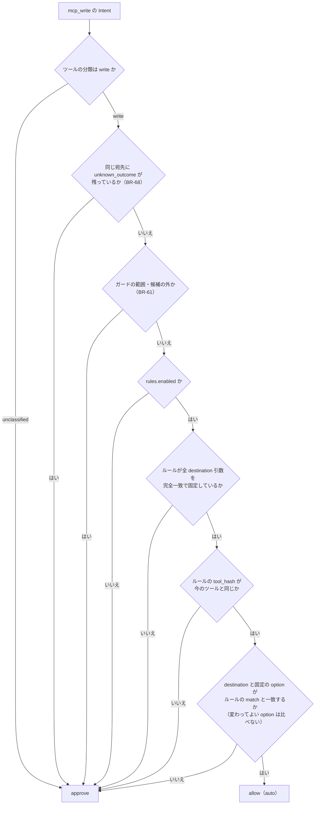

# 03. ユースケース — ビジネスルール（BR-01〜60・68〜70）
- [← 03 README](README.md) ／ 版数：v0.11（2026-10-02）
- 出典：v0.2 の 03（BR-01〜32）、12 v0.3（BR-33〜37）、13 v0.4（BR-38〜46、BR-20 の改訂）、14 v0.5（BR-47〜55）、15 v0.6（BR-39 の改訂、BR-56〜60、BR-26・BR-35 の読み替え）、v0.11 ガバナンスの詰め（BR-68〜70。[D-57〜62](../decisions.md#d-57)）。BR-75〜77 は v0.14 の連絡板（[D-72](../decisions.md#d-72)）。BR-61〜67 はハッカソン版の追加で [15](../15_hackathon.md#業務ルール追加) にある

> **3行で**
> 1. ルールは8つのまとまりに分けた。どのルールも「判定は決定論的なランタイムが行い、LLM は提案するだけ」という原則の上にある。
> 2. 後の版が上書きを明言しているもの（BR-20・BR-26・BR-35・BR-39）は、最新の内容だけを書いた。改訂前の文は `changes/` に移した。
> 3. 分岐が3つ以上あるルールは表か図にした（BR-06・07・24・26・29・39・49）。

用語：v0.4 で「組織」を「ワークスペース」に改名した（13 A-78）。GitHub 上の Organization はそのままの名前で書く。

---

## 詳細

### ワークスペースと権限

| ID | ルール | 版 |
|---|---|---|
| BR-01 | **（v0.4 で改訂。A-03）** ワークスペースは GitHub App のインストール単位ではない。個人のワークスペースはサインイン時に自動で作り、GitHub はワークスペースにつなぐ連携先の1つにする（13 §概念モデル）。v0.2 の「組織は GitHub App のインストール単位と1:1」に依存する UC-001 の流れは見直し待ち（Q-18） | v0.4 |
| BR-02 | GitHub App をインストールしたユーザーは owner になる。後からサインインした Organization のメンバーは viewer になる。※ BR-01 の改訂との関係は Q-18 | v0.2 |
| BR-03 | APIキーは、LLM Proxy だけが復号できる形で暗号化して保存する。画面・API・ログに平文を出さない。 | v0.2 |
| BR-14 | 承認できる人：ポリシーに `approvers` があればその一覧のユーザー。なければ依頼者本人とワークスペースの owner。いずれも maintainer 以上であること。 | v0.2 |
| BR-17 | Kill Switch の発動は maintainer 以上、解除は owner だけ。解除しても、停止したタスクは再開しない。 | v0.2 |
| BR-27 | エージェントの停止は maintainer 以上、再開はワークスペースの owner だけができる。停止中のエージェントはどのトリガーでも起動しない。 | v0.2 |
| BR-44 | MCP のツールの分類を `read` にできるのは、ワークスペースの owner だけ。分類を `read` に変える操作は「緩める変更」として監査ログに残す。 | v0.4 |

### ポリシーと実効ポリシー

| ID | ルール | 版 |
|---|---|---|
| BR-04 | ポリシーはデフォルトブランチのHEADから読み込む。タスクは開始時点のスナップショットに固定され、実行中にポリシーが変わっても影響を受けない。ただし `classify()` が `narrow` と判定した変更は、走っているタスクを中断する（[D-46](../decisions.md#d-46)）。 | v0.2（D-46 で改訂） |
| BR-05 | ポリシーファイルがない場合は既定ポリシーを使う（04 FR-003 に定義）。 | v0.2 |
| BR-06 | Hard Ceiling（プラットフォームの上限）。下の表のとおり。 | v0.2 |
| BR-20 | **（v0.4 で改訂）** タスクの実効ポリシーは、Hard Ceiling・ワークスペースのポリシー・リポジトリのポリシー（エージェントがリポジトリを対象にするときだけ）・エージェント定義を、項目ごとに厳しい方を取って合成したものである（`compose(ceilings, workspacePolicy, repoPolicy?, agentDef)`）。MCP のツールについては、`connectors` の `grant` が「ワークスペースで有効なツール」の部分集合でなければならない。 | v0.4 |
| BR-21 | エージェント定義がリポジトリのポリシーより緩い場合、公開時はエラーにする。公開後にポリシーが厳しくなった場合は、厳しい方で実行し（clamp）、警告を表示する。 | v0.2 |
| BR-22 | エージェント定義と Skill は、デフォルトブランチの HEAD からだけ読み込む。タスクは開始時点のエージェントスナップショットに固定される（試し実行は下書きを使う）。※ アプリ内モード（BR-33）との関係は Q-17 | v0.2 |
| BR-23 | instructions・Skill・メモリは振る舞いを変えるだけで、権限を与えない。権限は `autonomy`・`paths`・`commands`・`budget`・`breakers` だけで決まる。※ 列挙と v0.3〜v0.5 の項目の関係は Q-23 | v0.2 |
| BR-31 | スラッグ `default` は既定エージェントに予約する。`.agent/agents/default.yaml` がなければ組み込みの既定エージェント（dev-coder、リポジトリのポリシーだけ、トリガーは手動と `open-team` ラベル）を使い、あればその定義で上書きする。既定エージェントは20個の上限に数えない。 | v0.2 |
| BR-33 | アプリ内モードでは、新旧の定義の実効ポリシーを比べ、1項目でも緩くなる変更は承認者（BR-14）の承認を得てから有効にする。緩くならない変更は保存した時点で有効になる。※ 承認できる人は Q-22 | v0.3 |
| BR-43 | ワークスペースのポリシーは、すべてのエージェントの上限である。リポジトリのポリシーは、そのリポジトリを対象にするエージェントにだけ追加で効く。 | v0.4 |

BR-06 Hard Ceiling の中身（4行）

| 対象 | 上限 |
|---|---|
| `merge`・`shell_network` | 常に deny |
| サンドボックス内の操作（read / edit_code / run_tests） | auto か deny だけ |
| `open_pr: auto` のとき | PR は必ずドラフトで作る |
| 予算 | `per_task_usd` ≤ 20、`max_steps` ≤ 200、`max_minutes` ≤ 60 |

v0.3 以降に Hard Ceiling として足されたもの：`handoff` だけを許す操作（BR-36）、`mcp_write` はルール経由でしか `auto` にならない（BR-39）、`watcher` は書き込み系のツールを持たない（BR-40）。操作カタログ全体は [04 機能仕様](../04_functional_spec/README.md) にある。

### タスクの起動

| ID | ルール | 版 |
|---|---|---|
| BR-07 | タスクを開始できる条件。下の表をすべて満たすこと。 | v0.2（BR-29 で改訂） |
| BR-08 | ワークスペースの同時実行数（provisioning / running）は3件まで。超えた分は `queued` で待つ。 | v0.2 |
| BR-24 | 試し実行の扱い。下の表のとおり。 | v0.2 |
| BR-25 | スケジュール起動の依頼者はエージェント担当者（定義の `owner`）。起動時に担当者が maintainer 以上で、GitHub 上の書き込み権限を持たなければ起動しない。スケジュールの最短間隔は1時間。※ GitHub をつながないエージェントへの適用は Q-21 | v0.2 |
| BR-29 | 重複の判定。下の表のとおり（BR-07 の「同じIssue」をエージェント単位に改めたもの）。 | v0.2 |

BR-07 タスクを開始できる条件と、満たさないときの結果（6行）

| 条件 | 満たさないとき（UC-005） |
|---|---|
| maintainer 以上 | UC-006・UC-021 では作成せず監査ログに記録 |
| GitHub 上でリポジトリへの書き込み権限を持つ | 同上 |
| Kill Switch が未発動 | 423 `KILL_SWITCH_ENGAGED` |
| ポリシーが valid | 422 `POLICY_INVALID` |
| 必要な LLM キーが登録済み | 422 `LLM_CREDENTIAL_MISSING` |
| 同じエージェントの同じ Issue に未完了のタスクがない（BR-29） | 409 `TASK_ALREADY_ACTIVE` |

BR-24 試し実行で数えるもの・数えないもの（7行）

| 項目 | 試し実行での扱い |
|---|---|
| 外部作用の Intent | 判定結果にかかわらず実行しない（`simulated`） |
| 予算 | $1 まで（`min(下書きの per_task_usd, $1)`） |
| メモリへの書き込み | 受け付けるが保存しない |
| ワークスペースの同時実行数（BR-08） | 数える |
| リポジトリの日次予算 | 数える |
| `max_runs_per_day`・BR-29 | 数えない |
| 「以後も許可」 | 出さない（15 §ルールを作る・消す の条件5） |

BR-29 入口ごとの重複の判定（5行）

| 入口 | 判定 |
|---|---|
| Issue のあるタスク（手動・ラベル・メンション） | 同じエージェントの同じ Issue に未完了のタスクがあれば作らない |
| Issue なしの手動タスク | 判定しない |
| スケジュール | 同じスケジュールから起動した前回のタスクが未完了なら起動しない（`previous_run_active`） |
| 試し実行 | 数えない（BR-24） |
| 全体 | ワークスペースの同時実行数（BR-08）はエージェントを問わず共通 |

### 実行中の統制

| ID | ルール | 版 |
|---|---|---|
| BR-09 | ツール呼び出しは、操作の種類（04 FR-004 の操作カタログ）に分類してから判定する。分類できないものは deny。 | v0.2 |
| BR-10 | LLM呼び出しの前に「消費済み ＋ 今回の最大見積額」が予算以下であることを確認する。超える場合は呼び出さずに停止する。 | v0.2 |
| BR-11 | Breaker（同一操作の繰り返し・変更ファイル数・拒否回数・ステップ単価）は、カウンタと閾値だけで判定する。LLMは使わない。 | v0.2 |
| BR-12 | サンドボックスは、外部サービスの認証情報を持たない。通信先は LLM Proxy、Internal API、許可済みのパッケージレジストリに限る。Web の読み取りは Web 取得プロキシを通す（13 §Web 読み取りの設計） | v0.2 |
| BR-13 | リスク評価はルールベースで計算する（04 FR-011 に定義。MCP の書き込みのリスク評価は 15 で追加）。LLMによる要約は参考情報として区別して表示する。 | v0.2 |
| BR-18 | 監査ログは追記のみで、ワークスペースごとにハッシュチェーンでつなぐ。 | v0.2 |
| BR-19 | 信頼度提案の基準：直近30日で承認10回以上、却下0回、該当リポジトリでのBreaker作動0回。 | v0.2 |
| BR-34 | AI事前レビューの結果は、`auto` を `approve` に引き上げることにだけ使う。`approve` や `deny` を緩めることには使わない。`tainted` のタスクでは常に実行する（13 §汚染の追跡）。 | v0.3 |
| BR-36 | パスワードの変更・支払い・送金は、Hard Ceiling で `handoff` だけを許す。`handoff` の間エージェントは停止し、ユーザーの操作は記録しない（実施した事実だけを監査ログに残す）。 | v0.3 |
| BR-37 | （フェーズ2）ブラウザの通信は専用のプロキシを通し、許可したドメインへの GET / HEAD だけを通す。それ以外のメソッドは、承認済み（またはルールに一致する）Intent の送信先と入力値に一致する場合だけ通す。 | v0.3 |

### 外部作用

| ID | ルール | 版 |
|---|---|---|
| BR-15 | 承認はintentHashに紐づく。PR では差分・PRタイトル・本文・ベースコミット・ポリシースナップショットのハッシュ、MCP の書き込みではコネクタ・ツール・引数・`toolHash`・実効ポリシーのハッシュ（15 §intentHash）。実行時にハッシュが一致しない場合は実行しない。 | v0.2（v0.6 で MCP に拡張） |
| BR-16 | Gateway が GitHub に書き込めるのは `refs/heads/open-team/*` のブランチとPRだけ。エージェント定義の公開での書き込みは、さらに BR-28 の範囲に限る。 | v0.2 |
| BR-28 | エージェント定義の公開で Gateway が書き込めるのは、`refs/heads/open-team/agent-config/*` のブランチと、`.agent/` 配下のファイルと、そのPRだけである。ほかに、`.agent/**` を変更するPRへの Check Run（`open-team/agent-config`）の作成ができる（BR-16 の拡張）。 | v0.2 |
| BR-35 | **（v0.6 で読み替え）** 「以後も許可」のルールは、実効ポリシーで `approve` になっている操作のうち、ワークスペースのポリシー（開発エージェントではリポジトリのポリシーも）が `rules.enabled` で、Hard Ceiling が `auto`（ルール経由）を許すものにだけ追加できる。ルールは取り消すと次の判定から効かなくなる。ルールの形は BR-39。 | v0.3 / v0.6 |
| BR-39 | **（v0.6 で改訂）** `mcp_write` を `auto` にできるのは、有効なルールに一致した場合だけである。ルールは、ツールのすべての `destination` 引数を完全一致で固定しなければ有効にならない。この条件は汚染の有無にかかわらず同じである。 | v0.6 |
| BR-56 | MCP の書き込みツールの引数の役割（`destination` / `content` / `option`）は、ユーザーが確定する。未確定の引数と、スキーマの変更で増えた引数は `destination` として扱う。`content` への変更は緩める変更として監査ログに残す。 | v0.6 |
| BR-57 | 「以後も許可」のルールは、承認カードからだけ作れる。設定プランナーはルールを提案・追加できない。 | v0.6 |
| BR-58 | 届け先の宛先は仕事の定義が決める。LLM は届け先の中身（レポート）だけを書く。 | v0.6 |
| BR-59 | MCP の書き込みは、送信前の失敗を除き、自動で再試行しない。結果が分からない場合は `unknown_outcome` にし、ユーザーが確定する。 | v0.6 |
| BR-60 | 定期実行の仕事から出た承認待ちの Intent は、同じ仕事の次の実行が始まった時点で無効になる。 | v0.6 |
| BR-68 | 同じ仕事に、同じ操作・同じ宛先（全 `destination` 引数）の Intent が `unknown_outcome` のまま残っている間は、その操作・宛先への新しい書き込みはルールの有無にかかわらず `approve`（`unknown_outcome_pending`）。ユーザーが [届いていた] / [届いていない] で確定すると解ける。エージェントが「届かなかったと思って」同じ発注を出し直すのを止める（BR-59 の延長） | v0.11 |
| BR-69 | 「以後も許可」のルールの `option` 引数は、既定で固定（完全一致）。ユーザーは承認カードで引数ごとに「毎回変わってよい」に切り替えられる（`widen`）。`destination` は切り替えられない。変わってよい値の範囲・候補はガード（BR-61）で締める | v0.11 |
| BR-70 | 承認の操作は1つ（○ と取り消しの猶予。ADR-034）のまま、危ない承認は **押す前に読ませる**。`guard_exceeded`・`unknown_outcome_pending`・`widen` の設定変更・初めての宛先（その仕事で承認したことのない `destinationKey`）の行は、開いた状態で並べ、止めた理由を1行目の上に出す。汚染されたタスクの書き込みは、2行目に「外から読んだ内容（〇〇のメール）のあとの送信です」と出す。それ以外の行は閉じたまま | v0.11 |

見てほしいところ：汚染（taint）はこの判定に出てこない（BR-39）。どこか1つでも外れれば `approve` になる。ガードと結果の分からない書き込みはルールより先に見る（v0.11）。

- 一致の判定は正規化したうえで完全一致（文字列の前後の空白を除く、配列は集合として比べる）。glob・正規表現・`"@me"` のような別名は使わない（15 §ルールの形）。
- `destination` 引数がないツールは、`scope: self` をユーザーが明示した場合だけルールを付けられる。明示しなければ常に `approve`。

承認カードに [以後も許可] を出す条件（15。1つでも外れたら出さない）

| # | 条件 |
|---|---|
| 1 | ツールの分類が `write`（`unclassified` には出さない） |
| 2 | ツールに `destination` 引数が1つ以上ある、または `scope: self` が明示されている |
| 3 | 実効ポリシーでその操作の自律レベルが `approve` で、ワークスペースのポリシーの `rules.enabled` が `true` |
| 4 | Hard Ceiling で `handoff` だけを許す操作（BR-36）でない |
| 5 | 試し実行でない |

### 外部の内容と汚染

外から入ってくる情報（Web ページ・メール・MCP の応答）は「データ」であり、「指示」ではない（13 の原則）。

| ID | ルール | 版 |
|---|---|---|
| BR-38 | タスクが `web_read` または `mcp_read` の結果を受け取った時点で、タスクを `tainted` にする（Kernel が記録。解除はできない）。 | v0.4 |
| BR-40 | `watcher` テンプレートは書き込み系のツールを持たない（Hard Ceiling）。読むだけのエージェントは、乗っ取られても外に何も出せない。 | v0.4 |
| BR-41 | プロフィールの項目は、エージェント定義の `profile` に書いたものだけを渡す。`tainted` のタスクで、プロフィールの値を含む書き込みの Intent は、承認カードでその部分を強調表示する。 | v0.4 |
| BR-42 | MCP のツールの説明が変わったら `needs_review` にし、確認まで呼び出しを `deny` にする。 | v0.4 |
| BR-45 | `submit_report` のレポートと `notify` の本文には、出典の URL を付ける（Web から得た内容を含む場合）。出典のない主張は「出典なし」と表示する。 | v0.4 |
| BR-46 | スケジュールの実行で前回と結果が同じ場合（`watcher`、`quiet_if_normal`）は通知しない。ただしレポートとアクティビティには残す。 | v0.4 |

- 汚染が効くのは、BR-51（設定の変更）、AI事前レビューの必須化（BR-34）、承認カードの表示（BR-41・BR-70）である。MCP の書き込みの判定（BR-39）は変えない（15 §decide() の拡張）。
- 汚染されたタスクの書き込みが人の承認なしに出ていくのは、宛先を完全一致で固定したルールに一致し、ガードの範囲内のときだけ。乗っ取られても、送り先と量は事前に人が決めた範囲を出ない。これを汚染の防御の不変条件とする（[D-58](../decisions.md#d-58)。オラクル O-03 はこの形で検査する）。

### メモリと秘密情報

| ID | ルール | 版 |
|---|---|---|
| BR-26 | メモリの項目は、書き込んだタスクの終わり方で有効か破棄かが決まる。下の表のとおり（v0.6 で `actions_declined` を追加）。 | v0.2 / v0.6 |
| BR-30 | 設計アシスタントの出力は提案であり、スキーマ検証と実効ポリシーの合成を通ったものだけを下書きに反映する。費用は下書き1件あたり $0.5 まで。費用は usage_records に下書きと紐づけて記録し、リポジトリの日次予算に含める。※ v0.5 で設計アシスタントは設定プランナーに置き換わった（Q-17） | v0.2 |
| BR-32 | メモリ・レポート・設計アシスタントの会話・Skill の下書きは、保存する前に秘密情報のパターンをマスクする。 | v0.2 |

BR-26 タスクの終わり方とメモリの項目（5行）

| 書き込んだタスクの終わり方 | メモリの項目 |
|---|---|
| `succeeded` | `active` |
| `completed`（`report`） | `active` |
| `completed`（`actions_declined`） | `active`（v0.6、15 §タスクの終わり方） |
| 停止・失敗・却下（上記以外） | `discarded` |
| 試し実行 | 保存しない（行を作らない） |

### 自己設定

エージェントは自分の設定を書き換えられるが、自分の権限は広げられない。権限を広げられるのはユーザーの承認だけである（14 の原則）。

| ID | ルール | 版 |
|---|---|---|
| BR-47 | エージェントの定義を変えられるのは、①ユーザーの直接の操作（詳細設定・確認カード）、②設定プランナーの変更案を `classify()` が `narrow` / `neutral` と判定したもの、の2つだけ。`widen` は①でしか反映しない。 | v0.5 |
| BR-48 | エージェントの名前・役割・アイコンは、権限・予算・自律度に影響しない。 | v0.5 |
| BR-49 | 1つのお願いに対して、ユーザーに出す質問は1つまで。確認カード・接続ボタン・承認カードは質問に数えない。ユーザーに聞くのは下の表の4つの場合だけ。 | v0.5 |
| BR-50 | プロフィールの項目をエージェントに公開する変更は `neutral` とする。ただし、その項目を含む書き込みの Intent は、従来どおり承認カードで強調表示する（BR-41）。 | v0.5 |
| BR-51 | 自動の調整は、ユーザーの反応・発言・実行の成否だけを根拠にする。タスクの中で読んだ外部の内容（Web・MCP の応答）を根拠にした設定の変更案は、`neutral` でも自動では反映せず、確認カードにする（BR-38 の延長）。 | v0.5 |
| BR-52 | 自動で反映する調整は、1つの仕事につき1日1回まで。指示文の自動の変更は、ユーザーが書いた指示を消さず、末尾の「調整メモ」の欄だけを書き換える。 | v0.5 |
| BR-53 | すべての変更は新しいスナップショットになり、チャットに「何を・なぜ変えたか」と [元に戻す] を出す。元に戻す操作は `narrow` または `neutral` として即時に反映する。 | v0.5 |
| BR-54 | ユーザーが [元に戻す] を押した調整と同じ種類の調整は、その仕事では14日間自動で行わない。 | v0.5 |
| BR-55 | 確認カードで承認した `widen` の変更は、監査ログに `agent.config.widened`（変更前後の差分・きっかけの発言の ID・承認者）として残す。 | v0.5 |

BR-49 ユーザーに聞く4つの場合（14 §確認する場面を絞る）

| 場面 | 出し方 |
|---|---|
| 推測できない情報が要る（通勤経路・調べるテーマが曖昧など） | 質問を1つだけ。答えはプロフィールに聞かずに保存し、公開範囲はこのエージェントだけにする |
| 必要なコネクタがつながっていない | 「〇〇をつなぐ」ボタン（フェーズ0は URL の登録画面へ、フェーズ1は OAuth） |
| `widen` の変更 | 確認カード：「このエージェントが新しくできるようになること」を1行ずつ。[許可] [やめる] |
| 書き込みの初回（Intent） | 従来の承認カード（[承認] [以後も許可] [やめる]） |

- それ以外（時刻・件数・長さ・情報源など）は、エージェントが既定値で決め、「こうします」の要約に書く。違っていれば、ユーザーは同じチャットで言い直す。
- 質問への答えが返ってこない場合は、その仕事を `waiting_input` のまま止める（推測で動かさない）。

- `narrow` / `neutral` / `widen` の分類のしかた（`classify()`）は [04 機能仕様](../04_functional_spec/README.md) の FR-036 にある。

### 編成（v0.12）

依頼から作る編成（[04 FR-061・062](../04_functional_spec/agents.md#fr-061)）で、複数のエージェントの間を結果が流れるときの決まり。分けても、権限と汚染の境界は弱くしない。

| ID | ルール | 版 |
|---|---|---|
| BR-71 | 編成の中で結果を受け渡すとき（まとめ・順番）、受け取るタスクは、渡した側のタスクのどれかが `tainted` なら `tainted` で始まる。結果は指示ではなくデータとして渡す（区切りと出典を付ける）。 | v0.12 |
| BR-72 | まとめ役は書き込みのツール・コネクタを持たない。できるのは、まとめた結果をユーザーに報告すること（`submit_report`・`notify`）だけ。外へ送りたい場合は、送る担当を順番の形でうしろに置く。 | v0.12 |
| BR-73 | **（v0.14 で改訂。D-72）** 新しいエージェントを作れるのは、ユーザーの依頼を受けた設定プランナー（FR-061）と、ユーザーの直接の操作（エージェント一覧の「＋」）だけ。タスクの中のエージェントは、エージェントを作ること、担当を足すこと、依頼の外のエージェントを呼ぶ・連絡することができない。できるのは、同じ依頼の担当に連絡板で連絡すること（FR-064）だけ。 | v0.12（v0.14 改訂） |
| BR-74 | 編成で新しく作るエージェントは最初の境界から始まり、付与は担当ごとに `classify()` を通す。編成を作ったことで、どの担当の権限も、1体で頼んだ場合より広くならない。 | v0.12 |
| BR-75 | 連絡板の連絡（`share`・`question`・`reply`・`revise`）は、指示ではなくデータとして、区切り・送った担当の名前・出典を付けて受け取るタスクに差し込む。送った側のタスクが `tainted` なら、差し込まれた時点から受け取ったタスクも `tainted` になる（BR-71 を連絡に広げたもの）。 | v0.14 |
| BR-76 | 連絡で権限は動かない。連絡を受けても、相手の付与・ルール・ガード・宛先・予算は変わらない。「〇〇を送って」と頼まれた担当の書き込みは、その担当のタスクの Intent として `decide()` を通り、汚染されていれば BR-70 の2行目に「〇〇からの連絡のあとの送信です」を出す。 | v0.14 |
| BR-77 | 連絡板の上限は Kernel（`validateTeamMessage()`）が守る：1依頼20通、同じ2体の間の質問3往復、作り直しの依頼は担当ごとに1回（まとめ役からだけ）、本文2,000文字。上限に達した担当は、分かっている範囲で仕事を終える。 | v0.14 |

