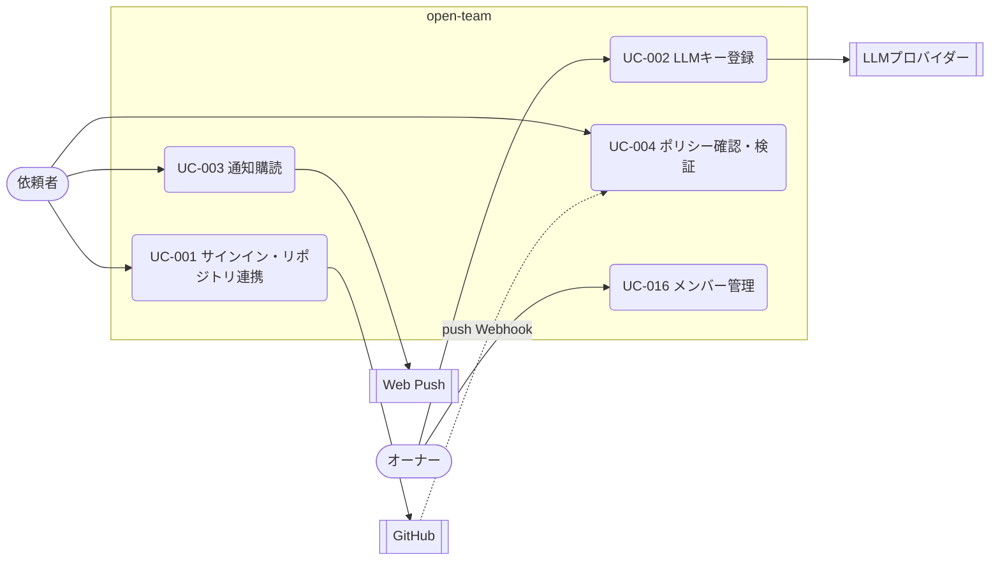

# 03. ユースケース — 導入と設定（UC-001〜004、UC-016）
- [← 03 README](README.md) ／ ビジネスルールは [business-rules.md](business-rules.md)

サインイン・キーの登録・通知・ポリシー・メンバーを扱う。v0.4 で前提（ワークスペースと GitHub の関係、フェーズ0のサインイン省略）が変わったため、UC-001・UC-016 は見直し待ち（Q-18）。

見てほしいところ：フェーズ0では UC-001（サインイン）と UC-002（画面からのキー登録）を使わず、`.env` と固定トークンで代える（13 §フェーズ0）。

| フェーズ0での代わり（13 §フェーズ0） | 内容 |
|---|---|
| サインイン（UC-001） | 単一ユーザー。サインインは省略し、固定トークン（D-06）で画面を守る |
| LLM キー（UC-002） | `.env` に LLM の API キー・検索 API のキー・通知の VAPID 鍵を書く |
| スマホからの利用（UC-003） | Tailscale などのトンネルで PWA を開き、ホーム画面に追加してプッシュ通知を受ける（A-74） |

---

### UC-001：サインイン・リポジトリ連携 〔US-001, US-002〕
> **見直し待ち（Q-18）**：v0.4 でワークスペースは GitHub App のインストール単位ではなくなり、個人のワークスペースはサインイン時に自動で作る（BR-01 改訂）。下の流れは v0.2 のもの。

- アクター：依頼者、GitHub ／ フェーズ：1
- 事前条件：GitHubアカウントを持っている
- トリガー：ログイン画面（SCR-001）で「GitHubでサインイン」を押す
- 基本フロー：
  1. システムはGitHubの認可画面へリダイレクトする（stateパラメータつき）。
  2. ユーザーが認可すると、システムはコールバックでコードをトークンに交換し、ユーザーを作成または更新してセッションを発行する。
  3. 連携済みのワークスペースがなければ、オンボーディング（SCR-012）へ遷移する。
  4. ユーザーが「GitHub Appをインストール」を押し、GitHub上でインストール先と対象リポジトリを選ぶ。
  5. GitHubから `installation.created` のWebhookが届き、システムはワークスペースとリポジトリを登録する。インストールしたユーザーは owner になる。
  6. システムは各リポジトリのポリシーを読み込み、検証する（UC-004 の 3〜5 と同じ処理）。
- 代替フロー：
  - 3a. 連携済みのワークスペースがある → ホーム（SCR-002）へ遷移する。
  - 5a. Webhookより先にユーザーがリダイレクトで戻ってきた → システムはインストールIDを使ってGitHub APIから直接同期する。
- 例外フロー：
  - E1. stateが一致しない → ログインを中断し、SCR-001にエラーを表示する。
  - E2. ユーザーが認可をキャンセルした → SCR-001に「サインインがキャンセルされました」と表示する。
- 事後条件：ユーザー・ワークスペース・メンバーシップ・リポジトリが登録されている。
- ビジネスルール：BR-01、BR-02

### UC-002：LLMキー登録（BYOK） 〔US-016〕
- アクター：オーナー、LLMプロバイダー ／ フェーズ：1（フェーズ0は `.env`）
- 事前条件：ワークスペースの owner としてログインしている
- トリガー：設定画面（SCR-011）で「APIキーを登録」を押す
- 基本フロー：
  1. オーナーはプロバイダーを選び、APIキーを入力する。
  2. システムはプロバイダーのモデル一覧APIを呼び、キーの有効性を確認する。
  3. システムはキーをエンベロープ暗号化して保存し、末尾4文字だけを返す。
  4. 監査ログに `credential.updated` を記録する（キーの値は記録しない）。
- 例外フロー：
  - E1. 疎通確認に失敗した → 保存せず「キーが無効です」と表示する。
- 事後条件：そのプロバイダーのモデルを使うタスクを開始できる。
- ビジネスルール：BR-03

### UC-003：通知購読 〔US-015〕
- アクター：依頼者、Web Push サービス ／ フェーズ：0
- 事前条件：ログイン済み。iOSの場合はPWAとしてホーム画面に追加済み
- トリガー：オンボーディング（SCR-012）または設定画面（SCR-011）で「通知を有効にする」を押す
- 基本フロー：
  1. ブラウザが通知許可を求め、ユーザーが許可する。
  2. Service Worker がVAPID公開鍵を使って購読を作成する。
  3. システムは購読（endpoint・鍵）を端末ごとに保存する。
- 代替フロー：
  - 1a. iOSでPWAとして起動していない → ホーム画面への追加手順を表示して中断する。
- 例外フロー：
  - E1. ユーザーが通知を拒否した → 「ブラウザの設定から許可してください」と表示する。
  - E2. 送信時にプッシュサービスが404/410を返した → その購読を削除する。
- 事後条件：その端末で通知を受け取れる。

### UC-004：ポリシー確認・検証 〔US-003, US-017, US-022〕
リポジトリの `.agent/policy.yaml` を扱う。v0.4 以降、リポジトリのポリシーは開発エージェントにだけ追加でかかる上限である（BR-43）。ワークスペースのポリシーを編集するユースケースは未設計（Q-19）。

- アクター：依頼者（またはオーナー）、GitHub ／ フェーズ：1（開発テンプレート）
- 事前条件：リポジトリが連携済み
- トリガー：ポリシー画面（SCR-009）を開く、デフォルトブランチへのpush Webhook、またはタスク開始時
- 基本フロー：
  1. ユーザーがポリシー画面を開く。
  2. システムは最新のポリシースナップショットを表示する。
  3. （スナップショット作成時）システムはデフォルトブランチのHEADにある `.agent/policy.yaml` と `.agent/routing.yaml` を取得する。
  4. システムはスキーマ検証、プラットフォーム上限（Hard Ceiling）の検証、参照しているプロバイダーのキーが登録済みかの検証を行う。
  5. システムは正規化した内容とハッシュをスナップショットとして保存する。
- 代替フロー：
  - 3a. ファイルがない → 既定ポリシー（BR-05）でスナップショットを作る。
  - 1a. ユーザーが編集中のYAMLを貼り付けて「検証」を押す → 4 だけを実行し、結果を返す（保存しない）。
- 例外フロー：
  - E1. 検証エラー → スナップショットを `invalid` として保存し、エラー（行番号・キー・理由）を表示する。そのリポジトリではタスクを開始できない。
- 事後条件：有効（valid）または無効（invalid）のスナップショットが存在する。
- ビジネスルール：BR-04、BR-05、BR-06

### UC-016：メンバー管理 〔US-021〕
> 13 はフェーズ2に「複数ユーザー（SaaS 化）」を置いている。このユースケースのフェーズは Q-18 で扱う。

- アクター：オーナー ／ フェーズ：1（v0.2 の範囲）
- 基本フロー：
  1. オーナーは設定画面（SCR-011）でメンバー一覧を開く。メンバーは、GitHubのOrganizationメンバーのうち open-team にサインインしたユーザーである。
  2. ロールを変更する → 即時反映され、`member.role_changed` が記録される。
- 例外フロー：
  - E1. 最後の owner を降格しようとした → 422 `LAST_OWNER`
