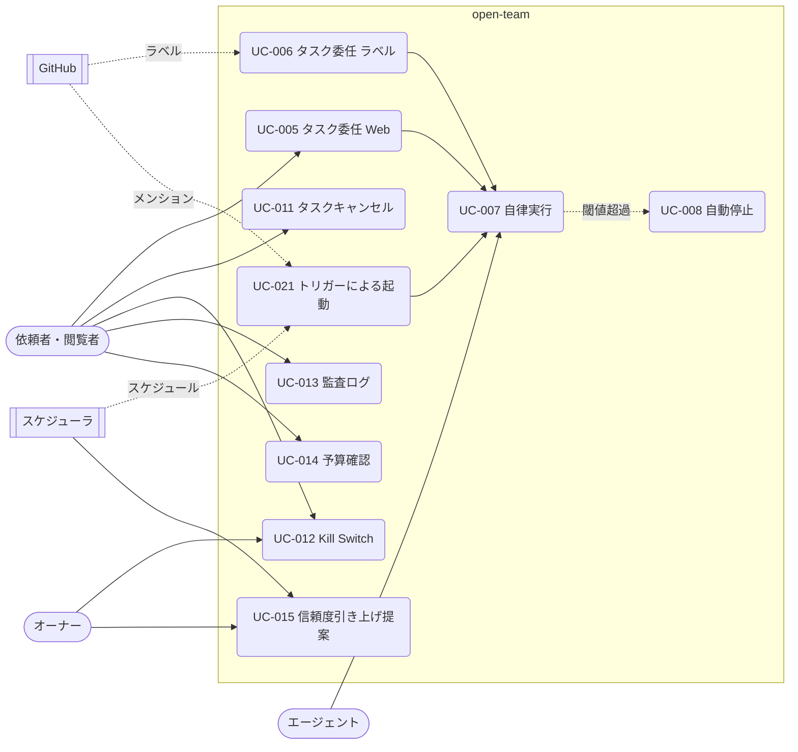

# 03. ユースケース — タスクの起動と実行（UC-005〜008、UC-011〜015、UC-021）
- [← 03 README](README.md) ／ ビジネスルールは [business-rules.md](business-rules.md)

どの入口からでもタスクを1件作り、同じ実行経路に乗せる。入口ごとに違うのは「依頼者の決め方」と「入力」だけである（12 §トリガーと入口）。v0.5 で起動条件は「仕事（job）」の中に移った。仕事との関係と `watch` の起動は Q-21。

見てほしいところ：入口は3つ（Web・ラベル・メンション/スケジュール）でも、実行は UC-007 の1本だけ。外部作用は UC-007 から [actions.md](actions.md) の承認に進む。

入口（トリガー）の一覧（12 §トリガーと入口。5行）

| トリガー | 入力 | 依頼者 | 受け付ける条件 | フェーズ |
|---|---|---|---|---|
| `manual` | Issue または指示文 | 操作したユーザー | BR-07 | 1（開発以外の手動は 0） |
| `github_label` | Issue | ラベルを付けたユーザー | BR-07。ラベル名は定義の `label`（既定の `open-team` ラベルは既定エージェント） | 1 |
| `github_mention` | Issue ＋ コメント本文 | コメントしたユーザー | BR-07。書式は `@open-team <agent-id> <指示>`（A-41） | 1 |
| `schedule` | 定義の `prompt` | エージェント担当者（定義の `owner`） | BR-25 | 0 |
| `slack` | メッセージ本文、スレッドの文脈 | Slack ユーザーに紐づいたユーザー | BR-07 ＋ Slack との紐づけ | 2 |

- すべてのトリガーで `max_runs_per_day` を数え、超えた分は作成せず監査ログに `trigger.skipped`（`daily_run_limit`）を記録する。
- メンションへの返事はコメントで行わない（コメントの投稿は Won't）。依頼者には Web Push で通知する（Q-16）。
- フェーズ0のスケジュールは PC が動いている間だけ実行され、止まっていた間の分は後から実行しない（A-75、R-07）。

---

### UC-005：タスク委任（Web） 〔US-004〕
- アクター：依頼者、GitHub ／ フェーズ：1
- 事前条件：maintainer 以上。LLMキーが登録済み。リポジトリのポリシーが valid
- トリガー：新規タスク画面（SCR-003）で「委任する」を押す
- 基本フロー：
  1. 依頼者はリポジトリと、委任先のエージェント（`active` のもの）を選ぶ。
  2. システムはGitHubからOpenのIssue一覧を取得して表示する。
  3. 依頼者はIssueを選び、必要であれば追加の指示（`instructions`、2,000文字まで）を入力し、「委任する」を押す。
  4. システムは事前条件（BR-07、BR-29）を検証する。
  5. システムはタスクを `queued`（`trigger_type = manual`）で作成し、そのときのポリシースナップショットIDとエージェントスナップショットIDを固定する（BR-04、BR-22）。
  6. 監査ログに `task.created` を記録し、実行キューに登録する。
  7. タスク詳細（SCR-005）へ遷移する。
- 代替フロー：
  - 1a. 委任先に既定エージェント（`default`）を選ぶ → `.agent/agents/default.yaml` がなければ組み込みの既定エージェントを使う（BR-31）。
  - 3a. Issueを選ばずに指示文だけを入力する → 指示文（2,000文字まで）をタスクの `prompt` としてタスクを作成する（Issue なしのタスク。重複は判定しない。BR-29）。
  - 5a. ワークスペースの同時実行数が上限に達している → `queued` のまま待機し、空きが出た時点で UC-007 を開始する。
  - 5b. 当日の予算が上限に達している → `queued` のまま、翌日0時まで待機する。
- 例外フロー：
  - E1. 同じエージェントの同じIssueに未完了のタスクがある → 409 `TASK_ALREADY_ACTIVE`（BR-29）
  - E2. Kill Switch が発動中 → 423 `KILL_SWITCH_ENGAGED`
  - E3. ポリシーが invalid → 422 `POLICY_INVALID`
  - E4. LLMキーが未登録 → 422 `LLM_CREDENTIAL_MISSING`
  - E5. 選んだエージェントが `active` でない（公開PRが未マージ・`invalid`）→ 422 `AGENT_NOT_ACTIVE`。停止中 → 423 `AGENT_DISABLED`（BR-27）。マージ前の下書きは試し実行 UC-018 だけができる
  - E6. エージェントの `max_runs_per_day` に達している → 429 `DAILY_RUN_LIMIT`
- 事後条件：タスクが `queued` で存在する。
- ビジネスルール：BR-07、BR-08、BR-22、BR-29

### UC-006：タスク委任（ラベル） 〔US-019, US-028〕
- アクター：GitHub（Webhook） ／ フェーズ：1
- 事前条件：リポジトリが連携済み
- トリガー：Issueに、エージェントの `github_label` トリガーのラベル（例：`agent:bug-fixer`）、または `open-team` ラベルが付いたことを示す `issues.labeled` Webhook
- 基本フロー：
  1. システムはWebhookの署名を検証し、配信IDで重複を排除する。
  2. システムはラベル名から委任先のエージェントを決める（定義の `label`。既定の `open-team` ラベルは既定エージェント（`default`、BR-31）に割り当てる。同じラベルを複数のエージェントに設定することは検証エラー `AGENT_TRIGGER_CONFLICT` で防ぐ）。
  3. システムはラベルを付けたGitHubユーザーを open-team のユーザーと照合する。
  4. `max_runs_per_day` を確認したうえで、UC-005 の 4〜6 を、そのユーザーを依頼者、`trigger_type = github_label` として実行する。
- 例外フロー：
  - E1. 署名が不正 → 401を返し、何も処理しない。
  - E2. ユーザーが未登録、または権限がない → タスクは作成せず、監査ログに `task.rejected_trigger` を記録する。
  - E3. エージェントが `active` でない、停止中、`max_runs_per_day` 超過、または同じエージェントの同じIssueに未完了のタスクがある → 作成せず、監査ログに `trigger.skipped`（理由コードつき）を記録する（UC-021 E1・E2 と同じ）。
- 事後条件：タスクが `queued` で存在する（または記録だけが残る）。
- ビジネスルール：BR-07、BR-27、BR-29

### UC-021：トリガーによる起動 〔US-028〕
- アクター：GitHub（Webhook）、スケジューラ（worker） ／ フェーズ：メンションは1、スケジュールは0
- 基本フロー（メンション）：
  1. `issue_comment.created` Webhook を受け取り、本文の先頭が `@open-team <agent-id>` かを判定する。
  2. コメントしたユーザーを open-team のユーザーと照合し、BR-07・BR-29・`max_runs_per_day` を検証する。
  3. コメントの残りを追加の指示（`instructions`、2,000文字まで）として、タスクを `queued`（`trigger_type = github_mention`）で作成する。
- 基本フロー（スケジュール）：
  1. worker は1分ごとに、`next_run_at` を過ぎたスケジュールを取り出す。
  2. エージェント担当者（定義の `owner`）が maintainer 以上で、GitHub 上の書き込み権限を持つこと、同じスケジュールから起動した前回のタスクが終わっていることを確認する（BR-25、BR-29）。
  3. 定義の `prompt` を入力として、タスクを `queued`（`trigger_type = schedule`）で作成し、次回時刻を更新する。
  4. （v0.6）同じ仕事の前の実行に承認待ちの Intent があれば `expired`（`superseded`）にする（BR-60。[actions.md](actions.md)）。
- 例外フロー：
  - E1. エージェントが `active` でない、または停止中 → 作成せず、`trigger.skipped` を記録する。
  - E2. 条件を満たさない（権限・上限 `daily_run_limit`・重複。スケジュールの前回のタスクが未完了なら `previous_run_active`）→ 同上（理由コードつき）。
- 事後条件：タスクが `queued` で存在する（または記録だけが残る）。
- ビジネスルール：BR-07、BR-25、BR-29、BR-60

### UC-007：自律実行 〔US-005, US-006, US-017, US-018, US-033〕
- アクター：エージェント、LLMプロバイダー ／ フェーズ：0（開発テンプレートは1）
- 事前条件：タスクが `queued` で、実行枠と予算に空きがある
- トリガー：ワーカーがキューからタスクを取り出す
- 基本フロー：
  1. ワーカーはタスクを `provisioning` にし、ベースコミットのリポジトリスナップショットを保存し、タスク専用のトークンを発行してサンドボックスを起動する。
  2. サンドボックスが起動し、タスクのコンテキスト（Issue または指示文・実効ポリシーの要約・スナップショットのURL、およびエージェントのテンプレート・instructions・Skill の一覧・メモリ）を取得する。タスクは `running` になる。
  3. エージェントは、エージェントスナップショットのテンプレートのフェーズ（dev-coder なら investigate → plan → implement → test → review → submit）に沿ってLLMを呼び出す。LLM呼び出しはすべてLLM Proxyを経由する。
  4. LLM Proxy は呼び出しごとに、予算の事前判定（BR-10）、LLMの呼び出し、実費の記録、応答に含まれるツール呼び出しの実効ポリシーによる判定（BR-09、BR-20）を行い、判定つきの応答を返す。テンプレートにないツールは deny になる。
  5. エージェントは allow と判定されたツール呼び出しだけを実行し、結果を次のLLM呼び出しに渡す。進捗はイベントとして送る。
  6. 3〜5を繰り返し、実装とテストを終えたら、`review` フェーズで別のモデルによる自己レビューを行い（修正点があれば implement に戻る。2回まで。結果は `action_intents.self_review` に保存する）、エージェントは差分とPR案（タイトル・本文）を `open_pr` のIntentとして提出する。
  7. システムはIntentに対してポリシー判定（UC-009 へ）を行う。サンドボックスは破棄される。
- 代替フロー：
  - 3a. テンプレートが reviewer / triager → PRを作らず、`submit_report` でレポートを提出する。タスクは `completed`（`status_detail = report`）になり、依頼者に Push 通知する。レポートは秘密情報をマスクして保存し（BR-32）、GitHub には書き込まない（A-39）。2回目の提出は 409 `REPORT_ALREADY_SUBMITTED`。
  - 3b. （v0.4）テンプレートが `researcher` / `briefer` / `watcher` / `assistant` → Web 読み取り・MCP のツールを使い、`submit_report`（出典つき。BR-45）と `notify` で結果を出す。外部の内容を読んだ時点でタスクは `tainted` になる（BR-38）。MCP の書き込みは [actions.md](actions.md) の流れに進む。
  - 4a. ツール呼び出しが deny → その呼び出しは実行不可の結果としてエージェントに返り、拒否回数に加算される。
  - 6a. エージェントが「変更不要」または「実装不能」と判断した → Intentを出さずに終了報告し、タスクは `failed`（理由つき）になる。
  - 6b. 3回目の自己レビューでも修正点が残る → 修正点を PR 本文の「未解決の指摘」に書いて提出する。
  - 7a. 試し実行（`is_dry_run = true`）→ Intent は判定結果にかかわらず `simulated` として保存し、承認カードをプレビュー表示する（API-013 の `intent.preview`）。承認フローにも Gateway にも渡さない（UC-018、BR-24）。
- 例外フロー：
  - E1. 予算・Breaker の閾値を超えた → UC-008
  - E2. サンドボックスが異常終了した、またはハートビートが60秒途絶えた → タスクは `failed`（`sandbox_lost`）。
  - E3. 実行時間が上限（`budget.max_minutes`）を超えた → UC-008
  - E4. LLMプロバイダーのエラー（429/5xx） → 指数バックオフで最大3回リトライし、それでも失敗したら `failed`（`llm_unavailable`）。
- 事後条件：`open_pr` のIntentが提出されている。または、レポートが提出されている。または、タスクが終了状態になっている。
- ビジネスルール：BR-09、BR-10、BR-11、BR-12、BR-20、BR-22、BR-23、BR-24、BR-38、BR-45

### UC-008：自動停止（予算・Breaker） 〔US-009, US-011〕
- アクター：システム（Governance Kernel） ／ フェーズ：0
- 事前条件：タスクが `running`
- トリガー：LLM ProxyまたはIntent判定で閾値超過を検知する
- 基本フロー：
  1. Kernelが超過を判定し、判定記録（入力値・該当ルール・結果 `halt`）を保存する。
  2. タスクを `halted` にし、停止理由（`budget_exceeded` / `breaker_tripped` / `timeout`）を保存する。
  3. サンドボックスのトークンを失効させ、サンドボックスを停止する。
  4. 監査ログに `breaker.tripped` または `budget.exceeded` を記録する。
  5. 依頼者に通知する（UC-003 で購読済みの場合）。
- 事後条件：タスクが `halted` で、以降の外部作用は起こらない。
- ビジネスルール：BR-10、BR-11

### UC-011：タスクキャンセル 〔US-012〕
- アクター：依頼者 ／ フェーズ：1
- 事前条件：タスクが終了状態ではない
- トリガー：タスク詳細（SCR-005）で「キャンセル」を押す
- 基本フロー：
  1. システムはタスクを `cancelled` にし、未処理のIntentを `expired` に、サンドボックスのトークンを失効させる。
  2. ワーカーがサンドボックスを停止する。
  3. 監査ログに `task.cancelled` を記録する。
- 例外フロー：
  - E1. すでに `executing` のIntentがある → キャンセルは受け付けるが、実行中のGitHub API呼び出しは完了まで待ち、その結果を記録する（PR作成の途中で止めて中途半端な状態にしないため）。
- 事後条件：タスクが `cancelled`。

### UC-012：Kill Switch 〔US-013〕
- アクター：依頼者（発動は maintainer 以上）、オーナー（解除） ／ フェーズ：1
- 事前条件：ログイン済み
- トリガー：共通ヘッダーの Kill Switch ボタンを押し、確認する
- 基本フロー：
  1. システムはワークスペースの `kill_switch_engaged` を true にする（この更新がコミットされた時点で、以降の判定はすべて deny になる）。
  2. 実行中・承認待ち・待機中のすべてのタスクに UC-011 の処理を行う（理由は `kill_switch`、状態は `halted`）。
  3. 監査ログに `killswitch.engaged` を記録し、ワークスペースのメンバー全員に通知する。
- 代替フロー：
  - 1a. 解除：オーナーが理由を入力して解除する → `kill_switch_engaged` を false にし、`killswitch.released` を記録する。停止したタスクは再開しない。
- 事後条件：ワークスペース内でエージェントが動いておらず、外部作用も起こらない。
- ビジネスルール：BR-17

### UC-013：監査ログ閲覧・検証・出力 〔US-014, US-023〕
- アクター：閲覧者以上 ／ フェーズ：0
- トリガー：監査ログ画面（SCR-010）を開く
- 基本フロー：
  1. 利用者はタスク・期間・イベントの種類で絞り込む。
  2. システムは該当するログを時系列で表示する。
  3. 利用者が「整合性を検証」を押すと、システムは指定範囲のハッシュチェーンを再計算して結果を返す。
  4. 利用者が「エクスポート」を押すと、システムはJSON Lines形式のファイルを生成してダウンロードさせる。
- 例外フロー：
  - E1. 検証で不一致が見つかった → 破損箇所の連番を表示し、プラットフォーム運営に自動で通報する。
- ビジネスルール：BR-18

### UC-014：予算確認 〔US-010〕
- アクター：依頼者 ／ フェーズ：0
- トリガー：ホーム（SCR-002）またはタスク詳細（SCR-005）を開く
- 基本フロー：
  1. システムは当日・当月の消費額（ワークスペース合計・リポジトリ別）と、日次予算に対する割合を返す。
  2. 実行中のタスクについては、タスク予算に対する消費額・ステップ数・経過時間をリアルタイムで更新する。

### UC-015：信頼度引き上げ提案 〔US-020〕
- アクター：スケジューラ、オーナー（または maintainer） ／ フェーズ：1
- トリガー：日次集計（毎日03:00 UTC）
- 基本フロー：
  1. スケジューラは、リポジトリと操作の組み合わせごとに直近30日の承認・却下・Breaker作動の件数を集計する。
  2. 基準（BR-19）を満たし、Hard Ceiling の範囲内で引き上げ可能なものについて提案を作る。
  3. ポリシー画面（SCR-009）に提案を表示する。
  4. 利用者が「受け入れる」を押す → policy.yaml を変更する差分で `open_pr` のIntentを作り、通常のIntent判定（UC-009）にかける。
- 代替フロー：
  - 4a. 「見送る」を押す → 提案を `dismissed` にし、30日間は同じ提案を作らない。
  - 1a. エージェント単位の提案：基準（BR-19）をエージェント単位に読み替えて集計する。ポリシーがすでに緩い値を許していればエージェント定義だけを、許していなければ policy.yaml とエージェント定義の両方を変える1つのPRとして提案する（BR-21 と両立させるため）。提案はエージェント詳細（SCR-017）に表示する。
- ビジネスルール：BR-19、BR-21
