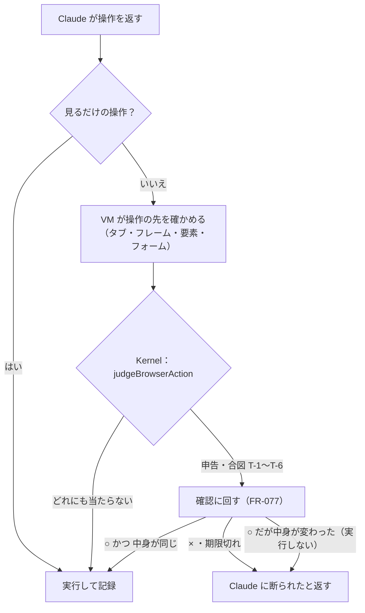

# 04. 機能仕様
- プロジェクト：Agent-Team-Open ／ 版数：v0.6（2026-10-24） ／ インプット：[03_use_cases](03_use_cases.md)

> **3行で**
> 1. 新しく足す機能は、VM（FR-074）・コンピューターユース（FR-075）・こわい操作の見分けと確認（FR-076・077）・交代（FR-078）・プロフィール（FR-079）・持ち主の確かめ（FR-073）・引っ越し（FR-082）・状態（FR-083）・再開（FR-084）・パック（FR-085）・VM のターミナル（FR-086）・LLM の接続先（FR-087、Should）・道具とスキルの渡し方（FR-088）・動いているタスクへのメッセージ（FR-089）。
> 2. こわい操作は、Kernel の決定論の関数が「申告あり・合図に当たった・操作の先が分からない」ときに確認に回す。それ以外の操作は確認しない。`type` の文字列の改行と、確認するドメインへの `open_url` も同じ判定にかける（D-157・D-158）。
> 3. パックは用途ごとのエージェント集（FR-085）。VM のターミナルは中のコマンドを判定せず、外に効くものだけ確認する（FR-086）。引き継ぐ機能は、どこから移すか（Cloudflare 版・旧 Node 版・新規）を[移植元の表](#移植元)に書く。

## 🧭 判断してほしいこと
| # | 種類 | 論点 | 選択肢 | おすすめ（理由） | 決まらないと止まるもの |
|---|---|---|---|---|---|
| Q-124 | 未決 | 画面の操作を子の文脈にし、親には短い報告だけ返すか（[ADR-057](adr/ADR-057-screen-work-in-child-context.md)） | 採用／今のまま 1 つの文脈 | MS-1 で 1 タスクの入力トークンと費用を測ってから決める。D-161 だけで $3 に収まらない仕事が多ければ採用 | MS-3 の runner の作り |
| R-76 | リスク | ページに仕込まれた指示（プロンプトインジェクション）で、ログイン済みのプロフィールを悪用される | — | 合図・確認するドメイン・汚染の扱い（BR-06）・操作の記録で抑える。残る危険は受け入れる（[11 §12](11_tech_spec.md#12-リスクと対策)） | — |

## 全体図

見てほしいところ：○ のあとで中身が変わっていたら、新しい確認は作らず、新しいスクショを Claude に返して決め直させる（D-159）。確認に回るのは「申告」か「合図」に当たったときだけ。判定は LLM ではなく Kernel のコード。先が分からない操作も合図（T-6）として確認に回る。

## 要点
- 操作は「見るだけ」と「変える」に分け、変える操作だけを判定する（[FR-075](#fr-075コンピューターユースの操作)）
- 合図は6つ：秘密の欄・確認するドメイン・決まった言葉・キーでの作動・修飾キー・先が分からない。`type` の改行と `open_url` も判定する（[FR-076](#fr-076こわい操作の見分け)）
- 承認はその1操作の中身（タブ・フレーム・要素・フォームの値・VM の世代）に結びつき、1回しか実行されない。中身が変わっていたら実行せず、Claude に決め直させる（[FR-077](#fr-077こわい操作の確認)）
- 交代は「渡す準備 → 人」の2段で、エージェントの操作と重ならない（[FR-078](#fr-078画面の共有と交代)）
- 再起動したら、終わっていないすべての状態を表のとおりに戻す。VM は必ず新しく起こす（[FR-084](#fr-084再起動から続ける)）
- パックは用途ごとのエージェント集。入れる・更新・外すと、依頼の振り分けがある（[FR-085](#fr-085パック)）
- VM の中のコマンドは判定せず実行し、1コマンド 120 秒・出力 64KB・1タスク 200 回で止める。外に効くものは確認する（[FR-086](#fr-086vm-のターミナル)）
- 道具は安い順に試す（知っていること → コネクタ → Web → VM のブラウザ → 人）。スキルの本文とコネクタの道具の詳細は、使うと決めてから読む（[FR-088](#fr-088道具とスキルの渡し方)）
- 動いているタスクへの持ち主のメッセージは列に並ばず、次の歩みの頭に入る（[FR-089](#fr-089動いているタスクへの持ち主のメッセージ)）

---

## 詳細

### 機能一覧
| ID | 機能名 | 概要 | 関連UC | 優先度 |
|---|---|---|---|---|
| FR-013 | 上限 | タスクと日次の費用・操作の回数・時間で止める（旧 FR-013 を引き継ぐ） | UC-046 | Must |
| FR-016 | 監査ログ | ハッシュの鎖つきの追記だけのログ（引き継ぎ） | UC-051 | Must |
| FR-017 | Web Push 通知 | 確認・交代の頼み・依頼の終わりを通知（最初の版には入れない） | UC-047, UC-048 | Should → 次の版（D-179） |
| FR-018 | 進捗の配信 | SSE で画面に変化を流す（引き継ぎ） | UC-044 | Must |
| FR-061 | 依頼を任せる | 依頼をエージェント1人に任せる。入っているパックの用途に合えば、そのパックから選ぶ。いなければ作る | UC-044 | Must |
| FR-063 | 回答を返す | エージェントの報告から依頼の回答を作る（引き継ぎ） | UC-044 | Must |
| FR-072 | エージェントの作成・削除 | したいことから1人作る・論理削除（PR #9 のまま） | UC-045 | Must |
| FR-073 | 持ち主の確かめ | Tailscale のログイン名と CSRF の確かめ | UC-043 | Must |
| FR-074 | VM の起動と停止 | エージェントのプロフィールをつけて VM を起こし、終わったら止める | UC-046 | Must |
| FR-075 | コンピューターユースの操作 | スクショと操作の繰り返し | UC-046 | Must |
| FR-076 | こわい操作の見分け | 申告と合図で、確認に回すかを決める | UC-046, UC-047 | Must |
| FR-077 | こわい操作の確認 | ブラウザの確認（TBL-039）にして ○ / × を待ち、承認された1操作を1回だけ実行する | UC-047 | Must |
| FR-078 | 画面の共有と交代 | 見るだけ・交代・返す | UC-048 | Must |
| FR-079 | プロフィール | エージェントごとに残し、消せる | UC-045, UC-048 | Must |
| FR-080 | Web 検索・取得 | `web_search`・`web_fetch` | UC-044 | Must |
| FR-081 | カレンダー・GitHub の書き込み | Intent・Kernel・gateway の流れ（引き継ぎ） | UC-049 | Must |
| FR-082 | 書き出し・取り込み | エージェントと設定を1つのファイルにする | UC-050 | Should |
| FR-083 | 起動と状態 | 起動の確かめ・ホストの状態を返す | UC-042 | Must |
| FR-084 | 再起動から続ける | 歩みの記録で、動いていたタスクを続ける | UC-042, UC-046 | Must |
| FR-085 | パック | 用途ごとのエージェント集を入れる・更新・外す。依頼を用途で振り分ける | UC-052, UC-044 | Must |
| FR-086 | VM のターミナル | VM の中でコマンドを実行し、リポジトリを動かして直す | UC-053 | Must |
| FR-087 | LLM の接続先 | `.env` で Anthropic 直・Bedrock・Vertex を選ぶ。接続先で使えない道具は宣言から外す | UC-042 | Should |
| FR-088 | 道具とスキルの渡し方 | 道具を安い順に試させる。スキルの本文とコネクタの道具の詳細は使うと決めてから読ませる | UC-044, UC-046 | Must |
| FR-089 | 動いているタスクへの持ち主のメッセージ | 列に並ばず次の歩みの頭に差し込む。同じタスクに届いた結果は 1 歩に 1 まとまり | UC-044 | Must |

### 機能詳細

### FR-073：持ち主の確かめ
- 入力：`/api/v1/*` のすべてのリクエスト
- 処理：
 1. 画面向けの待ち受けは front ネットワークの口だけ。そこに届くのは Tailscale のコンテナだけ（[07](07_architecture.md#レベル2コンテナ図)）。ほかのコンテナとは同じ口を共有しない
 2. ヘッダー `Tailscale-User-Login` が設定 `OWNER_LOGIN` と一致するか（大文字小文字は区別しない）
 3. GET 以外は、`Origin` が自分の URL であり、ヘッダー `X-Makase-Request: 1` があることを確かめる。WebSocket の開始も `Origin` を確かめる
- エラー：
 | 条件 | 挙動 | code |
 |---|---|---|
 | ログイン名がない・違う | 403 | `NOT_OWNER` |
 | Origin・専用ヘッダーが違う | 403 | `CSRF_REJECTED` |
- 補足：`GET /api/health`（API-082）だけは確かめない。返すのは `ok` と版だけ。ホストの状態は API-111（確かめあり）

### FR-074：VM の起動と停止
- 起こす：エージェントがタスクで初めて computer の道具を使ったとき。本体が box-manager に頼む（API-101）
- 処理：
 1. 同時数の空きは、`boxes` に `starting` の行を入れるトランザクションの中で数えて確保する（Docker を呼ぶのはトランザクションの外）。空きがなければ、タスクは `waiting_box` で待つ。空いたら古い順に起こす
 2. box-manager は、決まったイメージ・決まった資源の上限・VM ごとのネットワーク・エージェントのプロフィールのボリュームで VM を起こす（中身は [07](07_architecture.md#vm-の中身)）
 3. box-agent が応答したら running にする。60秒応答がなければ failed（確保した空きを返す）
 4. box-agent は起動時に、プロフィールの Chromium のロックファイル（`SingletonLock`・`SingletonSocket`・`SingletonCookie`）を消してから Chromium を起こす（前の VM が落ちたときに立たなくなるのを防ぐ。D-171）
- `boxes` の1行が「VM の世代」。起こし直すと新しい行（新しい世代）になる。承認・交代・操作は世代に結びつく
- 止める：タスクが終わった（どの終わり方でも）・交代の頼みのまま30分、または交代中に15分操作がない（D-167）・持ち主が止めた（API-099）・確認の期限が切れて Claude が止まった
- 状態：[ステータス定義](#ステータス定義)の `boxes.status`

### FR-075：コンピューターユースの操作
- 道具：Claude の computer use ツールと、Agent-Team-Open の道具 `open_url`・`read_page`・`confirm_action`・`request_takeover`
 - computer use ツールの宣言の形と画面の大きさの渡し方は、実装するときの既定モデルが使うツールの版の仕様に従う（画面は 1280×800）
 - `read_page()` はページの構造を読む（D-194）。box-agent が CDP のアクセシビリティツリーから、見えているボタン・リンク・入力欄・見出しの一覧（役割・名前・中心の座標・入力欄なら今の値）を文で返す。最大 200 個・16KB。秘密の欄（T-1 の対象）の値は返さない。汚染する（BR-06）。Claude は一覧の座標でクリックできるので、スクショを撮らずに進める歩みが増える（R-82）
 - `open_url(url)` はアドレスバーの代わり。CDP の `Page.navigate` で開く。`http`・`https` だけ受け、`javascript:`・`file:`・`chrome:` などは断る。確認するドメイン（`browser.confirm_domains`）への `open_url` は T-2 として確認に回し、それ以外はページを開くだけの読み取りとして判定しない（D-158）
- 処理（1歩）：
 1. Claude が操作を返す
 2. 操作の種類で分ける
   | 種類 | 操作 | 判定 |
   |---|---|---|
   | 見るだけ | `screenshot`・`mouse_move`・`scroll`・`wait`・`zoom`・`cursor_position`・`read_page`・`open_url`（確認するドメイン以外） | しない |
   | 変える | クリック全般・`left_click_drag`・`left_mouse_down`・`left_mouse_up`・`type`・`key`・`hold_key`・`open_url`（確認するドメインへ） | FR-076 |
 3. 変える操作は、box-agent に確かめだけを頼み（API-103 の `dryRun`）、判定のあと「確かめた中身のハッシュが今も同じなら実行」と頼む（API-103 の `expect`）。確かめた先と実行する先がずれたら実行しない。見るだけの操作はそのまま実行する
 4. `browser_actions`（TBL-033）に記録する。秘密の欄への文字は、記録するすべての場所（`browser_actions`・`task_steps`・`browser_checks`）で `***` に置き換える。秘密の欄（T-1 の対象）の領域は、box-agent が確かめたときの `rect` を使い、保存するスクショと Claude に送るスクショの両方で塗りつぶす（サイトがマスクしないカード番号も画像に残さない。D-162）
 5. 新しいスクショを Claude に返す（`read_page` の後はスクショを付けず、一覧だけ返す）。会話に画像として残すスクショは直近 `browser.keep_screenshots`（既定 3）枚だけで、古いものは「（スクショは省略）」の文に置き換える（1歩の費用が歩数とともに増えない。D-161）
- 上限：1タスクで操作 300 回・60分（ポリシーの `max_minutes` は 55：M-59）・$3（FR-013）。超えたら halted（`budget_exceeded` か `timeout`）。確認待ち・交代待ち（`awaiting_approval`・`waiting_takeover`・`taken_over`）の時間は含めない。待った時間は `tasks.paused_ms` に足し、判定は「経過時間 − `paused_ms`」で行う。外側の 60 分も同じ（D-174）

### FR-076：こわい操作の見分け
- 入力：操作・VM が確かめた操作の先（タブ・フレーム・要素の種類・`type`・`autocomplete`・見えている名前・フォームの中か・ページのドメイン）・申告の有無・ポリシーの `browser` 欄（TBL-035）
- 処理：Kernel の純粋な関数 `judgeBrowserAction` が `allow` か `approve` を返す。どれか1つでも当たれば `approve`

 | 合図 | 当たる条件 |
 |---|---|
 | 申告 | 直前の Claude の道具が `confirm_action` で、この操作を指している |
 | T-1 秘密の欄 | `type`・`key` の先が `input[type=password]`、または `autocomplete` が `current-password`・`new-password`・`cc-number`・`cc-csc`・`cc-exp` |
 | T-2 確認するドメイン | ページの登録ドメインが `browser.confirm_domains` に入っている（変える操作すべて。`open_url` を含む） |
 | T-3 決まった言葉 | クリック・`left_mouse_down` の先（ボタン・リンク・`input[type=submit]` と、その祖先のクリックできる要素。box-agent の確かめが `clickable` を返す `div` などの擬似ボタンも含む。D-173）の見えている名前が `browser.confirm_words` のどれかを含む。照合は、ラテン文字の語は単語の境界で、日本語は部分一致（「Postal code」「Confirmation number」で空振りしない。D-165） |
 | T-4 キーでの作動 | `key` が Enter・Space、または `type` の文字列に改行（`\n`・`\r`）を含み（D-157）、先がボタン・リンク・フォームの中。先が `textarea`・`contenteditable` のときは当たらない（改行なので。D-166）。作動する要素（フォームなら送信ボタン）の名前で T-3 を確かめる |
 | T-5 修飾キー | `key`・`hold_key` が Ctrl・Alt・Meta を含み、決まった安全なもの（Ctrl+C・Ctrl+A・Ctrl+F・Ctrl+Z）でない |
 | T-6 先が分からない | 変える操作の先の要素が分からない（canvas・ほかの出どころの iframe・JS のダイアログ・ブラウザの外）。ただし `browser.skip_unresolved_domains` のドメインでは当たらない |

- `left_mouse_up` と `left_click_drag` の離す点は、押した点と同じ判定を引き継ぐ（押すときに確かめる）
- 初期の決まった言葉：購入・注文・支払・決済・送信・投稿・削除・退会・解約・申し込・確定・Buy・Purchase・Pay・Checkout・Place order・Send・Post・Delete・Submit・Confirm（D-180）
- 初期の確認するドメイン・確かめないドメイン：どちらも空（持ち主が足す）。`clickable`（`cursor: pointer` か click のリスナーがある）で空振りが多いサイトは、確かめないドメインで外す（D-173）

### FR-077：こわい操作の確認
- 置き場所：`browser_checks`（TBL-039）。MCP の書き込み用の `action_intents`・`approvals` とは分ける（[ADR-052](adr/ADR-052-browser-checks-table.md)）
- 処理：
 1. 確認を `pending` で作る。中身は、操作の引数・VM の世代・タブとフレーム・操作の先・フォームの値の要約（秘密の欄はハッシュ）・ページの URL・スクショ・当たった合図。中身からハッシュ（`content_hash`）を作る
 2. 期限 30分。タスクは `awaiting_approval`。VM は動かしたまま。待っている時間は `paused_ms` に足す（D-174）
 3. 確認の一覧（SCR-019）に出し、画面を開いていれば SSE で知らせる（FR-018）
 4. ○（API-110）→ 1つのトランザクションで `pending → executing` に変える（条件つきの更新。0行なら 409 `CHECK_NOT_PENDING`）。その外で、box-agent に「中身のハッシュが同じなら実行」と操作 ID つきで頼む（API-103 の `expect`）
   | VM の答え | 確認の状態 |
   |---|---|
   | 実行した | `executed` |
   | 中身が違う | `expired`（`page_changed`）。新しい確認は作らず、Claude に新しいスクショと「画面が変わったので実行しなかった」を返して操作を決め直させる（T-6・`unknown_outcome` と同じ扱い。D-159） |
   | 答えがない・本体が落ちた | `unknown_outcome`。Claude に「実行されたか分からない」と新しいスクショで伝える |
 5. × → `rejected`。期限 → `expired`（`approval_timeout`）。どちらも Claude に結果を返して続ける
 6. 交代・VM の起こし直しで、その VM の世代の `pending` は `expired`（`taken_over`・`box_restarted`）
- box-agent は、操作 ID を覚えて2回目は実行しない（二重の ○ や再送で2回押さない）
- 「以後も許可」はない（1操作ごと）

### FR-078：画面の共有と交代
- 見る：VM の画面（SCR-022）は VNC を見るだけの形でつなぐ（API-089 `mode=view`）
- VM ごとに「操作する人」（`boxes.control`）を持つ：`agent`・`handing_over`・`human`
- 交代（API-090）：
 1. `control` を `handing_over` にする。以後、エージェントの新しい操作は受け付けない（API-103 は世代と `control` を確かめて断る）。本体は API-113 で box-manager に `control`・`control_epoch` を伝え、管理役が box-agent に渡す（D-160）
 2. 動いている Claude の呼び出しを中止し、返ってきた操作は捨てる。中止した呼び出しの歩み（`llm:<n>`）は `done`（結果 `aborted`）で閉じ、予約した費用を精算する（実際の請求額が取れなければ見積もりのまま確定。`started` のまま残さない。D-163）。その VM の世代の `pending` の確認は `expired`（`taken_over`）
 3. box-agent の動いている操作が終わるのを待ってから、`control = human`・`status_detail = 'taken_over'` にして 200
 4. `mode=control` の画面は `control = human` のときだけ、同時に1つだけつなげる
- 返す（API-091）：`control = agent` に戻し（API-113 で box-manager にも伝える）、Claude に「人が操作した」とスクショを渡して続ける。`control` の接続は閉じる
- 頼み：Claude が `request_takeover`（理由つき）を使うと、タスクは `status_detail = 'waiting_takeover'` で待ち、確認の一覧と SSE の知らせに出る。待ちの時間は `paused_ms` に足す（D-174）
- 放置：頼み（`requested`）のまま30分（確認と同じ。人が気づくまでの時間）、交代中（`active`）に15分操作がない → VM を止め、依頼は `waiting_input`（D-167）
- スマホからは見る・タップまで。交代中の文字入力（入力欄から送る）は次の版（D-181）
- 人の操作は合図で止めない。記録は交代の始まりと終わり（TBL-034）と、終わりのスクショだけ

### FR-079：プロフィール
- エージェントごとに、Docker のボリューム `makase-profile-<agentId>` を1つ持つ。VM を起こすたびに Chromium のユーザーデータとしてつなぐ
- 消す：持ち主の操作（API-092）・エージェントの削除（FR-072）。VM が動いている間は 409 `BOX_RUNNING`
- 1GB を超えたら、エージェントの画面に知らせを出す（消すかは持ち主が決める）

### FR-081：カレンダー・GitHub のつなぎ方（差分）
- つなぎ始め（API-094）で、期限 10分・1回限りの `state` を作り、つなぎ始めたブラウザに HttpOnly・SameSite=Lax の Cookie で結びつける。Google は PKCE を使う
- 戻り先（API-095）で、`state`・Cookie・PKCE を確かめる。GitHub はインストールの ID が、つなぎ始めた App のものかを API で確かめる

### FR-082：書き出し・取り込み
- 書き出す（API-097）：JSON 1つ。`formatVersion`、エージェント（今のスナップショット・手で書いたスキル）、設定（ポリシーの `budget` と `browser` 欄）を入れる
- 入れないもの：依頼・タスクの履歴、監査ログ、プロフィール、つながりの資格情報、API キー
- 取り込む（API-098）：形式を検証し、同じ名前のエージェントは飛ばして一覧で返す。設定は上書きする

### FR-083：起動と状態
- 起動の確かめ：64bit・空きメモリ・必須の設定・DB のマイグレーション（前にバックアップ）・VM のイメージ
- 状態（API-111・SCR-023）：版・DB・box-manager・動いている VM の数・空きディスク・空きメモリ

### FR-084：再起動から続ける
- 歩みの記録（TBL-038）：タスク・依頼の生成の1歩（LLM の呼び出し・道具の呼び出し）ごとに、始める前に `started`、終わったら結果つきで `done` を書く
- 起動時は、終わっていないすべての状態を次の表で戻す

 | 状態 | 戻し方 |
 |---|---|
 | `asks.status = generating` | 生成の歩みの記録をなぞり、その次から設定プランナーを続ける |
 | `tasks.status = queued` | そのまま並べ直す |
 | `tasks.status = provisioning` | `queued` に戻す |
 | `tasks.status = running` | 歩みの記録をなぞって続ける |
 | `tasks.status = awaiting_approval`（API の書き込み） | 確認を待ち続ける（承認は SQLite に残っている） |
 | `tasks.status = awaiting_approval`（ブラウザ） | 確認は `expired`（`box_restarted`）。running として続ける |
 | `tasks.status = executing`（API の書き込み） | 今の `unknown_outcome` の流れ（Cloudflare 版のまま） |
 | `browser_checks.status = executing` | `unknown_outcome` |
 | `takeovers.status` が `requested`・`active` | `expired` |
 | LLM の呼び出しが `started` のまま | 予約した見積もりの費用で精算し（FR-013）、呼び出しはやり直す |
 | `sandbox_commands.status = running` のまま | やり直さず、Claude に「前のコマンドが実行されたか分からない」と伝える（FR-086） |
 | VM を起こし直した | ファイルは消えるので入れ直す。Claude に「VM を起こし直した。ファイルは入れ直した」と伝え、リポジトリは API-118 で入れ直す（FR-086） |

- VM を使っていたタスクは、どの戻し方でも新しい世代の VM を起こす。残っていた古い VM は止める（`host_restart`）。Claude には「VM を起こし直した。前の画面と違う場合がある」と新しいスクショを渡し、記録の古いスクショは使わない
- `started` のまま残った VM の操作は、やり直さない。Claude に「前の操作が実行されたか分からない」と伝える

### FR-085：パック
- 入力：パックの JSON ファイル。`/opt/makase/packs/*.json`（イメージに同梱の標準パック）と `/data/packs/*.json`（持ち主が置くパック。データのボリューム）。DB には持たない。入れる・外すは API-115・116
- 定義の形：JSON 1つ。FR-082 の書き出しと同じ土台で、書き出したファイルに `purpose` を付ければパックになる

 | 項目 | 中身 |
 |---|---|
 | `formatVersion` | 形式の版 |
 | `id` | kebab-case、2〜40 字 |
 | `version` | 整数。上がっていれば更新 |
 | `name` | 表示名 |
 | `purpose` | 用途の説明（振り分けに使う） |
 | `examples` | この用途の依頼の例文、3〜10 個 |
 | `agents[]` | 名前・役割・指示・使う道具・上限 |
 | `skills[]` | 手で書いた手順書 |
 | `browser` | 確認するドメイン・決まった言葉の追加分 |

- 処理：
 1. 入れる（API-115）：`pack_installs` に記録し、`agents[]` からエージェントを作り（`pack_installs.agent_ids`）、`skills[]` を `agent_skills`（`origin = pack`、`pack_id`）に入れ、`browser` の追加分をポリシーに足す。定義を検証してから始める
 2. 更新（同じ API-115）：同じ `id` が入っていて `version` が上がっていれば、パックのエージェントの設定を作り直す。持ち主が手で変えた設定は失われると、先に知らせる
 3. 外す（API-116）：パックのエージェントを論理削除し（動いていれば 409 `AGENT_BUSY`）、プロフィールも消す（確かめのダイアログ）、`agent_skills` の行と `pack_installs` の行を消す。ポリシーに足した `browser` の分は戻す
 4. 振り分け（FR-061 の差分）：依頼が来たら、設定プランナーは入っているパックの `purpose`・`examples` を見て、合うパックを 1 つ選び、そのパックのエージェント 1 人に任せる（ADR-050 は維持：1 件 1 人）。合うパックがなければ今までどおり（使い回す 1 人か、新しく作る 1 人）。`asks.pack_id` は「持ち主が明示したパック」として残し、明示があれば優先する
 5. 画面：SCR-024 `/packs` に入っている・入れられるの一覧と、入れる・外す・更新。エージェント一覧（SCR-014）ではパック由来のエージェントにパック名のラベルを出す
- エラー：
 | 条件 | 挙動 | code |
 |---|---|---|
 | パックがない | 404 | `PACK_NOT_FOUND` |
 | 定義が形式に合わない | 422 | `PACK_INVALID` |
 | 外すとき、パックのエージェントが動いている | 409 | `AGENT_BUSY` |
 | 同じ版がすでに入っている | 409 | `PACK_ALREADY_INSTALLED` |
- 標準パック（イメージに同梱。最初の 1 つは D-186）：
 | 項目 | `announcement-page`（告知ページ制作パック） |
 |---|---|
 | `name` | 告知ページ制作 |
 | `purpose` | イベントや募集の告知ページ（HTML 1 枚）を、条件を聞いて作り、点検して、リポジトリに PR として出す |
 | `examples` | 「11/15 の文化祭の告知ページを作って」「サークルの新歓のページ。日時・場所・申込先はこれ」「この告知のスマホ表示を直して」 |
 | `agents[]` | 1 人（告知ページ制作係）。使う道具：VM のターミナル（HTML を書く・開く）、VM のブラウザ（できたページを 1280×800 と 360px 幅で開いて点検）、GitHub（PR） |
 | `skills[]` | 手順書 4 本：①設計（日時・会場・料金・対象・申込先を聞き切り、構成を決める）②制作（HTML・CSS を 1 ファイルで書く）③点検（必須項目の抜け・誤字・リンク・スマホ表示を VM のブラウザで確かめる）④仕上げ（配色・余白・見出しを整える）。デモの 4 人（設計士・職人・レビュー番長・配色の番人）はこの 4 本に対応する（1 件 1 人は ADR-050） |
 | `browser` | 確認するドメイン：なし。決まった言葉の追加分：「公開」「Publish」 |
 | 成果物の届け方 | VM の中に書いた HTML を tar で取り出し（API-118）、持ち主が指定したリポジトリへ PR の Intent にする（確認つき。FR-081・FR-086）。公開（GitHub Pages など）は PR の先で人がする（BR-10）。回答へのファイル添付は次の版（01 §7） |
 | 申込フォーム | 作らない。申込先はリンクか連絡先の文にする（個人情報を受け取らない） |
- 補足：手で書いたスキル（`agent_skills`）は残す。`origin` は `pack` だけ使い、`learned` は使わない（D-177）。方針は D-176・ADR-053

### FR-086：VM のターミナル
- 入力：Claude の道具の呼び出し。box-agent が VM の中で実行する（内部 API-117）。VM のイメージにシェル（bash）・git・Node・Python・よく使う CLI を入れる
- 道具（6つ。旧 sandbox の名前。`sandbox_commands.tool` の CHECK と同じ）：

 | 道具 | 引数・働き |
 |---|---|
 | `run_command` | `cwd`・`command`・`timeoutSec` |
 | `list_files` | ファイルの一覧 |
 | `read_file` | ファイルを読む |
 | `search` | 検索 |
 | `write_file` | ファイルを書く |
 | `delete_file` | ファイルを消す |

- 処理：
 1. 実行（API-117）：1 つずつ。`actionId`・`controlEpoch` は VM の操作と同じ（世代と `control` を確かめ、同じ `actionId` は 2 回実行しない）
 2. 判定しない：VM の中のコマンドは Kernel で判定しない（BR-08）。VM は使い捨てで、権限なし・資源の上限つき・VM ごとのネットワークにいるので、壊しても残らない
 3. 外向きの通信：ターミナルのプロセスは egress を「ターミナル用の資格」（プロキシ認証）で通し、egress は資格ごとに許可リストを分ける。ターミナル用の既定は `github.com`・`registry.npmjs.org`・`pypi.org`・`files.pythonhosted.org`（ポリシー `terminal.allow_hosts`）。Chromium の資格は今までどおり（アドレスの判定だけ）
 4. リポジトリの出し入れ（API-118）：clone はしない。本体の gateway が GitHub から tar を取り、VM に入れる。変更は tar として取り出し、差分にして PR の Intent に乗せる（確認つき。FR-081）。push・PR・外部 API への書き込みは VM からは直接できない（資格情報を VM に渡さない）
 5. 汚染：コマンドの出力・読んだファイルは外の内容として汚染する（BR-06 と同じ）
 6. 上限（NFR-080）：1 コマンド 120 秒・出力 64KB（超えた分は切って知らせる）・1 タスク 200 回（`terminal.max_commands`）。回数を超えたら halted（`budget_exceeded`）
 7. 記録：`sandbox_commands`（TBL-040）に 1 コマンド 1 行（`box_id`・`task_id`・`tool`・`args`・`status`・`ok`・`output`（64KB まで）・`exit_code`）
 8. 画面：SCR-021 依頼ページの「ターミナル」欄にコマンドと出力のログを出す。人がターミナルを直接打つのは次の版
- ポリシー JSON（TBL-035）の `terminal` 欄：`{ "allow_hosts": [...], "max_commands": 200, "command_timeout_sec": 120 }`
- エラー：
 | 条件 | 挙動 | code |
 |---|---|---|
 | 世代・`control` が違う | 409 | API-103 と同じ |
 | 1 コマンドが 120 秒を超えた | 結果に打ち切りを入れて返す（`ok = false`） | — |
 | 回数の上限 | タスクを halted（`budget_exceeded`） | — |
- 補足：再開は [FR-084](#fr-084再起動から続ける)。方針は D-178・ADR-054

### FR-087：LLM の接続先
- 入力：`.env` の `LLM_PROVIDER`（`anthropic`｜`bedrock`｜`vertex`。既定 `anthropic`）と、接続先ごとの資格（[11 §10](11_tech_spec.md#10-環境設定)）。起動時に読む。画面からは変えない（SCR-023 には表示だけ）
- 処理：
 1. クライアントの作成（`llm/claude.ts`）：接続先ごとの公式クライアントを作る。`anthropic` は `@anthropic-ai/sdk`、`bedrock` は `@anthropic-ai/bedrock-sdk` の `AnthropicBedrockMantle`（`awsRegion`）、`vertex` は `@anthropic-ai/vertex-sdk` の `AnthropicVertex`（`projectId`・`region`）。会話の形（Messages API・道具・画像）は共通
 2. モデル名：`CLAUDE_MODEL` の値を接続先の形にする。`anthropic`・`vertex` は `claude-opus-5-5` のまま、`bedrock` は `anthropic.` を前に付ける
 3. 道具の宣言の切り替え：接続先で使えない道具は Claude に出さない
 | 道具 | `anthropic` | `vertex` | `bedrock` |
 |---|---|---|---|
 | コンピューターユース（FR-075） | `computer_toolset_20260801` | `computer_toolset_20260801` | `computer_20251124` |
 | `web_search`（FR-080。Claude の Web 検索ツール） | 最新版 | 基本版（`web_search_20250305`） | 出さない（Bedrock にはない）。`web_fetch` と VM のブラウザで調べる |
 | `web_fetch`（FR-080。本体の実装） | 使える | 使える | 使える |
 | コネクタの道具の遅い読み込み（FR-088。tool search・`defer_loading`） | 使う | 使えれば使う | 使えれば使う。使えなければ最初から全部渡す（どちらも実装するときに確かめる） |
 4. 費用の見積もりと精算（FR-013）は Anthropic 直の単価で行う。Bedrock・Vertex の請求は各事業者の単価なので、設定画面の「ホスト」欄と手順書に「見積もりは目安」と書く
 5. 起動の確かめ（FR-083）：`LLM_PROVIDER` ごとの必須の値が足りなければ、足りない値の名前を出して止まる（UC-042 E2）。`GET /api/v1/host`（API-111）に `llm.provider`・`llm.model` を足す
 6. Anthropic 直にしかない機能（サーバー側のフォールバック、Fast mode、Priority Tier など）は使わない
- エラー：
 | 条件 | 挙動 | code |
 |---|---|---|
 | `LLM_PROVIDER` が 3 つ以外 | 起動時に止まる | — |
 | 接続先の資格が足りない | 起動時に足りない名前を出して止まる | — |
 | 接続先の認証が通らない（401・403） | タスクを failed にし、理由を知らせる。歩みの記録は残す | `LLM_AUTH_FAILED` |
- 補足：方針は D-185・[ADR-056](adr/ADR-056-llm-provider.md)

### FR-088：道具とスキルの渡し方
- 道具の順番（D-191）：エージェントの指示の共通部分（runner が足す。パックの指示より前）に次を書く。Kernel では強制しない
 | 順 | 方法 | 道具 |
 |---|---|---|
 | 1 | すでに知っていること・手順書 | 会話・`read_skill` |
 | 2 | アプリの API（コネクタ） | カレンダー・GitHub（FR-081） |
 | 3 | Web 検索・ページの取得 | `web_search`・`web_fetch`（FR-080） |
 | 4 | VM のブラウザ | `read_page` → computer use（FR-075） |
 | 5 | 人に聞く | 依頼の中の質問（今の流れ）・`request_takeover`（FR-078） |
 - 右ほど遅く・高く・こわい。前の方法で足りれば次に進まない。コネクタが失敗した（つながっていない・権限がない）ときは、Web 検索を飛ばして VM のブラウザに進んでよい
 - VM のブラウザでは、まず `read_page` で構造を読み、座標が分かればそのまま押す。スクショは画面の見た目を確かめるときに撮る
 - 2 段階認証・CAPTCHA・支払いの入力は自分でせず `request_takeover` で人に渡す
- スキル（D-192）：
 1. 最初に渡すのは、そのエージェントのスキルの名前と `description` の一覧だけ。`description` は「〜のときに使う」の形で書く（パックの手順書も同じ。200 字まで）
 2. 本文は道具 `read_skill(name)` で読む。読んだ本文は会話に残る。`agent_skills.last_used_at` を更新する
 3. パックの JSON の検証（FR-085）で、`description` が空・200 字を超えるものは `PACK_INVALID`
- コネクタの道具（D-193）：カレンダー・GitHub の道具は、名前と 1 行の説明だけ先に渡し、詳細（引数の形）は使うと決めたときに読み込む（Claude の tool search ツールと `defer_loading`）。接続先で使えないとき（FR-087 の表）は最初から全部渡す。つないでいないコネクタの道具は名前も出さない
- 子の文脈（ADR-057、Q-124）を採用したら、親の道具から computer use・`read_page`・`open_url` を外し `use_browser(goal, hints)` を足す

### FR-089：動いているタスクへの持ち主のメッセージ
- 入力：API-077。依頼のタスクが `running`・`awaiting_approval`・`waiting_takeover` のときも受ける（D-195）
- 処理：
 1. 今の `ask_pending_replies` に入れる（列に並ばない。新しいタスクは立てない）
 2. runner は次の歩みを始める前に、`consumed_at IS NULL` の行を古い順にまとめて「持ち主から：…」として会話に足し、同じトランザクションで `consumed_at` を入れる
 3. LLM の呼び出し中なら中止しない（入力トークンは払っているので）。呼び出しが終わってから次の歩みの頭に入れる。すぐ止めたいときは取り消し（API-016）
 4. 確認待ち・交代の頼みの間に届いたら、待ちは続けたまま、待ちが終わった次の歩みに入れる
 5. 同じタスクに届いた結果（確認の ○ / ×・交代の返却・コマンドの終わり・持ち主のメッセージ）は、次の歩みの 1 つの入力にまとめて渡す（1 歩に 1 まとまり）
- 依頼が `waiting_input` のとき（今まで）は、今のまま返事として次のタスクを立てる
- 汚染：持ち主のメッセージは汚染しない（BR-06 の外）

### 移植元
| FR | 移す元 | 足りないもの・差分 |
|---|---|---|
| FR-013 | Cloudflare 版 `edge/spend.ts`・`limits.ts` | 操作の回数・時間の上限（確認待ち・交代待ちは時間に含めない：`paused_ms`。D-174）。呼び出しの前に見積もりの費用を予約する（並んだタスクで日次を超えない） |
| FR-016 | Cloudflare 版 `db/audit.ts` | 新しい事象：`box.started`・`box.stopped`・`browser.checked`・`takeover.started`・`takeover.ended`・`profile.cleared`・`data.imported`。一覧の API は旧 Node 版から |
| FR-017 | 次の版 | 最初の版には入れない（D-179） |
| FR-018 | Cloudflare 版の SSE の設計（第5段で予定） | 本体のプロセスから流す（API-085）。VM・交代の事象 |
| FR-061・063 | Cloudflare 版 `asks/`・`workflows/plan-ask.ts` | 編成は作らない（[ADR-050](adr/ADR-050-one-agent-per-ask.md)）。返事（API-077）は旧 Node 版から |
| FR-072 | Cloudflare 版 `agents/` | 削除のときにプロフィールも消す |
| FR-080 | 新規（Cloudflare 版は 4f で予定だった） | `web_search` は Claude の Web 検索ツール（接続先で版が違う・Bedrock では出さない：FR-087）、`web_fetch` は旧 Node 版の edge と汚染のルール（`edge/web-seen.ts`） |
| FR-087 | 新規 | `llm/claude.ts` のクライアントの作成を接続先で分ける。道具の宣言の切り替え |
| FR-088 | 新規 | 道具の順番の指示・`read_skill`・コネクタの道具の遅い読み込み。スキルの表は今の `agent_skills` |
| FR-089 | Cloudflare 版 `ask_pending_replies` | 動いているタスクにも受ける。歩みの頭でまとめて読む |
| FR-081 | 旧 Node 版の gateway・gcal・github・connectors | 本体の中の部品にする（[ADR-051](adr/ADR-051-gateway-in-core.md)）。確認の一覧・○ / × の API も旧 Node 版から |
| FR-085 | Cloudflare 版 `pack_installs`・`asks.pack_id`・planner の pack の節 | 用途（`purpose`・`examples`）で振り分ける。定義はファイルで持つ |
| FR-086 | 旧 Node 版 sandbox（`packages/sandbox` の tar・executor、`edge/sandbox-command.ts` の道具名） | 判定は使わない |
| FR-073〜079・082〜084 | 新規 | — |

### 権限マトリクス
持ち主1人なので、ロールの表は持たない。持ち主はすべての API を使える。持ち主以外は何も使えない（FR-073）。

### ステータス定義
| 対象 | 値 | 意味 | 遷移先 |
|---|---|---|---|
| `boxes.status` | `starting` | 起こしている | running, failed |
| | `running` | 使っている（操作する人は `boxes.control`） | stopping, failed |
| | `stopping` | 止めている | stopped |
| | `stopped` | 止まった（終わり） | — |
| | `failed` | 起動・動作に失敗した（終わり） | — |
| `boxes.control` | `agent` | エージェントが操作する | handing_over |
| | `handing_over` | 人に渡す準備中 | human |
| | `human` | 人が操作する | agent |
| `takeovers.status` | `requested` | エージェントが頼んだ | active, expired |
| | `active` | 人が操作している | ended, expired |
| | `ended` | 人が返した（終わり） | — |
| | `expired` | 頼みのまま30分・交代中に15分操作がない・再起動（終わり） | — |
| `browser_checks.status` | `pending` | 確認待ち | executing, rejected, expired |
| | `executing` | 承認され、実行を頼んだ | executed, expired, unknown_outcome |
| | `executed`・`rejected`・`expired`・`unknown_outcome` | 終わり | — |
| `browser_checks.expire_reason` | `approval_timeout`・`page_changed`・`taken_over`・`box_restarted` | 期限切れの理由 | — |
| `tasks.status_detail`（足す値） | `waiting_box`・`taken_over`・`waiting_takeover`・`running_command` | VM の空き待ち・交代中・交代の頼み・ターミナルのコマンドを実行中 | — |
| `sandbox_commands.status` | `queued` | 受け付けた | running |
| | `running` | VM で実行中（再開時にこのままなら、やり直さず Claude に伝える） | done, expired |
| | `done` | 終わった（終わり） | — |
| | `expired` | 世代が替わるなどで実行されなかった（終わり） | — |

`tasks.status`・`asks.status`・`action_intents` の値は今のまま（[08](08_database.md#変える表)）。

### 知らせ（SSE。PWA を開いているとき）
知らせるのは伝える価値があるものだけ（D-197）。同じ依頼の同じ種類の知らせは 1 つにまとめ、未読の間は件数だけ増やす。進捗（1 歩ごとの変化）は知らせにせず、依頼のページの表示（FR-018）だけにする。

| きっかけ | 通知の文 |
|---|---|
| こわい操作の確認 | 「確認してください：<要約>」 |
| 交代の頼み | 「手を貸してください：<理由>」 |
| 依頼の終わり・失敗 | 「終わりました：<依頼の文>」・「止まりました：<理由>」 |

## このドキュメントで決まったこと
- [ADR-047](adr/ADR-047-risky-action-check.md)：こわい操作は申告＋合図
- [ADR-052](adr/ADR-052-browser-checks-table.md)：ブラウザの確認は別の表
- [ADR-053](adr/ADR-053-pack-by-purpose.md)：パックは「用途」の単位
- [ADR-054](adr/ADR-054-terminal-in-vm.md)：ターミナルは VM の中。確認は VM の外に効くものだけ
- [ADR-056](adr/ADR-056-llm-provider.md)：LLM の接続先に Bedrock・Vertex を足す
- [ADR-057](adr/ADR-057-screen-work-in-child-context.md)（提案）：画面の操作は子の文脈で（Q-124）
- D-141〜D-144、D-150〜D-153、D-157〜D-163、D-165〜D-168、D-171、D-173・D-174・D-176・D-178・D-179・D-180・D-181・D-185・D-186・D-187・D-191〜D-195・D-197（[00 決定事項ログ](00_overview.md#決定事項ログ)）
