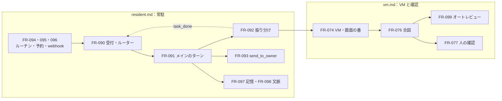

# 04. 機能仕様
- プロジェクト：Agent-Team-Open ／ 版数：v1.5（2026-10-25） ／ インプット：[03_use_cases](../03_use_cases.md)

> **3行で**
> 1. v1.0 で足したのは常駐の仕組み：受付とルーター（FR-090）・メインのターン（FR-091）・振り分けと報告（FR-092）・`send_to_owner`（FR-093）・ルーチン（FR-094）・予約した確認（FR-095）・webhook（FR-096）・記憶（FR-097。プロフィールと検索の 2 層）・文脈の組み方（FR-098）・Web Push（FR-017）。詳細は [resident.md](resident.md)。
> 2. VM は持ち主に 1 台で眠って起き（FR-074）、合図に当たった操作は人（FR-077）かオートレビュー（FR-099）に回る。控えと作り直し（FR-100）を足した。詳細は [vm.md](vm.md)。
> 3. 上限・振り分け先の選び方・パック・道具の渡し方などは [tools.md](tools.md)。FR-063（回答を返す）は FR-093 に統合した。

## 🧭 判断してほしいこと
| # | 種類 | 論点 | 選択肢 | おすすめ（理由） | 決まらないと止まるもの |
|---|---|---|---|---|---|
| R-76 | リスク | ページに仕込まれた指示（プロンプトインジェクション）で、ログイン済みのブラウザを悪用される | — | 合図・確認するドメイン・汚染の扱い（BR-06）・操作の記録・オートレビューに会話を渡さない（FR-099）で抑える。残る危険は受け入れる（[11 §12](../11_tech_spec.md#12-リスクと対策)） | — |
| R-90 | リスク | オートレビューがだまされる・見逃す | — | 外に出す・支払う・消す・秘密・POST の送信・別オリジンの iframe は必ず人（BR-14・D-242）。会話を渡さず、ページの文は信用しない材料として枠に入れる。迷ったら stop。記録で後から確かめる | — |
| R-91 | リスク | 記憶が汚染される・作り話が入る | — | 材料を持ち主のメッセージに限る（BR-12・D-246）。情報として渡す。画面で直せる | — |

## 全体図

見てほしいところ：常駐の仕組み（左）が回り、重い仕事だけが VM（右）に行く。終わったタスクはきっかけとして受付に戻る。

## 要点
- きっかけはすべて `wakes` を通る。動いているターンの間に届いた持ち主のチャットは `queued` のまま待ち、ターンが終わったらすぐ次のターンで始まる（[FR-090](resident.md#fr-090受付とルーター)）
- メインは VM を使わない。振り分け先は 1 段だけで、報告は 2,000 字まで（[FR-091](resident.md#fr-091メインのターン)・[FR-092](resident.md#fr-092振り分けと報告)）
- 地の文はチャットに出ない。話すのは `send_to_owner` だけ（[FR-093](resident.md#fr-093send_to_owner)）
- プロフィールを書く材料は持ち主のメッセージだけ（D-246。[FR-097](resident.md#fr-097記憶)）
- 先頭は次の要約まで変えず、外れは記録する。要約はターンを始める処理が 1 経路でする（[FR-098](resident.md#fr-098文脈の組み方)）
- 合図の行き先は決定論。外に出す・支払う・消す・秘密・POST の送信は人（[FR-076](vm.md#fr-076こわい操作の見分け)・[FR-099](vm.md#fr-099オートレビュー)）
- 費用は全体（`daily_usd`）と自動のきっかけ用（`daily_auto_usd`）の 2 つの日次上限で守る（[FR-013](tools.md#fr-013上限)）
- 画面の番は 1 つ。VM は 10 分で眠り、控えから戻せる（[FR-074](vm.md#fr-074vm-の起動と眠り)・[FR-100](vm.md#fr-100vm-の控えと作り直し)）

---

## 詳細

### 機能一覧
| ID | 機能名 | 概要 | 関連UC | 優先度 | 詳細 |
|---|---|---|---|---|---|
| FR-013 | 上限 | タスク・メインのターン・日次の費用（全体と自動のきっかけ用）・歩数・操作の回数・時間で止める | UC-046, UC-054 | Must | [tools](tools.md#fr-013上限) |
| FR-016 | 監査ログ | ハッシュの鎖つきの追記だけのログ（引き継ぎ） | UC-051 | Must | [tools](tools.md#fr-016監査ログ) |
| FR-017 | Web Push 通知 | `send_to_owner`・人の確認・交代の頼みを通知（v1.0 で Must：D-207） | UC-054, UC-047, UC-048 | Must | [resident](resident.md#fr-017web-push-通知) |
| FR-018 | 進捗の配信 | SSE で画面に変化の合図を流す（引き継ぎ） | UC-044 | Must | [tools](tools.md#fr-018進捗の配信) |
| FR-061 | 振り分け先の選び方 | 振り分け先の一覧をメインに渡す。パックの用途を添える | UC-055 | Must | [tools](tools.md#fr-061振り分け先の選び方) |
| FR-063 | 回答を返す | 使わない（FR-093 に統合） | — | — | — |
| FR-072 | エージェントの作成・削除 | 持ち主かメインが作る・論理削除。メインは消せない | UC-045, UC-055 | Must | [tools](tools.md#fr-072エージェントの作成削除) |
| FR-073 | 持ち主の確かめ | Tailscale のログイン名と CSRF の確かめ。webhook の口は別 | UC-043 | Must | [tools](tools.md#fr-073持ち主の確かめ) |
| FR-074 | VM の起動と眠り | 道具を使うときに起こし、10 分で眠る。画面の番 | UC-046, UC-061 | Must | [vm](vm.md#fr-074vm-の起動と眠り) |
| FR-075 | コンピューターユースの操作 | スクショと操作の繰り返し | UC-046 | Must | [vm](vm.md#fr-075コンピューターユースの操作) |
| FR-076 | こわい操作の見分け | 申告と合図で判定し、行き先（人・オートレビュー）を決める | UC-046, UC-047, UC-059 | Must | [vm](vm.md#fr-076こわい操作の見分け) |
| FR-077 | こわい操作の確認 | 人の ○ / × を待ち、承認された1操作を1回だけ実行する | UC-047 | Must | [vm](vm.md#fr-077こわい操作の確認) |
| FR-078 | 画面の共有と交代 | 見るだけ・交代・返す | UC-048 | Must | [vm](vm.md#fr-078画面の共有と交代) |
| FR-079 | ブラウザのデータ | VM に 1 つ。全員で共通。消せる | UC-048 | Must | [vm](vm.md#fr-079ブラウザのデータ) |
| FR-080 | Web 検索・取得 | `web_search`・`web_fetch` | UC-044 | Must | [tools](tools.md#fr-080web-検索取得) |
| FR-081 | カレンダー・GitHub の書き込み | Intent・Kernel・gateway の流れ（引き継ぎ） | UC-049 | Must | [tools](tools.md#fr-081カレンダーgithub-のつなぎ方差分) |
| FR-082 | 書き出し・取り込み | 使わない（v1.4：D-316） | — | — | — |
| FR-083 | 起動と状態 | 起動の確かめ・ホストの状態を返す | UC-042 | Must | [tools](tools.md#fr-083起動と状態) |
| FR-084 | 再起動から続ける | 歩みの記録で、動いていたターンとタスクを続ける | UC-042, UC-054 | Must | [vm](vm.md#fr-084再起動から続ける) |
| FR-085 | パック | 用途ごとのエージェント集を入れる・更新・外す。メインの振り分け先になる | UC-052, UC-055 | Must | [tools](tools.md#fr-085パック) |
| FR-086 | VM のターミナル | VM の中でコマンドを実行し、リポジトリを動かして直す | UC-053 | Must | [vm](vm.md#fr-086vm-のターミナル) |
| FR-087 | LLM の接続先 | 使わない（v1.4：D-315） | — | — | — |
| FR-088 | 道具とスキルの渡し方 | 安い順に試す。スキル・コネクタの詳細は要るときだけ。道具の約束事 | UC-054, UC-055 | Must | [tools](tools.md#fr-088道具とスキルの渡し方) |
| FR-089 | 動いているタスクへの持ち主のメッセージ | タスクの次の歩みの頭に入れる | UC-054, UC-055 | Must | [resident](resident.md#fr-089動いているタスクへの持ち主のメッセージ) |
| FR-090 | 受付とルーター | きっかけを受け、重複を捨て、行き先を決めてまとめる | UC-054 | Must | [resident](resident.md#fr-090受付とルーター) |
| FR-091 | メインのターン | 起きる → 歩む → 記憶を更新 → 眠る | UC-054 | Must | [resident](resident.md#fr-091メインのターン) |
| FR-092 | 振り分けと報告 | `delegate` でタスクを作り、報告を `task_done` で返す | UC-055 | Must | [resident](resident.md#fr-092振り分けと報告) |
| FR-093 | `send_to_owner` | 持ち主に話す唯一の道具（文・ファイル・選択肢） | UC-054 | Must | [resident](resident.md#fr-093send_to_owner) |
| FR-094 | ルーチン | プロンプトと時刻の組でメインを起こす | UC-056 | Must | [resident](resident.md#fr-094ルーチン) |
| FR-095 | 予約した確認 | メインが次に起きる時刻を予約する | UC-056 | Must | [resident](resident.md#fr-095予約した確認) |
| FR-096 | webhook | 署名を確かめて外の出来事をきっかけにする | UC-057 | Must | [resident](resident.md#fr-096webhook) |
| FR-097 | 記憶 | 2 層（プロフィール・検索）。記憶の更新の歩み | UC-058 | Must | [resident](resident.md#fr-097記憶) |
| FR-098 | 文脈の組み方 | 並べ方の固定・キャッシュの外れの記録・要約 | UC-060 | Must | [resident](resident.md#fr-098文脈の組み方) |
| FR-099 | オートレビュー | 合図に当たった操作を別の Claude が確かめる | UC-059 | Must | [vm](vm.md#fr-099オートレビュー) |
| FR-100 | VM の控えと作り直し | 毎日の控え・戻す・空から作り直す | UC-061 | Must | [vm](vm.md#fr-100vm-の控えと作り直し) |

### 権限マトリクス
持ち主1人なので、ロールの表は持たない。持ち主はすべての API を使える。持ち主以外は何も使えない（FR-073）。webhook の口（API-129）は署名を持つ送り手だけが使える。

エージェントの道具の範囲は役で分ける：

| 道具 | メイン | 振り分け先 |
|---|---|---|
| `send_to_owner`・`delegate`・`schedule_wake`・`propose_routine`・`list_tasks`・`steer_task`・`cancel_task` | ○ | — |
| VM（computer use・`open_url`・`read_page`・`confirm_action`・`request_takeover`・ターミナル） | — | ○ |
| `report` | — | ○ |
| `web_search`・`web_fetch`・コネクタ（書き込みは確認つき）・`read_skill`・`search_memory` | ○ | ○ |

### ステータス定義
| 対象 | 値 | 意味 | 遷移先 |
|---|---|---|---|
| `wakes.status` | `queued` | 受けて並んでいる | consumed, dropped |
| | `consumed` | ターン・タスクに渡した | 副作用未発生を証明できる失敗のみqueued/dropped。確定済み/不明ならconsumed維持（D-337） |
| | `dropped` | 日次の上限・行き先がない・戻した回数を超えた・webhook が 1 分 60 件を超えた（終わり。重複は `source_key` の UNIQUE で行を作らない） | — |
| `turns.status` | `running` | メインが歩んでいる | done, halted, failed |
| | `done`・`halted`・`failed` | 終わり（`halted` は上限、`failed` は LLM の失敗） | — |
| `turns.halt_reason` | `budget_exceeded`・`daily_budget_exceeded`・`steps_exceeded`・`timeout`・`context_exceeded` | 1 ターンの $1・日次の上限・40 歩・10 分（D-289）・呼び出し前の入力が 20 万トークンを超えた（次のターンの開始で要約する：D-323） | — |
| `tasks.status` | 今の値のまま（`schema.ts` の CHECK：`queued`・`provisioning`・`running`・`awaiting_approval`・`executing`・`succeeded`・`completed`・`rejected`・`failed`・`cancelled`・`halted`）。振り分けのタスクの終わりは `completed`（報告の `done`・`blocked`）・`failed`・`halted`・`cancelled` を使う（D-254・D-257） | 今のまま | 今のまま |
| `tasks.halt_reason`（足す値） | `vm_replaced`（控えに戻した・作り直した：D-268） | — | — |
| `tasks.status_detail`（足す値） | `waiting_vm`・`waiting_screen`・`taken_over`・`waiting_takeover`・`running_command`・`auto_review` | VM の起動待ち・画面の番待ち・交代中・交代の頼み・コマンドを実行中・オートレビュー中（v0.6 の `waiting_box` は `waiting_vm` に） | — |
| `boxes.status` | `starting` | 起こしている | running, failed |
| | `running` | 使っている（操作する人は `boxes.control`） | stopping, failed |
| | `stopping` | 止めている | stopped |
| | `stopped` | 止まった（眠った。終わり） | — |
| | `failed` | 起動・動作に失敗した（終わり） | — |
| `boxes.control` | `agent` | エージェント（画面の番を持つタスク）が操作する | handing_over |
| | `handing_over` | 人に渡す準備中 | human |
| | `human` | 人が操作する | agent |
| `takeovers.status` | `requested` | エージェントが頼んだ | active, expired |
| | `active` | 人が操作している | ended, expired |
| | `ended` | 人が返した（終わり） | — |
| | `expired` | 頼みのまま30分・交代中に15分操作がない・再起動（終わり。放置のときはタスクを報告の `blocked` で閉じる：D-257） | — |
| `browser_checks.status` | `pending` | 確認待ち | executing, rejected, expired |
| | `executing` | 承認され、実行を頼んだ | executed, expired, unknown_outcome |
| | `executed`・`rejected`・`expired`・`unknown_outcome` | 終わり | — |
| `browser_checks.expire_reason` | `approval_timeout`・`page_changed`・`taken_over`・`box_restarted`・`task_cancelled`・`screen_lost`・`vm_replaced`（控えに戻した・作り直した：D-308） | 期限切れの理由 | — |
| `auto_reviews.verdict` | `pass`・`stop`・`error`（時間切れ・形が違う） | `stop`・`error` は人の確認に回る | — |
| `sandbox_commands.status` | `queued` | 受け付けた | running |
| | `running` | VM で実行中（再開時にこのままなら、やり直さず Claude に伝える） | done, expired |
| | `done` | 終わった（終わり） | — |
| | `expired` | 世代が替わるなどで実行されなかった（終わり） | — |
| `routines.enabled` | 1・0 | 動かす・止めた | — |
| `scheduled_wakes.status` | `pending`・`fired`・`cancelled` | 待っている・起こした・消した | — |
| `workspace.vm_op` | `none`・`starting`・`stopping`・`snapshotting`・`restoring`・`rebuilding`・`clearing_browser` | 排他。復元/作り直し/消去は結果DB確定とACK後だけnone。応答不明は維持（D-333・334） | [10 states](../10_diagrams/states.md#workspacevm_op) |
| `workspace.vm_home_state` | `ok`・`broken` | VM のホームの状態。`broken` は戻す・作り直すだけ受ける（D-294） | [10 states](../10_diagrams/states.md#workspacevm_home_state) |
| `push_outbox.status` | `pending`・`sent`・`failed`・`expired`・`skipped` | Web Push の送り待ち。購読ごとの行（D-267・D-288）。`skipped` は見えている端末があって送らなかった | — |

`action_intents` の値は今のまま（[08](../08_database/README.md#変える表)）。`asks.status` は使わない（D-235）。

### 知らせ
知らせるのは伝える価値があるものだけ（D-197・D-229）。画面を開いていれば SSE、閉じていれば Web Push。中身は [FR-017](resident.md#fr-017web-push-通知)。

## このドキュメントで決まったこと
- [ADR-047](../adr/ADR-047-risky-action-check.md)：こわい操作は申告＋合図
- [ADR-052](../adr/ADR-052-browser-checks-table.md)：ブラウザの確認は別の表
- [ADR-053](../adr/ADR-053-pack-by-purpose.md)：パックは「用途」の単位
- [ADR-054](../adr/ADR-054-terminal-in-vm.md)・[ADR-061](../adr/ADR-061-vm-no-judge-restore.md)：ターミナルは VM の中。確認は VM の外に効くものだけ
- [ADR-058](../adr/ADR-058-resident-agent.md)〜[ADR-067](../adr/ADR-067-web-push-first.md)：常駐型の仕組み
- ADR-068：ブラウザとターミナルを別のコンテナにする。ADR-069：費用は自動のきっかけ用の別上限で守る。ADR-070：記憶は 2 層（プロフィールと検索）
- D-141〜D-144、D-150〜D-153、D-157〜D-163、D-165〜D-167、D-171、D-173・D-174・D-176・D-178・D-180・D-181・D-186・D-187・D-191〜D-198、D-201〜D-238、D-275〜D-289（[00 決定事項ログ](../00_overview.md#決定事項ログ)）、D-315〜D-328
