# 04. 機能仕様
- プロジェクト：open-team（仮称） ／ 版数：v0.6（2026-10-01）：v0.2 の本文に 12（v0.3）〜15（v0.6）を統合して書き直し（経緯は [changes/](../changes/2026-10-01-rewrite.md)） ／ インプット：[01](../01_requirements.md)、[02](../02_user_stories/README.md)、[03](../03_use_cases/README.md)

> **3行で**
> 1. 機能は FR-001〜040 の40件（FR-024 は v0.5 で廃止）。名前を付けて頼むだけのエージェント（FR-034〜040）が、ワークスペースのポリシーの範囲で自分を設定し、Web・MCP・GitHub を使って仕事をする。
> 2. 判定はすべて Kernel の純粋関数（`decide()`・`compose()`・`classify()`）が決定論的に行い、外部作用は必ず Intent（プレビュー → 承認かルール → 実行 → 記録）を通す。権限を広げる変更は人の承認でしか反映しない。
> 3. 下書き・Canvas・試し実行・公開（FR-025〜027）は v0.5 で「詳細設定」に下がり、作り方の変更に合わせた再設計は未決（Q-27）。次に読むのは [governance.md](governance.md)（判定の順序）。

## 🧭 判断してほしいこと
| # | 種類 | 論点 | 選択肢 | おすすめ（理由） | 決まらないと止まるもの |
|---|---|---|---|---|---|
| Q-25 | 未決 | `commands.allow` の書式（04 §未決事項） | A: 前方一致 / B: 正規表現 / C: 引数の構造化 | ベータで使われ方を見て再検討（元の記述） | FR-004、policy.yaml のスキーマ |
| Q-26 | 未決 | 承認カードの差分要約をどの言語で出すか（04 §未決事項） | A: Issue の言語 / B: ユーザー設定 | —（元の記述なし） | FR-011 |
| Q-27 | ✅決定 | v0.3 のアプリ内モード（既定。ADR-017・BR-33）と v0.5 の作り方の変更（TBL-021 下書きと下書き API の廃止、Canvas・試し実行は詳細設定で Could）を受けた FR-022・025〜027 の再設計。本書は v0.2 の仕様のまま残した（12 §未決事項「v0.3 の反映」、14 §既存ドキュメントへの影響） → **詳細設定で定義を直接編集し、下書きを作らず設定変更（TBL-025）として保存。classify() で widen なら確認カード**（[D-13](../decisions.md#d-13)）| A: 詳細設定の編集を config change（TBL-025）に載せる / B: 下書きを残す | —（元の記述なし） | FR-022、FR-025〜027、BR-22 |
| Q-28 | ✅決定 | 権限を広げる変更を承認できる人。12 は「承認者（BR-14）か組織の owner か」を未決とし、13 は「ワークスペースの owner（個人は自分）」、14 は「ユーザー」と書く → **ワークスペースの owner に限る**（[D-22](../decisions.md#d-22)）| A: 承認者（BR-14） / B: owner に限る | —（元の記述なし） | FR-036、BR-33、BR-47 |
| Q-29 | 未決 | v0.3 のフェーズ1機能の FR が未設計：`handoff`（REQ-035・BR-36。厳しさの順序とタスクの状態）、AI事前レビュー（REQ-036・BR-34）、アクティビティビュー（REQ-037）、`browser_submit`・`payment` のカタログ行（12 §エージェント定義への追加） | — | —（元の記述なし） | FR-004、[catalogs.md](catalogs.md) |
| Q-30 | ✅決定 | 13 の MCP コネクタ・Web 読み取り・汚染の追跡・ワークスペースのポリシー・プロフィール（REQ-042〜051）に FR ID がない。本書は [mcp-and-web.md](mcp-and-web.md) に共通定義として載せた。あわせて、リポジトリのないタスク・仕事からのタスク作成（FR-005）と `watch` トリガーの処理（FR-028）が未設計（13 §既存ドキュメントへの影響） → **新しい ID を振る（UC-029〜・FR-041〜・SCR-019〜）。MCP の書き込みは UC-009・010 を拡張せず別 UC。本設計は T-1 の設計作業で書く**（[D-09](../decisions.md#d-09)）| A: FR-041〜 を採番 / B: 共通定義のまま | —（元の記述なし） | FR-005、FR-028、03 の UC |
| Q-31 | ✅決定 | 14 は `compose()` を **仕事ごと**（`ceilings ∧ workspacePolicy ∧ repoPolicy ∧ agentGrants ∧ template`）に計算するとしたが、`effective_policy_hash`・intentHash の `policyHash`・`agent_snapshots` の実効ポリシーはエージェント単位の前提のまま（12 §FR-023、14 §エージェント定義の例） → **実効ポリシーは仕事（job）ごとに計算・保存し、intentHash の policyHash も仕事のもの。一回きりのお願いは既定の仕事として扱う**（[D-19](../decisions.md#d-19)）| A: 仕事ごとに持つ / B: エージェント単位に保つ | —（元の記述なし） | FR-010、FR-023、TBL-019 |
| Q-32 | ✅決定 | `submit_report` の対象。13 は「全テンプレートに広げ、出典を必須にする（操作は `notify`）」とするが、13 のテンプレート表の `watcher`・`assistant` には無く、04 では dev-coder から呼ぶと deny（FR-033） → **開発以外の全テンプレート（researcher・briefer・watcher・assistant）。開発は deny のまま**（[D-32](../decisions.md#d-32)）| A: 全テンプレート / B: 表のとおり | —（元の記述なし） | FR-029、FR-033 |
| Q-33 | ✅決定 | 15 で「1タスク1 Intent（A-30）」を廃止したが、`open_pr` の2件目の 409 `INTENT_ALREADY_SUBMITTED`（FR-010）を残すか → **open_pr だけ1タスク1件の制限（409 INTENT_ALREADY_SUBMITTED）を残す**（[D-23](../decisions.md#d-23)）| A: open_pr だけ残す / B: 廃止 | —（元の記述なし） | FR-010、09 のエラーコード |
| Q-34 | ✅決定 | 14 の UC-025 が `agents.status = idle` を使うが、状態の定義・遷移がない。仕事（`waiting_input` / `active` / `paused` / `done`）の遷移も未定義 → **idle を状態に足す（遷移は D-20）。仕事の遷移図は T-6 の設計作業で書く**（[D-20](../decisions.md#d-20)）| — | —（元の記述なし） | [status.md](status.md)、10 の状態遷移図 |
| Q-35 | ✅決定 | FR-024 を FR-035 に置き換えた後、「タスクから Skill の下書きを作る」（FR-030・UC-024）を誰が行うか、下書き1件 $0.5 の上限（BR-30）が設定プランナーにかかるか → **「このやり方を覚える」・チャットの一言で、設定プランナーが Skill の追加を設定変更として提案**（[D-16](../decisions.md#d-16)）| — | —（元の記述なし） | FR-030、FR-035 |
| Q-36 | ✅決定 | フェーズの割り当て。13・14 に明記のない FR はフェーズ1のままとした。13 は「複数ユーザー（SaaS 化）」をフェーズ2に置くため、FR-001（サインイン）・FR-020（メンバー管理）がフェーズ1か2かが揺れる → **複数ユーザーはフェーズ1から。FR-001・FR-020 はフェーズ1**（[D-02](../decisions.md#d-02)）| — | —（元の記述なし） | 機能一覧のフェーズ列 |
| Q-37 | 一部決定 | 自己設定の未決（14 §未決事項）。**①②③⑤は決定（[D-26〜29](../decisions.md)）、④任せ先の選び方だけ未決（REQ-057 はフェーズ0で後回し）**：①指示文の変更を `neutral` で自動反映してよい範囲 ②繰り返す仕事の初回に確認の実行を必ず行うか ③仕事を移すときにメモリも移すか ④同じ役割のエージェントが複数いるときの任せ先の選び方 ⑤口調・一人称をどこまで持たせるか | — | —（元の記述なし） | FR-036、FR-037、FR-040 |
| Q-38 | ✅決定 | （①は [D-10](../decisions.md#d-10)、②〜④は [D-34](../decisions.md#d-34)、⑤は [D-31](../decisions.md#d-31)） MCP の書き込みの未決（15 §未決事項）：①引数の役割をカタログで配るか初回の承認カードで確定させるか（**決定済み：[D-10](../decisions.md#d-10)**） ②ネストした `destination`（JSON Pointer か）③結果を待って次に進みたい `assistant` ④`readback` の設定方法 ⑤読めない宛先 ID の `labels` の付け方 | — | —（元の記述なし） | [mcp-and-web.md](mcp-and-web.md)、FR-012 |
| Q-39 | 一部決定 | （①は [D-30](../decisions.md#d-30)、②は [D-34](../decisions.md#d-34)、④は [D-33](../decisions.md#d-33)。③汚染の単位はフェーズ0はタスク単位のまま） Web・汚染・連携の未決（13・12 §未決事項）：①URL を使った持ち出しをどこまで防ぐか（汚染後の `web_fetch` を検索結果の URL に限るか）②MCP の書き込みの検証方法 ③汚染の単位（フェーズ0はタスク単位）④メンションへの返信（`comment_issue` を外部作用に足すか） | — | ③はフェーズ0はタスク単位（元の記述） | [mcp-and-web.md](mcp-and-web.md)、FR-028 |
| R-10 | リスク | `commands.allow` の前方一致はすり抜けうる | — | シェルのメタ文字を含むコマンドは常に不一致（A-16）。Q-25 で再検討 | — |
| R-11 | リスク | URL のクエリ文字列に情報を載せて持ち出す経路は残る（ADR-023） | — | 汚染後の書き込みの制限・`web.max_fetches_per_task`・ドメインの制限で緩和（完全には防げない） | — |
| R-12 | リスク | 指示文の変更は `neutral` のため、振る舞いが承認なしで変わりうる（ADR-027） | — | 境界（BR-20）・汚染の追跡・Intent の承認で抑える | — |
| R-13 | リスク | MCP には読み戻しの標準がなく、書き込みの検証は既定で `none`（ADR-022） | — | ツールごとに `readback`（フェーズ1）。`none` は監査ログに残す | — |
| R-14 | リスク | MCP サーバーの自己申告やツールの説明文の書き換えによる誤分類・乗っ取り（12 §未決事項） | — | 未分類＝書き込み、説明文とスキーマのハッシュ固定（`needs_review`） | — |

## 全体図

```mermaid
flowchart LR
  U[ユーザー] --> CH["FR-038 チャット"]
  CH --> PL["FR-035 設定プランナー"]
  PL --> CL{"FR-036 classify()"}
  CL -->|narrow / neutral| SN["FR-023 compose() → スナップショット"]
  CL -->|widen| U
  SN --> TR["FR-028 トリガー / FR-037 仕事"]
  TR --> T["FR-005 タスク"]
  T --> RT["FR-008 ランタイム / FR-009 LLM Proxy"]
  RT --> D{"FR-004 decide()"}
  D -->|allow| RT
  D -->|"approve / ルール"| I["FR-010 Intent"]
  I --> AP["FR-011 承認"]
  AP --> GW["FR-012 Gateway → GitHub・MCP"]
  D -->|halt| ST["FR-013〜015 停止"]
  GW --> AU["FR-016 監査ログ / FR-017 通知"]
```

見てほしいところ：モデル（プランナー・ランタイム）は提案するだけで、通すかどうかは2つの菱形（`classify()` と `decide()`）が決める。外に出るのは Gateway だけ。

## 要点
- 判定の順序は `halt`（Kill Switch・予算・Breaker）→ `deny`（分類・ツールの状態・Intent の数・パス）→ 自律レベル → ルールの一致。図は [governance.md#fr-004](governance.md#fr-004)。
- 実効ポリシーは Hard Ceiling・ワークスペース・リポジトリ（開発のみ）・エージェントの付与・テンプレートの「厳しい方」を取る。定義は [policy-and-schema.md](policy-and-schema.md)。
- MCP の書き込みは引数を `destination` / `content` / `option` に分け、「以後も許可」のルールは宛先を全部固定したときだけ効く（[mcp-and-web.md](mcp-and-web.md)）。
- Intent は1タスクに複数（既定5件）出せ、MCP の書き込みは自動で再試行しない。結果不明は `unknown_outcome`（[intents.md](intents.md)）。
- エージェントは名前と会話の単位で、仕事（jobs）を複数持つ。自分の設定は変えられるが、権限は広げられない（[agents.md](agents.md)）。
- 状態の一覧は [status.md](status.md)（状態遷移図は [10](../10_diagrams/README.md)）。

---

## 詳細

### 機能一覧（FR 索引）
フェーズの根拠：13 §フェーズ計画・14 §フェーズ0の完成条件。明記のないものはフェーズ1（v0.2 の MVP）のまま。複数ユーザーはフェーズ1から（[D-02](../decisions.md#d-02)）。

FR-001〜040 の一覧（40件）

| ID | 機能名 | 概要 | 関連UC | 優先度 | フェーズ | 定義 |
|---|---|---|---|---|---|---|
| FR-001 | GitHubサインイン・セッション | GitHub App の user-to-server OAuth でログイン | UC-001 | Must | 1（フェーズ0は省略） | [platform.md](platform.md#fr-001) |
| FR-002 | GitHub App 連携・同期 | インストール・リポジトリ・メンバーの同期と Webhook | UC-001, UC-006 | Must | 1 | [platform.md](platform.md#fr-002) |
| FR-003 | ポリシー読込・検証 | `.agent/policy.yaml`・`routing.yaml` の読込とスナップショット化 | UC-004 | Must | 1 | [platform.md](platform.md#fr-003) |
| FR-004 | ポリシー判定エンジン | allow / deny / approve / handoff / halt を返す純粋関数 | UC-007〜009 | Must | 0 | [governance.md](governance.md#fr-004) |
| FR-005 | タスク作成 | エージェントを指定してタスクを作りキューに登録 | UC-005 | Must | 0 | [runtime.md](runtime.md#fr-005) |
| FR-006 | ラベルトリガー | エージェントごとのラベルでタスクを作成 | UC-006 | Should | 1 | [runtime.md](runtime.md#fr-006) |
| FR-007 | サンドボックス実行管理 | 使い捨てサンドボックスの起動・監視・破棄 | UC-007 | Must | 1（フェーズ0の開発以外はコンテナ内のプロセス） | [runtime.md](runtime.md#fr-007) |
| FR-008 | エージェントランタイム | Harness（フェーズ制御・ツール実行・Router） | UC-007 | Must | 0 | [runtime.md](runtime.md#fr-008) |
| FR-009 | LLM Proxy | BYOK の LLM 呼び出し・予算の事前判定・ツール呼び出しの判定 | UC-007, UC-008 | Must | 0 | [runtime.md](runtime.md#fr-009) |
| FR-010 | Intent受付・検証 | `open_pr` の差分検証と MCP の書き込みの Intent 化、intentHash | UC-007, UC-009 | Must | 0（MCP）/ 1（PR） | [intents.md](intents.md#fr-010) |
| FR-011 | 承認フロー | 承認カード・承認・却下・「以後も許可」・期限切れ | UC-009 | Must | 0 | [intents.md](intents.md#fr-011) |
| FR-012 | Action Gateway | 承認済み Intent の実行と検証（PR・MCP） | UC-010 | Must | 0（MCP）/ 1（PR） | [intents.md](intents.md#fr-012) |
| FR-013 | 予算管理 | タスク・日・月の予算の計測と判定、予算メーター | UC-008, UC-014 | Must | 0 | [governance.md](governance.md#fr-013) |
| FR-014 | Circuit Breaker | ルールベースの暴走検知と自動停止 | UC-008 | Must | 0 | [governance.md](governance.md#fr-014) |
| FR-015 | キャンセル・Kill Switch | タスクの個別停止とワークスペース全体の一括停止 | UC-011, UC-012 | Must | 0 | [governance.md](governance.md#fr-015) |
| FR-016 | 監査ログ | ハッシュチェーンつき追記専用ログ | UC-013 | Must（エクスポートは Should） | 0（KMS の署名は1） | [platform.md](platform.md#fr-016) |
| FR-017 | Web Push 通知 | 購読の管理と通知の送信 | UC-003 | Must | 0 | [status.md](status.md#fr-017) |
| FR-018 | 進捗イベント配信 | タイムラインと SSE | UC-007, UC-014 | Must | 0 | [runtime.md](runtime.md#fr-018) |
| FR-019 | BYOK管理 | LLM の API キーの登録・確認・削除 | UC-002 | Must | 1（フェーズ0は `.env`） | [platform.md](platform.md#fr-019) |
| FR-020 | メンバー・ロール管理 | ロールの変更 | UC-016 | Should | 1 | [platform.md](platform.md#fr-020) |
| FR-021 | 信頼度提案 | 承認実績から自律レベルの引き上げを提案 | UC-015 | Should | 1 | [platform.md](platform.md#fr-021) |
| FR-022 | エージェント定義の読込・検証 | 定義と Skill の検証・合成・スナップショット化 | UC-020 | Must | 0（検証）/ 1（リポジトリからの読込） | [agent-builder.md](agent-builder.md#fr-022) |
| FR-023 | 実効ポリシーの合成 | `compose()` と clamp の検出 | UC-017, UC-020 | Must | 0 | [governance.md](governance.md#fr-023) |
| FR-024 | 設計アシスタント | **廃止（v0.5、→ FR-035）** | UC-017, UC-024 | — | — | [agent-builder.md](agent-builder.md#fr-024) |
| FR-025 | 下書きと Canvas | 下書きの保存、フォームと YAML の双方向編集 | UC-017 | Could（14 で REQ-018 を引き下げ） | 1（詳細設定） | [agent-builder.md](agent-builder.md#fr-025) |
| FR-026 | 試し実行 | 外部作用を `simulated` にした実行 | UC-018 | Could（14 で REQ-022 を引き下げ） | 1（詳細設定） | [agent-builder.md](agent-builder.md#fr-026) |
| FR-027 | 公開 | `.agent/` 配下の PR の作成（GitOps モード） | UC-019 | Must | 1 | [agent-builder.md](agent-builder.md#fr-027) |
| FR-028 | トリガー | 手動・ラベル・メンション・スケジュール・watch・起動上限 | UC-021 | Must | 0（手動・スケジュール・watch）/ 1（ラベル・メンション）/ 2（Slack） | [runtime.md](runtime.md#fr-028) |
| FR-029 | Harness テンプレート | 開発系3つと汎用4つ | UC-007 | Must | 0（researcher・briefer・watcher）/ 1（assistant・開発系） | [runtime.md](runtime.md#fr-029) |
| FR-030 | Skill | Skill の読込と `load_skill` | UC-017, UC-024 | Should | 1 | [agent-builder.md](agent-builder.md#fr-030) |
| FR-031 | エージェントメモリ | `remember`・有効化・注入・削除 | UC-023 | Should | 1 | [agent-builder.md](agent-builder.md#fr-031) |
| FR-032 | エージェントの停止・スコアカード | エージェント単位の停止・再開と実績の集計 | UC-022 | Must | 0（停止）/ 1（スコアカード） | [agent-builder.md](agent-builder.md#fr-032) |
| FR-033 | レポート | `submit_report` の受け付けと表示 | UC-007 | Should | 0 | [agent-builder.md](agent-builder.md#fr-033) |
| FR-034 | エージェントの作成（名前のみ） | 名前（任意）だけで作成し、最初の境界を付けて挨拶する | UC-025 | Must | 0 | [agents.md](agents.md#fr-034) |
| FR-035 | 設定プランナー | お願い・反応から定義の差分と確認事項を作る（FR-024 を置換） | UC-026, UC-028 | Must | 0 | [agents.md](agents.md#fr-035) |
| FR-036 | 変更の分類 | `classify()` で narrow / neutral / widen を返す | UC-026〜028 | Must | 0 | [governance.md](governance.md#fr-036) |
| FR-037 | 仕事 | 仕事の作成・変更・一時停止・削除・移動 | UC-026, UC-027 | Must | 0 | [agents.md](agents.md#fr-037) |
| FR-038 | エージェントのチャット | お願い・カード・結果・変更の記録を1本の会話に流す。音声入力 | UC-025〜028 | Must | 0 | [agents.md](agents.md#fr-038) |
| FR-039 | 自己調整 | 反応の集計・調整・元に戻す | UC-028 | Should | 0（チャットの一言）/ 後回し可（反応・開封） | [agents.md](agents.md#fr-039) |
| FR-040 | 任せ先の提案 | 役割の合う別のエージェントへの移動を提案 | UC-027 | Should | 0（後回し可） | [agents.md](agents.md#fr-040) |
| FR-061 | 依頼から編成を作る（v0.12） | 入口の依頼から、担当の使い回し・生成と形（ひとり・並列・まとめ・順番）を決めて始める | UC-040 | Must | 0（0-H は「ひとり」「順番」が Must） | [agents.md](agents.md#fr-061) |
| FR-062 | 編成で仕事を進める（v0.12） | 並列・まとめ・順番の動かし方、受け渡し、失敗の扱い | UC-040 | Must | 0（0-H は順番が Must、並列・まとめは Should） | [agents.md](agents.md#fr-062) |
| FR-063 | 依頼に1つの回答を返す（v0.14） | 窓口（ひとり＝その担当・まとめ＝まとめ役・順番＝最後の段・並列＝Kernel）が回答を1つ書く | UC-041 | Must | 0（0-H も Must） | [agents.md](agents.md#fr-063) |
| FR-064 | 担当どうしが連絡板で協調する（v0.14） | 共有・質問・返事・作り直しの依頼。`validateTeamMessage()`、追いのターン、上限 | UC-041 | Must | 0（0-H は Should） | [agents.md](agents.md#fr-064) |

### 本書で定義する共通定義の索引
| 定義 | ファイル |
|---|---|
| ワークスペースのポリシー・`policy.yaml`・`routing.yaml`・エージェント定義（v1・v2）・定義の保存場所・実効ポリシーの合成・Skill の形式・Harness テンプレート | [policy-and-schema.md](policy-and-schema.md) |
| 操作カタログ・ツールカタログ・理由コード | [catalogs.md](catalogs.md) |
| MCP コネクタ・引数の役割（`arg_roles`）・「以後も許可」のルール・届け先の宣言・Web 読み取り・汚染の追跡 | [mcp-and-web.md](mcp-and-web.md) |
| 全ステータス・Web Push・バッチ処理 | [status.md](status.md) |

### 権限マトリクス
ロールは owner / maintainer / viewer（ワークスペース単位。旧称は組織）。フェーズ0は単一ユーザーなので、すべて本人が行う。

権限マトリクス（39行）

| 機能 | 未ログイン | viewer | maintainer | owner | エージェント（サンドボックストークン） |
|---|---|---|---|---|---|
| サインイン（FR-001） | ○ | ○ | ○ | ○ | × |
| ワークスペース・リポジトリ・ポリシーの閲覧（FR-002, FR-003） | × | ○ | ○ | ○ | × |
| ポリシーの貼り付け検証（FR-003） | × | × | ○ | ○ | × |
| タスクの作成（FR-005） | × | × | ○ | ○ | × |
| タスク・タイムラインの閲覧（FR-018） | × | ○ | ○ | ○ | × |
| タスクのキャンセル（FR-015） | × | × | 自分が依頼したもの | ○ | × |
| 承認・却下・「以後も許可」（FR-011） | × | × | 承認者のとき（BR-14） | 承認者のとき（BR-14） | × |
| `unknown_outcome` の解決（FR-012） | × | × | 承認者のとき | 承認者のとき | × |
| Kill Switch 発動（FR-015） | × | × | ○ | ○ | × |
| Kill Switch 解除（FR-015） | × | × | × | ○ | × |
| 予算メーターの閲覧（FR-013） | × | ○ | ○ | ○ | × |
| 監査ログの閲覧・検証（FR-016） | × | ○ | ○ | ○ | × |
| 監査ログのエクスポート（FR-016） | × | × | × | ○ | × |
| BYOK の管理（FR-019） | × | × | × | ○ | × |
| メンバーの管理（FR-020） | × | ○（閲覧のみ） | ○（閲覧のみ） | ○ | × |
| 信頼度提案の受け入れ・見送り（FR-021） | × | × | ○ | ○ | × |
| 通知の購読（FR-017） | × | ○ | ○ | ○ | × |
| MCP ツールを `read` に分類・引数を `content` に確定（BR-44・BR-56） | × | × | × | ○ | × |
| `widen` の確認カードの承認（FR-036） | × | × | Q-28 | Q-28 | × |
| タスクのコンテキスト取得・LLM 呼び出し・進捗送信・Intent 提出（FR-007〜FR-010） | × | × | × | × | 自分のタスクだけ |
| エージェント一覧（リポジトリ別・全体）・詳細・スコアカードの閲覧（FR-022, FR-032） | × | ○ | ○ | ○ | × |
| 下書きの一覧・作成・編集・試し実行（FR-025, FR-026） | × | × | ○ | ○ | × |
| 下書きの破棄（FR-025） | × | × | 作成者のみ | ○ | × |
| 公開（PR の作成）（FR-027） | × | × | ○ | ○ | × |
| エージェントの停止（FR-032） | × | × | ○ | ○ | × |
| エージェントの再開（FR-032） | × | × | × | ○ | × |
| メモリの閲覧（FR-031） | × | ○ | ○ | ○ | × |
| メモリの削除（FR-031） | × | × | ○ | ○ | × |
| タスクから Skill の下書きを作る（FR-030） | × | × | ○ | ○ | × |
| テンプレートの一覧（FR-029） | × | ○ | ○ | ○ | × |
| メモリの書き込み・レポートの提出（FR-031, FR-033） | × | × | × | × | 自分のタスクだけ |

※ 公開 PR のマージは GitHub 上の権限に従う。FR-034〜040（作成・お願い・仕事・ルールの取り消し）のロール別の権限は、元の設計に記述がない（フェーズ0は単一ユーザー。複数ユーザーは Q-36）。

### 前提・仮定

本書で使う前提（A-xx）

| ID | 前提 | 出典 |
|---|---|---|
| A-13 | 1ステップは LLM 呼び出し1回と数える | 04 |
| A-14 | LLM プロバイダーは Anthropic・OpenAI・OpenRouter の3つ | 04 |
| A-15 | プロンプトと応答の全文は暗号化して30日保存し、設定で無効にできる | 04 |
| A-16 | `commands.allow` は前方一致。シェルのメタ文字を含むコマンドは一致しない | 04 |
| A-17 | 承認カードの差分要約の LLM 費用はタスクの予算から引く | 04 |
| A-18 | 監査ログのエクスポートは owner だけ | 04 |
| A-30 | **廃止（v0.6、→ 1タスクの Intent は複数。A-85）** | 15 |
| A-33 | フェーズ1の開発系テンプレートは dev-coder / reviewer / triager | 12 |
| A-34 | 1リポジトリのエージェントは20個、1エージェントの Skill は20個まで（エージェント数は A-81 で「1ワークスペース」に読み替え） | 12・14 |
| A-35 | 設計アシスタントの費用は下書き1件 $0.5 まで、リポジトリの日次予算に含める | 12 |
| A-36 | 試し実行の予算は1回 $1 まで | 12 |
| A-37 | スケジュールの最短間隔は1時間、`max_runs_per_day` は最大50 | 12 |
| A-38 | メモリは1エージェント200項目・各500文字、注入は合計4,000トークンまで | 12 |
| A-39 | レポートは open-team の中にだけ保存し、GitHub には書き込まない | 12 |
| A-41 | メンションの書式は `@open-team <agent-id> <指示>`、コメントの先頭だけ受け付ける | 12 |
| A-43 | GitHub App に `issue_comment` の購読と `checks: write` を追加する | 12 |
| A-46 | `paths.allow` の判定は Intent の全変更パスにも適用する | 04 |
| A-71 | フェーズ0の MCP はリモート（Streamable HTTP）。stdio はフェーズ0のコンテナ内だけ | 13 |
| A-72 | Web 検索は外部の検索 API（プロバイダーは設定で選ぶ。キーはユーザーのもの） | 13 |
| A-75 | PC が止まって実行できなかったスケジュールは後から実行しない | 13 |
| A-76 | プロフィールは1ワークスペース50項目・各500文字まで | 13 |
| A-77 | `web_fetch` の本文は最大200KB、1タスク30回まで | 13 |
| A-78 | 組織（organizations）はワークスペース（workspaces）に改名する | 13 |
| A-79 | 最初の境界の予算（$0.2 / $1 / 10回）でリサーチ系の仕事は足りる | 14 |
| A-80 | 会話の保存は90日。古いものは要約を残す | 14 |
| A-81 | 1エージェントの仕事は10個、ワークスペースのエージェントは20体まで | 14 |
| A-82 | 設定プランナーは routing の `plan` のモデルを使う（1回 $0.05 程度） | 14 |
| A-83 | 役割は5種類で足りる | 14 |
| A-84 | 引数の役割は入力スキーマの最上位のプロパティ単位で足りる | 15 |
| A-85 | 1タスクの Intent は既定5件、Hard Ceiling 20件 | 15 |
| A-86 | MCP の `tools/call` のタイムアウトは60秒、保存する応答は64KBまで | 15 |
| A-87 | フェーズ0では書き込みの結果を待って次の手順を決める必要はない | 15 |

## このドキュメントで決まったこと
- [ADR-001](../adr/ADR-001-pure-decision-engine.md)・[ADR-012](../adr/ADR-012-stricter-wins-composition.md)・[ADR-027](../adr/ADR-027-classify-widening-changes.md)：判定・合成・分類は Kernel の純粋関数
- [ADR-005](../adr/ADR-005-approval-bound-to-intent-hash.md)：承認は intentHash に紐づく
- [ADR-021](../adr/ADR-021-workspace-policy.md)：ポリシーの基本はワークスペース単位
- [ADR-022](../adr/ADR-022-mcp-unified-unclassified-is-write.md)・[ADR-029](../adr/ADR-029-mcp-arg-roles-destination-fixed.md)・[ADR-030](../adr/ADR-030-declarative-deliver.md)・[ADR-031](../adr/ADR-031-mcp-write-no-auto-retry.md)：MCP の書き込み
- [ADR-026](../adr/ADR-026-name-and-ask.md)・[ADR-028](../adr/ADR-028-jobs-as-unit-of-work.md)：名前を付けて頼む・仕事の単位
- 廃止：FR-024（v0.5、→ FR-035）、ツール `deliver`（v0.6、→ 仕事の `deliver` 宣言）、A-30（v0.6、→ A-85）
