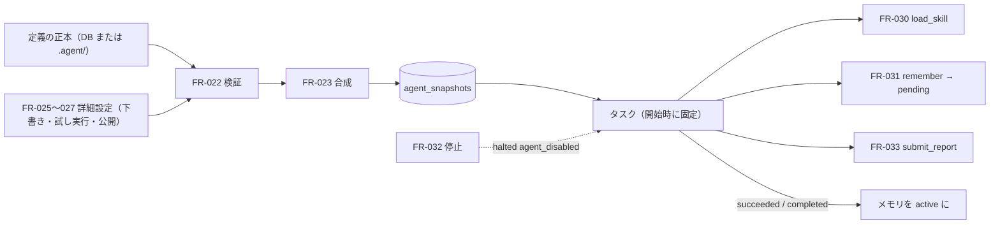

# 04. 機能仕様 — 定義の読込・詳細設定（下書き・試し実行・公開）・Skill・メモリ・停止・レポート
- 版数：v0.6（2026-10-01） ／ 親：[README.md](README.md) ／ 出典：04 §FR-022・024〜027・030〜033、12 §FR-022〜033、14 §決定事項・§要件

> **3行で**
> 1. 定義は検証・合成してから変更できないスナップショットにし、タスクは開始時のスナップショットに固定する（FR-022）。
> 2. v0.2 の作り方（下書き → Canvas → 試し実行 → PR で公開。FR-024〜027）は、v0.5 で「名前を付けて頼む」（[agents.md](agents.md)）に置き換わり、Canvas と試し実行は詳細設定（Could）に残る。下書きに依存する部分の再設計は Q-27。
> 3. Skill・メモリ・レポートは振る舞いを変えるだけで権限を与えず、保存前に秘密情報をマスクする（BR-23・BR-32）。

## 🧭 判断してほしいこと
[README](README.md#-判断してほしいこと) の Q-27（下書き系の再設計）、Q-32（`submit_report`）、Q-35（Skill をタスクから作る処理）。

## 全体図

見てほしいところ：どの経路の定義も同じ検証と合成を通る。メモリはタスクが成功したときだけ有効になる。

## 要点
- 検証エラーのコードは7つ（`AGENT_CLAMPED` だけ警告）。→ [FR-022](#fr-022)
- 試し実行は本番と同じ経路で、違いは「Intent を `simulated`」「予算 $1」「メモリを保存しない」の3つだけ。→ [FR-026](#fr-026)
- 公開は Gateway が `.agent/` 配下だけを書く PR で、エージェントの Intent ではない。→ [FR-027](#fr-027)
- メモリは1件500文字・1エージェント200件、注入は4,000トークンまで。→ [FR-031](#fr-031)
- エージェントの停止は maintainer 以上、再開はワークスペースの owner だけ。→ [FR-032](#fr-032)

---

## 詳細

### FR-022：エージェント定義の読込・検証 〔UC-020〕
- 概要：デフォルトブランチの `.agent/agents/*.yaml` と参照されている Skill を読み込み、検証と合成を行って、変更できないエージェントスナップショットとして保存する。設定プランナーの差分（FR-035）・下書き（FR-025）・公開 PR の CI も同じ検証を使う。フェーズ0（検証）/ 1（リポジトリからの読込）。アプリ内モード（定義の正本が DB）での読込は未設計（Q-27）。
- 利用ロール：システム（Webhook・worker）、viewer 以上（一覧・詳細の閲覧。API-041、API-042）
- 入力：repositoryId、commitSha（デフォルトブランチの HEAD）。デフォルトブランチへの `push` で `.agent/` 配下に変更がある場合と、リポジトリの連携時（FR-002）
- 処理：
  1. `push` で `.agent/` 配下に変更があればジョブを登録する（同じリポジトリのジョブは直列）。
  2. Gateway を通して `.agent/agents/*.yaml`（最大20ファイル、各64KB）と参照されている `.agent/skills/*/SKILL.md` を取得する。
  3. JSON Schema（`packages/policy-schema` に追加）で検証する。Skill がない、エージェント担当者（`owner`）がメンバーでない、同じラベルを複数のエージェントに設定した、なども検証エラー。
  4. FR-023 で合成する（ポリシーは同じコミットの FR-003 のスナップショット）。
  5. `agent_snapshots` に保存し（`source = branch`、`commit_sha` と Hard Ceiling の版 `ceilings_version` つき。NFR-036）、`agents` の状態を更新する。有効なものは `active`（`current_snapshot_id` を更新）、エラーは `invalid`、ファイルが消えたものは `removed`。`disabled` のエージェントの定義が更新されたら、`disabled` のままスナップショットだけ更新する。`default.yaml` がなければ組み込みの既定エージェント（`source = builtin`）を使う（BR-31）。
  6. スケジュールの次回時刻を計算し直す（`agent_schedules` のそのエージェントの行を作り直す。FR-028）。
  7. 公開 PR（FR-027）のマージによる変更なら、該当する下書きを `merged` にする。
  8. `agent.activated` / `agent.updated` / `agent.invalidated` / `agent.removed` を記録し、エージェント担当者とワークスペースの owner に Push 通知する（FR-017）。
- 出力：エージェントごとに `{ snapshotId, status: valid|invalid, definition, effectivePolicy, effectivePolicyHash, clamped[], errors[], warnings[] }`、および `agents.status`
- エラー・例外：

  | コード | 種類 | 内容 |
  |---|---|---|
  | `AGENT_SCHEMA_INVALID` | エラー | スキーマ違反（行番号つき） |
  | `AGENT_EXCEEDS_POLICY` | エラー | ポリシーより緩い（項目・定義の値・ポリシーの値） |
  | `AGENT_SKILL_NOT_FOUND` | エラー | 参照された Skill がない |
  | `AGENT_OWNER_INVALID` | エラー | エージェント担当者がメンバーでない、または viewer |
  | `AGENT_LIMIT_EXCEEDED` | エラー | 21個目以降のエージェント（ファイル名順。`default` は数えない） |
  | `AGENT_TRIGGER_CONFLICT` | エラー | 同じリポジトリの複数のエージェントに同じラベル |
  | `AGENT_CLAMPED` | 警告 | 公開後にポリシーが厳しくなり、切り詰めて実行している |

- 公開 PR の CI：`pull_request.opened` / `synchronize` を購読し、`.agent/**` を変更する PR（open-team が作ったものに限らない）に、PR の head の内容で2〜4 の検証と合成を行い、Check Run `open-team/agent-config` として返す（Gateway が作成。`checks: write`。A-43、BR-28）。
- ビジネスルール：BR-21、BR-22。`removed` になっても行は消さない（過去のタスクと監査ログから参照するため）。

### FR-024：設計アシスタント 〔UC-017, UC-024〕 — 廃止（v0.5、→ FR-035）
v0.5 で設定プランナー（[FR-035](agents.md#fr-035)）に置き換えた。タスクから Skill を作る処理と費用の上限の引き継ぎ先は Q-35。

v0.2 の仕様（参照用）

- 概要：作成者との会話から、下書きの YAML への変更案（JSON Patch）と説明を作る。検証を通ったものだけを下書きに反映する（BR-30）。利用ロールは maintainer 以上。
- 入力：`draftId`（`drafting` の下書き）、`message`（1〜4,000文字。API-045）。アシスタントに渡すもの：メッセージ、現在の下書き（YAML）、ポリシーの要約、既存のエージェントと Skill の一覧、テンプレートの説明。**リポジトリのコードは渡さない**。
- 処理：
  1. 呼び出し前に最大見積額 `estimatedCostUsd`（入力トークン数と `max_tokens` から計算）を求め、`assistant_cost_usd + estimatedCostUsd > 0.5` なら呼び出さずに 422（BR-30、A-35、NFR-059。FR-004 の予算判定と同じ考え方）。
  2. worker のジョブとして sandbox-edge の内部関数を経由して LLM を呼ぶ（要約の生成と同じ経路）。BYOK のキーと routing の `design`（未指定なら `plan`）のモデル（`phase = design`）。
  3. 応答 `{ explanation, patch }` の `patch` を下書きに適用した結果に FR-022 の検証と FR-023 の合成を行う。
  4. エラーがなければ反映し、変更点と `explanation` を SSE で返す（API-045）。Canvas では変わったノードを3秒ハイライトする。
  5. 費用を `assistant_cost_usd` に加算し、usage_records に `agent_draft_id` つき（`task_id` は NULL）で記録する。リポジトリの日次予算にも含める。
  6. 会話は秘密情報のパターンをマスクしてから保存する（BR-32、NFR-057）。
- 出力：`{ explanation, patch }` と反映後の検証結果（FR-025 と同じ形式）
- エラー・例外：変更案が合わない（1回目）→ 理由を返して1回だけ作り直させる。作り直しても合わない →「提案を反映できませんでした（理由）」。上限超過 → 422 `ASSISTANT_BUDGET_EXCEEDED`（以後は手での編集だけ）。応答待ち中の次のメッセージ → 409 `ASSISTANT_BUSY`。下書きが `drafting` でない → 409 `AGENT_DRAFT_NOT_EDITABLE`。4,000文字超 → 400 `VALIDATION_ERROR`。
- タスクから Skill の下書きを作る（UC-024、API-053）：`succeeded` または `completed`（`report`）で終わったタスク（試し実行を除く）の経過（ツール呼び出しの列と差分の要約）から `SKILL.md` の下書きを作り、そのエージェントの定義に Skill を追加した下書きを作る（FR-030）。
- 安全：アシスタントは公開・試し実行・権限の付与を行えない。できるのは下書きへの変更案の提示だけ。
- ビジネスルール：BR-20、BR-21、BR-30、BR-32

### FR-025：下書きと Canvas 〔UC-017〕
- 概要：定義の下書きを保存し、Canvas・フォーム・YAML のどれからでも編集・検証できるようにする。「このエージェントにできること」を実効ポリシーから生成する。v0.5 で詳細設定のタブ（SCR-017）に移り Could。下書き（TBL-021）と下書き API（API-043〜048・057・058）は v0.5 で廃止（以下は v0.2 の仕様。Q-27）。
- 利用ロール：maintainer 以上（作成・編集）
- 入力（作成。API-043）：`repositoryId`（連携中）、作成元（空 / テンプレート / 既存エージェントの複製）、`slug`（新規のとき。`^[a-z0-9][a-z0-9-]{1,31}$`。`default` は既定エージェントの上書きにだけ使える。同じ ID（`removed` を除く）があれば 409 `AGENT_SLUG_TAKEN`）
- 入力（更新と検証。API-046）：`definitionYaml`（最大64KB。フォームの編集もクライアントで YAML に反映して送る）、`skills[{ name, content }]`（`name` は `^[a-z0-9-]{2,40}$`、`content` は最大16KB）
- 処理：
  1. `agent_drafts` に `drafting` で保存する。同じエージェントに複数の下書きがあってもよい（公開 PR の衝突は GitHub 上で解決）。
  2. 更新のたびに FR-022 の検証と FR-023 の合成（デフォルトブランチ HEAD のポリシー）を行い、`last_validation` に保存する。エラーがあっても下書きは保存する。
  3. Canvas・フォーム・YAML は同じ下書きを編集する。YAML のコメントはフォームで編集しても保持する（AST を保持して部分的に書き換える）。YAML タブは入力が1秒止まったら検証する。
  4. 「このエージェントにできること」を実効ポリシーから固定の文テンプレートで生成する（LLM を使わない）。例：「`src/**` と `test/**` のファイルを変更できます（`src/billing/**` を除く）」「PRを作るには ren の承認が必要です」「1回あたり最大 $1.00、1日 $5.00 まで」。
  5. ポリシーや Hard Ceiling でこれ以上緩められない項目は `locked` として返し、Canvas では鍵アイコンと制限している値を表示する（例：ポリシーが `open_pr: approve` なら `open_pr: auto` は選べない）。Canvas 上の略記（`network` = `autonomy.shell_network` など）は表示上の略記として許す。
  6. 既存エージェントの編集では、公開済みの定義が現在のポリシーで切り詰められている項目を `clamped` として返す。下書きの値がポリシーより緩い場合は clamp ではなく `errors`（`AGENT_EXCEEDS_POLICY`）。
  7. 下書きの一覧（API-057、maintainer 以上）と破棄（API-058、作成者かワークスペースの owner。`discarded`）を提供する。
- 出力（API-046、200）：`{ draftId, errors[], warnings[], effective, locked: [{ path, by, limit? }], clamped: [{ path, defined, effective }], summary[] }`。Canvas の各ノードの値のデータ元は `agent_drafts.definition_yaml`（TBL-021）
- エラー・例外：検証エラー → 下書きは保存し 200 で `errors` に入れる（エラーの間は「試し実行」「公開する」を押せない）。制限された値 → 選べず「リポジトリのポリシーで制限されています」と鍵アイコン。`drafting` でない → 409 `AGENT_DRAFT_NOT_EDITABLE`。読込後に別の編集で更新された → 409 `AGENT_DRAFT_CONFLICT`。
- データの保持：会話の全文は秘密情報をマスクし（BR-32）、暗号化してオブジェクトストレージに30日。90日更新のない `drafting` は `discarded`。
- ビジネスルール：BR-20、BR-21、BR-30、BR-32

### FR-026：試し実行 〔UC-018〕
- 概要：下書きの定義で本番と同じ経路を通し、外部作用だけを Gateway の手前で止める（ADR-015）。v0.5 で詳細設定に移り Could（Q-27）。
- 利用ロール：maintainer 以上
- 入力（API-047）：`draftId`（`errors` が空）、`issueNumber`（△。1以上、Open）か `prompt`（△）のどちらか
- 処理：
  1. 下書きの定義とデフォルトブランチ HEAD のポリシーから合成し（FR-023）、下書きからスナップショットを都度作る（`source = draft`、`agent_draft_id` つき）。
  2. 予算を `min(per_task_usd, 1.0)` にし、`is_dry_run = true`・`trigger_type = dry_run`・`agent_draft_id` つきのタスクを作る（`agent_id` は NULL）。
  3. 実行経路は通常と同じ（FR-007〜FR-009）。違いは3つだけ：(1) FR-010 で保存した Intent を判定にかかわらず `simulated` にし、承認にも Gateway にも渡さない（承認カードはプレビュー）、(2) 予算は `min(per_task_usd, 1.0)`、(3) メモリへの書き込みは受け付けるが保存しない。
  4. タスクは `completed`（`status_detail = dry_run`）。
- 出力：タスク（SCR-005 に「試し実行」の帯）。結果（タイムライン・差分・プレビュー・費用）は下書きに紐づいて残る。
- エラー・例外：UC-007・UC-008 と同じ。費用が $1 に達したら次の LLM 呼び出しの前に停止する。
- ビジネスルール：BR-22、BR-24（同時実行数とリポジトリの日次予算には数え、`max_runs_per_day` と BR-29 には数えない）。「以後も許可」は試し実行では出さない（15）。

### FR-027：公開 〔UC-019〕
- 概要：下書きを `.agent/` 配下のファイルに書き出し、PR として提出する（GitOps モード）。有効になるのは PR がマージされて FR-022 で読み込まれたときだけ（ADR-011）。アプリ内モードでは保存した時点で有効（ADR-017。Q-27）。
- 利用ロール：maintainer 以上（マージは GitHub 上の権限）
- 入力（API-048）：draftId
- 処理：
  1. デフォルトブランチの最新のポリシーで再検証する（FR-022、FR-023）。
  2. 下書きを YAML（`.agent/agents/<slug>.yaml`）と Skill（`.agent/skills/<name>/SKILL.md`）に書き出す。
  3. Gateway の内部 API `POST /gw/v1/agent-config-prs` を `{ repositoryId, draftId, files: [{ path, content }] }` で呼ぶ。`path` が `.agent/` 配下でなければ拒否（BR-28）。
  4. Gateway はブランチ `open-team/agent-config/<draftId の先頭8文字>` を作り、`.agent/` 配下だけをコミットして PR を作る。コミットの作成者は GitHub App、タイトルは `open-team: <エージェント名> を追加 / 更新`、本文に実効ポリシーの要約・前の定義との差分・試し実行の結果へのリンク。
  5. 下書きを `published`（PR 番号つき）にし、`agent_config.pr_opened` を記録する（ユーザーの操作で、主体は操作したユーザー）。
  6. レビューとマージは GitHub 上で行う（ブランチ保護などがそのまま効く）。
  7. マージされずにクローズされたら（FR-002）下書きを `drafting` に戻し（`pr_number` を `last_pr_number` に）、再公開できるようにする。
- 出力：PR の番号と URL
- エラー・例外：再検証でエラー → 422 `AGENT_DRAFT_INVALID`（`errors` つき、PR は作らない）。公開済み → 409 `AGENT_DRAFT_ALREADY_PUBLISHED`。GitHub API のエラー → 502 `GITHUB_UPSTREAM_ERROR`。
- ビジネスルール：BR-21、BR-28。マージされていないエージェントは起動できない（試し実行のみ）。

### FR-030：Skill 〔UC-017, UC-024〕
- 概要：再利用できる手順を `.agent/skills/<name>/SKILL.md` で管理し、エージェントに付ける（形式は [policy-and-schema.md](policy-and-schema.md#skill-format)）。権限を与えない（BR-23）。フェーズ1。
- 利用ロール：エージェント（`load_skill`）、maintainer 以上（作成・タスクからの下書き作成）
- 処理（読込）：FR-022 で定義の `skills` に書かれた SKILL.md を取得し、frontmatter と本文の形式を検証して、スナップショットの `skills` に `{ name, description, content, sha256 }` で保存する（タスクは開始時の Skill に固定）。
- 処理（実行時）：コンテキスト（API-036）に `name`・`description`・本文を入れ、システムプロンプトには `name` と `description` だけ。本文は「利用者が書いたデータ」として区切る。`load_skill(name)` は LLM Proxy が read として判定し、`allow` なら本文を返す。付けられていない名前は deny。Skill に書かれたコマンドも `commands.allow` と実効ポリシーで判定する。
- 処理（タスクからの作成。UC-024、API-053）：`succeeded` または `completed`（`report`）のタスク（試し実行を除く）で「このやり方を Skill にする」を押すと、設計アシスタント（v0.2。後継は Q-35）が経過から `SKILL.md` の下書きを作り（秘密情報をマスク。BR-32）、Skill を追加した下書きが開く。以降は FR-025〜027 と同じ。
- エラー・例外：

  | 条件 | 挙動 |
  |---|---|
  | 定義が参照する Skill がない | `AGENT_SKILL_NOT_FOUND`（FR-022） |
  | 付けられていない Skill を `load_skill` | deny（ポリシーにより拒否として返す） |
  | 形式違反（`name` がディレクトリ名と不一致、`description` がない、本文16KB 超） | `AGENT_SCHEMA_INVALID`（FR-022） |
  | タスクが対象外（API-053） | 409 `TASK_NOT_COMPLETED` |

- ビジネスルール：BR-22、BR-23、BR-32。1エージェント20個まで（A-34）。

### FR-031：エージェントメモリ 〔UC-023〕
- 概要：エージェントごとのメモリを項目単位で保存し、完了したタスクの書き込みだけを有効にする（ADR-014）。フェーズ1。
- 利用ロール：エージェント（`remember`）、viewer 以上（閲覧。API-051）、maintainer 以上（削除。API-052）
- 処理（書き込み）：
  1. `memory.enabled: false` なら `remember` を渡さない（呼ばれたら deny）。
  2. `remember`（`content` 1〜500文字。API-055）は LLM Proxy で `memory_write` として判定し、`allow` のときだけ Internal API に送る。
  3. 秘密情報のパターン（`ghs_`、`sk-`、`AKIA`、秘密鍵のヘッダーなど）をマスクする（BR-32）。
  4. `pending` で保存し、`source_task_id`（NULL 可。タスクの削除で NULL。ON DELETE SET NULL）と表示用の `source_task_ref`（例「task 8f2a / Issue #123」）を残す。
  5. 試し実行の書き込みは受け付けるが保存しない（BR-24、BR-26）。
- 処理（有効化。BR-26）：タスクが `succeeded` または `completed`（`report` / `actions_declined`）で終わると `pending` を `active` に、停止・失敗・却下なら `discarded` にする。
- 処理（注入）：次のタスクの開始時に `active` を新しい順に合計4,000トークンまで入れる（A-38）。
- 処理（上限）：1件500文字、1エージェント200件（`memory.max_items`、1〜200）。超えたら古い `active` から `expired`。
- 処理（削除）：maintainer 以上が1件ずつ削除できる。`deleted`（`deleted_by` つき）にし、`agent.memory_deleted` を記録する。
- エラー・例外：`memory_write` が deny → 保存せず「ポリシーにより拒否」。文字数が範囲外 → 400 `VALIDATION_ERROR`。削除の権限がない → 403 `FORBIDDEN`。
- ビジネスルール：BR-23、BR-24、BR-26、BR-32

### FR-032：エージェントの停止・スコアカード 〔UC-022〕
- 概要：ワークスペース全体を止めずにエージェント単位で停止・再開する。実績（スコアカード）を集計する。フェーズ0（停止）/ 1（スコアカード）。
- 利用ロール：maintainer 以上（停止）、ワークスペースの owner（再開）、viewer 以上（スコアカード・全体の一覧 API-059）
- 処理（停止。API-049）：理由（必須）を受け、`disabled`（`disabled_by`・`disabled_reason`・`disabled_at`）にし、実行中・待機中のタスクを FR-015 と同じ手順で止める（`halted`、`agent_disabled`。p95 ≤ 10秒）。`agent.disabled` を記録し、担当者と owner に通知する。停止中はどのトリガーでも起動しない（BR-27）。
- 処理（再開。API-050）：owner が `active` に戻す（`agent.enabled`）。停止したタスクは再開しない。
- 処理（スコアカード）：毎時、直近30日のタスク数・PR 到達率・承認率・平均費用・平均ステップ数・Breaker 作動回数・clamp の有無を `agents.scorecard` に保存する。
- 信頼度提案（FR-021）をエージェント単位で行う（提案は SCR-017）。
- 処理（全体の一覧。API-059）：ワークスペースのすべてのエージェントを返す（`status` で絞り込み。SCR-002）。
- エラー・例外：停止・再開の権限がない → 403 `FORBIDDEN`
- ビジネスルール：BR-17、BR-27

### FR-033：レポート 〔UC-007〕
- 概要：エージェントのレポートを受け付け、open-team の中だけに保存して表示する。外部作用ではないので承認は不要（A-39）。v0.4 で出典（`sources[]`）を必須にし、汎用テンプレートにも広げた（対象は Q-32）。フェーズ0。
- 利用ロール：エージェント（サンドボックストークン。API-056）、viewer 以上（閲覧）
- 入力：`title`（1〜256文字）、`body`（Markdown、最大50,000文字）、`sources[]`（13）
- 処理：
  1. `submit_report` を Internal API（API-056）で受け付ける。
  2. 本文は保存前に秘密情報をマスクする（BR-32）。Web から得た内容を含む場合は出典の URL を付け、出典のない主張は「出典なし」と表示する（BR-45）。
  3. `tasks.report` に保存し、タスクを `completed`（`report`。試し実行は `dry_run`）にする。サンドボックスを終了させる（FR-007 の8）。仕事に `deliver` があれば Intent を作る（BR-58。タスクの終わり方は [intents.md](intents.md#task-endings)）。
  4. そのタスクのメモリの `pending` を `active` にする（試し実行を除く）。
  5. `task.report_submitted` を記録し、依頼者に Push 通知する（FR-017）。
- 出力：タスク詳細（SCR-005）での表示。本文は Markdown として表示し、リンクは表示時に無害化する。
- エラー・例外：dev-coder から呼ばれた → テンプレートにないツールとして deny（BR-09。Q-32）。本文50,000文字超 → 400 `VALIDATION_ERROR`。2回目の提出 → 409 `REPORT_ALREADY_SUBMITTED`。
- ビジネスルール：A-39、BR-32、BR-45。GitHub には何も書き込まない。

## このドキュメントで決まったこと
- [ADR-011](../adr/ADR-011-agent-definition-in-repo.md)：GitOps モード（定義をリポジトリに置く）
- [ADR-014](../adr/ADR-014-server-side-memory.md)：メモリはサーバー側、完了したタスクの書き込みだけ有効
- [ADR-015](../adr/ADR-015-dry-run-same-path.md)：試し実行は本番と同じ経路
- [ADR-017](../adr/ADR-017-in-app-definition-default.md)：アプリ内モードを既定にする
