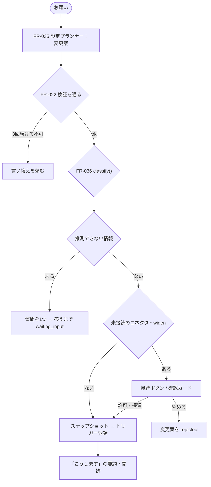
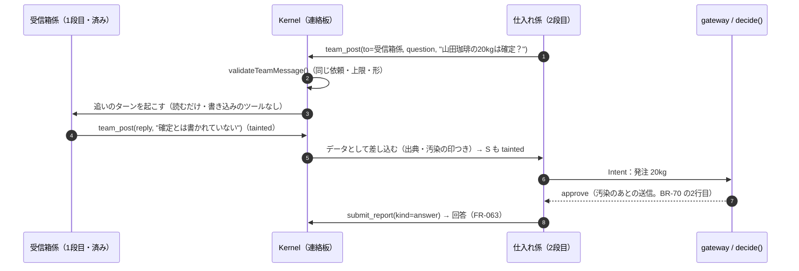

# 04. 機能仕様 — 名前を付けて頼むエージェント（作成・自己設定・仕事・チャット・自己調整）
- 版数：v0.14（2026-10-02） ／ 親：[README.md](README.md) ／ 出典：14（全体）、12 §エージェント間の委任（フェーズ2）、15 §ルールを作る・消す、v0.12 の依頼から編成を生成する（[ADR-036](../adr/ADR-036-ask-generates-formation.md)、[D-63〜68](../decisions.md#d-63)）、v0.14 の連絡板と回答（[ADR-038](../adr/ADR-038-team-board-and-one-answer.md)、[D-72](../decisions.md#d-72)）

> **3行で**
> 1. ユーザーはエージェントに名前を付け（空でもよい）、チャットでお願いするだけ。テンプレート・ツール・トリガー・届け先はエージェント（設定プランナー）が決める。
> 2. 設定の変更は `classify()` が narrow / neutral / widen に分け、widen だけを確認カードで人に戻す。ユーザーに聞くのは4つの場面だけ、質問は1つまで。
> 3. エージェントは反応・発言・実行の成否で自分を調整し続けるが、外部の内容を根拠にした変更は自動では反映しない。変更はすべて記録し、1タップで戻せる。
>
> **v0.12 で変わったこと**：ユーザーが名前を付ける手順をなくした。入口（SCR-020）で頼むと、設定プランナーが **編成**（誰がやるか・何人に分けるか）を作る。合う担当は使い回し、いなければ名前を付けて新しく作る。分け方は ひとり／並列／まとめ／順番 の4つ（[FR-061](#fr-061)・[FR-062](#fr-062)）。名前を付けて作る FR-034 は、メニューの奥のエージェント一覧に残す。
>
> **v0.14 で変わったこと**：複数の担当は、依頼ごとの **連絡板** で分かったことを共有し、質問し合ってから進める（[FR-064](#fr-064)）。担当が何体でも、ユーザーには依頼1件につき **回答を1つ** 返す。書くのは編成の窓口（ひとりならその担当、まとめはまとめ役、順番は最後の段）（[FR-063](#fr-063)）。連絡で担当も権限も増えず、汚染は連絡でも引き継ぐ。

## 🧭 判断してほしいこと
[README](README.md#-判断してほしいこと) の Q-28（widen の承認者）、Q-34（`idle` と仕事の状態）、Q-35（Skill をタスクから作る処理）、Q-37（自己設定の未決）。

| # | 種類 | 論点 | 選択肢 | おすすめ（理由） | 決まらないと止まるもの |
|---|---|---|---|---|---|
| Q-111 | ✅決定 | 並列の回答を誰が作るか（FR-063） | → **A：Kernel が担当ごとの報告を見出しつきで並べる（LLM なし）**（[D-74](../decisions.md#d-74)） | （呼び出しが増えず、汚染が1か所に集まらない。比べてほしい依頼は設定プランナーが「まとめ」を選ぶので、並列で文章にする場面は少ない） | 並列の回答の見た目（SCR-019・021） |
| （仮の値） | — | A-103 連絡は1依頼20通・質問は3往復、A-104 返事を待つのは5分、A-105 追いのターンは1ターン | 実機で、往復の数・待ち時間と費用を測って決め直す | — | FR-064 |

## 全体図

見てほしいところ：narrow / neutral はそのまま反映、止まるのは「質問」「接続」「widen」の3か所だけ（書き込みの初回の承認カードは実行時に別に出る）。

## 要点
- 作成直後のエージェントは仕事も付与もなく、「最初の境界」（Web 読み取り・通知・メモリ・低い予算）だけを持つ。→ [最初の境界](#initial-boundary)
- 名前から役割を推測するが、役割は挨拶・初期値・提案にだけ使い、権限に影響しない（BR-48）。→ [名前と役割](#name-and-role)
- 1体が複数の仕事（once / recurring / watch）を持ち、権限の境界は全仕事で共有する。→ [FR-037](#fr-037)
- 設定プランナーは「以後も許可」のルールを提案・追加できない（BR-57）。→ [FR-035](#fr-035)
- 自動の調整は1つの仕事につき1日1回まで、戻された種類の調整は14日間行わない。→ [FR-039](#fr-039)

---

## 詳細

### 概念
| 概念 | 説明 |
|---|---|
| エージェント | 名前のある担当者。**権限の境界**（使えるコネクタのツール・Web の範囲・作用の自律度・予算）と、メモリ・会話・プロフィールの公開範囲を持つ。仕事どうしは境界を共有する |
| 役割 | 名前と最初のお願いから推測した得意分野（`research` / `watch` / `brief` / `assist` / `dev`）。挨拶・テンプレートの初期値・「任せますか？」の提案に使う。**権限には影響しない**（BR-48） |
| 仕事（job） | 1つのお願いから作る実行の単位。テンプレート・指示・トリガー・届け先・通知の設定を持つ。`once` / `recurring` / `watch` の3種類 |
| 設定の変更（config change） | エージェントが自分の定義に加えたい差分。Kernel が分類し、広げる変更は承認を待つ。反映すると新しいスナップショット |
| 会話 | エージェントのチャット。お願い・確認カード・承認カード・結果の要約・変更の記録がすべてここに流れる |

> 原則：エージェントは自分の設定を書き換えられるが、自分の権限は広げられない。権限を広げられるのはユーザーの承認だけ。

### 最初の境界
作成直後のエージェントは、ワークスペースのポリシーの範囲で次だけを持つ。これより広い付与は、お願いの中で必要になったときに `widen` として確認する。

| 持つもの | 理由 |
|---|---|
| `web_read`（`auto`） | ワークスペースのポリシーが許す範囲。リサーチ系のお願いを確認なしで始められる |
| `notify`・`submit_report` | 組み込み。外部作用ではない |
| `memory_write`（`auto`） | 12 の既定と同じ |
| 予算 `per_task_usd: 0.2`、`per_day_usd: 1`、`max_runs_per_day: 10` | ワークスペースのポリシーより低い場合はそちらに合わせる（A-79） |

### 確認する場面（BR-49）
ユーザーに聞くのは次の4つだけ。それ以外（時刻・件数・長さ・情報源など）はエージェントが既定値で決めて「こうします」に書き、違えばユーザーが同じチャットで言い直す。

| 場面 | 出し方 |
|---|---|
| 推測できない情報が要る（通勤経路・テーマが曖昧など） | 質問を **1つだけ**。答えはプロフィール（REQ-048）に保存し（聞かずに保存）、公開範囲はこのエージェントだけ。答えが返らなければ仕事は `waiting_input` のまま（推測で動かさない） |
| 必要なコネクタがつながっていない | 「〇〇をつなぐ」ボタン（フェーズ0は URL の登録画面へ、フェーズ1は OAuth） |
| `widen` の変更 | 確認カード：「このエージェントが新しくできるようになること」を1行ずつ。[許可] [やめる] |
| 書き込みの初回（Intent） | 従来の承認カード（[承認] [以後も許可] [やめる]）。FR-011 |

### 名前と役割
| 名前の例 | 推測する役割 | 新しい仕事のテンプレートの初期値 | 最初の挨拶 |
|---|---|---|---|
| ニュースリサーチャー、調べ物係 | `research` | `researcher` | 「どんなニュースを、どのくらいの頻度で調べましょう？」 |
| 見張り番、価格ウォッチャー | `watch` | `watcher` | 「何を見張りましょう？ 変わったときだけお知らせします」 |
| 朝のまとめ、秘書 | `brief` / `assist` | `briefer` / `assistant` | 「毎日の何をまとめましょう？」 |
| エンジニア、バグ修正係 | `dev` | `dev-coder` | 「どのリポジトリで、何をしましょう？」（GitHub が未接続なら接続ボタンも） |
| 推測できない名前（「ポチ」など） | なし | お願いごとに決める | 「何をしましょう？」 |

- 推測は LLM が行うが、結果は5つの役割のどれか（またはなし）に限る（A-83）。「経理担当」と名付けても支払いの権限は付かない。
- 役割は、仕事が増えると仕事のテンプレートの多数決で更新する（`neutral`）。

### FR-034：エージェントの作成（名前のみ） 〔UC-025〕
- 概要：名前（任意）だけで作成し、最初の境界を付け、役割を推測して挨拶する（REQ-052・REQ-058。REQ-020 を置き換え）。フェーズ0。
- 入力（API-060）：`name?`
- 処理：
  1. エージェント一覧（SCR-014）の「＋ 新しいエージェント」で名前を入力する（空でもよい）。アイコンは名前から自動で選ぶ。
  2. エージェントを最初の境界で作り（TBL-018、`status = idle`。Q-34）、`agent.created` を記録する。
  3. 名前から役割を推測し（できなければ `null`）、役割に合わせた挨拶をチャットに出す。入力欄の上に役割に合わせた例文を3つまで出す（最初のお願いの前だけ）。
  4. 名前が空なら仮の名前「新しいエージェント」で始め、最初のお願いから設定プランナーが名前を1つ提案してそのまま付ける。チャットに「名前を『〇〇』にしました [名前を変える]」を出す（`name_source = suggested`）。
- 出力：エージェントと挨拶のメッセージ
- エラー・例外：ワークスペースのエージェントが20体に達している → 作成できない旨と、止まっているエージェントの一覧を出す（A-81）。
- ビジネスルール：名前はワークスペースの中で重複できない。重複する場合は末尾に番号を付ける（「朝の交通係 2」）。BR-48。

### FR-035：設定プランナー 〔UC-026, UC-028〕
- 概要：お願い・反応から、定義の差分（JSON Patch）と確認事項を作る（REQ-053・REQ-054）。v0.3 の設計アシスタント（FR-024）を置き換える。フェーズ0。
- 入力：お願いの本文、現在の定義（秘密情報はマスク）、ワークスペースのポリシーの要約、接続済みのコネクタとツールの分類、プロフィールの項目名（値は渡さない）
- 処理：
  1. routing の `plan` のモデルで呼ぶ（A-82）。費用は `usage_records` に `agent_id` つき・`task_id` は NULL で記録する（BR-30 と同じ）。
  2. 出力の差分は FR-022 の検証を通らなければ反映しない。通ったら FR-036 で分類する。
  3. お願いが既存の仕事の変更（「もっと短く」）なら、その仕事の変更案を作る（UC-026 2a）。
- 出力：`{ patch, questions[≤1], summary, suggested_name?, delegate_to? }`
- エラー・例外：3回続けて検証に通らない案 → お願いを言い換えてもらうよう返す（UC-026 E2）。ユーザーが [やめる] → 変更案を `rejected` にし何も反映しない。
- ビジネスルール：
  - 設定プランナーの呼び出しはタスクとは別のもので、外部の内容を読まないので `tainted` にならない。ただし会話に貼られた外部の文章はお願いとして扱い、ユーザーの発言として記録する。
  - 「以後も許可」のルールは提案・追加できない（ルールは承認カードからしか作れない。BR-57）。
  - BR-47：定義を変えられるのは、①ユーザーの直接の操作（詳細設定・確認カード）、②設定プランナーの変更案のうち `classify()` が `narrow` / `neutral` としたもの、の2つだけ。`widen` は①でしか反映しない。

### FR-037：仕事 〔UC-026, UC-027〕
- 概要：仕事の作成・変更・一時停止・削除・移動。仕事ごとのトリガー・テンプレート・届け先（REQ-055）。フェーズ0。
- 処理：
  1. お願いから仕事を作る（UC-026）：新しいスナップショットを作り、トリガーを登録する。`once` の仕事と、繰り返す仕事の初回の確認実行は、すぐにタスクを作る（初回の確認実行を必ず行うかは Q-37）。「こうします」の要約をチャットに出す。
  2. 一覧と一時停止・再開・削除（API-065）。中身（指示・トリガー・届け先）はスナップショットの定義が正で、TBL-023 は一覧と状態のためのもの。
  3. 移動（UC-027、API-066）：ユーザーが [〇〇に任せる] を押したら、移す先の境界で `classify()` をやり直し、`widen` があれば確認カードを出す。仕事を移し、元のエージェントではその仕事だけが使っていた付与を外す（`narrow`）。両方のチャットに記録し、`job.moved` を記録する。
- 制限：1エージェント10個まで（A-81）。実行回数は `max_runs_per_day`（エージェント単位）で頭打ち。
- 状態：`waiting_input` / `active` / `paused` / `done`（[status.md](status.md#job-status)）

### FR-038：エージェントのチャット 〔UC-025〜028〕
- 概要：お願い・質問・確認カード・承認カード・結果の要約・変更の記録を1本の会話に流す。音声入力（PWA の音声入力、REQ-038）。フェーズ0。
- 処理：
  1. お願い・返答は API-062 で送り、応答は SSE でエージェントの発言とカードを順に返す。会話の取得は API-061（カーソルでページング）。
  2. 発言は秘密情報をマスクしてから保存する（BR-32）。保存期間は90日、古いものは要約を残して消す（A-80）。
  3. カードの種類：こうします（[変える]）、接続（[〇〇をつなぐ]）、確認（`widen`。[許可] [やめる]。API-063）、承認（Intent。[承認] [以後も許可] [やめる]）、結果（👍 / 👎 と理由。API-067）、変更の記録（[元に戻す]。API-064）、任せ先の提案（[任せる] [このまま]）。画面は [06](../06_ux_design/README.md) の SCR-018。
  4. プッシュ通知をタップすると、そのエージェントのチャットの該当のカードを開く。

### FR-039：自己調整 〔UC-028〕
- 概要：反応の集計、調整の条件の判定、BR-51〜54 の適用、元に戻す（REQ-056）。フェーズ0（チャットの一言による調整）/ 後回し可（👍👎・開封時刻による自動の調整）。
- トリガー：タスクの完了、👍 / 👎 の入力、通知の開封の集計（1日1回）
- 処理：
  1. worker が仕事ごとの反応・成否を集め、下の表の条件に当たるかを判定する。
  2. 当たれば設定プランナーに調整案を作らせる（根拠は BR-51 の範囲）。
  3. Kernel が分類し、`neutral` / `narrow` で BR-52・BR-54 に当たらなければ反映する。それ以外は確認カード。
  4. チャットに「何を・なぜ変えたか」と [元に戻す] を出す。

| 見るもの | 変えるもの | 分類 | 反映 |
|---|---|---|---|
| チャットでの一言（「もっと短く」「日経も見て」「月曜は休み」） | 指示文・情報源・トリガー | ほとんど `neutral`（ドメインの追加などは `widen`） | お願いと同じ流れ |
| 結果への 👍 / 👎 と理由（長い・古い・関係ない・間違い） | 指示文・件数・情報源の優先度 | `neutral` | 自動で反映し記録 |
| 通知を開いたか・開いた時刻 | 実行時刻（前後30分まで）、`quiet_if_normal` | `neutral` | 自動で反映し記録 |
| 同じ情報源での失敗・空振りが3回続く | 情報源の差し替え（許可済みドメインの範囲） | `neutral` | 自動で反映し記録 |
| 結果が7日続けて開かれていない | 仕事を止める **提案** | `narrow` | 提案だけ（勝手に止めない） |
| 新しいツール・宛先・ドメインが要りそう | 境界を広げる **提案** | `widen` | 確認カード |

- 制限（14 §自己調整の制限）：
  - BR-51：自動の調整は**ユーザーの反応・発言・実行の成否**だけを根拠にする。タスクで読んだ外部の内容（Web・MCP の応答）を根拠にした変更案は、`neutral` でも確認カードにする（汚染の追跡を設定にも広げる）。`agent_config_changes.source_task_id` で判定する。
  - BR-52：自動の反映は1つの仕事につき1日1回まで。指示文の自動の変更は、ユーザーが書いた指示を消さず、末尾の「調整メモ」（`tuning`）だけを書き換える。
  - BR-53：すべての変更は新しいスナップショットになり、チャットに「何を・なぜ」と [元に戻す] を出す。元に戻す操作は `narrow` または `neutral` として即時に反映する（`agent.config.reverted`）。
  - BR-54：[元に戻す] を押した調整と同じ種類の調整は、その仕事では14日間自動で行わない。

### FR-040：任せ先の提案 〔UC-027〕
- 概要：お願いの種類と各エージェントの役割を照らして提案を出す。[このまま] を記憶する（REQ-057）。フェーズ0（後回し可）。
- 処理：
  1. 役割に合わないお願いでも **引き受ける**。仕事のテンプレートはお願いの内容で決める。
  2. 同じワークスペースに、お願いの内容と役割が一致するエージェントがいれば「〇〇に任せますか？」と提案する。[任せる] は FR-037 の移動。[このまま] は、同じ組み合わせ（エージェント × 役割）では以後提案しない。
  3. 一致するエージェントがいなければ、提案せずにそのまま引き受ける。新しいエージェントを勝手に作らない（エージェントのチャットで頼んだ場合。入口 SCR-020 で頼んだ場合は FR-061 が担当を作る）。
  4. 移すかどうかをエージェントの間で勝手に決めない。移すのはユーザーが [任せる] を押したときだけ（フェーズ2の委任 REQ-032 とは別）。

### エージェント間の委任（フェーズ2。REQ-032）
12 §フェーズ2の設計概要の範囲。詳細はフェーズ1の実装の後に設計する。
- 委任は `delegate` の Intent とし、`delegation.allow: [agent-id]` に書かれた相手にだけ委任できる。
- 委任先のタスクの予算は委任元の残りの予算から切り出す。委任の深さは2まで。
- 委任先のタスクは `parent_task_id` を持ち、委任元のタスクの停止で一緒に止まる。
- 取りまとめ役のテンプレート `coordinator`。エージェント間のメッセージは「データ」として渡し、相手の権限は増やさない。

### FR-061：依頼から編成を作る（エージェント生成） 〔UC-040〕
- 概要：入口（SCR-020）の依頼から、設定プランナーが編成（担当のエージェントと形）を作り、足りない担当を生成して、そのまま仕事を始める（REQ-063・REQ-064）。FR-035 の拡張。フェーズ0（ハッカソン版は「ひとり」と「順番」が Must、並列・まとめは Should。D-68・D-71）。
- 入力（API-072）：`text`（依頼の本文）、`mention?`（「@仕入れ係」で担当を指定したとき）
- 処理：
  1. 依頼（`asks`）を `generating` で作り、`ask.created` を記録する。SSE で「生成中」を返す。
  2. 設定プランナー（FR-035 と同じモデル・同じ費用の記録）に、依頼の本文・既存のエージェントの一覧（名前・役割・仕事の数・付与の要約）・ワークスペースのポリシーの要約・接続済みのコネクタを渡し、**編成案** を作らせる。
  3. 編成案を Kernel の `validateFormation()`（純粋関数）で検査する。通らなければ理由を添えてもう一度作らせ、3回続けて通らなければ「うまく決められませんでした」で終える（UC-040 E1）。
  4. 担当ごとに：既存のエージェントなら FR-037 で仕事を足す。新しいエージェントなら、設定プランナーが付けた名前と役割で作り（最初の境界。`name_source = suggested`）、仕事を足す。どちらも設定の変更は FR-036 の `classify()` を通り、`widen` は確認カード（SCR-019 の送る前の確認）で止まる。編成全体の確認は挟まない（D-67）。
  5. 依頼を `running` にし、`ask.formed`（編成案・担当ごとの「新しく作った / 使い回した」）を記録する。SSE で編成を返し、SCR-020 が表示する。
  6. 形が「ひとり」「並列」なら各担当の仕事をすぐ始める。「まとめ」「順番」なら FR-062 で進める。
- 出力：`formation { shape, members[{ agentId, agentName, isNew, jobId, summary, position, dependsOn[] }], aggregator? }`
- 使い回すか作るかの決め方（設定プランナーへの指示。最終的な判断は案の中身で、Kernel は検査だけをする）：
  - 役割と、その仕事に要るコネクタ・付与がすでにあるエージェントを優先して使い回す（引き継がれるのは、定義に入る「以後も許可」のルール・リハーサルで権限を絞った設定・付与と、担当単位の作業場の控え・スキル。合格証とリハーサルの結果〔本番で止めた発注を入れた試験を含む〕は仕事ごとで、使い回しても依頼ごとに新しい仕事になるので引き継がれない。D-120 で訂正）。
  - 使い回しの画面（D-120）：依頼のページ SCR-021 の段に「新しく作りました」または「いつもの担当 · 前の依頼 N件でも働きました」を出し（API-075 の `StageView.isNew`・`reuseLine`）、ライブラリ SCR-014 のカードに成長の1行 `growthLine`（使い回し N回 · 以後も許可にした N回 · 権限を絞った N回 · スキル N件。API-041 の `growth`）を出す。設定プランナーに渡す仕事の例（`jobHints`）は新しい順3件。
  - 合う担当がいない、仕事がすでに10個ある（A-81）、ユーザーが「新しい担当で」と書いた、のどれかなら作る。
  - `mention` があればその担当を使う（形は「ひとり」）。
- 形の選び方（設定プランナーへの指示）：

| 形 | 選ぶとき | 例 |
|---|---|---|
| ひとり | 1つの成果を、1つの権限の境界で作れる | 「在庫が減ったら発注して」→ 仕入れ係 |
| 並列 | 依頼に、互いの結果を使わない成果が2つ以上ある | 「毎朝ニュースをまとめて。あと在庫も見張って」→ ニュース係・仕入れ係がそれぞれ報告 |
| まとめ | 複数の情報源・観点を調べ、1つの報告にしてほしい | 「競合3社の値上げを調べて比べて」→ 3人が調べ、まとめ役が比較表に |
| 順番 | 後の担当が前の担当の結果を入力に使う。または、外部を読む担当と書き込む担当を分けると、それぞれの権限が狭くなる | 「仕入れ先のメールを読んで、必要なら発注して」→ 受信箱係 → 仕入れ係 |

- `validateFormation()` の検査（Kernel。LLM の出力をそのまま信じない）：
  - 担当は1〜5体（A-99）。順番は最大4段、まとめは担当2〜5体＋まとめ役1体。
  - まとめ役は書き込みのツール・コネクタを持たない（BR-72）。
  - 新しく作ると、ワークスペースのエージェントが20体（A-81）を超える場合は通さない（使い回しを増やして作り直させる）。
  - 編成は依頼1件の中で閉じる。担当が別の依頼の担当を呼ぶ・新しいエージェントを作ることはできない（BR-73）。
  - 窓口がちょうど1つある（並列は Kernel が組み立てるので窓口なし。FR-063）。
  - 新しく作る担当の名前が、ワークスペースの既存のエージェント・同じ編成の担当と重ならない（重なれば名前を付け直させる。名前は依頼の中身から付けた、ユーモアのある呼び名を既定にする：ご飯を調べる依頼なら「グルメ探偵」、在庫を見張る依頼なら「在庫の守護神」など。「〇〇係」「〇〇担当」のような堅い名前にはしない）。
- エラー・例外：生成の打ち切り（30秒、A-98）、Kill Switch 中（入力を受け付けない）、予算の上限（作らずに「今日の予算を使い切りました」）。
- ビジネスルール：BR-47（`widen` はユーザーの操作でしか反映しない）、BR-48（名前・役割は権限に影響しない）、BR-49（質問は1つまで）、BR-71〜74。

### FR-062：編成で仕事を進める（並列・まとめ・順番） 〔UC-040〕
- 概要：形に従って担当の仕事を動かし、結果の受け渡し・待ち合わせ・失敗の扱いを決める（REQ-064）。フェーズ0（ハッカソン版は順番が Must、並列・まとめは Should。D-71）。依頼の全体は SCR-021 で見せる。
- 処理：

| 形 | 動かし方 | 結果の受け渡し | 一部が失敗・停止したとき |
|---|---|---|---|
| 並列 | 全員を同時に始める | しない（連絡板の `share`・`question` だけ。FR-064） | ほかの担当はそのまま続ける。回答では、失敗した担当の見出しに「失敗：」 |
| まとめ | 担当を同時に始め、全員が終わるか待ち時間（A-100）を過ぎたら、まとめ役のタスクを始める | 各担当の結果（`submit_report` の本文）を、まとめ役の入力に「データ」として渡す | 終わった分だけでまとめ、報告に「〇〇は失敗しました」を書く。全員が失敗したら、まとめ役は動かさず失敗の報告 |
| 順番 | 1段ずつ。前の段が `succeeded` / `completed` で終わったら次を始める | 前の段の結果を、次の段の入力に「データ」として渡す | 次の段を始めず、質問の行（[やり直す] [ここまでで終える]）にする。やり直すと止まった段から再開 |

  - 受け渡す結果は指示ではなくデータとして渡す（区切りと出典を付け、システムの指示と混ぜない）。受け取ったタスクは、渡した側のどれかが `tainted` なら `tainted` で始まる（BR-71）。
  - 担当の書き込み（Intent）は、形に関係なくその担当のタスクの Intent として通常どおり判定する（FR-004）。まとめ役・後の段が待っているあいだに、前の段の送る前の確認が残っていても、待ち時間はその確認の分も数える。
  - 定期の仕事（`recurring`）の編成は、トリガーを編成に1つだけ持ち、毎回同じ形で動かす。担当の一時停止・削除は、まとめと順番では編成全体の一時停止になる（片方だけ動いて結果が欠けないように）。
  - Kill Switch・エージェントの停止は、担当ごとに通常どおり効く。順番・まとめでは、止まった担当のあとの段・まとめ役も始めない。
- 状態（`asks.status`）：`generating` → `running` → `done` / `failed` / `cancelled`、順番の失敗は `waiting_input`
- 結果をユーザーに返すのは FR-063 の回答1つ。担当どうしの途中のやり取りは FR-064。
- 記録：`ask.step.started`・`ask.step.finished`・`ask.aggregated`（監査ログ）

保存するもの（08 への反映はハッカソンの提出後）

| テーブル（仮） | 主な列 |
|---|---|
| `asks` | `id`、`workspace_id`、`text`（秘密情報はマスク）、`shape`（`single` / `parallel` / `aggregate` / `chain`）、`status`、`trigger`（定期のときだけ）、`created_at` |
| `ask_members` | `ask_id`、`agent_id`、`job_id`、`position`、`depends_on`（順番の前の段）、`is_aggregator`、`is_new` |
| `tasks` | `ask_id`（NULL 可）、`input_task_ids`（受け渡した元のタスク） |

API（仮）：API-072 `POST /asks`（作る。SSE で生成中・質問・編成を返す）、API-073 `POST /asks/:id/answer`（生成中の質問に答える）、API-074 `POST /asks/:id/resume`（順番のやり直し・ここまでで終える）、API-075 `GET /asks/:id`（依頼のページ SCR-021）。

- 前提・仮定（仮番号）：
  - A-99：1つの編成の担当は5体まで（まとめ役を除く）。順番は4段まで。
  - A-100：まとめ役は、全員が終わるか、最初の担当が始まってから30分（定期の仕事は次の実行の前まで）で始める。
  - A-101：まとめ役は書き込みを外した `briefer` のテンプレートで動かす（ADR-013 の範囲。新しいテンプレートは足さない）。

### FR-063：依頼に1つの回答を返す（窓口） 〔UC-041〕
- 概要：担当が何体でも、依頼1件にユーザーへの **回答** を1つ返す。回答を書くのは編成の **窓口**（1体）。1体の編成ならその担当がそのまま答える（REQ-066）。フェーズ0（0-H も Must。ひとり・順番は最後の担当の報告を回答にするだけで、LLM の呼び出しは増えない）。
- 窓口の決め方（`validateFormation()` が編成に窓口が1つだけあることを検査する）：

| 形 | 窓口 | 回答の作り方 |
|---|---|---|
| ひとり | その担当 | 担当の `submit_report` がそのまま回答 |
| 並列 | なし（Kernel が組み立てる） | 担当ごとの報告を、担当の名前を見出しにして並べる。LLM を通さない（D-74） |
| まとめ | まとめ役 | まとめ役の報告が回答。各担当の結果はデータとして受け取る（FR-062・BR-71） |
| 順番 | 最後の段の担当 | 最後の段の報告が回答。前の段の結果は「途中の経過」として回答の下に畳む |

- 回答の中身（窓口への指示。`submit_report` の `kind = answer`）：
  1. 結論（1〜3行。「豆を20kg発注します。あなたの確認待ちです」）。
  2. 誰が何をしたか（担当ごとに1行。連絡板で確かめたことがあれば「受信箱係に数量を確かめました」）。
  3. 手が要るもの（この依頼の送る前の確認の件数）と、失敗・止まった担当。2と3は Kernel が `ask_members`・Intent の状態から差し込み、窓口の LLM には書かせない（数を間違えないように）。
- 回答を出すとき：窓口の仕事が終わったとき（並列は全員が終わるか A-100 の待ち時間を過ぎたとき）。送る前の確認が残っていても待たずに出し、確認が済んだら3の行だけを Kernel が書き換える（回答を作り直さない）。
- 届け方：SCR-019 に **依頼1件につき報告の行を1つ**（担当ごとの報告の行は出さない。各担当の結果は行を開いた中と SCR-021）、SCR-021 のいちばん上の「回答」、Web Push は1回（0-H は Should）。定期の仕事は実行ごとに回答を1つ。
- 回答への返事：回答の行・SCR-021 の「この依頼に返事する」から一言送ると、窓口の担当へのお願い（FR-038）として扱う。並列は SCR-020 に戻して頼み直す（新しい依頼）。
- 汚染：回答を書いたタスクが `tainted` なら、回答に「外部の内容をもとにしています（〇〇のメール）」を1行添える（BR-70 と同じ出し方）。回答は報告だけで、外へは出ない。
- 記録：`ask.answered`（窓口のタスク・回答の本文のハッシュ）、`ask.answer.updated`（3の行の書き換え）。

### FR-064：担当どうしが連絡板で協調する 〔UC-041〕
- 概要：同じ依頼の担当は、依頼ごとの **連絡板** で、分かったことを共有し、質問し、答える。窓口（まとめ役）は担当に作り直しを頼める。担当も権限も増えない（REQ-067、BR-73・75〜77）。フェーズ0（0-H は Should。D-73）。ひとりの編成には連絡板を作らない。

見てほしいところ：連絡はいつも Kernel を通り、相手にはデータとして届く。仕入れ係が「発注して」と頼まれても頼まれなくても、発注は仕入れ係の Intent として `decide()` を通る。

- 担当に足すツール（編成の担当のタスクにだけ配る。読み取りの扱いで、承認は要らない）：
  - `team_post(to, kind, body, in_reply_to?)`：`to` は同じ依頼の担当の名前か `all`。`kind` は下の4つ。
  - `team_wait(message_id, timeout)`：質問の返事を待つ。最大 A-104。過ぎたら返事なしで続ける（「返事がないので、分かっている範囲で進めます」）。

| `kind` | 何をするか | 送れる組み合わせ |
|---|---|---|
| `share` | 分かったこと・途中の結果を共有する（同じことを二度調べないため） | 並列・まとめの担当どうし。順番は前の段 → 後の段 |
| `question` | ほかの担当に聞く | まとめ：担当どうし、まとめ役 → 担当。順番：後の段 → 前の段。並列：担当どうし |
| `reply` | 質問に答える | 質問を受けた担当 → 質問した担当 |
| `revise` | 作り直しを頼む（理由つき） | まとめ役 → 担当だけ。担当ごとに1回 |

- 受け取り方：
  - 動いているタスク：次のターンの入力に、区切り・送った担当の名前・送った側の汚染の印を付けて差し込む（指示とは混ぜない。BR-75）。
  - 終わったタスクに `question` が来た：その担当の **追いのターン** を起こす（同じ仕事・同じ境界、`parent_task_id` は元のタスク）。追いのターンは書き込みのツールを外し、`reply` を1通送って終わる。
  - `revise` が来た：同じ仕事で担当のタスクをもう一度動かす（理由を入力に足す）。書き込みは通常どおり判定する。まとめ役は作り直しの結果を待ってからまとめる（待ち時間は A-100 に含める）。
- `validateTeamMessage()`（Kernel。純粋関数。通らなければツールのエラーで返し、送った担当はそのまま続ける）：
  - 宛先が同じ依頼の担当である（別の依頼の担当・依頼の外のエージェントには送れない。BR-73）。
  - 形と `kind` の組み合わせが上の表にある。
  - 上限（BR-77）：1依頼の連絡は20通（A-103）、同じ2体の間の `question` は3往復、`revise` は担当ごとに1回、本文は2,000文字。
  - 秘密情報のマスク（監査ログと同じ処理）を通してから載せる。
- 協調の上限に達した・返事がない・相手が失敗したときは、送った担当は「分かっている範囲で」仕事を終える。止まって待ち続けない（依頼が `waiting_input` になるのは、順番の段の失敗だけ。FR-062）。
- 予算：追いのターン・作り直しのタスクは、その担当の仕事の予算から使う。連絡板を使っても、依頼の担当ごとの予算の上限は変わらない。
- 止める：Kill Switch・依頼の取り消しで連絡板を閉じ、待っている `team_wait` はすぐ返る。担当を止めると、その担当宛ての連絡はエラーになる。
- 記録：`ask.message.posted`（送った担当・宛先・種類・本文のハッシュ・`tainted`）、`ask.message.rejected`（理由）、`ask.followup.started`。

保存するもの（08 への反映はハッカソンの提出後）

| テーブル（仮） | 主な列 |
|---|---|
| `ask_messages` | `id`、`ask_id`、`from_member`、`to_member`（NULL は全員）、`kind`（`share` / `question` / `reply` / `revise`）、`body`（マスク済み）、`in_reply_to`、`tainted`、`from_task_id`、`created_at` |
| `asks` | `answer_task_id`（回答を書いたタスク）、`answered_at` |
| `ask_members` | `is_spokesperson`（窓口） |
| `tasks` | `kind`（`normal` / `followup` / `revise`）、`input_message_ids`（差し込んだ連絡） |

API（仮）：API-076 `GET /asks/:id/messages`（SCR-021 のやり取り。SSE で増える）、API-077 `POST /asks/:id/reply`（回答への返事。窓口へのお願いにする）。担当の `team_post` は runner の内部のツールで、外の API はない。

- 前提・仮定（仮番号）：
  - A-103：1つの依頼の連絡は20通まで。同じ2体の間の質問は3往復まで。
  - A-104：`team_wait` の待ち時間は最大5分（定期の仕事も同じ）。
  - A-105：追いのターンは1ターン（`reply` を1通）で終える。

## このドキュメントで決まったこと
- [ADR-038](../adr/ADR-038-team-board-and-one-answer.md)：担当どうしは依頼の連絡板で協調し、依頼1件に回答を1つ返す（v0.14）
- [ADR-036](../adr/ADR-036-ask-generates-formation.md)：頼むと編成が生成される（使い回し優先・4つの形・まとめ役は報告だけ）
- [ADR-026](../adr/ADR-026-name-and-ask.md)：名前を付けて頼む・設定はエージェント自身が行う
- [ADR-027](../adr/ADR-027-classify-widening-changes.md)：`classify()` で広げる変更だけを人に戻す
- [ADR-028](../adr/ADR-028-jobs-as-unit-of-work.md)：仕事を単位にし、エージェントは境界と会話の単位
