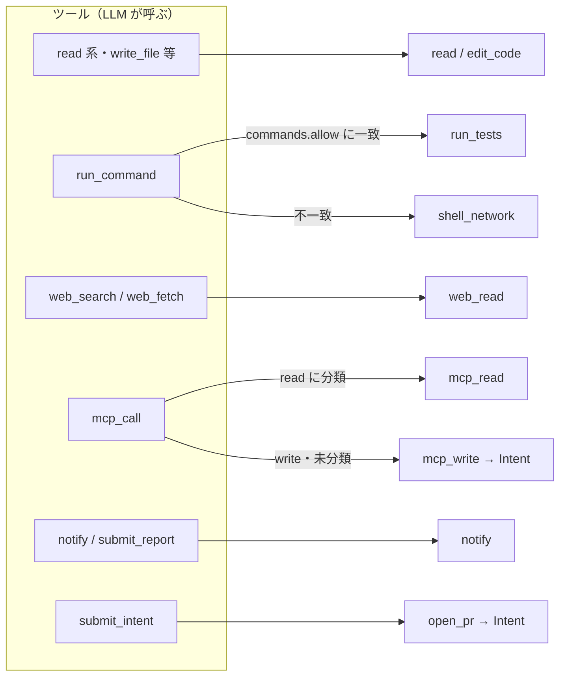

# 04. 機能仕様 — 操作カタログ・ツールカタログ
- 版数：v0.6（2026-10-01） ／ 親：[README.md](README.md) ／ 出典：04 §共通定義、12 §操作・ツールカタログの追加、13 §操作・ツールカタログの追加、15 §届け先の宣言化・§`decide()` の拡張

> **3行で**
> 1. ポリシーの `autonomy` のキーは「操作の種類」で、11種類（開発7・汎用4）＋ v0.3 で定義例に出た2種類。各操作に Hard Ceiling で設定できる値と既定値がある。
> 2. エージェントが呼べるツールは16個で、どれも操作の種類に対応づく。カタログにないツール・テンプレートにないツールは `deny`（BR-09）。
> 3. ツール `deliver` は v0.6 で廃止し、届け先は仕事の定義で宣言する（[mcp-and-web.md](mcp-and-web.md#deliver)）。

## 🧭 判断してほしいこと
[README](README.md#-判断してほしいこと) の Q-29（`handoff`・`browser_submit`・`payment` の行が未設計）、Q-32（`submit_report` の対象テンプレート）。

## 全体図

見てほしいところ：同じツールでも、引数（コマンド）やコネクタのツールの分類で操作の種類が変わる。Intent になるのは `mcp_write` と `open_pr` だけ。

## 要点
- `mcp_write` は一律に `auto` にできず、`auto` になるのは「以後も許可」のルールに一致したときだけ（Hard Ceiling）。
- `shell_network` と `merge` は `deny` しか設定できない。
- MCP のツールの操作名は `mcp.<connector>.<tool>`。ルールはこの名前で書く。
- `web_read` はサンドボックスから直接出ず、Web 取得プロキシ（sandbox-edge）を通す。

---

## 詳細

### 操作カタログ（Action Type）
ポリシーの `autonomy` キーは次の操作の種類に対応する。自律レベルの値は `auto` / `approve` / `deny`、v0.3 で `handoff`（ユーザーに引き継ぐ）が加わった（REQ-035）。

| 操作の種類 | 内容 | 判定する場所 | 設定できる値（Hard Ceiling） | 既定値 | フェーズ |
|---|---|---|---|---|---|
| `read` | リポジトリ内のファイルの読み取り・一覧・検索 | LLM Proxy | auto / deny | auto | 1 |
| `edit_code` | 作業ツリー上のファイルの作成・変更・削除 | LLM Proxy | auto / deny | auto | 1 |
| `run_tests` | `commands.allow` に一致するコマンドの実行 | LLM Proxy | auto / deny | auto | 1 |
| `shell_network` | `commands.allow` に一致しないコマンド、任意ホストへの通信 | LLM Proxy | deny のみ | deny | 1 |
| `open_pr` | ブランチ作成＋PR 作成（外部作用） | Kernel（Intent） | approve / auto / deny（auto は必ずドラフト） | approve | 1 |
| `merge` | PR のマージ（外部作用） | Kernel（Intent） | deny のみ | deny | 1 |
| `memory_write` | エージェントのメモリへの追加（FR-031） | LLM Proxy | auto / deny | auto | 1 |
| `web_read` | Web 検索・ページ取得（GET / HEAD のみ） | sandbox-edge（Web 取得プロキシ） | auto / deny | auto | 0 |
| `mcp_read` | 読み取りに分類した MCP ツールの呼び出し | sandbox-edge → Gateway | auto / approve / deny | auto | 0 |
| `mcp_write` | 書き込み・未分類の MCP ツールの呼び出し（Intent） | Kernel → Gateway | auto（ルール経由のみ）/ approve / handoff / deny | approve | 0 |
| `notify` | 組み込みのプッシュ通知・アプリ内レポートの保存 | Kernel | auto / deny | auto | 0 |
| `browser_submit` | ブラウザでの書き込み（12 の定義例。BR-37・ADR-019。カタログの行は未設計。Q-29） | — | — | — | 2 |
| `payment` | 支払い・送金（12 の定義例。Hard Ceiling で `handoff` のみ。BR-36） | — | handoff のみ | — | 1 |

- MCP のツールごとの操作名は `mcp.<connector>.<tool>`（例：`mcp.slack.post_message`）。「以後も許可」のルール（BR-35、15 で改訂）はこの名前と宛先の引数で書く（[mcp-and-web.md](mcp-and-web.md#rules)）。
- `mcp_write` を `auto` にできるのは、ルールに一致した場合だけで、ポリシーで一律に `auto` にはできない（Hard Ceiling）。
- パスワードの変更・支払い・送金は Hard Ceiling で `handoff` だけを許す（BR-36）。

### ツールカタログ（ツール → 操作の種類）

| ツール名 | 引数 | 操作の種類 | フェーズ |
|---|---|---|---|
| `list_files` | `path`, `glob?` | read | 1 |
| `read_file` | `path`, `range?` | read | 1 |
| `search` | `query`, `glob?` | read | 1 |
| `write_file` | `path`, `content` | edit_code | 1 |
| `apply_patch` | `patch`（unified diff） | edit_code（対象パスは全て抽出して判定する） | 1 |
| `delete_file` | `path` | edit_code | 1 |
| `run_command` | `command`, `timeoutSec?` | `commands.allow` に一致すれば run_tests、しなければ shell_network | 1 |
| `submit_intent` | `title`, `body` | open_pr（Proxy では判定せず FR-010 へ） | 1 |
| `finish` | `outcome`（`no_change` / `unable`）, `reason` | —（常に許可） | 0 |
| `load_skill` | `name` | read（付けられた Skill 以外の名前は deny。FR-030） | 1 |
| `remember` | `content`（1〜500文字） | memory_write（FR-031） | 1 |
| `submit_report` | `title`, `body`（最大50,000文字）, `sources[]` | notify（13 で全テンプレートに広げ、出典を必須にした。対象は Q-32。v0.2 では「—（reviewer / triager のみ、常に許可）」）（FR-033） | 0 |
| `web_search` | `query`, `max_results`（≤10）, `recency?` | web_read | 0 |
| `web_fetch` | `url` | web_read（本文を抽出したテキストを返す。最大200KB） | 0 |
| `mcp_call` | `connector`, `tool`, `arguments` | 分類により `mcp_read` / `mcp_write`。書き込みの戻り値は `{ intentId, status: pending_approval \| accepted \| denied }` だけ（15） | 0 |
| `notify` | `title`（≤60文字）, `body`（≤500文字）, `priority` | notify | 0 |
| ~~`deliver`~~ | — | **廃止（v0.6、→ 仕事の `deliver` 宣言。BR-58）** | — |

- カタログにないツール名は `deny`（`unknown_action`。BR-09）。テンプレートによって使えるツールが変わり（[policy-and-schema.md](policy-and-schema.md#templates)）、テンプレートにないツールも `deny` とする（BR-09）。
- `memory.enabled: false` のエージェントでは、どのテンプレートでも `remember` をツール一覧から外す（呼ばれたら deny）。

### 判定の理由コード（reasonCode）
`decide()`（FR-004）が返す理由。順序は [governance.md](governance.md#fr-004)。

| 判定 | reasonCode |
|---|---|
| `halt` | `kill_switch` / `task_terminated` / `budget_exceeded`（項目：`max_steps`・`per_task_usd`・`per_day_usd`・`agent_day_usd`・`max_minutes`）/ `breaker_tripped`（Breaker の種類） |
| `deny` | `unknown_action` / `not_granted` / `tool_needs_review` / `connector_disabled` / `intent_limit` / `path_denied` / `path_not_allowed` / `autonomy_deny` |
| `allow` | ルールに一致した場合は `matchedRule = rules[i]` |

## このドキュメントで決まったこと
- [ADR-022](../adr/ADR-022-mcp-unified-unclassified-is-write.md)：未分類の MCP ツールは書き込み扱い
- [ADR-023](../adr/ADR-023-builtin-web-read-proxy.md)：Web 読み取りは組み込みのプロキシ経由
- [ADR-030](../adr/ADR-030-declarative-deliver.md)：ツール `deliver` の廃止
