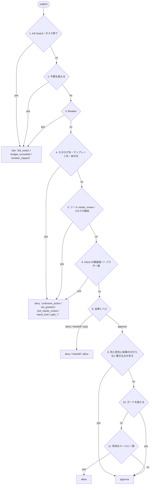

# 04. 機能仕様 — 判定・合成・分類・予算・停止
- 版数：v0.11（2026-10-02） ／ 親：[README.md](README.md) ／ 出典：04 §FR-004・013〜015・023、12 §FR-023、14 §変更の分類・§FR-036、15 §`decide()` の拡張、v0.11 のガバナンスの詰め（[D-57〜62](../decisions.md#d-57)）

> **3行で**
> 1. Kernel の3つの純粋関数が統制の中心：`decide()`（FR-004。1回の操作を通すか）、`compose()`（FR-023。実効ポリシー）、`classify()`（FR-036。設定の変更が権限を広げるか）。どれも LLM と外部 I/O を使わない。
> 2. `decide()` は上から順に評価し、最初に当てはまったものを返す：停止（`halt`）→ 拒否（`deny`）→ 自律レベル → 結果の分からない書き込み → ガード → 「以後も許可」のルール。後ろの3つは `approve` になる操作にだけ効き、`approve` を `allow` にできるのはルールだけ。
> 3. 予算・Breaker・キャンセル・Kill Switch・エージェント単位の停止は、すべて `halt` か同じ停止処理に集まる。

## 🧭 判断してほしいこと
[README](README.md#-判断してほしいこと) の Q-25（`commands.allow`）、Q-28（`widen` の承認者）、Q-29（`handoff`）、Q-31（仕事ごとの合成）、Q-37（`neutral` の範囲）。

## 全体図

見てほしいところ：`halt` の判定が `deny` より先。手順9〜11は `approve` になる操作にだけ効き、`deny` を緩めることはない。ガードと結果の分からない書き込み（9・10）はルールより先に見るので、ルールがあっても `approve` に戻す（BR-61・BR-68）。

## 要点
- `decide()` の入力の `policy` は常に `compose()` の結果（`effective`）。→ [FR-004](#fr-004)
- 汚染（taint）は `decide()` の MCP の書き込みの結果を変えない（効くのは BR-51・AI事前レビュー・承認カードの表示）。汚染されたタスクでも、宛先を固定したルールとガードの範囲内なら `allow`（[D-58](../decisions.md#d-58)）。→ [FR-004](#fr-004)
- ルールは宛先を完全一致で固定し、`option` は「固定」か「変わってよい」を選ぶ。変わってよい値の上限・候補はガードで締める（[D-60](../decisions.md#d-60)）。→ [FR-004](#fr-004)、[mcp-and-web.md](mcp-and-web.md#rules)
- `classify()` は新旧の定義を正規化して項目ごとに比べ、1つでも広がれば `widen`。→ [FR-036](#fr-036)
- エージェントの日次予算は、リポジトリ（ワークスペース）の日次予算とは別に効く。→ [FR-013](#fr-013)
- Kill Switch は p95 ≤ 10秒で全タスクを止める。エージェント単位の停止も同じ処理。→ [FR-015](#fr-015)

---

## 詳細

### FR-004：ポリシー判定エンジン 〔UC-007, UC-008, UC-009〕
- 概要：Governance Kernel の中核。**副作用のない純粋関数**で、同じ入力には必ず同じ出力を返す。フェーズ0。
- 利用ロール：システム（LLM Proxy・sandbox-edge・Intent 受付・Gateway が呼ぶ）
- 入力：

  | 項目 | 型 | 必須 | 説明 |
  |---|---|---|---|
  | policy | 正規化済みポリシー | ○ | タスクに固定されたエージェントスナップショットの実効ポリシー（FR-023 の `effective`。仕事ごと、D-19）。常に合成結果を渡す。ガード（`guards`）を含む |
  | subject | `{ kind: tool_call \| llm_call \| intent, actionType, action?, args, paths[], estimatedCostUsd?, tool?, origin? }` | ○ | 判定の対象。MCP は `actionType = mcp_call`、`action = mcp.<connector>.<tool>`。`tool = { classification, status, argRoles, scope, toolHash }`（Gateway が保存している判定時点の情報）。`origin = agent \| deliver`（記録用。判定には使わない） |
  | counters | `{ stepsUsed, costUsd, dayCostUsd, agentDayCostUsd, elapsedSec, deniedCount, repeatKey, repeatCount, changedPaths[], intentsCount, unknownOutcomeKeys[] }` | ○ | `dayCostUsd` はリポジトリの当日の費用、`agentDayCostUsd` はエージェントの当日の費用（`agent_day_usd`）、`intentsCount` はそのタスクの Intent の数。`unknownOutcomeKeys` は、同じ仕事の Intent のうち `unknown_outcome` のまま確定していないものの `destinationKey`（`action` と全 `destination` 引数の正規形 JSON のハッシュ。BR-68） |
  | flags | `{ killSwitchEngaged, taskStatus }` | ○ | ワークスペースとタスクの状態 |
  | taint | `{ tainted, sources[] }` | ○ | BR-38 |

- 処理（上から順に評価し、最初に当てはまったものを返す。図は[全体図](#fr-004-flow)）：
  1. `killSwitchEngaged`、または taskStatus が終了状態 → `halt`（`kill_switch` / `task_terminated`）
  2. 予算：`stepsUsed + 1 > max_steps`、`costUsd + estimatedCostUsd > per_task_usd`、`dayCostUsd + estimatedCostUsd > per_day_usd`（リポジトリ）、`agentDayCostUsd + estimatedCostUsd > per_day_usd`（エージェントの `budget.per_day_usd`。指定がある場合。項目 `agent_day_usd`）、`elapsedSec > max_minutes*60` のいずれか → `halt`（`budget_exceeded`、どの項目か）
  3. Breaker：FR-014 の条件のいずれか → `halt`（`breaker_tripped`、どの Breaker か）
  4. 操作の分類：カタログにない、テンプレートにない、またはコネクタ・ツールが付与されていない → `deny`（`unknown_action` / `not_granted`）
  5. ツールの状態：`needs_review`、またはコネクタが無効 → `deny`（`tool_needs_review` / `connector_disabled`）
  6. Intent の数：`intentsCount + 1 > max_intents_per_task`（既定5、Hard Ceiling 20。A-85）→ `deny`（`intent_limit`）
  7. パス（開発のみ）：対象パスのいずれかが `paths.deny` に一致 → `deny`（`path_denied`、一致したパターン）。`edit_code` の対象パス（Intent では全変更パス。A-46）のいずれかが `paths.allow`（指定がある場合）に含まれない → `deny`（`path_not_allowed`）
  8. 自律レベル：`deny` → `deny`（`autonomy_deny`）、`handoff` → `handoff`、`auto` → `allow`（`mcp_write` には `auto` を設定できない）、`approve` → 手順9へ
  9. 結果の分からない書き込み：今回の `destinationKey` が `unknownOutcomeKeys` に含まれる → `approve`（`unknown_outcome_pending`）。ユーザーが [届いていた] / [届いていない] で確定するまで、同じ宛先への同じ操作はルールがあっても自動にしない（BR-68。F-01 のタイムアウト後の再発注を止める）
  10. ガード：`policy.guards` のうち今回の `action` のものについて、対象の引数の値が1つでも範囲・候補の外にある → `approve`（`guard_exceeded`、`matchedRule = guards[i]`、超えた引数のパスと値）。配列の要素（`items[].quantity`）は要素ごとに調べる。対象の引数が見つからないガードは超えたものとして扱う（BR-61）
  11. ルール：`rules.enabled` で、有効なルール（網羅の条件と `tool_hash` を満たす。[mcp-and-web.md](mcp-and-web.md#rules)）のどれかに一致 → `allow`（`matchedRule = rules[i]`）。一致しなければ `approve`。一致は「`destination` と固定の `option` は完全一致、変わってよい `option` は比べない」（D-60）
- 出力：`{ decision: allow|deny|approve|handoff|halt, reasonCode, matchedRule, inputsHash }`。`matchedRule` はポリシー上のキーのパス（例：`paths.deny[1]`、`rules[0]`、`guards[0]`）。`approve` の理由は `approval_required`（手順11で不一致）・`unknown_outcome_pending`（手順9）・`guard_exceeded`（手順10）のどれか。承認カードとリハーサルの「誰が止めたか」はこの値を出す。
- 呼び出した側が、判定の入力と出力を policy_decisions に保存し、監査ログに記録する（判定エンジン自身は保存しない）。
- ビジネスルール：BR-06、BR-09〜BR-11、BR-20、BR-35、BR-39。
  - `classification = unclassified` のツールは手順8で `mcp_write` として扱い、手順9では一致しない（ルールを持てない）。
  - 汚染はこの判定（MCP の書き込み）の結果を変えない。汚染が効くのは BR-51（設定の変更）、AI事前レビューの必須化（フェーズ1）、承認カードの表示（BR-41）。
  - v0.2 の拡張は最小限の2点（(a) `paths.allow` の `path_not_allowed`、(b) カウンタ `agentDayCostUsd`）。v0.6 で手順4〜6・8・11（旧9）と入力の `tool`・`taint`・`intentsCount` を加えた。v0.11 で手順9・10 と `unknownOutcomeKeys`・`policy.guards` を加えた（D-57・D-61）。どれも純粋関数のまま。
  - 影の判定（`shadow = true`。15 §影の判定）でも `decide()` は同じ入力・同じ計算を行う。判定を無視するのは gateway の側で、Kernel は `shadow` を入力に取らない（BR-67）。

### FR-023：実効ポリシーの合成 〔UC-017, UC-020〕
- 概要：Hard Ceiling・ワークスペースのポリシー・リポジトリのポリシー（開発のみ）・エージェント定義・仕事のテンプレートから、タスクで使う実効ポリシーを合成する。**副作用のない純粋関数**として `packages/kernel` に置く（ADR-012）。フェーズ0。
- 利用ロール：システム（FR-022、FR-025〜027、FR-035、FR-036 が呼ぶ）
- 入力：

  | 項目 | 型 | 必須 | 説明 |
  |---|---|---|---|
  | ceilings | Hard Ceiling | ○ | プラットフォームの上限（BR-06） |
  | workspacePolicy | 正規化済みポリシー | ○ | ワークスペースのポリシー（13） |
  | repoPolicy | 正規化済みポリシー | − | FR-003 のスナップショット（ファイルがなければ既定ポリシー）。開発テンプレートのときだけ |
  | agentDef | 正規化済みのエージェント定義 | ○ | 公開済み・保存済みの定義、または下書きの定義。v2 では `grants` と仕事のテンプレート |

- 処理：
  1. [合成のしかた](policy-and-schema.md#composition)の表のとおり、項目ごとに厳しい方を取って `effective` を作る（14 では仕事ごと。Q-31）。ガード（`job_guards`）は仕事の定義から来る。同じ引数に複数あれば範囲の積・候補の積を取る（D-57）。
  2. エージェント定義の値がポリシーより緩い項目を求める。同じ計算の結果を、公開・保存時は `violations`（`AGENT_EXCEEDS_POLICY`）、公開後は `clamped`（`AGENT_CLAMPED`）として使う。
  3. `effective` を正規化し、キーをソートした正規形 JSON の SHA-256 を `effective_policy_hash` とする。
- 出力：`{ effective, violations[], clamped[] }`。`clamped` の要素は `{ path, defined, effective }`。
- 利用のしかた：
  - `decide()` の `policy` には常に `effective` を渡す。
  - `policyHash` は `effective` から計算する（intentHash に含まれるので、承認は実効ポリシーに紐づく。FR-010）。
  - 合成の結果と、合成に使った Hard Ceiling の版（`agent_snapshots.ceilings_version`）をスナップショットに残す。同じ版の Hard Ceiling で `compose()` を再現できる（NFR-036）。
- ビジネスルール：BR-20、BR-21、BR-43。判定に LLM や外部 I/O を使わない。

### FR-036：変更の分類 〔UC-026, UC-027, UC-028〕
- 概要：Kernel の純粋関数 `classify(before, after, policy)` で、エージェントの定義の変更を `narrow` / `neutral` / `widen` に分け、`widen` の項目の一覧を返す（ADR-027）。フェーズ0。
- 利用ロール：システム（FR-035・FR-037・FR-039 が呼ぶ）
- 処理：
  1. 比較は正規化した定義（`compose()` の結果）どうしで行う。ツールの付与・ルール・ドメイン・自律度・予算・実行回数・宛先を項目ごとに比べ、1つでも広がれば `widen`。
  2. テンプレートの変更は、新しいテンプレートのツールのうち、まだ付与されていないものがあれば `widen`。
  3. 1つの変更案に複数の項目がある場合は、最も広い分類を全体の分類にする。カードには `widen` の項目だけを並べる。
  4. 仕事の追加そのものは `neutral`。仕事が使うツール・宛先・自律度が既存の境界を超える部分だけが `widen`。
  5. 実行回数は仕事が増えても `max_runs_per_day`（エージェント単位）で頭打ち。上限を超える仕事を足すと、上限の引き上げ（`widen`）か頻度を下げる案をカードで出す。
- 出力：分類（`narrow` / `neutral` / `widen`）、`widen` の項目の一覧、足りないもの（未接続のコネクタ・未分類のツール。14 §流れ）

| 分類 | 例 | 扱い |
|---|---|---|
| `narrow` | ツールの付与を外す、`auto` を `approve` にする、予算を下げる、ドメインを絞る、仕事を止める・消す、ルールの取り消し、ガードの追加・範囲を狭める・候補を減らす、ルールの `option` を「変わってよい」から「固定」に戻す | すぐ反映。チャットに記録 |
| `neutral` | 指示文の変更、テンプレートの変更（新しいテンプレートのツールが付与済みの範囲）、トリガーの時刻、届け先の変更（既存のルールに一致する宛先）、通知の長さ、プロフィール項目の公開（BR-50） | すぐ反映。チャットに記録 |
| `widen` | 新しいコネクタのツールの付与、`approve` を `auto` にする、「以後も許可」のルールの追加、ルールの `option` を「固定」から「変わってよい」にする、ガードの削除・範囲を広げる・候補を足す、予算・実行回数の上限を上げる、ドメインの許可を増やす、既存のルールに一致しない宛先の届け先 | 確認カードで承認を待つ。承認まで、その変更を必要とする仕事は開始しない |

- エラー・例外：変更案が Hard Ceiling・ワークスペースのポリシーを超える → 反映せず、「この設定ではできないこと」と、ワークスペースのポリシーを変えれば可能かを説明する（UC-026 E1）。
- ビジネスルール：BR-47（`widen` はユーザーの直接の操作でしか反映しない）、BR-50、BR-51（外部の内容に影響されたタスクからの変更案は分類に関係なく確認カード）、BR-55（承認した `widen` は監査ログ `agent.config.widened`）。

### FR-013：予算管理 〔UC-008, UC-014〕
- 概要：費用・ステップ数・時間を計測し、判定エンジンに渡し、画面に表示する。フェーズ0。
- 処理：
  1. LLM 呼び出しのたびに usage_records を追加し、tasks の `cost_usd` と `steps_used` を同じトランザクションで加算する。
  2. リポジトリの日次合計は、ワークスペースのタイムゾーン（既定 UTC）での当日分の usage_records の合計。エージェント定義に `budget.per_day_usd` があれば、そのエージェントの当日分も同様に求め、別に効かせる（BR-20）。試し実行（BR-24）と設計アシスタント（BR-30、A-35）の費用もリポジトリの日次合計に含める（usage_records に `agent_draft_id` つき・`task_id` は NULL）。設定プランナー（FR-035）の費用は `agent_id` つき・`task_id` は NULL で記録する。
  3. 予算メーター：当日と当月のワークスペース合計・リポジトリ別の消費額と、日次上限に対する割合を返す。80% を超えたら警告色。
  4. 予算超過による停止：タスクを `halted`（`budget_exceeded`）にし、`budget.exceeded` を記録する。
- ビジネスルール：BR-10

### FR-014：Circuit Breaker 〔UC-008〕
- 概要：カウンタと閾値だけで暴走を検知する（FR-004 の手順3）。フェーズ0。

  | Breaker | 条件 | カウンタの更新 |
  |---|---|---|
  | `same_action_repeat` | 今回のツール呼び出しの `repeatKey`（ツール名＋引数の正規形 JSON のハッシュ）が直前と同じで、`repeatCount + 1 ≥ same_action_repeat` | 直前と同じなら +1、違えば 1 にリセット |
  | `files_changed_max` | edit_code の対象パスを加えた変更パス数が上限を超える。または Intent の変更ファイル数が上限を超える | 変更パスの集合に追加 |
  | `denied_attempts_max` | `deniedCount ≥ denied_attempts_max` | deny と判定されるたびに +1 |
  | `step_cost_usd_max` | LLM 呼び出しの `estimatedCostUsd > step_cost_usd_max` | — |

- 処理：作動したらタスクを `halted`（`breaker_tripped`）にし、`breaker.tripped`（種類・閾値・その時のカウンタ）を記録し、依頼者に通知する。
- ビジネスルール：BR-11

### FR-015：キャンセル・Kill Switch 〔UC-011, UC-012〕
- 概要：タスクの個別停止と、ワークスペース全体の一括停止。フェーズ0。
- 利用ロール：キャンセルは依頼者と owner、Kill Switch の発動は maintainer 以上、解除は owner
- 処理（キャンセル）：
  1. タスクを `cancelled` にし、`pending` の approval と未実行の Intent を `expired` に、サンドボックストークンを失効させる（1トランザクション）。
  2. ワーカーに停止を指示する（SandboxProvider の stop）。
  3. `task.cancelled` を記録する。
- 処理（Kill Switch 発動）：
  1. `workspaces.kill_switch_engaged = true`（旧 `organizations`）にする。以降、判定エンジンの手順1ですべて `halt`。
  2. 終了状態でないすべてのタスクにキャンセルと同じ処理を行う（状態は `halted`、理由は `kill_switch`）。
  3. `killswitch.engaged`（理由・実行者）を記録し、ワークスペースの全メンバーに通知する。
- 処理（解除）：理由（必須、500文字以内）を入力し、`kill_switch_engaged = false` にして `killswitch.released` を記録する。
- 処理（エージェント単位の停止）：FR-032 から呼ばれ、キャンセルと同じ処理を、そのエージェントの実行中・待機中のタスクに限って行う（`halted`、`halt_reason = agent_disabled`。目標は Kill Switch と同じ p95 ≤ 10秒）。
- エラー・例外：解除の権限がない → 403 `FORBIDDEN`。終了済みタスクのキャンセル → 409 `TASK_ALREADY_TERMINATED`。
- ビジネスルール：BR-17、BR-27。`executing` の Intent は完了まで待つ（UC-011 E1）。

## このドキュメントで決まったこと
- [ADR-001](../adr/ADR-001-pure-decision-engine.md)：判定は純粋関数
- [ADR-012](../adr/ADR-012-stricter-wins-composition.md)：厳しい方を取る合成
- [ADR-018](../adr/ADR-018-model-only-tightens.md)：モデルの判断は厳しくする方向にだけ使う
- [ADR-027](../adr/ADR-027-classify-widening-changes.md)：`classify()` で広げる変更だけを人に戻す
- [ADR-035](../adr/ADR-035-rule-options-and-guards.md)：ルールの `option` は「固定」か「変わってよい」、変わってよい値はガードで締める
