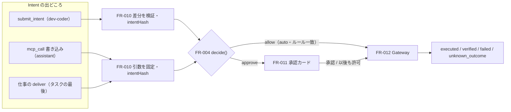

# 04. 機能仕様 — Intent・承認・Gateway
- 版数：v0.6（2026-10-01） ／ 親：[README.md](README.md) ／ 出典：04 §FR-010〜012、13 §呼び出しの経路、15 §Intent のライフサイクル・§承認カード

> **3行で**
> 1. 外部作用はすべて Intent になる：PR（`open_pr`）はサーバー側で差分を検証してから、MCP の書き込み（`mcp_call`）は引数をそのまま固定してから判定する。承認は intentHash に紐づく。
> 2. Intent は1タスクに複数（既定5件、上限20件）。エージェントは書き込みの結果を待たずに続け、ループの終わりに承認待ちがあればタスクは `awaiting_approval`。
> 3. Gateway だけが外部に書き込む。PR は最大3回再試行、MCP は送信後に結果が分からなければ再試行せず `unknown_outcome` にしてユーザーが確定する。

## 🧭 判断してほしいこと
[README](README.md#-判断してほしいこと) の Q-26（差分要約の言語）、Q-31（`policyHash` の単位）、Q-33（`open_pr` の2件目）、Q-38（`assistant` の結果待ち・`readback`）。

## 全体図

見てほしいところ：3つの出どころは同じ判定と同じ Gateway を通る。違うのは「何を固定するか」（PR は tree SHA、MCP は引数とツールのハッシュ）。

## 要点
- 試し実行の Intent は判定に関係なく `simulated` で、承認にも Gateway にも渡さない。→ [FR-010](#fr-010)
- PR の承認カードはルールベースのリスク評価、MCP は別の加点表を使う。→ [FR-011](#fr-011)
- 定期実行の仕事の承認期限は「24時間」と「次の実行の予定時刻」の早い方。次の実行が始まれば前の承認待ちは `superseded`。→ [FR-011](#fr-011)
- タスクの終わり方は Intent の結果の組み合わせで決まる。→ [タスクの終わり方](#task-endings)

---

## 詳細

### FR-010：Intent受付・検証 〔UC-007, UC-009〕
- 概要：サンドボックス（または sandbox-edge）から Intent を受け取り、内容を**サーバー側で**固定・検証してから判定する。フェーズ0（MCP）/ 1（PR）。
- 利用ロール：エージェント（サンドボックストークン）、ランタイム（`deliver`）

**PR（`open_pr`）**
- 入力：

  | 項目 | 型 | 必須 | バリデーション |
  |---|---|---|---|
  | actionType | `open_pr` | ○ | |
  | title | string | ○ | 1〜256文字 |
  | body | string | ○ | 最大20,000文字 |
  | diff | string（unified diff） | ○ | 最大5MB。バイナリのパッチを含まない |
  | testReport | `{ commands[], passed, summary }` | − | サンドボックスの自己申告として扱う |
  | 自己レビューの結果 | `pass` または修正点のリスト | − | dev-coder の `review` フェーズの結果（FR-008 の9）。参考情報で判定には使わない。`action_intents.self_review`（jsonb）に保存し、API-018 と API-013 で返す |

- 処理：
  1. 差分をパースし、変更パスの一覧（リネームは前後の両方）と追加・削除の行数を求める。
  2. ベースコミットのスナップショットに差分を適用できるかを確認し、結果の tree SHA（`expectedTreeSha`）を計算する。
  3. FR-004 で判定する（`subject.kind = intent`、`paths` = 全変更パス。`files_changed_max`・`paths.deny`・`paths.allow` を再検証）。
  4. `intentHash = SHA-256(正規形JSON{ actionType, baseCommitSha, expectedTreeSha, title, body, draft, policyHash })`。`policyHash` はエージェントスナップショットの実効ポリシーのハッシュ（`effective_policy_hash`）。
  5. action_intents を保存し、`intent.proposed` と判定結果を記録する。サンドボックスを終了させる（FR-007 の8）。
  6. 試し実行（`is_dry_run = true`）では、判定にかかわらず Intent を `simulated` にし、承認にも Gateway にも渡さない。承認カードはプレビュー（API-013 の `intent.preview`）として表示し、タスクを `completed`（`dry_run`）にする（FR-026、BR-24）。
  7. 試し実行でなければ、`approve` → FR-011、`allow` → ドラフトとして FR-012、`deny` / `halt` → タスクを `halted`（`policy_violation` など）。
- 出力：`{ intentId, decision }`
- エラー・例外：

  | 条件 | 挙動 |
  |---|---|
  | 差分を適用できない | 422 `DIFF_INVALID`。タスクは `failed` |
  | バイナリのパッチを含む | 422 `DIFF_INVALID` |
  | 同じタスクの2件目の Intent | 409 `INTENT_ALREADY_SUBMITTED`（v0.2。15 で1タスク1件の制約を外したため残すかは Q-33） |

**MCP の書き込み（`mcp_call`）**
- 出どころ：`assistant` のエージェントが `mcp_call` で書き込みツールを呼ぶ（`origin = agent`）か、タスクの最後にランタイムが仕事の `deliver` から作る（`origin = deliver`。[mcp-and-web.md](mcp-and-web.md#deliver)）。
- 処理：
  1. sandbox-edge が `decide(subject, taint, counters)` を呼ぶ（`subject.tool` に Gateway が保存しているツールの情報）。
  2. `intentHash = SHA-256(正規形JSON{ actionType: "mcp_call", connectorId, tool, arguments, toolHash, effectivePolicyHash })`。`toolHash` は説明文・入力スキーマ・`arg_roles` のハッシュ。`arguments` は承認カードにそのまま表示するものと同じ。
  3. action_intents に保存し、エージェントには `{ intentId, status: pending_approval | accepted | denied }` だけを返す（結果は待たない。A-87）。
  4. エージェントのループが終わった時点で承認待ちの Intent があれば、タスクを `awaiting_approval` にする。サンドボックス（または実行用のプロセス）はその時点で終了する（A-10 と同じ）。
- ビジネスルール：BR-06、BR-15、BR-24、BR-58。1タスクの Intent の数は FR-004 の手順6で制限する（A-85。A-30 は廃止）。

### FR-011：承認フロー 〔UC-009〕
- 概要：承認カードを作り、承認・「以後も許可」・却下・期限切れを処理する。フェーズ0。
- 利用ロール：承認者（BR-14）
- 処理（承認依頼の作成）：
  1. approvals を `pending` で作成し、タスクを `awaiting_approval` にする。期限は24時間後。定期実行の仕事から出た Intent は `min(作成から24時間, 同じ仕事の次の実行の予定時刻)`（15。A-05 の一律24時間を改訂）。
  2. リスク評価（ルールベース）を計算する。加点した条件は理由として表示する。
  3. PR では `summarize` フェーズのモデルで差分の要約（最大600文字）を作る。費用はタスク予算から引き、足りなければ要約なしで進める（A-17）。dev-coder の自己レビューの結果は「AIによる自己レビュー（参考）」として、リスク評価と区別して表示する（BR-13）。
  4. 承認者全員に Web Push を送る（FR-017）。

リスク評価の加点表（PR と MCP）

PR（合計 0〜2 `low`、3〜5 `medium`、6以上 `high`）：

| 条件 | 加点 |
|---|---|
| 変更ファイル数 > 10 | +2 |
| 追加・削除の合計行数 > 300 | +2 |
| 依存関係ファイル（`package.json`、`*lock*`、`requirements*.txt`、`go.mod` など）の変更 | +2 |
| DB マイグレーション（`**/migrations/**`）の変更 | +2 |
| テストファイルを変更せずに本体のコードだけを変更 | +1 |
| 自己申告のテスト結果がない、または失敗 | +2 |
| 設定ファイル（`*.yml`、`*.yaml`、`*.toml`、`Dockerfile`）の変更 | +1 |

MCP の書き込み（合計 0〜1 `low`、2〜3 `medium`、4以上 `high`）：

| 条件 | 加点 |
|---|---|
| タスクが `tainted` | +2 |
| 宛先がどのルールにも一致しない | +2 |
| 中身にプロフィールの値を含む | +2 |
| `assistant` でエージェントが直接呼んだ（`origin = agent`） | +1 |
| `scope: self` のツール | −1 |

- 承認カード（MCP の書き込み）の区画：

  | 区画 | 中身 |
  |---|---|
  | 見出し | コネクタ名・ツール名。`deliver` から作られたものは「結果の送信」と明示 |
  | 宛先 | `destination` 引数を、ルールの `labels` があれば名前つきで、なければ値をそのまま、大きく表示 |
  | 中身 | `content` 引数をそのまま。プロフィールの値を含む部分を強調（BR-41） |
  | その他 | `option` 引数 |
  | 汚染 | タスクが `tainted` なら、読んだ情報源（URL・コネクタ）の一覧 |
  | ツールの説明 | 現在の説明文（ハッシュで固定したもの） |
  | 操作 | [承認] [以後も許可] [やめる]（[以後も許可] は[5条件](mcp-and-web.md#rules)を満たすときだけ） |

- 処理（承認・却下）：
  1. 入力（API-019）：`decision`（approve / reject）、`intentHash`、`remember?`（true は [以後も許可]）、`comment?`（1,000文字以内）
  2. 検証：承認者であること、approval が `pending` で期限内、Kill Switch が未発動、タスクが終了状態でない、`intentHash` が一致する。
  3. approve：approval を `approved`、Intent を `approved` にし、Gateway の実行ジョブを登録する。`remember = true` ならルールを追加し（`approvals.remember`・`created_rule_id`）、「次の値は固定されます／毎回変わってよい」を確認として表示してから確定する。reject：approval と Intent を `rejected`、PR のタスクを `rejected` にする（MCP のタスクの終わり方は[下の表](#task-endings)）。
  4. `approval.decided` を記録する（[以後も許可] なら `agent.config.widened`（`origin = approval_rule`）も）。
- 処理（期限切れ）：スケジューラが1分ごとに期限切れの `pending` を探し、approval と Intent を `expired`、PR のタスクを `halted`（`approval_expired`）にする。
- 処理（承認待ちと定期実行。BR-60）：
  - 次の実行が始まった時点で、同じ仕事の前の実行の `pending_approval` の Intent を `expired`（`superseded`）にし、そのタスクを `completed`（`actions_declined`）で終わらせる（古いニュースを後から送らないため）。
  - 期限切れ・置き換えのたびに通知は送らない。チャットのカードを「期限切れ」に変えるだけ。
  - 3回続けて承認されずに置き換えられたら、チャットで「承認が間に合っていません。[以後も許可] にするか、届け先を外しますか？」と1回だけ聞く。
- エラー・例外：

  | 条件 | HTTP / code |
  |---|---|
  | 承認者でない | 403 `FORBIDDEN` |
  | すでに決定済み・期限切れ | 409 `APPROVAL_NOT_PENDING` |
  | intentHash 不一致 | 409 `INTENT_CHANGED` |
  | Kill Switch 発動中 | 423 `KILL_SWITCH_ENGAGED` |
  | `remember = true` だが「以後も許可」の条件を満たさない | 422 `RULE_NOT_ALLOWED` |

- ビジネスルール：BR-13、BR-14、BR-15、BR-35、BR-57、BR-60

### FR-012：Action Gateway 〔UC-010〕
- 概要：外部作用を実行する唯一のコンポーネント。GitHub App の秘密鍵と MCP の認証情報にアクセスできるのはここだけ。フェーズ0（MCP）/ 1（PR）。
- 利用ロール：システム
- 入力：intentId

**PR（`open_pr`）**
1. トランザクションの中で action_intents を `SELECT ... FOR UPDATE` でロックし、`approved`（または auto で許可済み）、Kill Switch が未発動、タスクが終了状態でないことを確認して `executing` にコミットする。
2. インストールトークンを発行する（対象リポジトリだけ、`contents: write` と `pull_requests: write` だけ）。
3. ベースコミットの tree に差分を適用し、Git Data API で blob・tree・commit を作る。tree SHA が `expectedTreeSha` と違えば中止する。
4. `refs/heads/open-team/task-{taskId}` を作る（既にあり同じコミットならそのまま使う）。
5. PR を作る。本文の末尾にタスクへのリンク・intentHash・承認者を追記する。`draft` は承認なら false、auto なら true。
6. Intent を `executed` にし、PR の番号と URL を保存し、`action.executed` を記録する。
7. 検証：PR を取得し、head の tree SHA が `expectedTreeSha` と一致し、base が想定どおりなら Intent を `verified`、タスクを `succeeded` にし、`action.verified` を記録する。

| 条件 | 挙動 |
|---|---|
| 1 で状態が不正 | 実行しない。Intent を `failed`（`precondition_failed`） |
| 差分を適用できない（ベースが変わった） | Intent・タスクとも `failed`（`base_conflict`） |
| 検証で不一致 | Intent を `failed`（`verify_mismatch`）、タスクを `failed`。依頼者に警告を通知 |
| GitHub API の 5xx / レート制限 | 最大3回、指数バックオフで再試行（4 と 5 は冪等に実装） |

- エージェント定義の公開（FR-027）：内部 API `POST /gw/v1/agent-config-prs` で、ユーザーの操作による `.agent/` 配下の PR を作る。Intent ではないので上の1〜7 は通らない。書き込めるのは `refs/heads/open-team/agent-config/*` のブランチ、`.agent/` 配下のファイル、その PR だけ（BR-28）。
- 定義の検証結果の表示（FR-022）：`.agent/**` を変更する PR（open-team が作ったものに限らない）に Check Run `open-team/agent-config` を作成・更新する（`checks: write`。BR-28）。

**MCP の書き込み（`mcp_call`）**
1. `action_intents` を `SELECT … FOR UPDATE` でロックし、`approved`、Kill Switch が未発動、ツールの現在の `toolHash` が Intent のものと同じことを確かめ、`executing` にする。ツールが変わっていれば `expired`（`tool_changed`）。
2. 認証情報を復号し、固定した引数をそのまま `tools/call` に渡す（タイムアウト60秒。A-86。BR-15 を MCP に広げる）。
3. 結果で状態を決める。応答の本文はサイズの上限（64KB）とマスクを通してから保存する。

| 結果 | 状態 | 再試行 |
|---|---|---|
| 正常な応答（`isError` なし） | `executed`（検証 `none` なら終了。`readback` はフェーズ1） | — |
| `isError: true` の応答 | `failed`（`tool_error`、応答の本文を保存） | しない |
| 送信前の失敗（名前解決・接続拒否・TLS） | `approved` のまま | 最大3回、指数バックオフ。尽きたら `failed`（`unreachable`） |
| 認証エラー（401・403、トークンの更新に失敗） | `failed`（`auth_required`） | しない。チャットに [つなぎ直して再実行] を出す |
| 送信後のタイムアウト・接続断・5xx | `unknown_outcome` | **しない**（二重送信を避ける） |

- `unknown_outcome` は承認者に通知し、カードに [実行済みとして閉じる] [失敗として閉じる] [もう一度実行] を出す（API-070）。[もう一度実行] は同じ引数で新しい Intent を作り、二重になるおそれをカードに書いて承認を求める（ルールがあっても `auto` にしない）。
- ツールが `needs_review` になった時点で、そのツールの `pending_approval` と未実行の `approved` の Intent をすべて `expired`（`tool_changed`）にし、チャットで知らせる。
- ビジネスルール：BR-15、BR-16、BR-28、BR-59。BR-16（Gateway が書き込めるのは `refs/heads/open-team/*` のブランチと PR だけ）は、定義の公開と Check Run について BR-28 で拡張する。

### タスクの終わり方
MCP の書き込みを含むタスク（15）。`succeeded` の意味を「PR の作成と検証が完了」から「外部作用がすべて実行された（検証できるものは検証済み）」に広げた。

| Intent の結果 | タスクの状態 |
|---|---|
| Intent がない | `completed`（`report`） |
| すべて `executed` / `verified` | `succeeded` |
| `rejected` / `expired` を含み、`failed` / `unknown_outcome` を含まない | `completed`（`actions_declined`） |
| `failed` / `unknown_outcome` を1つでも含む | `failed`（`action_failed`）。レポートは残り、閲覧できる |

## このドキュメントで決まったこと
- [ADR-002](../adr/ADR-002-gateway-holds-github-key.md)：Gateway だけが鍵を持つ
- [ADR-004](../adr/ADR-004-destroy-sandbox-on-intent.md)：Intent の提出でサンドボックスを終える
- [ADR-005](../adr/ADR-005-approval-bound-to-intent-hash.md)：承認は intentHash に紐づく
- [ADR-031](../adr/ADR-031-mcp-write-no-auto-retry.md)：MCP の書き込みは自動で再試行しない
