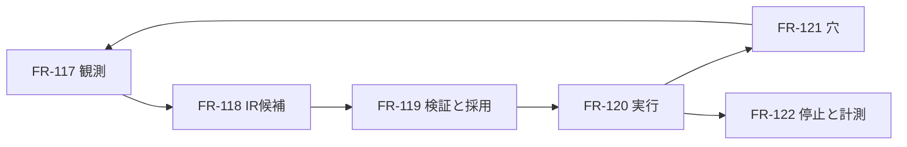

# 04. 成長機構の機能仕様
- 版数：v1.8（2026-10-26） ／ インプット：[UC-073〜076](../03_learning.md)

> **3行で**
> 1. 型付きの実行履歴を、制限された命令のプログラムへ変換する。
> 2. 検証ゲートを通った版だけ自動採用する。
> 3. ガード不成立・情報不足だけを穴にし、拒否や障害とは分ける。

## 🧭 判断してほしいこと
[R-114〜116](../00_learning.md#-判断してほしいこと)。特に自動採用は汎化の証明を意味しない。

## 全体図

見てほしいところ：候補生成LLMは検証結果やactiveポインタを書き換えられない。

## 要点
- [IR](#irの契約)は任意コードを含まない。
- [採用](#fr-119)には独立した正解条件を使う。
- [実行](#fr-120)は毎回freshな外部状態から計算する。
- [穴](#fr-121)は必要な情報だけで解く。
- [停止](#fr-122)は次の副作用より先に確認する。

## 詳細
### FR-117
〔UC-073〕入力：task、型付き依頼、ツールの要求と結果、取得時刻、権限・接続・設定・ツールの版。
- 本体が観測を採取し、`source=tool|owner|hypothesis`、汚染、schema、依存ノードを付ける。LLMがtool由来の根拠を自称しても採用しない。
- 日程調整の依頼schemaは `operation=schedule.propose.v1`、`calendarRefs`、`windowStart`、`windowEnd`、`durationMinutes`、`timeZone`、`selectionRule`。時間帯はIANA、期間は最大31日、長さは15〜480分、カレンダーは最大10個。
- `selectionRule`は明示された`earliest|latest|ask`のみ。参加者の好みを推測して固定しない。予定名・参加者・書込先は別の操作入力で、学習定数へ埋め込まない。
- 認証情報・会議本文・説明文は保存対象外。空き時間区間と仮名化したカレンダー参照を保存する。欠損・redactionで契約を再現できない場合はeligible=false。
- 出力：TBL-064。記録不能なら通常実行は継続し「学習対象外」を記録する。

### IRの契約
`irVersion=1`。ルートは`inputSchema, outputSchema, scope, dependencies, nodes, outputRef`。JSON Schemaを閉じた定義とし未知キーを拒否する。

| node.kind | 許可する内容 | 結果 |
|---|---|---|
| read | 登録済み`calendar.freeBusy.v1`のみ | 型付き観測 |
| transform | `normalizeWindow`、`intersectFreeBusy`、`enumerateSlots`、`selectSlot`の版付き純粋演算 | 型付き値 |
| guard | `all, eq, in, exists, range, schemaMatches, freshWithin`の型付き式 | pass / miss / blocked |
| hole | 入出力schema、必要根拠、解決対象、解決後の合流先 | 検査済み値 |
| propose | 登録済み`calendar.createEvent.v1`のIntent生成 | 既存Kernelに渡す操作案 |

- ノードは一意のid、先行ノードへの参照、出力schemaを持つ。最大32ノード、循環・再帰・任意JS・shell・SQL・任意URL・動的ツール名は禁止。
- guardは`onPass`と`onMiss`を明示。missは契約付きhole、または副作用前の通常経路へ戻す。blockedは権限や設定上の禁止で、穴へ接続できない。
- 入出力参照は宣言済みJSON Pointerのみ。観測由来の汚染は伝播し、IRやLLMで解除しない。
- scopeはoperation、inputSchemaのdigest、接続アカウント、calendarRefs集合、利用者の選択規則版で照合。曖昧な類似度による自動実行は禁止。
- 最初の版は既知の型付き演算の組み合わせだけ。未知演算はholeとして残す。自由文の意味解析は別途LLMを使いうるため、サービス全体のLLMゼロとは表示しない。

### FR-118
〔UC-073〕入力：同scopeの適格な成功履歴5件以上。少なくとも2種類の期間と2種類の空き時間パターンを含む。
- 本体の5分tickで候補生成を要求する。LLMは候補IRのみ返し、認証情報・実カレンダーIDは受け取らない。範囲の参照は仮名のslotと本体側のbindingで結ぶ。
- JSON構造・型・依存グラフ・演算allowlist・汚染伝播を静的検査し、不変のdigest付きcandidate版として保存する。
- 同一digest・同一根拠集合の候補は重複生成しない。期限更新では新しい根拠集合で同じIRの新しい版を作成できる。同scopeで非終端候補は1件。入力値を固定した丸暗記候補は、許可された設定値以外の定数があれば拒否する。
- 出力：TBL-065。エラー：schema不正、禁止命令、予算超過は候補不採用。元の仕事の結果とは分離する。

### FR-119
〔UC-074〕検証ゲートは次の全条件のAND。1項目でも欠ければactiveにしない。

| 段階 | 合格条件 | 独立性 |
|---|---|---|
| 静的検査 | IR契約をすべて満たす | バージョン固定のvalidator |
| 再生 | 元となった適格実行5件以上で期待出力と一致 | 成功履歴＋人が確定した選択条件 |
| 反例 | 100件以上、適用内・適用外を含み期待挙動と100%一致 | 候補が変更できないテスト集合・参照実装 |
| シャドー | 生成後の異なる依頼5件で出力契約と比較にすべて合格 | 同じ観測を通常経路と候補へ供給 |
| 採用直前 | 依存版、設定版、接続identityが現在値と一致 | 本体が再取得して照合 |

- 反例の必須カテゴリ：DST境界、タイムゾーン不明、期間逆転、候補なし、境界の重なり、欠損カレンダー、権限拒否、古い観測、ツールschema変更、選択規則変更。各10件以上。入力外では停止／穴になることを検査する。
- 正解条件：営業時間等の指定制約、全カレンダーの空き、期間内、必要長、選択規則。候補自身や同じLLMの「正しそう」はoracleにしない。
- 再生・反例・シャドーは書込クライアントを持たない。proposeは正規化したIntentの値を比較するだけ。シャドーの観測取得も通常実行の結果を共有する。
- 状態：candidate→validating→shadowing→active。失敗はrejected。旧activeはsuperseded。依存変更・出力違反はinvalidated、手動停止はdisabled。終端版の再有効化は不可、新candidateとして再検証する。
- 切替はSQLiteトランザクションで旧activeの状態変更・新active・検証参照・監査を同時更新する。同scopeのactiveは最大1版。実行中のrunは固定版を維持するが、invalidated/disabledは次ノード前に停止する。

### FR-120
〔UC-075〕入力：型付き依頼、scope、active版。出力：候補日時／操作Intentと実行結果。
- 型付き受付の後でレジストリ照合し、プログラム版と依存版をrunへ固定する。初回やscope不一致では通常のメイン／エージェント経路に渡す。
- readは毎run取得する。過去の空き時間を本番の入力に代用しない。区間は半開区間`[start,end)`、UTC instantで計算し、表示時だけIANAタイムゾーンへ変換する。
- 出力契約は各ノード後に評価。違反は版をinvalidatedにし、未送信なら通常経路へ戻す。既送信の操作を巻き戻したと見なさない。
- propose後は既存Kernel・承認・コネクタに渡す。既存のIntent実行境界に学習run用のpreflightを追加し、承認後／送信直前に空き時間を再取得する。取得から30秒超ならもう一度取得する。空きが変化したらIntentを破棄して再計算し、内容が変わった操作は再承認する。Executorがコネクタへ直接書く経路は設けない。
- 副作用は`runId + nodeId`の一意なeffect keyとIntent IDで関連づける。送信予定を先に永続化する。送信後に結果不明ならunknown_outcomeにし、自動再送も通常経路での作り直しも禁止する。既存コネクタで結果照会できれば照合し、それ以外は人が確認する。
- 再起動時は最後の保存済みノードから再開。依存版と停止状態を照合し、古いreadとその子孫を無効化する。完了済み副作用を含む子孫は再実行せず、確認待ちにする。

### FR-121
〔UC-075〕入力：holeのschema・不足情報・先行観測・予算。出力：schemaと根拠を満たす値、またはneeds_owner。

| 条件 | 扱い |
|---|---|
| 候補の適用範囲外、ガードmiss | 型付き穴で必要部分だけ推論 |
| 観測の矛盾 | 読み直しで確かめ、解消しなければ人へ |
| 好み・参加者・タイムゾーンが不明 | 勝手に決めず人へ |
| Kernel deny、権限不足 | blocked。LLMで迂回しない |
| timeout・429 | 技術障害として既存の再試行規約へ |
| 送信結果不明 | unknown_outcome。重複送信しない |

- 本体がholeの状態をopen→resolving→resolvedまたはneeds_ownerへ更新する。キャンセルはcancelled。
- holeごとに既存の裏タスク枠で一時的な推論を行う。永続的なagentsレコードを毎回増やさず、再委譲しない。最大2試行、runごとに最大4穴。
- 穴の待機中はcheckpointを保存してexecutorの実行枠を解放し、resolverのタスクを先に実行できるようにする。resolver完了通知で同じrunを再開する。最大穴数を超える場合はneeds_ownerとして停止する。
- 解決用LLMにはread-onlyの必要なツールだけを渡す。副作用は解決後のproposeから行う。自由な手順やコードを回答として受け取らない。
- resolvedにはtool/ownerの根拠参照が必要。hypothesisだけでは確定しない。回答後にschema・根拠のfreshness・出力条件を本体が検査する。
- 解決結果は実行中IRを書き換えない。対応可能範囲を増やすのは新candidateの検証後だけ。

### FR-122
〔UC-076〕入力：停止する版または全体の学習設定。出力：状態と理由、費用・成功率・LLM呼出数。
- 持ち主だけが詳細取得・停止可能。エージェントには採用・停止APIを公開しない。自動採用は内部validatorだけが行う。
- `learning.enabled=false`で新規候補生成・採用・新規IR実行を止める。実行中は次ノード前に停止し、送信済み結果は記録する。通常のAI機能は利用可能。
- 版停止はdisabled、全体停止は版状態を変更しない。全体再有効化時は依存版・有効期限を再照合する。
- 採用・失効・停止は監査と既存SSEの再取得通知に記録。`send_to_owner`以外からチャットへ勝手に投稿しない。
- 依存schema・演算版・設定版・アカウントが変われば次ノード前にinvalidated。認証トークンの単なる更新はidentity変更ではない。
- 計測定義と保持期間は[NFR-098〜101](../05_non_functional.md#成長機構v18)。

## このドキュメントで決まったこと
[ADR-085](../adr/ADR-085-learning-ir.md)・[ADR-086](../adr/ADR-086-learning-activation.md)・[ADR-087](../adr/ADR-087-learning-holes.md)。
