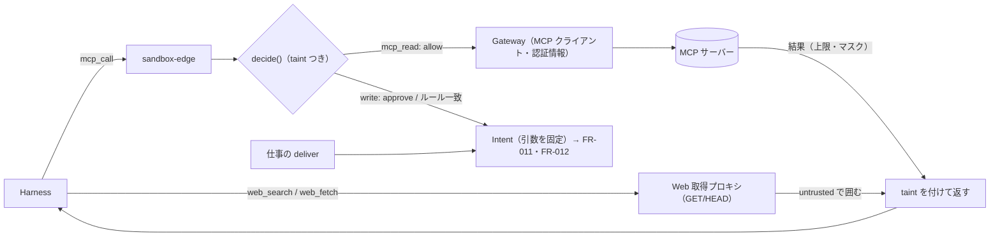
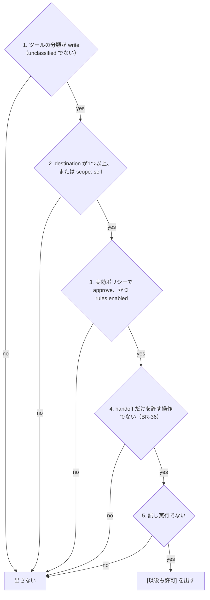

# 04. 機能仕様 — MCP コネクタ・引数の役割・「以後も許可」・届け先・Web 読み取り・汚染の追跡
- 版数：v0.6（2026-10-01） ／ 親：[README.md](README.md) ／ 出典：13 §MCP コネクタの設計・§Web 読み取りの設計・§汚染の追跡、15 §引数の役割・§「以後も許可」のルール・§届け先の宣言化、12 §競合機能の採用方針

> **3行で**
> 1. 外部サービスは MCP コネクタでつなぐ。ツールは既定で `unclassified`（＝書き込み扱い）で、ユーザーが確定するまで `read` にならず、説明文とスキーマはハッシュで固定する。
> 2. 書き込みツールの引数は `destination`（宛先）/ `content`（中身）/ `option` に分け、「以後も許可」のルールは宛先の引数をすべて実際の値で固定したときだけ効く。宛先は定義が決め、LLM は中身だけを書く。
> 3. Web は GET / HEAD だけの組み込みプロキシで読む。外から読んだタスクは `tainted` になり、その後の設定の変更と承認カードの扱いが厳しくなる。

本書の内容（13 の REQ-042〜051）には FR ID がまだない（Q-30）。

## 🧭 判断してほしいこと
[README](README.md#-判断してほしいこと) の Q-30（FR 未採番）、Q-38（MCP の書き込みの未決）、Q-39（Web・汚染の未決）、R-11・R-13・R-14。

## 全体図

見てほしいところ：読み取りの結果はすべて taint を付けてモデルに戻り、書き込みは必ず Intent になる。認証情報は Gateway から外に出ない。

## 要点
- MCP の分類を `read` にできるのはワークスペースの owner だけで、緩める変更として監査ログに残す（BR-44）。→ [登録と分類](#registration)
- 未確定の引数・スキーマの変更で増えた引数は `destination` として扱う（BR-56）。→ [引数の役割](#arg-roles)
- ルールの一致は正規化した完全一致で、glob・正規表現・別名（`@me`）は使えない。→ [「以後も許可」のルール](#rules)
- ツールの説明やスキーマが変わると `needs_review` になり、ルールも承認待ちの Intent も効かなくなる（BR-42）。
- `watcher` は書き込み系のツールを持たず、乗っ取られても外に何も出せない（BR-40）。→ [汚染の追跡](#taint)

---

## 詳細

<a id="registration"></a>
### 登録と分類
フェーズ0。データは connectors（TBL-027）・connector_tools（TBL-028）（[08](../08_database/README.md)）。

| 段階 | 内容 |
|---|---|
| 登録 | フェーズ0：リモートの MCP サーバー（Streamable HTTP）を URL と認証情報（API キー or OAuth）で登録する（A-71）。フェーズ1：カタログから OAuth で接続する（REQ-049） |
| ツールの取得 | Gateway が `tools/list` を呼び、ツール名・説明・入力スキーマ・注釈（`readOnlyHint` など）を保存する |
| 分類 | 既定は `unclassified`（＝書き込み扱い）。注釈やカタログの推奨は **初期値の提案** として表示するだけで、ユーザーが確定するまで `read` にならない（サーバーの自己申告を信用しない） |
| 固定 | 説明文・入力スキーマ・`arg_roles` のハッシュ（`tool_hash`）を保存する。変わったツールは `needs_review` になり、確認まで呼び出しを `deny`（BR-42。ツールの説明を後から書き換える攻撃への対策） |
| 認証情報 | Gateway だけが持ち、暗号化して保存する。サンドボックスと LLM には渡さない |
| 確定の API | API-071：分類・`arg_roles`・`scope`・`verify` の確定（owner のみ。緩める変更は監査ログ） |

- 呼び出しの経路：読み取り（`mcp_read: auto`）は sandbox-edge → Kernel（allow）→ Gateway → `tools/call` → 結果（サイズ上限・秘密情報のマスク）→ taint を付けて Harness へ。書き込み・未分類は Kernel が `approve`（またはルール一致で `allow`）を返し、Intent として受け付ける（引数を固定・intentHash）。シーケンス図は [10](../10_diagrams/README.md)。
- 実行後の検証：MCP には読み戻しの標準がないため、ツールごとに `verify` を `none`（既定）/ `readback`（フェーズ1）で設定する。`none` はその旨を監査ログに残す（R-13）。

<a id="arg-roles"></a>
### 引数の役割（`arg_roles`）
書き込みツールを `write` に分類するときに、引数ごとの役割を一緒に確定する（BR-56）。

| 役割 | 意味 | 例 | ルールでの扱い |
|---|---|---|---|
| `destination` | 作用の届く先。変わると「誰に・どこに」が変わる | `channel`、`to`、`cc`、`bcc`、`recipient`、`email`、`url`、`share_with`、`calendar_id`、`path` | すべて完全一致で固定しなければならない |
| `content` | 中身。毎回変わってよい | `text`、`body`、`message`、`subject`、`title`、`description` | ルールに書けない（自由） |
| `option` | 振る舞いの設定 | `unfurl_links`、`reply_broadcast`、`visibility`、`send_at` | ルールに書いたものだけ完全一致。書かなければ自由 |

- 役割は **入力スキーマの最上位のプロパティ** に付ける。ネストしたオブジェクトや配列の要素ごとの役割はフェーズ0では扱わず、最上位で `destination` にする（A-84。ネストは Q-38）。
- 未確定の引数は `destination`（厳しい方に倒す）。`content` と確定できるのは owner だけで、`destination` → `content` は緩める変更として監査ログに残す。
- 引数名から推測した役割を初期値の提案として出す（上の表の例の名前）。ユーザーが確定するまで効かない。
- `destination` が1つもない書き込みツール（例：自分のメモを作る `create_note`）は、`scope: self`（自分のアカウントの中でだけ作用する）を明示した場合に限りルールを付けられる。明示しなければ常に `approve`。
- `arg_roles` は説明文・入力スキーマと一緒にハッシュで固定する。スキーマが変わったら `needs_review` になり役割も確定し直す。新しく増えた引数は `destination`。

<a id="rules"></a>
### 「以後も許可」のルール
v0.3 で採用（REQ-034、BR-35）し、v0.6 で形を決めた（BR-39 改訂）。ルールはエージェント定義（スナップショット）の `rules` に置き、別のテーブルは作らない。一覧は API-068、取り消しは API-069。

<details>
<summary>ルールの形（YAML）</summary>

```yaml
rules:
  - id: r-7f3a
    action: mcp.slack.post_message
    match:                        # destination の引数は全部、完全一致
      channel: "D04ABCDEF"
    labels:                       # 表示用（判定には使わない）
      channel: "自分宛ての DM"
    tool_hash: "sha256:…"         # ルールを作ったときのツールの説明・スキーマ・arg_roles のハッシュ
    added_by: me
    added_at: 2026-10-02T07:01:12+09:00
    source_intent_id: "…"

  # v0.11（D-60）：option の一部を「変わってよい」にしたルール
  - id: r-91c2
    action: mcp.supplier.place_order
    match:
      supplier_id: "SUP-0012"     # destination：完全一致
      items[].sku: ["BEAN-HOUSE", "MILK-1L"]   # 固定の option：集合として完全一致
    free: ["items[].quantity", "items[].unit_price"]   # 変わってよい option（比べない）
    tool_hash: "sha256:…"
```

ガードは仕事の定義（`job_guards`）に置く。ルールの有無にかかわらず効く（BR-61）。

```yaml
guards:
  - action: mcp.supplier.place_order
    arg: items[].quantity
    max: 20                       # 数値：min / max（含む）。桁数は max_digits
  - action: mcp.supplier.place_order
    arg: items[].unit_price
    max: 800
  - action: mcp.repo.create_pull_request
    arg: packages[].name
    in: ["left-pad", "lodash"]    # 文字列：候補の集合
```

</details>

- **一致の判定**：`match` の各キーについて、Intent の引数の値と正規化したうえで完全一致すること。`free` に挙げた `option` 引数は比べない（D-60）。`free` に入れられるのは `option` の引数だけで、`destination` は入れられない（入れたルールは無効）。正規化は文字列の前後の空白を除く、配列は集合として比べる（順序を無視し、要素の増減は不一致）、数値・真偽値はそのまま。glob や正規表現は使えない。
- **網羅の条件**：`match` のキーにそのツールのすべての `destination` 引数が含まれていなければ、ルールは無効。後から `destination` が増えたら既存のルールは自動的に効かなくなる。
- **ツールの変更**：`tool_hash` が現在のツールと違うルールは効かない。再確認（`needs_review` の解除）のときに、ルールを引き継ぐかを同じ画面で選ぶ（既定は引き継がない）。
- **別名を使わない**：`"@me"` のような別名は使わず、承認した Intent の **実際の値** を入れる。人が読める名前は `labels` に入れる。
- この条件は汚染の有無にかかわらず同じ（BR-39 改訂。v0.4 の「汚染時だけ引数のパターンまで一致」を置き換え）。
- ワークスペースのポリシーの `rules.enabled: false` で、どのエージェントにも「以後も許可」を出さず、既存のルールも効かない。1エージェント20個まで（`rules.max_per_agent`）。
- BR-35 の「リポジトリのポリシーと Hard Ceiling が `auto` を許すもの」は、「ワークスペースのポリシー（開発エージェントではリポジトリのポリシーも）が `rules.enabled` で、Hard Ceiling が `auto`（ルール経由）を許すもの」と読み替える。

| 操作 | 内容 | 分類（`classify()`） | 監査ログ |
|---|---|---|---|
| 承認カードの [以後も許可] | その Intent を承認し、同時にルールを追加する。`match` は Intent の `destination` 引数すべてと、固定にした `option` 引数の値。カードでは「固定される値」（宛先・固定の option）と「毎回変わってよい値」（`content` と、ユーザーが変わってよいにした option）を分けて見せる。`option` は既定で固定で、行ごとに「毎回変わってよい」に切り替えられる。切り替えた数値の引数には「上限を付ける」（ガードの追加）を同じ所に出し、承認した値の2倍を既定の上限として示す（D-60） | `widen`。ユーザーの直接の操作なので確認カードは重ねて出さない（BR-47 ①） | `approval.decided` と `agent.config.widened`（`origin = approval_rule`） |
| ルールの一覧で [取り消す] | ルールを削除する。次の判定から効かない | `narrow`（即時） | `agent.config.changed` |
| 設定プランナーの提案 | ルールの追加は提案できない（BR-57） | — | — |

[以後も許可] を出す条件（1つでも外れたら出さず、[承認] [やめる] だけ）：



- ポリシーや Hard Ceiling が `approve` を求める操作には [以後も許可] を出さず、代わりに「ポリシー変更の PR を作る」（信頼度提案。FR-021）を出す（12）。

<a id="deliver"></a>
### 届け先の宣言
結果をプッシュ通知・アプリ内レポート・連携先に届ける（REQ-046）。v0.6 で、LLM が呼ぶツール `deliver`（13）を廃止し、仕事の定義の `jobs[].deliver` を正にした（BR-58）。

<details>
<summary>届け先の宣言の例</summary>

```yaml
jobs:
  - id: morning-news
    kind: recurring
    template: researcher
    deliver:
      - to: mcp.slack.post_message
        args:                        # destination と option は定義で決める
          channel: "D04ABCDEF"
        content:                     # content の引数にレポートのどこを入れるか
          text: "{{report.summary}}\n\n{{report.sources_markdown}}"
      - to: notify
```

</details>

- エージェント（LLM）は `submit_report` でレポートを出すだけで、宛先を書かない。
- タスクの最後に、ランタイムが `deliver` の各項目から Intent を作る（`origin = deliver`）。`args` は定義からそのまま、`content` はテンプレートにレポートを差し込んで作る。使える変数は `report.title` / `report.summary` / `report.body` / `report.sources_markdown` だけ。
- この Intent の宛先は定義から来たもので外部の内容の影響を受けないが、判定は通常の Intent と同じ（ルールに一致すれば `auto`、しなければ `approve`）。
- 届け先の宛先の変更は仕事の定義の変更として `classify()` にかかる（既存のルールに一致する宛先なら `neutral`、しなければ `widen`）。
- `assistant` テンプレートでは、エージェントが `mcp_call` で書き込みツールを直接呼べる（宛先も LLM が決める。`origin = agent`）。これも Intent で、ルールの判定も同じ。

### Web 読み取り
フェーズ0（REQ-044）。ADR-023。

- `web_search` は検索 API（プロバイダーは設定で選ぶ。A-72）、`web_fetch` は **Web 取得プロキシ** を通す。サンドボックスから直接インターネットに出る経路は作らない（`shell_network` は deny のまま）。
- プロキシは GET / HEAD のみを通し、私的アドレス・メタデータのアドレス・`deny_domains` を拒否する。Cookie や認証ヘッダーは送らない。リダイレクト先も同じ規則で判定する。
- 取得した本文は HTML からテキストを抽出し、`<untrusted source="url">…</untrusted>` で囲んでモデルに渡す。本文は最大200KB、1タスク30回まで（`web.max_fetches_per_task` で減らせる。A-77）。
- ログインが要るページは対象外（フェーズ2の統制つきブラウザで扱う。BR-37）。

<a id="taint"></a>
### 汚染の追跡（taint）
Web ページ・メール・MCP の応答には、指示を装った文章が入りうる。モデルに見抜かせるのではなく、**決定論的なルール** で外部作用を絞る（ADR-024、REQ-047）。フェーズ0の単位はタスク（Q-39 ③）。

| ルール | 内容 |
|---|---|
| BR-38 | タスクが `web_read` または `mcp_read` の結果を受け取った時点で `tainted` にする（Kernel が記録。解除はできない。`tasks.tainted`） |
| BR-39（v0.6 改訂） | `mcp_write` を `auto` にできるのは、有効なルールに一致した場合だけ。ルールはツールのすべての `destination` 引数を完全一致で固定しなければ有効にならない。汚染の有無にかかわらず同じ |
| BR-40 | `watcher` テンプレートは書き込み系のツールを持たない（Hard Ceiling） |
| BR-41 | プロフィールの項目は、定義の `profile` に書いたものだけを渡す。`tainted` のタスクで、プロフィールの値を含む書き込みの Intent は、承認カードでその部分を強調する |
| BR-42 | MCP のツールの説明が変わったら `needs_review` にし、確認まで呼び出しを `deny` |
| BR-51 | 外部の内容を根拠にした設定の変更案は、`neutral` でも自動で反映しない（[agents.md](agents.md#fr-039)） |

- 汚染は `decide()` の MCP の書き込みの結果を変えない。効くのは BR-51、AI事前レビューの必須化（`tainted` のタスクでは常に実行し、結果は厳しくする方向にだけ使う。BR-34、フェーズ1）、承認カードの表示（BR-41、汚染の情報源の一覧）。
- MCP の書き込みのリスク評価で、`tainted` は +2（FR-011）。

### 通知とレポートの出典
- `submit_report` のレポートと `notify` の本文には、Web から得た内容を含む場合は出典の URL を付ける。出典のない主張は「出典なし」と表示する（BR-45）。
- スケジュールの実行で前回と結果が同じ場合（`watcher`、`quiet_if_normal`）は通知しない。レポートとアクティビティには残す（BR-46）。

## このドキュメントで決まったこと
- [ADR-022](../adr/ADR-022-mcp-unified-unclassified-is-write.md)：連携は MCP に統一、未分類は書き込み
- [ADR-023](../adr/ADR-023-builtin-web-read-proxy.md)：Web 読み取りは組み込みのプロキシ
- [ADR-024](../adr/ADR-024-taint-tracking-against-injection.md)：プロンプトインジェクションへの対策は汚染の追跡
- [ADR-029](../adr/ADR-029-mcp-arg-roles-destination-fixed.md)：引数の役割と宛先の固定
- [ADR-030](../adr/ADR-030-declarative-deliver.md)：届け先の宣言化
