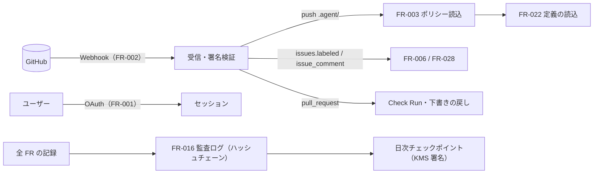

# 04. 機能仕様 — サインイン・GitHub 連携・ポリシー読込・監査・BYOK・メンバー・信頼度
- 版数：v0.6（2026-10-01） ／ 親：[README.md](README.md) ／ 出典：04 §FR-001〜003・016・019〜021、13 §フェーズ0の構成、14 §統制との関係（監査ログのイベント）、15 §ルールを作る・消す

> **3行で**
> 1. GitHub 連携（サインイン・App・`policy.yaml`・信頼度提案）は開発テンプレートと同じくフェーズ1。フェーズ0は単一ユーザーでサインインを省略し、LLM のキーは `.env` に置く。
> 2. 監査ログはワークスペースごとのハッシュチェーンつき追記専用ログで、フェーズ0でも省略しない（KMS による日次チェックポイントの署名はフェーズ1）。
> 3. ロールは owner / maintainer / viewer。最後の owner は降格できない。

## 🧭 判断してほしいこと
なし（FR-001・FR-020 はフェーズ1。[D-02](../decisions.md#d-02)）。

## 全体図

見てほしいところ：GitHub からの入力はすべて Webhook の受信で冪等に受け、処理はキューで非同期に行う。

## 要点
- GitHub App に要求する権限は6つだけ（`checks: write` を含む）。→ [FR-002](#fr-002)
- ポリシーの検証は「構文 → スキーマ → Hard Ceiling → プロバイダーのキー」の順。→ [FR-003](#fr-003)
- 監査ログは DB ロールに INSERT と SELECT しか与えず、UPDATE と DELETE はトリガーでも禁止。→ [FR-016](#fr-016)
- 信頼度提案の受け入れは、ポリシーが auto でも必ず承認を通す。→ [FR-021](#fr-021)

---

## 詳細

### FR-001：GitHubサインイン・セッション 〔UC-001〕
- 概要：GitHub App の user-to-server OAuth（有効期限つきトークン）でログインし、サーバー側セッションを発行する。フェーズ1。フェーズ0はサインインを省略し、固定トークン（D-06）で画面を守る（13）。
- 利用ロール：全員（未ログイン）
- 入力：`code`（string、必須、GitHub から返るもの）、`state`（string、必須、発行したものと一致し10分以内）
- 処理：
  1. `state` を生成して署名つき Cookie に保存し、GitHub の認可 URL へリダイレクトする。
  2. コールバックで `state` を照合し、`code` をアクセストークン（8時間）とリフレッシュトークン（6か月）に交換する。
  3. `GET /user` でユーザー情報を取得し、users を作成・更新する。トークンは暗号化して保存する。
  4. sessions を作成し、Cookie `ot_session`（HttpOnly・Secure・SameSite=Lax、30日のローリング期限）を発行する。
  5. アクセスできるインストールを `GET /user/installations` で取得し、memberships を同期する（FR-002）。
- 出力：SCR-002 または SCR-012 へのリダイレクト
- エラー・例外：

  | 条件 | 挙動 | メッセージ |
  |---|---|---|
  | state 不一致・期限切れ | SCR-001 へ戻す | 「サインインをやり直してください」 |
  | ユーザーが認可を拒否 | SCR-001 へ戻す | 「サインインがキャンセルされました」 |
  | GitHub API エラー | SCR-001 へ戻す | 「GitHubに接続できませんでした」 |

- ビジネスルール：状態を変更する API は、Cookie に加えて `X-CSRF-Token` ヘッダー（セッションに紐づくトークン）を必須とする。

### FR-002：GitHub App 連携・同期 〔UC-001, UC-006〕
- 概要：GitHub App のインストール状態、対象リポジトリ、ユーザーの権限を同期する。フェーズ1。v0.4 以降、GitHub App のインストールはワークスペースにつなぐ連携の1つ（A-78。旧：インストール＝組織）。
- 利用ロール：システム（Webhook）、ログイン中のユーザー
- 入力：Webhook（`X-Hub-Signature-256`、`X-GitHub-Delivery`、イベント本体）
- 処理：
  1. HMAC-SHA256 で署名を検証する。`X-GitHub-Delivery` が処理済みなら200を返して終了（冪等）。
  2. イベントごとの処理：

     | イベント | 処理 |
     |---|---|
     | `installation.created` | ワークスペース（旧 organizations）を作成し、インストールしたユーザーを owner として登録、リポジトリを登録する |
     | `installation.deleted` / `suspend` | ワークスペースを `disconnected` にし、実行中のタスクを `halted`（`installation_removed`） |
     | `installation_repositories.added/removed` | repositories を追加、または `disconnected` |
     | `push`（デフォルトブランチ、`.agent/` 以下が変わった） | FR-003 でスナップショットを更新し、FR-022 で定義を読み込む |
     | `issues.labeled`（`open-team`、またはいずれかのエージェントの `github_label` のラベル） | FR-006 |
     | `issue_comment.created`（本文の先頭が `@open-team <agent-id>`） | FR-028（メンション） |
     | `pull_request.opened` / `synchronize`（`.agent/**` を変更する PR。open-team が作ったものに限らない） | FR-022 の検証を行い、Check Run `open-team/agent-config` で返す |
     | `pull_request.closed` | open-team の PR ならマージされたかを action_intents に記録（FR-021 の集計）。定義の公開 PR（FR-027）がマージされずにクローズされたら、下書きを `drafting` に戻す（`pr_number` を `last_pr_number` に移す） |

  3. 受信記録を保存する。
- 出力：HTTP 200（処理はキューで非同期）
- エラー・例外：署名不正 → 401、未対応のイベント → 200（無視）
- ビジネスルール：BR-01、BR-02。要求する権限は `contents: write`、`pull_requests: write`、`issues: read`、`metadata: read`、`members: read` に `checks: write`（公開 PR の検証結果）を加えた6つだけ。購読に `issue_comment`（読み取りのみ）を追加し、`pull_request` は `opened` / `synchronize` も処理する（A-43、BR-28）。

### FR-003：ポリシー読込・検証 〔UC-004〕
- 概要：リポジトリのポリシーファイルを読み込み、検証し、変更できないスナップショットとして保存する。フェーズ1（開発エージェントの追加の上限。BR-43）。ワークスペースのポリシー（アプリ内）の検証・版管理の FR は未設計（Q-30）。
- 利用ロール：システム、viewer 以上（閲覧）、maintainer 以上（貼り付け検証）
- 入力：repositoryId、commitSha（デフォルトブランチの HEAD）、または貼り付けた YAML 文字列（最大64KB）
- 処理：
  1. `.agent/policy.yaml` と `.agent/routing.yaml` を Contents API で取得する。なければ既定値。
  2. YAML をパースする（アンカー・エイリアス・カスタムタグは禁止。64KB まで）。
  3. JSON Schema で検証し、各値が範囲内かを確認する。
  4. Hard Ceiling を検証する（BR-06）。
  5. routing に書かれたプロバイダーのキーが登録済みかを確認する（未登録は warning、タスク開始時に error）。
  6. 省略したキーを既定値で埋めて正規化し、キーをソートした正規形 JSON の SHA-256 を `policyHash` とする。
  7. policy_snapshots に保存する（repository_id と commit_sha の組は一意）。
  8. 同じコミットの定義（`.agent/agents/*.yaml` と Skill）を FR-022 で読み込む。ポリシーだけが変わった場合も全エージェントの合成（FR-023）をやり直し、clamp が発生したものに警告を付ける（UC-020 2a、BR-21）。
- 出力：`{ snapshotId, status: valid|invalid, policy, routing, policyHash, errors[], warnings[] }`
- エラー・例外：

  | 条件 | 挙動 | メッセージ（例） |
  |---|---|---|
  | YAML 構文エラー | invalid | `policy.yaml:12 YAMLの構文エラー` |
  | スキーマ違反 | invalid | `budget.per_task_usd: 0.1〜20 の範囲で指定してください` |
  | Hard Ceiling 違反 | invalid | `autonomy.merge: 現在のプランでは deny のみ指定できます` |
  | approvers に存在しないユーザー | warning | `approvers[1]: open-team に登録されていないユーザーです` |

- ビジネスルール：BR-04、BR-05、BR-06、BR-22

### FR-016：監査ログ 〔UC-013〕
- 概要：ワークスペースごとの追記専用ログ。ハッシュチェーンで改ざんを検知できる。フェーズ0（単一ユーザーでも省略しない）。KMS の鍵によるチェックポイントの署名はフェーズ0で省略する（13）。
- 処理（記録）：
  1. ワークスペースごとの連番 `seq` を採番する（ワークスペースの行をロック）。
  2. `hash = SHA-256(prevHash || seq || occurredAt || eventType || actor || 正規形JSON(payload))`。先頭の `prevHash` は32バイトの0。
  3. audit_logs に INSERT する。DB ロールには INSERT と SELECT だけを与え、UPDATE と DELETE はトリガーでも禁止する。
- 処理（日次チェックポイント）：毎日00:10 UTC に、ワークスペースごとの最新の `seq` と `hash` を KMS の鍵で署名し、保持ロックをかけたオブジェクトストレージに保存する（DB の管理者がチェーンを再計算しても検知できるように）。
- 処理（検証）：指定範囲のハッシュを再計算し、チェックポイントとも照合する。結果は `{ ok, checkedCount, firstBrokenSeq? }`。
- 処理（エクスポート、Should）：期間（最大90日）を指定し、JSON Lines で出力する（1行1イベント、`seq`・`hash`・`prevHash` を含む）。

記録するイベント（eventType の一覧）

| eventType | 記録するタイミング |
|---|---|
| `task.created` / `task.rejected_trigger` / `task.status_changed` / `task.cancelled` | タスクの作成・状態変化 |
| `policy.snapshot_created` | スナップショットの作成 |
| `llm.called` | LLM 呼び出し（モデル・トークン数・費用・プロンプトのハッシュ） |
| `decision.made` | 判定（allow 以外、および Intent に対するものはすべて。tool_call の allow は policy_decisions だけ） |
| `intent.proposed` / `approval.requested` / `approval.decided` / `approval.expired` | Intent と承認 |
| `action.executed` / `action.verified` / `action.failed` | 外部作用 |
| `budget.exceeded` / `breaker.tripped` | 自動停止 |
| `killswitch.engaged` / `killswitch.released` | Kill Switch |
| `credential.updated` / `credential.deleted` / `member.role_changed` / `installation.changed` / `org.settings_changed` | 設定の変更 |
| `agent.activated` / `agent.updated` / `agent.invalidated` / `agent.removed` | 定義の読み込み（FR-022） |
| `agent.disabled` / `agent.enabled` | エージェントの停止・再開（FR-032） |
| `agent_config.pr_opened` | 定義の公開 PR の作成（FR-027。主体は操作したユーザー） |
| `trigger.skipped` | トリガーによる起動の見送り（理由コード。FR-028） |
| `agent.memory_deleted` | メモリの項目の削除（FR-031） |
| `task.report_submitted` | レポートの提出（FR-033） |
| `agent.created` / `agent.renamed` | エージェントの作成・名前の変更（FR-034） |
| `agent.config.changed`（分類つき）/ `agent.config.widened`（変更前後の差分・きっかけの発言の ID・承認者。BR-55）/ `agent.config.reverted` | 設定の変更（FR-035〜036、FR-039）。[以後も許可] のルールの追加は `agent.config.widened`（`origin = approval_rule`）、ルールの取り消しは `agent.config.changed` |
| `job.created` / `job.moved` / `job.paused` | 仕事（FR-037、FR-040） |
| MCP ツールの分類を `read` に、引数を `content` に変える操作 | 「緩める変更」として記録する（BR-44・BR-56。eventType 名は元の設計に記述なし） |
| `handoff` の実施 | 実施した事実だけを記録し、ユーザーの操作は記録しない（BR-36） |

- ビジネスルール：BR-18

### FR-019：BYOK管理 〔UC-002〕
- 概要：LLM の API キーを登録・確認・削除する。フェーズ1。フェーズ0は `.env` に LLM・検索 API のキーと VAPID 鍵を置く（13、REQ-051）。
- 利用ロール：owner
- 入力：`provider`（anthropic / openai / openrouter）、`apiKey`（最大512文字）
- 処理：
  1. プロバイダーのモデル一覧 API で疎通を確認する。
  2. DEK を生成して AES-256-GCM でキーを暗号化し、DEK は KMS の KEK で暗号化する。
  3. 暗号文・暗号化した DEK・末尾4文字を保存する。1ワークスペースにつきプロバイダーごとに1件（上書き）。
  4. `credential.updated` を記録する。
- エラー・例外：疎通確認に失敗 → 422 `LLM_CREDENTIAL_INVALID`
- ビジネスルール：BR-03

### FR-020：メンバー・ロール管理 〔UC-016〕
- 利用ロール：owner。フェーズ1。
- 処理：メンバーの一覧取得、ロールの変更。最後の owner を降格させようとした場合は 422 `LAST_OWNER`。変更したら `member.role_changed` を記録する。

### FR-021：信頼度提案 〔UC-015〕
- 概要：承認の実績を集計し、自律レベルの引き上げを提案する。フェーズ1。
- 処理：
  1. 毎日03:00 UTC：リポジトリごとに、直近30日の `open_pr` の承認数・却下数と Breaker の作動数を集計する。
  2. 基準（BR-19）を満たし、現在のポリシーが `open_pr: approve` で、`dismissed` の提案が30日以内にない場合、trust_proposals を `open` で作る（内容：`autonomy.open_pr: approve → auto`（ドラフト PR））。
  3. 受け入れ：現在のポリシーファイルを書き換えた差分を作り、「ポリシー変更」専用のタスク（`kind = policy_change`、サンドボックスは使わない）を作って、FR-010 の3以降（判定・承認・実行）に流す。この変更は常に `approve` として扱う（ポリシーが auto でも承認を必須にする）。
  4. 見送り：`dismissed` にする。
- エージェント単位の提案（FR-032）：1 の集計と 2 の基準の判定をエージェントごとに行う（BR-19 をエージェント単位に読み替え）。受け入れたとき、ポリシーがすでに `open_pr: auto` を許していればエージェント定義だけを、許していなければ policy.yaml とエージェント定義の両方を変更する1つの PR として提案する（BR-21 と両立させるため）。提案は SCR-017 に表示する。
- 「以後も許可」を出せない操作（ポリシーや Hard Ceiling が `approve` を求めるもの）では、代わりに「ポリシー変更の PR を作る」（信頼度提案）を出す（12 §競合機能の採用方針）。
- ビジネスルール：BR-19

## このドキュメントで決まったこと
- [ADR-002](../adr/ADR-002-gateway-holds-github-key.md)：GitHub の鍵は Gateway だけ
- [ADR-010](../adr/ADR-010-byok-envelope-encryption.md)：BYOK のエンベロープ暗号化
- [ADR-025](../adr/ADR-025-phase0-single-user-local.md)：フェーズ0は単一ユーザー・ローカル
