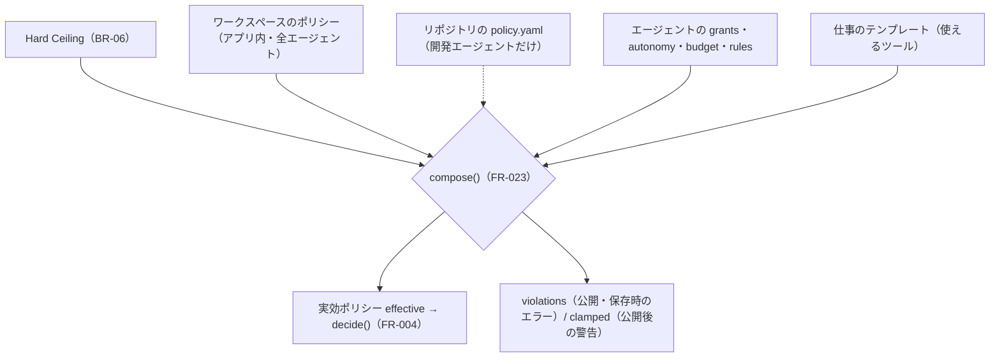

# 04. 機能仕様 — ポリシー・定義スキーマ・合成・テンプレート
- 版数：v0.6（2026-10-01） ／ 親：[README.md](README.md) ／ 出典：04 §共通定義、12 §エージェント定義への追加（v0.3）・§定義の保存場所・§Harness テンプレート・§Skill、13 §実効ポリシーの合成・§ワークスペースのポリシー・§Harness テンプレートの追加、14 §エージェント定義の例、15 §ワークスペースのポリシー（追加）

> **3行で**
> 1. 権限の上限は Hard Ceiling → ワークスペースのポリシー → リポジトリの `policy.yaml`（開発エージェントだけ）→ エージェントの付与（`grants`）→ 仕事のテンプレートの順に重なり、`compose()` が項目ごとに厳しい方を取る。
> 2. エージェント定義は v2（v0.5）で、権限の境界はエージェント単位、テンプレート・指示・トリガー・届け先は仕事（`jobs[]`）単位。v1 は `jobs` が1つの v2 として読む。
> 3. 名前・役割・instructions・Skill・メモリは権限を与えない（BR-23・BR-48）。権限はポリシーの項目だけで決まる。

## 🧭 判断してほしいこと
[README](README.md#-判断してほしいこと) の Q-27（アプリ内モードと下書き）、Q-31（仕事ごとの合成とハッシュ）、Q-32（`submit_report`）。

## 全体図

見てほしいところ：入力はどれも「上限」で、どれか1つでも厳しければそれが効く。点線のリポジトリのポリシーは開発テンプレートのときだけ加わる。

## 要点
- ワークスペースのポリシーはアプリ内で編集し、版の履歴を持つ。緩める変更は owner の承認が要る（BR-33 と同じ。承認者は Q-28）。→ [ワークスペースのポリシー](#workspace-policy)
- `policy.yaml` を書かない場合は既定ポリシー（BR-05）。→ [リポジトリのポリシー](#repo-policy)
- 定義の保存場所はアプリ内モード（既定、保存で有効）と GitOps モード（マージで有効）。→ [定義の保存場所](#storage-modes)
- 公開後にポリシーが厳しくなったら、エージェントは無効にせず clamp して動かす（BR-21）。→ [実効ポリシーの合成](#composition)
- テンプレートは7つ（汎用4・開発3）。ランタイムは固定でユーザーはコードを書かない（ADR-013）。→ [Harness テンプレート](#templates)

---

## 詳細

<a id="workspace-policy"></a>
### ワークスペースのポリシー
すべてのエージェントの上限（BR-43）。フェーズ0。リポジトリがなくてもエージェントを作れる（REQ-045）。

<details>
<summary>ワークスペースのポリシーの例（13 ＋ 15 の `rules`）</summary>

```yaml
version: 1
autonomy:
  web_read: auto
  notify: auto                      # 組み込みのプッシュ通知・アプリ内レポート
  mcp_read: auto                    # 読み取りに分類した MCP ツール
  mcp_write: approve                # 書き込み・未分類の MCP ツール（ルールで auto にできる）
  open_pr: approve                  # 開発（GitHub をつないだ場合）
budget:
  per_task_usd: 0.5
  per_day_usd: 3
  max_steps: 40
  max_minutes: 15
web:
  deny_domains: ["*.internal", "localhost"]   # 既定で私的アドレスは常に拒否（Hard Ceiling）
  max_fetches_per_task: 30
connectors:
  enabled: [slack, gmail, google-calendar, maps]
rules:
  enabled: true              # false にすると、どのエージェントにも「以後も許可」を出さない。既存のルールも効かない
  max_per_agent: 20
approvers: [me]
```

</details>

<a id="repo-policy"></a>
### リポジトリのポリシー（`.agent/policy.yaml`）
開発エージェント（リポジトリを対象にするもの）にだけ追加でかかる上限（BR-43）。フェーズ1。

<details>
<summary>policy.yaml と routing.yaml のスキーマ</summary>

```yaml
version: 1                      # 必須。現在は 1 のみ
autonomy:                       # 省略したキーは既定値
  read: auto
  edit_code: auto
  run_tests: auto
  shell_network: deny
  open_pr: approve
  merge: deny
budget:
  per_task_usd: 2               # 0.1〜20
  per_day_usd: 10               # リポジトリ単位の日次上限。0.1〜200
  max_steps: 80                 # 1〜200（1ステップ = LLM呼び出し1回）
  max_minutes: 45               # 5〜60（サンドボックスの実時間）
breakers:
  same_action_repeat: 5         # 2〜20
  files_changed_max: 30         # 1〜200
  denied_attempts_max: 3        # 1〜20
  step_cost_usd_max: 0.5        # 0.01〜5
paths:
  deny: [".github/workflows/**", "infra/**", "**/.env*"]   # glob（micromatch 互換）
commands:
  allow: ["npm ci", "npm test", "npm run build"]         # 前方一致。シェルのメタ文字（; | & ` $( > <）を含むコマンドは常に不一致
approvers: ["ren"]              # 任意。GitHubのログイン名
```

`.agent/routing.yaml`（任意）：

```yaml
version: 1
phases:
  investigate: anthropic/claude-haiku-4-5-20251001
  plan: anthropic/claude-opus-5-5
  implement: anthropic/claude-sonnet-5-5
  test: anthropic/claude-sonnet-5-5
  summarize: anthropic/claude-haiku-4-5-20251001   # 承認カードの差分要約
  # review / report / design（エージェントビルダーで追加。未指定なら plan のモデル）
```

</details>

- モデルの指定は `{provider}/{model}`。provider は `anthropic` / `openai` / `openrouter`。
- 追加のフェーズ：`review`（dev-coder の自己レビュー）、`report`（reviewer / triager のレポート作成）、`design`（設計アシスタント。FR-024 は v0.5 で廃止）。routing.yaml とエージェント定義の `routing` のどちらでも指定でき（`packages/policy-schema` の routing のスキーマに追加）、未指定ならいずれも `plan` のモデル。エージェント定義の `routing` はそのエージェントについて routing.yaml を上書きする。設定プランナー（FR-035）は `plan` のモデルを使う（A-82）。
- **既定ポリシー**（ファイルがない場合。BR-05）：上の例と同じ値。ただし `paths.deny` は `[".github/workflows/**", "**/.env*"]`、`commands.allow` は空（run_tests は実質使えない）、`approvers` はなし。`memory_write` は既定値（auto）。

### エージェント定義（v1：`.agent/agents/<id>.yaml`）
- ID はファイル名（拡張子を除く）で `^[a-z0-9][a-z0-9-]{1,31}$`。1ワークスペース20体まで（A-81。v0.2 は1リポジトリ20個。既定エージェント `default` は数えない）。
- 省略したキーは、ポリシー（または既定ポリシー）の値を引き継ぐ。
- 定義の `owner` を「エージェント担当者」と呼び、ロールの owner（ワークスペースの owner）と区別する。
- GitOps モードでは、定義はデフォルトブランチの HEAD からだけ読み、タスクは開始時点のエージェントスナップショットに固定される（BR-22）。

<details>
<summary>v1 の定義（12・04 v0.2）</summary>

```yaml
version: 1                        # 必須。現在は 1 のみ
name: バグ修正係                   # 必須。表示名 1〜40文字
description: 再現手順つきのバグIssueを直してPRを出す   # 必須。1〜200文字
template: dev-coder               # 必須。dev-coder / reviewer / triager（フェーズ1）
owner: aoi                        # 必須。エージェント担当者（GitHubログイン名）。スケジュール起動時の依頼者・通知先
instructions: |                   # 役割の指示。最大8,000文字。instructions_file と排他
  再現テストを先に書いてから修正する。
  公開APIのシグネチャは変えない。
# instructions_file: .agent/agents/bug-fixer.md
skills: [fix-flaky-test]          # .agent/skills/<name>/SKILL.md。最大20
autonomy:                         # 操作の種類ごと。ポリシーより緩くできない
  read: auto
  edit_code: auto
  run_tests: auto
  open_pr: approve
  memory_write: auto
paths:
  allow: ["src/**", "test/**"]    # edit_code の対象を絞る。省略時は全体
  deny: ["src/billing/**"]        # ポリシーの paths.deny に追加される
commands:
  allow: ["npm test"]             # ポリシーの commands.allow のいずれかに前方一致するものだけ
budget:
  per_task_usd: 1
  per_day_usd: 5                  # このエージェントの日次上限（リポジトリの日次上限とは別に効く）
  max_steps: 60
  max_minutes: 30
breakers:
  files_changed_max: 10           # キーと範囲はポリシーと同じ
triggers:
  - type: manual
  - type: github_label
    label: "agent:bug-fixer"
  - type: github_mention          # Issueのコメントで「@open-team bug-fixer ...」
  - type: schedule
    cron: "0 9 * * 1-5"
    timezone: Asia/Tokyo
    prompt: "flakyなテストを1つ探して直す"
max_runs_per_day: 10              # 1〜50。全トリガーの合計
approvers: [ren]                  # ポリシーに approvers があれば、その部分集合であること
memory:
  enabled: true
  max_items: 200                  # 1〜200
routing:                          # 任意。フェーズごとのモデル（routing.yaml を上書き）
  implement: anthropic/claude-sonnet-5-5
  review: anthropic/claude-opus-5-5
```

</details>

<details>
<summary>v0.3 で追加したキー（12 §エージェント定義への追加）</summary>

```yaml
appearance:                       # 見た目
  icon: bug                       # 組み込みのアイコン名
  color: amber
autonomy:
  open_pr: approve
  browser_submit: approve         # フェーズ2
  payment: handoff                # Hard Ceiling で handoff のみ
rules:                            # 「以後も許可」で追加される。取り消せる（形は mcp-and-web.md）
  - action: mcp.slack.post_message
    match: { channel: "C01DEVANN" } # 宛先の引数はすべて実際の値で固定
    labels: { channel: "#dev-announce" }
    added_by: ren
    added_at: 2026-10-01T09:00:00+09:00
workspace:                        # フェーズ2（永続ワークスペース。REQ-039・ADR-020）
  persistent: true
  size_gb: 5
browser:                          # フェーズ2（統制つきブラウザ。REQ-040・ADR-019）
  domains: ["*.notion.so", "app.linear.app"]
  credentials: [notion-work]      # 保管庫のログイン情報の名前（値は持たない）
```

</details>

- 13 で `profile`（見せるプロフィールの項目）、`connectors.<name>.grant`（付与する MCP ツール。読み取りに分類済みのものも書き込みも）、`web.allow_domains`（省略時はワークスペースの範囲内すべて）、`notify.quiet_if_normal` を追加した。
- 権限は `autonomy`・`paths`・`commands`・`budget`・`breakers`（と 13 以降の `connectors` の付与・`web`・`rules`）だけで決まる。instructions・Skill・メモリは振る舞いを変えるだけ（BR-23）。
- スケジュールの最短間隔は1時間（BR-25、A-37）。
- **既定エージェント**（BR-31）：スラッグ `default` は予約。`.agent/agents/default.yaml` がなければ組み込みの既定エージェント（dev-coder、リポジトリのポリシーだけ、トリガーは手動と `open-team` ラベル）を使い、スナップショットの `source = builtin`。あればその定義で上書きする。上限の数に入れない。既存のタスクはマイグレーションで既定エージェントに紐づける。

### エージェント定義（v2：仕事 `jobs` と権限の境界 `grants`）
v0.5 で導入。ユーザーはこの形式を見なくてよく、詳細設定の「YAML」タブと GitOps モードでだけ使う。

<details>
<summary>v2 の定義の例（14、届け先は 15 の形）</summary>

```yaml
version: 2                          # v0.5 で jobs を導入
name: ニュースリサーチャー
role: research                      # 推測した役割（権限に影響しない）
appearance: { icon: newspaper, color: blue }
grants:                             # 権限の境界（全仕事で共有）
  web: { allow_domains: ["*"] }     # ワークスペースのポリシーの範囲内
  connectors:
    slack: { grant: [post_message] }
autonomy:
  mcp_write: approve
rules:                              # 「以後も許可」で追加されたもの
  - action: mcp.slack.post_message
    match: { channel: "D04ABCDEF" }  # 宛先は実際の値で固定
    labels: { channel: "自分宛ての DM" }
budget: { per_task_usd: 0.2, per_day_usd: 1 }
max_runs_per_day: 10
profile: [interests]
jobs:
  - id: morning-news
    kind: recurring                 # once / recurring / watch
    template: researcher
    instructions: |                 # ユーザーのお願いから作った指示
      テーマ：AI規制、半導体。各3件、1行の要約と出典URL。
    tuning: |                       # 自己調整の欄（BR-52）
      要約は40文字以内（👎「長い」×2 より）
    trigger: { type: schedule, cron: "0 7 * * *", timezone: Asia/Tokyo }
    deliver:                        # 宛先は定義が決め、LLM は中身だけを書く（BR-58）
      - to: mcp.slack.post_message
        args: { channel: "D04ABCDEF" }
        content: { text: "{{report.summary}}\n\n{{report.sources_markdown}}" }
  - id: tsmc-earnings
    kind: watch
    template: watcher
    instructions: TSMC の IR ページの決算資料の更新を見張る
    trigger: { type: watch, interval: 1h, targets: ["https://investor.tsmc.com/..."] }
    deliver: [{ to: notify }]
```

</details>

- v1 の定義（`template` / `instructions` / `triggers` が直下にあるもの）は、`jobs` が1つの v2 として読み込む（互換）。
- 1エージェントの仕事は10個まで（A-81）。仕事の slug はエージェントの中で一意（`^[a-z0-9-]{2,40}$`）。
- 仕事のテンプレートが使うツールは、エージェントの `grants` の範囲に限られる。

<a id="storage-modes"></a>
### 定義の保存場所
v0.3 で ADR-011 を改訂（ADR-017）。ワークスペースの設定でモードを選ぶ。GitOps モードのワークスペースでは、アプリ内の保存は下書きになる（v0.2 の動き）。この節に合わせた FR-022・025〜027 の再設計は Q-27。

| | アプリ内モード（既定） | GitOps モード |
|---|---|---|
| 定義の正本 | open-team の DB（版の履歴つき） | リポジトリの `.agent/agents/*.yaml` |
| 有効になるとき | 保存した時点 | デフォルトブランチへのマージ |
| 権限を広げる変更 | 承認が要る（承認カードに定義の差分を表示。v0.5 以降は `classify()` の `widen`） | PR のレビュー（GitHub のルール） |
| 権限を狭める変更・指示の変更 | 保存した時点で有効 | PR のマージ |
| 上限 | ポリシーと Hard Ceiling（どちらのモードでも同じ合成。BR-20） | 同左 |
| 書き出し | いつでも YAML として書き出し、PR にできる | — |

- 「権限を広げる変更」は、新旧の定義を `compose()` にかけ、実効ポリシーのどれかの項目が緩くなったかで決定論的に判定する（自律レベル・パス・コマンド・予算・Breaker・ルール・連携先・ドメイン）。v0.5 でこの判定を `classify()`（FR-036）として定義した。

<a id="composition"></a>
### 実効ポリシーの合成（BR-20）
`compose()` の引数は版ごとに広がった。最新は 14 の形。

| 版 | シグネチャ |
|---|---|
| v0.2（12） | `compose(ceilings, repoPolicy, agentDef)` |
| v0.4（13） | `compose(ceilings, workspacePolicy, repoPolicy?, agentDef)`。`repoPolicy` は開発テンプレートのときだけ |
| v0.5（14、最新） | 仕事ごとに `ceilings ∧ workspacePolicy ∧ repoPolicy ∧ agentGrants ∧ template`（ハッシュの単位は Q-31） |

| 項目 | 合成のしかた |
|---|---|
| `autonomy.*` | 厳しさの順 `deny > approve > auto` で最も厳しい値（`handoff` の位置は Q-29） |
| `budget.*`、`breakers.*` | 最小値。`per_day_usd` はリポジトリ（ワークスペース）とエージェントの両方が別々に効く |
| `paths.deny` | 和集合 |
| `paths.allow` | エージェントの指定（なければ全体）。deny が優先 |
| `commands.allow` | エージェントの各要素が、ポリシーのいずれかの要素に前方一致する場合だけ残す |
| `approvers` | ポリシーにあれば、エージェントの指定はその部分集合でなければならない。どちらにもなければ BR-14 のとおり |
| `connectors.*.grant` | ワークスペースで有効なツール（`connectors.enabled`）の部分集合でなければならない |
| `guards`（v0.11。仕事の定義の `job_guards`） | 和集合。同じツール・同じ引数に複数あれば、範囲（`min`・`max`）は積（`min` は大きい方・`max` は小さい方）、候補（`in`）は積。積が空ならその引数は常に `guard_exceeded`（[D-57](../decisions.md#d-57)） |

**緩めようとした場合**（BR-21）
- 公開時・保存時（定義の検証・PR の CI チェック）：エラー `AGENT_EXCEEDS_POLICY`。どの項目が、ポリシーのどの値を超えたかを示す。
- 公開後にポリシーが厳しくなった場合：エージェントは無効にせず、厳しい方で実行する（clamp）。スナップショットに `clamped` として記録し、一覧・Canvas・タスク詳細に警告 `AGENT_CLAMPED` を表示する。

<a id="skill-format"></a>
### Skill の形式（`.agent/skills/<name>/SKILL.md`）
- `name` は `^[a-z0-9-]{2,40}$`、本文は最大16KB。1エージェント20個まで（A-34）。
- 先頭に `name` と `description`（いつ使うか、1〜200文字）の frontmatter、その下に手順・判断ルール・期待する出力。

```markdown
---
name: fix-flaky-test
description: flakyなテストを直すときに使う
---
（手順・判断ルール・期待する出力）
```

- タスク開始時に `name` と `description` だけをシステムプロンプトに入れ、本文は `load_skill` で必要なときに読む（FR-030）。Skill に書かれたコマンドも `commands.allow` と実効ポリシーで判定される（BR-23）。

<a id="templates"></a>
### Harness テンプレート
汎用テンプレートは REQ-050（用途別のスターターはフェーズ1）。ランタイムはプラットフォームが提供する固定のイメージで、テンプレートは「フェーズの並び・使えるツール・出力の種類」の組み合わせ（ADR-013、FR-029）。

| テンプレート | フェーズの並び | 使えるツール | 出力 | 用途 | フェーズ |
|---|---|---|---|---|---|
| `researcher` | 調査 → 整理 → 要約 | `web_search`, `web_fetch`, `mcp_call`（読み取りのみ）, `submit_report`, `notify` | レポート（出典つき） | ニュースのリサーチ | 0 |
| `briefer` | 収集 → 要約（短く） | `researcher` と同じ。出力の長さに上限（通知1件＋レポート） | 通知＋レポート | 朝の交通 | 0 |
| `watcher` | 取得 → 前回と比較 → 変化があれば要約 | `web_fetch`, `mcp_call`（読み取りのみ）, `notify` | 変化があったときだけ通知（Hard Ceiling で書き込み系のツールを持たない。BR-40） | ページの見張り | 0 |
| `assistant` | 計画 → 実行 | 読み書きすべての MCP ツール（書き込みは Intent）, `web_*`, `notify` | Intent とレポート | メールの整理 | 1 |
| `dev-coder` | investigate → plan → implement → test → review → submit | 全ツール（`submit_report` を除く） | `open_pr` の Intent | バグ修正、小さな機能追加、依存関係の更新 | 1 |
| `reviewer` | investigate → review → report | read 系、`run_command`、`load_skill`、`remember`、`submit_report`、`finish` | レポート | PR のセルフチェック、脆弱性・技術的負債の調査 | 1 |
| `triager` | investigate → report | read 系、`load_skill`、`remember`、`submit_report`、`finish`（Open の Issue 一覧はタスクのコンテキストで渡す） | レポート | Issue の分類・優先度・担当の提案 | 1 |

- 13 の表の `researcher`・`briefer` にあったツール `deliver` は v0.6 で廃止（届け先は仕事の `deliver` で宣言。BR-58）。
- `memory.enabled: false` のエージェントでは、どのテンプレートでも `remember` を外す（呼ばれたら deny）。
- リポジトリ（GitHub）をつないでいないワークスペースでは、開発系のテンプレートは出さない（US-039）。

## このドキュメントで決まったこと
- [ADR-012](../adr/ADR-012-stricter-wins-composition.md)：厳しい方を取る合成
- [ADR-013](../adr/ADR-013-template-fixed-runtime.md)：ランタイムはテンプレートに固定
- [ADR-017](../adr/ADR-017-in-app-definition-default.md)：アプリ内モードを既定にする
- [ADR-021](../adr/ADR-021-workspace-policy.md)：ワークスペースのポリシー
- [ADR-028](../adr/ADR-028-jobs-as-unit-of-work.md)：定義 v2（仕事）
