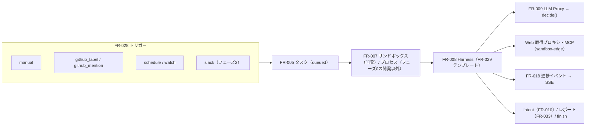

# 04. 機能仕様 — タスク・実行・トリガー・テンプレート
- 版数：v0.6（2026-10-01） ／ 親：[README.md](README.md) ／ 出典：04 §FR-005〜009・018・028・029、12 §トリガーと入口・§FR-029、13 §フェーズ0の構成・§Web 読み取り、14 §エージェント定義の例

> **3行で**
> 1. どの入口（手動・ラベル・メンション・スケジュール・watch・Slack）からでも、タスクを1件作って同じ実行経路に乗せる。入口ごとに違うのは「依頼者の決め方」と「入力」だけ。
> 2. ランタイム（Harness）はプラットフォームの固定イメージで、テンプレートに従ってフェーズ・ツール・出力を切り替える。LLM の出口は LLM Proxy だけで、呼び出しごとに予算とツール呼び出しを判定する。
> 3. 開発タスクは使い捨てのサンドボックスで動き、サンドボックス内はすべて信頼しない。フェーズ0の開発以外のタスクはコンテナ内のプロセスで動く。

## 🧭 判断してほしいこと
[README](README.md#-判断してほしいこと) の Q-30（リポジトリのないタスク・`watch` の処理が未設計）、Q-32（`submit_report`）、Q-39 ④（メンションへの返信）。

## 全体図

見てほしいところ：Harness から外に出る線は sandbox-edge 経由だけ。結果は Intent・レポート・finish のどれかで終わる。

## 要点
- 重複の判定は「同じエージェント × 同じ Issue」。スケジュールは前回の起動が未完了なら起動しない（BR-29）。→ [FR-005](#fr-005)
- `max_runs_per_day`（1〜50、全トリガー合計）を超えた起動は作らず `trigger.skipped` を記録する。→ [FR-028](#fr-028)
- システムプロンプトの順序：テンプレートの指示 → 実効ポリシーの要約 → instructions → Skill の一覧 → メモリ → タスクの入力。→ [FR-008](#fr-008)
- dev-coder は提出前に別モデルで自己レビューし、implement に戻れるのは2回まで。→ [FR-008](#fr-008)

---

## 詳細

### FR-005：タスク作成 〔UC-005〕
- 概要：委任先のエージェントを指定し、Issue または指示文からタスクを作る。トリガー（FR-006、FR-028）と試し実行（FR-026）もこの処理でタスクを作る。フェーズ0。v0.5 以降、タスクは仕事（`job_id`）に紐づく。リポジトリのないタスクの入力は未設計（Q-30）。
- 利用ロール：maintainer 以上
- 入力：

  | 項目 | 型 | 必須 | バリデーション |
  |---|---|---|---|
  | repositoryId | uuid | ○ | 連携中のリポジトリ |
  | agentId | uuid | ○ | そのリポジトリのエージェントで `active` |
  | issueNumber | integer | △ | `issueNumber` か `prompt` のどちらか一方が必須（両方は不可）。1以上。GitHub 上で Open |
  | prompt | string | △ | Issue なしのタスクの本文（指示文だけの委任・スケジュール）。2,000文字以内 |
  | instructions | string | − | Issue に対する追加の指示（Web・メンション）。`issueNumber` があるときだけ。2,000文字以内 |

- 処理：
  1. BR-07 の条件を順に検証する。「同じ Issue に未完了のタスクがない」は同じエージェントの同じ Issue について判定する（BR-29。Issue なしの手動タスクは判定しない）。エージェントが `active` で停止中でないこと（BR-27）と、`max_runs_per_day` を超えていないこと（FR-028）も確認する。GitHub 上の書き込み権限は、ユーザーのトークンで `GET /repos/{owner}/{repo}/collaborators/{username}/permission` を呼んで確認する（5分キャッシュ）。
  2. 最新の valid なスナップショットを取得し、デフォルトブランチの HEAD とずれていれば FR-003 で更新する。エージェントの現在のスナップショット（`agents.current_snapshot_id`）を取得する。
  3. `issueNumber` があれば、Issue のタイトル・本文（先頭20,000文字）を取得して保存する。
  4. tasks を `queued` で作成し（`policy_snapshot_id`・`agent_id`・`agent_snapshot_id`・`base_commit_sha`・`trigger_type`・`output_type` を固定。BR-22）、`task.created` を記録する。`trigger_type` は `manual` / `github_label` / `github_mention` / `schedule` / `dry_run` / `trust_proposal`（v0.1 の `trigger` を置き換え）。`output_type` はテンプレートで決まる（dev-coder は `pr`、reviewer / triager は `report`）。
  5. 実行キューに登録する（DB のトランザクションに含める）。
- 出力：作成したタスク（201）
- エラー・例外：

  | 条件 | HTTP / code | メッセージ |
  |---|---|---|
  | Kill Switch 発動中 | 423 `KILL_SWITCH_ENGAGED` | Kill Switch 発動中のため新しいタスクを開始できません |
  | ポリシーが invalid | 422 `POLICY_INVALID` | ポリシーにエラーがあります |
  | キーが未登録 | 422 `LLM_CREDENTIAL_MISSING` | LLM の API キーを登録してください |
  | 同じエージェントの同じ Issue に未完了のタスク | 409 `TASK_ALREADY_ACTIVE` | この Issue は実行中です |
  | GitHub 上の権限がない | 403 `FORBIDDEN` | このリポジトリへの書き込み権限がありません |
  | Issue がクローズ済み・存在しない | 422 `ISSUE_NOT_OPEN` | Issue が見つからないか、クローズされています |
  | `issueNumber` と `prompt` のどちらもない／両方ある | 400 `VALIDATION_ERROR` | Issue か指示文のどちらかを指定してください |
  | エージェントが `active` でない | 422 `AGENT_NOT_ACTIVE` | このエージェントは現在起動できません |
  | エージェントが停止中（`disabled`） | 423 `AGENT_DISABLED` | このエージェントは停止中です |
  | `max_runs_per_day` を超える | 429 `DAILY_RUN_LIMIT` | このエージェントの今日の起動回数の上限に達しました |

- ビジネスルール：BR-07、BR-08、BR-22、BR-27、BR-29。ワークスペースの同時実行数（BR-08）はエージェントを問わず共通。試し実行は同時実行数とリポジトリの日次予算には数え、`max_runs_per_day` と BR-29 には数えない（BR-24）。

### FR-006：ラベルトリガー 〔UC-006〕
- 概要：`issues.labeled` を受けてタスクを作る。ラベルはエージェントごと（`github_label` トリガーの `label`）。既定の `open-team` ラベルは既定エージェントに割り当てる。フェーズ1。
- 利用ロール：システム
- 処理：
  1. ラベル名から委任先を決める。`active` なエージェントの `label` に一致すればそのエージェント、`open-team` なら既定エージェント（BR-31）。どれにも当たらなければ何もしない。同じラベルを複数のエージェントに設定すると定義の検証エラー `AGENT_TRIGGER_CONFLICT`（FR-022）なので、当たるエージェントは高々1つ。
  2. `sender.id` を users.github_user_id と照合する。
  3. そのユーザーを依頼者として FR-005 の1〜5 を実行する（`trigger_type = github_label`）。
  4. 失敗したらタスクを作らず `task.rejected_trigger`（理由コード）を記録する。エージェントが `active` でない・停止中・`max_runs_per_day` 超過なら `trigger.skipped`（理由コード）を記録する。
- ビジネスルール：A-07、BR-29。Issue へのコメントは返さない（Won't）。

### FR-007：サンドボックス実行管理 〔UC-007〕
- 概要：タスク単位の使い捨てサンドボックスを起動・監視・破棄する。フェーズ1（開発タスク）。フェーズ0の開発以外のタスクはコンテナ内のプロセスで動く（13）。
- 利用ロール：システム（ワーカー）
- 処理：
  1. キューからタスクを取り出し、同時実行数（BR-08）と日次予算を確認する。空きがなければ30秒後に再度キューに入れる。
  2. タスクを `provisioning` にする。
  3. GitHub App のトークンでベースコミットの tarball を取得し、オブジェクトストレージに保存する（`paths.deny` に一致するファイルも含める。書き込みの禁止は FR-004 と FR-010 で強制する）。
  4. サンドボックストークン（ランダム256ビット。タスク ID に紐づく。有効期限 `max_minutes + 5分`）を発行し、ハッシュだけを保存する。
  5. SandboxProvider（→ [07](../07_architecture.md)）でジョブを起動する。渡すのは `TASK_ID`・`SANDBOX_TOKEN`・`INTERNAL_API_URL` の3つの環境変数だけ。
  6. 最初の `GET /internal/v1/task-context` でタスクを `running` にする。
  7. 監視：ハートビート（イベント送信または LLM 呼び出し）が60秒ない → `failed`（`sandbox_lost`）。実行時間が `max_minutes` を超えた → `halted`（`timeout`）。
  8. 終了時（Intent 提出・finish・停止）：トークンを失効させ、ジョブを停止し、tarball を24時間後に削除する。
- エラー・例外：起動に失敗 → 2回まで再試行し、それでも失敗なら `failed`（`provision_failed`）。tarball が500MB超 → `failed`（`repo_too_large`）。

### FR-008：エージェントランタイム 〔UC-007〕
- 概要：open-agent の Harness。**プラットフォームが提供する固定のコンテナイメージ**で動き、利用者はイメージを差し替えられない。テンプレート（FR-029）に従ってフェーズ・ツール・出力を切り替える（ADR-013）。フェーズ0。
- 利用ロール：エージェント
- 処理：
  1. タスクのコンテキスト（テンプレート・instructions・Skill（`name`・`description`・本文）・メモリ・実効ポリシーの要約。triager には Open の Issue 一覧（最大100件。タイトル・ラベル・本文の先頭2,000文字）。API-036）を取得し、スナップショットを展開して作業ツリーを作る（ローカルで `git init` し、ベースコミットの内容で初期コミット）。
  2. システムプロンプトの順序：テンプレートの指示 → 実効ポリシーの要約 → エージェントの instructions → Skill の一覧（`name` と `description` だけ）→ メモリ → タスクの入力。instructions とメモリは「利用者が書いたデータ」として区切る。
  3. テンプレートのフェーズの順に LLM Proxy 経由で LLM を呼ぶ。各呼び出しに `phase` を付け、Router が routing（定義の `routing` で上書き）でモデルを決める。`review`・`report`・`design` の指定がなければ `plan` のモデル。
  4. ツール呼び出しのうち Proxy が `allow` としたものだけ実行する。`deny` は「ポリシーにより拒否（理由コード）」を LLM に返す。`halt` を受けたら直ちに終了する。テンプレートにないツールは deny（BR-09）。
  5. `run_command` は作業ツリー上で、タイムアウト（最大600秒）つきで実行し、出力は先頭と末尾の各16KB に切り詰めて渡す。
  6. `load_skill` は Proxy が `allow` のときだけ Skill の本文を返す（FR-030）。`remember` は `allow` のときだけ API-055 に送る（FR-031）。
  7. ステップごとに進捗イベント（フェーズ・ツール名・結果の要約）を送る。
  8. `finish`（どのテンプレートでも使える）なら、進捗イベント `finished`（`outcome`・`reason`）を送って終了する。タスクは `failed`（`agent_no_change` / `agent_unable`）。
  9. dev-coder の自己レビュー（REQ-028）：implement と test の後、`review` フェーズで別のモデル（routing の `review`。未指定なら `plan`）が Issue・instructions・差分・テスト結果を読み、`pass` か修正点のリストを返す。修正点があれば implement に戻る（結果は `action_intents.self_review`）。戻れるのは2回まで、3回目は修正点を PR 本文の「未解決の指摘」に書いて提出する。結果は承認カードに「AIによる自己レビュー（参考）」として表示し、リスク評価（BR-13）と区別する。
  10. `submit_intent`（dev-coder）なら、`git diff`（テキストのみ、`--binary` なし）と PR のタイトル・本文・テスト結果の要約・自己レビューの結果を FR-010 に送り、終了する。
  11. `submit_report` なら、レポートを API-056 に送り（FR-033）、終了する。仕事に `deliver` があれば、ランタイムがレポートから Intent を作る（BR-58）。
- ビジネスルール：BR-12、BR-23。ランタイムは協調的に判定に従うが、`run_tests` でリポジトリのコードを実行するため**サンドボックス内のすべてを信頼しない**。最終的な防御はサンドボックスの境界（認証情報なし・通信の制限）と FR-010 の差分検証（ADR-003）。

### FR-009：LLM Proxy 〔UC-007, UC-008〕
- 概要：サンドボックスからの唯一の LLM の出口。BYOK のキーを使い、呼び出しごとに予算とツール呼び出しを判定する。sandbox-edge に Web 取得プロキシと同居する（13）。フェーズ0。
- 利用ロール：エージェント（サンドボックストークン）
- 入力：

  | 項目 | 型 | 必須 | バリデーション |
  |---|---|---|---|
  | phase | enum（investigate / plan / implement / test / summarize / review / report / design） | ○ | `review`・`report`・`design` はエージェントビルダーで追加。`design` は設計アシスタント（廃止）だけが使った |
  | messages | array | ○ | 合計で最大1MB |
  | tools | array | ○ | テンプレートで使えるツールだけ（`memory.enabled: false` なら `remember` を除く） |
  | maxTokens | integer | ○ | 1〜16,000 |

- 処理：
  1. サンドボックストークンを検証し、タスクが `running` であることを確認する。
  2. Router で `phase` からモデルを決める。
  3. `estimatedCostUsd = 入力トークン × 入力単価 + maxTokens × 出力単価`（単価はプラットフォームの価格表 → 07）。
  4. FR-004 で `subject.kind = llm_call` を判定し、`halt` なら停止処理（FR-013 / FR-014）を行って 409 `TASK_HALTED`。
  5. キーを復号し、プロバイダーの API を呼ぶ（タイムアウト120秒。429 / 5xx は指数バックオフで最大3回）。
  6. 応答の usage から実費を計算し、usage_records に記録し、カウンタ（ステップ数・費用）を更新する。
  7. 応答の各ツール呼び出しを FR-004 で判定し（`subject.kind = tool_call`）、policy_decisions に保存する。
  8. 応答本文と、判定 `governance: [{ toolCallId, decision, reasonCode }]` を返す。
- エラー・例外：トークン不正・失効 → 401 `UNAUTHORIZED`。タスクが停止・終了済み → 409 `TASK_HALTED`。プロバイダーのエラーがリトライ後も続く → 502 `LLM_UPSTREAM_ERROR`。
- ビジネスルール：BR-03、BR-10、BR-20。`remember` は `memory_write` として判定する。プロンプトと応答の全文は暗号化して30日間保存する（設定で無効にできる。A-15）。DB にはハッシュ・トークン数・費用だけを保存する。

### FR-018：進捗イベント配信 〔UC-007, UC-014〕
- 概要：タスクのタイムラインを保存し、SSE でリアルタイムに配信する。フェーズ0。
- 処理：
  1. サンドボックスから進捗イベントを受け取る（最大10件/秒/タスク。超えた分は捨て、`dropped` の件数だけ記録）。
  2. 状態変化・判定・費用の更新など、サーバー側のイベントも task_events に保存する。
  3. SSE：`GET /api/v1/tasks/{taskId}/stream` で `Last-Event-ID` 以降を配信する。Postgres の LISTEN/NOTIFY で行い、15秒ごとにハートビート。
- イベントの種類：`phase_started`、`tool_called`（ツール名・判定・要約）、`llm_called`（モデル・費用）、`status_changed`、`budget_updated`、`message`、`finished`（`outcome`・`reason`）

### FR-028：トリガー 〔UC-021〕
- 概要：どの入口からでも `tasks` を1件作り、同じ実行経路（FR-007〜FR-012）に乗せる。v0.5 以降、トリガーは仕事（`jobs[].trigger`）ごとに持つ。
- 利用ロール：システム（Webhook・worker）

| トリガー | 入力 | 依頼者 | 受け付ける条件 | フェーズ |
|---|---|---|---|---|
| `manual` | Issue または指示文 | 操作したユーザー | BR-07 | 0 |
| `github_label` | Issue | ラベルを付けたユーザー | BR-07。ラベル名は定義の `label`（`open-team` は既定エージェント）（FR-006） | 1 |
| `github_mention` | Issue ＋ コメント本文（指示として追加） | コメントしたユーザー | BR-07。書式は `@open-team <agent-id> <指示>`（A-41） | 1 |
| `schedule` | 定義の `prompt`（v2 は仕事の指示） | エージェント担当者（定義の `owner`） | BR-25 | 0 |
| `watch` | `interval`・`targets`（14 の例：`{ type: watch, interval: 1h, targets: [...] }`） | —（未設計。Q-30） | 読み取り専用で定期的に調べ、変化があれば通知（REQ-043、BR-46） | 0 |
| `slack` | メッセージ本文、スレッドの文脈 | Slack ユーザーに紐づいたユーザー | BR-07 ＋ Slack との紐づけ | 2 |

- 処理（メンション）：
  1. `issue_comment.created` を受け取り、本文の先頭が `@open-team <agent-id>` かを判定する（A-41）。
  2. コメントしたユーザーを照合し、BR-07・BR-29・`max_runs_per_day` を検証する。
  3. コメントの残りを追加の指示（`tasks.instructions`、2,000文字まで）として `queued` で作成する（`trigger_type = github_mention`）。
  4. 依頼者には Web Push で通知する（コメントでの返事は Won't。Q-39 ④）。
- 処理（スケジュール）：
  1. `agent_schedules` に展開する（スナップショットが変わるたびにそのエージェントの行を作り直す。v0.5 以降は仕事ごと `job_id`）。cron はタイムゾーンつきで解釈し、存在しない時刻（夏時間）は飛ばす。
  2. worker は1分ごとに `next_run_at` を過ぎたスケジュールを取り出す（`FOR UPDATE SKIP LOCKED`）。
  3. `agents.status`・Kill Switch・`max_runs_per_day` を確認し、エージェント担当者が maintainer 以上で GitHub 上の書き込み権限を持つことを Gateway で確認する（BR-25）。同じスケジュールの前回のタスクが未完了なら起動しない（`trigger.skipped`、`previous_run_active`。BR-29）。
  4. 満たせば `prompt` を入力（`tasks.prompt`）に `queued` で作成し（`agent_snapshot_id` を固定）、実行ジョブを同じトランザクションで登録して `next_run_at` を更新する。満たさなければ `trigger.skipped`（理由）を記録して `next_run_at` を更新する。結果を `last_result`（`created` / `skipped:<理由>`）に残す。
  5. フェーズ0で PC が止まっていた間のスケジュールは後から実行せず、アクティビティに「未実行」として残す（A-75）。
  6. 定期実行の仕事の次の実行が始まったら、前の実行の承認待ちを `superseded` にする（FR-011、BR-60）。
- 起動の上限：すべてのトリガーで `max_runs_per_day`（1〜50、全トリガー合計）を数え、超えた分は作らず `trigger.skipped`（`daily_run_limit`）を記録する（常時稼働のエージェントの暴走を防ぐ）。
- エラー・例外：

  | 条件 | 挙動 |
  |---|---|
  | エージェントが `active` でない、または停止中 | 作成せず `trigger.skipped` |
  | 条件を満たさない（権限・上限・重複） | 作成せず `trigger.skipped`（理由コード） |
  | スケジュールの間隔が1時間より短い | 定義の検証エラー（FR-022） |
  | 手動の委任（API-011）で起動できない | `active` でない → 422 `AGENT_NOT_ACTIVE`、停止中 → 423 `AGENT_DISABLED`、上限 → 429 `DAILY_RUN_LIMIT`（FR-005） |

- 起動の結果（作成・スキップ・理由）はすべて監査ログに残す。GitHub App に `issue_comment` の購読を追加する（読み取りのみ。A-43）。
- `instructions` は Issue に対する追加の指示（Web・メンション）、`prompt` は Issue なしのタスクの本文。どちらも2,000文字まで。
- ビジネスルール：BR-07、BR-25、BR-27、BR-29

### FR-029：Harness テンプレート 〔UC-007〕
- 概要：エージェント（v2 では仕事）の実行のしかたを、プラットフォームが提供する固定のテンプレートから選ぶ（ADR-013、A-33）。一覧と各テンプレートのツールは [policy-and-schema.md](policy-and-schema.md#templates)。フェーズ0（researcher・briefer・watcher）/ 1（assistant・開発系）。
- 利用ロール：システム（FR-008 が使う）、ログイン中のユーザー（一覧の取得。API-054）
- 処理：
  1. テンプレートは `packages/harness/templates/` に、フェーズの並び・各フェーズのシステムプロンプト・使えるツール・出力の種類として定義する。
  2. システムプロンプトの組み立て順は FR-008 の2。
  3. LLM Proxy の `phase` に `review`・`report`・`design` を追加する（FR-009）。
  4. dev-coder の自己レビューは FR-008 の9。
  5. テンプレートにないツールは deny（BR-09）。`finish` はすべてのテンプレートで使える。
  6. triager には Open の Issue 一覧（最大100件）をタスクのコンテキスト（API-036）で渡し、Issue を読む新しいツールは作らない。一覧は worker がサンドボックスの起動前に Gateway 経由で取得してタスクに保存する（リポジトリのスナップショットと同じ経路。サンドボックスと sandbox-edge は GitHub を呼ばない）。
  7. `watcher` は書き込み系のツールを持たない（Hard Ceiling。BR-40）。
- 出力：dev-coder は `open_pr` の Intent、reviewer / triager / researcher / briefer はレポート（FR-033）、watcher は変化があったときの通知、assistant は Intent とレポート
- ビジネスルール：BR-09、BR-13、BR-23、BR-40

## このドキュメントで決まったこと
- [ADR-003](../adr/ADR-003-cooperative-enforcement-in-sandbox.md)：サンドボックス内は協調的に従うが信頼しない
- [ADR-008](../adr/ADR-008-cloud-run-jobs-sandbox.md)：サンドボックスの基盤
- [ADR-013](../adr/ADR-013-template-fixed-runtime.md)：ランタイムはテンプレートに固定
- [ADR-025](../adr/ADR-025-phase0-single-user-local.md)：フェーズ0は単一ユーザー・ローカル
