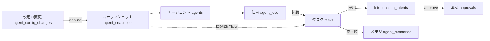

# 04. 機能仕様 — ステータス定義・通知・バッチ処理
- 版数：v0.6（2026-10-01） ／ 親：[README.md](README.md) ／ 出典：04 §ステータス定義・§FR-017・§通知・バッチ処理、14 §データベース、15 §Intent の状態・§タスクの終わり方・§承認待ちと定期実行

> **3行で**
> 1. 状態を持つものは10種類（タスク・Intent・承認・信頼度提案・エージェント・スナップショット・下書き（廃止）・メモリ・仕事・設定の変更）。状態遷移図は [10](../10_diagrams/README.md) にあり、本書は値・意味・遷移先の表。
> 2. v0.6 で Intent に `unknown_outcome` と `expired` の理由（`superseded`・`tool_changed`）、タスクに `completed`（`actions_declined`）と `failed`（`action_failed`）を加えた。
> 3. 通知は Web Push だけで、コードの内容は含めず、通知から直接は承認できない。

## 🧭 判断してほしいこと
[README](README.md#-判断してほしいこと) の Q-29（`handoff` の間の状態）、Q-34（`idle` と仕事の遷移）。DB 側の保存先は [08](../08_database/README.md) の Q-68。

## 全体図

見てほしいところ：タスクの終わり方が Intent とメモリの状態を決め、設定の変更は必ずスナップショットを経てエージェントに効く。

## 要点
- タスクの終了状態は6つ（`succeeded` / `completed` / `rejected` / `failed` / `cancelled` / `halted`）。→ [タスク](#task-status)
- MCP の Intent は検証が `none` なら `executed` で終わる。→ [Intent](#intent-status)
- 下書き（TBL-021）は v0.5 で廃止し、設定の変更（TBL-025）と会話（TBL-024）に置き換えた。→ [下書き](#draft-status)
- 承認期限切れ・置き換えでは通知しない（チャットのカードだけ変える）。→ [FR-017](#fr-017)

---

## 詳細

### タスク（tasks.status）
| 値 | 意味 | 遷移可能先 |
|---|---|---|
| `queued` | 待機中 | provisioning, cancelled, halted |
| `provisioning` | サンドボックスを準備中 | running, failed, cancelled, halted |
| `running` | エージェントが実行中 | awaiting_approval, executing, completed, failed, cancelled, halted |
| `awaiting_approval` | 承認待ち（MCP ではループが終わった時点で承認待ちの Intent がある） | executing, rejected, cancelled, halted |
| `executing` | Gateway が外部作用を実行中 | succeeded, failed |
| `succeeded` | 外部作用がすべて実行された（検証できるものは検証済み）（終了）。v0.2 は「PR 作成と検証が完了」 | — |
| `completed` | 外部作用なしで完了（終了） | — |
| `rejected` | 承認者が却下（終了。PR） | — |
| `failed` | エラーで失敗（終了） | — |
| `cancelled` | ユーザーがキャンセル（終了） | — |
| `halted` | ランタイムが停止（終了） | — |

- `halt_reason`：`budget_exceeded` / `breaker_tripped` / `timeout` / `kill_switch` / `policy_violation` / `approval_expired` / `installation_removed` / `agent_disabled`
- `fail_reason`：`sandbox_lost` / `provision_failed` / `repo_too_large` / `llm_unavailable` / `diff_invalid` / `base_conflict` / `verify_mismatch` / `precondition_failed` / `agent_no_change` / `agent_unable` / `action_failed`（MCP の Intent に `failed` か `unknown_outcome` を含む。v0.6）
- `completed` の内訳（`status_detail`）：`dry_run`（試し実行。Intent は `simulated`）/ `report`（レポートを提出、Intent なし）/ `actions_declined`（Intent が却下・期限切れ・置き換えのみ。v0.6）
- `tasks.tainted`：外部の内容を読んだら true（BR-38。解除しない）
- メモリの有効化（BR-26）：`succeeded` と `completed`（`report` / `actions_declined`）で `pending` を `active` に。試し実行のメモリは保存しない。

### Intent（action_intents.status）
| 値 | 意味 | 遷移可能先 |
|---|---|---|
| `proposed` | 提出された | pending_approval, approved, denied, simulated |
| `simulated` | 試し実行のため実行しない（終了。BR-24） | — |
| `denied` | 判定で拒否（終了） | — |
| `pending_approval` | 承認待ち | approved, rejected, expired |
| `approved` | 承認済み、または auto・ルールで許可 | executing, expired（`tool_changed` を含む）, failed（Gateway の前提確認に失敗。MCP の送信前の失敗が尽きた `unreachable`） |
| `rejected` | 却下（終了） | — |
| `expired` | 期限切れ・キャンセル・Kill Switch・次の実行への置き換え（`superseded`）・ツールの変更（`tool_changed`）で無効（終了） | — |
| `executing` | 実行中 | executed, failed, unknown_outcome |
| `executed` | 外部作用を実行済み。検証が `none` のツール（MCP の既定）では **終了** | verified, failed（PR、または MCP の `readback`） |
| `unknown_outcome` | 送信した後に応答が返らなかった（タイムアウト・接続断・5xx）。v0.6 | executed（ユーザーが「実行済み」と確認）, failed（「失敗」と確認） |
| `verified` | 検証済み（終了） | — |
| `failed` | 実行または検証に失敗（終了）。MCP の理由：`tool_error` / `unreachable` / `auth_required` | — |

### 承認（approvals.status）
| 値 | 意味 | 遷移可能先 |
|---|---|---|
| `pending` | 承認待ち。期限は24時間、定期実行の仕事は `min(24時間, 次の実行の予定時刻)` | approved, rejected, expired |
| `approved` | 承認（終了）。`remember = true` なら [以後も許可] でルールを作った（`created_rule_id`） | — |
| `rejected` | 却下（終了） | — |
| `expired` | 期限切れ・キャンセル・置き換えによる無効（終了） | — |

### 信頼度提案（trust_proposals.status）
`open` → `accepted` / `dismissed`

### エージェント（agents.status）
| 値 | 意味 | 遷移可能先 |
|---|---|---|
| `idle` | 14 の UC-025 で作成直後に使う。定義・遷移は未設計（Q-34） | — |
| `active` | 有効。トリガーで起動できる | invalid, disabled, removed |
| `invalid` | 定義にエラーがある（FR-022）。起動できない | active, removed |
| `disabled` | maintainer 以上が停止した（FR-032）。どのトリガーでも起動しない。停止中に定義が更新されても `disabled` のまま、スナップショットだけを更新 | active（owner の再開）, removed |
| `removed` | 定義ファイルが消えた（終了。行は消さない） | — |

- 公開後にポリシーが厳しくなったら `active` のまま厳しい方で実行する（clamp。`AGENT_CLAMPED`）。既定エージェント `default` は `default.yaml` がなければ組み込みの定義（`source = builtin`）で `active`（BR-31）。

### エージェントスナップショット（agent_snapshots.status）
`valid` / `invalid`（作成後は変更しない）。`source` は `branch` / `draft` / `builtin`。v0.5 で `definition` を v2 の形式で保存し、`config_change_id`（反映した設定の変更）を持つ。

### 下書き（agent_drafts.status）— 廃止（v0.5、→ TBL-024・TBL-025）

v0.2 の状態（参照用。Q-27）

| 値 | 意味 | 遷移可能先 |
|---|---|---|
| `drafting` | 作成・編集中（試し実行もこの状態） | published, discarded |
| `published` | 公開 PR を作成した（PR 番号つき） | merged, drafting（マージされずにクローズ。`pr_number` を `last_pr_number` に） |
| `merged` | 公開 PR のマージを FR-022 で検出した（終了） | — |
| `discarded` | 90日更新がない、または破棄（API-058）（終了） | — |

### メモリ（agent_memories.status）
| 値 | 意味 | 遷移可能先 |
|---|---|---|
| `pending` | 書き込んだタスクが実行中（試し実行の書き込みは行を作らない） | active, discarded |
| `active` | 書き込んだタスクが完了した。次のタスクから使う | expired, deleted |
| `discarded` | 書き込んだタスクが停止・失敗・却下で終わった（終了） | — |
| `expired` | 上限（`memory.max_items`）を超えて古いものから押し出された（終了） | — |
| `deleted` | maintainer 以上が削除した（終了） | — |

### 仕事（agent_jobs.status）
v0.5。遷移の定義は 14 にない（Q-34）。本文から読み取れる遷移だけを書く。

| 値 | 意味 | 本文にある遷移 |
|---|---|---|
| `waiting_input` | 質問の答え・コネクタの接続を待っている（推測で動かさない） | → active（答え・接続のあと。US-041 AC2・AC4） |
| `active` | 動いている | ⇄ paused（API-065 の一時停止・再開） |
| `paused` | 一時停止中 | ⇄ active |
| `done` | 終了 | — |

### 設定の変更（agent_config_changes.status）
v0.5。`classification` は `narrow` / `neutral` / `widen`、`origin` は `user_request` / `feedback` / `failure` / `engagement` / `manual` / `revert` / `move`（15 で `approval_rule` も使う。08 の Q-68）。

| 値 | 意味 | 遷移可能先 |
|---|---|---|
| `proposed` | 確認カードで承認待ち（`widen`、または BR-51 に当たるもの） | applied, rejected |
| `applied` | 反映した（新しいスナップショット `snapshot_id`） | reverted |
| `rejected` | ユーザーが [やめる]（終了） | — |
| `reverted` | [元に戻す] で戻した（終了。戻す操作は新しい変更として記録） | — |

### FR-017：Web Push 通知 〔UC-003〕
- 概要：VAPID を使った Web Push で通知する。フェーズ0（VAPID 鍵は `.env`。スマホはトンネル経由の PWA。A-74）。組み込みの `notify` ツール（13）も同じ経路で送る。
- 処理：
  1. 購読の登録：`endpoint`、`keys.p256dh`、`keys.auth`、端末名（UserAgent から推定）を保存する。
  2. 送信するイベントと宛先（下表）。
  3. ペイロードには `url`（SCR-005・SCR-007、v0.5 以降はエージェントのチャットの該当カード）を含める。コードの内容は含めない（A-06）。
  4. 送信先が 404 / 410 を返したら、その購読を削除する。
- 通知から直接承認するアクションボタンは付けない（承認は必ずアプリの中で行う）。

送信するイベントと宛先（12件）

| イベント | 宛先 | 本文（例） |
|---|---|---|
| 承認待ち | 承認者全員 | 「承認待ち：owner/repo #123」 |
| 成功（PR 作成） | 依頼者 | 「PRを作成しました：owner/repo #123」 |
| 停止（予算・Breaker・期限切れ）・失敗 | 依頼者 | 「停止しました（予算超過）：owner/repo #123」 |
| Kill Switch 発動 | ワークスペースの全メンバー | 「Kill Switchが発動されました」 |
| 検証の不一致 | 依頼者と owner | 「PRの検証に失敗しました：owner/repo #123」 |
| エージェントの有効化・更新・無効化・削除（FR-022） | エージェント担当者とワークスペースの owner | 「bug-fixer が有効になりました」 |
| エージェントの停止・再開（FR-032） | エージェント担当者と owner | 「bug-fixer が停止されました」 |
| レポートの完了（FR-033） | 依頼者 | 「レポートが届きました：owner/repo」 |
| メンションによるタスクの作成（FR-028） | 依頼者（コメントしたユーザー） | 「タスクを作成しました：owner/repo #123」 |
| `unknown_outcome`（FR-012） | 承認者 | —（元の記述なし） |
| エージェントの `notify`・結果（13） | ユーザー（宛先の決め方は元の記述なし） | 結果の要約（前回と同じなら送らない。BR-46） |
| 承認の期限切れ・置き換え（15） | **送らない**（チャットのカードを「期限切れ」に変えるだけ） | — |

### バッチ処理

定期処理とイベント駆動の処理（20件）

| 名前 | タイミング | 内容 | 関連FR |
|---|---|---|---|
| 承認期限切れの処理 | 1分ごと | 期限切れの `pending` を `expired` にする | FR-011 |
| サンドボックスの監視 | 15秒ごと | ハートビートの途絶・時間超過を検知する | FR-007 |
| 待機中タスクの再投入 | 30秒ごと | 実行枠や日次予算が空いたタスクを開始する | FR-007, FR-013 |
| スナップショットの削除 | 1時間ごと | 終了から24時間を過ぎた tarball を削除する | FR-007 |
| 監査ログの日次チェックポイント | 毎日 00:10 UTC | ワークスペースごとの最新ハッシュに署名して保存する（フェーズ0は省略） | FR-016 |
| 信頼度の集計 | 毎日 03:00 UTC | 提案を作成する | FR-021 |
| データの保持期限の処理 | 毎日 04:00 UTC | 保持期限（→ 08）を過ぎたデータを削除する。会話は90日で要約を残して消す（A-80） | — |
| スケジュールによる起動 | 1分ごと | `next_run_at` を過ぎたスケジュールからタスクを作成する（または `trigger.skipped`）。フェーズ0で取りこぼした分は実行しない（A-75） | FR-028 |
| 承認待ちの置き換え | 定期実行の仕事の次の実行の開始時 | 前の実行の `pending_approval` を `expired`（`superseded`）にし、タスクを `completed`（`actions_declined`）に。3回続いたらチャットで1回だけ聞く | FR-011 |
| ツールの変更による失効 | ツールが `needs_review` になった時 | そのツールの `pending_approval` と未実行の `approved` を `expired`（`tool_changed`）にし、チャットで知らせる | FR-012 |
| 自己調整の集計 | 1日1回（と、タスクの完了・👍👎の入力時） | 反応・成否を集め、調整の条件を判定する | FR-039 |
| エージェント定義の読み込み | `.agent/` 配下を変更する `push` の受信時 | 検証・合成・スナップショット化、スケジュールの再計算（同じリポジトリは直列） | FR-022 |
| 定義の検証（Check Run） | `.agent/**` を変更する PR の `opened` / `synchronize` | head の定義を検証・合成し、Check Run に返す | FR-022 |
| 公開 PR のクローズの処理 | 公開 PR の `closed`（マージなし） | 下書きを `drafting` に戻す | FR-027 |
| スコアカードの集計 | 1時間ごと | 直近30日の実績を `agents.scorecard` に保存する | FR-032 |
| 下書きの整理 | 毎日（保持期限の処理と同時） | 90日更新のない `drafting` を `discarded` にする（v0.2。下書きは v0.5 で廃止） | FR-025 |
| メモリの有効化 | タスクの終了時 | `succeeded` / `completed`（`report` / `actions_declined`）なら `pending` を `active`、それ以外は `discarded` | FR-031 |
| 届け先の Intent の作成 | タスクの最後 | 仕事の `deliver` の各項目から Intent を作る | FR-010 |
| `unknown_outcome` の通知 | Intent が `unknown_outcome` になった時 | 承認者に通知し、カードに解決の操作を出す | FR-012 |
| Web Push | イベント発生時 | FR-017 の表のとおり | FR-017 |

## このドキュメントで決まったこと
- [ADR-007](../adr/ADR-007-sse-realtime.md)：リアルタイム配信は SSE
- [ADR-031](../adr/ADR-031-mcp-write-no-auto-retry.md)：`unknown_outcome` で人が確定する
- 状態遷移図は [10](../10_diagrams/README.md)
