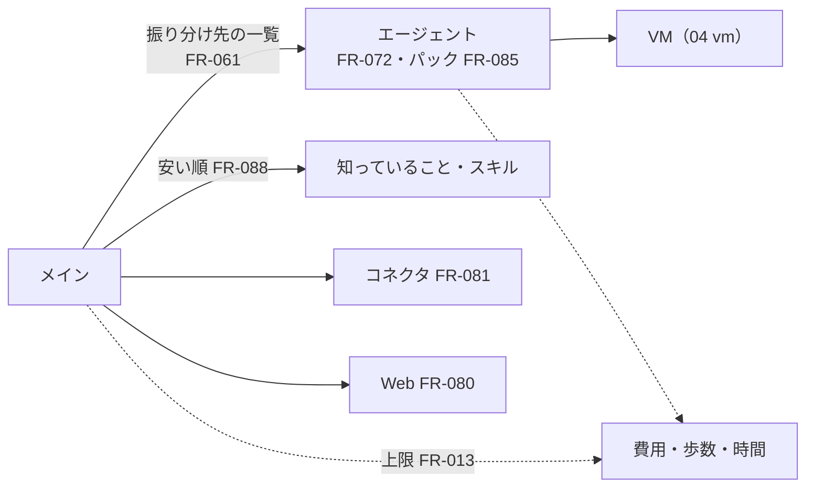

# 04. 機能仕様：道具とそのほか
- プロジェクト：Agent-Team-Open ／ 版数：v1.2（2026-10-24） ／ 親：[04 機能仕様](README.md)

> **3行で**
> 1. 上限（FR-013）はタスクに加えてメインのターンにもかかり、日次の残りの $1 は持ち主のチャットのために取っておく。
> 2. 振り分け先の選び方（FR-061）・エージェントの作成（FR-072）・パック（FR-085）は、メインの振り分けの材料になる。道具は安い順に試し、スキルとコネクタの詳細は要るときだけ読む（FR-088）。
> 3. 持ち主の確かめ（FR-073）・カレンダーと GitHub（FR-081）・引っ越し（FR-082）・状態（FR-083）・LLM の接続先（FR-087）は v0.6 を引き継ぎ、常駐型の分を足した。

## 全体図

見てほしいところ：VM（4 番目の手段）を使うのは振り分け先だけ。上限はメインにも振り分け先にもかかる。

---

### FR-013：上限
| 対象 | 上限 | 超えたとき |
|---|---|---|
| タスク（振り分け先） | $3・200 歩・操作 300 回・55 分（外側の打ち切り 60 分）・コマンド 200 回（D-141・D-175） | `halted`（`budget_exceeded`・`timeout`）。メインに報告 |
| メインのターン | $1・40 歩・10 分（D-230） | `halted`（`budget_exceeded`・`steps_exceeded`・`timeout`。D-289）。持ち主に知らせる（FR-091） |
| 日次 | $10（メイン・振り分け先・オートレビュー・記憶の更新・要約・先温めの合計） | 下の「費用の区分」 |

- 費用の区分（D-230・D-259）：すべての費用の予約に区分（`budget_class`）を付ける。`chat`（持ち主のチャット・`approval_done`・`steer`（持ち主から）で始まったターンと、そこから生まれたタスク・オートレビュー）と `auto`（ルーチン・予約・webhook で始まったものと、そこから生まれたもの）。`task_done` はタスクの区分を引き継ぐ。まとめたターンに `chat` が 1 つでもあれば `chat`。動いている `auto` のターンに `chat`・`approval_done` を結びつけたら、そのターンは `chat` に上がる（D-279）。タイマーの要約は `auto`、先温めは `chat`、冷えた後の要約と呼び出し前の要約はそのターンの区分（D-280）
 - `auto` の予約は、日次の残りのうち $1（`reserve_chat_usd`）を使えない。届かなければ、`routine`・`scheduled`・`webhook` のきっかけは `dropped`（`budget`）にして `system` のメッセージで知らせる。`auto` のタスクは途中で `halted`（`budget_exceeded`）、ターンは `halted`（`daily_budget_exceeded`。D-289）
 - `chat`・`task_done`・`approval_done`・`steer` のきっかけは日次の上限で捨てない。ターンを始めるお金（区分で使える残りが 1 歩目の見積もりに届く）がなければ、ルーターは翌日（`TZ` の 0 時）までターンを始めず、きっかけは `queued` のまま待つ（`chat` も待つ）。そのことは `system` のメッセージで 1 日 1 回だけ知らせる（D-282）
 - 残りとの比べ方は、いつも区分で使える残り（`auto` は日次の残り − $1）で行う。`delegate` の確かめ（FR-092）も同じ（D-289）
- 時間は確認待ち・交代待ちを除いて数える（`paused_ms`：D-174）
- LLM を呼ぶ前に見積もりの費用を予約し、終わったら精算する（D-153）。キャッシュの読み・5 分の書き・1 時間の書きのトークンもそれぞれの単価で数える（D-263）
- 上限は設定（API-096）で変えられ、次のタスク・ターンから効く（D-151）

### FR-016：監査ログ
- ハッシュの鎖つきの追記だけのログ（Cloudflare 版 `db/audit.ts` を引き継ぐ）。足す事象は [移植元](#移植元) の表

### FR-018：進捗の配信
- SSE（API-085）で、画面に「何か変わった」の合図だけを流す。中身は画面が REST で取りに行く（D-196）。チャット・ターン・タスク・VM・確認・交代の変化を流す
- 1 歩ごとの変化はタスクのページの表示だけで、知らせ（FR-017）にはしない（D-197）

### FR-061：振り分け先の選び方
- メインの文脈の③（FR-098）に、振り分け先の一覧を入れる：名前・「いつ使うか」（`agents.description`、200 字まで）・使える道具の種類（VM・ターミナル・GitHub・カレンダー）・パックなら `purpose` と `examples` の 3 つ
- 一覧が変わる（作る・消す・パックを入れる）と③が変わるので、次のターンの頭で新しい先頭を作る（FR-098）
- メインは一覧から選ぶ。合うものがなければ `delegate` の `newAgent` で作る（FR-072）。持ち主が名前を挙げたら、そのエージェントを選ぶ
- 選び方は LLM の判断で、決定論ではない。選んだ理由を `tasks.delegate_reason`（100 字）に残し、タスクのページに出す

### FR-072：エージェントの作成・削除
- 作る：持ち主がエージェント一覧から（したいことの文から LLM で 1 人。PR #9 のまま）、またはメインが `delegate` の `newAgent` で。どちらも名前・指示・道具・「いつ使うか」を検証して `agents`（`kind = 'worker'`）に入れる。メインが作ったときは生成画面（AgentBirth）に切り替える
- 消す：論理削除。動いているタスクがあれば 409 `AGENT_BUSY`。メインは消せない（409 `MAIN_AGENT`）。VM のログインとファイルは消さない（BR-07）。そのエージェントのメモは消す
- メインの指示は消せないが、持ち主が「手直し」（指示の後ろに足す文、2,000 字まで）を書ける

### FR-080：Web 検索・取得
- `web_search` は Claude の Web 検索ツール（接続先で版が違う・Bedrock では出さない：FR-087）。`web_fetch` は本体の実装で、egress と同じアドレスの判定をかける（D-164）。どちらの結果も汚染する

### FR-073：持ち主の確かめ
- 入力：`/api/v1/*` のすべてのリクエスト
- 処理：
 1. 画面向けの待ち受けは front ネットワークの口だけ。そこに届くのは Tailscale のコンテナだけ（[07](../07_architecture.md#レベル2コンテナ図)）。ほかのコンテナとは同じ口を共有しない
 2. ヘッダー `Tailscale-User-Login` が設定 `OWNER_LOGIN` と一致するか（大文字小文字は区別しない）
 3. GET 以外は、`Origin` が自分の URL であり、ヘッダー `X-Makase-Request: 1` があることを確かめる。WebSocket の開始も `Origin` を確かめる
- エラー：
 | 条件 | 挙動 | code |
 |---|---|---|
 | ログイン名がない・違う | 403 | `NOT_OWNER` |
 | Origin・専用ヘッダーが違う | 403 | `CSRF_REJECTED` |
- 補足：`GET /api/health`（API-082）だけは確かめない。返すのは `ok` と版だけ。ホストの状態は API-111（確かめあり）
- webhook の口（:8081）は別の待ち受けで、`POST /hooks/:hookId`（API-129）しか置かない。Funnel が公開するのは 8443 番だけで、それを :8081 に流す。画面と API の 443 番（:8080）は Funnel にしない（Funnel の公開はポート単位なので。D-241）。Funnel の通信には `Tailscale-User-Login` が付かないので、ここでは身元を見ず、署名で確かめる（FR-096・ADR-065）。:8081 に `/api/*` が届いたら 404

### FR-081：カレンダー・GitHub のつなぎ方（差分）
- つなぎ始め（API-094）で、期限 10分・1回限りの `state` を作り、つなぎ始めたブラウザに HttpOnly・SameSite=Lax の Cookie で結びつける。Google は PKCE を使う
- 戻り先（API-095）で、`state`・Cookie・PKCE を確かめる。GitHub はインストールの ID が、つなぎ始めた App のものかを API で確かめる
- 書き込みの持ち主（D-248）：Intent と承認は、振り分け先のタスク（`task_id`）かメインのターン（`turn_id`）のどちらか一方を持つ。メインの書き込みが確認に回ったらターンを終えてよく、決まったら `approval_done` でメインが起きる（[FR-091](resident.md#fr-091メインのターン)）。取り消したタスクの承認待ちの Intent は `expired` にする（D-250）
- メインのターンの承認（D-275）：判定の記録（`policy_decisions`）も `turn_id` で残す。○ / ×（API-019）と期限切れのタイマーは、`turn_id` を持つ Intent ではタスクを止めず（`approval_expired` の halted はタスクのときだけ）、× と期限切れは決めたのと、○ は実行の結果を書くのと同じトランザクションで `approval_done` を入れる

### FR-082：書き出し・取り込み
- 書き出す（API-097）：JSON 1つ。`formatVersion`（2）、エージェント（今のスナップショット・手で書いたスキル。メインの指示の手直しを含む）、設定（ポリシーの `budget`・`browser`・`terminal` 欄）、プロフィールの事実（`memory_facts`）、ルーチンを入れる（D-239）
- 入れないもの：チャット・ターン・タスクの履歴、ログ・メモ、監査ログ、VM のホームと控え、つながりの資格情報、受け口（秘密を含むので、引っ越し先で作り直す）、API キー
- 取り込む（API-098）：形式を検証し、同じ名前のエージェントは飛ばして一覧で返す。設定は上書きする。プロフィールの事実は足す（同じ文は飛ばす）。ルーチンは止めた状態で入れる（持ち主が見てから動かす）。`formatVersion` 1（v0.6）も読める

### FR-083：起動と状態
- 起動の確かめ：64bit・空きメモリ・必須の設定・DB のマイグレーション（前にバックアップ）・VM のイメージ
- 状態（API-111・SCR-023）：版・DB・box-manager・VM（動いているか・世代・画面の番・ホームの大きさ・最後の控え・今の VM の操作（`vm_op`））・空きディスク（3GB を切ったら警告：D-265）・空きメモリ・動いているターンとタスクの数・今日の費用・キャッシュの当たり率と外れの件数（直近 24 時間。FR-098）・Funnel の状態（受け口があるか・公開されているか）

### FR-085：パック
- 入力：パックの JSON ファイル。`/opt/makase/packs/*.json`（イメージに同梱の標準パック）と `/data/packs/*.json`（持ち主が置くパック。データのボリューム）。DB には持たない。入れる・外すは API-115・116
- 定義の形：JSON 1つ。FR-082 の書き出しと同じ土台で、書き出したファイルに `purpose` を付ければパックになる

 | 項目 | 中身 |
 |---|---|
 | `formatVersion` | 形式の版 |
 | `id` | kebab-case、2〜40 字 |
 | `version` | 整数。上がっていれば更新 |
 | `name` | 表示名 |
 | `purpose` | 用途の説明（振り分けに使う） |
 | `examples` | この用途の頼みの例文、3〜10 個 |
 | `agents[]` | 名前・役割・指示・使う道具・上限 |
 | `skills[]` | 手で書いた手順書 |
 | `browser` | 確認するドメイン・`human_words`・`confirm_words` の追加分（D-274） |

- 処理：
 1. 入れる（API-115）：`pack_installs` に記録し、`agents[]` からエージェントを作り（`pack_installs.agent_ids`）、`skills[]` を `agent_skills`（`origin = pack`、`pack_id`）に入れ、`browser` の追加分をポリシーに足す。定義を検証してから始める
 2. 更新（同じ API-115）：同じ `id` が入っていて `version` が上がっていれば、パックのエージェントの設定を作り直す。持ち主が手で変えた設定は失われると、先に知らせる
 3. 外す（API-116）：パックのエージェントを論理削除し（動いていれば 409 `AGENT_BUSY`。確かめのダイアログ）、`agent_skills` の行と `pack_installs` の行を消す。VM のログインは消さない。ポリシーに足した `browser` の分は戻す
 4. 振り分け（FR-061）：パックのエージェントはメインの振り分け先の一覧に載り、パックの `purpose`・`examples` も添える。メインは合うパックのエージェントを選んで `delegate` する（ADR-059）。持ち主が「告知ページパックで」と明示したら、メインはそのパックのエージェントを選ぶ
 5. 画面：SCR-024 `/packs` に入っている・入れられるの一覧と、入れる・外す・更新。エージェント一覧（SCR-014）ではパック由来のエージェントにパック名のラベルを出す
- エラー：
 | 条件 | 挙動 | code |
 |---|---|---|
 | パックがない | 404 | `PACK_NOT_FOUND` |
 | 定義が形式に合わない | 422 | `PACK_INVALID` |
 | 外すとき、パックのエージェントが動いている | 409 | `AGENT_BUSY` |
 | 同じ版がすでに入っている | 409 | `PACK_ALREADY_INSTALLED` |
- 標準パック（イメージに同梱。最初の 1 つは D-186）：
 | 項目 | `announcement-page`（告知ページ制作パック） |
 |---|---|
 | `name` | 告知ページ制作 |
 | `purpose` | イベントや募集の告知ページ（HTML 1 枚）を、条件を聞いて作り、点検して、リポジトリに PR として出す |
 | `examples` | 「11/15 の文化祭の告知ページを作って」「サークルの新歓のページ。日時・場所・申込先はこれ」「この告知のスマホ表示を直して」 |
 | `agents[]` | 1 人（告知ページ制作係）。使う道具：VM のターミナル（HTML を書く・開く）、VM のブラウザ（できたページを 1280×800 と 360px 幅で開いて点検）、GitHub（PR） |
 | `skills[]` | 手順書 4 本：①設計（日時・会場・料金・対象・申込先を聞き切り、構成を決める）②制作（HTML・CSS を 1 ファイルで書く）③点検（`~/work/<taskId>` で簡易サーバーを立て、`http://127.0.0.1:8000/` を VM のブラウザで 1280×800 と 360px 幅で開き、必須項目の抜け・誤字・リンク・スマホ表示を確かめる。D-266）④仕上げ（配色・余白・見出しを整える）。デモの 4 人（設計士・職人・レビュー番長・配色の番人）はこの 4 本に対応する（1 つのタスクを 1 人で進める。メインが工程ごとに分けて振り分けてもよい） |
 | `browser` | 確認するドメイン：なし。`human_words` の追加分：「公開」「Publish」 |
 | 成果物の届け方 | VM の中に書いた HTML を tar で取り出し（API-118）、持ち主が指定したリポジトリへ PR の Intent にする（確認つき。FR-081・FR-086）。公開（GitHub Pages など）は PR の先で人がする（BR-10）。できた HTML は報告の成果物として写され（D-244）、メインが PR の URL とともに `send_to_owner` の `file` で渡す。持ち主はダウンロードするか、スクリプトの動かないプレビューで見る（D-243） |
 | 申込フォーム | 作らない。申込先はリンクか連絡先の文にする（個人情報を受け取らない） |
- 補足：手で書いたスキル（`agent_skills`）は残す。`origin` は `pack` だけ使い、`learned` は使わない（D-177）。方針は D-176・ADR-053

### FR-087：LLM の接続先
- 入力：`.env` の `LLM_PROVIDER`（`anthropic`｜`bedrock`｜`vertex`。既定 `anthropic`）と、接続先ごとの資格（[11 §10](../11_tech_spec.md#10-環境設定)）。起動時に読む。画面からは変えない（SCR-023 には表示だけ）
- 処理：
 1. クライアントの作成（`llm/claude.ts`）：接続先ごとの公式クライアントを作る。`anthropic` は `@anthropic-ai/sdk`、`bedrock` は `@anthropic-ai/bedrock-sdk` の `AnthropicBedrockMantle`（`awsRegion`）、`vertex` は `@anthropic-ai/vertex-sdk` の `AnthropicVertex`（`projectId`・`region`）。会話の形（Messages API・道具・画像）は共通
 2. モデル名：`CLAUDE_MODEL` の値を接続先の形にする。`anthropic`・`vertex` は `claude-opus-5-5` のまま、`bedrock` は `anthropic.` を前に付ける
 3. 道具の宣言の切り替え：接続先で使えない道具は Claude に出さない
 | 道具 | `anthropic` | `vertex` | `bedrock` |
 |---|---|---|---|
 | コンピューターユース（FR-075） | `computer_toolset_20260801`（名前・画面の大きさなし） | `computer_toolset_20260801` | `computer_20251124`（`display_width_px`・`display_height_px`） |
 | `web_search`（FR-080。Claude の Web 検索ツール） | 最新版 | 基本版（`web_search_20250305`） | 出さない（Bedrock にはない）。`web_fetch` と VM のブラウザで調べる |
 | `web_fetch`（FR-080。本体の実装） | 使える | 使える | 使える |
 | コネクタの道具の遅い読み込み（FR-088。tool search・`defer_loading`） | 使う | 使えれば使う | 使えれば使う。使えなければ最初から全部渡す（どちらも実装するときに確かめる） |
 4. 費用の見積もりと精算（FR-013）は Anthropic 直の単価で行う。Bedrock・Vertex の請求は各事業者の単価なので、設定画面の「ホスト」欄と手順書に「見積もりは目安」と書く
 5. 起動の確かめ（FR-083）：`LLM_PROVIDER` ごとの必須の値が足りなければ、足りない値の名前を出して止まる（UC-042 E2）。`GET /api/v1/host`（API-111）に `llm.provider`・`llm.model` を足す
 6. オートレビュー（FR-099）は `CLAUDE_REVIEW_MODEL`（既定 `claude-sonnet-5-5`）を同じ接続先で呼ぶ。`bedrock` では同じく `anthropic.` を前に付ける
 7. プロンプトキャッシュ（FR-098）は、どの接続先でも 5 分と 1 時間の `cache_control` が使える。サーバー側の context editing（`clear_tool_uses_20250919`）が使えるかは接続先ごとに実装するときに確かめ、使えなければ古いスクショを消さずに、タスクの上限（操作 300 回）で抑える
 8. Anthropic 直にしかない機能（サーバー側のフォールバック、Fast mode、Priority Tier など）は使わない
- エラー：
 | 条件 | 挙動 | code |
 |---|---|---|
 | `LLM_PROVIDER` が 3 つ以外 | 起動時に止まる | — |
 | 接続先の資格が足りない | 起動時に足りない名前を出して止まる | — |
 | 接続先の認証が通らない（401・403） | タスクを failed にし、理由を知らせる。歩みの記録は残す | `LLM_AUTH_FAILED` |
- 補足：方針は D-185・[ADR-056](../adr/ADR-056-llm-provider.md)

### FR-088：道具とスキルの渡し方
- 誰が何を持つか：メインの道具は [FR-091](resident.md#fr-091メインのターン)、振り分け先の道具は [FR-092](resident.md#fr-092振り分けと報告)。どちらも、つないでいないコネクタ・接続先で使えない道具は最初から出さない
- 道具の順番（D-191）：エージェントの指示の共通部分（本体が足す。パックの指示より前）に次を書く。Kernel では強制しない。メインは 1〜3 と 5 を自分で使い、4 は振り分ける
 | 順 | 方法 | 道具 |
 |---|---|---|
 | 1 | すでに知っていること・手順書 | 会話・`read_skill` |
 | 2 | アプリの API（コネクタ） | カレンダー・GitHub（FR-081） |
 | 3 | Web 検索・ページの取得 | `web_search`・`web_fetch`（FR-080） |
 | 4 | VM のブラウザ | `read_page` → computer use（FR-075） |
 | 5 | 人に聞く | メインは `send_to_owner` の `choices`・文、振り分け先は報告の `blocked`・`request_takeover`（FR-078） |
 - 右ほど遅く・高く・こわい。前の方法で足りれば次に進まない。コネクタが失敗した（つながっていない・権限がない）ときは、Web 検索を飛ばして VM のブラウザに進んでよい
 - VM のブラウザでは、まず `read_page` で構造を読み、座標が分かればそのまま押す。スクショは画面の見た目を確かめるときに撮る
 - 2 段階認証・CAPTCHA・支払いの入力は自分でせず `request_takeover` で人に渡す
- スキル（D-192）：
 1. 最初に渡すのは、そのエージェントのスキルの名前と `description` の一覧だけ。`description` は「〜のときに使う」の形で書く（パックの手順書も同じ。200 字まで）
 2. 本文は道具 `read_skill(name)` で読む。読んだ本文は会話に残る。`agent_skills.last_used_at` を更新する
 3. パックの JSON の検証（FR-085）で、`description` が空・200 字を超えるものは `PACK_INVALID`
- コネクタの道具（D-193）：カレンダー・GitHub の道具は、名前と 1 行の説明だけ先に渡し、詳細（引数の形）は使うと決めたときに読み込む（Claude の tool search ツールと `defer_loading`）。接続先で使えないとき（FR-087 の表）は最初から全部渡す。つないでいないコネクタの道具は名前も出さない
- 道具の約束事（D-238）：ターンとタスクの途中で道具を足し外ししない（キャッシュを壊さない：FR-098）。使えないとき（つながりが切れた・VM が作り直し中）は道具を残したままエラーを返し、文に次にやること（例：「GitHub がつながっていない。持ち主に `send_to_owner` でつなぎ直しを頼む」）を書く。道具の説明とスキーマは 1 つ 4,000 字まで
- 画面の操作を親子の文脈に分ける案（ADR-057）は、メインと振り分け先に分けたので使わない（ADR-059）

### 移植元
| FR | 移す元 | 足りないもの・差分 |
|---|---|---|
| FR-013 | Cloudflare 版 `edge/spend.ts`・`limits.ts` | 操作の回数・時間の上限（確認待ち・交代待ちは時間に含めない：`paused_ms`。D-174）。呼び出しの前に見積もりの費用を予約する（並んだタスクで日次を超えない） |
| FR-016 | Cloudflare 版 `db/audit.ts` | 新しい事象：`box.started`・`box.stopped`・`browser.checked`・`takeover.started`・`takeover.ended`・`profile.cleared`・`data.imported`。一覧の API は旧 Node 版から |
| FR-017 | 旧 Node 版の push（`push_subscriptions`・VAPID） | v1.0 で最初の版に入れる（D-207）。送るものを絞る（D-229） |
| FR-018 | Cloudflare 版の SSE の設計（第5段で予定） | 本体のプロセスから流す（API-085）。チャット・ターン・タスク・VM・交代の事象 |
| FR-061 | Cloudflare 版 `workflows/plan-ask.ts`（設定プランナーのエージェントの選び方） | メインの振り分けの手がかり（振り分け先の一覧）に使う。`asks/` の依頼の流れは使わない（D-235） |
| FR-072 | Cloudflare 版 `agents/` | 削除のときはそのエージェントのメモだけ消す。VM のログインとファイルは消さない（共有のため。BR-07） |
| FR-080 | 新規（Cloudflare 版は 4f で予定だった） | `web_search` は Claude の Web 検索ツール（接続先で版が違う・Bedrock では出さない：FR-087）、`web_fetch` は旧 Node 版の edge と汚染のルール（`edge/web-seen.ts`） |
| FR-087 | 新規 | `llm/claude.ts` のクライアントの作成を接続先で分ける。道具の宣言の切り替え |
| FR-088 | 新規 | 道具の順番の指示・`read_skill`・コネクタの道具の遅い読み込み。スキルの表は今の `agent_skills` |
| FR-089 | Cloudflare 版 `ask_pending_replies` の考え方 | `wakes`（`chat`・`steer`）に置き換える。歩みの頭でまとめて読む |
| FR-081 | 旧 Node 版の gateway・gcal・github・connectors | 本体の中の部品にする（[ADR-051](../adr/ADR-051-gateway-in-core.md)）。確認の一覧・○ / × の API も旧 Node 版から |
| FR-085 | Cloudflare 版 `pack_installs`・`asks.pack_id`・planner の pack の節 | 用途（`purpose`・`examples`）で振り分ける。定義はファイルで持つ |
| FR-086 | 旧 Node 版 sandbox（`packages/sandbox` の tar・executor、`edge/sandbox-command.ts` の道具名） | 判定は使わない |
| FR-073〜079・082〜084・090〜100 | 新規 | ターンの耐久性は FR-084 の歩みの記録（`owner_kind = 'turn'`）を使う。記憶の検索は SQLite の FTS5（D-225） |

