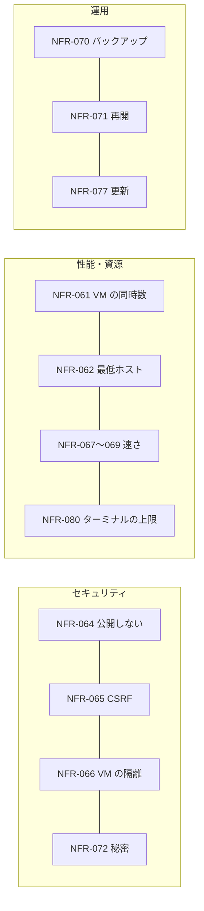

# 05. 非機能要件
- プロジェクト：Agent-Team-Open ／ 版数：v0.5（2026-10-24） ／ インプット：[01_requirements](01_requirements.md)

> **3行で**
> 1. いちばん小さいホストは「64bit・メモリ 4GB・空き 10GB」（ラズパイ 4/5 の 4GB）。このホストで VM を1つ動かせることを基準にする。
> 2. 守りの中心は「インターネットに公開しない」「VM から家の LAN と本体に届かない」「持ち主以外は入れない」の3つ。
> 3. 家の機械なので稼働率の目標は置かない。そのかわり、再起動から続けられることと毎日のバックアップを決める。OSS として配るので、初めて置く人の所要（NFR-081）を目標に入れる。

## 🧭 判断してほしいこと
| # | 種類 | 論点 | 選択肢 | おすすめ（理由） | 決まらないと止まるもの |
|---|---|---|---|---|---|
| R-77 | リスク | ラズパイで Chromium とスクショの処理が重く、1歩が遅い | — | VM は1つ・画面は 1280×800 にする。NFR-067・068 を実機で測り、外れたら画面を小さくする | — |
| R-78 | リスク | Win ノートのスリープや WSL の自動停止で止まる | — | 再起動から続ける（FR-084）。手順書に WSL を止めない設定を書く | — |

## 全体図

見てほしいところ：数値はすべて Claude判断（おまかせ）。実機で測って直す前提。

## 要点
- 最低のホストは 64bit・4GB・空き 10GB。推奨は 8GB（[NFR-062](#一覧)）
- VM の同時数は既定 1、設定で 4 まで（NFR-061）
- ホストのポートは1つも開けない。入口は Tailscale だけ（NFR-064）
- VM は権限なし・資源の上限つきで、外へは egress だけを通る（NFR-066）
- 費用の上限は1タスク $3・日次 $10（NFR-076）
- ターミナルは 1 コマンド 120 秒・出力 64KB・1 タスク 200 回まで（NFR-080）
- 初めて置く人は、Docker と Tailscale が入った機械で手順書だけで 30 分以内に起動できる（NFR-081）

---

## 詳細

### 一覧
| ID | カテゴリ | 要件 | 目標値 | 根拠 |
|---|---|---|---|---|
| NFR-061 | 拡張性 | VM の同時数 | 既定 1、設定 `max_boxes` で 1〜4 | VM1つで Chromium がおよそ 0.8〜1.5GB を使う |
| NFR-062 | 移植性 | 最低のホスト | 64bit Linux（arm64・amd64）、メモリ 4GB、空きディスク 10GB。推奨 8GB | 本体＋ VM1つ＋OS が 4GB に入る |
| NFR-063 | 性能 | VM の画面の大きさ | 1280×800・24bit | computer use の推奨の範囲。スクショの費用を抑える |
| NFR-064 | セキュリティ | 公開の範囲 | ホストのポートは開けない。入口は Tailscale の HTTPS（`tailscale serve`）だけ | REQ-077。公開の攻撃面をなくす |
| NFR-065 | セキュリティ | CSRF | GET 以外は Origin と `X-Makase-Request` を確かめる。WebSocket は Origin を確かめる | Tailscale の身元は、ほかのサイトからのリクエストにも自動で付く |
| NFR-066 | セキュリティ | VM の隔離 | 権限なしの利用者・capability なし・ルートは読み取りだけ・メモリ 1.5GB・CPU 1.5・プロセス 512。ネットワークは VM ごとに1つ（`internal: true`）で、外へは egress だけ。家の LAN・tailnet・本体・ほかの VM・ホストのブリッジのアドレスには届かない（ADR-045）。ターミナルの外向き通信は egress の許可リスト（`terminal.allow_hosts`）だけ（D-178） | VM は信用しないページを開く |
| NFR-067 | 性能 | VM の起動 | p95 15秒以内（ラズパイ 5）、8秒以内（amd64 の PC） | 依頼のたびに起こすので待ち時間に効く |
| NFR-068 | 性能 | 1歩の本体側の処理（LLM を除く：確かめ・判定・実行・スクショ） | p95 300ms 以内（PC）、600ms 以内（ラズパイ 5） | 1タスクで数百歩ある |
| NFR-069 | 性能 | 画面の配信の遅れ | 人の操作が画面に出るまで 1秒以内（同じ国の中の Tailscale 経由） | 交代でログインを打てる速さ |
| NFR-070 | 運用 | バックアップ | SQLite を毎日1回、`VACUUM INTO` でデータのボリュームに。7世代。マイグレーションの前にも1回 | 家の機械1台なので戻り先が要る |
| NFR-071 | 可用性 | 再起動からの再開 | 本体の起動から 60秒以内に、終わっていない依頼・タスクを FR-084 の表のとおりに戻して続ける。確定した歩みは失わない（RPO 0。`synchronous=FULL`） | REQ-092 |
| NFR-072 | セキュリティ | 秘密 | API キー・Tailscale の認証キーは `.env`（権限 600）だけ。カレンダーの refresh token は暗号化して SQLite に。ログには出さない | 今の決めごとを引き継ぐ |
| NFR-073 | 運用 | スクショの保持 | 画像は 7日で消す。操作の記録の行は残す | ラズパイのディスクは小さい |
| NFR-074 | ユーザビリティ | 対応端末 | iOS Safari・Android Chrome・PC の Chrome / Edge / Firefox / Safari の最新2版。画面の幅 360px から。交代中の文字入力は PC だけ（スマホは次の版。D-181） | スマホで見る・タップで操作するまでできる |
| NFR-075 | 移植性 | 動く土台 | Linux カーネル 5.10 以上、Docker Engine 24 以上、Compose v2。WSL2（Win）・OrbStack か Colima（Mac）・Raspberry Pi OS 64bit を確かめる | REQ-076 |
| NFR-076 | コスト | 費用の上限 | 1タスク $3・日次 $10（設定で変えられる） | スクショは1枚ごとに入力トークンになる |
| NFR-077 | 運用 | 更新 | イメージを入れ替えて `docker compose up -d`。DB のマイグレーションは起動のときに自動 | 手順を1つにする |
| NFR-078 | セキュリティ | 監査ログ | ハッシュの鎖つき・追記だけ・保持は無期限 | 今の決めごとを引き継ぐ |
| NFR-079 | 運用 | ログ | 本体・box-manager は JSON の行を標準出力に。Docker のログの上限は1つあたり 10MB × 3 | ディスクを食わない |
| NFR-080 | 性能・資源 | ターミナルの上限 | 1 コマンド 120 秒・出力 64KB（超えた分は切って知らせる）・1 タスク 200 回（`terminal.max_commands`） | VM の資源とログの大きさ |
| NFR-081 | ユーザビリティ | 初めて置く人の所要 | Docker と Tailscale が入った 64bit Linux で、手順書（README）だけを見て `docker compose up -d` から画面が開くまで 30 分以内。開発者でない人 3 人中 2 人以上（D-188・D-189） | OSS として配る。レビューの「設定負担」と「第三者が使えること」の指摘（ADR-055） |

### 測り方
| NFR | 測り方 |
|---|---|
| NFR-067 | box-manager が起こし始めてから、box-agent が応答するまでを記録し、20回の p95 を見る |
| NFR-068 | 歩みの記録の `started` から `done` までのうち、LLM の待ちを除いた時間 |
| NFR-069 | 交代中に文字を打ち、VNC の画面に出るまでを目で測る（10回） |
| NFR-081 | 開発者でない人に README だけを渡し、`.env` を書き始めてから画面が開くまでをストップウォッチで測る。詰まった箇所を記録して README に戻す |

## このドキュメントで決まったこと
- D-139、D-140、D-141、D-144、D-145、D-146、D-148、D-178、D-181、D-188、D-189（[00 決定事項ログ](00_overview.md#決定事項ログ)）
