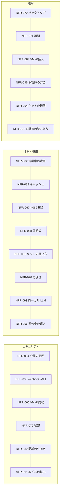

# 05. 非機能要件
- プロジェクト：Agent-Team-Open ／ 版数：v1.8（2026-10-26） ／ インプット：[01_requirements](01_requirements.md)

> **3行で**
> 1. いちばん小さいホストは「64bit・メモリ 4GB・空き 32GB」（ラズパイ 4/5 の 4GB）。キットで届ける家庭向けは、最低が 8GB・推奨が 16GB のラズパイ 5 に USB の SSD つき（NFR-062・092）。
> 2. 守りの中心は「画面と API はインターネットに公開しない（webhook の受け口だけ署名つきで公開）」「VM から本体・tailnet・ホスト自身に届かない（家や社内の機械は、持ち主が書いた内部ホスト＝家の機械だけ。D-343）」「持ち主以外は入れない」の3つ。「家の中だけで動かす」（閉域モード）では、外向きが許可リストの先だけになる（NFR-089）。
> 3. 常駐型なので「待機中はほぼ無料」（NFR-082）と「キャッシュに当たる」（NFR-083）を目標に入れる。v1.7 で、キットの初回 15 分（NFR-094）・保管庫の安全（NFR-095）・家の中の速さ（NFR-096）・家計簿の読み取り（NFR-097）を足し、NFR-092 を「キットの選び方と同居できるもの」の表に作り直した。

## 成長機構（v1.8）
〔REQ-119〜122〕以下は委任に基づく受入目標であり、実測値ではない。

| ID | 分類 | 目標・判定方法 |
|---|---|---|
| NFR-098 | 品質・効果 | 学習未使用100件以上で通常経路比の成功率低下を2ポイント以内、型付き入力確定後のLLM呼出総数を50%以上削減。通常経路0回なら削減率はN/A。未知・失敗も母数へ含める |
| NFR-099 | 資源・費用 | 学習は日0.50 USD以内か既存予算残額の小さい方、候補生成日3件、保持全版100件、同scope候補1件、run同時1・検証同時1、学習領域512MiB。既存自動予算にも算入 |
| NFR-100 | 性能・再開 | ラズパイ5 16GBで32ノード以下の純粋計算p95 200ms以内（外部API・LLM・DB待機を除く）。再起動後60秒以内に未完了runを再判定、30秒リース・10秒更新。結果不明の送信を自動再送する件数0 |
| NFR-101 | 保持・説明可能性 | 観測・検証ケース・run・holeを30日保持、active最大30日。全採用に検証根拠、全穴に理由、全runに版・回数・費用を100%記録。認証情報の観測への保存0件。UIは320px幅・キーボードで利用可能 |

学習費＋実行費の合計と、通常経路を同じ件数実行した費用を別に比較し、損益分岐件数を測る。性能・費用の未達は成功率低下で埋め合わせない。検証方法は[技術仕様](11_learning.md#検証と評価)、保持例外は[DB](08_database/learning.md#保持と削除)。

## 🧭 判断してほしいこと
| # | 種類 | 論点 | 選択肢 | おすすめ（理由） | 決まらないと止まるもの |
|---|---|---|---|---|---|
| R-77 | リスク | ラズパイで Chromium とスクショの処理が重く、1歩が遅い | — | VM は1台・画面は 1280×800・画面の番は 1 つ。NFR-067・068 を実機で測り、外れたら画面を小さくする | — |
| R-78 | リスク | Win ノートのスリープや WSL の自動停止で止まる。止まっている間はルーチンも動かない | — | 再起動から続ける（FR-084）。過ぎたルーチンは 1 回だけ動かす。手順書に WSL を止めない設定を書く | — |
| R-92 | リスク | ルーチンや webhook で日次の上限を使い切り、持ち主が話せなくなる | — | 自動のきっかけ用の日次上限 `daily_auto_usd` を別に持つ（ADR-069）。ルーチンは 15 分以上の間隔・20 本まで。webhook は 1 受け口 1 分 60 件を超えたら 429 | — |
| R-102 | リスク | 閉域で Web Push が使えず、留守の間の知らせに気づくのが遅れる（v1.6・D-342） | — | `closed` では画面の中の通知（SSE）と、任意で社内に置いた ntfy に送る。`standard` の Web Push も、中身は暗号化されるが宛先と時刻は外の Push サービスに出ることを手順書に書く | — |
| R-106 | リスク | 内部ホストの許可が広すぎて、ページの仕掛けから家や社内の機械に届く（v1.6・D-343） | — | 既定は空・CIDR は狭く書く・既定は `confirm`（人）・固定の除外（本体・box-manager・tailnet・ホスト自身・クラウドのメタデータ）は書いても断る | — |
| R-112 | リスク | ラズパイ 8GB でメモリが足りない（v1.7・D-380） | 8GB のまま使う／16GB にする | 16GB を推奨（NFR-092）。8GB では本体がメモリを見て、VM を起こしている間は 4B の生成モデルを止める（排他）。数字は見積もりで実機で測る | — |

## 全体図

見てほしいところ：数値はすべて Claude判断（おまかせ）。実機で測って直す前提。

## 要点
- 最低のホストは 64bit・4GB・空き 32GB。推奨は 8GB。キットは最低 8GB・推奨 16GB（[NFR-062](#一覧)）。選び方は [NFR-092](#nfr-092-キットの選び方と同居できるもの)
- VM は 1 台。裏のタスクは同時に 3 つ、画面の番は 1 つ（NFR-061・088）
- 入口は Tailscale（既定）・Headscale・社内 LAN の直結から選ぶ。公開するのは webhook の受け口だけで、署名と上限つき（NFR-064・085）
- 何もない日の LLM の費用は $0.05 以下。VM は 10 分で止まる（NFR-082）
- 2 回目以降の呼び出しで先頭の 9 割以上がキャッシュに当たる（NFR-083）
- 留守の間の知らせは 30 秒以内にスマホに届く（NFR-086）
- 初めて置く人は、手順書だけで 30 分以内に起動できる（NFR-081。キットを使わない置き方）
- キットは、電源を入れてから最初のお願いまで 15 分以内（非エンジニア 3 人中 2 人以上。NFR-094）
- 「家の中だけで動かす」（`closed`）で、許可リスト外への外向きは 0（NFR-089）。判定は再実行で 100% 同じ結果（NFR-090）。監査ログの書き換え・消去・差し込みは必ず見つかる（NFR-091）
- キットの選び方と同居できるものは NFR-092 の表（持ち主 1 人は変えない。チームで 1 台の案は不採用：D-383）。ローカル LLM の最低の条件は NFR-093
- 保管庫は消すのはゴミ箱へ（30 日）・上書きは前の版を残し・空にするのは人（NFR-095）。仕分けは 1 回 1 秒以内（NFR-096）。家計簿は試しの 50 枚で金額・日付 95%・費目 90%（NFR-097）

---

## 詳細

### 一覧
| ID | カテゴリ | 要件 | 目標値 | 根拠 |
|---|---|---|---|---|
| NFR-061 | 拡張性 | VM の数と画面 | VM は 1 台（ADR-060）。画面の番は 1 つ。ターミナルは同時に 2 本（最低のホストの値。大きいホストの目安は NFR-092） | VM1つで Chromium がおよそ 0.8〜1.5GB を使う |
| NFR-062 | 移植性 | 最低のホスト | 64bit Linux（arm64・amd64）、メモリ 4GB、空きディスク 32GB（D-240 の 20GB を D-300 で直した）。推奨 8GB・64GB。キット（v1.7・D-372）は最低 8GB・推奨 16GB のラズパイ 5 に USB の SSD（512GB 以上）。VM のホーム（2 ボリュームの合計）は 4GB まで（D-265 の 8GB を D-300 で直した）。控えは 3 世代。空きが 3GB を切ったら VM の起動と控えをやめ、動いている VM も止めて知らせる（D-265・D-300） | 本体＋ VM（2 コンテナ）＋OS が 4GB に入る。キットは Home Assistant と判断モデルも同居させるので 8GB から（NFR-092）。空き 32GB の内訳（圧縮が効かないときの最大）：イメージ 4GB（更新の間は新旧が並ぶ）・本体のデータ 3.5GB（SQLite・バックアップ 7 世代・スクショ 7 日・成果物）・ログ 0.5GB・下限 3GB・ホーム 4GB・控え 4 個 × 4GB（3 世代＋書きかけの 1 つ）＝ 31GB |
| NFR-063 | 性能 | VM の画面の大きさ | 1280×800・24bit | computer use の推奨の範囲。スクショの費用を抑える |
| NFR-064 | セキュリティ | 公開の範囲 | ホストのポートは開けない（直結のときだけ、社内 LAN に向けた HTTPS の 1 ポート）。画面と API の入口は、次の 3 つから選ぶ（D-341）。Tailscale（既定。HTTPS は `tailscale serve`）・Headscale（自前の調整サーバー。使い方は Tailscale と同じ）・社内 LAN の直結（社内 CA の TLS 証明書。社内 LAN の中だけで待ち受ける）。`closed` では Tailscale の SaaS の調整サーバーと Funnel を使わない。受け口があるときだけ（`standard` の Tailscale のとき）、`tailscale funnel` で 8443 番を公開し `/hooks/` を webhook の口（:8081）に流す。443 番は Funnel にしない（Funnel の公開はポート単位。ADR-065・D-241）。`closed` の webhook は、社内の GitLab・GitHub Enterprise Server から LAN の中で受ける。持ち主の確かめ：Tailscale・Headscale は `Tailscale-User-Login` と `OWNER_LOGIN` を比べる（Headscale でも `tailscale serve` が同じヘッダーを付ける）。社内 LAN の直結は本体のパスキー（WebAuthn）でログインし、HttpOnly・Secure・SameSite=Strict のセッション Cookie（12 時間）。最初のパスキーは `docker compose exec makase makase owner-enroll` が出す 1 回限りの URL で登録する（v1.6・D-358。FR-073）。キットでは同じ登録を画面の QR にしている（v1.7・D-372） | REQ-077・106。公開の攻撃面を最小にする |
| NFR-065 | セキュリティ | CSRF | GET 以外は Origin と `X-Makase-Request` を確かめる。WebSocket は Origin を確かめる | Tailscale の身元は、ほかのサイトからのリクエストにも自動で付く |
| NFR-066 | セキュリティ | VM の隔離 | VM は 2 つのコンテナの組（`box-browser`・`box-shell`。ADR-068）。どちらも capability なし・`no-new-privileges`・ルートは読み取りだけ（ホームと `/tmp` だけ書ける）・box ネットワーク（`internal: true`）だけ・DNS なし・Docker の既定の seccomp（`box-browser` は Chromium 用の seccomp プロファイル）。`box-browser`：権限なしの利用者 `browser`・メモリ 1.5GB・CPU 1.5・プロセス 512。`box-shell`：権限なしの利用者 `agent`・メモリ 1GB・CPU 1・プロセス 256。外へは egress だけで、許可リストは送り元のコンテナで分ける（`box-browser` はグローバルでないアドレスを断るだけ、`box-shell` は `terminal.allow_hosts`、知らない送り元は断る。どちらも内部ホストの許可を除く）。本体・box-manager・tailnet・ホスト自身・クラウドのメタデータ（`169.254.169.254` など）には、どんな設定でも届かない（固定の除外。書いても断る）。例外は持ち主が `network.internal_hosts`（CIDR・ホスト名。既定は空）に書いた内部ホストだけで、`box-browser` と `terminal` で別に書く。内部ホストへの作動はホストごとに `confirm`（既定。人）か `auto` を選ぶ（v1.6・D-343。R-106）。`closed`（家の中だけで動かす）では、このほかに `network.allow_hosts` にない先へ出ない（NFR-089）。X・CDP・VNC・box-agent・プロフィールのボリュームは `box-browser` の中にあり、`box-shell` から届かない。Chromium のサンドボックスが使えないホストでは `--no-sandbox` で起こし、状態欄に「ブラウザのサンドボックスなし」を出す（R-100）。2 つのコンテナは 1 つの世代として一緒に起こし、一緒に止める | VM は信用しないページを開き、残り続ける |
| NFR-067 | 性能 | VM の起き上がり | 止まった VM の起動から box-agent の応答まで p95 15秒以内（ラズパイ 5）、8秒以内（amd64 の PC） | 眠った VM を道具のたびに起こす |
| NFR-068 | 性能 | 1歩の本体側の処理（LLM を除く：確かめ・判定・実行・スクショ） | p95 300ms 以内（PC）、600ms 以内（ラズパイ 5） | 1タスクで数百歩ある |
| NFR-069 | 性能 | 画面の配信の遅れ | 人の操作が画面に出るまで 1秒以内（同じ国の中の Tailscale 経由） | 交代でログインを打てる速さ |
| NFR-070 | 運用 | バックアップ | SQLite を毎日1回、`VACUUM INTO` でデータのボリュームに。7世代。マイグレーションの前にも1回 | 家の機械1台なので戻り先が要る |
| NFR-071 | 可用性 | 再起動からの再開 | 本体の起動から 60秒以内に、終わっていないきっかけ・ターン・タスクを FR-084 の表のとおりに戻して続ける。確定した歩みは失わない（RPO 0。`synchronous=FULL`）。box-manager のホームの入れ替え・控えの終わりを待つ時間は 60 秒に含めない（その間は VM を起こさない：D-294） | REQ-092 |
| NFR-072 | セキュリティ | 秘密 | API キー（Anthropic・OpenAI。`OPENAI_API_KEY`）・Tailscale（Headscale）の認証キー・VAPID の秘密鍵は `.env`（権限 600）だけ。カレンダーの refresh token と受け口の署名の秘密は暗号化して SQLite に。v1.7：ChatGPT のトークン（アクセス・リフレッシュ。`workspace.chatgpt_auth`）も暗号化して SQLite に置き、VM には置かない（D-386）。ログには出さない。VM には資格情報を置かない | 今の決めごとを引き継ぐ |
| NFR-073 | 運用 | スクショの保持 | 画像は 7日で消す。操作の記録の行は残す | ラズパイのディスクは小さい |
| NFR-074 | ユーザビリティ | 対応端末 | iOS Safari（Web Push は「ホーム画面に追加」した PWA だけ）・Android Chrome・PC の Chrome / Edge / Firefox / Safari の最新2版。画面の幅 360px から。交代中の文字入力は PC だけ（D-181） | スマホで頼む・見る・確認する・タップするまでできる |
| NFR-075 | 移植性 | 動く土台 | Linux カーネル 5.10 以上、Docker Engine 24 以上、Compose v2。WSL2（Win）は WSL の中の Docker Engine を推奨し、Docker Desktop・OrbStack・Colima も可。Raspberry Pi OS 64bit も確かめる | REQ-076 |
| NFR-076 | コスト | 費用の上限 | 1タスク $3・メインの 1 ターン $1・日次 $10（`daily_usd`。すべての LLM の費用の合計。接続先ごとの宣言した単価で計算する：D-355）・自動のきっかけ（`routine`・`scheduled`・`webhook`）は日次 $7（`daily_auto_usd`）。どちらも設定で変えられる（D-322） | 常駐型は放っておいても動く |
| NFR-077 | 運用 | 更新 | イメージを入れ替えて `docker compose up -d`。DB のマイグレーションは起動のときに自動。VM のホームはそのまま使う | 手順を1つにする |
| NFR-078 | セキュリティ | 監査ログ | ハッシュの鎖つき（各行に `prev_hash`・`row_hash`。D-350）・追記だけ・保持は無期限。検査は NFR-091 | 今の決めごとを引き継ぐ |
| NFR-079 | 運用 | ログ | 本体・box-manager は JSON の行を標準出力に。Docker のログの上限は1つあたり 10MB × 3 | ディスクを食わない |
| NFR-080 | 性能・資源 | ターミナルの上限 | 1 コマンド 120 秒・出力 64KB（超えた分は切って知らせる）・1 タスク 200 回（`terminal.max_commands`） | VM の資源とログの大きさ |
| NFR-081 | ユーザビリティ | 初めて置く人の所要 | Docker と入口（Tailscale。Headscale・社内 LAN の直結のときはその用意）が済んだ 64bit Linux で、手順書（README）だけを見て `docker compose up -d` から画面が開くまで 30 分以内。開発者でない人 3 人中 2 人以上（D-188・D-189）。webhook の受け口は別の手順（任意）。閉域の置き方も別の手順（[運用契約](11_operations.md)）で、この目標には含めない。これは「キットを使わない置き方」（開発者向け）で、キットの初回は NFR-094（v1.7：D-372） | OSS として配る |
| NFR-082 | コスト | 待機中の費用 | きっかけがなければ LLM を呼ばない。VM は 10 分使わなければ止める。ルーチンのない 1 日の LLM の費用 $0.05 以下（要約を含む） | 常駐型は待っている間ほぼ無料でないと成り立たない（D-231） |
| NFR-083 | コスト・性能 | プロンプトキャッシュ | メインの 2 回目以降の呼び出し（前の呼び出しから 1 時間以内）で、先頭（FR-098 の①〜⑤）の 9 割以上がキャッシュに当たる率 95% 以上。外れはすべて部分ごとのハッシュつきで記録する | キャッシュの外れはバグとして扱う（ADR-066） |
| NFR-084 | 運用 | VM の控え | 毎日 1 回・3 世代。`makase-browser-profile` と `makase-vm-home` の 2 つを 1 つの tar（zstd）にまとめる。2GB のホームで控えに 5 分以内、戻すのに 5 分以内（PC）。上限の 4GB でも 30 分の打ち切り（D-294）より前に終わる。新しい控えを確かめてから古いものを消す（失敗しても戻り先が残る）。控えは控え専用のボリュームに置く（D-309）。戻し・作り直しに失敗したら、ホームを「壊れている」にして戻す・作り直すだけを受ける（D-294） | 前の仕事の残りを消せる（ADR-061） |
| NFR-085 | セキュリティ | webhook の口 | 公開するのは 8443 番の `POST /hooks/:hookId` だけ。`hookId` は 128 bit。署名（HMAC-SHA256。汎用は時刻と配達 ID も）が合わなければ 401 で何も残さない。本文 256KB。1 受け口 1 分 60 件を超えたら 429 で何も残さない。重複は配達 ID で捨てる（D-261） | ADR-065。公開の口を最小にする |
| NFR-086 | 性能 | 知らせの遅れ | `send_to_owner`・確認・交代の頼みから Web Push の送信まで 5 秒以内（送り待ちの表から。再起動しても失わない：D-267）。端末に届くまでは目安 30 秒（Push のサービスと端末の状態によるので保証しない） | 留守の間の確認に気づく |
| NFR-087 | 性能・コスト | 記憶の大きさ | プロフィール 100 個・4,000 字。`search_memory` は 1 回 500ms 以内（10 万行で） | 先頭を小さく保つ（ADR-070） |
| NFR-088 | 拡張性 | 同時に動く数 | メインのターン 1 つ・裏のタスク 3 つ（`workspace.max_tasks`、1〜5）・画面の番 1 つ・ターミナル 2 本 | VM 1 台と 4GB のホストで回る数（D-217）。大きいホストの目安は NFR-092 |
| NFR-089 | セキュリティ | 閉域の外向き | `network.mode = closed` で、`network.allow_hosts`（LLM の接続先も明示して書く）にない先への外向きが 0。本体の外向きも egress の外向きも対象。書いていない先は断り、台帳に拒否として残す（D-340・344）。台帳に書けないとき：`closed` では新しい外向きを断る。`standard` では通し、欠けた件数を台帳に記録して状態欄に出す。egress の溜まり（最大 1 万件）が満杯のときも同じ（D-359・360） | REQ-106。台帳（`egress_events`）と egress のログで確かめる |
| NFR-090 | 性能・信頼性 | 判定の再現性 | 同じ入力と規則の版で判定を再実行すると 100% 同じ結果。Kernel の判定 1 回は p95 5ms 以内（PC）。Kernel の判定は純粋な関数（時刻・乱数・LLM・ネットワークを使わない：D-349） | REQ-109。外から確かめられる判定にする |
| NFR-091 | セキュリティ | 改ざんの検出 | 監査ログの 1 行の書き換え・消去・差し込みを、検査で必ず見つける。検査は 100 万行で 60 秒以内（PC）。毎日 0 時の末尾のハッシュを控える（D-350）。ホストの root を取られた場合に守れるのは、外に控えた先頭のハッシュより後だけ（R-103） | REQ-109 |
| NFR-092 | 拡張性 | キットの選び方と同居できるもの | ホストごとに、同時に動かせるもの（本体＋VM・Home Assistant・判断モデル・4B の生成モデル）の表を載せる。計算のしかたは表の下。持ち主は 1 人（REQ-078）。チームで 1 台の人数の表は消した（ADR-075 は不採用：D-383）。数字は見積もりで、実機で測って直す（R-77・R-112）（D-372・380・383） | REQ-112・115・117。キットのホストを選ぶ目安 |
| NFR-093 | 移植性 | ローカル LLM | `openai_compatible` で `main`・`worker` を動かすときの最低の条件：道具の呼び出しができ、文脈が 32k 以上。画面の操作（`generic`）は「試し」で、成功率の目標は持たない（D-354・357）。ラズパイ 5 のローカル生成モデルは 4B 級（量子化）までを `summary` と短い文章の役割に限って選べ、`main`・`worker`・`computer` には使わない（v1.7：D-380。D-357 を置き換え）。同じ PC に置くなら、モデルのぶんのメモリを NFR-092 の表から引く | REQ-110。能力が足りないモデルを役割に選べないようにする（D-353） |
| NFR-094 | ユーザビリティ | キットの初回の所要 | 電源を入れてから最初のお願いが通るまで 15 分以内。非エンジニア 3 人中 2 人以上（第三者テスト）。手順は①電源と LAN（または Wi-Fi をスマホから設定）→②スマホに Tailscale を入れ、キットの QR で招待を受ける→③画面の QR からパスキーを登録→④ChatGPT でサインイン（短いコードをスマホで承認する。API キーは要らない：D-386・387）、または API キーを貼る→⑤最初のお願い（D-372・384・387）。ChatGPT でサインインするなら、API キーを取る段がなくなり、いちばん長い待ちが減る（REQ-112。FR-116）。NFR-081 は、キットを使わない置き方（Docker と入口を自分で用意する開発者向け）として残し、30 分以内の別の目標 | REQ-112。家の人が自分だけで始められる |
| NFR-095 | 信頼性・安全 | 保管庫の安全 | 消す＝`ゴミ箱` へ移す（30 日で自動で消える）。上書き＝前の版を `.versions` に残す（30 日）。ゴミ箱を空にする・30 日より前に消すのは必ず人。保管庫の控えは毎週、別のディスクか NAS へ（任意。[運用契約](11_operations.md)）。VM には保管庫をつながない（D-373） | REQ-113。写真・書類を壊さない（R-110） |
| NFR-096 | 性能 | 家の中の速さ | 仕分け（`classify`）1 回は p95 1 秒以内（ラズパイ 5）。4B の生成モデルの速さ・メモリは実機で測って目標を決める（D-379・380。R-109・112） | REQ-117。使い心地を落とさない |
| NFR-097 | 品質 | 家計簿の読み取り | 試しのレシート 50 枚で、金額・日付が 95% 以上、費目が 90% 以上合う。自信が低いものは確認のカードで持ち主に直してもらう（D-375） | REQ-114。家計簿の信頼 |

### NFR-092 キットの選び方と同居できるもの
前提（見積もり）：本体＋SQLite＋OS ≒ 1.5GB。起きている VM 1 台 ＝ 最大 2.5GB（用がなければ眠る）。Home Assistant ≒ 0.5〜1GB。判断モデル（約 4 億パラメーター）≒ 0.5GB。4B の生成モデル（量子化）≒ 3GB。LLM がクラウドならホストの負荷にならない。

| ホスト | 同時に動かせるもの | 向いている人 |
|---|---|---|
| ラズパイ 4/5（4GB） | 本体＋VM（HA・ローカルのモデルは無理） | 今の最低。キットには使わない |
| ラズパイ 5（8GB） | 本体＋VM＋HA＋判断モデル（計 約 5.5GB）。4B の生成モデルは VM が眠っている間だけ | キットの最低 |
| ラズパイ 5（16GB） | 全部同時（計 約 9GB） | **キットの推奨** |
| ふつうの PC（16GB 以上） | 全部同時。GPU があれば画像を読むローカルのモデルも | 開発者・写真を家の外に出したくない人 |

計算のしかた：本体 1.5＋VM 2.5＋HA 1＋判断モデル 0.5 ＝ 約 5.5GB。4B の生成モデル 3GB を足すと約 8.5〜9GB。8GB のホストでは、VM を起こしている間は本体がメモリを見て 4B の生成モデルを止める（排他：D-380）。ディスクは USB の SSD（512GB 以上）に、保管庫・本体のデータ・VM のホーム・控えを置く。数字は見積もりで、実機で測って直す（R-77・R-112）。

注意：持ち主は 1 人・VM は 1 台（REQ-078）。家族で使うのは次の版の候補（REQ-118、Won't）。チームで 1 台にする案（[ADR-075](adr/ADR-075-team-sharing-proposal.md)）は不採用になり、人数の表は消した（D-383）。

### 測り方
| NFR | 測り方 |
|---|---|
| NFR-067 | box-manager が起こし始めてから、box-agent が応答するまでを記録し、20回の p95 を見る |
| NFR-068 | 歩みの記録の `started` から `done` までのうち、LLM の待ちを除いた時間 |
| NFR-069 | 交代中に文字を打ち、VNC の画面に出るまでを目で測る（10回） |
| NFR-081 | 開発者でない人に README だけを渡し、`.env` を書き始めてから画面が開くまでをストップウォッチで測る。詰まった箇所を記録して README に戻す |
| NFR-082 | ルーチンも受け口もない状態で 24 時間置き、`usage_records` の合計を見る |
| NFR-083 | `usage_records` の `cache_read_tokens` と先頭の長さから、当たり率を 1 日ごとに出す（SCR-023 に出す） |
| NFR-086 | 試しの通知（設定画面）を 10 回送り、端末に届くまでを目で測る |
| NFR-089 | `closed` にして、許可リスト外の先へ本体と VM から 100 回ずつ出させ、台帳の拒否の件数と egress のログを突き合わせる。許可リスト外への外向きの成功は 0 |
| NFR-090 | 過去の判定の入力を全部再実行して、結果が一致する割合。Kernel の判定 1 回の時間を 1 万回測って p95 を見る |
| NFR-091 | 監査ログの 1 行の書き換え・消去・差し込みを 100 通り作り、検査（API-151）が全部見つけること。100 万行の検査の時間を測る |
| NFR-092 | 実機（ラズパイ 5 の 8GB・16GB・PC）で、本体・VM・HA・判断モデル・4B の生成モデルを同時に動かして、メモリと CPU を測り、表の数字を直す（R-112） |
| NFR-093 | Ollama・vLLM などで `main`・`worker` を動かし、道具の呼び出しが通ることと文脈 32k を確かめる |
| NFR-094 | 非エンジニア 3 人に、キットを渡して説明なしで始めてもらい、電源を入れてから最初のお願いが通るまでをストップウォッチで測る。詰まった箇所は手順書に戻す |
| NFR-095 | 保管庫でファイルを消す・上書きして、ゴミ箱と `.versions` に 30 日残ること、ゴミ箱を空にするのが人の確認なしでは通らないことを確かめる |
| NFR-096 | ラズパイ 5 で `classify` を 1,000 回呼び、p95 を見る。4B の生成モデルは短い文章の役割の速さとメモリを測る |
| NFR-097 | 試しのレシート 50 枚（印字・手書きの混じり）を送り、金額・日付・費目の正解率を数える |

## このドキュメントで決まったこと
- D-140、D-141、D-144〜D-146、D-148、D-178、D-181、D-188、D-189、D-209、D-213、D-214、D-216、D-217、D-223、D-224、D-230、D-231、D-240、v1.2：D-290〜D-294、D-300、D-304、D-309、v1.4：D-315・D-319・D-320・D-321・D-322・D-324・D-325・D-326、v1.6：D-340〜D-346（閉域・容量）・D-347〜D-351（判定の確かめ）・D-352〜D-357（モデルの選択）・D-358〜D-370（持ち主の確かめ・台帳の経路と失敗・モデルの既定と文脈）（[00 決定事項ログ](00_overview.md#決定事項ログ)）
- v1.7：D-371〜D-384（家の人に広げる・キット D-371・372、保管庫 D-373、家計簿 D-375、判断モデルとローカル生成モデル D-379・380、キットの選び方 D-383、API キー D-384）
