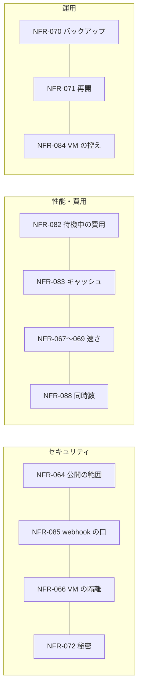

# 05. 非機能要件
- プロジェクト：Agent-Team-Open ／ 版数：v1.4（2026-10-24） ／ インプット：[01_requirements](01_requirements.md)

> **3行で**
> 1. いちばん小さいホストは「64bit・メモリ 4GB・空き 32GB」（ラズパイ 4/5 の 4GB。SD・SSD は 64GB 以上）。このホストで VM 1 台（2 コンテナ）と裏のタスク 3 つが回ることを基準にする。
> 2. 守りの中心は「画面と API はインターネットに公開しない（webhook の受け口だけ署名つきで公開）」「VM から家の LAN と本体に届かない」「持ち主以外は入れない」の3つ。
> 3. 常駐型なので「待機中はほぼ無料」（NFR-082）と「キャッシュに当たる」（NFR-083）を目標に入れる。家の機械なので稼働率の目標は置かず、再起動から続けられることと毎日のバックアップ・VM の控えを決める。

## 🧭 判断してほしいこと
| # | 種類 | 論点 | 選択肢 | おすすめ（理由） | 決まらないと止まるもの |
|---|---|---|---|---|---|
| R-77 | リスク | ラズパイで Chromium とスクショの処理が重く、1歩が遅い | — | VM は1台・画面は 1280×800・画面の番は 1 つ。NFR-067・068 を実機で測り、外れたら画面を小さくする | — |
| R-78 | リスク | Win ノートのスリープや WSL の自動停止で止まる。止まっている間はルーチンも動かない | — | 再起動から続ける（FR-084）。過ぎたルーチンは 1 回だけ動かす。手順書に WSL を止めない設定を書く | — |
| R-92 | リスク | ルーチンや webhook で日次の上限を使い切り、持ち主が話せなくなる | — | 自動のきっかけ用の日次上限 `daily_auto_usd` を別に持つ（ADR-069）。ルーチンは 15 分以上の間隔・20 本まで。webhook は 1 受け口 1 分 60 件を超えたら 429 | — |

## 全体図

見てほしいところ：数値はすべて Claude判断（おまかせ）。実機で測って直す前提。

## 要点
- 最低のホストは 64bit・4GB・空き 32GB。推奨は 8GB（[NFR-062](#一覧)）
- VM は 1 台。裏のタスクは同時に 3 つ、画面の番は 1 つ（NFR-061・088）
- 入口は Tailscale だけ。公開するのは webhook の受け口だけで、署名と上限つき（NFR-064・085）
- 何もない日の LLM の費用は $0.05 以下。VM は 10 分で止まる（NFR-082）
- 2 回目以降の呼び出しで先頭の 9 割以上がキャッシュに当たる（NFR-083）
- 留守の間の知らせは 30 秒以内にスマホに届く（NFR-086）
- 初めて置く人は、手順書だけで 30 分以内に起動できる（NFR-081）

---

## 詳細

### 一覧
| ID | カテゴリ | 要件 | 目標値 | 根拠 |
|---|---|---|---|---|
| NFR-061 | 拡張性 | VM の数と画面 | VM は 1 台（ADR-060）。画面の番は 1 つ。ターミナルは同時に 2 本 | VM1つで Chromium がおよそ 0.8〜1.5GB を使う |
| NFR-062 | 移植性 | 最低のホスト | 64bit Linux（arm64・amd64）、メモリ 4GB、空きディスク 32GB（D-240 の 20GB を D-300 で直した）。推奨 8GB・64GB。VM のホーム（2 ボリュームの合計）は 4GB まで（D-265 の 8GB を D-300 で直した）。控えは 3 世代。空きが 3GB を切ったら VM の起動と控えをやめ、動いている VM も止めて知らせる（D-265・D-300） | 本体＋ VM（2 コンテナ）＋OS が 4GB に入る。空き 32GB の内訳（圧縮が効かないときの最大）：イメージ 4GB（更新の間は新旧が並ぶ）・本体のデータ 3.5GB（SQLite・バックアップ 7 世代・スクショ 7 日・成果物）・ログ 0.5GB・下限 3GB・ホーム 4GB・控え 4 個 × 4GB（3 世代＋書きかけの 1 つ）＝ 31GB |
| NFR-063 | 性能 | VM の画面の大きさ | 1280×800・24bit | computer use の推奨の範囲。スクショの費用を抑える |
| NFR-064 | セキュリティ | 公開の範囲 | ホストのポートは開けない。画面と API の入口は Tailscale の HTTPS（`tailscale serve`）だけ。受け口があるときだけ、`tailscale funnel` で 8443 番を公開し `/hooks/` を webhook の口（:8081）に流す。443 番は Funnel にしない（Funnel の公開はポート単位。ADR-065・D-241） | REQ-077。公開の攻撃面を最小にする |
| NFR-065 | セキュリティ | CSRF | GET 以外は Origin と `X-Makase-Request` を確かめる。WebSocket は Origin を確かめる | Tailscale の身元は、ほかのサイトからのリクエストにも自動で付く |
| NFR-066 | セキュリティ | VM の隔離 | VM は 2 つのコンテナの組（`box-browser`・`box-shell`。ADR-068）。どちらも capability なし・`no-new-privileges`・ルートは読み取りだけ（ホームと `/tmp` だけ書ける）・box ネットワーク（`internal: true`）だけ・DNS なし・Docker の既定の seccomp（`box-browser` は Chromium 用の seccomp プロファイル）。`box-browser`：権限なしの利用者 `browser`・メモリ 1.5GB・CPU 1.5・プロセス 512。`box-shell`：権限なしの利用者 `agent`・メモリ 1GB・CPU 1・プロセス 256。外へは egress だけで、許可リストは送り元のコンテナで分ける（`box-browser` はグローバルでないアドレスを断るだけ、`box-shell` は `terminal.allow_hosts`、知らない送り元は断る）。家の LAN・tailnet・本体には届かない。X・CDP・VNC・box-agent・プロフィールのボリュームは `box-browser` の中にあり、`box-shell` から届かない。Chromium のサンドボックスが使えないホストでは `--no-sandbox` で起こし、状態欄に「ブラウザのサンドボックスなし」を出す（R-100）。2 つのコンテナは 1 つの世代として一緒に起こし、一緒に止める | VM は信用しないページを開き、残り続ける |
| NFR-067 | 性能 | VM の起き上がり | 止まった VM の起動から box-agent の応答まで p95 15秒以内（ラズパイ 5）、8秒以内（amd64 の PC） | 眠った VM を道具のたびに起こす |
| NFR-068 | 性能 | 1歩の本体側の処理（LLM を除く：確かめ・判定・実行・スクショ） | p95 300ms 以内（PC）、600ms 以内（ラズパイ 5） | 1タスクで数百歩ある |
| NFR-069 | 性能 | 画面の配信の遅れ | 人の操作が画面に出るまで 1秒以内（同じ国の中の Tailscale 経由） | 交代でログインを打てる速さ |
| NFR-070 | 運用 | バックアップ | SQLite を毎日1回、`VACUUM INTO` でデータのボリュームに。7世代。マイグレーションの前にも1回 | 家の機械1台なので戻り先が要る |
| NFR-071 | 可用性 | 再起動からの再開 | 本体の起動から 60秒以内に、終わっていないきっかけ・ターン・タスクを FR-084 の表のとおりに戻して続ける。確定した歩みは失わない（RPO 0。`synchronous=FULL`）。box-manager のホームの入れ替え・控えの終わりを待つ時間は 60 秒に含めない（その間は VM を起こさない：D-294） | REQ-092 |
| NFR-072 | セキュリティ | 秘密 | API キー・Tailscale の認証キー・VAPID の秘密鍵は `.env`（権限 600）だけ。カレンダーの refresh token と受け口の署名の秘密は暗号化して SQLite に。ログには出さない。VM には資格情報を置かない | 今の決めごとを引き継ぐ |
| NFR-073 | 運用 | スクショの保持 | 画像は 7日で消す。操作の記録の行は残す | ラズパイのディスクは小さい |
| NFR-074 | ユーザビリティ | 対応端末 | iOS Safari（Web Push は「ホーム画面に追加」した PWA だけ）・Android Chrome・PC の Chrome / Edge / Firefox / Safari の最新2版。画面の幅 360px から。交代中の文字入力は PC だけ（D-181） | スマホで頼む・見る・確認する・タップするまでできる |
| NFR-075 | 移植性 | 動く土台 | Linux カーネル 5.10 以上、Docker Engine 24 以上、Compose v2。WSL2（Win）は WSL の中の Docker Engine を推奨し、Docker Desktop・OrbStack・Colima も可。Raspberry Pi OS 64bit も確かめる | REQ-076 |
| NFR-076 | コスト | 費用の上限 | 1タスク $3・メインの 1 ターン $1・日次 $10（`daily_usd`。すべての LLM の費用の合計）・自動のきっかけ（`routine`・`scheduled`・`webhook`）は日次 $7（`daily_auto_usd`）。どちらも設定で変えられる（D-322） | 常駐型は放っておいても動く |
| NFR-077 | 運用 | 更新 | イメージを入れ替えて `docker compose up -d`。DB のマイグレーションは起動のときに自動。VM のホームはそのまま使う | 手順を1つにする |
| NFR-078 | セキュリティ | 監査ログ | ハッシュの鎖つき・追記だけ・保持は無期限 | 今の決めごとを引き継ぐ |
| NFR-079 | 運用 | ログ | 本体・box-manager は JSON の行を標準出力に。Docker のログの上限は1つあたり 10MB × 3 | ディスクを食わない |
| NFR-080 | 性能・資源 | ターミナルの上限 | 1 コマンド 120 秒・出力 64KB（超えた分は切って知らせる）・1 タスク 200 回（`terminal.max_commands`） | VM の資源とログの大きさ |
| NFR-081 | ユーザビリティ | 初めて置く人の所要 | Docker と Tailscale が入った 64bit Linux で、手順書（README）だけを見て `docker compose up -d` から画面が開くまで 30 分以内。開発者でない人 3 人中 2 人以上（D-188・D-189）。webhook の受け口は別の手順（任意） | OSS として配る |
| NFR-082 | コスト | 待機中の費用 | きっかけがなければ LLM を呼ばない。VM は 10 分使わなければ止める。ルーチンのない 1 日の LLM の費用 $0.05 以下（要約を含む） | 常駐型は待っている間ほぼ無料でないと成り立たない（D-231） |
| NFR-083 | コスト・性能 | プロンプトキャッシュ | メインの 2 回目以降の呼び出し（前の呼び出しから 1 時間以内）で、先頭（FR-098 の①〜⑤）の 9 割以上がキャッシュに当たる率 95% 以上。外れはすべて部分ごとのハッシュつきで記録する | キャッシュの外れはバグとして扱う（ADR-066） |
| NFR-084 | 運用 | VM の控え | 毎日 1 回・3 世代。`makase-browser-profile` と `makase-vm-home` の 2 つを 1 つの tar（zstd）にまとめる。2GB のホームで控えに 5 分以内、戻すのに 5 分以内（PC）。上限の 4GB でも 30 分の打ち切り（D-294）より前に終わる。新しい控えを確かめてから古いものを消す（失敗しても戻り先が残る）。控えは控え専用のボリュームに置く（D-309）。戻し・作り直しに失敗したら、ホームを「壊れている」にして戻す・作り直すだけを受ける（D-294） | 前の仕事の残りを消せる（ADR-061） |
| NFR-085 | セキュリティ | webhook の口 | 公開するのは 8443 番の `POST /hooks/:hookId` だけ。`hookId` は 128 bit。署名（HMAC-SHA256。汎用は時刻と配達 ID も）が合わなければ 401 で何も残さない。本文 256KB。1 受け口 1 分 60 件を超えたら 429 で何も残さない。重複は配達 ID で捨てる（D-261） | ADR-065。公開の口を最小にする |
| NFR-086 | 性能 | 知らせの遅れ | `send_to_owner`・確認・交代の頼みから Web Push の送信まで 5 秒以内（送り待ちの表から。再起動しても失わない：D-267）。端末に届くまでは目安 30 秒（Push のサービスと端末の状態によるので保証しない） | 留守の間の確認に気づく |
| NFR-087 | 性能・コスト | 記憶の大きさ | プロフィール 100 個・4,000 字。`search_memory` は 1 回 500ms 以内（10 万行で） | 先頭を小さく保つ（ADR-070） |
| NFR-088 | 拡張性 | 同時に動く数 | メインのターン 1 つ・裏のタスク 3 つ（`workspace.max_tasks`、1〜5）・画面の番 1 つ・ターミナル 2 本 | VM 1 台と 4GB のホストで回る数（D-217） |

### 測り方
| NFR | 測り方 |
|---|---|
| NFR-067 | box-manager が起こし始めてから、box-agent が応答するまでを記録し、20回の p95 を見る |
| NFR-068 | 歩みの記録の `started` から `done` までのうち、LLM の待ちを除いた時間 |
| NFR-069 | 交代中に文字を打ち、VNC の画面に出るまでを目で測る（10回） |
| NFR-081 | 開発者でない人に README だけを渡し、`.env` を書き始めてから画面が開くまでをストップウォッチで測る。詰まった箇所を記録して README に戻す |
| NFR-082 | ルーチンも受け口もない状態で 24 時間置き、`usage_records` の合計を見る |
| NFR-083 | `usage_records` の `cache_read_tokens` と先頭の長さから、当たり率を 1 日ごとに出す（SCR-023 に出す） |
| NFR-086 | 試しの通知（設定画面）を 10 回送り、端末に届くまでを目で測る |

## このドキュメントで決まったこと
- D-140、D-141、D-144〜D-146、D-148、D-178、D-181、D-188、D-189、D-209、D-213、D-214、D-216、D-217、D-223、D-224、D-230、D-231、D-240、v1.2：D-290〜D-294、D-300、D-304、D-309、v1.4：D-315・D-319・D-320・D-321・D-322・D-324・D-325・D-326（[00 決定事項ログ](00_overview.md#決定事項ログ)）
