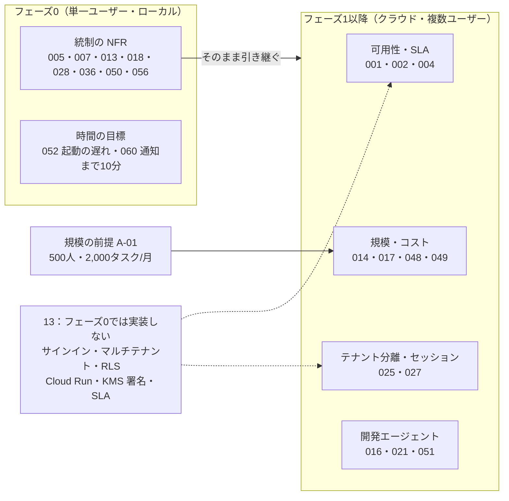

# 05. 非機能要件
- プロジェクト：open-team（仮称） ／ 版数：v0.6（2026-10-01、12〜15 を統合して書き直し） ／ インプット：[01 要件定義](01_requirements.md)、[04 機能仕様](04_functional_spec/README.md)、[07 アーキテクチャ](07_architecture.md)

> **3行で**
> 1. NFR-001〜059 を数値で定める。統制の要件（障害時・停止後の外部作用 0件、判定の再現性 100%、サンドボックスに認証情報 0件など）はフェーズ0から効く。
> 2. 規模の前提 A-01（ユーザー500人・タスク2,000件/月）と、マルチテナント・RLS・SLA・クラウドの要件はフェーズ1以降。フェーズ0（単一ユーザー・ローカル）では実装しない（設計は残す）。
> 3. フェーズ0に固有の時間の目標は NFR-052（起動の遅れ p95 ≤ 2分）と NFR-060（通知まで10分以内）（[D-07](decisions.md#d-07)）。各 NFR の実現手段は [11](11_tech_spec.md)、指標は [07](07_architecture.md#ログ監視エラー通知)。

## 🧭 判断してほしいこと
| # | 種類 | 論点 | 選択肢 | おすすめ（理由） | 決まらないと止まるもの |
|---|---|---|---|---|---|
| Q-40 | ✅決定 | フェーズ0の NFR が未設計。① 下表で「?」の NFR がフェーズ0で効くか ② フェーズ0に固有の NFR（ローカルでの起動時間、スケジュールの遅れ）の数値（13 §既存ドキュメントへの影響は項目だけ）。13 にある数値は US-036 AC1「スケジュールの時刻から10分以内に要約がプッシュ通知で届く」だけ → **NFR-052（p95 ≤ 2分）をフェーズ0にも適用し、通しの NFR-060（通知まで10分以内）を追加。「?」の NFR は統制・安全系 0〜、運用・規模系 1〜 で割り当て**（[D-07](decisions.md#d-07)）| ① NFR ごとに 0〜 / 1〜 ② A: US-036 AC1 の10分を NFR にする / B: NFR-052（p95 ≤ 2分）をフェーズ0にも適用 / C: 別に定める | —（元の記述なし） | フェーズ0の完成条件の確認、「?」の NFR |
| Q-41 | ✅決定 | 複数ユーザー（SaaS）・規模前提 A-01 はどのフェーズからか。13 のフェーズ計画表は「複数ユーザー（SaaS 化）」をフェーズ2に置くが、ADR-025 と 13 §既存ドキュメントへの影響は「マルチテナント（の NFR）はフェーズ1以降」とする（13「フェーズ計画（v0.4 で改訂）」と「ADR-025」） → **フェーズ1から**（[D-02](decisions.md#d-02)）| A: フェーズ1から（本書はこの扱いで書いた） / B: フェーズ2から（「1〜(a)(c)」の NFR を 2〜 に読み替える） | —（元の記述なし） | NFR-001〜004, 014, 017, 025, 027, 048, A-01 |
| Q-42 | ✅決定 | NFR-055 の前提（API-046 の下書きの検証、SCR-016 の YAML 入力）は v0.5 で API-046 が廃止・SCR-016 が詳細設定へ移動。NFR-055 を廃止するか、詳細設定の検証に読み替えるか（NFR-054・059 は [11 Q-94](11_tech_spec.md)） → **詳細設定の検証（保存前の検証 API）に読み替え**（[D-17](decisions.md#d-17)）| A: 廃止 / B: 詳細設定の検証に読み替え | —（元の記述なし） | NFR-055, A-48 |
| Q-43 | ✅決定 | フェーズ0の鍵の置き場所：13 はフェーズ0の LLM の API キーを `.env` に置くとするが、NFR-022・023 と ADR-010 は KMS のエンベロープ暗号化と「復号は LLM Proxy だけ」を求める。13 の省略リストは「KMS によるチェックポイントの署名」だけ（13「フェーズ0：個人の開発環境での構成」） → **.env に置き、NFR-022・023 はフェーズ1から。キーは LLM Proxy と Gateway だけが読む**（[D-04](decisions.md#d-04)）| A: NFR-022・023 はフェーズ1〜とする / B: フェーズ0でも別の方法で満たす | —（元の記述なし） | NFR-022, NFR-023, ADR-010 |
| Q-44 | 未決 | NFR-056 のプロパティベーステストで保証する範囲。元はフェーズ2の組織共通の上限（`compose(ceilings, orgPolicy, repoPolicy, agentDef)`）も含めるかが未決だったが、v0.4 で組織共通の上限はワークスペースのポリシー（`compose(ceilings, workspacePolicy, repoPolicy?, agentDef)`、ADR-021）に置き換わった | A: ワークスペースのポリシーを含む新しい合成にも同じ性質を保証する / B: 現行の文言（リポジトリのポリシーと Hard Ceiling）のまま | —（元の記述なし） | NFR-056, BR-20, BR-43 |
| Q-45 | 未決 | 将来の運用条件：有料化した後の SLA（稼働率の保証と返金の条件）と、企業向けに監査ログの保持期間を延ばす場合の上限（例：7年）。課金はどのフェーズでも当面扱わない（13） | — | —（元の記述なし） | NFR-001, NFR-035 |
| Q-46 | 未決 | プライベートレジストリへの対応方法（認証情報をサンドボックスに渡さずに実現する方法） | — | —（元の記述なし） | NFR-019, A-21 |
| Q-47 | 未決 | NFR-057 のマスクで検出できない秘密情報（独自形式のトークンなど）への対応。ワークスペース（旧称：組織）ごとにパターンを追加できるようにするか | A: 追加できる / B: 共通パターンのみ | —（元の記述なし） | NFR-057, NFR-032 |
| R-15 | リスク | スケジュール起動が広く使われ、タスク数が A-01 の規模を超える | — | ベータで計測し、NFR-014・048 を見直す（元の未決事項の記述） | NFR-014, NFR-048 |

- 関連：NFR-054・059（設計アシスタント）の扱いは [11 Q-94](11_tech_spec.md)。サンドボックス基盤の検証は [07 Q-49](07_architecture.md#-判断してほしいこと)、Cloud SQL の HA は [07 R-16](07_architecture.md#-判断してほしいこと)。

## 全体図

見てほしいところ：統制の要件はフェーズに関係なく効き、運用・規模の要件だけがフェーズ1以降に回る。

## 要点
- **フェーズの見方**：各表の「フェーズ」列で、`0〜` はフェーズ0から、`1〜` はフェーズ1以降、`—` は前提が廃止・置換された（Q-42・11 Q-94）。根拠の記号は [凡例](#フェーズ列の凡例)。
- **規模の前提**：A-01 はベータ（SaaS）の規模で、フェーズ0（単一ユーザー）には当てはまらない。複数ユーザーはフェーズ1から（[D-02](decisions.md#d-02)、[規模の前提とフェーズ](#規模の前提とフェーズ)）。
- **安全側に倒す**：Kernel・DB に障害があるときと Kill Switch の後は、外部作用 0件（NFR-005・013）。
- **サンドボックス**：認証情報 0件、通信先は許可リストだけ（NFR-018・019）。
- **再現性**：判定と実効ポリシーの合成は、保存した入力から100%同じ結果になる（NFR-036・056）。
- **費用**：インフラは $500/月以下（フェーズ1〜）、予算の超過は「1ステップの最大見積額」以内（NFR-048・050）。

---

## 詳細

## 規模の前提とフェーズ

| 項目 | フェーズ0 | フェーズ1以降 |
|---|---|---|
| 規模 | プロダクトオーナー1人（単一ユーザー・ローカル。ADR-025） | A-01：ユーザー500人、ワークスペース（旧称：組織）100、タスク2,000件/月（ピーク時の同時実行50タスク、A-20） |
| 「他人のデータを預かる」ための要件 | 実装しない（設計は残す）：サインイン・マルチテナント・RLS・SLA。構成からも Cloud Run・KMS によるチェックポイントの署名を省く（13） | 実装する |
| 統制（Kernel・監査ログ・Intent） | フェーズ1と同じものを使う（単一ユーザーでも省略しない。13） | 同左 |
| PC が止まっているとき | スケジュールは実行されない。取りこぼしは後から実行せず「未実行」と残す（A-75） | NFR-001 の稼働率 |

- マルチテナント系の NFR はフェーズ1から（[D-02](decisions.md#d-02)）。
- A-47：A-01 のタスク数には、トリガー（ラベル・メンション・スケジュール）による起動と試し実行を含める。

### フェーズ列の凡例
| 記号 | 意味 |
|---|---|
| (a) | 13 がフェーズ0で省略すると明記したもの（サインイン・マルチテナント・RLS・Cloud Run・KMS 署名・SLA）に当たる |
| (b) | 開発テンプレート（GitHub 連携・PR）はフェーズ1（[D-03](decisions.md#d-03)） |
| (c) | 規模の前提 A-01 に基づく（フェーズ1から。[D-02](decisions.md#d-02)） |
| (d) | 統制はフェーズ0でも省略しない（13「フェーズ0」「変わること・変わらないこと」） |

## 可用性

| ID | 要件 | 目標値 | 根拠 | フェーズ |
|---|---|---|---|---|
| NFR-001 | Control Plane（Web・API・Gateway・Proxy）の月間稼働率 | ≥ 99.5%（月間の停止は3.6時間以内） | ベータ期の SaaS。承認と Kill Switch が使えない時間を限定する（REQ-005, REQ-009） | 1〜(a) |
| NFR-002 | Kill Switch とキャンセルの API の稼働率 | ≥ 99.9% | 最後の安全装置（REQ-009）。他の API とは別に監視する | 1〜(a) |
| NFR-003 | 目標復旧時間（RTO）／ 目標復旧時点（RPO） | RTO ≤ 4時間 ／ RPO ≤ 5分 | マネージド DB のポイントインタイムリカバリを使う | 1〜 |
| NFR-004 | 計画メンテナンス | 月1回まで、1回30分以内、7日前に告知 | ベータ期の運用負荷とのバランス | 1〜(a) |
| NFR-005 | 障害時の安全側への倒れ方（フェイルクローズ） | Kernel・DB に障害があるとき、外部作用の実行は **0件** | 判定できない場合は許可しない（REQ-004, REQ-006） | 0〜(d) |

## 性能・拡張性

性能・拡張性の NFR（20件：006〜017、051〜055）

| ID | 要件 | 目標値 | 根拠 | フェーズ |
|---|---|---|---|---|
| NFR-006 | 画面から呼ぶ API の応答時間（GitHub を呼ばないもの） | p95 < 300ms、p99 < 1s | スマホでの承認操作の快適さ（REQ-005） | 1〜 |
| NFR-007 | 判定エンジンの処理時間（1回あたり） | p99 < 5ms（I/O を除く） | LLM 呼び出しごとに実行するため、オーバーヘッドを無視できる大きさにする | 0〜(d) |
| NFR-008 | LLM Proxy のオーバーヘッド（プロバイダーの応答時間を除く） | p95 < 100ms | 1タスクで最大200回呼ぶ | 1〜 |
| NFR-009 | タスクの開始時間（`queued` → `running`。実行枠に空きがある場合） | p95 < 60秒 | 「委任したらすぐ動き出す」体験（REQ-002） | 0〜 |
| NFR-010 | 承認待ちになってから通知が届くまで | p95 < 10秒 | 承認のタイミングを逃さない（REQ-011） | 0〜 |
| NFR-011 | 進捗イベントが画面に表示されるまで | p95 < 3秒 | リアルタイム性（REQ-013） | 0〜 |
| NFR-012 | Kill Switch：押下から、全サンドボックスの停止を確認するまで | p95 < 10秒 | REQ-009 | 0〜(d) |
| NFR-013 | Kill Switch：押下のコミット以降に開始された外部作用 | **0件** | 判定と実行の両方で、同じトランザクションの中で状態を確認する（FR-012） | 0〜(d) |
| NFR-014 | システム全体の同時実行サンドボックス数 | 50（ベータ）→ 設定変更だけで500まで | A-01 のピーク。ワークスペース（旧称：組織）の上限は3（BR-08） | 1〜(a)(c) |
| NFR-015 | サンドボックス1台のリソース | 2 vCPU、4 GiB メモリ、10 GiB ディスク | 一般的な Web リポジトリのビルドとテストができる大きさ | 1〜（フェーズ0はローカルの Docker の既定） |
| NFR-016 | 扱えるリポジトリの大きさ | tarball で 500MB まで | FR-007 | 1〜(b) |
| NFR-017 | データの伸び | 監査ログ：約30万件/月、usage_records：約16万件/月。agents は1ワークスペース20体まで（v0.5、A-81。旧：1リポジトリ20件。既定エージェント `default` を除く。BR-31）、仕事（jobs）は1エージェント10個まで（A-81）、agent_memories は1エージェント200件まで、agent_snapshots は `.agent/` への push 1回につきエージェント数分 | タスク2,000件（トリガーによる起動・試し実行を含む）× 平均80ステップ ＋ 判定。上限は A-34、A-38、A-81 | 1〜(c) |
| NFR-051 | エージェント定義の反映時間：デフォルトブランチへの push から `active` になるまで（v0.3 以降は GitOps モードのとき。ADR-011） | p95 ≤ 2分 | REQ-021、US-027。push Webhook → 読み込みジョブ → 検証・合成（FR-022、UC-020）。同じリポジトリのジョブは直列 | 1〜(b) |
| NFR-052 | スケジュール起動の遅れ：予定時刻から、タスクが作成されるまで | p95 ≤ 2分 | REQ-023、US-028。worker の定期処理が1分ごとなので、待ちは最大1分 ＋ 権限の確認（FR-028） | 0〜（[D-07](decisions.md#d-07)） |
| NFR-053 | エージェント単位の停止：押下から、当該エージェントの全タスクの停止を確認するまで | p95 ≤ 10秒 | REQ-026、US-032。Kill Switch と同じ停止処理を、そのエージェントのタスクに限って行う（FR-032、NFR-012） | 0〜(d) |
| NFR-060 | 定期の仕事の通しの時間（フェーズ0）：予定時刻から、結果のプッシュ通知が届くまで | 10分以内 | US-036 AC1、フェーズ0の完成条件。NFR-052（起動の遅れ）を含む | 0〜（[D-07](decisions.md#d-07)） |
| NFR-054 | 設計アシスタントの応答 | 送信から最初の表示（SSE）まで p95 ≤ 5秒、変更案の反映まで p95 ≤ 30秒 | REQ-020、US-024。反映までの時間にはスキーマ検証と実効ポリシーの合成（BR-30）を含む。設計アシスタントは v0.5 で設定プランナーに置換 | —（11 Q-94） |
| NFR-055 | 下書きの検証（API-046）の応答時間 | p95 ≤ 500ms | SCR-016 では YAML の入力が1秒止まるたびに検証する。スキーマ検証と compose() を含むため、NFR-006 より緩い目標にする。API-046 は v0.5 で廃止 | —（Q-42） |

## セキュリティ

セキュリティの NFR（15件：018〜030、056、057）

| ID | 要件 | 目標値 | 根拠 | フェーズ |
|---|---|---|---|---|
| NFR-018 | サンドボックスの中にある外部サービスの認証情報 | **0件**（GitHub トークン・LLM のキー・クラウドの認証情報・MCP の認証情報のいずれもない） | 乗っ取られても被害が出ない構造（REQ-003）。MCP の認証情報は Gateway だけが持つ（13） | 0〜(d) |
| NFR-019 | サンドボックスの通信先 | Internal API、LLM Proxy、許可したパッケージレジストリ（npm、PyPI、crates.io、Go proxy、Maven Central、RubyGems）だけ。その他はネットワーク層で遮断する。Web の読み取りは Web 取得プロキシ経由の `web_read` だけ（v0.4、ADR-023） | BR-12 | 0〜(d) |
| NFR-020 | サンドボックスの隔離 | ユーザー空間カーネル（gVisor）または microVM で動かし、タスクごとに破棄する。ホストのメタデータサーバーへの通信は遮断する | 任意のコードを実行する前提（FR-008）。フェーズ0は開発以外のタスクをコンテナ内のプロセスで動かす（13） | 1〜（フェーズ0はローカルの Docker コンテナ） |
| NFR-021 | GitHub App の秘密鍵にアクセスできるサービスアカウント | Action Gateway の1つだけ | 外部作用の単一チョークポイント | 1〜(b) |
| NFR-022 | BYOK のキーを復号できるサービスアカウント | LLM Proxy の1つだけ（検証用の API は登録時に平文を扱うだけで保存しない） | BR-03 | 1〜（[D-04](decisions.md#d-04)） |
| NFR-023 | 保存データの暗号化 | DB・オブジェクトストレージはすべて AES-256。API キー・GitHub のユーザートークンはアプリケーション層でも暗号化（エンベロープ暗号化） | 秘密情報の二重の保護 | 1〜（[D-04](decisions.md#d-04)） |
| NFR-024 | 通信の暗号化 | TLS 1.2 以上。HSTS（max-age 1年）を有効にする | — | 1〜（フェーズ0はトンネルの暗号化で代える） |
| NFR-025 | セッション | HttpOnly・Secure・SameSite=Lax の Cookie。30日のローリング期限。ログアウトで即時失効 | FR-001。フェーズ0の画面の保護方式は 11 Q-95 | 1〜(a) |
| NFR-026 | CSRF・XSS 対策 | 状態を変える API には CSRF トークンを必須にする。CSP は `default-src 'self'` を基本にする。差分・Issue の本文は必ずエスケープして表示する | 差分や Issue には第三者が書いた内容が含まれる | 0〜(d) |
| NFR-027 | テナント分離 | すべてのクエリで `organization_id`（ワークスペースへの改名は 08、A-78）を条件にする。PostgreSQL の行レベルセキュリティ（RLS）で二重に守る | マルチテナント SaaS | 1〜(a) |
| NFR-028 | 監査ログの改ざん検知 | ハッシュチェーンと、日次の署名つきチェックポイント（保持ロックつきで1年間保存） | REQ-010 | 0〜(d)。署名つきチェックポイントは 1〜(a) |
| NFR-029 | 脆弱性対策 | 依存パッケージの脆弱性スキャンを毎日。Critical は72時間以内、High は14日以内に修正。サンドボックスのイメージは毎週作り直す | — | 1〜 |
| NFR-030 | レート制限 | 画面から呼ぶ API はユーザーごとに600回/分、Webhook は1,000回/分、LLM Proxy はタスクごとに60回/分 | 乱用防止 | 1〜 |
| NFR-056 | 実効ポリシーの単調性 | compose() は、どの入力に対しても、リポジトリのポリシー（と Hard Ceiling）より緩い結果を返さない。プロパティベーステストで検証する | BR-20、BR-21、ADR-012。原則「エージェントは権限の境界であり、権限は増やさない」（REQ-019）。範囲は Q-44 | 0〜(d) |
| NFR-057 | メモリ・レポート・会話・Skill の下書きの秘密情報 | すべてに、秘密情報のパターン（`ghs_`、`sk-`、`AKIA`、秘密鍵のヘッダーなど）を平文で保存しない（書き込み時にマスクする） | BR-32、FR-024、FR-030、FR-031、FR-033、ADR-014。次のタスクのコンテキストや画面に繰り返し出るため。パターンは NFR-032 と共通 | 0〜(d) |

- NFR-018 の「MCP の認証情報」は、13 の「MCP の認証情報は Gateway だけが持つ・サンドボックスと LLM には渡さない」を取り込んだもの。NFR-019 の後半も同様（ADR-023）。

## 運用・保守

運用・保守の NFR（6件：031〜036）

| ID | 要件 | 目標値 | 根拠 | フェーズ |
|---|---|---|---|---|
| NFR-031 | 監視 | NFR-001、002、006、009、010、012、051〜054 の指標をダッシュボードで常に見られるようにする。目標を下回ったら5分以内にアラート | 指標は [07](07_architecture.md#ログ監視エラー通知) | 1〜 |
| NFR-032 | 構造化ログ | JSON 形式のログに `requestId`、`orgId`、`taskId` を必ず含める。秘密情報（トークン・キー・Cookie）は自動でマスクする | — | 0〜（秘密情報を出さない部分） |
| NFR-033 | バックアップ | DB は毎日のバックアップ（7日分）とポイントインタイムリカバリ（7日分） | NFR-003 | 1〜 |
| NFR-034 | デプロイ | GitHub Actions からコンテナを自動でデプロイし、ロールバックは5分以内。DB のマイグレーションは後方互換に保つ（expand/contract） | — | 1〜(a) |
| NFR-035 | データの保持期間 | 監査ログ：1年（ベータ）、タスク・Intent・差分・進捗イベント：90日、プロンプトと応答の全文：30日、設計アシスタントとの会話の全文：30日、更新のない下書き：90日で `discarded`、メモリ：削除されるまで、リポジトリの tarball：タスク終了から24時間 | 最小限の保持。v0.5 のエージェントのチャット（会話）は A-80「90日、古いものは要約を残す」（14 の仮定） | 1〜 |
| NFR-036 | 判定の再現性 | 保存した判定の入力（ポリシースナップショット・subject・counters・flags）から判定エンジンを実行し直すと、100%同じ結果になる。実効ポリシーも、エージェントスナップショットに保存した入力（ポリシースナップショット・エージェント定義）と、記録した版（`agent_snapshots.ceilings_version`）の Hard Ceiling から compose() を実行し直すと、`effective_policy_hash` が100%一致する。Hard Ceiling を変更しても過去の版を参照できるように残す | 原則「決定論的なランタイム」（REQ-004）。判定には常に合成結果を渡す（FR-023、ADR-012）。counters にはエージェントの日次費用（`agent_day_usd`）を含む（FR-004） | 0〜(d) |

## 移行性

| ID | 要件 | 目標値 | 根拠 | フェーズ |
|---|---|---|---|---|
| NFR-037 | 既存資産の取り込み | itiwoman-automation の FlowEngine・RunCoordinator と、open-agent の Router・PermissionMap・Harness の単体テストを、移植後もすべて通す。既定エージェント（`default`、リポジトリのポリシーだけで動く）での判定結果は、エージェントビルダーを入れる前と同じになる | A-02。既存のタスクはマイグレーションで既定エージェントに紐づける（12「tasks への変更」） | 0〜 |
| NFR-038 | 既存のユーザーデータ | 移行するデータはない（open-agent の localStorage の内容は移行しない） | 新規 SaaS のため | 0〜 |

## ユーザビリティ・アクセシビリティ

ユーザビリティ・アクセシビリティの NFR（7件：039〜044、058）

| ID | 要件 | 目標値 | 根拠 | フェーズ |
|---|---|---|---|---|
| NFR-039 | 対応ブラウザ | iOS Safari 16.4 以上（PWA）、Android Chrome 最新2版、PC の Chrome・Edge・Firefox・Safari の最新2版 | Web Push の対応状況 | 0〜 |
| NFR-040 | 画面の幅 | 360px から 1920px まで、横スクロールなしで使える | スマホ優先 | 0〜 |
| NFR-041 | 承認までの操作 | 通知をタップしてから承認の確定まで、3タップ以内 | REQ-005 | 0〜 |
| NFR-042 | 準拠する基準（アクセシビリティ） | WCAG 2.2 AA。タップできる領域は 44×44px 以上 | — | 1〜 |
| NFR-043 | 表示言語 | 日本語と英語（ブラウザの設定で切り替え） | 開発者全般が対象 | 1〜（フェーズ0は日本語のみ） |
| NFR-044 | 初期表示 | スマホ（4G 回線相当）で LCP < 2.5秒。JavaScript の初回読み込みは gzip で 200KB 以下 | — | 1〜 |
| NFR-058 | Canvas のスマホ対応 | Harness Canvas（SCR-016）は、スマホの幅（360px）で横スクロールなしに全ノードを確認・編集できる | SCR-016（スマホではノードを縦に並べたカードにし、タップで編集シートを開く）、NFR-040。SCR-016 は v0.5 で詳細設定へ移動 | —（Canvas は詳細設定。T-4） |

## 法令・コンプライアンス

| ID | 要件 | 目標値 | 根拠 | フェーズ |
|---|---|---|---|---|
| NFR-045 | 個人情報 | 保存する個人情報は、GitHub のユーザー ID・ログイン名・表示名・アバター URL・メールアドレス（公開されている場合）だけ。退会の申請から30日以内に削除する（監査ログの中では、ユーザー ID を仮名化する） | 個人情報保護法、GDPR | 1〜(a) |
| NFR-046 | 利用規約 | GitHub App の規約、各 LLM プロバイダーの規約（BYOK での第三者による利用）を順守する。利用者のコードをモデルの学習に使わない | — | 0〜 |
| NFR-047 | データの所在 | データは日本または米国のリージョンに保存する（ベータは1リージョン） | A-19 | 1〜(a) |

## コスト

| ID | 要件 | 目標値 | 根拠 | フェーズ |
|---|---|---|---|---|
| NFR-048 | インフラの月額（LLM の費用を除く） | ベータの規模で $500/月 以下 | 無料ベータの運営コストの上限 | 1〜(a)(c) |
| NFR-049 | 1タスクあたりのサンドボックスの費用 | 平均 $0.10 以下 | 45分 × 2 vCPU を上限にしたときの見積もり | 1〜(a) |
| NFR-050 | 予算の見積もりの誤差 | 実際の費用が予算の上限を超えた額は「1ステップの最大見積額」以内 | 事前判定（BR-10）が最大見積額を使うため、原則は超えない | 0〜(d) |
| NFR-059 | 試し実行と設計アシスタントの費用 | 試し実行は1回 $1（BR-24）、設計アシスタントは下書き1件あたり $0.5（BR-30）の上限を超えない | A-35、A-36。どちらも日次予算に含める。守り方は NFR-050 と同じ（事前判定で最大見積額を使う） | —（設計アシスタントの部分は 11 Q-94） |

## 前提・仮定
- A-19：ベータ期は Google Cloud の東京リージョン（asia-northeast1）の1リージョンで運用する。
- A-20：ピーク時の同時実行数は50タスクとする。
- A-21：許可するパッケージレジストリは NFR-019 の6つとする（プライベートレジストリには対応しない。Q-46）。
- A-47：A-01 のタスク数（2,000件/月）には、トリガー（ラベル・メンション・スケジュール）による起動と試し実行を含める。
- A-35、A-36：設計アシスタントは下書き1件あたり $0.5、試し実行は1回 $1 までとする（NFR-059）。
- A-37：スケジュールの最短間隔は1時間、`max_runs_per_day` は最大50とする（NFR-052 の負荷の前提）。
- A-48：NFR-055 の検証は、GitHub と LLM を呼ばず、DB にあるデフォルトブランチのポリシースナップショットを使う。
- 13〜15 で加わった容量・時間の前提（NFR ではなく仮定として扱う。一覧は [00](00_overview.md)）：A-75（取りこぼしたスケジュールは実行しない）、A-76（プロフィールは50項目・各500文字）、A-77（`web_fetch` は本文 200KB・1タスク30回）、A-79（最初の境界の予算）、A-80（会話の保存90日）、A-81（エージェント20体・仕事10個）、A-85（1タスクの Intent 既定5件・上限20件）、A-86（`tools/call` のタイムアウト60秒・応答は64KBまで）。

## このドキュメントで決まったこと
- NFR-001〜059 の目標値（上の各表）。フェーズの割り当ては [ADR-025](adr/ADR-025-phase0-single-user-local.md) と 13 の「フェーズ0では実装しない」に基づく。
- NFR-017 の上限を v0.5 の A-81（1ワークスペース20体・1エージェント10仕事）に更新。NFR-018・019 に MCP の認証情報と Web 取得プロキシ（[ADR-022](adr/ADR-022-mcp-unified-unclassified-is-write.md)・[ADR-023](adr/ADR-023-builtin-web-read-proxy.md)）を反映。
- 関連する設計判断：[ADR-001](adr/ADR-001-pure-decision-engine.md)（NFR-036）、[ADR-010](adr/ADR-010-byok-envelope-encryption.md)（NFR-022）、[ADR-012](adr/ADR-012-stricter-wins-composition.md)（NFR-056）、[ADR-014](adr/ADR-014-server-side-memory.md)（NFR-057）。
